# System Design Master Handbook

Backend Engineering, Distributed Systems, DevOps, Security, Production Operations, and AI/ML Serving

Study edition | 18 October 2026 | Original topic identifiers 1-111

## Contents

Part I supplies prerequisites and engineering foundations. Parts II-XII teach all 111 original topics. Part XIII connects them to AI/ML serving. Part XIV applies them in eight complete designs. Part XV contains practical assessment, official references, and the full implementation appendix.

**Part II. Backend Architecture and API Reliability**

[1. Rate Limiting](#topic-001), [3. Load Balancing](#topic-003), [4. Reverse Proxies](#topic-004), [5. API Gateways](#topic-005), [10. Circuit Breakers](#topic-010), [11. Timeouts](#topic-011), [12. Retries](#topic-012), [13. Exponential Backoff](#topic-013), [14. Idempotency](#topic-014).

**Part III. Databases and Data Management**

[25. Database Indexing](#topic-025), [26. Query Optimization](#topic-026), [27. N+1 Queries](#topic-027), [28. Connection Pooling](#topic-028), [29. Read Replicas](#topic-029), [30. Sharding](#topic-030), [31. Partitioning](#topic-031), [32. Replication](#topic-032), [36. Optimistic Locking](#topic-036), [37. Pessimistic Locking](#topic-037), [81. Database Migrations](#topic-081), [82. Schema Versioning](#topic-082).

**Part IV. Distributed Systems and Messaging**

[15. Message Queues](#topic-015), [16. Pub/Sub](#topic-016), [17. Event-Driven Architecture](#topic-017), [18. Distributed Transactions](#topic-018), [19. Saga Pattern](#topic-019), [20. Dead Letter Queues](#topic-020), [21. Cron Jobs](#topic-021), [33. Leader Election](#topic-033), [34. CAP Theorem](#topic-034), [35. Eventual Consistency](#topic-035), [38. Distributed Locks](#topic-038), [95. Network Partitions](#topic-095), [96. Clock Skew](#topic-096).

**Part V. Concurrency, Runtime, and Performance**

[39. Race Conditions](#topic-039), [40. Deadlocks](#topic-040), [41. Memory Leaks](#topic-041), [42. Garbage Collection](#topic-042), [43. Thread Safety](#topic-043), [44. Backpressure](#topic-044), [89. Cold Starts](#topic-089), [90. Serverless Limits](#topic-090), [91. Latency](#topic-091), [92. Throughput](#topic-092), [93. P99 Latency](#topic-093), [94. Tail Latency](#topic-094).

**Part VI. Scaling, Caching, and Delivery**

[2. Caching](#topic-002), [45. Autoscaling](#topic-045), [46. Horizontal Scaling](#topic-046), [47. Vertical Scaling](#topic-047), [48. CDN](#topic-048), [49. Edge Caching](#topic-049), [50. Cache Invalidation](#topic-050).

**Part VII. Containers, Kubernetes, and Delivery Engineering**

[6. CI/CD](#topic-006), [7. Docker](#topic-007), [8. Kubernetes](#topic-008), [9. Service Discovery](#topic-009), [51. Feature Flags](#topic-051), [52. Blue-Green Deployment](#topic-052), [53. Canary Releases](#topic-053), [54. Rolling Deployments](#topic-054), [55. Rollbacks](#topic-055), [56. Health Checks](#topic-056), [57. Liveness and Readiness Probes](#topic-057), [106. Helm Charts](#topic-106), [107. Build Caching](#topic-107), [108. Dependency Hell](#topic-108).

**Part VIII. Observability and Site Reliability Engineering**

[58. Monitoring](#topic-058), [59. Logging](#topic-059), [60. Distributed Tracing](#topic-060), [61. Metrics](#topic-061), [62. Alerts](#topic-062), [63. SLOs](#topic-063), [64. SLIs](#topic-064), [65. Error Budgets](#topic-065), [66. Observability](#topic-066).

**Part IX. Application Security and Identity**

[67. Secrets Management](#topic-067), [68. IAM](#topic-068), [69. OAuth](#topic-069), [70. JWT Rotation](#topic-070), [71. TLS](#topic-071), [72. Encryption at Rest](#topic-072), [73. Encryption in Transit](#topic-073), [74. WAF](#topic-074), [75. DDoS Protection](#topic-075), [76. CORS](#topic-076), [77. CSRF](#topic-077), [78. SQL Injection](#topic-078), [79. XSS](#topic-079), [80. SSRF](#topic-080).

**Part X. Networking, Communication, and API Evolution**

[22. WebSockets](#topic-022), [23. Long Polling](#topic-023), [24. Server-Sent Events](#topic-024), [97. DNS](#topic-097), [98. TCP vs UDP](#topic-098), [99. HTTP/2 and HTTP/3](#topic-099), [100. gRPC](#topic-100), [101. Webhooks](#topic-101), [102. API Versioning](#topic-102), [103. Semantic Versioning](#topic-103).

**Part XI. Infrastructure, Cloud, and Disaster Recovery**

[83. Disaster Recovery](#topic-083), [84. Backups](#topic-084), [85. Failover](#topic-085), [86. Multi-Region Deployment](#topic-086), [87. Chaos Engineering](#topic-087), [88. Cost Optimization](#topic-088), [104. Infrastructure as Code](#topic-104), [105. Terraform](#topic-105).

**Part XII. Production Operations and Incident Management**

[109. Production Incidents](#topic-109), [110. On-Call](#topic-110), [111. Postmortems](#topic-111).

## Part I. Foundations of Production Systems

### How to use this book

This handbook assumes basic programming: variables, functions, collections, exceptions, and simple complexity analysis. You do not need prior cloud or distributed-systems experience. Learn enough SQL to write SELECT, INSERT, UPDATE, and JOIN statements; enough HTTP to distinguish a request, response, method, status, header, and body; and enough operating-system vocabulary to distinguish a process, thread, file, socket, and memory allocation. When a term is unfamiliar, use the glossary rather than skipping the surrounding argument.

The original 111 topic numbers are permanent identifiers. Learning parts group them by dependency rather than numerical order. Each topic contains fourteen teaching sections, a worked example, a visual, interview practice, and exercises with solution guidance. The interview answers intentionally revisit the mechanism from different angles: first explain it without reading the answer, then compare your reasoning. The standalone interview bank repeats those questions for revision; those repetitions are not additional unique questions.

Use a three-pass method. On the first pass, read the explanation, problem, analogy, and diagram. On the second, reproduce the worked example and run the applicable lab. On the third, close the book and answer the scenario and advanced questions. Keep an engineering notebook with four entries for every design decision: requirement, assumption, chosen mechanism, and evidence that would make you change your mind.

All capacity numbers in this book are hypothetical unless explicitly described as output from an included deterministic program. They illustrate arithmetic, not measured performance claims for a product or provider. The source notes identify official documentation consulted on 18 October 2026. Provider limits, security recommendations, tool flags, and supported versions should be checked again before a real deployment. The examples are educational; the audit states which were executed and which configurations still need their actual runtimes.

### 1. Begin with a user promise

System design starts with behavior, not a shopping list of components. A functional requirement says what users can do: browse products, maintain a cart, place an order, pay, and receive a receipt. A non-functional requirement qualifies that behavior: response time, availability, privacy, durability, freshness, cost, and operational constraints. An order accepted successfully must not silently vanish. A catalog description may be allowed to lag briefly. Those two promises justify different data paths.

Ask concrete scope questions in an interview even when no production stakeholder is present. Is payment authorization or payment settlement required? Must a chat message be durable before it appears delivered? Is a prediction response a small vector or a streamed generated answer? How many tenants exist, and can one tenant dominate traffic? What failures must the system tolerate? What is explicitly excluded? Write answers as assumptions when the interviewer leaves them open.

An invariant is a condition that must remain true across all valid state transitions. For ShopStream, stock cannot become negative, a logical checkout cannot create two charges, and one tenant cannot read another tenant's private order. An objective is a measured target such as 99% of accepted interactive predictions completing within a chosen time. Invariants and objectives differ: trading a little latency for lower cost may be acceptable, while trading away authorization correctness is not.

### 2. A request from browser to database and back

A customer enters the shop address. The browser obtains an address through DNS, potentially using cached results. It establishes a transport connection, negotiates TLS and verifies the service identity, then sends an HTTP request. A CDN may answer a permitted cached request. Otherwise an edge proxy or load balancer forwards it to an eligible application instance. The application authenticates the caller, authorizes the specific operation, validates input, and acquires bounded resources.

For a product read, the application may check an internal cache. On a miss it acquires a database connection, executes a query under the relevant isolation semantics, releases the connection, updates the cache if permitted, and returns a response. The proxy and browser apply their own response handling and caching rules. Each hop can queue, time out, reject, disconnect, or produce an ambiguous outcome. A request that never reached the application cannot appear in its application log, so outside-in evidence matters.

HTTP status codes communicate protocol-level outcomes, not a complete business history. A 202 can mean durable acceptance for later processing. A timeout can mean the client stopped waiting after the server committed. A 200 containing an incorrect price is still a correctness failure. Define stable operation identifiers and explicit states such as pending, confirmed, declined, and reconciliation-required where asynchronous work or ambiguity exists.

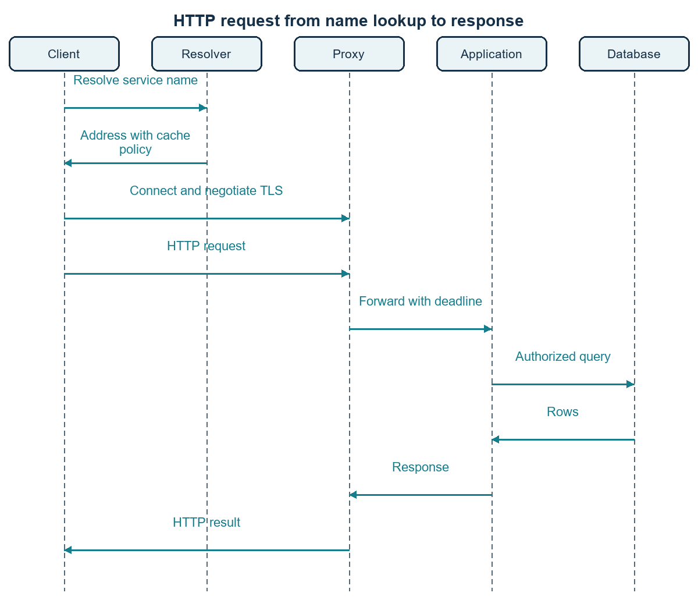

*Figure 137. HTTP request from name lookup to response.* Read top to bottom. Each arrow names a request or reply. Connection setup may be reused; a lost response does not prove a write failed. Source: [editable Mermaid](diagrams/seq-http.mmd).


Read this sequence top to bottom. The client talks to a resolver before the service connection. The proxy forwards a request to the application; the application alone owns the database operation shown. A response lost on the return path is a different failure from a request rejected before database access. Connection setup is shown separately because a reused connection amortizes that work.

### 3. Capacity estimation with units

Assume one million daily active users, each making twenty API requests per day. Daily volume is 20 million requests. Dividing by 86,400 seconds gives about 231.5 requests/second on average. Assume a peak-to-average factor of eight: the planning peak is about 1,852 requests/second. This is a stated hypothesis to validate, not a universal traffic rule. A product launch can create a much sharper burst than ordinary daily seasonality.

If mean time in the system at that load is 0.2 seconds, Little's Law gives average concurrent work L=lambda*W=1,852*0.2, about 370 requests. This relationship concerns stable long-run averages and consistent boundaries. It does not mean 370 operating-system threads are necessarily needed: asynchronous I/O, internal fanout, and resource-specific hold time change how concurrency maps to implementation resources.

Assume each response averages 12 KB, ignoring request bytes, compression, and protocol overhead. At peak, response bandwidth is approximately 1,852*12 KB=22.2 MB/second, or 178 Mb/second using decimal units. Add realistic overhead and failure headroom rather than provisioning exactly that figure. Large downloads can dominate bandwidth even when their request count is small.

Assume 100,000 orders/day and 2 KB of logical order data. One year is about 73 GB of logical data. Three complete copies make 219 GB before indexes, logs, backups, deleted-row overhead, and growth. If the measured index/storage overhead factor is two, the online footprint becomes roughly 438 GB under that assumed factor. State whether an estimate is logical, physical, replicated, or retained-backup size; mixing them is a common design error.

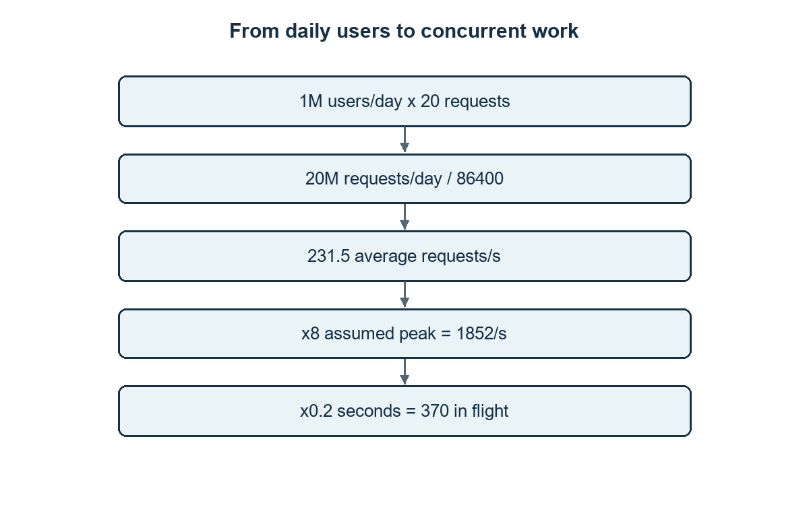

*Figure 184. From daily users to concurrent work.* Every step preserves its units and states its assumption. Peak factor and mean response time must later be measured. Source: [editable SVG](diagrams/ill-capacity.svg).


The illustration preserves units through the calculation. Move from users/day to requests/day, divide by seconds/day, multiply by a stated peak factor, then derive concurrency and bytes/second separately. Do not multiply concurrency by throughput again; they are already related through time in the system.

### 4. Bottlenecks, utilization, and headroom

A system is a chain and network of resource constraints. CPU execution, database locks, pool slots, disk IOPS, memory bandwidth, network throughput, and external quotas can each become the bottleneck. Low CPU with high latency often means waiting, not spare usable capacity. Measure queue wait and resource hold time to determine which constraint is active.

Suppose a worker takes 10 ms of CPU per request on a single fully available core. The ideal CPU-only ceiling is 100 requests/second. If each request also holds a database connection for 200 ms, a pool of ten connections has an ideal occupancy ceiling of 50 requests/second. The smaller relevant capacity dominates. Real scheduling, I/O, contention, and variance reduce these idealized ceilings.

At 1,000 jobs/second arriving and 1,100 completing, a backlog of 60,000 jobs drains at only 100 jobs/second, taking 600 seconds. Dividing by 1,100 would incorrectly ignore continuing arrivals. During recovery, capacity must handle live traffic plus catch-up. If queues contain expired work, process policy may discard or reconcile it instead of spending resources on results users no longer need.

The ideal M/M/1 queue assumes Poisson arrivals, exponential service times, one server, and a stable arrival rate below service rate. Its mean time in system is 1/(mu-lambda). At mu=100/second and lambda=50/second, the model gives 20 ms; at lambda=90 it gives 100 ms. Real workloads rarely fit every assumption, but the shape explains why latency deteriorates near saturation. Benchmark realistic distributions and keep failure headroom.

### 5. Availability, durability, and correlated failures

Availability describes whether required operations can be completed. Durability describes preservation of accepted data. A system can be available while returning stale results, or durable while temporarily unavailable. Reliability combines multiple aspects of correct useful behavior over time. Choose measurable definitions rather than treating these terms as interchangeable praise.

For independent serial dependencies with availability A1 and A2, a simplified model multiplies them. Two required 99.9% dependencies yield 0.999 squared, about 99.8001%. The independence and identical measurement-window assumptions matter. Shared power, networking, credentials, code, or operators can correlate failures and invalidate the estimate. Redundant replicas improve availability only if the surviving path has independent dependencies and enough capacity.

A 99.9% time-based objective over thirty days permits approximately 43.2 minutes of bad time. A request-based 99.9% objective instead permits 0.1% of eligible requests to be bad. A five-minute peak-hour outage and a five-minute overnight outage consume equal time budgets but can consume very different request budgets. Use the definition that represents the promised experience and report its limitations.

Backups answer how far back data can be restored; failover answers how service responsibility changes. RPO measures tolerated loss of recent data. RTO measures targeted recovery time. A secondary region with stale data and missing credentials may satisfy neither objective. Recovery must be demonstrated with a drill and integrity checks.

### 6. Data modeling before database selection

ShopStream's initial relational model includes users, products, carts, cart_items, orders, order_items, payments, inventory, and outbox events. Store money as an integer minor-unit amount plus explicit currency under a defined currency contract. Snapshot the purchased product name and price in the order line so historical invoices do not change when the catalog changes. Use foreign keys and constraints where they represent local invariants.

An order and payment are related but not identical entities. One order may have several payment attempts and one logical successful payment intent. An external provider operation needs its own stable ID and state. An order status must not be inferred solely from whether the latest HTTP call returned 200. Preserve pending and unknown states and reconcile them.

Choose storage based on access patterns and guarantees. A relational database is a strong default for transactional orders and constraints. An object store suits large immutable model artifacts and media. A search index is a derived view for text retrieval. A cache stores disposable copies. A broker transports or retains messages under its own contract. Adding each specialized system introduces synchronization, access control, backup, and incident responsibilities.

### 7. ACID and isolation in concrete terms

Atomicity means a transaction's local changes commit together or are rolled back. Consistency in ACID refers to preserving defined database/application rules, not automatically synchronizing every replica. Isolation controls which concurrent effects a transaction may observe. Durability means committed changes survive the failures covered by the database's configured storage and replication guarantees.

Consider two account rows. A transfer must debit one and credit the other together, while checking sufficient funds. A transaction prevents half a local transfer, but the chosen isolation and locking still matter under concurrent withdrawals. A CHECK constraint can enforce a nonnegative balance on a row. Cross-row invariants may require a stronger transaction design.

In PostgreSQL's usual Read Committed mode, each statement sees a committed snapshot at statement start, with important rules for concurrent updates. Repeatable Read gives a stable transaction snapshot but can permit serialization anomalies. Serializable aims for outcomes equivalent to a serial execution and can abort transactions that must be retried. PostgreSQL treats requested Read Uncommitted as Read Committed. These are PostgreSQL-specific details; isolation names do not imply identical implementation behavior across databases. See the official [transaction isolation documentation](https://www.postgresql.org/docs/current/transaction-iso.html) for those specific semantics.

Write skew illustrates why atomic row updates are not enough. Two doctors are on call. Each transaction observes that the other is on call, then independently sets its own row off call. Both writes can succeed under snapshot isolation even though the final state violates the rule that at least one doctor remains. Serialize the relevant decision, lock a shared guard under a correct design, or use a suitable constraint/model. Do not merely add separate version columns and assume the cross-row invariant is protected.

Read an EXPLAIN tree from child operations toward their parents. Estimated cost is not wall-clock milliseconds. Actual rows, loops, buffers, spills, and waits help explain work. EXPLAIN ANALYZE executes the statement, so use an isolated dataset for mutating queries. The official [EXPLAIN guide](https://www.postgresql.org/docs/current/using-explain.html) verifies these plan-reading distinctions; the included SQL lab supplies original data and queries for practice.

### 8. Synchronous and asynchronous boundaries

A synchronous call ties the caller's completion to a response from a dependency. It is easy to understand for a small read, but serial dependencies add latency and shared failure exposure. An asynchronous boundary lets the caller acknowledge durable acceptance and return while a worker completes the task later. It requires status retrieval, delivery semantics, retention, and user expectations about delay.

At-most-once delivery can lose messages because it avoids retries. At-least-once delivery can repeat messages because acknowledgment loss cannot always be distinguished from unfinished work. Exactly-once claims require a precise boundary. A broker transaction can atomically commit records and offsets within a supported system; it does not automatically atomically send email, update an unrelated database, and charge a card.

The outbox pattern closes one important gap: business state and an event-to-publish are committed in the same database transaction. A relay may publish more than once. The inbox pattern can make a consumer's deduplication record and local database effect atomic. External effects still need provider idempotency or reconciliation. The handbook's SQLite lab demonstrates this local boundary without pretending to implement a distributed broker.

### 9. Evolving ShopStream deliberately

Begin with a modular monolith and PostgreSQL. Modules separate catalog, accounts, carts, orders, and payments in code; they need not be independent services. One deployment and one transactional boundary reduce operating complexity while the product is small. Record the evidence that would justify a later change: repeated expensive reads, queue delay, an independently scaling workload, different ownership, or isolation needs.

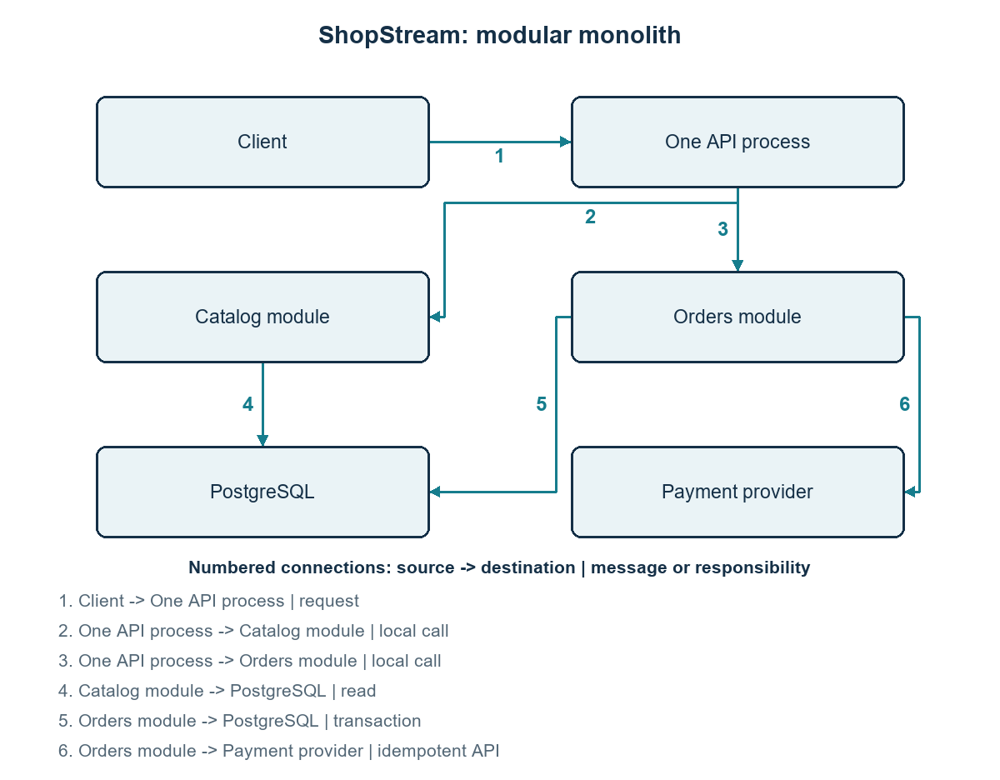

*Figure 113. ShopStream: modular monolith.* Modules share deployment and a local database transaction boundary. Payment is still a remote, independently failing dependency. Source: [editable Mermaid](diagrams/arch-monolith.mmd).


The client enters one application boundary. Modules share a database but have explicit responsibilities. The payment provider is already a distributed dependency even though the application is a monolith. A timeout at that boundary requires an operation ID and reconciliation from the first release.

| Stage | Motivation and change | New cost or failure mode | Evidence and test |
|---|---|---|---|
| 1. Indexes | Slow customer-order lookup; add query-shaped index | Write amplification and index storage | Compare plans and realistic write load |
| 2. Pooling | Connection setup and session growth | Pool wait and leaked ownership | Exception-release and saturation tests |
| 3. Cache | Repeated catalog reads | Stale copies and miss storms | Freshness race and origin-load test |
| 4. Rate limits | One caller consumes capacity | False rejection and limiter dependency | Tenant isolation and outage policy test |
| 5. Proxy/LB | Multiple API replicas and TLS boundary | Routing, drain, and proxy failure | Kill one replica under bounded load |
| 6. Queue | Receipts delay checkout | Duplicate delivery and aging backlog | Crash before acknowledgment |
| 7. Idempotency | Replayed checkout creates duplicates | Key retention and payload conflicts | Concurrent same-key requests |
| 8. Transactions | Stock and order must agree locally | Locks and isolation anomalies | Last-item and rollback tests |
| 9. Events | Several consumers need order facts | Schema drift and lost publication | Outbox replay and consumer-version matrix |
| 10. Saga | Separate business owners/datastores | Partial states and failed compensation | Unknown payment and compensation retry |
| 11. Scale out | Independent request capacity exhausted | Shared database and session limits | Aggregate capacity and failover test |
| 12. Containers | Reproducible packaging | Image, signal, and resource-limit issues | Non-root startup and termination test |
| 13. Orchestration | Managing replicas becomes burdensome | Control-plane and networking complexity | Readiness and node-loss drill |
| 14. CI/CD | Manual release errors | Build trust and promotion mistakes | Promote same digest and stop failed gates |
| 15. Telemetry | Cross-component diagnosis is slow | Data cost and sampling gaps | Correlated trace/log/metric exercise |
| 16. Security | Broader exposure and tenants | Policy drift and secret lifecycle | Cross-tenant negative tests and rotation |
| 17. Regions | Regional recovery/locality requirement | Conflicts and cross-region dependency | Fenced failover and residency review |
| 18. Recovery | Deletion/corruption survival | Backup/key/replay dependencies | Timed isolated restore with invariants |
| 19. Cost | Resource spend grows | Savings can remove headroom | Cost per useful result under SLO |
| 20. Operations | Incidents require coordinated response | Toil, fatigue, and unsafe changes | Tabletop, handoff, postmortem actions |

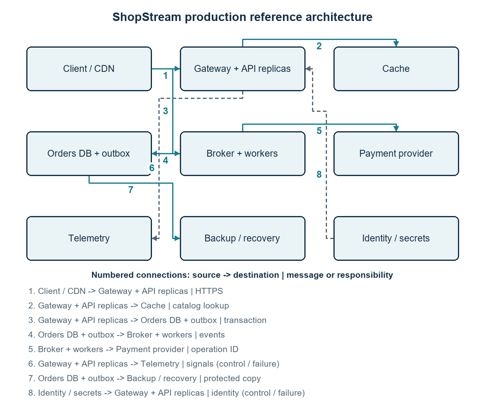

*Figure 136. ShopStream production reference architecture.* Requests, durable state, asynchronous work, telemetry, and recovery are separate paths. Shared dependencies remain explicit. Source: [editable Mermaid](diagrams/arch-production.mmd).


This mature reference design adds components only where the preceding table gives a reason. It is a design vocabulary, not a requirement to deploy everything. Synchronous user paths, asynchronous events, and control/telemetry paths use different edge labels. Payments remain behind a deliberate idempotent integration boundary, and restoration remains necessary even with replicas.

### 10. Reading diagrams and testing claims

Every visual has a stable figure ID and local image. Editable Mermaid sources accompany graph diagrams, and SVG sources accompany technical illustrations. Labels and shapes carry meaning in grayscale: diamonds are decisions, labeled dashed edges represent failure or control paths, and arrows indicate the direction of the stated message or operation. Architecture arrows are not automatically trust grants. Sequence diagrams run downward in time, while state diagrams show allowed transitions rather than physical placement.

A useful test states the claim, introduces a discriminating input or fault, and checks an observable invariant. 'The service started' is weak evidence for idempotency. Two simultaneous same-key checkouts producing one durable order is stronger evidence for the local implementation. It still does not prove a real payment provider has matching semantics. Keep the boundary of each test visible.

When measuring performance, distinguish synthetic arithmetic, local microbenchmarks, load tests, and production observations. The included numbers are reproducible models and educational outputs. Build an open-loop load generator only against systems you own or are authorized to test, set a stop threshold, record errors and timeouts, and preserve the workload distribution. Optimization should follow evidence and end with remeasurement.


## Part II. Backend Architecture and API Reliability

<a id="topic-001"></a>

### 1. Rate Limiting

Prerequisites and related reading: [11. Timeouts](#topic-011), [44. Backpressure](#topic-044), [45. Autoscaling](#topic-045), [68. IAM](#topic-068).

#### 1. Simple explanation

Rate limiting decides how much work one caller may submit during a period.

#### 2. The problem it solves

ShopStream's product API must remain usable when one integration sends thousands of requests. Without admission control, a cheap request for the caller can consume expensive database or inference capacity for everybody.

#### 3. Intuitive analogy

A museum admits visitors using replenishing tickets. Spare tickets allow a short burst; new arrivals wait or leave when tickets run out. Unlike a museum, one API operation may cost ten times another, so tickets can represent weighted work.

#### 4. Technical working mechanism

1. Identify an authenticated tenant and operation, not an easily spoofed header.

2. A token bucket holds at most B tokens and refills at r tokens/second using elapsed monotonic time.

3. Atomically compute tokens=min(B,tokens+r*elapsed), then subtract request cost only if enough remain.

4. Return HTTP 429 with a useful retry hint on rejection.

5. Across replicas, coordinate shared counters or divide a global allowance; independent full buckets multiply the allowance.


**Boundary and advanced reasoning.** A global strict quota introduces coordination latency and a dependency. Regional token leases improve availability but permit overshoot bounded by outstanding leases. Explain that bound before claiming global accuracy. Monitor limiter latency, tenant rejection rate, and backend saturation to distinguish abusive demand from an undersized service.

#### 5. Architecture and diagrams

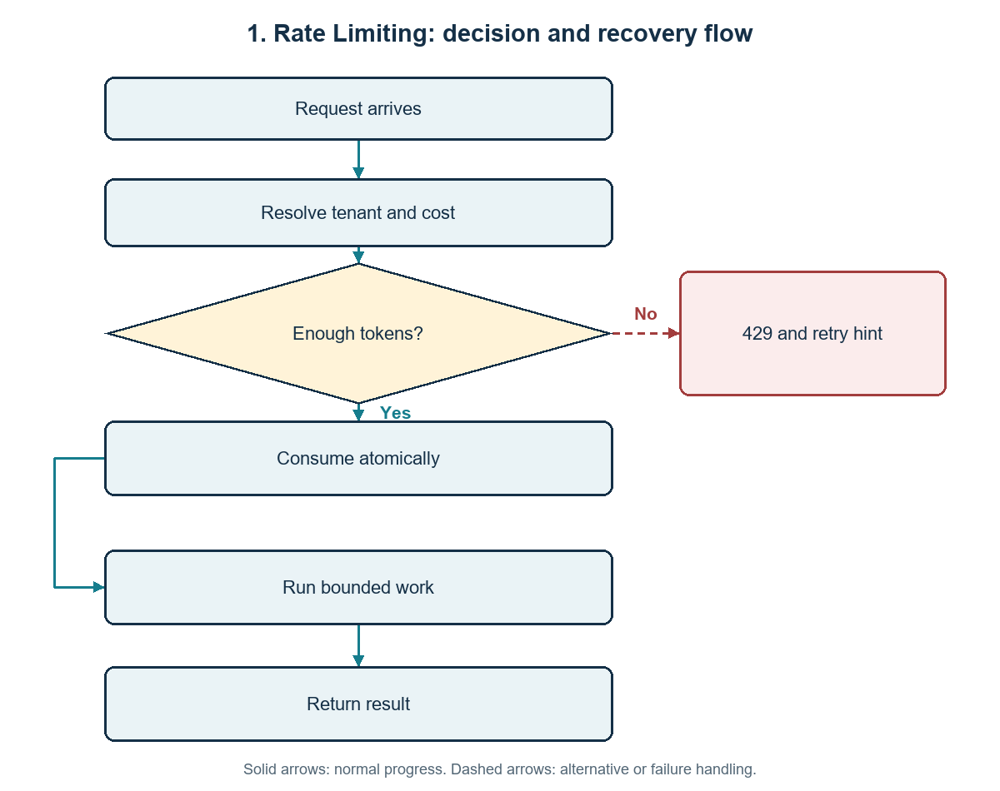

*Figure 1. 1. Rate Limiting: decision and recovery flow.* Start at "Request arrives" and move to "Resolve tenant and cost". At "Enough tokens?", the Yes branch goes to "Consume atomically" and the No branch goes to "429 and retry hint". Follow the arrows to the terminal or recovery outcome; a dashed branch is not an implicit success. Source: [editable Mermaid](diagrams/topic-001.mmd).


#### 6. Step-by-step example

1. With B=5 and r=2, five simultaneous unit-cost calls pass.

2. The sixth is rejected.

3. After 0.5 seconds one token exists.

4. For inference, a ten-token request needs ten tokens even if the request count is small.

5. Record accepted work and rejected work separately.

#### 7. Implementation

The complete runnable module is [examples/algorithms.py](examples/algorithms.py); run `python algorithms.py` from the examples directory. The following excerpt isolates `TokenBucket`. Required imports, surrounding definitions, expected output, and limitations are in the complete module and [lab guide](examples/README.md).

```python
class TokenBucket:
    """Single-threaded model; a real shared limiter needs atomic synchronization."""
    def __init__(self, capacity, rate, clock):
        if capacity <= 0 or rate <= 0:
            raise ValueError("capacity and refill rate must be positive")
        self.capacity, self.rate, self.clock = capacity, rate, clock
        self.tokens, self.updated = float(capacity), clock.now

    def allow(self, cost=1):
        if cost <= 0:
            raise ValueError("cost must be positive")
        now = self.clock.now
        self.tokens = min(self.capacity, self.tokens + (now - self.updated) * self.rate)
        self.updated = now
        if cost > self.tokens:
            return False
        self.tokens -= cost
        return True
```

Read the state changes in this excerpt alongside the mechanism above. The lab is a model of its stated boundary; it does not establish the behavior of a distributed deployment or an external provider. Check the assertions in [test_examples.py](examples/test_examples.py) and compare your output with [recorded outputs](examples/actual_outputs/).

#### 8. Production use cases

ShopStream's product API must remain usable when one integration sends thousands of requests. Without admission control, a cheap request for the caller can consume expensive database or inference capacity for everybody. With B=5 and r=2, five simultaneous unit-cost calls pass.

#### 9. Advantages and disadvantages

Fixed windows are cheap but allow boundary bursts. Sliding logs are precise but retain request timestamps. Sliding counters approximate a moving window. Token buckets support bounded bursts; concurrency limits instead bound simultaneous work. Combine both when requests have variable duration.

#### 10. Common mistakes and debugging

Keying every user by proxy IP unfairly groups them. A non-atomic read/decrement overspends tokens. A limiter outage needs an explicit fail-open or fail-closed policy per operation: browsing and paid generation need different risk decisions.

#### 11. Comparison with related concepts

| Decision | Engineering interpretation |
|---|---|
| What this topic contributes | Rate limiting decides how much work one caller may submit during a period. |
| Nearest alternatives and limits | Fixed windows are cheap but allow boundary bursts. Sliding logs are precise but retain request timestamps. Sliding counters approximate a moving window. Token buckets support bounded bursts; concurrency limits instead bound simultaneous work. Combine both when requests have variable duration. |
| Combined design | Read [11. Timeouts](#topic-011) and [44. Backpressure](#topic-044); identify which layer owns each invariant rather than assuming their guarantees are interchangeable. |

#### 12. Interview preparation

**1.1 - Conceptual; Beginner. A teammate wants to add rate limiting everywhere. What concrete need should justify it?**

**Model answer:** Rate limiting decides how much work one caller may submit during a period. ShopStream's product API must remain usable when one integration sends thousands of requests. Without admission control, a cheap request for the caller can consume expensive database or inference capacity for everybody. Fixed windows are cheap but allow boundary bursts.

**1.2 - Conceptual; Intermediate. What must be represented or coordinated for rate limiting to work correctly?**

**Model answer:** Identify an authenticated tenant and operation, not an easily spoofed header. A token bucket holds at most B tokens and refills at r tokens/second using elapsed monotonic time. Atomically compute tokens=min(B,tokens+r*elapsed), then subtract request cost only if enough remain. Return HTTP 429 with a useful retry hint on rejection. Across replicas, coordinate shared counters or divide a global allowance; independent full buckets multiply the allowance.

**1.3 - Conceptual; Beginner. Explain the analogy, then identify where it stops being a trustworthy model.**

**Model answer:** A museum admits visitors using replenishing tickets. Spare tickets allow a short burst; new arrivals wait or leave when tickets run out. Unlike a museum, one API operation may cost ten times another, so tickets can represent weighted work. The implementation must still follow the explicit state and failure rules described in the mechanism; an analogy cannot establish a delivery, timing, or security guarantee.

**1.4 - Conceptual; Intermediate. Which nearby alternative would you compare with rate limiting, and what changes the choice?**

**Model answer:** Fixed windows are cheap but allow boundary bursts. Sliding logs are precise but retain request timestamps. Sliding counters approximate a moving window. Token buckets support bounded bursts; concurrency limits instead bound simultaneous work. Combine both when requests have variable duration.

**1.5 - Conceptual; Intermediate. How can an apparently functioning implementation still violate the intended contract?**

**Model answer:** Keying every user by proxy IP unfairly groups them. A non-atomic read/decrement overspends tokens. A limiter outage needs an explicit fail-open or fail-closed policy per operation: browsing and paid generation need different risk decisions.

**1.6 - Scenario; Intermediate. Walk through the worked ShopStream example. What evidence establishes the outcome, and what remains an assumption?**

**Model answer:** With B=5 and r=2, five simultaneous unit-cost calls pass. The sixth is rejected. After 0.5 seconds one token exists. For inference, a ten-token request needs ten tokens even if the request count is small. Record accepted work and rejected work separately. Verify the stated state transition or measurement at the responsible boundary. The numerical values, when present, are assumptions or deterministic examples rather than vendor performance guarantees.

**1.7 - Scenario; Advanced. You must validate this behavior before rollout. What experiment would expose a false correctness claim?**

**Model answer:** Simulate a burst at t=0 and another at t=0.5; expect 5 then 1 accepted. Next run two independent buckets and demonstrate doubled admission. Finally design regional leases whose sum cannot exceed the purchased budget; reconcile usage after recovery. Record the starting state, injected condition, observed result, and invariant. A successful startup alone does not demonstrate the behavior under test.

**1.8 - Scenario; Advanced. A change involving rate limiting produces a customer-visible regression. How would you investigate and choose a safe response?**

**Model answer:** Keying every user by proxy IP unfairly groups them. A non-atomic read/decrement overspends tokens. A limiter outage needs an explicit fail-open or fail-closed policy per operation: browsing and paid generation need different risk decisions. A global strict quota introduces coordination latency and a dependency. Regional token leases improve availability but permit overshoot bounded by outstanding leases. Explain that bound before claiming global accuracy. Monitor limiter latency, tenant rejection rate, and backend saturation to distinguish abusive demand from an undersized service.

**1.9 - Advanced follow-up; Expert. Which hidden assumptions become important under failure, scale, or a changed workload?**

**Model answer:** A global strict quota introduces coordination latency and a dependency. Regional token leases improve availability but permit overshoot bounded by outstanding leases. Explain that bound before claiming global accuracy. Monitor limiter latency, tenant rejection rate, and backend saturation to distinguish abusive demand from an undersized service.

**1.10 - Advanced follow-up; Expert. How does this design interact with timeouts and backpressure?**

**Model answer:** Identify an authenticated tenant and operation, not an easily spoofed header. Establish an end-to-end deadline using a monotonic clock. Bound queue length, in-flight requests, and per-client buffers. Specify which component owns each decision and trace a failure across the combined boundary. Do not infer one component's guarantee from another component's name.

**Common incorrect answer:** "Adding the component makes the guarantee automatic." This is wrong because the mechanism depends on specific state, boundaries, and failure assumptions. Keying every user by proxy IP unfairly groups them.

**A deeper interviewer probe:** Change the timing, workload, or failure condition described in the advanced answer. Ask which invariant still holds, what observation would disprove it, and whether the fallback changes the user contract. A global strict quota introduces coordination latency and a dependency.

#### 13. Exercises and solution walkthroughs

**Beginner exercise:** Reproduce the worked example for rate limiting on paper. Record the initial state, each transition, and the result before reading the walkthrough.

**Beginner solution:** With B=5 and r=2, five simultaneous unit-cost calls pass. The sixth is rejected. After 0.5 seconds one token exists. For inference, a ten-token request needs ten tokens even if the request count is small. Record accepted work and rejected work separately.

**Intermediate exercise:** Simulate a burst at t=0 and another at t=0.5; expect 5 then 1 accepted. Write the observable assertion and identify which component owns it.

**Intermediate solution:** Simulate a burst at t=0 and another at t=0.5; expect 5 then 1 accepted. Next run two independent buckets and demonstrate doubled admission. Finally design regional leases whose sum cannot exceed the purchased budget; reconcile usage after recovery. Use the provided lab where applicable; for platform behavior, record the runtime version and actual evidence instead of treating a diagram as a test.

**Advanced exercise:** Extend the example to a failure or scale condition described below. State the guarantee you retain, the one you relax if necessary, and a safe recovery procedure.

**Advanced solution:** A global strict quota introduces coordination latency and a dependency. Regional token leases improve availability but permit overshoot bounded by outstanding leases. Explain that bound before claiming global accuracy. Monitor limiter latency, tenant rejection rate, and backend saturation to distinguish abusive demand from an undersized service. Keying every user by proxy IP unfairly groups them. A complete solution identifies a detection signal, a bounded action, and a verification of the business outcome.

#### 14. Key takeaways

- Rate limiting decides how much work one caller may submit during a period.

- Identify an authenticated tenant and operation, not an easily spoofed header.

- Fixed windows are cheap but allow boundary bursts.

- Keying every user by proxy IP unfairly groups them.

- A global strict quota introduces coordination latency and a dependency.


**When to use it:** ShopStream's product API must remain usable when one integration sends thousands of requests. Without admission control, a cheap request for the caller can consume expensive database or inference capacity for everybody.

**Terminology:** See this topic's glossary entry and the linked related terms. **Continue with:** [11. Timeouts](#topic-011), [44. Backpressure](#topic-044), [45. Autoscaling](#topic-045), [68. IAM](#topic-068).
<a id="topic-003"></a>

### 3. Load Balancing

Prerequisites and related reading: [4. Reverse Proxies](#topic-004), [9. Service Discovery](#topic-009), [14. Idempotency](#topic-014), [56. Health Checks](#topic-056).

#### 1. Simple explanation

A load balancer distributes incoming work among eligible servers.

#### 2. The problem it solves

Adding ShopStream API replicas is useless if all clients still reach one replica. Balancing also removes failed destinations, but it cannot make an overloaded database faster or guarantee that a forwarded operation did not execute.

#### 3. Intuitive analogy

An airport assigns passengers to open security lanes. The shortest queue may still contain slow inspections. Likewise, connection count is only a proxy for application work, especially with multiplexed connections.

#### 4. Technical working mechanism

1. Discover backends, evaluate health, select one, establish or reuse a connection, and forward traffic.

2. Round robin ignores unequal work; weighted balancing models capacity; least-connections approximates occupancy; consistent hashing preserves some affinity as membership changes.

3. L4 routes transport connections.

4. L7 understands HTTP paths and headers.

5. Drain old backends before removal and distinguish connection failure from a timeout after a write.


**Boundary and advanced reasoning.** A few long-lived HTTP/2 connections can pin disproportionate work to a subset of backends. Request-level balancing, connection rotation, and sufficient connection diversity may help. Confirm where balancing occurs before changing the algorithm. Keep trusted proxy boundaries explicit when preserving client addresses.

#### 5. Architecture and diagrams


*Figure 3. 3. Load Balancing: decision and recovery flow.* Start at "Client request" and move to "Discover eligible backends". At "Healthy capacity available?", the Yes branch goes to "Select backend" and the No branch goes to "Reject or shed load". Follow the arrows to the terminal or recovery outcome; a dashed branch is not an implicit success. Source: [editable Mermaid](diagrams/topic-003.mmd).


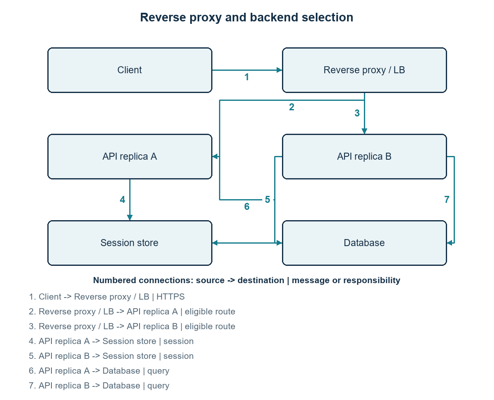

*Figure 115. Reverse proxy and backend selection.* The proxy selects a ready backend. Shared state and database capacity remain dependencies of both replicas. Source: [editable Mermaid](diagrams/arch-proxy-lb.mmd).


#### 6. Step-by-step example

1. Three equal replicas each sustain an assumed 100 requests/second at the target latency.

2. At 180 requests/second, removing one leaves 90 per survivor.

3. At 270, losing one exceeds their combined safe capacity.

4. Reserve failure headroom rather than sizing only for normal operation.

#### 7. Implementation

The complete runnable module is [examples/algorithms.py](examples/algorithms.py); run `python algorithms.py` from the examples directory. The following excerpt isolates `round_robin`. Required imports, surrounding definitions, expected output, and limitations are in the complete module and [lab guide](examples/README.md).

```python
def round_robin(backends, requests):
    if not backends:
        raise ValueError("no healthy backends")
    return [backends[index % len(backends)] for index in range(requests)]
```

Read the state changes in this excerpt alongside the mechanism above. The lab is a model of its stated boundary; it does not establish the behavior of a distributed deployment or an external provider. Check the assertions in [test_examples.py](examples/test_examples.py) and compare your output with [recorded outputs](examples/actual_outputs/).

#### 8. Production use cases

Adding ShopStream API replicas is useless if all clients still reach one replica. Balancing also removes failed destinations, but it cannot make an overloaded database faster or guarantee that a forwarded operation did not execute. Three equal replicas each sustain an assumed 100 requests/second at the target latency.

#### 9. Advantages and disadvantages

Sticky sessions reduce movement but concentrate load and complicate failover. External session storage makes replicas more interchangeable. Client-side balancing removes a central hop but requires every client to refresh membership and use compatible policies.

#### 10. Common mistakes and debugging

Retrying a POST blindly after backend timeout can duplicate an order. Health checks that test only process existence keep broken replicas eligible. Observe per-backend traffic, queueing, errors, and connection age; averages hide a single hot server.

#### 11. Comparison with related concepts

| Decision | Engineering interpretation |
|---|---|
| What this topic contributes | A load balancer distributes incoming work among eligible servers. |
| Nearest alternatives and limits | Sticky sessions reduce movement but concentrate load and complicate failover. External session storage makes replicas more interchangeable. Client-side balancing removes a central hop but requires every client to refresh membership and use compatible policies. |
| Combined design | Read [4. Reverse Proxies](#topic-004) and [9. Service Discovery](#topic-009); identify which layer owns each invariant rather than assuming their guarantees are interchangeable. |

#### 12. Interview preparation

**3.1 - Conceptual; Beginner. A teammate wants to add load balancing everywhere. What concrete need should justify it?**

**Model answer:** A load balancer distributes incoming work among eligible servers. Adding ShopStream API replicas is useless if all clients still reach one replica. Balancing also removes failed destinations, but it cannot make an overloaded database faster or guarantee that a forwarded operation did not execute. Sticky sessions reduce movement but concentrate load and complicate failover.

**3.2 - Conceptual; Intermediate. What must be represented or coordinated for load balancing to work correctly?**

**Model answer:** Discover backends, evaluate health, select one, establish or reuse a connection, and forward traffic. Round robin ignores unequal work; weighted balancing models capacity; least-connections approximates occupancy; consistent hashing preserves some affinity as membership changes. L4 routes transport connections. L7 understands HTTP paths and headers. Drain old backends before removal and distinguish connection failure from a timeout after a write.

**3.3 - Conceptual; Beginner. Explain the analogy, then identify where it stops being a trustworthy model.**

**Model answer:** An airport assigns passengers to open security lanes. The shortest queue may still contain slow inspections. Likewise, connection count is only a proxy for application work, especially with multiplexed connections. The implementation must still follow the explicit state and failure rules described in the mechanism; an analogy cannot establish a delivery, timing, or security guarantee.

**3.4 - Conceptual; Intermediate. Which nearby alternative would you compare with load balancing, and what changes the choice?**

**Model answer:** Sticky sessions reduce movement but concentrate load and complicate failover. External session storage makes replicas more interchangeable. Client-side balancing removes a central hop but requires every client to refresh membership and use compatible policies.

**3.5 - Conceptual; Intermediate. How can an apparently functioning implementation still violate the intended contract?**

**Model answer:** Retrying a POST blindly after backend timeout can duplicate an order. Health checks that test only process existence keep broken replicas eligible. Observe per-backend traffic, queueing, errors, and connection age; averages hide a single hot server.

**3.6 - Scenario; Intermediate. Walk through the worked ShopStream example. What evidence establishes the outcome, and what remains an assumption?**

**Model answer:** Three equal replicas each sustain an assumed 100 requests/second at the target latency. At 180 requests/second, removing one leaves 90 per survivor. At 270, losing one exceeds their combined safe capacity. Reserve failure headroom rather than sizing only for normal operation. Verify the stated state transition or measurement at the responsible boundary. The numerical values, when present, are assumptions or deterministic examples rather than vendor performance guarantees.

**3.7 - Scenario; Advanced. You must validate this behavior before rollout. What experiment would expose a false correctness claim?**

**Model answer:** Route twelve requests round robin across three servers; expect four each. Assign one request a much longer duration and compare least-active routing. Then remove a server mid-write and explain why an idempotency key is required before retrying. Record the starting state, injected condition, observed result, and invariant. A successful startup alone does not demonstrate the behavior under test.

**3.8 - Scenario; Advanced. A change involving load balancing produces a customer-visible regression. How would you investigate and choose a safe response?**

**Model answer:** Retrying a POST blindly after backend timeout can duplicate an order. Health checks that test only process existence keep broken replicas eligible. Observe per-backend traffic, queueing, errors, and connection age; averages hide a single hot server. A few long-lived HTTP/2 connections can pin disproportionate work to a subset of backends. Request-level balancing, connection rotation, and sufficient connection diversity may help. Confirm where balancing occurs before changing the algorithm. Keep trusted proxy boundaries explicit when preserving client addresses.

**3.9 - Advanced follow-up; Expert. Which hidden assumptions become important under failure, scale, or a changed workload?**

**Model answer:** A few long-lived HTTP/2 connections can pin disproportionate work to a subset of backends. Request-level balancing, connection rotation, and sufficient connection diversity may help. Confirm where balancing occurs before changing the algorithm. Keep trusted proxy boundaries explicit when preserving client addresses.

**3.10 - Advanced follow-up; Expert. How does this design interact with reverse proxies and service discovery?**

**Model answer:** Discover backends, evaluate health, select one, establish or reuse a connection, and forward traffic. Accept the client connection, validate HTTP framing and size, terminate TLS if configured, choose an upstream, and forward a normalized request. Instances register or controllers publish membership. Specify which component owns each decision and trace a failure across the combined boundary. Do not infer one component's guarantee from another component's name.

**Common incorrect answer:** "Adding the component makes the guarantee automatic." This is wrong because the mechanism depends on specific state, boundaries, and failure assumptions. Retrying a POST blindly after backend timeout can duplicate an order.

**A deeper interviewer probe:** Change the timing, workload, or failure condition described in the advanced answer. Ask which invariant still holds, what observation would disprove it, and whether the fallback changes the user contract. A few long-lived HTTP/2 connections can pin disproportionate work to a subset of backends.

#### 13. Exercises and solution walkthroughs

**Beginner exercise:** Reproduce the worked example for load balancing on paper. Record the initial state, each transition, and the result before reading the walkthrough.

**Beginner solution:** Three equal replicas each sustain an assumed 100 requests/second at the target latency. At 180 requests/second, removing one leaves 90 per survivor. At 270, losing one exceeds their combined safe capacity. Reserve failure headroom rather than sizing only for normal operation.

**Intermediate exercise:** Route twelve requests round robin across three servers; expect four each. Write the observable assertion and identify which component owns it.

**Intermediate solution:** Route twelve requests round robin across three servers; expect four each. Assign one request a much longer duration and compare least-active routing. Then remove a server mid-write and explain why an idempotency key is required before retrying. Use the provided lab where applicable; for platform behavior, record the runtime version and actual evidence instead of treating a diagram as a test.

**Advanced exercise:** Extend the example to a failure or scale condition described below. State the guarantee you retain, the one you relax if necessary, and a safe recovery procedure.

**Advanced solution:** A few long-lived HTTP/2 connections can pin disproportionate work to a subset of backends. Request-level balancing, connection rotation, and sufficient connection diversity may help. Confirm where balancing occurs before changing the algorithm. Keep trusted proxy boundaries explicit when preserving client addresses. Retrying a POST blindly after backend timeout can duplicate an order. A complete solution identifies a detection signal, a bounded action, and a verification of the business outcome.

#### 14. Key takeaways

- A load balancer distributes incoming work among eligible servers.

- Discover backends, evaluate health, select one, establish or reuse a connection, and forward traffic.

- Sticky sessions reduce movement but concentrate load and complicate failover.

- Retrying a POST blindly after backend timeout can duplicate an order.

- A few long-lived HTTP/2 connections can pin disproportionate work to a subset of backends.


**When to use it:** Adding ShopStream API replicas is useless if all clients still reach one replica. Balancing also removes failed destinations, but it cannot make an overloaded database faster or guarantee that a forwarded operation did not execute.

**Terminology:** See this topic's glossary entry and the linked related terms. **Continue with:** [4. Reverse Proxies](#topic-004), [9. Service Discovery](#topic-009), [14. Idempotency](#topic-014), [56. Health Checks](#topic-056).
<a id="topic-004"></a>

### 4. Reverse Proxies

Prerequisites and related reading: [3. Load Balancing](#topic-003), [5. API Gateways](#topic-005), [71. TLS](#topic-071), [97. DNS](#topic-097).

#### 1. Simple explanation

A reverse proxy accepts requests on behalf of an application server.

#### 2. The problem it solves

It gives ShopStream a controlled entry point for TLS, routing, compression, and request limits. Clients see the proxy endpoint rather than every internal process address.

#### 3. Intuitive analogy

A hotel's reception desk receives guests and directs them to departments. The desk can become a bottleneck and must not trust a visitor claiming to be the hotel manager. Similarly, forwarded identity headers need a trusted source.

#### 4. Technical working mechanism

1. Accept the client connection, validate HTTP framing and size, terminate TLS if configured, choose an upstream, and forward a normalized request.

2. Preserve correlation IDs and trusted forwarding information.

3. Stream or buffer bodies deliberately.

4. Match upstream deadlines to the end-to-end budget.

5. Strip caller-supplied internal authentication headers before setting verified values.


**Boundary and advanced reasoning.** When TLS ends at the proxy, the next hop is a separate trust decision. Re-encrypt where the internal network threat model requires it. Debug failures by comparing client timing, proxy upstream timing, application traces, and body limits, rather than treating every 502 as an application crash.

#### 5. Architecture and diagrams

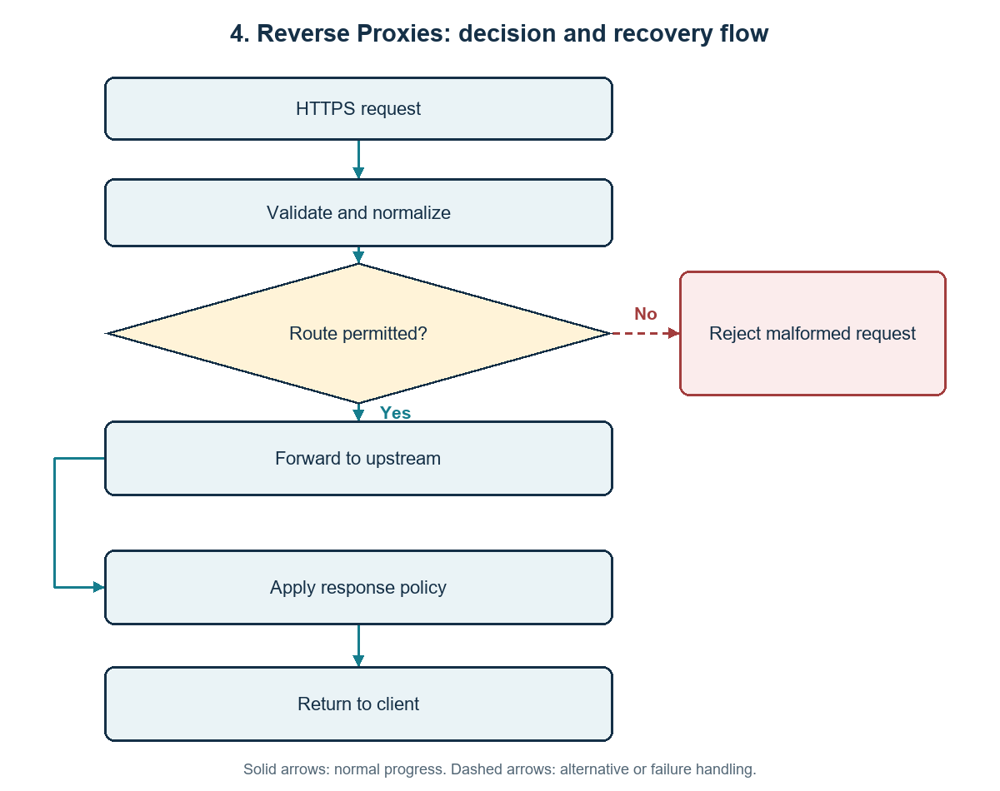

*Figure 4. 4. Reverse Proxies: decision and recovery flow.* Start at "HTTPS request" and move to "Validate and normalize". At "Route permitted?", the Yes branch goes to "Forward to upstream" and the No branch goes to "Reject malformed request". Follow the arrows to the terminal or recovery outcome; a dashed branch is not an implicit success. Source: [editable Mermaid](diagrams/topic-004.mmd).


#### 6. Step-by-step example

1. A client requests /api/products over HTTPS.

2. The proxy decrypts it, routes /api to the API on port 8000, and routes immutable assets to a static origin.

3. If the upstream connect fails, the proxy returns a gateway error; it must not invent a successful application response.

#### 7. Implementation

Use the complete [configuration or SQL example](examples/nginx.conf) and its setup/run instructions in [examples/README.md](examples/README.md). Read every field in the configuration against the mechanism above; file parsing and runtime behavior are different validation levels.

The configuration requires its named runtime. See the verification report before assuming it was executed here. Use a disposable local environment for database and orchestration exercises; the examples do not deploy cloud resources.

#### 8. Production use cases

It gives ShopStream a controlled entry point for TLS, routing, compression, and request limits. Clients see the proxy endpoint rather than every internal process address. A client requests /api/products over HTTPS.

#### 9. Advantages and disadvantages

A forward proxy represents clients; a reverse proxy represents servers. Load balancing is one possible reverse-proxy function. Buffering protects slow upstreams from slow clients but consumes memory or disk; streaming lowers buffering at the cost of longer resource occupancy.

#### 10. Common mistakes and debugging

Mismatched parsers and ambiguous message framing can create request-smuggling risks. Use maintained implementations and consistent hop behavior. A public backend bypasses proxy restrictions, so enforce network boundaries and application authorization as well.

#### 11. Comparison with related concepts

| Decision | Engineering interpretation |
|---|---|
| What this topic contributes | A reverse proxy accepts requests on behalf of an application server. |
| Nearest alternatives and limits | A forward proxy represents clients; a reverse proxy represents servers. Load balancing is one possible reverse-proxy function. Buffering protects slow upstreams from slow clients but consumes memory or disk; streaming lowers buffering at the cost of longer resource occupancy. |
| Combined design | Read [3. Load Balancing](#topic-003) and [5. API Gateways](#topic-005); identify which layer owns each invariant rather than assuming their guarantees are interchangeable. |

#### 12. Interview preparation

**4.1 - Conceptual; Beginner. A teammate wants to add reverse proxies everywhere. What concrete need should justify it?**

**Model answer:** A reverse proxy accepts requests on behalf of an application server. It gives ShopStream a controlled entry point for TLS, routing, compression, and request limits. Clients see the proxy endpoint rather than every internal process address. A forward proxy represents clients; a reverse proxy represents servers.

**4.2 - Conceptual; Intermediate. What must be represented or coordinated for reverse proxies to work correctly?**

**Model answer:** Accept the client connection, validate HTTP framing and size, terminate TLS if configured, choose an upstream, and forward a normalized request. Preserve correlation IDs and trusted forwarding information. Stream or buffer bodies deliberately. Match upstream deadlines to the end-to-end budget. Strip caller-supplied internal authentication headers before setting verified values.

**4.3 - Conceptual; Beginner. Explain the analogy, then identify where it stops being a trustworthy model.**

**Model answer:** A hotel's reception desk receives guests and directs them to departments. The desk can become a bottleneck and must not trust a visitor claiming to be the hotel manager. Similarly, forwarded identity headers need a trusted source. The implementation must still follow the explicit state and failure rules described in the mechanism; an analogy cannot establish a delivery, timing, or security guarantee.

**4.4 - Conceptual; Intermediate. Which nearby alternative would you compare with reverse proxies, and what changes the choice?**

**Model answer:** A forward proxy represents clients; a reverse proxy represents servers. Load balancing is one possible reverse-proxy function. Buffering protects slow upstreams from slow clients but consumes memory or disk; streaming lowers buffering at the cost of longer resource occupancy.

**4.5 - Conceptual; Intermediate. How can an apparently functioning implementation still violate the intended contract?**

**Model answer:** Mismatched parsers and ambiguous message framing can create request-smuggling risks. Use maintained implementations and consistent hop behavior. A public backend bypasses proxy restrictions, so enforce network boundaries and application authorization as well.

**4.6 - Scenario; Intermediate. Walk through the worked ShopStream example. What evidence establishes the outcome, and what remains an assumption?**

**Model answer:** A client requests /api/products over HTTPS. The proxy decrypts it, routes /api to the API on port 8000, and routes immutable assets to a static origin. If the upstream connect fails, the proxy returns a gateway error; it must not invent a successful application response. Verify the stated state transition or measurement at the responsible boundary. The numerical values, when present, are assumptions or deterministic examples rather than vendor performance guarantees.

**4.7 - Scenario; Advanced. You must validate this behavior before rollout. What experiment would expose a false correctness claim?**

**Model answer:** Draw the two independent TCP connections. Configure distinct upstream connect and response timeouts. Explain a large upload that fails at the proxy before the application logs anything; inspect body-size limits and buffering storage. Record the starting state, injected condition, observed result, and invariant. A successful startup alone does not demonstrate the behavior under test.

**4.8 - Scenario; Advanced. A change involving reverse proxies produces a customer-visible regression. How would you investigate and choose a safe response?**

**Model answer:** Mismatched parsers and ambiguous message framing can create request-smuggling risks. Use maintained implementations and consistent hop behavior. A public backend bypasses proxy restrictions, so enforce network boundaries and application authorization as well. When TLS ends at the proxy, the next hop is a separate trust decision. Re-encrypt where the internal network threat model requires it. Debug failures by comparing client timing, proxy upstream timing, application traces, and body limits, rather than treating every 502 as an application crash.

**4.9 - Advanced follow-up; Expert. Which hidden assumptions become important under failure, scale, or a changed workload?**

**Model answer:** When TLS ends at the proxy, the next hop is a separate trust decision. Re-encrypt where the internal network threat model requires it. Debug failures by comparing client timing, proxy upstream timing, application traces, and body limits, rather than treating every 502 as an application crash.

**4.10 - Advanced follow-up; Expert. How does this design interact with load balancing and api gateways?**

**Model answer:** Accept the client connection, validate HTTP framing and size, terminate TLS if configured, choose an upstream, and forward a normalized request. Discover backends, evaluate health, select one, establish or reuse a connection, and forward traffic. Authenticate credentials, validate their issuer and audience, derive a trusted principal, apply tenant quotas, route by a stable contract, and propagate a deadline and trace context. Specify which component owns each decision and trace a failure across the combined boundary. Do not infer one component's guarantee from another component's name.

**Common incorrect answer:** "Adding the component makes the guarantee automatic." This is wrong because the mechanism depends on specific state, boundaries, and failure assumptions. Mismatched parsers and ambiguous message framing can create request-smuggling risks.

**A deeper interviewer probe:** Change the timing, workload, or failure condition described in the advanced answer. Ask which invariant still holds, what observation would disprove it, and whether the fallback changes the user contract. When TLS ends at the proxy, the next hop is a separate trust decision.

#### 13. Exercises and solution walkthroughs

**Beginner exercise:** Reproduce the worked example for reverse proxies on paper. Record the initial state, each transition, and the result before reading the walkthrough.

**Beginner solution:** A client requests /api/products over HTTPS. The proxy decrypts it, routes /api to the API on port 8000, and routes immutable assets to a static origin. If the upstream connect fails, the proxy returns a gateway error; it must not invent a successful application response.

**Intermediate exercise:** Draw the two independent TCP connections. Write the observable assertion and identify which component owns it.

**Intermediate solution:** Draw the two independent TCP connections. Configure distinct upstream connect and response timeouts. Explain a large upload that fails at the proxy before the application logs anything; inspect body-size limits and buffering storage. Use the provided lab where applicable; for platform behavior, record the runtime version and actual evidence instead of treating a diagram as a test.

**Advanced exercise:** Extend the example to a failure or scale condition described below. State the guarantee you retain, the one you relax if necessary, and a safe recovery procedure.

**Advanced solution:** When TLS ends at the proxy, the next hop is a separate trust decision. Re-encrypt where the internal network threat model requires it. Debug failures by comparing client timing, proxy upstream timing, application traces, and body limits, rather than treating every 502 as an application crash. Mismatched parsers and ambiguous message framing can create request-smuggling risks. A complete solution identifies a detection signal, a bounded action, and a verification of the business outcome.

#### 14. Key takeaways

- A reverse proxy accepts requests on behalf of an application server.

- Accept the client connection, validate HTTP framing and size, terminate TLS if configured, choose an upstream, and forward a normalized request.

- A forward proxy represents clients; a reverse proxy represents servers.

- Mismatched parsers and ambiguous message framing can create request-smuggling risks.

- When TLS ends at the proxy, the next hop is a separate trust decision.


**When to use it:** It gives ShopStream a controlled entry point for TLS, routing, compression, and request limits. Clients see the proxy endpoint rather than every internal process address.

**Terminology:** See this topic's glossary entry and the linked related terms. **Continue with:** [3. Load Balancing](#topic-003), [5. API Gateways](#topic-005), [71. TLS](#topic-071), [97. DNS](#topic-097).
<a id="topic-005"></a>

### 5. API Gateways

Prerequisites and related reading: [1. Rate Limiting](#topic-001), [4. Reverse Proxies](#topic-004), [68. IAM](#topic-068), [69. OAuth](#topic-069).

#### 1. Simple explanation

An API gateway applies shared API policies at a service boundary.

#### 2. The problem it solves

ShopStream can centralize authentication checks, quotas, routing, and request metadata before traffic reaches orders or catalog services. Business authorization still belongs close to the protected data.

#### 3. Intuitive analogy

A university entrance checks IDs and directs visitors to buildings. Entering the campus does not grant access to every laboratory. A gateway identity check likewise does not authorize every object-level operation.

#### 4. Technical working mechanism

1. Authenticate credentials, validate their issuer and audience, derive a trusted principal, apply tenant quotas, route by a stable contract, and propagate a deadline and trace context.

2. Keep request transformations explicit and versioned.

3. Record policy rejection separately from backend failure.

4. Deploy redundant instances and treat configuration rollout as production code.


**Boundary and advanced reasoning.** Shared policy makes changes powerful and dangerous. Canary gateway configuration against representative routes and compare rejection rates by tenant. Do not log bearer tokens while debugging. For AI APIs, enforce both request-rate and estimated compute budgets, then reconcile actual usage.

#### 5. Architecture and diagrams

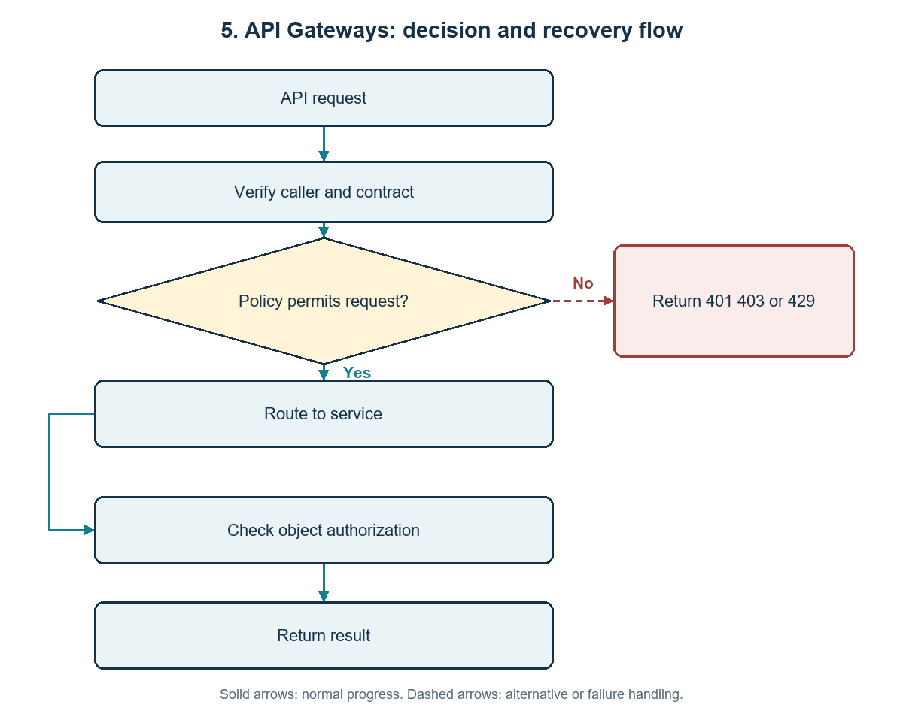

*Figure 5. 5. API Gateways: decision and recovery flow.* Start at "API request" and move to "Verify caller and contract". At "Policy permits request?", the Yes branch goes to "Route to service" and the No branch goes to "Return 401 403 or 429". Follow the arrows to the terminal or recovery outcome; a dashed branch is not an implicit success. Source: [editable Mermaid](diagrams/topic-005.mmd).


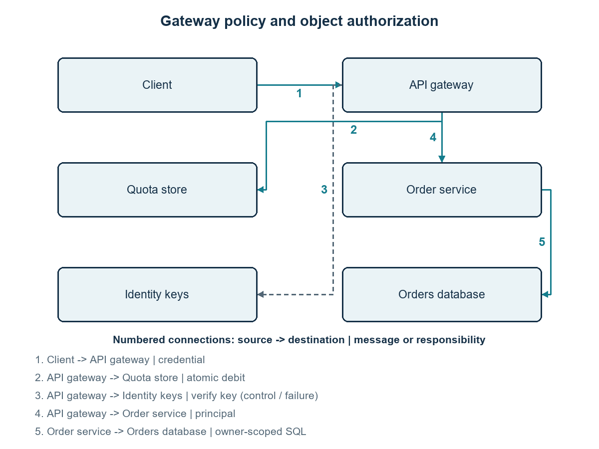

*Figure 116. Gateway policy and object authorization.* Gateway authentication and quota precede service-level ownership checks. A gateway pass is not blanket authorization. Source: [editable Mermaid](diagrams/arch-gateway.mmd).


#### 6. Step-by-step example

1. A seller calls PATCH /products/42.

2. The gateway accepts a valid token with catalog-write scope.

3. The catalog service then checks whether product 42 belongs to that seller.

4. If ownership fails, it returns 403 even though the gateway authentication succeeded.

#### 7. Implementation

For this topic, the worked scenario and the exercise below are the direct practical implementation of the reasoning. A standalone toy implementation would hide important platform or protocol guarantees. Use the relevant official implementation or managed runtime for real deployment, and validate its actual contract.

The associated [examples/security.py](examples/security.py) illustrates a related local boundary, not a full implementation of api gateways. [The lab guide](examples/README.md) distinguishes executable simulations, configurations, and design exercises.

#### 8. Production use cases

ShopStream can centralize authentication checks, quotas, routing, and request metadata before traffic reaches orders or catalog services. Business authorization still belongs close to the protected data. A seller calls PATCH /products/42.

#### 9. Advantages and disadvantages

A reverse proxy primarily mediates traffic; a gateway adds API policy and management. A service mesh focuses on service-to-service concerns. These roles overlap, so choose based on requirements rather than labels. Excessive gateway business logic creates a coupled bottleneck.

#### 10. Common mistakes and debugging

Trusting unsigned identity headers lets direct callers impersonate users. Caching authorization decisions without revocation or tenant scope can retain access too long. Test routes that bypass the gateway and reject them unless separately authenticated.

#### 11. Comparison with related concepts

| Decision | Engineering interpretation |
|---|---|
| What this topic contributes | An API gateway applies shared API policies at a service boundary. |
| Nearest alternatives and limits | A reverse proxy primarily mediates traffic; a gateway adds API policy and management. A service mesh focuses on service-to-service concerns. These roles overlap, so choose based on requirements rather than labels. Excessive gateway business logic creates a coupled bottleneck. |
| Combined design | Read [1. Rate Limiting](#topic-001) and [4. Reverse Proxies](#topic-004); identify which layer owns each invariant rather than assuming their guarantees are interchangeable. |

#### 12. Interview preparation

**5.1 - Conceptual; Beginner. A teammate wants to add api gateways everywhere. What concrete need should justify it?**

**Model answer:** An API gateway applies shared API policies at a service boundary. ShopStream can centralize authentication checks, quotas, routing, and request metadata before traffic reaches orders or catalog services. Business authorization still belongs close to the protected data. A reverse proxy primarily mediates traffic; a gateway adds API policy and management.

**5.2 - Conceptual; Intermediate. What must be represented or coordinated for api gateways to work correctly?**

**Model answer:** Authenticate credentials, validate their issuer and audience, derive a trusted principal, apply tenant quotas, route by a stable contract, and propagate a deadline and trace context. Keep request transformations explicit and versioned. Record policy rejection separately from backend failure. Deploy redundant instances and treat configuration rollout as production code.

**5.3 - Conceptual; Beginner. Explain the analogy, then identify where it stops being a trustworthy model.**

**Model answer:** A university entrance checks IDs and directs visitors to buildings. Entering the campus does not grant access to every laboratory. A gateway identity check likewise does not authorize every object-level operation. The implementation must still follow the explicit state and failure rules described in the mechanism; an analogy cannot establish a delivery, timing, or security guarantee.

**5.4 - Conceptual; Intermediate. Which nearby alternative would you compare with api gateways, and what changes the choice?**

**Model answer:** A reverse proxy primarily mediates traffic; a gateway adds API policy and management. A service mesh focuses on service-to-service concerns. These roles overlap, so choose based on requirements rather than labels. Excessive gateway business logic creates a coupled bottleneck.

**5.5 - Conceptual; Intermediate. How can an apparently functioning implementation still violate the intended contract?**

**Model answer:** Trusting unsigned identity headers lets direct callers impersonate users. Caching authorization decisions without revocation or tenant scope can retain access too long. Test routes that bypass the gateway and reject them unless separately authenticated.

**5.6 - Scenario; Intermediate. Walk through the worked ShopStream example. What evidence establishes the outcome, and what remains an assumption?**

**Model answer:** A seller calls PATCH /products/42. The gateway accepts a valid token with catalog-write scope. The catalog service then checks whether product 42 belongs to that seller. If ownership fails, it returns 403 even though the gateway authentication succeeded. Verify the stated state transition or measurement at the responsible boundary. The numerical values, when present, are assumptions or deterministic examples rather than vendor performance guarantees.

**5.7 - Scenario; Advanced. You must validate this behavior before rollout. What experiment would expose a false correctness claim?**

**Model answer:** Trace authentication and ownership as separate decisions. Add a tenant quota test with two sellers. Design a gateway outage mode that preserves public catalog reads without permitting unauthenticated writes or unbounded paid inference. Record the starting state, injected condition, observed result, and invariant. A successful startup alone does not demonstrate the behavior under test.

**5.8 - Scenario; Advanced. A change involving api gateways produces a customer-visible regression. How would you investigate and choose a safe response?**

**Model answer:** Trusting unsigned identity headers lets direct callers impersonate users. Caching authorization decisions without revocation or tenant scope can retain access too long. Test routes that bypass the gateway and reject them unless separately authenticated. Shared policy makes changes powerful and dangerous. Canary gateway configuration against representative routes and compare rejection rates by tenant. Do not log bearer tokens while debugging. For AI APIs, enforce both request-rate and estimated compute budgets, then reconcile actual usage.

**5.9 - Advanced follow-up; Expert. Which hidden assumptions become important under failure, scale, or a changed workload?**

**Model answer:** Shared policy makes changes powerful and dangerous. Canary gateway configuration against representative routes and compare rejection rates by tenant. Do not log bearer tokens while debugging. For AI APIs, enforce both request-rate and estimated compute budgets, then reconcile actual usage.

**5.10 - Advanced follow-up; Expert. How does this design interact with rate limiting and reverse proxies?**

**Model answer:** Authenticate credentials, validate their issuer and audience, derive a trusted principal, apply tenant quotas, route by a stable contract, and propagate a deadline and trace context. Identify an authenticated tenant and operation, not an easily spoofed header. Accept the client connection, validate HTTP framing and size, terminate TLS if configured, choose an upstream, and forward a normalized request. Specify which component owns each decision and trace a failure across the combined boundary. Do not infer one component's guarantee from another component's name.

**Common incorrect answer:** "Adding the component makes the guarantee automatic." This is wrong because the mechanism depends on specific state, boundaries, and failure assumptions. Trusting unsigned identity headers lets direct callers impersonate users.

**A deeper interviewer probe:** Change the timing, workload, or failure condition described in the advanced answer. Ask which invariant still holds, what observation would disprove it, and whether the fallback changes the user contract. Shared policy makes changes powerful and dangerous.

#### 13. Exercises and solution walkthroughs

**Beginner exercise:** Reproduce the worked example for api gateways on paper. Record the initial state, each transition, and the result before reading the walkthrough.

**Beginner solution:** A seller calls PATCH /products/42. The gateway accepts a valid token with catalog-write scope. The catalog service then checks whether product 42 belongs to that seller. If ownership fails, it returns 403 even though the gateway authentication succeeded.

**Intermediate exercise:** Trace authentication and ownership as separate decisions. Write the observable assertion and identify which component owns it.

**Intermediate solution:** Trace authentication and ownership as separate decisions. Add a tenant quota test with two sellers. Design a gateway outage mode that preserves public catalog reads without permitting unauthenticated writes or unbounded paid inference. Use the provided lab where applicable; for platform behavior, record the runtime version and actual evidence instead of treating a diagram as a test.

**Advanced exercise:** Extend the example to a failure or scale condition described below. State the guarantee you retain, the one you relax if necessary, and a safe recovery procedure.

**Advanced solution:** Shared policy makes changes powerful and dangerous. Canary gateway configuration against representative routes and compare rejection rates by tenant. Do not log bearer tokens while debugging. For AI APIs, enforce both request-rate and estimated compute budgets, then reconcile actual usage. Trusting unsigned identity headers lets direct callers impersonate users. A complete solution identifies a detection signal, a bounded action, and a verification of the business outcome.

#### 14. Key takeaways

- An API gateway applies shared API policies at a service boundary.

- Authenticate credentials, validate their issuer and audience, derive a trusted principal, apply tenant quotas, route by a stable contract, and propagate a deadline and trace context.

- A reverse proxy primarily mediates traffic; a gateway adds API policy and management.

- Trusting unsigned identity headers lets direct callers impersonate users.

- Shared policy makes changes powerful and dangerous.


**When to use it:** ShopStream can centralize authentication checks, quotas, routing, and request metadata before traffic reaches orders or catalog services. Business authorization still belongs close to the protected data.

**Terminology:** See this topic's glossary entry and the linked related terms. **Continue with:** [1. Rate Limiting](#topic-001), [4. Reverse Proxies](#topic-004), [68. IAM](#topic-068), [69. OAuth](#topic-069).
<a id="topic-010"></a>

### 10. Circuit Breakers

Prerequisites and related reading: [11. Timeouts](#topic-011), [12. Retries](#topic-012), [44. Backpressure](#topic-044), [58. Monitoring](#topic-058).

#### 1. Simple explanation

A circuit breaker stops repeatedly calling a dependency that is likely to fail.

#### 2. The problem it solves

If ShopStream's recommendation provider stalls, failing fast protects API threads and connections. The breaker limits propagation of failure; it does not repair the provider.

#### 3. Intuitive analogy

An electrical breaker disconnects an unsafe circuit. Unlike a physical breaker, a software breaker estimates dependency health from recent outcomes and must occasionally test whether recovery has occurred.

#### 4. Technical working mechanism

1. In closed state, forward calls and record eligible failures.

2. Open after a defined threshold over a window and minimum sample.

3. While open, reject immediately or use an explicitly safe fallback.

4. After a cooldown, enter half-open and allow a bounded probe count.

5. Successful probes close the breaker; failed probes reopen it.

6. Track state per dependency and meaningful failure domain.


**Boundary and advanced reasoning.** Local breakers observe only one process's traffic and can disagree. Shared breaker state coordinates behavior but adds latency and another failure dependency. Use minimum samples and probe limits, then evaluate user-visible error rate and resource recovery rather than celebrating a high open count.

#### 5. Architecture and diagrams

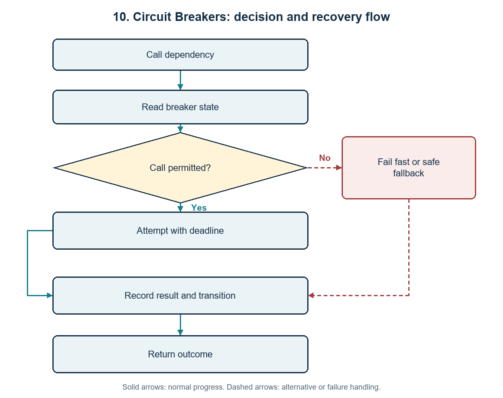

*Figure 10. 10. Circuit Breakers: decision and recovery flow.* Start at "Call dependency" and move to "Read breaker state". At "Call permitted?", the Yes branch goes to "Attempt with deadline" and the No branch goes to "Fail fast or safe fallback". Follow the arrows to the terminal or recovery outcome; a dashed branch is not an implicit success. Source: [editable Mermaid](diagrams/topic-010.mmd).


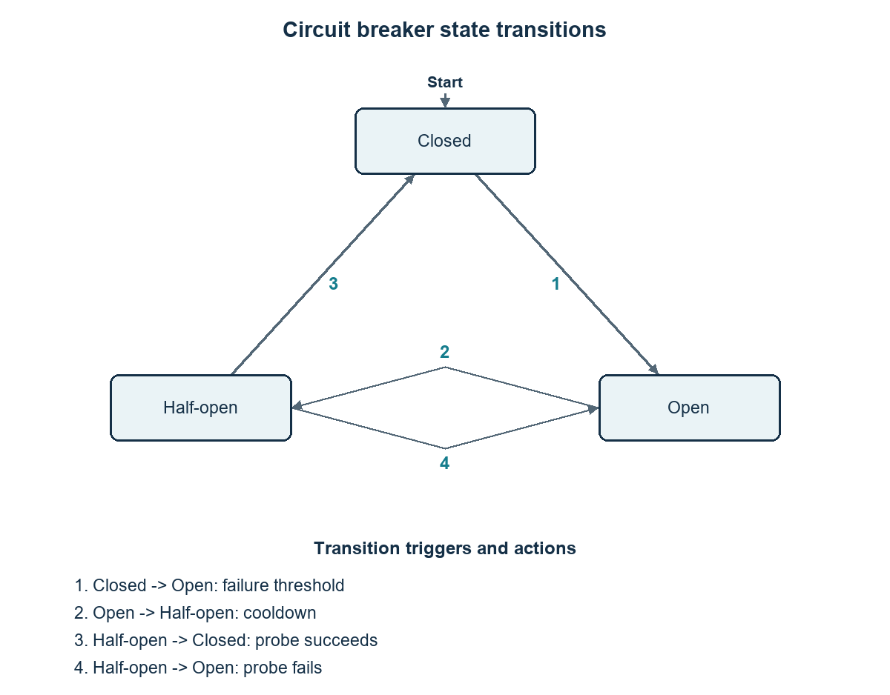

*Figure 170. Circuit breaker state transitions.* Closed records eligible outcomes. Open rejects calls. Half-open limits recovery probes; success closes and failure reopens. Source: [editable Mermaid](diagrams/state-breaker.mmd).


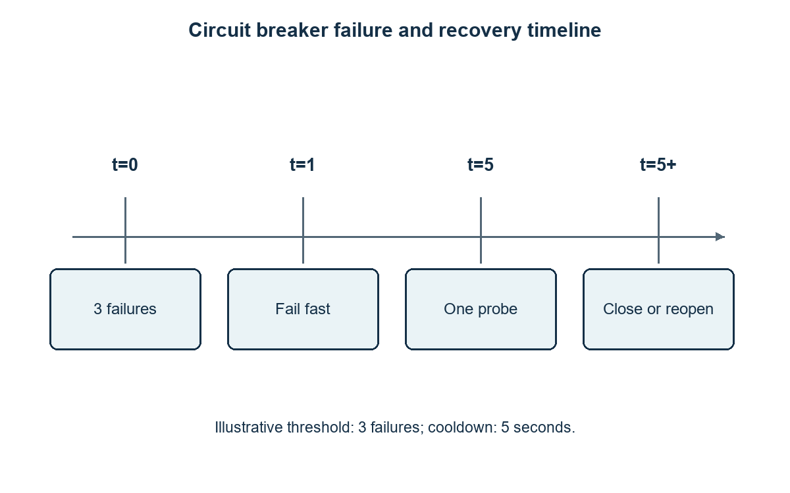

*Figure 187. Circuit breaker failure and recovery timeline.* Failures open the breaker, a cooldown rejects work, and a limited probe tests recovery. This timeline supplements the state diagram. Source: [editable SVG](diagrams/ill-breaker.svg).


#### 6. Step-by-step example

1. At t=0 three calls fail.

2. The demo opens for five seconds.

3. A call at t=1 is rejected locally.

4. At t=5 one probe is admitted.

5. If it succeeds the breaker closes; if it times out the breaker opens again.

6. Each call still needs its own timeout.

#### 7. Implementation

The complete runnable module is [examples/algorithms.py](examples/algorithms.py); run `python algorithms.py` from the examples directory. The following excerpt isolates `CircuitBreaker`. Required imports, surrounding definitions, expected output, and limitations are in the complete module and [lab guide](examples/README.md).

```python
class CircuitBreaker:
    """Consecutive-failure, sequential-call demo; no concurrent probe arbitration."""
    def __init__(self, clock, threshold=3, cooldown=5):
        if threshold < 1 or cooldown <= 0:
            raise ValueError("invalid breaker policy")
        self.clock, self.threshold, self.cooldown = clock, threshold, cooldown
        self.state, self.failures, self.opened = "closed", 0, None

    def call(self, function):
        if self.state == "open":
            if self.clock.now - self.opened < self.cooldown:
                raise CircuitOpen("dependency temporarily rejected")
            self.state = "half-open"
        try:
            result = function()
        except (TimeoutError, ConnectionError):
            self.failures += 1
            if self.state == "half-open" or self.failures >= self.threshold:
                self.state, self.opened = "open", self.clock.now
            raise
        else:
            self.state, self.failures = "closed", 0
            return result
```

Read the state changes in this excerpt alongside the mechanism above. The lab is a model of its stated boundary; it does not establish the behavior of a distributed deployment or an external provider. Check the assertions in [test_examples.py](examples/test_examples.py) and compare your output with [recorded outputs](examples/actual_outputs/).

#### 8. Production use cases

If ShopStream's recommendation provider stalls, failing fast protects API threads and connections. The breaker limits propagation of failure; it does not repair the provider. At t=0 three calls fail.

#### 9. Advantages and disadvantages

Retries seek success by repeating attempts; breakers reduce attempts when failure is sustained. Bulkheads separately cap resource consumption. A breaker may wrongly reject work during a transient failure, so thresholds trade protection against availability.

#### 10. Common mistakes and debugging

Counting user validation errors as provider failures opens the breaker unnecessarily. Allowing every caller through half-open creates a recovery stampede. A fallback price or authorization answer can be incorrect even if it returns HTTP 200.

#### 11. Comparison with related concepts

| Decision | Engineering interpretation |
|---|---|
| What this topic contributes | A circuit breaker stops repeatedly calling a dependency that is likely to fail. |
| Nearest alternatives and limits | Retries seek success by repeating attempts; breakers reduce attempts when failure is sustained. Bulkheads separately cap resource consumption. A breaker may wrongly reject work during a transient failure, so thresholds trade protection against availability. |
| Combined design | Read [11. Timeouts](#topic-011) and [12. Retries](#topic-012); identify which layer owns each invariant rather than assuming their guarantees are interchangeable. |

#### 12. Interview preparation

**10.1 - Conceptual; Beginner. A teammate wants to add circuit breakers everywhere. What concrete need should justify it?**

**Model answer:** A circuit breaker stops repeatedly calling a dependency that is likely to fail. If ShopStream's recommendation provider stalls, failing fast protects API threads and connections. The breaker limits propagation of failure; it does not repair the provider. Retries seek success by repeating attempts; breakers reduce attempts when failure is sustained.

**10.2 - Conceptual; Intermediate. What must be represented or coordinated for circuit breakers to work correctly?**

**Model answer:** In closed state, forward calls and record eligible failures. Open after a defined threshold over a window and minimum sample. While open, reject immediately or use an explicitly safe fallback. After a cooldown, enter half-open and allow a bounded probe count. Successful probes close the breaker; failed probes reopen it. Track state per dependency and meaningful failure domain.

**10.3 - Conceptual; Beginner. Explain the analogy, then identify where it stops being a trustworthy model.**

**Model answer:** An electrical breaker disconnects an unsafe circuit. Unlike a physical breaker, a software breaker estimates dependency health from recent outcomes and must occasionally test whether recovery has occurred. The implementation must still follow the explicit state and failure rules described in the mechanism; an analogy cannot establish a delivery, timing, or security guarantee.

**10.4 - Conceptual; Intermediate. Which nearby alternative would you compare with circuit breakers, and what changes the choice?**

**Model answer:** Retries seek success by repeating attempts; breakers reduce attempts when failure is sustained. Bulkheads separately cap resource consumption. A breaker may wrongly reject work during a transient failure, so thresholds trade protection against availability.

**10.5 - Conceptual; Intermediate. How can an apparently functioning implementation still violate the intended contract?**

**Model answer:** Counting user validation errors as provider failures opens the breaker unnecessarily. Allowing every caller through half-open creates a recovery stampede. A fallback price or authorization answer can be incorrect even if it returns HTTP 200.

**10.6 - Scenario; Intermediate. Walk through the worked ShopStream example. What evidence establishes the outcome, and what remains an assumption?**

**Model answer:** At t=0 three calls fail. The demo opens for five seconds. A call at t=1 is rejected locally. At t=5 one probe is admitted. If it succeeds the breaker closes; if it times out the breaker opens again. Each call still needs its own timeout. Verify the stated state transition or measurement at the responsible boundary. The numerical values, when present, are assumptions or deterministic examples rather than vendor performance guarantees.

**10.7 - Scenario; Advanced. You must validate this behavior before rollout. What experiment would expose a false correctness claim?**

**Model answer:** Run the fake-clock state transition demo. Add a failed half-open probe and verify it reopens. Design a recommendation fallback that omits recommendations while preserving checkout correctness, and contrast it with an unsafe payment-success fallback. Record the starting state, injected condition, observed result, and invariant. A successful startup alone does not demonstrate the behavior under test.

**10.8 - Scenario; Advanced. A change involving circuit breakers produces a customer-visible regression. How would you investigate and choose a safe response?**

**Model answer:** Counting user validation errors as provider failures opens the breaker unnecessarily. Allowing every caller through half-open creates a recovery stampede. A fallback price or authorization answer can be incorrect even if it returns HTTP 200. Local breakers observe only one process's traffic and can disagree. Shared breaker state coordinates behavior but adds latency and another failure dependency. Use minimum samples and probe limits, then evaluate user-visible error rate and resource recovery rather than celebrating a high open count.

**10.9 - Advanced follow-up; Expert. Which hidden assumptions become important under failure, scale, or a changed workload?**

**Model answer:** Local breakers observe only one process's traffic and can disagree. Shared breaker state coordinates behavior but adds latency and another failure dependency. Use minimum samples and probe limits, then evaluate user-visible error rate and resource recovery rather than celebrating a high open count.

**10.10 - Advanced follow-up; Expert. How does this design interact with timeouts and retries?**

**Model answer:** In closed state, forward calls and record eligible failures. Establish an end-to-end deadline using a monotonic clock. Classify the failure, establish whether replay is safe, check total deadline and attempt budget, wait with jitter, then repeat using the same logical operation ID. Specify which component owns each decision and trace a failure across the combined boundary. Do not infer one component's guarantee from another component's name.

**Common incorrect answer:** "Adding the component makes the guarantee automatic." This is wrong because the mechanism depends on specific state, boundaries, and failure assumptions. Counting user validation errors as provider failures opens the breaker unnecessarily.

**A deeper interviewer probe:** Change the timing, workload, or failure condition described in the advanced answer. Ask which invariant still holds, what observation would disprove it, and whether the fallback changes the user contract. Local breakers observe only one process's traffic and can disagree.

#### 13. Exercises and solution walkthroughs

**Beginner exercise:** Reproduce the worked example for circuit breakers on paper. Record the initial state, each transition, and the result before reading the walkthrough.

**Beginner solution:** At t=0 three calls fail. The demo opens for five seconds. A call at t=1 is rejected locally. At t=5 one probe is admitted. If it succeeds the breaker closes; if it times out the breaker opens again. Each call still needs its own timeout.

**Intermediate exercise:** Run the fake-clock state transition demo. Write the observable assertion and identify which component owns it.

**Intermediate solution:** Run the fake-clock state transition demo. Add a failed half-open probe and verify it reopens. Design a recommendation fallback that omits recommendations while preserving checkout correctness, and contrast it with an unsafe payment-success fallback. Use the provided lab where applicable; for platform behavior, record the runtime version and actual evidence instead of treating a diagram as a test.

**Advanced exercise:** Extend the example to a failure or scale condition described below. State the guarantee you retain, the one you relax if necessary, and a safe recovery procedure.

**Advanced solution:** Local breakers observe only one process's traffic and can disagree. Shared breaker state coordinates behavior but adds latency and another failure dependency. Use minimum samples and probe limits, then evaluate user-visible error rate and resource recovery rather than celebrating a high open count. Counting user validation errors as provider failures opens the breaker unnecessarily. A complete solution identifies a detection signal, a bounded action, and a verification of the business outcome.

#### 14. Key takeaways

- A circuit breaker stops repeatedly calling a dependency that is likely to fail.

- In closed state, forward calls and record eligible failures.

- Retries seek success by repeating attempts; breakers reduce attempts when failure is sustained.

- Counting user validation errors as provider failures opens the breaker unnecessarily.

- Local breakers observe only one process's traffic and can disagree.


**When to use it:** If ShopStream's recommendation provider stalls, failing fast protects API threads and connections. The breaker limits propagation of failure; it does not repair the provider.

**Terminology:** See this topic's glossary entry and the linked related terms. **Continue with:** [11. Timeouts](#topic-011), [12. Retries](#topic-012), [44. Backpressure](#topic-044), [58. Monitoring](#topic-058).
<a id="topic-011"></a>

### 11. Timeouts

Prerequisites and related reading: [12. Retries](#topic-012), [13. Exponential Backoff](#topic-013), [14. Idempotency](#topic-014), [91. Latency](#topic-091).

#### 1. Simple explanation

A timeout limits how long a caller waits.

#### 2. The problem it solves

ShopStream cannot let one slow inventory request hold an HTTP worker forever. Waiting resources accumulate even when CPUs appear idle, making time limits a capacity and reliability mechanism.

#### 3. Intuitive analogy

A diner gives a restaurant a deadline before leaving for a train. The kitchen may continue cooking after the diner leaves. Likewise, a client timeout does not prove server work stopped or that a write failed.

#### 4. Technical working mechanism

1. Establish an end-to-end deadline using a monotonic clock.

2. Allocate portions to connection establishment, TLS, pool acquisition, reads, and downstream calls.

3. Pass remaining budget rather than resetting a full timeout at each hop.

4. Cancel abandoned work where supported and release resources in finally blocks.

5. Distinguish an attempt timeout from a total request deadline.


**Boundary and advanced reasoning.** Cancellation is cooperative and can race with commit. Record durable operation state independently of client connection lifetime. Measure queue wait, pool wait, connect, TLS, server processing, and response transfer separately to locate the phase consuming the budget.

#### 5. Architecture and diagrams

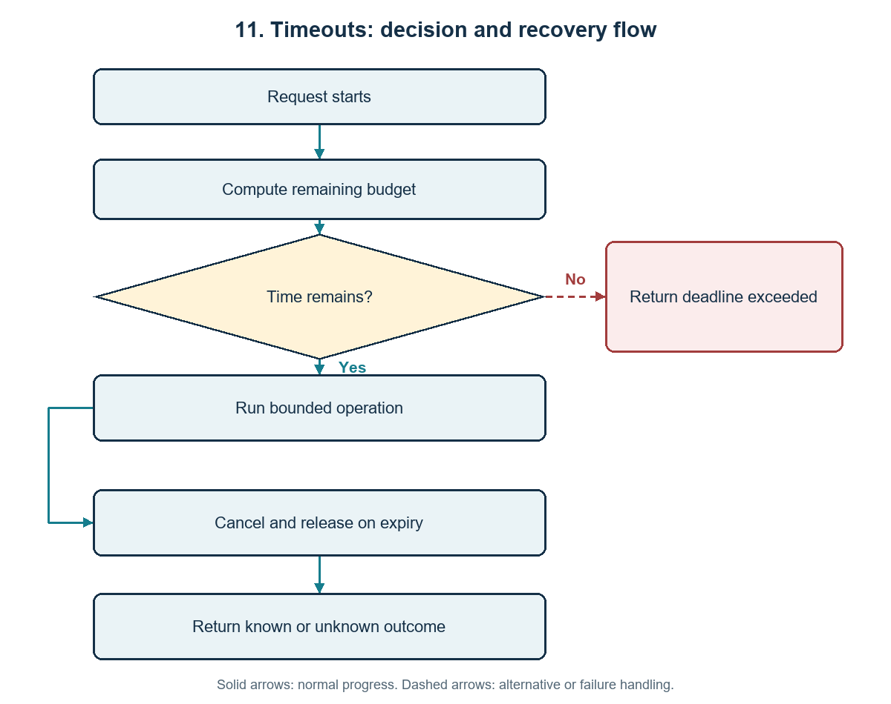

*Figure 11. 11. Timeouts: decision and recovery flow.* Start at "Request starts" and move to "Compute remaining budget". At "Time remains?", the Yes branch goes to "Run bounded operation" and the No branch goes to "Return deadline exceeded". Follow the arrows to the terminal or recovery outcome; a dashed branch is not an implicit success. Source: [editable Mermaid](diagrams/topic-011.mmd).


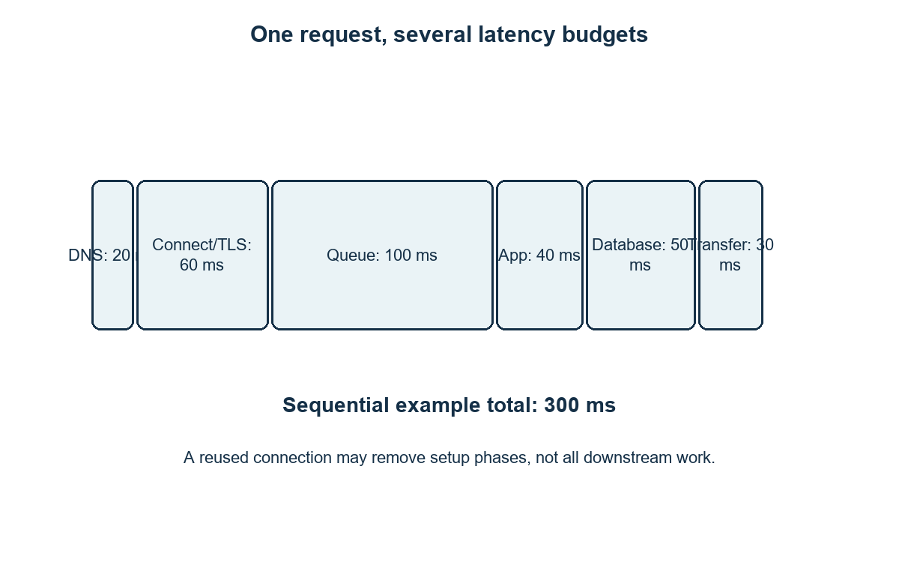

*Figure 183. One request, several latency budgets.* Add only sequential phases. Parallel work uses the critical path rather than the sum of every span. Source: [editable SVG](diagrams/ill-budget.svg).


#### 6. Step-by-step example

1. A 500 ms request budget reserves 50 ms for ingress and response, 100 ms for database work, and at most 300 ms for a dependency, leaving 50 ms margin.

2. If queueing already consumed 250 ms, the dependency cannot still receive its original 300 ms allowance.

#### 7. Implementation

The complete runnable module is [examples/algorithms.py](examples/algorithms.py); run `python algorithms.py` from the examples directory. The following excerpt isolates `retry_transient`. Required imports, surrounding definitions, expected output, and limitations are in the complete module and [lab guide](examples/README.md).

```python
def retry_transient(operation, clock, deadline, delays):
    """Fake-time scheduler: operation itself must honor its passed remaining budget."""
    waits = iter(delays)
    while True:
        remaining = deadline - clock.now
        if remaining <= 0:
            raise TimeoutError("total deadline exhausted")
        try:
            return operation(remaining)
        except (ConnectionError, TimeoutError):
            try:
                delay = next(waits)
            except StopIteration:
                raise
            if clock.now + delay >= deadline:
                raise TimeoutError("no budget for another attempt")
            clock.advance(delay)
```

Read the state changes in this excerpt alongside the mechanism above. The lab is a model of its stated boundary; it does not establish the behavior of a distributed deployment or an external provider. Check the assertions in [test_examples.py](examples/test_examples.py) and compare your output with [recorded outputs](examples/actual_outputs/).

#### 8. Production use cases

ShopStream cannot let one slow inventory request hold an HTTP worker forever. Waiting resources accumulate even when CPUs appear idle, making time limits a capacity and reliability mechanism. A 500 ms request budget reserves 50 ms for ingress and response, 100 ms for database work, and at most 300 ms for a dependency, leaving 50 ms margin.

#### 9. Advantages and disadvantages

Short timeouts reduce resource occupancy but increase false failures. Long ones tolerate variation but enlarge queues. Choose from measured distributions and user requirements, allowing for cold connections and deployment effects; percentiles alone do not define a universal safe number.

#### 10. Common mistakes and debugging

A read timeout that resets after every byte permits an arbitrarily long total transfer. A timeout after payment submission is an unknown outcome, not proof of failure. Reconcile by operation ID before retrying an unsafe side effect.

#### 11. Comparison with related concepts

| Decision | Engineering interpretation |
|---|---|
| What this topic contributes | A timeout limits how long a caller waits. |
| Nearest alternatives and limits | Short timeouts reduce resource occupancy but increase false failures. Long ones tolerate variation but enlarge queues. Choose from measured distributions and user requirements, allowing for cold connections and deployment effects; percentiles alone do not define a universal safe number. |
| Combined design | Read [12. Retries](#topic-012) and [13. Exponential Backoff](#topic-013); identify which layer owns each invariant rather than assuming their guarantees are interchangeable. |

#### 12. Interview preparation

**11.1 - Conceptual; Beginner. A teammate wants to add timeouts everywhere. What concrete need should justify it?**

**Model answer:** A timeout limits how long a caller waits. ShopStream cannot let one slow inventory request hold an HTTP worker forever. Waiting resources accumulate even when CPUs appear idle, making time limits a capacity and reliability mechanism. Short timeouts reduce resource occupancy but increase false failures.

**11.2 - Conceptual; Intermediate. What must be represented or coordinated for timeouts to work correctly?**

**Model answer:** Establish an end-to-end deadline using a monotonic clock. Allocate portions to connection establishment, TLS, pool acquisition, reads, and downstream calls. Pass remaining budget rather than resetting a full timeout at each hop. Cancel abandoned work where supported and release resources in finally blocks. Distinguish an attempt timeout from a total request deadline.

**11.3 - Conceptual; Beginner. Explain the analogy, then identify where it stops being a trustworthy model.**

**Model answer:** A diner gives a restaurant a deadline before leaving for a train. The kitchen may continue cooking after the diner leaves. Likewise, a client timeout does not prove server work stopped or that a write failed. The implementation must still follow the explicit state and failure rules described in the mechanism; an analogy cannot establish a delivery, timing, or security guarantee.

**11.4 - Conceptual; Intermediate. Which nearby alternative would you compare with timeouts, and what changes the choice?**

**Model answer:** Short timeouts reduce resource occupancy but increase false failures. Long ones tolerate variation but enlarge queues. Choose from measured distributions and user requirements, allowing for cold connections and deployment effects; percentiles alone do not define a universal safe number.

**11.5 - Conceptual; Intermediate. How can an apparently functioning implementation still violate the intended contract?**

**Model answer:** A read timeout that resets after every byte permits an arbitrarily long total transfer. A timeout after payment submission is an unknown outcome, not proof of failure. Reconcile by operation ID before retrying an unsafe side effect.

**11.6 - Scenario; Intermediate. Walk through the worked ShopStream example. What evidence establishes the outcome, and what remains an assumption?**

**Model answer:** A 500 ms request budget reserves 50 ms for ingress and response, 100 ms for database work, and at most 300 ms for a dependency, leaving 50 ms margin. If queueing already consumed 250 ms, the dependency cannot still receive its original 300 ms allowance. Verify the stated state transition or measurement at the responsible boundary. The numerical values, when present, are assumptions or deterministic examples rather than vendor performance guarantees.

**11.7 - Scenario; Advanced. You must validate this behavior before rollout. What experiment would expose a false correctness claim?**

**Model answer:** Allocate a 1-second deadline across three sequential calls. Inject 600 ms of queue wait and recalculate remaining budget. Show why retrying a payment after an ambiguous timeout needs idempotency and provider reconciliation. Record the starting state, injected condition, observed result, and invariant. A successful startup alone does not demonstrate the behavior under test.

**11.8 - Scenario; Advanced. A change involving timeouts produces a customer-visible regression. How would you investigate and choose a safe response?**

**Model answer:** A read timeout that resets after every byte permits an arbitrarily long total transfer. A timeout after payment submission is an unknown outcome, not proof of failure. Reconcile by operation ID before retrying an unsafe side effect. Cancellation is cooperative and can race with commit. Record durable operation state independently of client connection lifetime. Measure queue wait, pool wait, connect, TLS, server processing, and response transfer separately to locate the phase consuming the budget.

**11.9 - Advanced follow-up; Expert. Which hidden assumptions become important under failure, scale, or a changed workload?**

**Model answer:** Cancellation is cooperative and can race with commit. Record durable operation state independently of client connection lifetime. Measure queue wait, pool wait, connect, TLS, server processing, and response transfer separately to locate the phase consuming the budget.

**11.10 - Advanced follow-up; Expert. How does this design interact with retries and exponential backoff?**

**Model answer:** Establish an end-to-end deadline using a monotonic clock. Classify the failure, establish whether replay is safe, check total deadline and attempt budget, wait with jitter, then repeat using the same logical operation ID. For retry index k starting at zero, calculate cap_k=min(max_delay,base*2**k). Specify which component owns each decision and trace a failure across the combined boundary. Do not infer one component's guarantee from another component's name.

**Common incorrect answer:** "Adding the component makes the guarantee automatic." This is wrong because the mechanism depends on specific state, boundaries, and failure assumptions. A read timeout that resets after every byte permits an arbitrarily long total transfer.

**A deeper interviewer probe:** Change the timing, workload, or failure condition described in the advanced answer. Ask which invariant still holds, what observation would disprove it, and whether the fallback changes the user contract. Cancellation is cooperative and can race with commit.

#### 13. Exercises and solution walkthroughs

**Beginner exercise:** Reproduce the worked example for timeouts on paper. Record the initial state, each transition, and the result before reading the walkthrough.

**Beginner solution:** A 500 ms request budget reserves 50 ms for ingress and response, 100 ms for database work, and at most 300 ms for a dependency, leaving 50 ms margin. If queueing already consumed 250 ms, the dependency cannot still receive its original 300 ms allowance.

**Intermediate exercise:** Allocate a 1-second deadline across three sequential calls. Write the observable assertion and identify which component owns it.

**Intermediate solution:** Allocate a 1-second deadline across three sequential calls. Inject 600 ms of queue wait and recalculate remaining budget. Show why retrying a payment after an ambiguous timeout needs idempotency and provider reconciliation. Use the provided lab where applicable; for platform behavior, record the runtime version and actual evidence instead of treating a diagram as a test.

**Advanced exercise:** Extend the example to a failure or scale condition described below. State the guarantee you retain, the one you relax if necessary, and a safe recovery procedure.

**Advanced solution:** Cancellation is cooperative and can race with commit. Record durable operation state independently of client connection lifetime. Measure queue wait, pool wait, connect, TLS, server processing, and response transfer separately to locate the phase consuming the budget. A read timeout that resets after every byte permits an arbitrarily long total transfer. A complete solution identifies a detection signal, a bounded action, and a verification of the business outcome.

#### 14. Key takeaways

- A timeout limits how long a caller waits.

- Establish an end-to-end deadline using a monotonic clock.

- Short timeouts reduce resource occupancy but increase false failures.

- A read timeout that resets after every byte permits an arbitrarily long total transfer.

- Cancellation is cooperative and can race with commit.


**When to use it:** ShopStream cannot let one slow inventory request hold an HTTP worker forever. Waiting resources accumulate even when CPUs appear idle, making time limits a capacity and reliability mechanism.

**Terminology:** See this topic's glossary entry and the linked related terms. **Continue with:** [12. Retries](#topic-012), [13. Exponential Backoff](#topic-013), [14. Idempotency](#topic-014), [91. Latency](#topic-091).
<a id="topic-012"></a>

### 12. Retries

Prerequisites and related reading: [10. Circuit Breakers](#topic-010), [11. Timeouts](#topic-011), [13. Exponential Backoff](#topic-013), [14. Idempotency](#topic-014).

#### 1. Simple explanation

A retry repeats an operation after a failure that might be temporary.

#### 2. The problem it solves

It can hide a brief connection interruption, but repeating an operation that already committed can create duplicate orders. Retry policy therefore depends on semantics, not only an error code.

#### 3. Intuitive analogy

If a cashier cannot hear you, repeating your question is safe; repeating a payment without checking the receipt may charge twice. Network failures similarly leave uncertainty about what the receiver completed.

#### 4. Technical working mechanism

1. Classify the failure, establish whether replay is safe, check total deadline and attempt budget, wait with jitter, then repeat using the same logical operation ID.

2. Retry transient transport failures and selected overload responses only under a bounded policy.

3. Respect server retry hints.

4. Stop on permanent validation or authorization errors.


**Boundary and advanced reasoning.** A retry budget can cap additional traffic as a fraction of successful or original traffic. Combine it with circuit breaking and admission control. For asynchronous work, persist attempt counts and next-attempt times so process restarts do not reset the budget.

#### 5. Architecture and diagrams


*Figure 12. 12. Retries: decision and recovery flow.* Start at "Attempt fails" and move to "Classify error and replay safety". At "Retry budget remains?", the Yes branch goes to "Wait with jitter" and the No branch goes to "Stop and report outcome". Follow the arrows to the terminal or recovery outcome; a dashed branch is not an implicit success. Source: [editable Mermaid](diagrams/topic-012.mmd).


#### 6. Step-by-step example

1. The order API sends payment key K.

2. The provider commits but its response is lost.

3. The retry sends K again and receives the original charge result.

4. Sending a new key would create a second logical payment even if the amount is identical.

#### 7. Implementation

The complete runnable module is [examples/algorithms.py](examples/algorithms.py); run `python algorithms.py` from the examples directory. The following excerpt isolates `retry_transient`. Required imports, surrounding definitions, expected output, and limitations are in the complete module and [lab guide](examples/README.md).

```python
def retry_transient(operation, clock, deadline, delays):
    """Fake-time scheduler: operation itself must honor its passed remaining budget."""
    waits = iter(delays)
    while True:
        remaining = deadline - clock.now
        if remaining <= 0:
            raise TimeoutError("total deadline exhausted")
        try:
            return operation(remaining)
        except (ConnectionError, TimeoutError):
            try:
                delay = next(waits)
            except StopIteration:
                raise
            if clock.now + delay >= deadline:
                raise TimeoutError("no budget for another attempt")
            clock.advance(delay)
```

Read the state changes in this excerpt alongside the mechanism above. The lab is a model of its stated boundary; it does not establish the behavior of a distributed deployment or an external provider. Check the assertions in [test_examples.py](examples/test_examples.py) and compare your output with [recorded outputs](examples/actual_outputs/).

#### 8. Production use cases

It can hide a brief connection interruption, but repeating an operation that already committed can create duplicate orders. Retry policy therefore depends on semantics, not only an error code. The order API sends payment key K.

#### 9. Advantages and disadvantages

Retries improve availability for independent transient failures but amplify sustained overload. Three attempts at each of three layers can generate 27 leaf attempts. Prefer one coordinated retry layer and a shared total deadline.

#### 10. Common mistakes and debugging

Infinite retries make outages self-sustaining. Retrying all 4xx responses wastes resources. A retry count without delay synchronizes callers. Track attempts separately from logical requests so success metrics do not hide amplification.

#### 11. Comparison with related concepts

| Decision | Engineering interpretation |
|---|---|
| What this topic contributes | A retry repeats an operation after a failure that might be temporary. |
| Nearest alternatives and limits | Retries improve availability for independent transient failures but amplify sustained overload. Three attempts at each of three layers can generate 27 leaf attempts. Prefer one coordinated retry layer and a shared total deadline. |
| Combined design | Read [10. Circuit Breakers](#topic-010) and [11. Timeouts](#topic-011); identify which layer owns each invariant rather than assuming their guarantees are interchangeable. |

#### 12. Interview preparation

**12.1 - Conceptual; Beginner. A teammate wants to add retries everywhere. What concrete need should justify it?**

**Model answer:** A retry repeats an operation after a failure that might be temporary. It can hide a brief connection interruption, but repeating an operation that already committed can create duplicate orders. Retry policy therefore depends on semantics, not only an error code. Retries improve availability for independent transient failures but amplify sustained overload.

**12.2 - Conceptual; Intermediate. What must be represented or coordinated for retries to work correctly?**

**Model answer:** Classify the failure, establish whether replay is safe, check total deadline and attempt budget, wait with jitter, then repeat using the same logical operation ID. Retry transient transport failures and selected overload responses only under a bounded policy. Respect server retry hints. Stop on permanent validation or authorization errors.

**12.3 - Conceptual; Beginner. Explain the analogy, then identify where it stops being a trustworthy model.**

**Model answer:** If a cashier cannot hear you, repeating your question is safe; repeating a payment without checking the receipt may charge twice. Network failures similarly leave uncertainty about what the receiver completed. The implementation must still follow the explicit state and failure rules described in the mechanism; an analogy cannot establish a delivery, timing, or security guarantee.

**12.4 - Conceptual; Intermediate. Which nearby alternative would you compare with retries, and what changes the choice?**

**Model answer:** Retries improve availability for independent transient failures but amplify sustained overload. Three attempts at each of three layers can generate 27 leaf attempts. Prefer one coordinated retry layer and a shared total deadline.

**12.5 - Conceptual; Intermediate. How can an apparently functioning implementation still violate the intended contract?**

**Model answer:** Infinite retries make outages self-sustaining. Retrying all 4xx responses wastes resources. A retry count without delay synchronizes callers. Track attempts separately from logical requests so success metrics do not hide amplification.

**12.6 - Scenario; Intermediate. Walk through the worked ShopStream example. What evidence establishes the outcome, and what remains an assumption?**

**Model answer:** The order API sends payment key K. The provider commits but its response is lost. The retry sends K again and receives the original charge result. Sending a new key would create a second logical payment even if the amount is identical. Verify the stated state transition or measurement at the responsible boundary. The numerical values, when present, are assumptions or deterministic examples rather than vendor performance guarantees.

**12.7 - Scenario; Advanced. You must validate this behavior before rollout. What experiment would expose a false correctness claim?**

**Model answer:** Simulate one transient failure followed by success and verify two attempts. Simulate permanent failure and verify one. Calculate downstream attempts with three layers, then redesign so only the outer layer retries with a shared key. Record the starting state, injected condition, observed result, and invariant. A successful startup alone does not demonstrate the behavior under test.

**12.8 - Scenario; Advanced. A change involving retries produces a customer-visible regression. How would you investigate and choose a safe response?**

**Model answer:** Infinite retries make outages self-sustaining. Retrying all 4xx responses wastes resources. A retry count without delay synchronizes callers. Track attempts separately from logical requests so success metrics do not hide amplification. A retry budget can cap additional traffic as a fraction of successful or original traffic. Combine it with circuit breaking and admission control. For asynchronous work, persist attempt counts and next-attempt times so process restarts do not reset the budget.

**12.9 - Advanced follow-up; Expert. Which hidden assumptions become important under failure, scale, or a changed workload?**

**Model answer:** A retry budget can cap additional traffic as a fraction of successful or original traffic. Combine it with circuit breaking and admission control. For asynchronous work, persist attempt counts and next-attempt times so process restarts do not reset the budget.

**12.10 - Advanced follow-up; Expert. How does this design interact with circuit breakers and timeouts?**

**Model answer:** Classify the failure, establish whether replay is safe, check total deadline and attempt budget, wait with jitter, then repeat using the same logical operation ID. In closed state, forward calls and record eligible failures. Establish an end-to-end deadline using a monotonic clock. Specify which component owns each decision and trace a failure across the combined boundary. Do not infer one component's guarantee from another component's name.

**Common incorrect answer:** "Adding the component makes the guarantee automatic." This is wrong because the mechanism depends on specific state, boundaries, and failure assumptions. Infinite retries make outages self-sustaining.

**A deeper interviewer probe:** Change the timing, workload, or failure condition described in the advanced answer. Ask which invariant still holds, what observation would disprove it, and whether the fallback changes the user contract. A retry budget can cap additional traffic as a fraction of successful or original traffic.

#### 13. Exercises and solution walkthroughs

**Beginner exercise:** Reproduce the worked example for retries on paper. Record the initial state, each transition, and the result before reading the walkthrough.

**Beginner solution:** The order API sends payment key K. The provider commits but its response is lost. The retry sends K again and receives the original charge result. Sending a new key would create a second logical payment even if the amount is identical.

**Intermediate exercise:** Simulate one transient failure followed by success and verify two attempts. Write the observable assertion and identify which component owns it.

**Intermediate solution:** Simulate one transient failure followed by success and verify two attempts. Simulate permanent failure and verify one. Calculate downstream attempts with three layers, then redesign so only the outer layer retries with a shared key. Use the provided lab where applicable; for platform behavior, record the runtime version and actual evidence instead of treating a diagram as a test.

**Advanced exercise:** Extend the example to a failure or scale condition described below. State the guarantee you retain, the one you relax if necessary, and a safe recovery procedure.

**Advanced solution:** A retry budget can cap additional traffic as a fraction of successful or original traffic. Combine it with circuit breaking and admission control. For asynchronous work, persist attempt counts and next-attempt times so process restarts do not reset the budget. Infinite retries make outages self-sustaining. A complete solution identifies a detection signal, a bounded action, and a verification of the business outcome.

#### 14. Key takeaways

- A retry repeats an operation after a failure that might be temporary.

- Classify the failure, establish whether replay is safe, check total deadline and attempt budget, wait with jitter, then repeat using the same logical operation ID.

- Retries improve availability for independent transient failures but amplify sustained overload.

- Infinite retries make outages self-sustaining.

- A retry budget can cap additional traffic as a fraction of successful or original traffic.


**When to use it:** It can hide a brief connection interruption, but repeating an operation that already committed can create duplicate orders. Retry policy therefore depends on semantics, not only an error code.

**Terminology:** See this topic's glossary entry and the linked related terms. **Continue with:** [10. Circuit Breakers](#topic-010), [11. Timeouts](#topic-011), [13. Exponential Backoff](#topic-013), [14. Idempotency](#topic-014).
<a id="topic-013"></a>

### 13. Exponential Backoff

Prerequisites and related reading: [11. Timeouts](#topic-011), [12. Retries](#topic-012), [44. Backpressure](#topic-044).

#### 1. Simple explanation

Exponential backoff increases the delay between repeated attempts.

#### 2. The problem it solves

When a dependency is overloaded, immediately repeating every request competes with its recovery. Spreading retries reduces the synchronized waves created by many clients failing together.

#### 3. Intuitive analogy

After a busy phone signal, callers wait longer before trying again. If everyone waits exactly the same interval, they still call together. Randomized waiting is what breaks that synchronization.

#### 4. Technical working mechanism

1. For retry index k starting at zero, calculate cap_k=min(max_delay,base*2**k).

2. Full jitter draws a delay uniformly from zero to cap_k.

3. Limit attempts and stop when the remaining deadline cannot accommodate the wait and useful work.

4. Use a monotonic clock and honor server hints without extending the total deadline indefinitely.


**Boundary and advanced reasoning.** Full jitter has mean cap_k/2, but worst-case wait approaches cap_k. Deadline analysis must use a safe bound or reject attempts dynamically. Independent clients still need a server-wide retry budget because random timing does not reduce total submitted work by itself.

#### 5. Architecture and diagrams

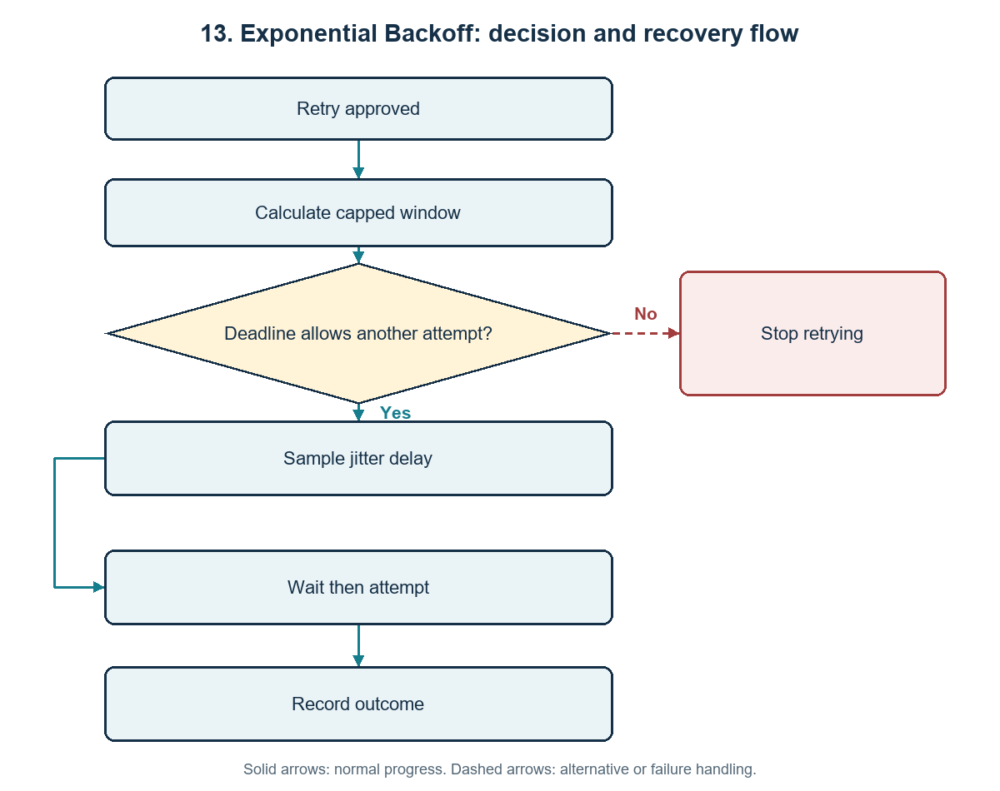

*Figure 13. 13. Exponential Backoff: decision and recovery flow.* Start at "Retry approved" and move to "Calculate capped window". At "Deadline allows another attempt?", the Yes branch goes to "Sample jitter delay" and the No branch goes to "Stop retrying". Follow the arrows to the terminal or recovery outcome; a dashed branch is not an implicit success. Source: [editable Mermaid](diagrams/topic-013.mmd).


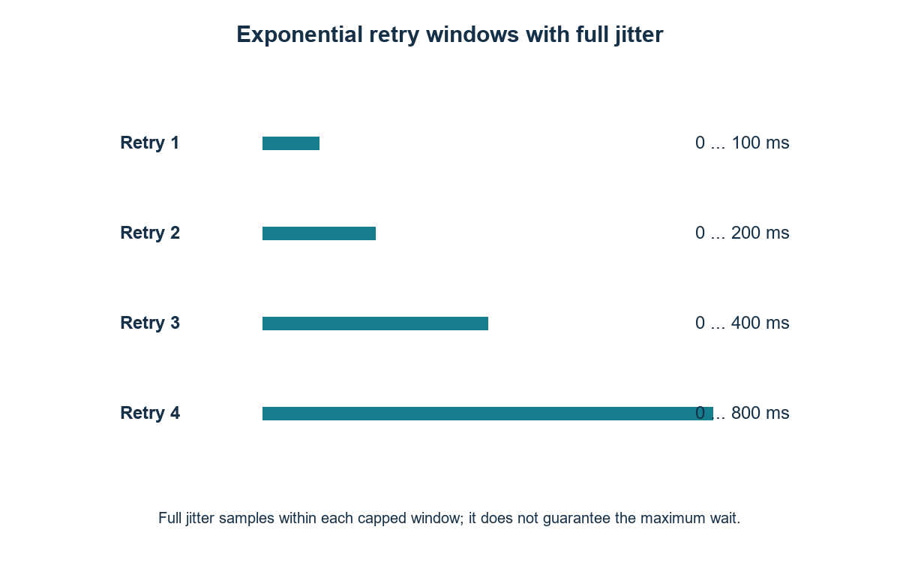

*Figure 186. Exponential retry windows with full jitter.* Each retry samples a different window; the cap and total deadline still bound the policy. Source: [editable SVG](diagrams/ill-backoff.svg).


#### 6. Step-by-step example

1. With base=100 ms and cap=800 ms, retry windows are 0-100, 0-200, 0-400, then 0-800 ms.

2. These are windows, not guaranteed delays.

3. Four retries can consume substantial time even before operation execution, so budget them explicitly.

#### 7. Implementation

The complete runnable module is [examples/algorithms.py](examples/algorithms.py); run `python algorithms.py` from the examples directory. The following excerpt isolates `jitter_delays`. Required imports, surrounding definitions, expected output, and limitations are in the complete module and [lab guide](examples/README.md).

```python
def jitter_delays(attempts=4, base=0.1, cap=0.8, seed=7):
    if attempts < 0 or base <= 0 or cap <= 0:
        raise ValueError("invalid retry policy")
    rng, window = random.Random(seed), min(base, cap)
    result = []
    for _ in range(attempts):
        result.append(rng.uniform(0, window))
        window = min(cap, window * 2)
    return result
```

Read the state changes in this excerpt alongside the mechanism above. The lab is a model of its stated boundary; it does not establish the behavior of a distributed deployment or an external provider. Check the assertions in [test_examples.py](examples/test_examples.py) and compare your output with [recorded outputs](examples/actual_outputs/).

#### 8. Production use cases

When a dependency is overloaded, immediately repeating every request competes with its recovery. Spreading retries reduces the synchronized waves created by many clients failing together. With base=100 ms and cap=800 ms, retry windows are 0-100, 0-200, 0-400, then 0-800 ms.

#### 9. Advantages and disadvantages

Fixed delay is simple and useful for predictable polling but can synchronize clients. Exponential growth reduces pressure faster. Decorrelated jitter and equal jitter have different delay distributions; no policy removes the need for idempotency or capacity limits.

#### 10. Common mistakes and debugging

Adding tiny random noise to a huge common delay may leave a retry herd. Integer overflow in unbounded exponentiation can break limits. Cap before expensive computation and test deterministic random seeds in educational simulations.

#### 11. Comparison with related concepts

| Decision | Engineering interpretation |
|---|---|
| What this topic contributes | Exponential backoff increases the delay between repeated attempts. |
| Nearest alternatives and limits | Fixed delay is simple and useful for predictable polling but can synchronize clients. Exponential growth reduces pressure faster. Decorrelated jitter and equal jitter have different delay distributions; no policy removes the need for idempotency or capacity limits. |
| Combined design | Read [11. Timeouts](#topic-011) and [12. Retries](#topic-012); identify which layer owns each invariant rather than assuming their guarantees are interchangeable. |

#### 12. Interview preparation

**13.1 - Conceptual; Beginner. A teammate wants to add exponential backoff everywhere. What concrete need should justify it?**

**Model answer:** Exponential backoff increases the delay between repeated attempts. When a dependency is overloaded, immediately repeating every request competes with its recovery. Spreading retries reduces the synchronized waves created by many clients failing together. Fixed delay is simple and useful for predictable polling but can synchronize clients.

**13.2 - Conceptual; Intermediate. What must be represented or coordinated for exponential backoff to work correctly?**

**Model answer:** For retry index k starting at zero, calculate cap_k=min(max_delay,base*2**k). Full jitter draws a delay uniformly from zero to cap_k. Limit attempts and stop when the remaining deadline cannot accommodate the wait and useful work. Use a monotonic clock and honor server hints without extending the total deadline indefinitely.

**13.3 - Conceptual; Beginner. Explain the analogy, then identify where it stops being a trustworthy model.**

**Model answer:** After a busy phone signal, callers wait longer before trying again. If everyone waits exactly the same interval, they still call together. Randomized waiting is what breaks that synchronization. The implementation must still follow the explicit state and failure rules described in the mechanism; an analogy cannot establish a delivery, timing, or security guarantee.

**13.4 - Conceptual; Intermediate. Which nearby alternative would you compare with exponential backoff, and what changes the choice?**

**Model answer:** Fixed delay is simple and useful for predictable polling but can synchronize clients. Exponential growth reduces pressure faster. Decorrelated jitter and equal jitter have different delay distributions; no policy removes the need for idempotency or capacity limits.

**13.5 - Conceptual; Intermediate. How can an apparently functioning implementation still violate the intended contract?**

**Model answer:** Adding tiny random noise to a huge common delay may leave a retry herd. Integer overflow in unbounded exponentiation can break limits. Cap before expensive computation and test deterministic random seeds in educational simulations.

**13.6 - Scenario; Intermediate. Walk through the worked ShopStream example. What evidence establishes the outcome, and what remains an assumption?**

**Model answer:** With base=100 ms and cap=800 ms, retry windows are 0-100, 0-200, 0-400, then 0-800 ms. These are windows, not guaranteed delays. Four retries can consume substantial time even before operation execution, so budget them explicitly. Verify the stated state transition or measurement at the responsible boundary. The numerical values, when present, are assumptions or deterministic examples rather than vendor performance guarantees.

**13.7 - Scenario; Advanced. You must validate this behavior before rollout. What experiment would expose a false correctness claim?**

**Model answer:** Print seeded retry delays and verify each lies within its window. Compute the maximum four-wait sum, 1.5 seconds for the listed windows. Compare a fleet using fixed delays with jitter by counting retries per time bucket. Record the starting state, injected condition, observed result, and invariant. A successful startup alone does not demonstrate the behavior under test.

**13.8 - Scenario; Advanced. A change involving exponential backoff produces a customer-visible regression. How would you investigate and choose a safe response?**

**Model answer:** Adding tiny random noise to a huge common delay may leave a retry herd. Integer overflow in unbounded exponentiation can break limits. Cap before expensive computation and test deterministic random seeds in educational simulations. Full jitter has mean cap_k/2, but worst-case wait approaches cap_k. Deadline analysis must use a safe bound or reject attempts dynamically. Independent clients still need a server-wide retry budget because random timing does not reduce total submitted work by itself.

**13.9 - Advanced follow-up; Expert. Which hidden assumptions become important under failure, scale, or a changed workload?**

**Model answer:** Full jitter has mean cap_k/2, but worst-case wait approaches cap_k. Deadline analysis must use a safe bound or reject attempts dynamically. Independent clients still need a server-wide retry budget because random timing does not reduce total submitted work by itself.

**13.10 - Advanced follow-up; Expert. How does this design interact with timeouts and retries?**

**Model answer:** For retry index k starting at zero, calculate cap_k=min(max_delay,base*2**k). Establish an end-to-end deadline using a monotonic clock. Classify the failure, establish whether replay is safe, check total deadline and attempt budget, wait with jitter, then repeat using the same logical operation ID. Specify which component owns each decision and trace a failure across the combined boundary. Do not infer one component's guarantee from another component's name.

**Common incorrect answer:** "Adding the component makes the guarantee automatic." This is wrong because the mechanism depends on specific state, boundaries, and failure assumptions. Adding tiny random noise to a huge common delay may leave a retry herd.

**A deeper interviewer probe:** Change the timing, workload, or failure condition described in the advanced answer. Ask which invariant still holds, what observation would disprove it, and whether the fallback changes the user contract. Full jitter has mean cap_k/2, but worst-case wait approaches cap_k.

#### 13. Exercises and solution walkthroughs

**Beginner exercise:** Reproduce the worked example for exponential backoff on paper. Record the initial state, each transition, and the result before reading the walkthrough.

**Beginner solution:** With base=100 ms and cap=800 ms, retry windows are 0-100, 0-200, 0-400, then 0-800 ms. These are windows, not guaranteed delays. Four retries can consume substantial time even before operation execution, so budget them explicitly.

**Intermediate exercise:** Print seeded retry delays and verify each lies within its window. Write the observable assertion and identify which component owns it.

**Intermediate solution:** Print seeded retry delays and verify each lies within its window. Compute the maximum four-wait sum, 1.5 seconds for the listed windows. Compare a fleet using fixed delays with jitter by counting retries per time bucket. Use the provided lab where applicable; for platform behavior, record the runtime version and actual evidence instead of treating a diagram as a test.

**Advanced exercise:** Extend the example to a failure or scale condition described below. State the guarantee you retain, the one you relax if necessary, and a safe recovery procedure.

**Advanced solution:** Full jitter has mean cap_k/2, but worst-case wait approaches cap_k. Deadline analysis must use a safe bound or reject attempts dynamically. Independent clients still need a server-wide retry budget because random timing does not reduce total submitted work by itself. Adding tiny random noise to a huge common delay may leave a retry herd. A complete solution identifies a detection signal, a bounded action, and a verification of the business outcome.

#### 14. Key takeaways

- Exponential backoff increases the delay between repeated attempts.

- For retry index k starting at zero, calculate cap_k=min(max_delay,base*2**k).

- Fixed delay is simple and useful for predictable polling but can synchronize clients.

- Adding tiny random noise to a huge common delay may leave a retry herd.

- Full jitter has mean cap_k/2, but worst-case wait approaches cap_k.


**When to use it:** When a dependency is overloaded, immediately repeating every request competes with its recovery. Spreading retries reduces the synchronized waves created by many clients failing together.

**Terminology:** See this topic's glossary entry and the linked related terms. **Continue with:** [11. Timeouts](#topic-011), [12. Retries](#topic-012), [44. Backpressure](#topic-044).
<a id="topic-014"></a>

### 14. Idempotency

Prerequisites and related reading: [12. Retries](#topic-012), [15. Message Queues](#topic-015), [17. Event-Driven Architecture](#topic-017), [18. Distributed Transactions](#topic-018), [19. Saga Pattern](#topic-019).

#### 1. Simple explanation

An idempotent operation has the same intended effect when repeated as when performed once.

#### 2. The problem it solves

ShopStream needs one order for one checkout even if a user double-clicks or a response disappears. Identical HTTP payloads alone do not identify the same purchase intent.

#### 3. Intuitive analogy

A cloakroom ticket refers to one deposited coat. Re-presenting the same ticket does not create another coat. A new ticket, however, represents a new operation even if the coats look identical.

#### 4. Technical working mechanism

1. Accept a client-generated operation key scoped to tenant and endpoint.

2. Store a canonical request fingerprint and durable status under a unique constraint.

3. Atomically claim the key, execute local changes and persist the result in one transaction when possible.

4. Return the saved result on replay.

5. Reject reuse with a different payload and define in-progress behavior and retention.


**Boundary and advanced reasoning.** The effect boundary matters. A local transaction cannot atomically commit an unrelated payment provider call. Persist intent, use provider keys, reconcile unknown outcomes, and expose pending state. Define what happens when the provider retention window is shorter than your own replay window.

#### 5. Architecture and diagrams


*Figure 14. 14. Idempotency: decision and recovery flow.* Start at "Mutation received" and move to "Look up scoped key". At "Completed matching request?", the Yes branch goes to "Replay stored response" and the No branch goes to "Claim key atomically". Follow the arrows to the terminal or recovery outcome; a dashed branch is not an implicit success. Source: [editable Mermaid](diagrams/topic-014.mmd).


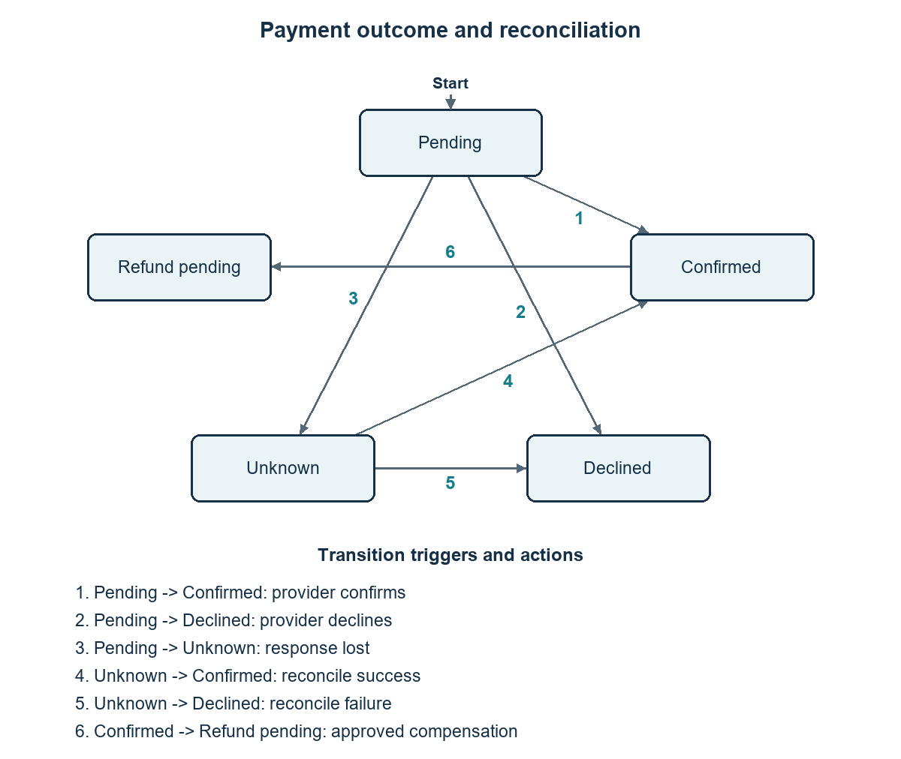

*Figure 173. Payment outcome and reconciliation.* Unknown is not declined. A refund is a new financial action, not erasure of the original payment. Source: [editable Mermaid](diagrams/state-payment.mmd).


#### 6. Step-by-step example

1. Checkout key K inserts order O and its response in one database transaction.

2. A crash after commit but before HTTP response leaves a recoverable result.

3. The next request with K returns O.

4. External payment side effects need the same protection at the provider plus reconciliation or an outbox workflow.

#### 7. Implementation

The complete runnable module is [examples/orders.py](examples/orders.py); run `python orders.py` from the examples directory. The following excerpt isolates `place_order`. Required imports, surrounding definitions, expected output, and limitations are in the complete module and [lab guide](examples/README.md).

```python
def place_order(path, tenant, key, sku="book", quantity=1, inject_failure=False):
    if not tenant or not key or not isinstance(quantity, int) or quantity <= 0:
        raise ValueError("tenant, operation key, and positive integer quantity required")
    payload = json.dumps({"sku": sku, "quantity": quantity}, sort_keys=True, separators=(",", ":"))
    fingerprint = hashlib.sha256(payload.encode()).hexdigest()
    with closing(connect(path)) as db:
        try:
            db.execute("BEGIN IMMEDIATE")
            old = db.execute("SELECT fingerprint,order_id FROM operations WHERE tenant=? AND key=?",
                             (tenant, key)).fetchone()
            if old:
                if old[0] != fingerprint:
                    raise ValueError("idempotency key reused with different payload")
                db.commit()
                return old[1]
            result = db.execute("UPDATE inventory SET stock=stock-? WHERE sku=? AND stock>=?",
                                (quantity, sku, quantity))
            if result.rowcount != 1:
                raise ValueError("insufficient inventory or unknown SKU")
            order_id = db.execute("INSERT INTO orders(tenant,sku,quantity) VALUES (?,?,?)",
                                  (tenant, sku, quantity)).lastrowid
            db.execute("INSERT INTO operations VALUES (?,?,?,?)", (tenant, key, fingerprint, order_id))
            db.execute("INSERT INTO outbox(order_id,event_type) VALUES (?,?)", (order_id, "OrderPlaced"))
            if inject_failure:
                raise RuntimeError("simulated crash before commit")
            db.commit()
            return order_id
        except BaseException:
            db.rollback()
            raise
```

Read the state changes in this excerpt alongside the mechanism above. The lab is a model of its stated boundary; it does not establish the behavior of a distributed deployment or an external provider. Check the assertions in [test_examples.py](examples/test_examples.py) and compare your output with [recorded outputs](examples/actual_outputs/).

#### 8. Production use cases

ShopStream needs one order for one checkout even if a user double-clicks or a response disappears. Identical HTTP payloads alone do not identify the same purchase intent. Checkout key K inserts order O and its response in one database transaction.

#### 9. Advantages and disadvantages

Idempotency differs from deduplication by time or payload similarity. HTTP PUT has idempotent intended semantics; arbitrary POST endpoints need an explicit contract. An inbox deduplicates consumed event IDs; an outbox reliably publishes committed local changes.

#### 10. Common mistakes and debugging

Checking then inserting without a uniqueness constraint races. An in-memory key cache disappears on restart. Expiring keys too early permits late duplicates. Never promise exactly-once delivery merely because one database transaction suppresses duplicate local effects.

#### 11. Comparison with related concepts

| Decision | Engineering interpretation |
|---|---|
| What this topic contributes | An idempotent operation has the same intended effect when repeated as when performed once. |
| Nearest alternatives and limits | Idempotency differs from deduplication by time or payload similarity. HTTP PUT has idempotent intended semantics; arbitrary POST endpoints need an explicit contract. An inbox deduplicates consumed event IDs; an outbox reliably publishes committed local changes. |
| Combined design | Read [12. Retries](#topic-012) and [15. Message Queues](#topic-015); identify which layer owns each invariant rather than assuming their guarantees are interchangeable. |

#### 12. Interview preparation

**14.1 - Conceptual; Beginner. A teammate wants to add idempotency everywhere. What concrete need should justify it?**

**Model answer:** An idempotent operation has the same intended effect when repeated as when performed once. ShopStream needs one order for one checkout even if a user double-clicks or a response disappears. Identical HTTP payloads alone do not identify the same purchase intent. Idempotency differs from deduplication by time or payload similarity.

**14.2 - Conceptual; Intermediate. What must be represented or coordinated for idempotency to work correctly?**

**Model answer:** Accept a client-generated operation key scoped to tenant and endpoint. Store a canonical request fingerprint and durable status under a unique constraint. Atomically claim the key, execute local changes and persist the result in one transaction when possible. Return the saved result on replay. Reject reuse with a different payload and define in-progress behavior and retention.

**14.3 - Conceptual; Beginner. Explain the analogy, then identify where it stops being a trustworthy model.**

**Model answer:** A cloakroom ticket refers to one deposited coat. Re-presenting the same ticket does not create another coat. A new ticket, however, represents a new operation even if the coats look identical. The implementation must still follow the explicit state and failure rules described in the mechanism; an analogy cannot establish a delivery, timing, or security guarantee.

**14.4 - Conceptual; Intermediate. Which nearby alternative would you compare with idempotency, and what changes the choice?**

**Model answer:** Idempotency differs from deduplication by time or payload similarity. HTTP PUT has idempotent intended semantics; arbitrary POST endpoints need an explicit contract. An inbox deduplicates consumed event IDs; an outbox reliably publishes committed local changes.

**14.5 - Conceptual; Intermediate. How can an apparently functioning implementation still violate the intended contract?**

**Model answer:** Checking then inserting without a uniqueness constraint races. An in-memory key cache disappears on restart. Expiring keys too early permits late duplicates. Never promise exactly-once delivery merely because one database transaction suppresses duplicate local effects.

**14.6 - Scenario; Intermediate. Walk through the worked ShopStream example. What evidence establishes the outcome, and what remains an assumption?**

**Model answer:** Checkout key K inserts order O and its response in one database transaction. A crash after commit but before HTTP response leaves a recoverable result. The next request with K returns O. External payment side effects need the same protection at the provider plus reconciliation or an outbox workflow. Verify the stated state transition or measurement at the responsible boundary. The numerical values, when present, are assumptions or deterministic examples rather than vendor performance guarantees.

**14.7 - Scenario; Advanced. You must validate this behavior before rollout. What experiment would expose a false correctness claim?**

**Model answer:** Run concurrent attempts with the same key and assert one order row. Repeat with a different payload and expect conflict. Crash between provider acceptance and local result persistence; recover by querying the provider using the original key. Record the starting state, injected condition, observed result, and invariant. A successful startup alone does not demonstrate the behavior under test.

**14.8 - Scenario; Advanced. A change involving idempotency produces a customer-visible regression. How would you investigate and choose a safe response?**

**Model answer:** Checking then inserting without a uniqueness constraint races. An in-memory key cache disappears on restart. Expiring keys too early permits late duplicates. Never promise exactly-once delivery merely because one database transaction suppresses duplicate local effects. The effect boundary matters. A local transaction cannot atomically commit an unrelated payment provider call. Persist intent, use provider keys, reconcile unknown outcomes, and expose pending state. Define what happens when the provider retention window is shorter than your own replay window.

**14.9 - Advanced follow-up; Expert. Which hidden assumptions become important under failure, scale, or a changed workload?**

**Model answer:** The effect boundary matters. A local transaction cannot atomically commit an unrelated payment provider call. Persist intent, use provider keys, reconcile unknown outcomes, and expose pending state. Define what happens when the provider retention window is shorter than your own replay window.

**14.10 - Advanced follow-up; Expert. How does this design interact with retries and message queues?**

**Model answer:** Accept a client-generated operation key scoped to tenant and endpoint. Classify the failure, establish whether replay is safe, check total deadline and attempt budget, wait with jitter, then repeat using the same logical operation ID. Publish durably according to broker guarantees, deliver to a consumer, reserve or hide it for a visibility interval, process the side effect, then acknowledge. Specify which component owns each decision and trace a failure across the combined boundary. Do not infer one component's guarantee from another component's name.

**Common incorrect answer:** "Adding the component makes the guarantee automatic." This is wrong because the mechanism depends on specific state, boundaries, and failure assumptions. Checking then inserting without a uniqueness constraint races.

**A deeper interviewer probe:** Change the timing, workload, or failure condition described in the advanced answer. Ask which invariant still holds, what observation would disprove it, and whether the fallback changes the user contract. The effect boundary matters.

#### 13. Exercises and solution walkthroughs

**Beginner exercise:** Reproduce the worked example for idempotency on paper. Record the initial state, each transition, and the result before reading the walkthrough.

**Beginner solution:** Checkout key K inserts order O and its response in one database transaction. A crash after commit but before HTTP response leaves a recoverable result. The next request with K returns O. External payment side effects need the same protection at the provider plus reconciliation or an outbox workflow.

**Intermediate exercise:** Run concurrent attempts with the same key and assert one order row. Write the observable assertion and identify which component owns it.

**Intermediate solution:** Run concurrent attempts with the same key and assert one order row. Repeat with a different payload and expect conflict. Crash between provider acceptance and local result persistence; recover by querying the provider using the original key. Use the provided lab where applicable; for platform behavior, record the runtime version and actual evidence instead of treating a diagram as a test.

**Advanced exercise:** Extend the example to a failure or scale condition described below. State the guarantee you retain, the one you relax if necessary, and a safe recovery procedure.

**Advanced solution:** The effect boundary matters. A local transaction cannot atomically commit an unrelated payment provider call. Persist intent, use provider keys, reconcile unknown outcomes, and expose pending state. Define what happens when the provider retention window is shorter than your own replay window. Checking then inserting without a uniqueness constraint races. A complete solution identifies a detection signal, a bounded action, and a verification of the business outcome.

#### 14. Key takeaways

- An idempotent operation has the same intended effect when repeated as when performed once.

- Accept a client-generated operation key scoped to tenant and endpoint.

- Idempotency differs from deduplication by time or payload similarity.

- Checking then inserting without a uniqueness constraint races.

- The effect boundary matters.


**When to use it:** ShopStream needs one order for one checkout even if a user double-clicks or a response disappears. Identical HTTP payloads alone do not identify the same purchase intent.

**Terminology:** See this topic's glossary entry and the linked related terms. **Continue with:** [12. Retries](#topic-012), [15. Message Queues](#topic-015), [17. Event-Driven Architecture](#topic-017), [18. Distributed Transactions](#topic-018), [19. Saga Pattern](#topic-019).

**Official verification references:** [Python sqlite3 reference](https://docs.python.org/3/library/sqlite3.html). These references verify the named protocol or platform details; the examples, diagrams, and numerical assumptions are original teaching material.


## Part III. Databases and Data Management

<a id="topic-025"></a>

### 25. Database Indexing

Prerequisites and related reading: [26. Query Optimization](#topic-026), [27. N+1 Queries](#topic-027), [31. Partitioning](#topic-031), [81. Database Migrations](#topic-081).

#### 1. Simple explanation

An index is a searchable structure that helps a database find rows without examining every row.

#### 2. The problem it solves

ShopStream often searches orders by customer and creation time. A suitable index reduces examined data, but every insert and update must maintain it.

#### 3. Intuitive analogy

A library catalog maps authors and titles to shelf positions. A catalog ordered by author then title is useful for author searches, but not equally useful for every title-only search. Physical access patterns and database optimizers add nuances beyond the analogy.

#### 4. Technical working mechanism

1. B-tree indexes organize sorted keys in balanced pages, supporting equality, ranges, and ordering.

2. Hash indexes target equality.

3. A composite index on customer_id, created_at can narrow by customer and scan a date range.

4. Selectivity, statistics, table size, correlation, and visibility influence whether the planner chooses it.

5. Covering indexes can reduce heap access when visibility permits.


**Boundary and advanced reasoning.** Index-only scans still depend on visibility information and may visit heap pages. A production index build can lock or consume significant I/O; choose a supported concurrent strategy and monitor progress. Constraints and performance indexes have different correctness roles even when both use indexes internally.

#### 5. Architecture and diagrams

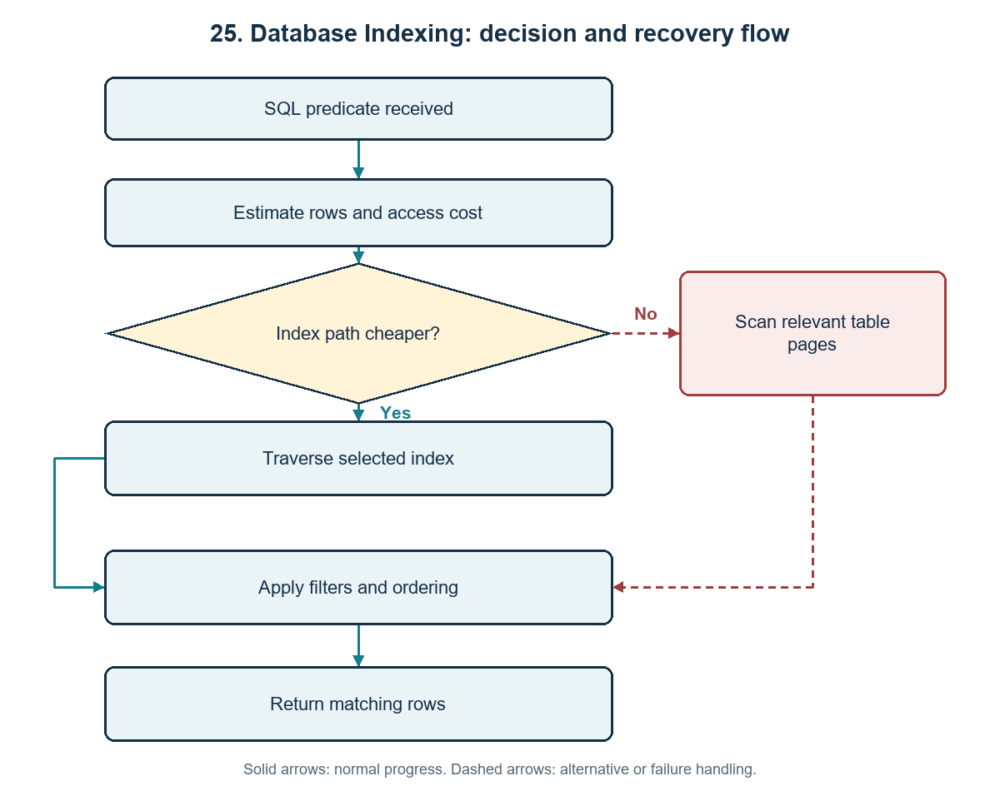

*Figure 25. 25. Database Indexing: decision and recovery flow.* Start at "SQL predicate received" and move to "Estimate rows and access cost". At "Index path cheaper?", the Yes branch goes to "Traverse selected index" and the No branch goes to "Scan relevant table pages". Follow the arrows to the terminal or recovery outcome; a dashed branch is not an implicit success. Source: [editable Mermaid](diagrams/topic-025.mmd).


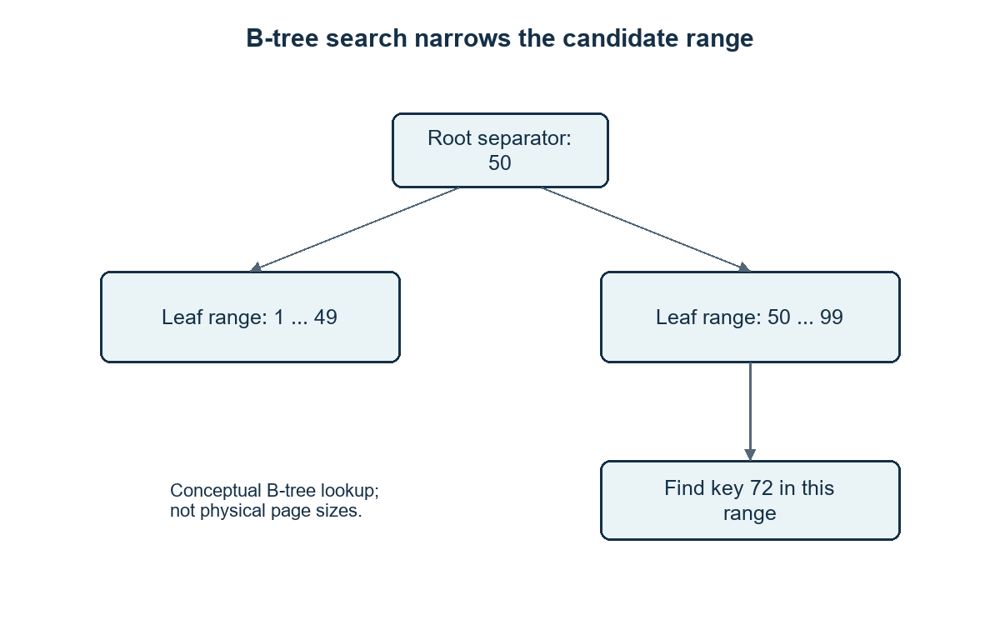

*Figure 182. B-tree search narrows the candidate range.* The root directs key 72 toward the relevant sorted range. This is a conceptual tree; real page fanout and visibility rules are more complex. Source: [editable SVG](diagrams/ill-index.svg).


#### 6. Step-by-step example

1. Query orders for customer 7 ordered by created_at descending with LIMIT 20.

2. Compare a sequential scan plus sort with an index on customer_id, created_at DESC.

3. Inspect estimated and actual row counts and buffer reads; do not infer speed solely from the word Index in the plan.

#### 7. Implementation

Use the complete [configuration or SQL example](examples/database.sql) and its setup/run instructions in [examples/README.md](examples/README.md). Read every field in the configuration against the mechanism above; file parsing and runtime behavior are different validation levels.

The configuration requires its named runtime. See the verification report before assuming it was executed here. Use a disposable local environment for database and orchestration exercises; the examples do not deploy cloud resources.

#### 8. Production use cases

ShopStream often searches orders by customer and creation time. A suitable index reduces examined data, but every insert and update must maintain it. Query orders for customer 7 ordered by created_at descending with LIMIT 20.

#### 9. Advantages and disadvantages

More indexes improve selected reads but increase writes, storage, vacuum work, and cache pressure. Partial indexes cover a predicate such as pending orders. Expression indexes support a matching expression. Small tables or broad scans may favor sequential access.

#### 10. Common mistakes and debugging

Indexing every column wastes resources. Wrapping a column in an unmatched function can defeat the intended access path. Composite key order should follow query patterns, while acknowledging engine-specific skip-scan and planner behavior.

#### 11. Comparison with related concepts

| Decision | Engineering interpretation |
|---|---|
| What this topic contributes | An index is a searchable structure that helps a database find rows without examining every row. |
| Nearest alternatives and limits | More indexes improve selected reads but increase writes, storage, vacuum work, and cache pressure. Partial indexes cover a predicate such as pending orders. Expression indexes support a matching expression. Small tables or broad scans may favor sequential access. |
| Combined design | Read [26. Query Optimization](#topic-026) and [27. N+1 Queries](#topic-027); identify which layer owns each invariant rather than assuming their guarantees are interchangeable. |

#### 12. Interview preparation

**25.1 - Conceptual; Beginner. A teammate wants to add database indexing everywhere. What concrete need should justify it?**

**Model answer:** An index is a searchable structure that helps a database find rows without examining every row. ShopStream often searches orders by customer and creation time. A suitable index reduces examined data, but every insert and update must maintain it. More indexes improve selected reads but increase writes, storage, vacuum work, and cache pressure.

**25.2 - Conceptual; Intermediate. What must be represented or coordinated for database indexing to work correctly?**

**Model answer:** B-tree indexes organize sorted keys in balanced pages, supporting equality, ranges, and ordering. Hash indexes target equality. A composite index on customer_id, created_at can narrow by customer and scan a date range. Selectivity, statistics, table size, correlation, and visibility influence whether the planner chooses it. Covering indexes can reduce heap access when visibility permits.

**25.3 - Conceptual; Beginner. Explain the analogy, then identify where it stops being a trustworthy model.**

**Model answer:** A library catalog maps authors and titles to shelf positions. A catalog ordered by author then title is useful for author searches, but not equally useful for every title-only search. Physical access patterns and database optimizers add nuances beyond the analogy. The implementation must still follow the explicit state and failure rules described in the mechanism; an analogy cannot establish a delivery, timing, or security guarantee.

**25.4 - Conceptual; Intermediate. Which nearby alternative would you compare with database indexing, and what changes the choice?**

**Model answer:** More indexes improve selected reads but increase writes, storage, vacuum work, and cache pressure. Partial indexes cover a predicate such as pending orders. Expression indexes support a matching expression. Small tables or broad scans may favor sequential access.

**25.5 - Conceptual; Intermediate. How can an apparently functioning implementation still violate the intended contract?**

**Model answer:** Indexing every column wastes resources. Wrapping a column in an unmatched function can defeat the intended access path. Composite key order should follow query patterns, while acknowledging engine-specific skip-scan and planner behavior.

**25.6 - Scenario; Intermediate. Walk through the worked ShopStream example. What evidence establishes the outcome, and what remains an assumption?**

**Model answer:** Query orders for customer 7 ordered by created_at descending with LIMIT 20. Compare a sequential scan plus sort with an index on customer_id, created_at DESC. Inspect estimated and actual row counts and buffer reads; do not infer speed solely from the word Index in the plan. Verify the stated state transition or measurement at the responsible boundary. The numerical values, when present, are assumptions or deterministic examples rather than vendor performance guarantees.

**25.7 - Scenario; Advanced. You must validate this behavior before rollout. What experiment would expose a false correctness claim?**

**Model answer:** Run the PostgreSQL query-plan lab on generated orders. Compare plans before and after an index, without promising a fixed speedup. Add a low-selectivity predicate and explain why the planner may still choose a sequential scan. Record the starting state, injected condition, observed result, and invariant. A successful startup alone does not demonstrate the behavior under test.

**25.8 - Scenario; Advanced. A change involving database indexing produces a customer-visible regression. How would you investigate and choose a safe response?**

**Model answer:** Indexing every column wastes resources. Wrapping a column in an unmatched function can defeat the intended access path. Composite key order should follow query patterns, while acknowledging engine-specific skip-scan and planner behavior. Index-only scans still depend on visibility information and may visit heap pages. A production index build can lock or consume significant I/O; choose a supported concurrent strategy and monitor progress. Constraints and performance indexes have different correctness roles even when both use indexes internally.

**25.9 - Advanced follow-up; Expert. Which hidden assumptions become important under failure, scale, or a changed workload?**

**Model answer:** Index-only scans still depend on visibility information and may visit heap pages. A production index build can lock or consume significant I/O; choose a supported concurrent strategy and monitor progress. Constraints and performance indexes have different correctness roles even when both use indexes internally.

**25.10 - Advanced follow-up; Expert. How does this design interact with query optimization and n+1 queries?**

**Model answer:** B-tree indexes organize sorted keys in balanced pages, supporting equality, ranges, and ordering. Capture a representative slow query and parameters. Instrument query count per request. Specify which component owns each decision and trace a failure across the combined boundary. Do not infer one component's guarantee from another component's name.

**Common incorrect answer:** "Adding the component makes the guarantee automatic." This is wrong because the mechanism depends on specific state, boundaries, and failure assumptions. Indexing every column wastes resources.

**A deeper interviewer probe:** Change the timing, workload, or failure condition described in the advanced answer. Ask which invariant still holds, what observation would disprove it, and whether the fallback changes the user contract. Index-only scans still depend on visibility information and may visit heap pages.

#### 13. Exercises and solution walkthroughs

**Beginner exercise:** Reproduce the worked example for database indexing on paper. Record the initial state, each transition, and the result before reading the walkthrough.

**Beginner solution:** Query orders for customer 7 ordered by created_at descending with LIMIT 20. Compare a sequential scan plus sort with an index on customer_id, created_at DESC. Inspect estimated and actual row counts and buffer reads; do not infer speed solely from the word Index in the plan.

**Intermediate exercise:** Run the PostgreSQL query-plan lab on generated orders. Write the observable assertion and identify which component owns it.

**Intermediate solution:** Run the PostgreSQL query-plan lab on generated orders. Compare plans before and after an index, without promising a fixed speedup. Add a low-selectivity predicate and explain why the planner may still choose a sequential scan. Use the provided lab where applicable; for platform behavior, record the runtime version and actual evidence instead of treating a diagram as a test.

**Advanced exercise:** Extend the example to a failure or scale condition described below. State the guarantee you retain, the one you relax if necessary, and a safe recovery procedure.

**Advanced solution:** Index-only scans still depend on visibility information and may visit heap pages. A production index build can lock or consume significant I/O; choose a supported concurrent strategy and monitor progress. Constraints and performance indexes have different correctness roles even when both use indexes internally. Indexing every column wastes resources. A complete solution identifies a detection signal, a bounded action, and a verification of the business outcome.

#### 14. Key takeaways

- An index is a searchable structure that helps a database find rows without examining every row.

- B-tree indexes organize sorted keys in balanced pages, supporting equality, ranges, and ordering.

- More indexes improve selected reads but increase writes, storage, vacuum work, and cache pressure.

- Indexing every column wastes resources.

- Index-only scans still depend on visibility information and may visit heap pages.


**When to use it:** ShopStream often searches orders by customer and creation time. A suitable index reduces examined data, but every insert and update must maintain it.

**Terminology:** See this topic's glossary entry and the linked related terms. **Continue with:** [26. Query Optimization](#topic-026), [27. N+1 Queries](#topic-027), [31. Partitioning](#topic-031), [81. Database Migrations](#topic-081).

**Official verification references:** [PostgreSQL EXPLAIN](https://www.postgresql.org/docs/current/using-explain.html). These references verify the named protocol or platform details; the examples, diagrams, and numerical assumptions are original teaching material.
<a id="topic-026"></a>

### 26. Query Optimization

Prerequisites and related reading: [25. Database Indexing](#topic-025), [27. N+1 Queries](#topic-027), [28. Connection Pooling](#topic-028), [91. Latency](#topic-091).

#### 1. Simple explanation

Query optimization reduces the work needed to produce a correct database result.

#### 2. The problem it solves

ShopStream's order page may be slow because it scans too much data, joins inefficiently, waits for locks, or transfers oversized results. The first task is locating the actual cost.

#### 3. Intuitive analogy

Planning a delivery route avoids repeatedly crossing the city. The shortest map route is not always fastest during traffic. A query plan likewise depends on data distribution, cached pages, concurrency, and estimates.

#### 4. Technical working mechanism

1. Capture a representative slow query and parameters.

2. Inspect EXPLAIN estimates, then EXPLAIN ANALYZE and buffer statistics safely because ANALYZE executes the statement.

3. Compare estimated rows to actual rows, examine loops, sort spills, joins, and I/O.

4. Update statistics, rewrite predicates or joins, add appropriate indexes, and remeasure under representative load.


**Boundary and advanced reasoning.** Parameter-sensitive distributions can make a plan good for common customers and terrible for a large tenant. Test representative skew, not just average inputs. Separate application pool acquisition from database execution and inspect wait events before adding hardware.

#### 5. Architecture and diagrams


*Figure 26. 26. Query Optimization: decision and recovery flow.* Start at "Slow query observed" and move to "Capture plan and waits". At "Estimate matches reality?", the Yes branch goes to "Optimize measured bottleneck" and the No branch goes to "Refresh statistics and inspect skew". Follow the arrows to the terminal or recovery outcome; a dashed branch is not an implicit success. Source: [editable Mermaid](diagrams/topic-026.mmd).


#### 6. Step-by-step example

1. A nested loop predicts ten outer rows but receives 100,000.

2. Its inner lookup runs 100,000 times.

3. Better statistics or a changed query may select a hash join.

4. A LIMIT helps only if the plan can avoid doing all upstream work first.

#### 7. Implementation

Use the complete [configuration or SQL example](examples/database.sql) and its setup/run instructions in [examples/README.md](examples/README.md). Read every field in the configuration against the mechanism above; file parsing and runtime behavior are different validation levels.

The configuration requires its named runtime. See the verification report before assuming it was executed here. Use a disposable local environment for database and orchestration exercises; the examples do not deploy cloud resources.

#### 8. Production use cases

ShopStream's order page may be slow because it scans too much data, joins inefficiently, waits for locks, or transfers oversized results. The first task is locating the actual cost. A nested loop predicts ten outer rows but receives 100,000.

#### 9. Advantages and disadvantages

Optimizing one query may increase write cost or memory use. Denormalization can reduce joins but introduces update consistency. A cached result avoids repeated work but changes freshness. Choose the smallest change that meets the workload target.

#### 10. Common mistakes and debugging

EXPLAIN costs are not milliseconds. Running ANALYZE on destructive statements in production can modify data. Low CPU does not mean a query is fast: locks, disk, network, or pool waits can dominate.

#### 11. Comparison with related concepts

| Decision | Engineering interpretation |
|---|---|
| What this topic contributes | Query optimization reduces the work needed to produce a correct database result. |
| Nearest alternatives and limits | Optimizing one query may increase write cost or memory use. Denormalization can reduce joins but introduces update consistency. A cached result avoids repeated work but changes freshness. Choose the smallest change that meets the workload target. |
| Combined design | Read [25. Database Indexing](#topic-025) and [27. N+1 Queries](#topic-027); identify which layer owns each invariant rather than assuming their guarantees are interchangeable. |

#### 12. Interview preparation

**26.1 - Conceptual; Beginner. A teammate wants to add query optimization everywhere. What concrete need should justify it?**

**Model answer:** Query optimization reduces the work needed to produce a correct database result. ShopStream's order page may be slow because it scans too much data, joins inefficiently, waits for locks, or transfers oversized results. The first task is locating the actual cost. Optimizing one query may increase write cost or memory use.

**26.2 - Conceptual; Intermediate. What must be represented or coordinated for query optimization to work correctly?**

**Model answer:** Capture a representative slow query and parameters. Inspect EXPLAIN estimates, then EXPLAIN ANALYZE and buffer statistics safely because ANALYZE executes the statement. Compare estimated rows to actual rows, examine loops, sort spills, joins, and I/O. Update statistics, rewrite predicates or joins, add appropriate indexes, and remeasure under representative load.

**26.3 - Conceptual; Beginner. Explain the analogy, then identify where it stops being a trustworthy model.**

**Model answer:** Planning a delivery route avoids repeatedly crossing the city. The shortest map route is not always fastest during traffic. A query plan likewise depends on data distribution, cached pages, concurrency, and estimates. The implementation must still follow the explicit state and failure rules described in the mechanism; an analogy cannot establish a delivery, timing, or security guarantee.

**26.4 - Conceptual; Intermediate. Which nearby alternative would you compare with query optimization, and what changes the choice?**

**Model answer:** Optimizing one query may increase write cost or memory use. Denormalization can reduce joins but introduces update consistency. A cached result avoids repeated work but changes freshness. Choose the smallest change that meets the workload target.

**26.5 - Conceptual; Intermediate. How can an apparently functioning implementation still violate the intended contract?**

**Model answer:** EXPLAIN costs are not milliseconds. Running ANALYZE on destructive statements in production can modify data. Low CPU does not mean a query is fast: locks, disk, network, or pool waits can dominate.

**26.6 - Scenario; Intermediate. Walk through the worked ShopStream example. What evidence establishes the outcome, and what remains an assumption?**

**Model answer:** A nested loop predicts ten outer rows but receives 100,000. Its inner lookup runs 100,000 times. Better statistics or a changed query may select a hash join. A LIMIT helps only if the plan can avoid doing all upstream work first. Verify the stated state transition or measurement at the responsible boundary. The numerical values, when present, are assumptions or deterministic examples rather than vendor performance guarantees.

**26.7 - Scenario; Advanced. You must validate this behavior before rollout. What experiment would expose a false correctness claim?**

**Model answer:** Compare estimated and actual rows in the SQL lab. Change the data distribution and refresh statistics. Investigate a low-CPU/high-latency query by gathering locks, wait events, disk latency, and pool occupancy before choosing an optimization. Record the starting state, injected condition, observed result, and invariant. A successful startup alone does not demonstrate the behavior under test.

**26.8 - Scenario; Advanced. A change involving query optimization produces a customer-visible regression. How would you investigate and choose a safe response?**

**Model answer:** EXPLAIN costs are not milliseconds. Running ANALYZE on destructive statements in production can modify data. Low CPU does not mean a query is fast: locks, disk, network, or pool waits can dominate. Parameter-sensitive distributions can make a plan good for common customers and terrible for a large tenant. Test representative skew, not just average inputs. Separate application pool acquisition from database execution and inspect wait events before adding hardware.

**26.9 - Advanced follow-up; Expert. Which hidden assumptions become important under failure, scale, or a changed workload?**

**Model answer:** Parameter-sensitive distributions can make a plan good for common customers and terrible for a large tenant. Test representative skew, not just average inputs. Separate application pool acquisition from database execution and inspect wait events before adding hardware.

**26.10 - Advanced follow-up; Expert. How does this design interact with database indexing and n+1 queries?**

**Model answer:** Capture a representative slow query and parameters. B-tree indexes organize sorted keys in balanced pages, supporting equality, ranges, and ordering. Instrument query count per request. Specify which component owns each decision and trace a failure across the combined boundary. Do not infer one component's guarantee from another component's name.

**Common incorrect answer:** "Adding the component makes the guarantee automatic." This is wrong because the mechanism depends on specific state, boundaries, and failure assumptions. EXPLAIN costs are not milliseconds.

**A deeper interviewer probe:** Change the timing, workload, or failure condition described in the advanced answer. Ask which invariant still holds, what observation would disprove it, and whether the fallback changes the user contract. Parameter-sensitive distributions can make a plan good for common customers and terrible for a large tenant.

#### 13. Exercises and solution walkthroughs

**Beginner exercise:** Reproduce the worked example for query optimization on paper. Record the initial state, each transition, and the result before reading the walkthrough.

**Beginner solution:** A nested loop predicts ten outer rows but receives 100,000. Its inner lookup runs 100,000 times. Better statistics or a changed query may select a hash join. A LIMIT helps only if the plan can avoid doing all upstream work first.

**Intermediate exercise:** Compare estimated and actual rows in the SQL lab. Write the observable assertion and identify which component owns it.

**Intermediate solution:** Compare estimated and actual rows in the SQL lab. Change the data distribution and refresh statistics. Investigate a low-CPU/high-latency query by gathering locks, wait events, disk latency, and pool occupancy before choosing an optimization. Use the provided lab where applicable; for platform behavior, record the runtime version and actual evidence instead of treating a diagram as a test.

**Advanced exercise:** Extend the example to a failure or scale condition described below. State the guarantee you retain, the one you relax if necessary, and a safe recovery procedure.

**Advanced solution:** Parameter-sensitive distributions can make a plan good for common customers and terrible for a large tenant. Test representative skew, not just average inputs. Separate application pool acquisition from database execution and inspect wait events before adding hardware. EXPLAIN costs are not milliseconds. A complete solution identifies a detection signal, a bounded action, and a verification of the business outcome.

#### 14. Key takeaways

- Query optimization reduces the work needed to produce a correct database result.

- Capture a representative slow query and parameters.

- Optimizing one query may increase write cost or memory use.

- EXPLAIN costs are not milliseconds.

- Parameter-sensitive distributions can make a plan good for common customers and terrible for a large tenant.


**When to use it:** ShopStream's order page may be slow because it scans too much data, joins inefficiently, waits for locks, or transfers oversized results. The first task is locating the actual cost.

**Terminology:** See this topic's glossary entry and the linked related terms. **Continue with:** [25. Database Indexing](#topic-025), [27. N+1 Queries](#topic-027), [28. Connection Pooling](#topic-028), [91. Latency](#topic-091).

**Official verification references:** [PostgreSQL EXPLAIN](https://www.postgresql.org/docs/current/using-explain.html). These references verify the named protocol or platform details; the examples, diagrams, and numerical assumptions are original teaching material.
<a id="topic-027"></a>

### 27. N+1 Queries

Prerequisites and related reading: [25. Database Indexing](#topic-025), [26. Query Optimization](#topic-026), [28. Connection Pooling](#topic-028).

#### 1. Simple explanation

N+1 occurs when one query fetches a list and another query runs for each list item.

#### 2. The problem it solves

ShopStream retrieves 100 orders, then separately fetches the customer for every order. Even fast queries accumulate network round trips and connection work.

#### 3. Intuitive analogy

A librarian brings a reading list, then walks to the shelves once for each book. Collecting related books in a planned trip is more efficient, but carrying an unlimited pile is also impractical.

#### 4. Technical working mechanism

1. Instrument query count per request.

2. Identify lazy relationship loading inside loops.

3. Replace it with a join, eager loading, or a bounded batch keyed by required IDs.

4. Reconstruct results using a map.

5. Preserve pagination and authorization; a large join can duplicate parent rows and produce a Cartesian explosion.


**Boundary and advanced reasoning.** Parallelizing 100 queries may lower one request's latency while exhausting the shared pool. The goal is reducing total work and round trips, not hiding them with concurrency. Track query count and rows returned as regression indicators in integration tests.

#### 5. Architecture and diagrams


*Figure 27. 27. N+1 Queries: decision and recovery flow.* Start at "Fetch parent list" and move to "Inspect relationship access". At "One query per item?", the Yes branch goes to "Collect IDs and batch" and the No branch goes to "Use existing bounded query". Follow the arrows to the terminal or recovery outcome; a dashed branch is not an implicit success. Source: [editable Mermaid](diagrams/topic-027.mmd).


#### 6. Step-by-step example

1. A page uses one order query plus 100 customer lookups.

2. Assuming 4 ms per serial round trip, network delay alone approaches 404 ms.

3. A two-query batch reduces the number of round trips to two, though actual execution and transfer costs still need measurement.

#### 7. Implementation

Use the complete [configuration or SQL example](examples/database.sql) and its setup/run instructions in [examples/README.md](examples/README.md). Read every field in the configuration against the mechanism above; file parsing and runtime behavior are different validation levels.

The configuration requires its named runtime. See the verification report before assuming it was executed here. Use a disposable local environment for database and orchestration exercises; the examples do not deploy cloud resources.

#### 8. Production use cases

ShopStream retrieves 100 orders, then separately fetches the customer for every order. Even fast queries accumulate network round trips and connection work. A page uses one order query plus 100 customer lookups.

#### 9. Advantages and disadvantages

Joins let the database optimize relationships. Batched loading is useful across service boundaries or for several independent collections. Eager-loading everything can overfetch, so request only fields and relationships the page needs.

#### 10. Common mistakes and debugging

Caching masks N+1 in warm tests but leaves cold requests slow. A global loader can leak data across tenants. Scope loaders to the request or correctly keyed authorization context and enforce maximum batch sizes.

#### 11. Comparison with related concepts

| Decision | Engineering interpretation |
|---|---|
| What this topic contributes | N+1 occurs when one query fetches a list and another query runs for each list item. |
| Nearest alternatives and limits | Joins let the database optimize relationships. Batched loading is useful across service boundaries or for several independent collections. Eager-loading everything can overfetch, so request only fields and relationships the page needs. |
| Combined design | Read [25. Database Indexing](#topic-025) and [26. Query Optimization](#topic-026); identify which layer owns each invariant rather than assuming their guarantees are interchangeable. |

#### 12. Interview preparation

**27.1 - Conceptual; Beginner. A teammate wants to add n+1 queries everywhere. What concrete need should justify it?**

**Model answer:** N+1 occurs when one query fetches a list and another query runs for each list item. ShopStream retrieves 100 orders, then separately fetches the customer for every order. Even fast queries accumulate network round trips and connection work. Joins let the database optimize relationships.

**27.2 - Conceptual; Intermediate. What must be represented or coordinated for n+1 queries to work correctly?**

**Model answer:** Instrument query count per request. Identify lazy relationship loading inside loops. Replace it with a join, eager loading, or a bounded batch keyed by required IDs. Reconstruct results using a map. Preserve pagination and authorization; a large join can duplicate parent rows and produce a Cartesian explosion.

**27.3 - Conceptual; Beginner. Explain the analogy, then identify where it stops being a trustworthy model.**

**Model answer:** A librarian brings a reading list, then walks to the shelves once for each book. Collecting related books in a planned trip is more efficient, but carrying an unlimited pile is also impractical. The implementation must still follow the explicit state and failure rules described in the mechanism; an analogy cannot establish a delivery, timing, or security guarantee.

**27.4 - Conceptual; Intermediate. Which nearby alternative would you compare with n+1 queries, and what changes the choice?**

**Model answer:** Joins let the database optimize relationships. Batched loading is useful across service boundaries or for several independent collections. Eager-loading everything can overfetch, so request only fields and relationships the page needs.

**27.5 - Conceptual; Intermediate. How can an apparently functioning implementation still violate the intended contract?**

**Model answer:** Caching masks N+1 in warm tests but leaves cold requests slow. A global loader can leak data across tenants. Scope loaders to the request or correctly keyed authorization context and enforce maximum batch sizes.

**27.6 - Scenario; Intermediate. Walk through the worked ShopStream example. What evidence establishes the outcome, and what remains an assumption?**

**Model answer:** A page uses one order query plus 100 customer lookups. Assuming 4 ms per serial round trip, network delay alone approaches 404 ms. A two-query batch reduces the number of round trips to two, though actual execution and transfer costs still need measurement. Verify the stated state transition or measurement at the responsible boundary. The numerical values, when present, are assumptions or deterministic examples rather than vendor performance guarantees.

**27.7 - Scenario; Advanced. You must validate this behavior before rollout. What experiment would expose a false correctness claim?**

**Model answer:** Count queries for 1, 10, and 100 parent rows; linear growth reveals the pattern. Replace per-row access with a batch and verify constant query count. Add two one-to-many joins and explain duplicated rows and pagination errors. Record the starting state, injected condition, observed result, and invariant. A successful startup alone does not demonstrate the behavior under test.

**27.8 - Scenario; Advanced. A change involving n+1 queries produces a customer-visible regression. How would you investigate and choose a safe response?**

**Model answer:** Caching masks N+1 in warm tests but leaves cold requests slow. A global loader can leak data across tenants. Scope loaders to the request or correctly keyed authorization context and enforce maximum batch sizes. Parallelizing 100 queries may lower one request's latency while exhausting the shared pool. The goal is reducing total work and round trips, not hiding them with concurrency. Track query count and rows returned as regression indicators in integration tests.

**27.9 - Advanced follow-up; Expert. Which hidden assumptions become important under failure, scale, or a changed workload?**

**Model answer:** Parallelizing 100 queries may lower one request's latency while exhausting the shared pool. The goal is reducing total work and round trips, not hiding them with concurrency. Track query count and rows returned as regression indicators in integration tests.

**27.10 - Advanced follow-up; Expert. How does this design interact with database indexing and query optimization?**

**Model answer:** Instrument query count per request. B-tree indexes organize sorted keys in balanced pages, supporting equality, ranges, and ordering. Capture a representative slow query and parameters. Specify which component owns each decision and trace a failure across the combined boundary. Do not infer one component's guarantee from another component's name.

**Common incorrect answer:** "Adding the component makes the guarantee automatic." This is wrong because the mechanism depends on specific state, boundaries, and failure assumptions. Caching masks N+1 in warm tests but leaves cold requests slow.

**A deeper interviewer probe:** Change the timing, workload, or failure condition described in the advanced answer. Ask which invariant still holds, what observation would disprove it, and whether the fallback changes the user contract. Parallelizing 100 queries may lower one request's latency while exhausting the shared pool.

#### 13. Exercises and solution walkthroughs

**Beginner exercise:** Reproduce the worked example for n+1 queries on paper. Record the initial state, each transition, and the result before reading the walkthrough.

**Beginner solution:** A page uses one order query plus 100 customer lookups. Assuming 4 ms per serial round trip, network delay alone approaches 404 ms. A two-query batch reduces the number of round trips to two, though actual execution and transfer costs still need measurement.

**Intermediate exercise:** Count queries for 1, 10, and 100 parent rows; linear growth reveals the pattern. Write the observable assertion and identify which component owns it.

**Intermediate solution:** Count queries for 1, 10, and 100 parent rows; linear growth reveals the pattern. Replace per-row access with a batch and verify constant query count. Add two one-to-many joins and explain duplicated rows and pagination errors. Use the provided lab where applicable; for platform behavior, record the runtime version and actual evidence instead of treating a diagram as a test.

**Advanced exercise:** Extend the example to a failure or scale condition described below. State the guarantee you retain, the one you relax if necessary, and a safe recovery procedure.

**Advanced solution:** Parallelizing 100 queries may lower one request's latency while exhausting the shared pool. The goal is reducing total work and round trips, not hiding them with concurrency. Track query count and rows returned as regression indicators in integration tests. Caching masks N+1 in warm tests but leaves cold requests slow. A complete solution identifies a detection signal, a bounded action, and a verification of the business outcome.

#### 14. Key takeaways

- N+1 occurs when one query fetches a list and another query runs for each list item.

- Instrument query count per request.

- Joins let the database optimize relationships.

- Caching masks N+1 in warm tests but leaves cold requests slow.

- Parallelizing 100 queries may lower one request's latency while exhausting the shared pool.


**When to use it:** ShopStream retrieves 100 orders, then separately fetches the customer for every order. Even fast queries accumulate network round trips and connection work.

**Terminology:** See this topic's glossary entry and the linked related terms. **Continue with:** [25. Database Indexing](#topic-025), [26. Query Optimization](#topic-026), [28. Connection Pooling](#topic-028).

**Official verification references:** [PostgreSQL EXPLAIN](https://www.postgresql.org/docs/current/using-explain.html). These references verify the named protocol or platform details; the examples, diagrams, and numerical assumptions are original teaching material.
<a id="topic-028"></a>

### 28. Connection Pooling

Prerequisites and related reading: [11. Timeouts](#topic-011), [26. Query Optimization](#topic-026), [44. Backpressure](#topic-044), [45. Autoscaling](#topic-045).

#### 1. Simple explanation

A connection pool reuses a bounded set of database connections.

#### 2. The problem it solves

Establishing a connection costs work, and databases cannot serve unlimited sessions efficiently. ShopStream needs enough connections for useful concurrency while keeping demand below database capacity.

#### 3. Intuitive analogy

A company shares a fleet of cars. Borrowers wait when all cars are in use, and cars must be returned even if a trip fails. Buying more cars cannot widen a congested road.

#### 4. Technical working mechanism

1. Acquire a connection with a timeout, execute a short transaction, commit or roll back, and release in a guaranteed cleanup path.

2. Validate stale connections and reset session state where required.

3. Size all application pools together, including rolling-deployment overlap and background workers.

4. Observe acquisition wait separately from query time.


**Boundary and advanced reasoning.** A pool can protect the database by moving waiting into the application, but the waiting queue must also be bounded. Little's Law relates average in-use connections to transaction rate times connection hold time. Use measured hold time and test under skewed slow queries.

#### 5. Architecture and diagrams

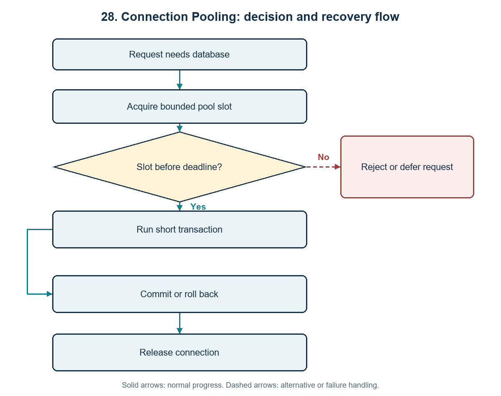

*Figure 28. 28. Connection Pooling: decision and recovery flow.* Start at "Request needs database" and move to "Acquire bounded pool slot". At "Slot before deadline?", the Yes branch goes to "Run short transaction" and the No branch goes to "Reject or defer request". Follow the arrows to the terminal or recovery outcome; a dashed branch is not an implicit success. Source: [editable Mermaid](diagrams/topic-028.mmd).


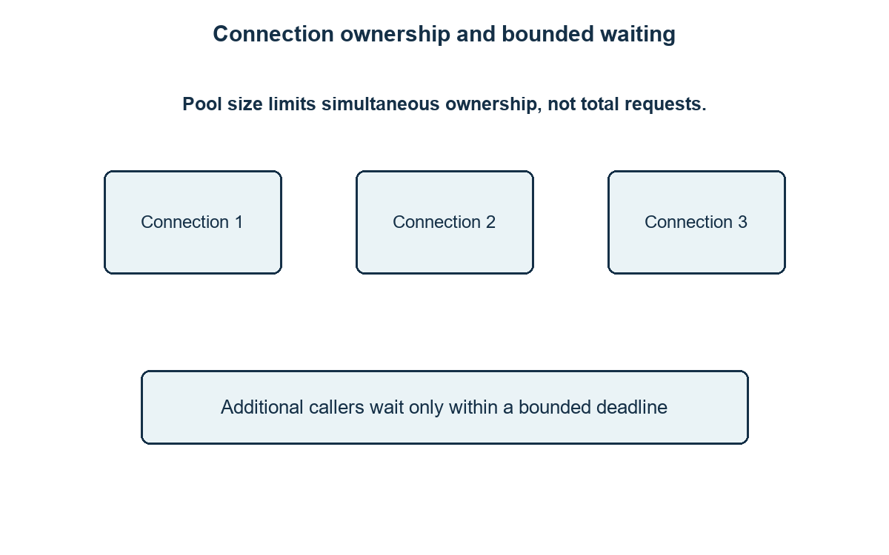

*Figure 190. Connection ownership and bounded waiting.* Each token represents one reusable connection. Exceptions must return ownership; adding application replicas multiplies potential demand. Source: [editable SVG](diagrams/ill-pool.svg).


#### 6. Step-by-step example

1. Ten replicas each allow 20 connections, reserving 200 database sessions before workers or administration.

2. Doubling replicas doubles possible sessions.

3. If the database safe budget is 150, autoscaling can cause connection failure despite reducing per-pod CPU.

#### 7. Implementation

The complete runnable module is [examples/concurrency.py](examples/concurrency.py); run `python concurrency.py` from the examples directory. The following excerpt isolates `Pool`. Required imports, surrounding definitions, expected output, and limitations are in the complete module and [lab guide](examples/README.md).

```python
class Pool:
    """Toy pool of tokens, NOT database connections."""
    def __init__(self, size):
        if size <= 0:
            raise ValueError("positive size required")
        self.available = queue.Queue(maxsize=size)
        for number in range(size):
            self.available.put(number)

    @contextmanager
    def acquire(self, timeout=0.1):
        token = self.available.get(timeout=timeout)
        try:
            yield token
        finally:
            self.available.put(token)
```

Read the state changes in this excerpt alongside the mechanism above. The lab is a model of its stated boundary; it does not establish the behavior of a distributed deployment or an external provider. Check the assertions in [test_examples.py](examples/test_examples.py) and compare your output with [recorded outputs](examples/actual_outputs/).

#### 8. Production use cases

Establishing a connection costs work, and databases cannot serve unlimited sessions efficiently. ShopStream needs enough connections for useful concurrency while keeping demand below database capacity. Ten replicas each allow 20 connections, reserving 200 database sessions before workers or administration.

#### 9. Advantages and disadvantages

Session pooling preserves connection-specific state. Transaction pooling improves multiplexing but constrains session features and requires driver compatibility. Pool size is a concurrency limit, not a throughput promise; long transactions reduce useful reuse.

#### 10. Common mistakes and debugging

Leaked connections eventually block every caller. Holding connections while calling payment APIs wastes scarce capacity. Per-request pool creation defeats reuse. Log acquisition timeout counts and inspect oldest transactions before simply increasing limits.

#### 11. Comparison with related concepts

| Decision | Engineering interpretation |
|---|---|
| What this topic contributes | A connection pool reuses a bounded set of database connections. |
| Nearest alternatives and limits | Session pooling preserves connection-specific state. Transaction pooling improves multiplexing but constrains session features and requires driver compatibility. Pool size is a concurrency limit, not a throughput promise; long transactions reduce useful reuse. |
| Combined design | Read [11. Timeouts](#topic-011) and [26. Query Optimization](#topic-026); identify which layer owns each invariant rather than assuming their guarantees are interchangeable. |

#### 12. Interview preparation

**28.1 - Conceptual; Beginner. A teammate wants to add connection pooling everywhere. What concrete need should justify it?**

**Model answer:** A connection pool reuses a bounded set of database connections. Establishing a connection costs work, and databases cannot serve unlimited sessions efficiently. ShopStream needs enough connections for useful concurrency while keeping demand below database capacity. Session pooling preserves connection-specific state.

**28.2 - Conceptual; Intermediate. What must be represented or coordinated for connection pooling to work correctly?**

**Model answer:** Acquire a connection with a timeout, execute a short transaction, commit or roll back, and release in a guaranteed cleanup path. Validate stale connections and reset session state where required. Size all application pools together, including rolling-deployment overlap and background workers. Observe acquisition wait separately from query time.

**28.3 - Conceptual; Beginner. Explain the analogy, then identify where it stops being a trustworthy model.**

**Model answer:** A company shares a fleet of cars. Borrowers wait when all cars are in use, and cars must be returned even if a trip fails. Buying more cars cannot widen a congested road. The implementation must still follow the explicit state and failure rules described in the mechanism; an analogy cannot establish a delivery, timing, or security guarantee.

**28.4 - Conceptual; Intermediate. Which nearby alternative would you compare with connection pooling, and what changes the choice?**

**Model answer:** Session pooling preserves connection-specific state. Transaction pooling improves multiplexing but constrains session features and requires driver compatibility. Pool size is a concurrency limit, not a throughput promise; long transactions reduce useful reuse.

**28.5 - Conceptual; Intermediate. How can an apparently functioning implementation still violate the intended contract?**

**Model answer:** Leaked connections eventually block every caller. Holding connections while calling payment APIs wastes scarce capacity. Per-request pool creation defeats reuse. Log acquisition timeout counts and inspect oldest transactions before simply increasing limits.

**28.6 - Scenario; Intermediate. Walk through the worked ShopStream example. What evidence establishes the outcome, and what remains an assumption?**

**Model answer:** Ten replicas each allow 20 connections, reserving 200 database sessions before workers or administration. Doubling replicas doubles possible sessions. If the database safe budget is 150, autoscaling can cause connection failure despite reducing per-pod CPU. Verify the stated state transition or measurement at the responsible boundary. The numerical values, when present, are assumptions or deterministic examples rather than vendor performance guarantees.

**28.7 - Scenario; Advanced. You must validate this behavior before rollout. What experiment would expose a false correctness claim?**

**Model answer:** Calculate the maximum aggregate connection count during a 25% rollout surge. Inject an exception and verify release. Simulate a slow query and compare acquisition wait with execution latency while maintaining a fixed database session budget. Record the starting state, injected condition, observed result, and invariant. A successful startup alone does not demonstrate the behavior under test.

**28.8 - Scenario; Advanced. A change involving connection pooling produces a customer-visible regression. How would you investigate and choose a safe response?**

**Model answer:** Leaked connections eventually block every caller. Holding connections while calling payment APIs wastes scarce capacity. Per-request pool creation defeats reuse. Log acquisition timeout counts and inspect oldest transactions before simply increasing limits. A pool can protect the database by moving waiting into the application, but the waiting queue must also be bounded. Little's Law relates average in-use connections to transaction rate times connection hold time. Use measured hold time and test under skewed slow queries.

**28.9 - Advanced follow-up; Expert. Which hidden assumptions become important under failure, scale, or a changed workload?**

**Model answer:** A pool can protect the database by moving waiting into the application, but the waiting queue must also be bounded. Little's Law relates average in-use connections to transaction rate times connection hold time. Use measured hold time and test under skewed slow queries.

**28.10 - Advanced follow-up; Expert. How does this design interact with timeouts and query optimization?**

**Model answer:** Acquire a connection with a timeout, execute a short transaction, commit or roll back, and release in a guaranteed cleanup path. Establish an end-to-end deadline using a monotonic clock. Capture a representative slow query and parameters. Specify which component owns each decision and trace a failure across the combined boundary. Do not infer one component's guarantee from another component's name.

**Common incorrect answer:** "Adding the component makes the guarantee automatic." This is wrong because the mechanism depends on specific state, boundaries, and failure assumptions. Leaked connections eventually block every caller.

**A deeper interviewer probe:** Change the timing, workload, or failure condition described in the advanced answer. Ask which invariant still holds, what observation would disprove it, and whether the fallback changes the user contract. A pool can protect the database by moving waiting into the application, but the waiting queue must also be bounded.

#### 13. Exercises and solution walkthroughs

**Beginner exercise:** Reproduce the worked example for connection pooling on paper. Record the initial state, each transition, and the result before reading the walkthrough.

**Beginner solution:** Ten replicas each allow 20 connections, reserving 200 database sessions before workers or administration. Doubling replicas doubles possible sessions. If the database safe budget is 150, autoscaling can cause connection failure despite reducing per-pod CPU.

**Intermediate exercise:** Calculate the maximum aggregate connection count during a 25% rollout surge. Write the observable assertion and identify which component owns it.

**Intermediate solution:** Calculate the maximum aggregate connection count during a 25% rollout surge. Inject an exception and verify release. Simulate a slow query and compare acquisition wait with execution latency while maintaining a fixed database session budget. Use the provided lab where applicable; for platform behavior, record the runtime version and actual evidence instead of treating a diagram as a test.

**Advanced exercise:** Extend the example to a failure or scale condition described below. State the guarantee you retain, the one you relax if necessary, and a safe recovery procedure.

**Advanced solution:** A pool can protect the database by moving waiting into the application, but the waiting queue must also be bounded. Little's Law relates average in-use connections to transaction rate times connection hold time. Use measured hold time and test under skewed slow queries. Leaked connections eventually block every caller. A complete solution identifies a detection signal, a bounded action, and a verification of the business outcome.

#### 14. Key takeaways

- A connection pool reuses a bounded set of database connections.

- Acquire a connection with a timeout, execute a short transaction, commit or roll back, and release in a guaranteed cleanup path.

- Session pooling preserves connection-specific state.

- Leaked connections eventually block every caller.

- A pool can protect the database by moving waiting into the application, but the waiting queue must also be bounded.


**When to use it:** Establishing a connection costs work, and databases cannot serve unlimited sessions efficiently. ShopStream needs enough connections for useful concurrency while keeping demand below database capacity.

**Terminology:** See this topic's glossary entry and the linked related terms. **Continue with:** [11. Timeouts](#topic-011), [26. Query Optimization](#topic-026), [44. Backpressure](#topic-044), [45. Autoscaling](#topic-045).
<a id="topic-029"></a>

### 29. Read Replicas

Prerequisites and related reading: [32. Replication](#topic-032), [35. Eventual Consistency](#topic-035), [83. Disaster Recovery](#topic-083), [85. Failover](#topic-085).

#### 1. Simple explanation

A read replica serves a copy of database data to offload reads.

#### 2. The problem it solves

ShopStream can send product browsing and reporting to replicas while writes go to the primary. Replication lag means a successful write may not immediately appear on a replica.

#### 3. Intuitive analogy

Branch libraries receive copies of a central catalog. A newly added book may be visible centrally before branch copies update. A copy is useful only if its freshness matches the reader's purpose.

#### 4. Technical working mechanism

1. The primary writes a replication log.

2. Replicas receive and apply it, potentially at different rates.

3. Route eligible reads to a replica and correctness-sensitive reads to the primary or a replica confirmed to have reached a required log position.

4. Measure receive lag and replay lag, not just network connectivity.


**Boundary and advanced reasoning.** Promoting a lagging replica can lose acknowledged writes under asynchronous replication. Fence the old primary before accepting new writes and reconcile timelines. Read routing, failover, and recovery point objectives must be designed together.

#### 5. Architecture and diagrams


*Figure 29. 29. Read Replicas: decision and recovery flow.* Start at "Read request" and move to "Determine freshness requirement". At "Replica sufficiently current?", the Yes branch goes to "Read from replica" and the No branch goes to "Read primary or wait boundedly". Follow the arrows to the terminal or recovery outcome; a dashed branch is not an implicit success. Source: [editable Mermaid](diagrams/topic-029.mmd).


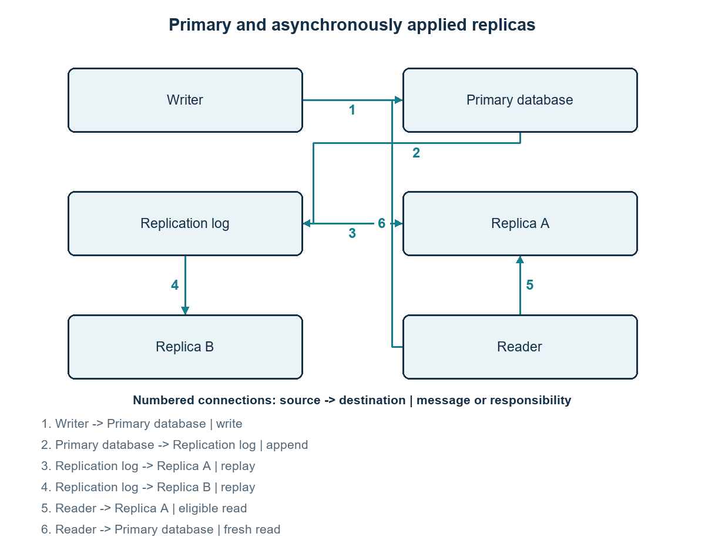

*Figure 122. Primary and asynchronously applied replicas.* Replica reads are selected by freshness requirements. Log transport and application can lag independently. Source: [editable Mermaid](diagrams/arch-replication.mmd).


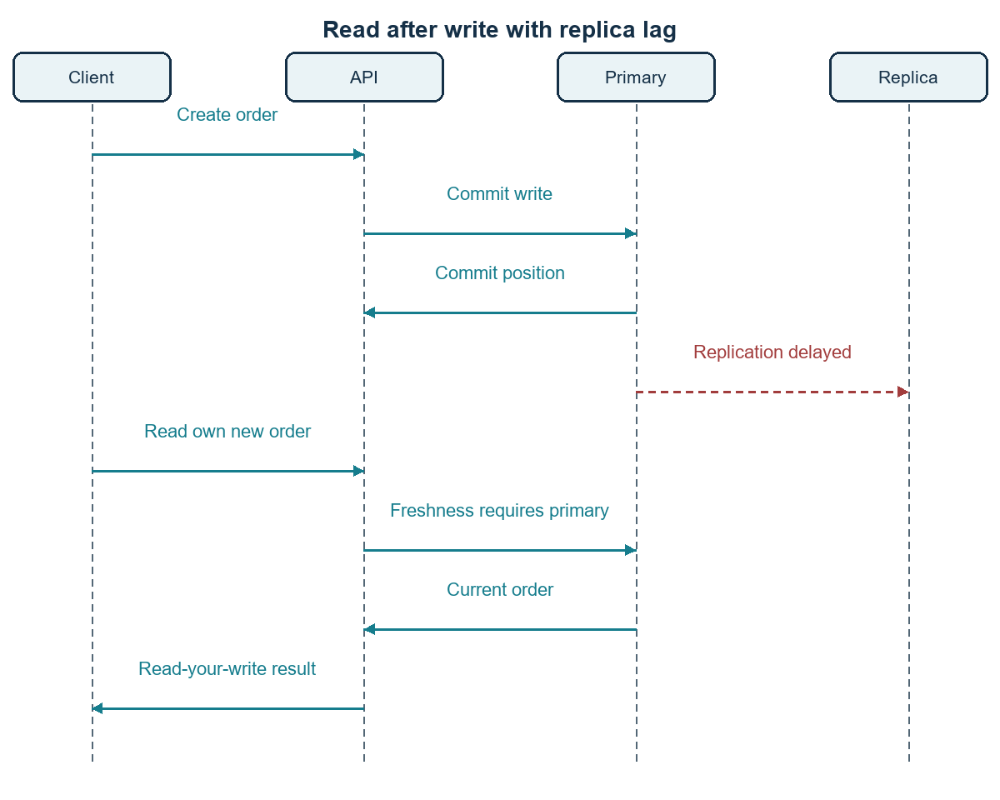

*Figure 141. Read after write with replica lag.* A session token or explicit primary route prevents a stale replica from falsely hiding a newly accepted order. Source: [editable Mermaid](diagrams/seq-replica.mmd).


#### 6. Step-by-step example

1. A customer creates order O, then refreshes the order page.

2. A replica 500 ms behind returns no order.

3. Route that read to the primary or use a session consistency token until the replica catches up, rather than displaying a false failure.

#### 7. Implementation

For this topic, the worked scenario and the exercise below are the direct practical implementation of the reasoning. A standalone toy implementation would hide important platform or protocol guarantees. Use the relevant official implementation or managed runtime for real deployment, and validate its actual contract.

The associated [examples/algorithms.py](examples/algorithms.py) illustrates a related local boundary, not a full implementation of read replicas. [The lab guide](examples/README.md) distinguishes executable simulations, configurations, and design exercises.

#### 8. Production use cases

ShopStream can send product browsing and reporting to replicas while writes go to the primary. Replication lag means a successful write may not immediately appear on a replica. A customer creates order O, then refreshes the order page.

#### 9. Advantages and disadvantages

Replicas scale some reads and support recovery but do not generally increase primary write throughput. Synchronous acknowledgment can reduce certain data-loss windows at added latency and availability cost; exact guarantees depend on which replication stage is acknowledged.

#### 10. Common mistakes and debugging

Round-robin reads can make a user see data go backward. Long analytical queries may interfere with replay or be canceled depending on the database. Replication copies accidental deletion, so it is not a substitute for backups.

#### 11. Comparison with related concepts

| Decision | Engineering interpretation |
|---|---|
| What this topic contributes | A read replica serves a copy of database data to offload reads. |
| Nearest alternatives and limits | Replicas scale some reads and support recovery but do not generally increase primary write throughput. Synchronous acknowledgment can reduce certain data-loss windows at added latency and availability cost; exact guarantees depend on which replication stage is acknowledged. |
| Combined design | Read [32. Replication](#topic-032) and [35. Eventual Consistency](#topic-035); identify which layer owns each invariant rather than assuming their guarantees are interchangeable. |

#### 12. Interview preparation

**29.1 - Conceptual; Beginner. A teammate wants to add read replicas everywhere. What concrete need should justify it?**

**Model answer:** A read replica serves a copy of database data to offload reads. ShopStream can send product browsing and reporting to replicas while writes go to the primary. Replication lag means a successful write may not immediately appear on a replica. Replicas scale some reads and support recovery but do not generally increase primary write throughput.

**29.2 - Conceptual; Intermediate. What must be represented or coordinated for read replicas to work correctly?**

**Model answer:** The primary writes a replication log. Replicas receive and apply it, potentially at different rates. Route eligible reads to a replica and correctness-sensitive reads to the primary or a replica confirmed to have reached a required log position. Measure receive lag and replay lag, not just network connectivity.

**29.3 - Conceptual; Beginner. Explain the analogy, then identify where it stops being a trustworthy model.**

**Model answer:** Branch libraries receive copies of a central catalog. A newly added book may be visible centrally before branch copies update. A copy is useful only if its freshness matches the reader's purpose. The implementation must still follow the explicit state and failure rules described in the mechanism; an analogy cannot establish a delivery, timing, or security guarantee.

**29.4 - Conceptual; Intermediate. Which nearby alternative would you compare with read replicas, and what changes the choice?**

**Model answer:** Replicas scale some reads and support recovery but do not generally increase primary write throughput. Synchronous acknowledgment can reduce certain data-loss windows at added latency and availability cost; exact guarantees depend on which replication stage is acknowledged.

**29.5 - Conceptual; Intermediate. How can an apparently functioning implementation still violate the intended contract?**

**Model answer:** Round-robin reads can make a user see data go backward. Long analytical queries may interfere with replay or be canceled depending on the database. Replication copies accidental deletion, so it is not a substitute for backups.

**29.6 - Scenario; Intermediate. Walk through the worked ShopStream example. What evidence establishes the outcome, and what remains an assumption?**

**Model answer:** A customer creates order O, then refreshes the order page. A replica 500 ms behind returns no order. Route that read to the primary or use a session consistency token until the replica catches up, rather than displaying a false failure. Verify the stated state transition or measurement at the responsible boundary. The numerical values, when present, are assumptions or deterministic examples rather than vendor performance guarantees.

**29.7 - Scenario; Advanced. You must validate this behavior before rollout. What experiment would expose a false correctness claim?**

**Model answer:** Write then immediately read from a delayed replica simulation. Add a primary-read fallback for the user's own new order. Describe which evidence proves a candidate replica has all required committed transactions before promotion. Record the starting state, injected condition, observed result, and invariant. A successful startup alone does not demonstrate the behavior under test.

**29.8 - Scenario; Advanced. A change involving read replicas produces a customer-visible regression. How would you investigate and choose a safe response?**

**Model answer:** Round-robin reads can make a user see data go backward. Long analytical queries may interfere with replay or be canceled depending on the database. Replication copies accidental deletion, so it is not a substitute for backups. Promoting a lagging replica can lose acknowledged writes under asynchronous replication. Fence the old primary before accepting new writes and reconcile timelines. Read routing, failover, and recovery point objectives must be designed together.

**29.9 - Advanced follow-up; Expert. Which hidden assumptions become important under failure, scale, or a changed workload?**

**Model answer:** Promoting a lagging replica can lose acknowledged writes under asynchronous replication. Fence the old primary before accepting new writes and reconcile timelines. Read routing, failover, and recovery point objectives must be designed together.

**29.10 - Advanced follow-up; Expert. How does this design interact with replication and eventual consistency?**

**Model answer:** The primary writes a replication log. Capture committed changes in a log, transmit them, apply them in order within the guaranteed domain, and track durable progress. Propagate changes through logs or events, identify entities and versions, apply a defined merge rule, and repair missed updates. Specify which component owns each decision and trace a failure across the combined boundary. Do not infer one component's guarantee from another component's name.

**Common incorrect answer:** "Adding the component makes the guarantee automatic." This is wrong because the mechanism depends on specific state, boundaries, and failure assumptions. Round-robin reads can make a user see data go backward.

**A deeper interviewer probe:** Change the timing, workload, or failure condition described in the advanced answer. Ask which invariant still holds, what observation would disprove it, and whether the fallback changes the user contract. Promoting a lagging replica can lose acknowledged writes under asynchronous replication.

#### 13. Exercises and solution walkthroughs

**Beginner exercise:** Reproduce the worked example for read replicas on paper. Record the initial state, each transition, and the result before reading the walkthrough.

**Beginner solution:** A customer creates order O, then refreshes the order page. A replica 500 ms behind returns no order. Route that read to the primary or use a session consistency token until the replica catches up, rather than displaying a false failure.

**Intermediate exercise:** Write then immediately read from a delayed replica simulation. Write the observable assertion and identify which component owns it.

**Intermediate solution:** Write then immediately read from a delayed replica simulation. Add a primary-read fallback for the user's own new order. Describe which evidence proves a candidate replica has all required committed transactions before promotion. Use the provided lab where applicable; for platform behavior, record the runtime version and actual evidence instead of treating a diagram as a test.

**Advanced exercise:** Extend the example to a failure or scale condition described below. State the guarantee you retain, the one you relax if necessary, and a safe recovery procedure.

**Advanced solution:** Promoting a lagging replica can lose acknowledged writes under asynchronous replication. Fence the old primary before accepting new writes and reconcile timelines. Read routing, failover, and recovery point objectives must be designed together. Round-robin reads can make a user see data go backward. A complete solution identifies a detection signal, a bounded action, and a verification of the business outcome.

#### 14. Key takeaways

- A read replica serves a copy of database data to offload reads.

- The primary writes a replication log.

- Replicas scale some reads and support recovery but do not generally increase primary write throughput.

- Round-robin reads can make a user see data go backward.

- Promoting a lagging replica can lose acknowledged writes under asynchronous replication.


**When to use it:** ShopStream can send product browsing and reporting to replicas while writes go to the primary. Replication lag means a successful write may not immediately appear on a replica.

**Terminology:** See this topic's glossary entry and the linked related terms. **Continue with:** [32. Replication](#topic-032), [35. Eventual Consistency](#topic-035), [83. Disaster Recovery](#topic-083), [85. Failover](#topic-085).
<a id="topic-030"></a>

### 30. Sharding

Prerequisites and related reading: [31. Partitioning](#topic-031), [32. Replication](#topic-032), [38. Distributed Locks](#topic-038), [46. Horizontal Scaling](#topic-046).

#### 1. Simple explanation

Sharding splits a dataset across independently hosted partitions.

#### 2. The problem it solves

ShopStream may outgrow the storage or write capacity of one database server. A shard key determines where each record lives and which requests require cross-shard work.

#### 3. Intuitive analogy

A university divides students among administrative offices. Assigning by department makes departmental tasks local but can overload the largest department. Every division rule favors some access patterns and complicates others.

#### 4. Technical working mechanism

1. Choose a key aligned with common transactions, map keys to shards through ranges, hashes, or a directory, and route requests accordingly.

2. Track ownership during rebalancing.

3. Copy data, catch up changes, fence old ownership, switch routing, and verify counts before retiring the old copy.

4. Plan global IDs and cross-shard queries explicitly.


**Boundary and advanced reasoning.** Rebalancing is a distributed state transition, not merely copying rows. A stale router can write to the old shard after cutover. Use ownership epochs or another fencing scheme and reconciliation to prevent divergent writable copies.

#### 5. Architecture and diagrams


*Figure 30. 30. Sharding: decision and recovery flow.* Start at "Data operation" and move to "Extract shard key". At "Ownership known and current?", the Yes branch goes to "Route to owning shard" and the No branch goes to "Refresh routing or fail safely". Follow the arrows to the terminal or recovery outcome; a dashed branch is not an implicit success. Source: [editable Mermaid](diagrams/topic-030.mmd).


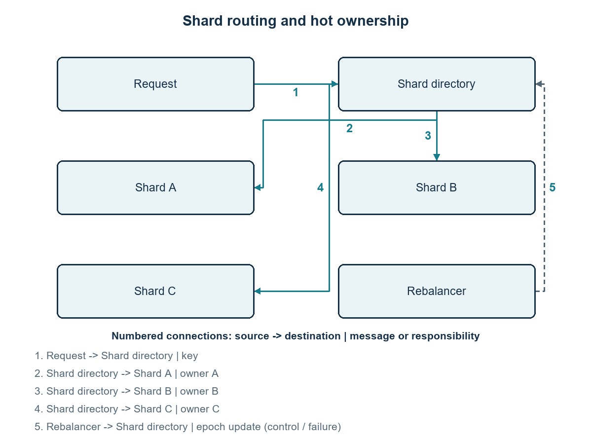

*Figure 123. Shard routing and hot ownership.* The directory maps a key to an owner. Rebalancing must fence old ownership before stale routers can write divergent data. Source: [editable Mermaid](diagrams/arch-sharding.mmd).


#### 6. Step-by-step example

1. Hash tenant ID across four shards.

2. Most tenants distribute evenly, but one giant tenant remains a hot shard.

3. Subsharding that tenant by entity may spread writes while making tenant-wide transactions and reports more expensive.

#### 7. Implementation

The complete runnable module is [examples/algorithms.py](examples/algorithms.py); run `python algorithms.py` from the examples directory. The following excerpt isolates `shard_for`. Required imports, surrounding definitions, expected output, and limitations are in the complete module and [lab guide](examples/README.md).

```python
def shard_for(key, shards):
    """Modulo-hash example. Resizing changes ownership; not consistent hashing."""
    if shards <= 0:
        raise ValueError("positive shard count required")
    digest = hashlib.sha256(str(key).encode()).digest()
    return int.from_bytes(digest[:8], "big") % shards
```

Read the state changes in this excerpt alongside the mechanism above. The lab is a model of its stated boundary; it does not establish the behavior of a distributed deployment or an external provider. Check the assertions in [test_examples.py](examples/test_examples.py) and compare your output with [recorded outputs](examples/actual_outputs/).

#### 8. Production use cases

ShopStream may outgrow the storage or write capacity of one database server. A shard key determines where each record lives and which requests require cross-shard work. Hash tenant ID across four shards.

#### 9. Advantages and disadvantages

Replication copies the same data; sharding divides it. Native table partitioning may remain inside one database system. Sharding improves capacity but adds routing, rebalancing, cross-shard transactions, backups, and operational complexity.

#### 10. Common mistakes and debugging

A timestamp key concentrates new writes in the newest range. Modulo N routing remaps many keys when N changes. Avoid introducing sharding solely because it sounds scalable; first measure indexes, query shapes, vertical capacity, and archival options.

#### 11. Comparison with related concepts

| Decision | Engineering interpretation |
|---|---|
| What this topic contributes | Sharding splits a dataset across independently hosted partitions. |
| Nearest alternatives and limits | Replication copies the same data; sharding divides it. Native table partitioning may remain inside one database system. Sharding improves capacity but adds routing, rebalancing, cross-shard transactions, backups, and operational complexity. |
| Combined design | Read [31. Partitioning](#topic-031) and [32. Replication](#topic-032); identify which layer owns each invariant rather than assuming their guarantees are interchangeable. |

#### 12. Interview preparation

**30.1 - Conceptual; Beginner. A teammate wants to add sharding everywhere. What concrete need should justify it?**

**Model answer:** Sharding splits a dataset across independently hosted partitions. ShopStream may outgrow the storage or write capacity of one database server. A shard key determines where each record lives and which requests require cross-shard work. Replication copies the same data; sharding divides it.

**30.2 - Conceptual; Intermediate. What must be represented or coordinated for sharding to work correctly?**

**Model answer:** Choose a key aligned with common transactions, map keys to shards through ranges, hashes, or a directory, and route requests accordingly. Track ownership during rebalancing. Copy data, catch up changes, fence old ownership, switch routing, and verify counts before retiring the old copy. Plan global IDs and cross-shard queries explicitly.

**30.3 - Conceptual; Beginner. Explain the analogy, then identify where it stops being a trustworthy model.**

**Model answer:** A university divides students among administrative offices. Assigning by department makes departmental tasks local but can overload the largest department. Every division rule favors some access patterns and complicates others. The implementation must still follow the explicit state and failure rules described in the mechanism; an analogy cannot establish a delivery, timing, or security guarantee.

**30.4 - Conceptual; Intermediate. Which nearby alternative would you compare with sharding, and what changes the choice?**

**Model answer:** Replication copies the same data; sharding divides it. Native table partitioning may remain inside one database system. Sharding improves capacity but adds routing, rebalancing, cross-shard transactions, backups, and operational complexity.

**30.5 - Conceptual; Intermediate. How can an apparently functioning implementation still violate the intended contract?**

**Model answer:** A timestamp key concentrates new writes in the newest range. Modulo N routing remaps many keys when N changes. Avoid introducing sharding solely because it sounds scalable; first measure indexes, query shapes, vertical capacity, and archival options.

**30.6 - Scenario; Intermediate. Walk through the worked ShopStream example. What evidence establishes the outcome, and what remains an assumption?**

**Model answer:** Hash tenant ID across four shards. Most tenants distribute evenly, but one giant tenant remains a hot shard. Subsharding that tenant by entity may spread writes while making tenant-wide transactions and reports more expensive. Verify the stated state transition or measurement at the responsible boundary. The numerical values, when present, are assumptions or deterministic examples rather than vendor performance guarantees.

**30.7 - Scenario; Advanced. You must validate this behavior before rollout. What experiment would expose a false correctness claim?**

**Model answer:** Distribute sample tenant keys and measure skew. Add one hot tenant and show why uniform hashing cannot split that tenant automatically. Design migration states with a clear single-writer cutover and rollback boundary. Record the starting state, injected condition, observed result, and invariant. A successful startup alone does not demonstrate the behavior under test.

**30.8 - Scenario; Advanced. A change involving sharding produces a customer-visible regression. How would you investigate and choose a safe response?**

**Model answer:** A timestamp key concentrates new writes in the newest range. Modulo N routing remaps many keys when N changes. Avoid introducing sharding solely because it sounds scalable; first measure indexes, query shapes, vertical capacity, and archival options. Rebalancing is a distributed state transition, not merely copying rows. A stale router can write to the old shard after cutover. Use ownership epochs or another fencing scheme and reconciliation to prevent divergent writable copies.

**30.9 - Advanced follow-up; Expert. Which hidden assumptions become important under failure, scale, or a changed workload?**

**Model answer:** Rebalancing is a distributed state transition, not merely copying rows. A stale router can write to the old shard after cutover. Use ownership epochs or another fencing scheme and reconciliation to prevent divergent writable copies.

**30.10 - Advanced follow-up; Expert. How does this design interact with partitioning and replication?**

**Model answer:** Choose a key aligned with common transactions, map keys to shards through ranges, hashes, or a directory, and route requests accordingly. Define range, list, or hash bounds, route inserts, and let queries prune irrelevant partitions when predicates expose the partition key. Capture committed changes in a log, transmit them, apply them in order within the guaranteed domain, and track durable progress. Specify which component owns each decision and trace a failure across the combined boundary. Do not infer one component's guarantee from another component's name.

**Common incorrect answer:** "Adding the component makes the guarantee automatic." This is wrong because the mechanism depends on specific state, boundaries, and failure assumptions. A timestamp key concentrates new writes in the newest range.

**A deeper interviewer probe:** Change the timing, workload, or failure condition described in the advanced answer. Ask which invariant still holds, what observation would disprove it, and whether the fallback changes the user contract. Rebalancing is a distributed state transition, not merely copying rows.

#### 13. Exercises and solution walkthroughs

**Beginner exercise:** Reproduce the worked example for sharding on paper. Record the initial state, each transition, and the result before reading the walkthrough.

**Beginner solution:** Hash tenant ID across four shards. Most tenants distribute evenly, but one giant tenant remains a hot shard. Subsharding that tenant by entity may spread writes while making tenant-wide transactions and reports more expensive.

**Intermediate exercise:** Distribute sample tenant keys and measure skew. Write the observable assertion and identify which component owns it.

**Intermediate solution:** Distribute sample tenant keys and measure skew. Add one hot tenant and show why uniform hashing cannot split that tenant automatically. Design migration states with a clear single-writer cutover and rollback boundary. Use the provided lab where applicable; for platform behavior, record the runtime version and actual evidence instead of treating a diagram as a test.

**Advanced exercise:** Extend the example to a failure or scale condition described below. State the guarantee you retain, the one you relax if necessary, and a safe recovery procedure.

**Advanced solution:** Rebalancing is a distributed state transition, not merely copying rows. A stale router can write to the old shard after cutover. Use ownership epochs or another fencing scheme and reconciliation to prevent divergent writable copies. A timestamp key concentrates new writes in the newest range. A complete solution identifies a detection signal, a bounded action, and a verification of the business outcome.

#### 14. Key takeaways

- Sharding splits a dataset across independently hosted partitions.

- Choose a key aligned with common transactions, map keys to shards through ranges, hashes, or a directory, and route requests accordingly.

- Replication copies the same data; sharding divides it.

- A timestamp key concentrates new writes in the newest range.

- Rebalancing is a distributed state transition, not merely copying rows.


**When to use it:** ShopStream may outgrow the storage or write capacity of one database server. A shard key determines where each record lives and which requests require cross-shard work.

**Terminology:** See this topic's glossary entry and the linked related terms. **Continue with:** [31. Partitioning](#topic-031), [32. Replication](#topic-032), [38. Distributed Locks](#topic-038), [46. Horizontal Scaling](#topic-046).
<a id="topic-031"></a>

### 31. Partitioning

Prerequisites and related reading: [25. Database Indexing](#topic-025), [30. Sharding](#topic-030), [81. Database Migrations](#topic-081), [84. Backups](#topic-084).

#### 1. Simple explanation

Partitioning divides a logical table or dataset into smaller pieces using a rule.

#### 2. The problem it solves

ShopStream can separate orders by month for pruning and retention. The term does not by itself imply different servers; many partitions can share one database host.

#### 3. Intuitive analogy

A filing cabinet uses drawers labeled by year. Opening only the relevant drawer reduces search work. All drawers still share the same room, so partitioning alone does not enlarge the building.

#### 4. Technical working mechanism

1. Define range, list, or hash bounds, route inserts, and let queries prune irrelevant partitions when predicates expose the partition key.

2. Create suitable indexes on partitions and automate future partition creation.

3. Coordinate unique constraints and foreign keys with database-specific partition rules.

4. Detach or archive old partitions under a controlled retention procedure.


**Boundary and advanced reasoning.** Partition choice encodes lifecycle assumptions. Late-arriving data, corrected timestamps, and legal holds complicate deletion. Test boundary timestamps in UTC and confirm row movement behavior when a partition key changes.

#### 5. Architecture and diagrams

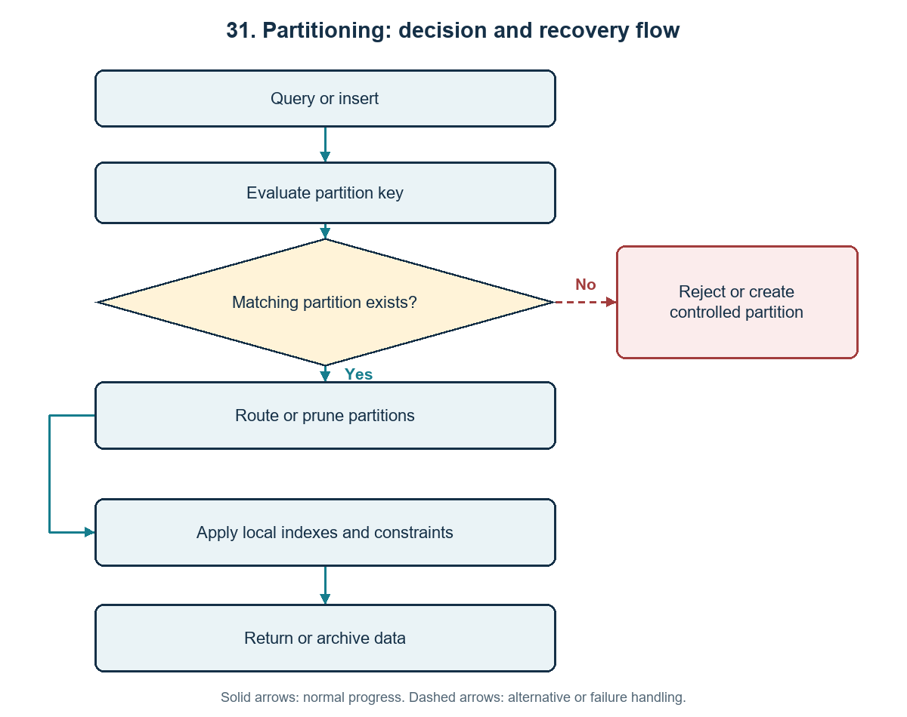

*Figure 31. 31. Partitioning: decision and recovery flow.* Start at "Query or insert" and move to "Evaluate partition key". At "Matching partition exists?", the Yes branch goes to "Route or prune partitions" and the No branch goes to "Reject or create controlled partition". Follow the arrows to the terminal or recovery outcome; a dashed branch is not an implicit success. Source: [editable Mermaid](diagrams/topic-031.mmd).


#### 6. Step-by-step example

1. A query for orders in October can scan that month's partition instead of years of history.

2. A query that omits created_at may still touch every partition.

3. Dropping an old partition makes retention efficient but must respect financial and product retention requirements.

#### 7. Implementation

Use the complete [configuration or SQL example](examples/database.sql) and its setup/run instructions in [examples/README.md](examples/README.md). Read every field in the configuration against the mechanism above; file parsing and runtime behavior are different validation levels.

The configuration requires its named runtime. See the verification report before assuming it was executed here. Use a disposable local environment for database and orchestration exercises; the examples do not deploy cloud resources.

#### 8. Production use cases

ShopStream can separate orders by month for pruning and retention. The term does not by itself imply different servers; many partitions can share one database host. A query for orders in October can scan that month's partition instead of years of history.

#### 9. Advantages and disadvantages

Partitioning improves manageability and some query patterns. Sharding distributes storage ownership across nodes. Over-partitioning increases planning and catalog overhead; too few large partitions reduce pruning and maintenance benefits.

#### 10. Common mistakes and debugging

Missing the next month's partition can reject inserts. Applying a transformation that hides the partition predicate may prevent pruning. A unique order ID constraint may require including the partition key or another database-specific design.

#### 11. Comparison with related concepts

| Decision | Engineering interpretation |
|---|---|
| What this topic contributes | Partitioning divides a logical table or dataset into smaller pieces using a rule. |
| Nearest alternatives and limits | Partitioning improves manageability and some query patterns. Sharding distributes storage ownership across nodes. Over-partitioning increases planning and catalog overhead; too few large partitions reduce pruning and maintenance benefits. |
| Combined design | Read [25. Database Indexing](#topic-025) and [30. Sharding](#topic-030); identify which layer owns each invariant rather than assuming their guarantees are interchangeable. |

#### 12. Interview preparation

**31.1 - Conceptual; Beginner. A teammate wants to add partitioning everywhere. What concrete need should justify it?**

**Model answer:** Partitioning divides a logical table or dataset into smaller pieces using a rule. ShopStream can separate orders by month for pruning and retention. The term does not by itself imply different servers; many partitions can share one database host. Partitioning improves manageability and some query patterns.

**31.2 - Conceptual; Intermediate. What must be represented or coordinated for partitioning to work correctly?**

**Model answer:** Define range, list, or hash bounds, route inserts, and let queries prune irrelevant partitions when predicates expose the partition key. Create suitable indexes on partitions and automate future partition creation. Coordinate unique constraints and foreign keys with database-specific partition rules. Detach or archive old partitions under a controlled retention procedure.

**31.3 - Conceptual; Beginner. Explain the analogy, then identify where it stops being a trustworthy model.**

**Model answer:** A filing cabinet uses drawers labeled by year. Opening only the relevant drawer reduces search work. All drawers still share the same room, so partitioning alone does not enlarge the building. The implementation must still follow the explicit state and failure rules described in the mechanism; an analogy cannot establish a delivery, timing, or security guarantee.

**31.4 - Conceptual; Intermediate. Which nearby alternative would you compare with partitioning, and what changes the choice?**

**Model answer:** Partitioning improves manageability and some query patterns. Sharding distributes storage ownership across nodes. Over-partitioning increases planning and catalog overhead; too few large partitions reduce pruning and maintenance benefits.

**31.5 - Conceptual; Intermediate. How can an apparently functioning implementation still violate the intended contract?**

**Model answer:** Missing the next month's partition can reject inserts. Applying a transformation that hides the partition predicate may prevent pruning. A unique order ID constraint may require including the partition key or another database-specific design.

**31.6 - Scenario; Intermediate. Walk through the worked ShopStream example. What evidence establishes the outcome, and what remains an assumption?**

**Model answer:** A query for orders in October can scan that month's partition instead of years of history. A query that omits created_at may still touch every partition. Dropping an old partition makes retention efficient but must respect financial and product retention requirements. Verify the stated state transition or measurement at the responsible boundary. The numerical values, when present, are assumptions or deterministic examples rather than vendor performance guarantees.

**31.7 - Scenario; Advanced. You must validate this behavior before rollout. What experiment would expose a false correctness claim?**

**Model answer:** Create monthly partitions in the SQL lab and inspect pruning. Insert a boundary-date order and verify routing. Design an archival process that validates backup readability and legal retention before detaching old data. Record the starting state, injected condition, observed result, and invariant. A successful startup alone does not demonstrate the behavior under test.

**31.8 - Scenario; Advanced. A change involving partitioning produces a customer-visible regression. How would you investigate and choose a safe response?**

**Model answer:** Missing the next month's partition can reject inserts. Applying a transformation that hides the partition predicate may prevent pruning. A unique order ID constraint may require including the partition key or another database-specific design. Partition choice encodes lifecycle assumptions. Late-arriving data, corrected timestamps, and legal holds complicate deletion. Test boundary timestamps in UTC and confirm row movement behavior when a partition key changes.

**31.9 - Advanced follow-up; Expert. Which hidden assumptions become important under failure, scale, or a changed workload?**

**Model answer:** Partition choice encodes lifecycle assumptions. Late-arriving data, corrected timestamps, and legal holds complicate deletion. Test boundary timestamps in UTC and confirm row movement behavior when a partition key changes.

**31.10 - Advanced follow-up; Expert. How does this design interact with database indexing and sharding?**

**Model answer:** Define range, list, or hash bounds, route inserts, and let queries prune irrelevant partitions when predicates expose the partition key. B-tree indexes organize sorted keys in balanced pages, supporting equality, ranges, and ordering. Choose a key aligned with common transactions, map keys to shards through ranges, hashes, or a directory, and route requests accordingly. Specify which component owns each decision and trace a failure across the combined boundary. Do not infer one component's guarantee from another component's name.

**Common incorrect answer:** "Adding the component makes the guarantee automatic." This is wrong because the mechanism depends on specific state, boundaries, and failure assumptions. Missing the next month's partition can reject inserts.

**A deeper interviewer probe:** Change the timing, workload, or failure condition described in the advanced answer. Ask which invariant still holds, what observation would disprove it, and whether the fallback changes the user contract. Partition choice encodes lifecycle assumptions.

#### 13. Exercises and solution walkthroughs

**Beginner exercise:** Reproduce the worked example for partitioning on paper. Record the initial state, each transition, and the result before reading the walkthrough.

**Beginner solution:** A query for orders in October can scan that month's partition instead of years of history. A query that omits created_at may still touch every partition. Dropping an old partition makes retention efficient but must respect financial and product retention requirements.

**Intermediate exercise:** Create monthly partitions in the SQL lab and inspect pruning. Write the observable assertion and identify which component owns it.

**Intermediate solution:** Create monthly partitions in the SQL lab and inspect pruning. Insert a boundary-date order and verify routing. Design an archival process that validates backup readability and legal retention before detaching old data. Use the provided lab where applicable; for platform behavior, record the runtime version and actual evidence instead of treating a diagram as a test.

**Advanced exercise:** Extend the example to a failure or scale condition described below. State the guarantee you retain, the one you relax if necessary, and a safe recovery procedure.

**Advanced solution:** Partition choice encodes lifecycle assumptions. Late-arriving data, corrected timestamps, and legal holds complicate deletion. Test boundary timestamps in UTC and confirm row movement behavior when a partition key changes. Missing the next month's partition can reject inserts. A complete solution identifies a detection signal, a bounded action, and a verification of the business outcome.

#### 14. Key takeaways

- Partitioning divides a logical table or dataset into smaller pieces using a rule.

- Define range, list, or hash bounds, route inserts, and let queries prune irrelevant partitions when predicates expose the partition key.

- Partitioning improves manageability and some query patterns.

- Missing the next month's partition can reject inserts.

- Partition choice encodes lifecycle assumptions.


**When to use it:** ShopStream can separate orders by month for pruning and retention. The term does not by itself imply different servers; many partitions can share one database host.

**Terminology:** See this topic's glossary entry and the linked related terms. **Continue with:** [25. Database Indexing](#topic-025), [30. Sharding](#topic-030), [81. Database Migrations](#topic-081), [84. Backups](#topic-084).
<a id="topic-032"></a>

### 32. Replication

Prerequisites and related reading: [29. Read Replicas](#topic-029), [33. Leader Election](#topic-033), [35. Eventual Consistency](#topic-035), [84. Backups](#topic-084).

#### 1. Simple explanation

Replication maintains copies of data on multiple machines.

#### 2. The problem it solves

Copies can improve read capacity and survival of machine failure, but they must agree about accepted writes. ShopStream's durability depends on when a write is acknowledged and which copies contain it.

#### 3. Intuitive analogy

Several clerks maintain ledgers from one official journal. Copies protect against a lost notebook, but copying a mistaken entry spreads the mistake. Independent clerks accepting incompatible edits need a conflict rule.

#### 4. Technical working mechanism

1. Capture committed changes in a log, transmit them, apply them in order within the guaranteed domain, and track durable progress.

2. Leader-follower replication has one write authority.

3. Multi-leader systems allow several writers and need conflict handling.

4. Quorum systems require defined read/write protocols; R+W>N alone does not prove linearizability without additional conditions.


**Boundary and advanced reasoning.** Data-center diversity protects against some correlated failures but adds network delay and operational differences. Acknowledged durability depends on storage behavior, replication mode, membership changes, and failure assumptions. State those assumptions whenever advertising zero data loss.

#### 5. Architecture and diagrams


*Figure 32. 32. Replication: decision and recovery flow.* Start at "Leader commits change" and move to "Append and transmit log". At "Required acknowledgments reached?", the Yes branch goes to "Acknowledge according to policy" and the No branch goes to "Wait or fail within deadline". Follow the arrows to the terminal or recovery outcome; a dashed branch is not an implicit success. Source: [editable Mermaid](diagrams/topic-032.mmd).


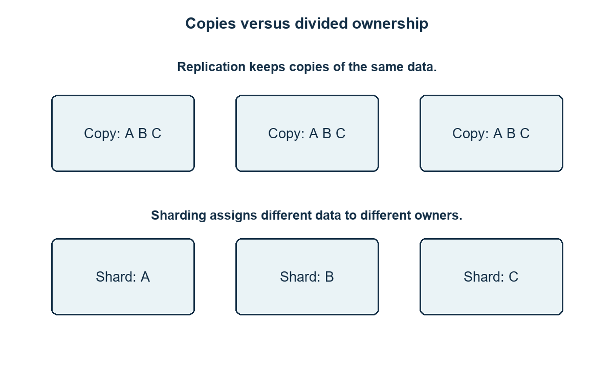

*Figure 181. Copies versus divided ownership.* Top: each replica has A, B, and C. Bottom: shards own different subsets. Real systems can combine sharding with replication. Source: [editable SVG](diagrams/ill-replication.svg).


#### 6. Step-by-step example

1. A primary acknowledges after its local durable write while a follower is disconnected.

2. If the primary is lost before replication, promotion may omit that write.

3. Waiting for a synchronous durable replica narrows the loss window but can block writes when that replica is unavailable.

#### 7. Implementation

For this topic, the worked scenario and the exercise below are the direct practical implementation of the reasoning. A standalone toy implementation would hide important platform or protocol guarantees. Use the relevant official implementation or managed runtime for real deployment, and validate its actual contract.

The associated [examples/algorithms.py](examples/algorithms.py) illustrates a related local boundary, not a full implementation of replication. [The lab guide](examples/README.md) distinguishes executable simulations, configurations, and design exercises.

#### 8. Production use cases

Copies can improve read capacity and survival of machine failure, but they must agree about accepted writes. ShopStream's durability depends on when a write is acknowledged and which copies contain it. A primary acknowledges after its local durable write while a follower is disconnected.

#### 9. Advantages and disadvantages

Synchronous and asynchronous replication trade acknowledgment latency, availability, and possible data loss. Replication is not backup because corruption and deletion propagate. Logical replication and physical replication operate at different abstraction levels and support different compatibility constraints.

#### 10. Common mistakes and debugging

Assuming every copy is current creates stale reads. Promoting without fencing creates two writers. Measuring only bytes sent ignores unapplied backlog. Track durable receive and apply positions and test recovery, not merely steady-state synchronization.

#### 11. Comparison with related concepts

| Decision | Engineering interpretation |
|---|---|
| What this topic contributes | Replication maintains copies of data on multiple machines. |
| Nearest alternatives and limits | Synchronous and asynchronous replication trade acknowledgment latency, availability, and possible data loss. Replication is not backup because corruption and deletion propagate. Logical replication and physical replication operate at different abstraction levels and support different compatibility constraints. |
| Combined design | Read [29. Read Replicas](#topic-029) and [33. Leader Election](#topic-033); identify which layer owns each invariant rather than assuming their guarantees are interchangeable. |

#### 12. Interview preparation

**32.1 - Conceptual; Beginner. A teammate wants to add replication everywhere. What concrete need should justify it?**

**Model answer:** Replication maintains copies of data on multiple machines. Copies can improve read capacity and survival of machine failure, but they must agree about accepted writes. ShopStream's durability depends on when a write is acknowledged and which copies contain it. Synchronous and asynchronous replication trade acknowledgment latency, availability, and possible data loss.

**32.2 - Conceptual; Intermediate. What must be represented or coordinated for replication to work correctly?**

**Model answer:** Capture committed changes in a log, transmit them, apply them in order within the guaranteed domain, and track durable progress. Leader-follower replication has one write authority. Multi-leader systems allow several writers and need conflict handling. Quorum systems require defined read/write protocols; R+W>N alone does not prove linearizability without additional conditions.

**32.3 - Conceptual; Beginner. Explain the analogy, then identify where it stops being a trustworthy model.**

**Model answer:** Several clerks maintain ledgers from one official journal. Copies protect against a lost notebook, but copying a mistaken entry spreads the mistake. Independent clerks accepting incompatible edits need a conflict rule. The implementation must still follow the explicit state and failure rules described in the mechanism; an analogy cannot establish a delivery, timing, or security guarantee.

**32.4 - Conceptual; Intermediate. Which nearby alternative would you compare with replication, and what changes the choice?**

**Model answer:** Synchronous and asynchronous replication trade acknowledgment latency, availability, and possible data loss. Replication is not backup because corruption and deletion propagate. Logical replication and physical replication operate at different abstraction levels and support different compatibility constraints.

**32.5 - Conceptual; Intermediate. How can an apparently functioning implementation still violate the intended contract?**

**Model answer:** Assuming every copy is current creates stale reads. Promoting without fencing creates two writers. Measuring only bytes sent ignores unapplied backlog. Track durable receive and apply positions and test recovery, not merely steady-state synchronization.

**32.6 - Scenario; Intermediate. Walk through the worked ShopStream example. What evidence establishes the outcome, and what remains an assumption?**

**Model answer:** A primary acknowledges after its local durable write while a follower is disconnected. If the primary is lost before replication, promotion may omit that write. Waiting for a synchronous durable replica narrows the loss window but can block writes when that replica is unavailable. Verify the stated state transition or measurement at the responsible boundary. The numerical values, when present, are assumptions or deterministic examples rather than vendor performance guarantees.

**32.7 - Scenario; Advanced. You must validate this behavior before rollout. What experiment would expose a false correctness claim?**

**Model answer:** Pause replication, commit a write, and inspect divergence in a simulation. Compare acknowledgment policies. Design a failover drill that verifies fencing, committed record counts, and recovery of clients with stale connections. Record the starting state, injected condition, observed result, and invariant. A successful startup alone does not demonstrate the behavior under test.

**32.8 - Scenario; Advanced. A change involving replication produces a customer-visible regression. How would you investigate and choose a safe response?**

**Model answer:** Assuming every copy is current creates stale reads. Promoting without fencing creates two writers. Measuring only bytes sent ignores unapplied backlog. Track durable receive and apply positions and test recovery, not merely steady-state synchronization. Data-center diversity protects against some correlated failures but adds network delay and operational differences. Acknowledged durability depends on storage behavior, replication mode, membership changes, and failure assumptions. State those assumptions whenever advertising zero data loss.

**32.9 - Advanced follow-up; Expert. Which hidden assumptions become important under failure, scale, or a changed workload?**

**Model answer:** Data-center diversity protects against some correlated failures but adds network delay and operational differences. Acknowledged durability depends on storage behavior, replication mode, membership changes, and failure assumptions. State those assumptions whenever advertising zero data loss.

**32.10 - Advanced follow-up; Expert. How does this design interact with read replicas and leader election?**

**Model answer:** Capture committed changes in a log, transmit them, apply them in order within the guaranteed domain, and track durable progress. The primary writes a replication log. In a quorum-based consensus protocol, nodes use election timeouts, increasing terms, durable votes, and log freshness checks. Specify which component owns each decision and trace a failure across the combined boundary. Do not infer one component's guarantee from another component's name.

**Common incorrect answer:** "Adding the component makes the guarantee automatic." This is wrong because the mechanism depends on specific state, boundaries, and failure assumptions. Assuming every copy is current creates stale reads.

**A deeper interviewer probe:** Change the timing, workload, or failure condition described in the advanced answer. Ask which invariant still holds, what observation would disprove it, and whether the fallback changes the user contract. Data-center diversity protects against some correlated failures but adds network delay and operational differences.

#### 13. Exercises and solution walkthroughs

**Beginner exercise:** Reproduce the worked example for replication on paper. Record the initial state, each transition, and the result before reading the walkthrough.

**Beginner solution:** A primary acknowledges after its local durable write while a follower is disconnected. If the primary is lost before replication, promotion may omit that write. Waiting for a synchronous durable replica narrows the loss window but can block writes when that replica is unavailable.

**Intermediate exercise:** Pause replication, commit a write, and inspect divergence in a simulation. Write the observable assertion and identify which component owns it.

**Intermediate solution:** Pause replication, commit a write, and inspect divergence in a simulation. Compare acknowledgment policies. Design a failover drill that verifies fencing, committed record counts, and recovery of clients with stale connections. Use the provided lab where applicable; for platform behavior, record the runtime version and actual evidence instead of treating a diagram as a test.

**Advanced exercise:** Extend the example to a failure or scale condition described below. State the guarantee you retain, the one you relax if necessary, and a safe recovery procedure.

**Advanced solution:** Data-center diversity protects against some correlated failures but adds network delay and operational differences. Acknowledged durability depends on storage behavior, replication mode, membership changes, and failure assumptions. State those assumptions whenever advertising zero data loss. Assuming every copy is current creates stale reads. A complete solution identifies a detection signal, a bounded action, and a verification of the business outcome.

#### 14. Key takeaways

- Replication maintains copies of data on multiple machines.

- Capture committed changes in a log, transmit them, apply them in order within the guaranteed domain, and track durable progress.

- Synchronous and asynchronous replication trade acknowledgment latency, availability, and possible data loss.

- Assuming every copy is current creates stale reads.

- Data-center diversity protects against some correlated failures but adds network delay and operational differences.


**When to use it:** Copies can improve read capacity and survival of machine failure, but they must agree about accepted writes. ShopStream's durability depends on when a write is acknowledged and which copies contain it.

**Terminology:** See this topic's glossary entry and the linked related terms. **Continue with:** [29. Read Replicas](#topic-029), [33. Leader Election](#topic-033), [35. Eventual Consistency](#topic-035), [84. Backups](#topic-084).
<a id="topic-036"></a>

### 36. Optimistic Locking

Prerequisites and related reading: [37. Pessimistic Locking](#topic-037), [39. Race Conditions](#topic-039), [81. Database Migrations](#topic-081), [102. API Versioning](#topic-102).

#### 1. Simple explanation

Optimistic locking lets concurrent readers proceed, then checks whether data changed before accepting a write.

#### 2. The problem it solves

ShopStream editors can update product descriptions without holding database locks while thinking. A version comparison prevents silently overwriting another editor's work.

#### 3. Intuitive analogy

Two students edit copies of a report with revision number 7. The first publishes revision 8. The second must compare changes rather than replacing the newer report with an old copy.

#### 4. Technical working mechanism

1. Read a row and version, compute the proposed change, then atomically UPDATE with WHERE id=?

2. AND version=old_version while incrementing the version.

3. One affected row means success; zero means conflict or absence.

4. Reload and merge or ask the user to resolve.

5. For HTTP, ETag with If-Match can expose similar precondition semantics.


**Boundary and advanced reasoning.** Write skew can occur when two transactions read overlapping constraints but update different rows. Protect the invariant with serializable transactions, explicit locking of a shared guard, or an appropriate database constraint. The correct choice follows the invariant, not the popularity of version columns.

#### 5. Architecture and diagrams

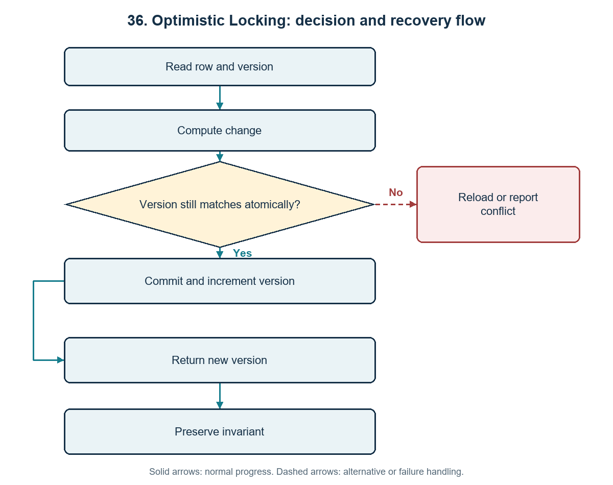

*Figure 36. 36. Optimistic Locking: decision and recovery flow.* Start at "Read row and version" and move to "Compute change". At "Version still matches atomically?", the Yes branch goes to "Commit and increment version" and the No branch goes to "Reload or report conflict". Follow the arrows to the terminal or recovery outcome; a dashed branch is not an implicit success. Source: [editable Mermaid](diagrams/topic-036.mmd).


#### 6. Step-by-step example

1. Both editors read version 4.

2. Alice updates successfully to 5.

3. Bob's conditional update using 4 affects zero rows.

4. Returning 409 or 412 under the chosen API contract is safer than silently retrying his old full replacement against version 5.

#### 7. Implementation

Use the complete [configuration or SQL example](examples/database.sql) and its setup/run instructions in [examples/README.md](examples/README.md). Read every field in the configuration against the mechanism above; file parsing and runtime behavior are different validation levels.

The configuration requires its named runtime. See the verification report before assuming it was executed here. Use a disposable local environment for database and orchestration exercises; the examples do not deploy cloud resources.

#### 8. Production use cases

ShopStream editors can update product descriptions without holding database locks while thinking. A version comparison prevents silently overwriting another editor's work. Both editors read version 4.

#### 9. Advantages and disadvantages

Optimistic checks work well with infrequent conflicts and short write operations. Pessimistic locking may be simpler for high-contention critical sections. A single-row version check does not automatically protect a multi-row business invariant.

#### 10. Common mistakes and debugging

Reading then writing the version in separate unguarded operations races. Automatically retrying every user edit can erase intentional conflict detection. Distinguish retryable computation from changes requiring human or domain-specific merge decisions.

#### 11. Comparison with related concepts

| Decision | Engineering interpretation |
|---|---|
| What this topic contributes | Optimistic locking lets concurrent readers proceed, then checks whether data changed before accepting a write. |
| Nearest alternatives and limits | Optimistic checks work well with infrequent conflicts and short write operations. Pessimistic locking may be simpler for high-contention critical sections. A single-row version check does not automatically protect a multi-row business invariant. |
| Combined design | Read [37. Pessimistic Locking](#topic-037) and [39. Race Conditions](#topic-039); identify which layer owns each invariant rather than assuming their guarantees are interchangeable. |

#### 12. Interview preparation

**36.1 - Conceptual; Beginner. A teammate wants to add optimistic locking everywhere. What concrete need should justify it?**

**Model answer:** Optimistic locking lets concurrent readers proceed, then checks whether data changed before accepting a write. ShopStream editors can update product descriptions without holding database locks while thinking. A version comparison prevents silently overwriting another editor's work. Optimistic checks work well with infrequent conflicts and short write operations.

**36.2 - Conceptual; Intermediate. What must be represented or coordinated for optimistic locking to work correctly?**

**Model answer:** Read a row and version, compute the proposed change, then atomically UPDATE with WHERE id=? AND version=old_version while incrementing the version. One affected row means success; zero means conflict or absence. Reload and merge or ask the user to resolve. For HTTP, ETag with If-Match can expose similar precondition semantics.

**36.3 - Conceptual; Beginner. Explain the analogy, then identify where it stops being a trustworthy model.**

**Model answer:** Two students edit copies of a report with revision number 7. The first publishes revision 8. The second must compare changes rather than replacing the newer report with an old copy. The implementation must still follow the explicit state and failure rules described in the mechanism; an analogy cannot establish a delivery, timing, or security guarantee.

**36.4 - Conceptual; Intermediate. Which nearby alternative would you compare with optimistic locking, and what changes the choice?**

**Model answer:** Optimistic checks work well with infrequent conflicts and short write operations. Pessimistic locking may be simpler for high-contention critical sections. A single-row version check does not automatically protect a multi-row business invariant.

**36.5 - Conceptual; Intermediate. How can an apparently functioning implementation still violate the intended contract?**

**Model answer:** Reading then writing the version in separate unguarded operations races. Automatically retrying every user edit can erase intentional conflict detection. Distinguish retryable computation from changes requiring human or domain-specific merge decisions.

**36.6 - Scenario; Intermediate. Walk through the worked ShopStream example. What evidence establishes the outcome, and what remains an assumption?**

**Model answer:** Both editors read version 4. Alice updates successfully to 5. Bob's conditional update using 4 affects zero rows. Returning 409 or 412 under the chosen API contract is safer than silently retrying his old full replacement against version 5. Verify the stated state transition or measurement at the responsible boundary. The numerical values, when present, are assumptions or deterministic examples rather than vendor performance guarantees.

**36.7 - Scenario; Advanced. You must validate this behavior before rollout. What experiment would expose a false correctness claim?**

**Model answer:** Run two updates against the same version and assert one success. Add If-Match semantics to an edit API. Design a two-doctor on-call invariant and explain why separate row versions do not ensure one doctor remains on duty. Record the starting state, injected condition, observed result, and invariant. A successful startup alone does not demonstrate the behavior under test.

**36.8 - Scenario; Advanced. A change involving optimistic locking produces a customer-visible regression. How would you investigate and choose a safe response?**

**Model answer:** Reading then writing the version in separate unguarded operations races. Automatically retrying every user edit can erase intentional conflict detection. Distinguish retryable computation from changes requiring human or domain-specific merge decisions. Write skew can occur when two transactions read overlapping constraints but update different rows. Protect the invariant with serializable transactions, explicit locking of a shared guard, or an appropriate database constraint. The correct choice follows the invariant, not the popularity of version columns.

**36.9 - Advanced follow-up; Expert. Which hidden assumptions become important under failure, scale, or a changed workload?**

**Model answer:** Write skew can occur when two transactions read overlapping constraints but update different rows. Protect the invariant with serializable transactions, explicit locking of a shared guard, or an appropriate database constraint. The correct choice follows the invariant, not the popularity of version columns.

**36.10 - Advanced follow-up; Expert. How does this design interact with pessimistic locking and race conditions?**

**Model answer:** Read a row and version, compute the proposed change, then atomically UPDATE with WHERE id=? Start a transaction, acquire the required row locks such as SELECT FOR UPDATE, inspect current values, perform changes, and commit promptly. Identify shared mutable state and the invariant. Specify which component owns each decision and trace a failure across the combined boundary. Do not infer one component's guarantee from another component's name.

**Common incorrect answer:** "Adding the component makes the guarantee automatic." This is wrong because the mechanism depends on specific state, boundaries, and failure assumptions. Reading then writing the version in separate unguarded operations races.

**A deeper interviewer probe:** Change the timing, workload, or failure condition described in the advanced answer. Ask which invariant still holds, what observation would disprove it, and whether the fallback changes the user contract. Write skew can occur when two transactions read overlapping constraints but update different rows.

#### 13. Exercises and solution walkthroughs

**Beginner exercise:** Reproduce the worked example for optimistic locking on paper. Record the initial state, each transition, and the result before reading the walkthrough.

**Beginner solution:** Both editors read version 4. Alice updates successfully to 5. Bob's conditional update using 4 affects zero rows. Returning 409 or 412 under the chosen API contract is safer than silently retrying his old full replacement against version 5.

**Intermediate exercise:** Run two updates against the same version and assert one success. Write the observable assertion and identify which component owns it.

**Intermediate solution:** Run two updates against the same version and assert one success. Add If-Match semantics to an edit API. Design a two-doctor on-call invariant and explain why separate row versions do not ensure one doctor remains on duty. Use the provided lab where applicable; for platform behavior, record the runtime version and actual evidence instead of treating a diagram as a test.

**Advanced exercise:** Extend the example to a failure or scale condition described below. State the guarantee you retain, the one you relax if necessary, and a safe recovery procedure.

**Advanced solution:** Write skew can occur when two transactions read overlapping constraints but update different rows. Protect the invariant with serializable transactions, explicit locking of a shared guard, or an appropriate database constraint. The correct choice follows the invariant, not the popularity of version columns. Reading then writing the version in separate unguarded operations races. A complete solution identifies a detection signal, a bounded action, and a verification of the business outcome.

#### 14. Key takeaways

- Optimistic locking lets concurrent readers proceed, then checks whether data changed before accepting a write.

- Read a row and version, compute the proposed change, then atomically UPDATE with WHERE id=?

- Optimistic checks work well with infrequent conflicts and short write operations.

- Reading then writing the version in separate unguarded operations races.

- Write skew can occur when two transactions read overlapping constraints but update different rows.


**When to use it:** ShopStream editors can update product descriptions without holding database locks while thinking. A version comparison prevents silently overwriting another editor's work.

**Terminology:** See this topic's glossary entry and the linked related terms. **Continue with:** [37. Pessimistic Locking](#topic-037), [39. Race Conditions](#topic-039), [81. Database Migrations](#topic-081), [102. API Versioning](#topic-102).

**Official verification references:** [PostgreSQL transaction isolation](https://www.postgresql.org/docs/current/transaction-iso.html). These references verify the named protocol or platform details; the examples, diagrams, and numerical assumptions are original teaching material.
<a id="topic-037"></a>

### 37. Pessimistic Locking

Prerequisites and related reading: [18. Distributed Transactions](#topic-018), [36. Optimistic Locking](#topic-036), [39. Race Conditions](#topic-039), [40. Deadlocks](#topic-040).

#### 1. Simple explanation

Pessimistic locking reserves access before changing shared data.

#### 2. The problem it solves

ShopStream can lock an inventory row while deciding whether stock remains. Competing transactions wait or fail according to policy, making some critical sections easier to reason about.

#### 3. Intuitive analogy

A clerk takes the only key to a stockroom while counting and allocating goods. Others wait. Holding the key while phoning an unrelated supplier unnecessarily blocks everyone else.

#### 4. Technical working mechanism

1. Start a transaction, acquire the required row locks such as SELECT FOR UPDATE, inspect current values, perform changes, and commit promptly.

2. Use a consistent lock order and bounded lock waits.

3. Locks are released at transaction end.

4. MVCC means ordinary readers may still see snapshots; a row lock does not necessarily block every read.


**Boundary and advanced reasoning.** SKIP LOCKED is useful for competing job workers but intentionally gives an incomplete view of locked rows; it is not a general correctness fix for financial queries. Fairness and starvation need observation when frequently skipping busy records.

#### 5. Architecture and diagrams

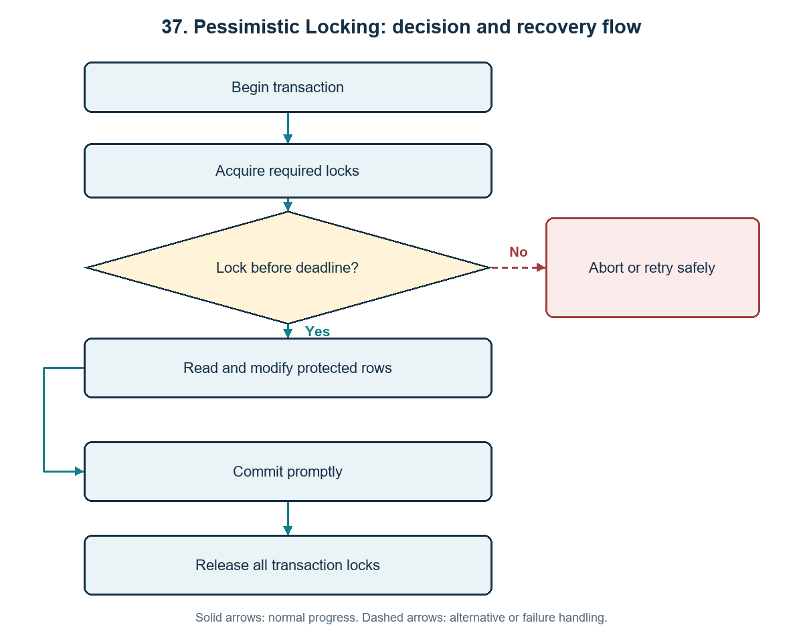

*Figure 37. 37. Pessimistic Locking: decision and recovery flow.* Start at "Begin transaction" and move to "Acquire required locks". At "Lock before deadline?", the Yes branch goes to "Read and modify protected rows" and the No branch goes to "Abort or retry safely". Follow the arrows to the terminal or recovery outcome; a dashed branch is not an implicit success. Source: [editable Mermaid](diagrams/topic-037.mmd).


#### 6. Step-by-step example

1. Stock is one.

2. Transaction A locks the row, decrements to zero, and commits.

3. B waits, then observes zero and rejects its purchase.

4. An atomic conditional UPDATE can achieve the same narrow invariant without a separate read-then-lock sequence.

#### 7. Implementation

Use the complete [configuration or SQL example](examples/database.sql) and its setup/run instructions in [examples/README.md](examples/README.md). Read every field in the configuration against the mechanism above; file parsing and runtime behavior are different validation levels.

The configuration requires its named runtime. See the verification report before assuming it was executed here. Use a disposable local environment for database and orchestration exercises; the examples do not deploy cloud resources.

#### 8. Production use cases

ShopStream can lock an inventory row while deciding whether stock remains. Competing transactions wait or fail according to policy, making some critical sections easier to reason about. Stock is one.

#### 9. Advantages and disadvantages

Locking prevents certain concurrent interference but adds waiting and deadlock risk. Optimistic checks avoid waiting until conflict detection. Serializable isolation addresses broader anomalies, while explicit row locks protect only the objects and operations actually covered.

#### 10. Common mistakes and debugging

Calling a payment provider while holding inventory locks creates long contention chains. Locking rows in opposite orders permits deadlocks. Use short local transactions and reservations for workflows that involve external services.

#### 11. Comparison with related concepts

| Decision | Engineering interpretation |
|---|---|
| What this topic contributes | Pessimistic locking reserves access before changing shared data. |
| Nearest alternatives and limits | Locking prevents certain concurrent interference but adds waiting and deadlock risk. Optimistic checks avoid waiting until conflict detection. Serializable isolation addresses broader anomalies, while explicit row locks protect only the objects and operations actually covered. |
| Combined design | Read [18. Distributed Transactions](#topic-018) and [36. Optimistic Locking](#topic-036); identify which layer owns each invariant rather than assuming their guarantees are interchangeable. |

#### 12. Interview preparation

**37.1 - Conceptual; Beginner. A teammate wants to add pessimistic locking everywhere. What concrete need should justify it?**

**Model answer:** Pessimistic locking reserves access before changing shared data. ShopStream can lock an inventory row while deciding whether stock remains. Competing transactions wait or fail according to policy, making some critical sections easier to reason about. Locking prevents certain concurrent interference but adds waiting and deadlock risk.

**37.2 - Conceptual; Intermediate. What must be represented or coordinated for pessimistic locking to work correctly?**

**Model answer:** Start a transaction, acquire the required row locks such as SELECT FOR UPDATE, inspect current values, perform changes, and commit promptly. Use a consistent lock order and bounded lock waits. Locks are released at transaction end. MVCC means ordinary readers may still see snapshots; a row lock does not necessarily block every read.

**37.3 - Conceptual; Beginner. Explain the analogy, then identify where it stops being a trustworthy model.**

**Model answer:** A clerk takes the only key to a stockroom while counting and allocating goods. Others wait. Holding the key while phoning an unrelated supplier unnecessarily blocks everyone else. The implementation must still follow the explicit state and failure rules described in the mechanism; an analogy cannot establish a delivery, timing, or security guarantee.

**37.4 - Conceptual; Intermediate. Which nearby alternative would you compare with pessimistic locking, and what changes the choice?**

**Model answer:** Locking prevents certain concurrent interference but adds waiting and deadlock risk. Optimistic checks avoid waiting until conflict detection. Serializable isolation addresses broader anomalies, while explicit row locks protect only the objects and operations actually covered.

**37.5 - Conceptual; Intermediate. How can an apparently functioning implementation still violate the intended contract?**

**Model answer:** Calling a payment provider while holding inventory locks creates long contention chains. Locking rows in opposite orders permits deadlocks. Use short local transactions and reservations for workflows that involve external services.

**37.6 - Scenario; Intermediate. Walk through the worked ShopStream example. What evidence establishes the outcome, and what remains an assumption?**

**Model answer:** Stock is one. Transaction A locks the row, decrements to zero, and commits. B waits, then observes zero and rejects its purchase. An atomic conditional UPDATE can achieve the same narrow invariant without a separate read-then-lock sequence. Verify the stated state transition or measurement at the responsible boundary. The numerical values, when present, are assumptions or deterministic examples rather than vendor performance guarantees.

**37.7 - Scenario; Advanced. You must validate this behavior before rollout. What experiment would expose a false correctness claim?**

**Model answer:** Use two SQL sessions to reserve the last unit. Reverse lock order on two rows to reproduce a deadlock in an isolated lab. Replace the long transaction with an expiring reservation and define safe expiry reconciliation. Record the starting state, injected condition, observed result, and invariant. A successful startup alone does not demonstrate the behavior under test.

**37.8 - Scenario; Advanced. A change involving pessimistic locking produces a customer-visible regression. How would you investigate and choose a safe response?**

**Model answer:** Calling a payment provider while holding inventory locks creates long contention chains. Locking rows in opposite orders permits deadlocks. Use short local transactions and reservations for workflows that involve external services. SKIP LOCKED is useful for competing job workers but intentionally gives an incomplete view of locked rows; it is not a general correctness fix for financial queries. Fairness and starvation need observation when frequently skipping busy records.

**37.9 - Advanced follow-up; Expert. Which hidden assumptions become important under failure, scale, or a changed workload?**

**Model answer:** SKIP LOCKED is useful for competing job workers but intentionally gives an incomplete view of locked rows; it is not a general correctness fix for financial queries. Fairness and starvation need observation when frequently skipping busy records.

**37.10 - Advanced follow-up; Expert. How does this design interact with distributed transactions and optimistic locking?**

**Model answer:** Start a transaction, acquire the required row locks such as SELECT FOR UPDATE, inspect current values, perform changes, and commit promptly. In two-phase commit, a coordinator asks participants to prepare. Read a row and version, compute the proposed change, then atomically UPDATE with WHERE id=? Specify which component owns each decision and trace a failure across the combined boundary. Do not infer one component's guarantee from another component's name.

**Common incorrect answer:** "Adding the component makes the guarantee automatic." This is wrong because the mechanism depends on specific state, boundaries, and failure assumptions. Calling a payment provider while holding inventory locks creates long contention chains.

**A deeper interviewer probe:** Change the timing, workload, or failure condition described in the advanced answer. Ask which invariant still holds, what observation would disprove it, and whether the fallback changes the user contract. SKIP LOCKED is useful for competing job workers but intentionally gives an incomplete view of locked rows; it is not a general correctness fix for financial queries.

#### 13. Exercises and solution walkthroughs

**Beginner exercise:** Reproduce the worked example for pessimistic locking on paper. Record the initial state, each transition, and the result before reading the walkthrough.

**Beginner solution:** Stock is one. Transaction A locks the row, decrements to zero, and commits. B waits, then observes zero and rejects its purchase. An atomic conditional UPDATE can achieve the same narrow invariant without a separate read-then-lock sequence.

**Intermediate exercise:** Use two SQL sessions to reserve the last unit. Write the observable assertion and identify which component owns it.

**Intermediate solution:** Use two SQL sessions to reserve the last unit. Reverse lock order on two rows to reproduce a deadlock in an isolated lab. Replace the long transaction with an expiring reservation and define safe expiry reconciliation. Use the provided lab where applicable; for platform behavior, record the runtime version and actual evidence instead of treating a diagram as a test.

**Advanced exercise:** Extend the example to a failure or scale condition described below. State the guarantee you retain, the one you relax if necessary, and a safe recovery procedure.

**Advanced solution:** SKIP LOCKED is useful for competing job workers but intentionally gives an incomplete view of locked rows; it is not a general correctness fix for financial queries. Fairness and starvation need observation when frequently skipping busy records. Calling a payment provider while holding inventory locks creates long contention chains. A complete solution identifies a detection signal, a bounded action, and a verification of the business outcome.

#### 14. Key takeaways

- Pessimistic locking reserves access before changing shared data.

- Start a transaction, acquire the required row locks such as SELECT FOR UPDATE, inspect current values, perform changes, and commit promptly.

- Locking prevents certain concurrent interference but adds waiting and deadlock risk.

- Calling a payment provider while holding inventory locks creates long contention chains.

- SKIP LOCKED is useful for competing job workers but intentionally gives an incomplete view of locked rows; it is not a general correctness fix for financial queries.


**When to use it:** ShopStream can lock an inventory row while deciding whether stock remains. Competing transactions wait or fail according to policy, making some critical sections easier to reason about.

**Terminology:** See this topic's glossary entry and the linked related terms. **Continue with:** [18. Distributed Transactions](#topic-018), [36. Optimistic Locking](#topic-036), [39. Race Conditions](#topic-039), [40. Deadlocks](#topic-040).

**Official verification references:** [PostgreSQL transaction isolation](https://www.postgresql.org/docs/current/transaction-iso.html). These references verify the named protocol or platform details; the examples, diagrams, and numerical assumptions are original teaching material.
<a id="topic-081"></a>

### 81. Database Migrations

Prerequisites and related reading: [25. Database Indexing](#topic-025), [52. Blue-Green Deployment](#topic-052), [54. Rolling Deployments](#topic-054), [55. Rollbacks](#topic-055), [82. Schema Versioning](#topic-082).

#### 1. Simple explanation

A database migration changes schema or data in a controlled versioned process.

#### 2. The problem it solves

ShopStream must evolve while old and new application instances may run together. A migration that succeeds in isolation can still cause an outage through locks or compatibility breaks.

#### 3. Intuitive analogy

Renovating a library while it stays open requires temporary signs and compatible shelf locations. Removing the old entrance before visitors learn the new one strands them.

#### 4. Technical working mechanism

1. Use expand-and-contract: add compatible schema, deploy code that tolerates both forms, backfill in bounded checkpointed batches, switch reads and writes after verification, then remove old schema only after old code and rollback requirements expire.

2. Set lock and statement budgets, serialize migration ownership, and review database-specific DDL behavior.


**Boundary and advanced reasoning.** Test a compatibility matrix: old application with expanded schema, new application with partially backfilled data, and rollback after new writes. For large tables, use supported concurrent index or deferred-validation procedures and measure their resource effects in staging.

#### 5. Architecture and diagrams

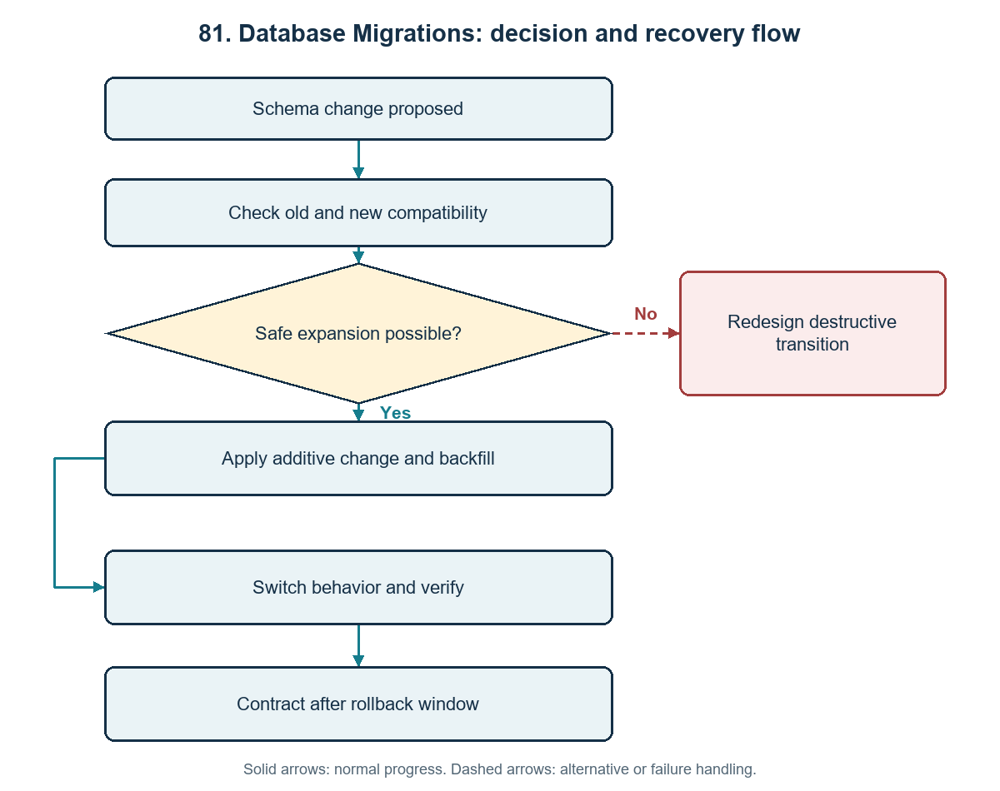

*Figure 81. 81. Database Migrations: decision and recovery flow.* Start at "Schema change proposed" and move to "Check old and new compatibility". At "Safe expansion possible?", the Yes branch goes to "Apply additive change and backfill" and the No branch goes to "Redesign destructive transition". Follow the arrows to the terminal or recovery outcome; a dashed branch is not an implicit success. Source: [editable Mermaid](diagrams/topic-081.mmd).


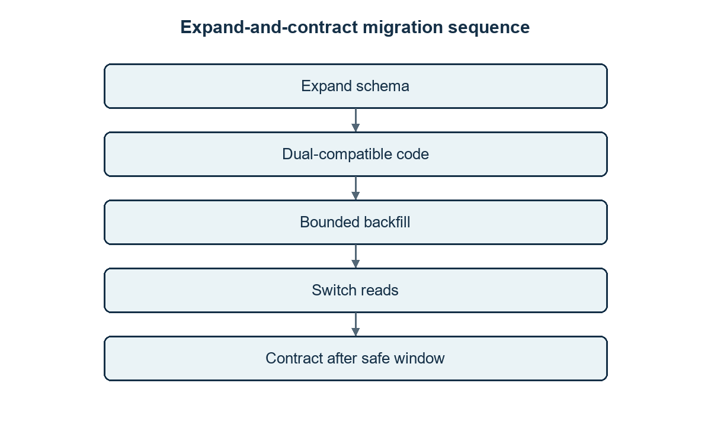

*Figure 193. Expand-and-contract migration sequence.* The old contract remains during mixed-version operation. Removing it is a separate, later change after backfill and rollback requirements are satisfied. Source: [editable SVG](diagrams/ill-migration.svg).


#### 6. Step-by-step example

1. Add display_name as nullable while retaining full_name.

2. New code writes both, a backfill copies old values, and readers migrate after validation.

3. Only later is full_name removed.

4. A failed deployment can still return to old code during the compatibility window.

#### 7. Implementation

Use the complete [configuration or SQL example](examples/database.sql) and its setup/run instructions in [examples/README.md](examples/README.md). Read every field in the configuration against the mechanism above; file parsing and runtime behavior are different validation levels.

The configuration requires its named runtime. See the verification report before assuming it was executed here. Use a disposable local environment for database and orchestration exercises; the examples do not deploy cloud resources.

#### 8. Production use cases

ShopStream must evolve while old and new application instances may run together. A migration that succeeds in isolation can still cause an outage through locks or compatibility breaks. Add display_name as nullable while retaining full_name.

#### 9. Advantages and disadvantages

Schema migration differs from a bulk data repair, though both may share tooling. Transactional DDL support varies by operation and database. A rollback script is not automatically safe if it discards new data; forward repair may be preferable.

#### 10. Common mistakes and debugging

One giant backfill transaction creates locks, replication lag, and large rollback work. Adding constraints without checking existing rows can fail late. Running migrations from every app replica risks races.

#### 11. Comparison with related concepts

| Decision | Engineering interpretation |
|---|---|
| What this topic contributes | A database migration changes schema or data in a controlled versioned process. |
| Nearest alternatives and limits | Schema migration differs from a bulk data repair, though both may share tooling. Transactional DDL support varies by operation and database. A rollback script is not automatically safe if it discards new data; forward repair may be preferable. |
| Combined design | Read [25. Database Indexing](#topic-025) and [52. Blue-Green Deployment](#topic-052); identify which layer owns each invariant rather than assuming their guarantees are interchangeable. |

#### 12. Interview preparation

**81.1 - Conceptual; Beginner. A teammate wants to add database migrations everywhere. What concrete need should justify it?**

**Model answer:** A database migration changes schema or data in a controlled versioned process. ShopStream must evolve while old and new application instances may run together. A migration that succeeds in isolation can still cause an outage through locks or compatibility breaks. Schema migration differs from a bulk data repair, though both may share tooling.

**81.2 - Conceptual; Intermediate. What must be represented or coordinated for database migrations to work correctly?**

**Model answer:** Use expand-and-contract: add compatible schema, deploy code that tolerates both forms, backfill in bounded checkpointed batches, switch reads and writes after verification, then remove old schema only after old code and rollback requirements expire. Set lock and statement budgets, serialize migration ownership, and review database-specific DDL behavior.

**81.3 - Conceptual; Beginner. Explain the analogy, then identify where it stops being a trustworthy model.**

**Model answer:** Renovating a library while it stays open requires temporary signs and compatible shelf locations. Removing the old entrance before visitors learn the new one strands them. The implementation must still follow the explicit state and failure rules described in the mechanism; an analogy cannot establish a delivery, timing, or security guarantee.

**81.4 - Conceptual; Intermediate. Which nearby alternative would you compare with database migrations, and what changes the choice?**

**Model answer:** Schema migration differs from a bulk data repair, though both may share tooling. Transactional DDL support varies by operation and database. A rollback script is not automatically safe if it discards new data; forward repair may be preferable.

**81.5 - Conceptual; Intermediate. How can an apparently functioning implementation still violate the intended contract?**

**Model answer:** One giant backfill transaction creates locks, replication lag, and large rollback work. Adding constraints without checking existing rows can fail late. Running migrations from every app replica risks races.

**81.6 - Scenario; Intermediate. Walk through the worked ShopStream example. What evidence establishes the outcome, and what remains an assumption?**

**Model answer:** Add display_name as nullable while retaining full_name. New code writes both, a backfill copies old values, and readers migrate after validation. Only later is full_name removed. A failed deployment can still return to old code during the compatibility window. Verify the stated state transition or measurement at the responsible boundary. The numerical values, when present, are assumptions or deterministic examples rather than vendor performance guarantees.

**81.7 - Scenario; Advanced. You must validate this behavior before rollout. What experiment would expose a false correctness claim?**

**Model answer:** Walk through the supplied expansion SQL. Backfill by primary-key ranges with checkpoints. Design a release gate that prevents dropping a column while any supported binary or consumer still requires it. Record the starting state, injected condition, observed result, and invariant. A successful startup alone does not demonstrate the behavior under test.

**81.8 - Scenario; Advanced. A change involving database migrations produces a customer-visible regression. How would you investigate and choose a safe response?**

**Model answer:** One giant backfill transaction creates locks, replication lag, and large rollback work. Adding constraints without checking existing rows can fail late. Running migrations from every app replica risks races. Test a compatibility matrix: old application with expanded schema, new application with partially backfilled data, and rollback after new writes. For large tables, use supported concurrent index or deferred-validation procedures and measure their resource effects in staging.

**81.9 - Advanced follow-up; Expert. Which hidden assumptions become important under failure, scale, or a changed workload?**

**Model answer:** Test a compatibility matrix: old application with expanded schema, new application with partially backfilled data, and rollback after new writes. For large tables, use supported concurrent index or deferred-validation procedures and measure their resource effects in staging.

**81.10 - Advanced follow-up; Expert. How does this design interact with database indexing and blue-green deployment?**

**Model answer:** Use expand-and-contract: add compatible schema, deploy code that tolerates both forms, backfill in bounded checkpointed batches, switch reads and writes after verification, then remove old schema only after old code and rollback requirements expire. B-tree indexes organize sorted keys in balanced pages, supporting equality, ranges, and ordering. Build one immutable artifact, deploy green, apply backward-compatible schema expansion, warm dependencies, run checks, switch a controlled portion or all routing, and drain blue. Specify which component owns each decision and trace a failure across the combined boundary. Do not infer one component's guarantee from another component's name.

**Common incorrect answer:** "Adding the component makes the guarantee automatic." This is wrong because the mechanism depends on specific state, boundaries, and failure assumptions. One giant backfill transaction creates locks, replication lag, and large rollback work.

**A deeper interviewer probe:** Change the timing, workload, or failure condition described in the advanced answer. Ask which invariant still holds, what observation would disprove it, and whether the fallback changes the user contract. Test a compatibility matrix: old application with expanded schema, new application with partially backfilled data, and rollback after new writes.

#### 13. Exercises and solution walkthroughs

**Beginner exercise:** Reproduce the worked example for database migrations on paper. Record the initial state, each transition, and the result before reading the walkthrough.

**Beginner solution:** Add display_name as nullable while retaining full_name. New code writes both, a backfill copies old values, and readers migrate after validation. Only later is full_name removed. A failed deployment can still return to old code during the compatibility window.

**Intermediate exercise:** Walk through the supplied expansion SQL. Write the observable assertion and identify which component owns it.

**Intermediate solution:** Walk through the supplied expansion SQL. Backfill by primary-key ranges with checkpoints. Design a release gate that prevents dropping a column while any supported binary or consumer still requires it. Use the provided lab where applicable; for platform behavior, record the runtime version and actual evidence instead of treating a diagram as a test.

**Advanced exercise:** Extend the example to a failure or scale condition described below. State the guarantee you retain, the one you relax if necessary, and a safe recovery procedure.

**Advanced solution:** Test a compatibility matrix: old application with expanded schema, new application with partially backfilled data, and rollback after new writes. For large tables, use supported concurrent index or deferred-validation procedures and measure their resource effects in staging. One giant backfill transaction creates locks, replication lag, and large rollback work. A complete solution identifies a detection signal, a bounded action, and a verification of the business outcome.

#### 14. Key takeaways

- A database migration changes schema or data in a controlled versioned process.

- Use expand-and-contract: add compatible schema, deploy code that tolerates both forms, backfill in bounded checkpointed batches, switch reads and writes after verification, then remove old schema only after old code and rollback requirements expire.

- Schema migration differs from a bulk data repair, though both may share tooling.

- One giant backfill transaction creates locks, replication lag, and large rollback work.

- Test a compatibility matrix: old application with expanded schema, new application with partially backfilled data, and rollback after new writes.


**When to use it:** ShopStream must evolve while old and new application instances may run together. A migration that succeeds in isolation can still cause an outage through locks or compatibility breaks.

**Terminology:** See this topic's glossary entry and the linked related terms. **Continue with:** [25. Database Indexing](#topic-025), [52. Blue-Green Deployment](#topic-052), [54. Rolling Deployments](#topic-054), [55. Rollbacks](#topic-055), [82. Schema Versioning](#topic-082).
<a id="topic-082"></a>

### 82. Schema Versioning

Prerequisites and related reading: [16. Pub/Sub](#topic-016), [17. Event-Driven Architecture](#topic-017), [81. Database Migrations](#topic-081), [102. API Versioning](#topic-102), [103. Semantic Versioning](#topic-103).

#### 1. Simple explanation

Schema versioning tracks the structure and meaning of data exchanged or stored over time.

#### 2. The problem it solves

ShopStream events may be consumed by services deployed on different schedules. Readers and writers need an explicit compatibility contract, not just matching field names.

#### 3. Intuitive analogy

Departments use different editions of a form. Adding an optional box is often manageable; changing the meaning of an existing box can silently corrupt decisions even if the paper still looks familiar.

#### 4. Technical working mechanism

1. Identify schema version and owner, define optional/default behavior, validate compatibility in CI, and evolve through additive changes where possible.

2. Preserve field meaning and stable identifiers.

3. For binary protocols, follow rules for field numbers and unknown fields.

4. Maintain adapters or dual readers during transitions and define retention for historical data.


**Boundary and advanced reasoning.** Compatibility has direction: a new reader handling old data differs from an old reader handling new data. Test both required directions and include semantic invariants, units, timezones, and enum expansion. A parser accepting a record does not prove the business logic understands it.

#### 5. Architecture and diagrams

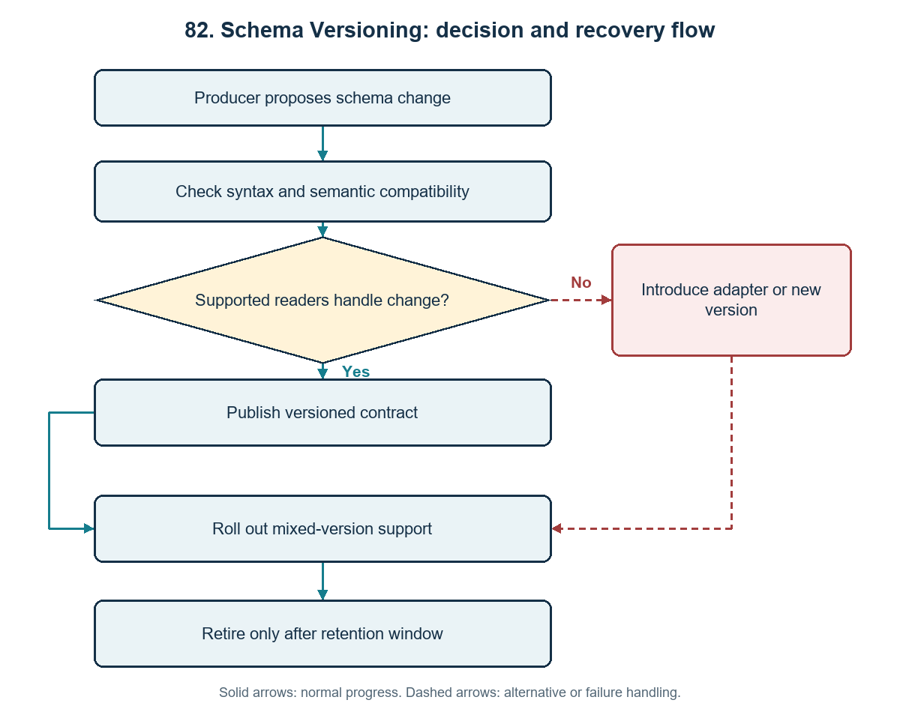

*Figure 82. 82. Schema Versioning: decision and recovery flow.* Start at "Producer proposes schema change" and move to "Check syntax and semantic compatibility". At "Supported readers handle change?", the Yes branch goes to "Publish versioned contract" and the No branch goes to "Introduce adapter or new version". Follow the arrows to the terminal or recovery outcome; a dashed branch is not an implicit success. Source: [editable Mermaid](diagrams/topic-082.mmd).


#### 6. Step-by-step example

1. OrderPlaced v1 contains amount in minor currency units.

2. Adding currency as an optional field with a documented migration default may be compatible under a restricted historical assumption.

3. Reinterpreting amount as major units is a breaking semantic change even if its numeric type stays the same.

#### 7. Implementation

The complete runnable module is [examples/protocols.py](examples/protocols.py); run `python protocols.py` from the examples directory. The following excerpt isolates `read_order_v2`. Required imports, surrounding definitions, expected output, and limitations are in the complete module and [lab guide](examples/README.md).

```python
def read_order_v2(record):
    # Explicit migration rule: these historical v1 records were INR-only.
    version = record.get("schema_version", 1)
    if version not in (1, 2):
        raise ValueError("unsupported schema version")
    currency = "INR" if version == 1 else record["currency"]
    return {"amount_minor": record["amount_minor"], "currency": currency}
```

Read the state changes in this excerpt alongside the mechanism above. The lab is a model of its stated boundary; it does not establish the behavior of a distributed deployment or an external provider. Check the assertions in [test_examples.py](examples/test_examples.py) and compare your output with [recorded outputs](examples/actual_outputs/).

#### 8. Production use cases

ShopStream events may be consumed by services deployed on different schedules. Readers and writers need an explicit compatibility contract, not just matching field names. OrderPlaced v1 contains amount in minor currency units.

#### 9. Advantages and disadvantages

Database migrations change physical or logical storage. API versioning changes external contracts. Event schemas must account for retained historical messages and replay. Semantic version numbers communicate intended compatibility but do not prove it.

#### 10. Common mistakes and debugging

Making an optional field required breaks older producers. Reusing a removed protobuf field number can reinterpret old data. Testing only the newest producer with the newest consumer misses mixed-version failures.

#### 11. Comparison with related concepts

| Decision | Engineering interpretation |
|---|---|
| What this topic contributes | Schema versioning tracks the structure and meaning of data exchanged or stored over time. |
| Nearest alternatives and limits | Database migrations change physical or logical storage. API versioning changes external contracts. Event schemas must account for retained historical messages and replay. Semantic version numbers communicate intended compatibility but do not prove it. |
| Combined design | Read [16. Pub/Sub](#topic-016) and [17. Event-Driven Architecture](#topic-017); identify which layer owns each invariant rather than assuming their guarantees are interchangeable. |

#### 12. Interview preparation

**82.1 - Conceptual; Beginner. A teammate wants to add schema versioning everywhere. What concrete need should justify it?**

**Model answer:** Schema versioning tracks the structure and meaning of data exchanged or stored over time. ShopStream events may be consumed by services deployed on different schedules. Readers and writers need an explicit compatibility contract, not just matching field names. Database migrations change physical or logical storage.

**82.2 - Conceptual; Intermediate. What must be represented or coordinated for schema versioning to work correctly?**

**Model answer:** Identify schema version and owner, define optional/default behavior, validate compatibility in CI, and evolve through additive changes where possible. Preserve field meaning and stable identifiers. For binary protocols, follow rules for field numbers and unknown fields. Maintain adapters or dual readers during transitions and define retention for historical data.

**82.3 - Conceptual; Beginner. Explain the analogy, then identify where it stops being a trustworthy model.**

**Model answer:** Departments use different editions of a form. Adding an optional box is often manageable; changing the meaning of an existing box can silently corrupt decisions even if the paper still looks familiar. The implementation must still follow the explicit state and failure rules described in the mechanism; an analogy cannot establish a delivery, timing, or security guarantee.

**82.4 - Conceptual; Intermediate. Which nearby alternative would you compare with schema versioning, and what changes the choice?**

**Model answer:** Database migrations change physical or logical storage. API versioning changes external contracts. Event schemas must account for retained historical messages and replay. Semantic version numbers communicate intended compatibility but do not prove it.

**82.5 - Conceptual; Intermediate. How can an apparently functioning implementation still violate the intended contract?**

**Model answer:** Making an optional field required breaks older producers. Reusing a removed protobuf field number can reinterpret old data. Testing only the newest producer with the newest consumer misses mixed-version failures.

**82.6 - Scenario; Intermediate. Walk through the worked ShopStream example. What evidence establishes the outcome, and what remains an assumption?**

**Model answer:** OrderPlaced v1 contains amount in minor currency units. Adding currency as an optional field with a documented migration default may be compatible under a restricted historical assumption. Reinterpreting amount as major units is a breaking semantic change even if its numeric type stays the same. Verify the stated state transition or measurement at the responsible boundary. The numerical values, when present, are assumptions or deterministic examples rather than vendor performance guarantees.

**82.7 - Scenario; Advanced. You must validate this behavior before rollout. What experiment would expose a false correctness claim?**

**Model answer:** Write v1 and v2 order-event examples with explicit currency units. Test old/new reader-writer combinations. Design a replay adapter for a historical schema without silently inventing missing business information. Record the starting state, injected condition, observed result, and invariant. A successful startup alone does not demonstrate the behavior under test.

**82.8 - Scenario; Advanced. A change involving schema versioning produces a customer-visible regression. How would you investigate and choose a safe response?**

**Model answer:** Making an optional field required breaks older producers. Reusing a removed protobuf field number can reinterpret old data. Testing only the newest producer with the newest consumer misses mixed-version failures. Compatibility has direction: a new reader handling old data differs from an old reader handling new data. Test both required directions and include semantic invariants, units, timezones, and enum expansion. A parser accepting a record does not prove the business logic understands it.

**82.9 - Advanced follow-up; Expert. Which hidden assumptions become important under failure, scale, or a changed workload?**

**Model answer:** Compatibility has direction: a new reader handling old data differs from an old reader handling new data. Test both required directions and include semantic invariants, units, timezones, and enum expansion. A parser accepting a record does not prove the business logic understands it.

**82.10 - Advanced follow-up; Expert. How does this design interact with pub/sub and event-driven architecture?**

**Model answer:** Identify schema version and owner, define optional/default behavior, validate compatibility in CI, and evolve through additive changes where possible. Publish an event to a topic, route it to subscriptions, retain it according to policy, and let each subscriber track its own progress. Commit domain state and an outbox row in the same local transaction. Specify which component owns each decision and trace a failure across the combined boundary. Do not infer one component's guarantee from another component's name.

**Common incorrect answer:** "Adding the component makes the guarantee automatic." This is wrong because the mechanism depends on specific state, boundaries, and failure assumptions. Making an optional field required breaks older producers.

**A deeper interviewer probe:** Change the timing, workload, or failure condition described in the advanced answer. Ask which invariant still holds, what observation would disprove it, and whether the fallback changes the user contract. Compatibility has direction: a new reader handling old data differs from an old reader handling new data.

#### 13. Exercises and solution walkthroughs

**Beginner exercise:** Reproduce the worked example for schema versioning on paper. Record the initial state, each transition, and the result before reading the walkthrough.

**Beginner solution:** OrderPlaced v1 contains amount in minor currency units. Adding currency as an optional field with a documented migration default may be compatible under a restricted historical assumption. Reinterpreting amount as major units is a breaking semantic change even if its numeric type stays the same.

**Intermediate exercise:** Write v1 and v2 order-event examples with explicit currency units. Write the observable assertion and identify which component owns it.

**Intermediate solution:** Write v1 and v2 order-event examples with explicit currency units. Test old/new reader-writer combinations. Design a replay adapter for a historical schema without silently inventing missing business information. Use the provided lab where applicable; for platform behavior, record the runtime version and actual evidence instead of treating a diagram as a test.

**Advanced exercise:** Extend the example to a failure or scale condition described below. State the guarantee you retain, the one you relax if necessary, and a safe recovery procedure.

**Advanced solution:** Compatibility has direction: a new reader handling old data differs from an old reader handling new data. Test both required directions and include semantic invariants, units, timezones, and enum expansion. A parser accepting a record does not prove the business logic understands it. Making an optional field required breaks older producers. A complete solution identifies a detection signal, a bounded action, and a verification of the business outcome.

#### 14. Key takeaways

- Schema versioning tracks the structure and meaning of data exchanged or stored over time.

- Identify schema version and owner, define optional/default behavior, validate compatibility in CI, and evolve through additive changes where possible.

- Database migrations change physical or logical storage.

- Making an optional field required breaks older producers.

- Compatibility has direction: a new reader handling old data differs from an old reader handling new data.


**When to use it:** ShopStream events may be consumed by services deployed on different schedules. Readers and writers need an explicit compatibility contract, not just matching field names.

**Terminology:** See this topic's glossary entry and the linked related terms. **Continue with:** [16. Pub/Sub](#topic-016), [17. Event-Driven Architecture](#topic-017), [81. Database Migrations](#topic-081), [102. API Versioning](#topic-102), [103. Semantic Versioning](#topic-103).


## Part IV. Distributed Systems and Messaging

<a id="topic-015"></a>

### 15. Message Queues

Prerequisites and related reading: [14. Idempotency](#topic-014), [16. Pub/Sub](#topic-016), [20. Dead Letter Queues](#topic-020), [44. Backpressure](#topic-044).

#### 1. Simple explanation

A message queue stores work until a consumer can process it.

#### 2. The problem it solves

ShopStream sends email asynchronously so checkout does not wait on the mail provider. The queue absorbs temporary mismatch between arrival and processing rates, but a permanently overloaded queue grows without bound.

#### 3. Intuitive analogy

Restaurant order slips wait for cooks. A cook may finish a meal and lose the slip before marking it complete. A replacement cook can then prepare it again, which resembles redelivery after a lost acknowledgment.

#### 4. Technical working mechanism

1. Publish durably according to broker guarantees, deliver to a consumer, reserve or hide it for a visibility interval, process the side effect, then acknowledge.

2. Failure or expired ownership permits redelivery.

3. Use durable deduplication, bounded prefetch, per-message attempts, and a DLQ for unprocessable messages.

4. Ordering normally applies only within a defined partition or queue configuration.


**Boundary and advanced reasoning.** If arrival is 120 jobs/second and service is 100, backlog grows by 20/second, or 72,000/hour. A queue buys time, not throughput. Scale consumers only if the downstream dependency has headroom, and shed or defer nonessential work when recovery cannot meet the freshness SLO.

#### 5. Architecture and diagrams

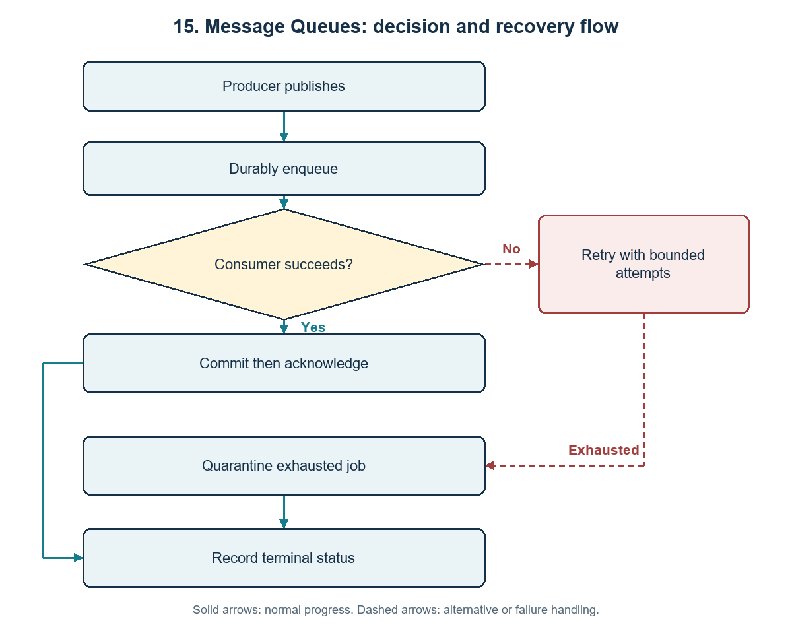

*Figure 15. 15. Message Queues: decision and recovery flow.* Start at "Producer publishes" and move to "Durably enqueue". At "Consumer succeeds?", the Yes branch goes to "Commit then acknowledge" and the No branch goes to "Retry with bounded attempts". Follow the arrows to the terminal or recovery outcome; a dashed branch is not an implicit success. Source: [editable Mermaid](diagrams/topic-015.mmd).


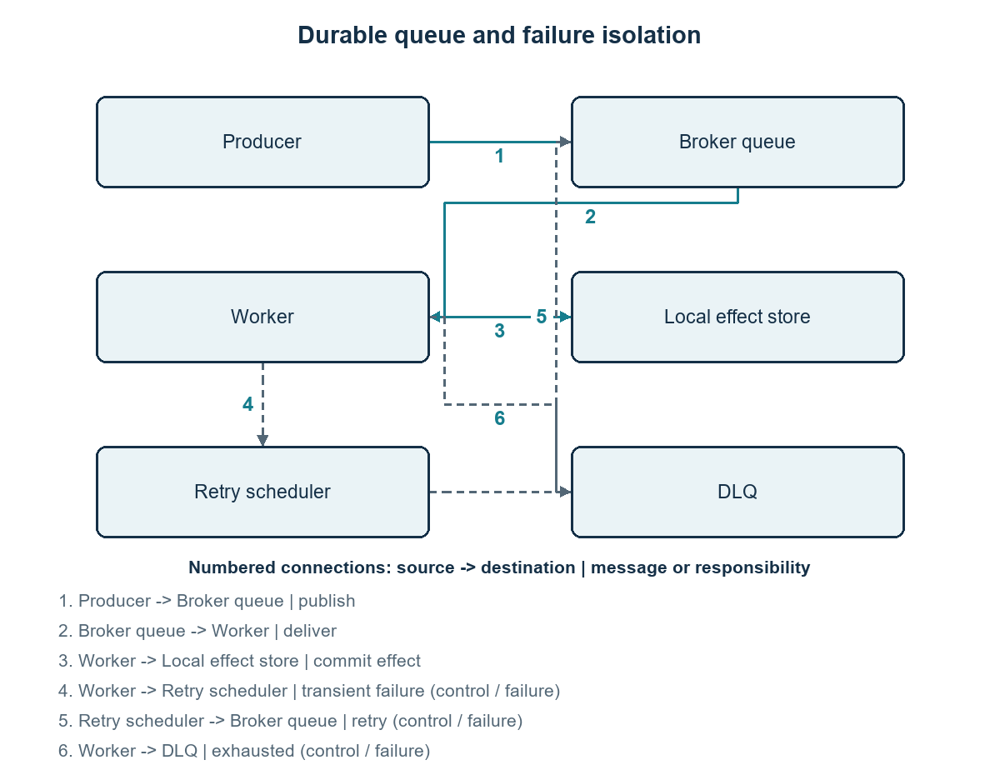

*Figure 118. Durable queue and failure isolation.* Acknowledge only after the promised durable effect. Retry and DLQ paths remain visible instead of being counted as completion. Source: [editable Mermaid](diagrams/arch-queue.mmd).


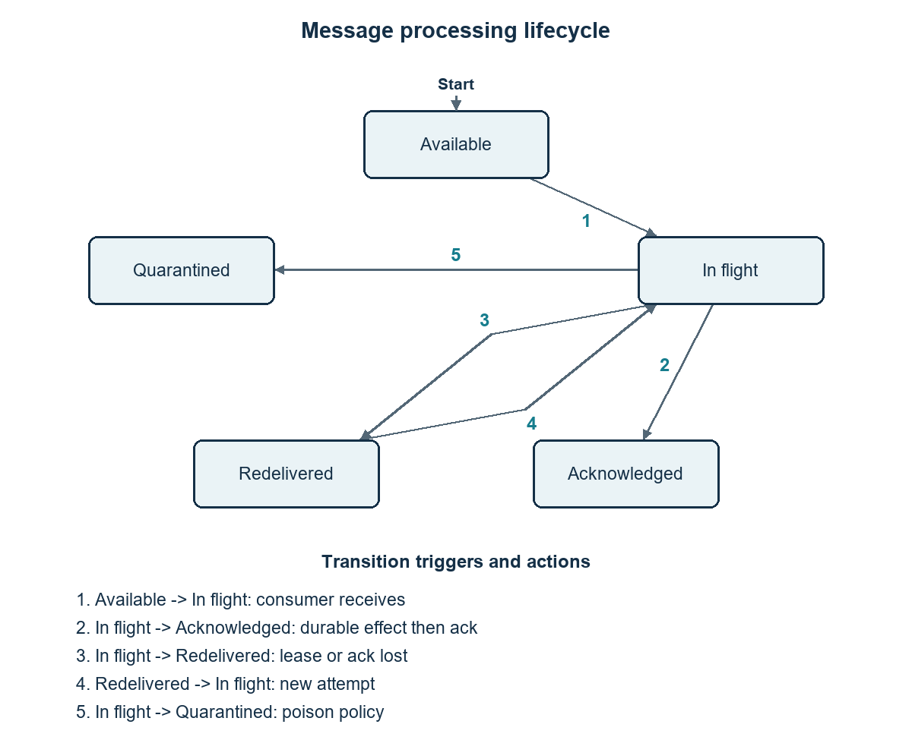

*Figure 174. Message processing lifecycle.* Redelivery can occur after the effect succeeded. Deduplicate at the effect boundary. Source: [editable Mermaid](diagrams/state-message.mmd).


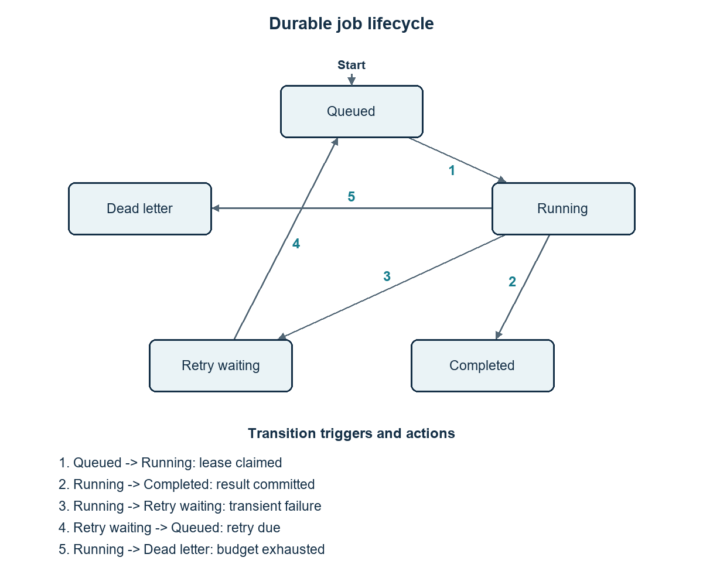

*Figure 172. Durable job lifecycle.* The result commits before acknowledgment. Retry waiting is durable in a real implementation; dead letter requires ownership. Source: [editable Mermaid](diagrams/state-job.mmd).


#### 6. Step-by-step example

1. A receipt job is accepted, a worker sends email, and the worker crashes before acknowledgment.

2. The broker redelivers.

3. An email-provider idempotency key or delivery ledger prevents a second send where supported; otherwise duplicates are a documented possibility.

#### 7. Implementation

The complete runnable module is [examples/messaging.py](examples/messaging.py); run `python messaging.py` from the examples directory. The following excerpt isolates `process_queue`. Required imports, surrounding definitions, expected output, and limitations are in the complete module and [lab guide](examples/README.md).

```python
def process_queue(jobs, max_attempts=3):
    queue, completed, dead = deque(jobs), set(), []
    effect_count = 0
    while queue:
        job = queue.popleft()
        if job.event_id in completed:
            continue
        job.attempts += 1
        if job.payload == "poison":
            if job.attempts < max_attempts:
                queue.append(job)
            else:
                dead.append(job)
            continue
        effect_count += 1
        completed.add(job.event_id)
    return effect_count, completed, dead
```

Read the state changes in this excerpt alongside the mechanism above. The lab is a model of its stated boundary; it does not establish the behavior of a distributed deployment or an external provider. Check the assertions in [test_examples.py](examples/test_examples.py) and compare your output with [recorded outputs](examples/actual_outputs/).

#### 8. Production use cases

ShopStream sends email asynchronously so checkout does not wait on the mail provider. The queue absorbs temporary mismatch between arrival and processing rates, but a permanently overloaded queue grows without bound. A receipt job is accepted, a worker sends email, and the worker crashes before acknowledgment.

#### 9. Advantages and disadvantages

At-most-once avoids redelivery but can lose work. At-least-once favors eventual handling but duplicates are possible. Exactly-once processing claims require a stated transactional boundary; external side effects rarely share the broker transaction.

#### 10. Common mistakes and debugging

Acknowledging before committing loses work on crash. Unlimited retries block useful work behind poison messages. Queue depth alone misses a single very old job. Monitor oldest age, arrival rate, completion rate, retries, and DLQ growth.

#### 11. Comparison with related concepts

| Decision | Engineering interpretation |
|---|---|
| What this topic contributes | A message queue stores work until a consumer can process it. |
| Nearest alternatives and limits | At-most-once avoids redelivery but can lose work. At-least-once favors eventual handling but duplicates are possible. Exactly-once processing claims require a stated transactional boundary; external side effects rarely share the broker transaction. |
| Combined design | Read [14. Idempotency](#topic-014) and [16. Pub/Sub](#topic-016); identify which layer owns each invariant rather than assuming their guarantees are interchangeable. |

#### 12. Interview preparation

**15.1 - Conceptual; Beginner. A teammate wants to add message queues everywhere. What concrete need should justify it?**

**Model answer:** A message queue stores work until a consumer can process it. ShopStream sends email asynchronously so checkout does not wait on the mail provider. The queue absorbs temporary mismatch between arrival and processing rates, but a permanently overloaded queue grows without bound. At-most-once avoids redelivery but can lose work.

**15.2 - Conceptual; Intermediate. What must be represented or coordinated for message queues to work correctly?**

**Model answer:** Publish durably according to broker guarantees, deliver to a consumer, reserve or hide it for a visibility interval, process the side effect, then acknowledge. Failure or expired ownership permits redelivery. Use durable deduplication, bounded prefetch, per-message attempts, and a DLQ for unprocessable messages. Ordering normally applies only within a defined partition or queue configuration.

**15.3 - Conceptual; Beginner. Explain the analogy, then identify where it stops being a trustworthy model.**

**Model answer:** Restaurant order slips wait for cooks. A cook may finish a meal and lose the slip before marking it complete. A replacement cook can then prepare it again, which resembles redelivery after a lost acknowledgment. The implementation must still follow the explicit state and failure rules described in the mechanism; an analogy cannot establish a delivery, timing, or security guarantee.

**15.4 - Conceptual; Intermediate. Which nearby alternative would you compare with message queues, and what changes the choice?**

**Model answer:** At-most-once avoids redelivery but can lose work. At-least-once favors eventual handling but duplicates are possible. Exactly-once processing claims require a stated transactional boundary; external side effects rarely share the broker transaction.

**15.5 - Conceptual; Intermediate. How can an apparently functioning implementation still violate the intended contract?**

**Model answer:** Acknowledging before committing loses work on crash. Unlimited retries block useful work behind poison messages. Queue depth alone misses a single very old job. Monitor oldest age, arrival rate, completion rate, retries, and DLQ growth.

**15.6 - Scenario; Intermediate. Walk through the worked ShopStream example. What evidence establishes the outcome, and what remains an assumption?**

**Model answer:** A receipt job is accepted, a worker sends email, and the worker crashes before acknowledgment. The broker redelivers. An email-provider idempotency key or delivery ledger prevents a second send where supported; otherwise duplicates are a documented possibility. Verify the stated state transition or measurement at the responsible boundary. The numerical values, when present, are assumptions or deterministic examples rather than vendor performance guarantees.

**15.7 - Scenario; Advanced. You must validate this behavior before rollout. What experiment would expose a false correctness claim?**

**Model answer:** Simulate acknowledgment loss and verify local deduplication. Add a poison message and move it after three failed attempts. Calculate backlog drain time after a burst using excess service capacity, not total service rate. Record the starting state, injected condition, observed result, and invariant. A successful startup alone does not demonstrate the behavior under test.

**15.8 - Scenario; Advanced. A change involving message queues produces a customer-visible regression. How would you investigate and choose a safe response?**

**Model answer:** Acknowledging before committing loses work on crash. Unlimited retries block useful work behind poison messages. Queue depth alone misses a single very old job. Monitor oldest age, arrival rate, completion rate, retries, and DLQ growth. If arrival is 120 jobs/second and service is 100, backlog grows by 20/second, or 72,000/hour. A queue buys time, not throughput. Scale consumers only if the downstream dependency has headroom, and shed or defer nonessential work when recovery cannot meet the freshness SLO.

**15.9 - Advanced follow-up; Expert. Which hidden assumptions become important under failure, scale, or a changed workload?**

**Model answer:** If arrival is 120 jobs/second and service is 100, backlog grows by 20/second, or 72,000/hour. A queue buys time, not throughput. Scale consumers only if the downstream dependency has headroom, and shed or defer nonessential work when recovery cannot meet the freshness SLO.

**15.10 - Advanced follow-up; Expert. How does this design interact with idempotency and pub/sub?**

**Model answer:** Publish durably according to broker guarantees, deliver to a consumer, reserve or hide it for a visibility interval, process the side effect, then acknowledge. Accept a client-generated operation key scoped to tenant and endpoint. Publish an event to a topic, route it to subscriptions, retain it according to policy, and let each subscriber track its own progress. Specify which component owns each decision and trace a failure across the combined boundary. Do not infer one component's guarantee from another component's name.

**Common incorrect answer:** "Adding the component makes the guarantee automatic." This is wrong because the mechanism depends on specific state, boundaries, and failure assumptions. Acknowledging before committing loses work on crash.

**A deeper interviewer probe:** Change the timing, workload, or failure condition described in the advanced answer. Ask which invariant still holds, what observation would disprove it, and whether the fallback changes the user contract. If arrival is 120 jobs/second and service is 100, backlog grows by 20/second, or 72,000/hour.

#### 13. Exercises and solution walkthroughs

**Beginner exercise:** Reproduce the worked example for message queues on paper. Record the initial state, each transition, and the result before reading the walkthrough.

**Beginner solution:** A receipt job is accepted, a worker sends email, and the worker crashes before acknowledgment. The broker redelivers. An email-provider idempotency key or delivery ledger prevents a second send where supported; otherwise duplicates are a documented possibility.

**Intermediate exercise:** Simulate acknowledgment loss and verify local deduplication. Write the observable assertion and identify which component owns it.

**Intermediate solution:** Simulate acknowledgment loss and verify local deduplication. Add a poison message and move it after three failed attempts. Calculate backlog drain time after a burst using excess service capacity, not total service rate. Use the provided lab where applicable; for platform behavior, record the runtime version and actual evidence instead of treating a diagram as a test.

**Advanced exercise:** Extend the example to a failure or scale condition described below. State the guarantee you retain, the one you relax if necessary, and a safe recovery procedure.

**Advanced solution:** If arrival is 120 jobs/second and service is 100, backlog grows by 20/second, or 72,000/hour. A queue buys time, not throughput. Scale consumers only if the downstream dependency has headroom, and shed or defer nonessential work when recovery cannot meet the freshness SLO. Acknowledging before committing loses work on crash. A complete solution identifies a detection signal, a bounded action, and a verification of the business outcome.

#### 14. Key takeaways

- A message queue stores work until a consumer can process it.

- Publish durably according to broker guarantees, deliver to a consumer, reserve or hide it for a visibility interval, process the side effect, then acknowledge.

- At-most-once avoids redelivery but can lose work.

- Acknowledging before committing loses work on crash.

- If arrival is 120 jobs/second and service is 100, backlog grows by 20/second, or 72,000/hour.


**When to use it:** ShopStream sends email asynchronously so checkout does not wait on the mail provider. The queue absorbs temporary mismatch between arrival and processing rates, but a permanently overloaded queue grows without bound.

**Terminology:** See this topic's glossary entry and the linked related terms. **Continue with:** [14. Idempotency](#topic-014), [16. Pub/Sub](#topic-016), [20. Dead Letter Queues](#topic-020), [44. Backpressure](#topic-044).
<a id="topic-016"></a>

### 16. Pub/Sub

Prerequisites and related reading: [15. Message Queues](#topic-015), [17. Event-Driven Architecture](#topic-017), [35. Eventual Consistency](#topic-035), [82. Schema Versioning](#topic-082).

#### 1. Simple explanation

Publish/subscribe sends an event to multiple independently interested subscribers.

#### 2. The problem it solves

An OrderPlaced event may update analytics, notifications, and fulfillment. The publisher does not need to synchronously call every consumer or wait for them all to finish.

#### 3. Intuitive analogy

A campus announcement reaches several clubs. Each club decides what to do with it and can miss it if announcements are not archived. Durable subscriptions differ from transient broadcast channels.

#### 4. Technical working mechanism

1. Publish an event to a topic, route it to subscriptions, retain it according to policy, and let each subscriber track its own progress.

2. Consumers within one subscription may share work, while distinct subscriptions each receive a copy.

3. Partition keys define ordering domains.

4. Version event schemas and make handlers idempotent.


**Boundary and advanced reasoning.** Replays are useful for rebuilding projections but can resend emails or payments. Classify subscribers into replay-safe computation and irreversible external action. Include event ID, entity ID, schema version, occurrence time, and causation metadata without placing secrets in the event envelope.

#### 5. Architecture and diagrams

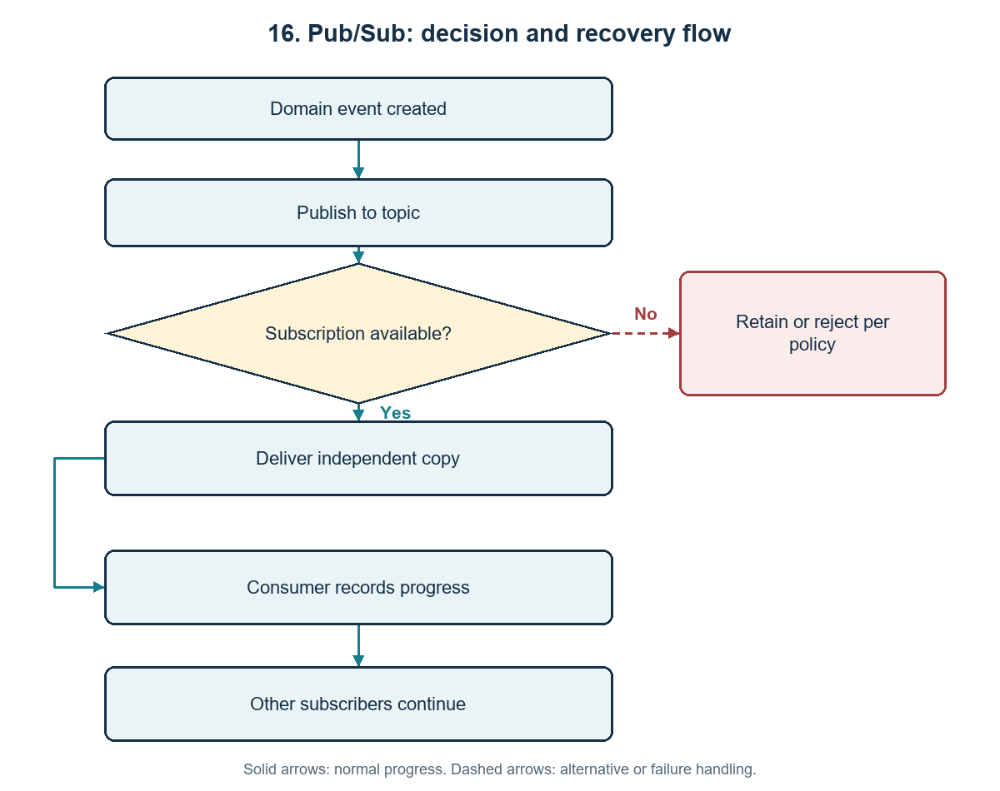

*Figure 16. 16. Pub/Sub: decision and recovery flow.* Start at "Domain event created" and move to "Publish to topic". At "Subscription available?", the Yes branch goes to "Deliver independent copy" and the No branch goes to "Retain or reject per policy". Follow the arrows to the terminal or recovery outcome; a dashed branch is not an implicit success. Source: [editable Mermaid](diagrams/topic-016.mmd).


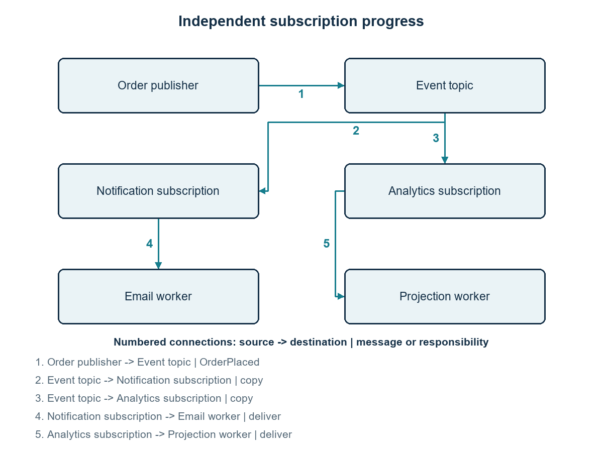

*Figure 119. Independent subscription progress.* Each subscription has its own progress and failure handling. Consumers in one subscription can share work rather than each receiving every event. Source: [editable Mermaid](diagrams/arch-pubsub.mmd).


#### 6. Step-by-step example

1. OrderPlaced O enters a topic.

2. Notifications processes it immediately, analytics lags ten minutes, and fulfillment retries a temporary error.

3. Separate offsets prevent analytics lag from blocking notification progress, although shared broker capacity can still couple them.

#### 7. Implementation

For this topic, the worked scenario and the exercise below are the direct practical implementation of the reasoning. A standalone toy implementation would hide important platform or protocol guarantees. Use the relevant official implementation or managed runtime for real deployment, and validate its actual contract.

The associated [examples/messaging.py](examples/messaging.py) illustrates a related local boundary, not a full implementation of pub/sub. [The lab guide](examples/README.md) distinguishes executable simulations, configurations, and design exercises.

#### 8. Production use cases

An OrderPlaced event may update analytics, notifications, and fulfillment. The publisher does not need to synchronously call every consumer or wait for them all to finish. OrderPlaced O enters a topic.

#### 9. Advantages and disadvantages

A work queue typically assigns one job to one consumer in a group. Pub/sub fans out to several subscriptions. Synchronous RPC gives immediate success or failure to the caller but increases temporal coupling and latency.

#### 10. Common mistakes and debugging

Assuming all subscribers are atomic creates false business guarantees. Deleting retention before a slow subscriber catches up loses its history. Changing a field's meaning while retaining its name silently corrupts downstream processing.

#### 11. Comparison with related concepts

| Decision | Engineering interpretation |
|---|---|
| What this topic contributes | Publish/subscribe sends an event to multiple independently interested subscribers. |
| Nearest alternatives and limits | A work queue typically assigns one job to one consumer in a group. Pub/sub fans out to several subscriptions. Synchronous RPC gives immediate success or failure to the caller but increases temporal coupling and latency. |
| Combined design | Read [15. Message Queues](#topic-015) and [17. Event-Driven Architecture](#topic-017); identify which layer owns each invariant rather than assuming their guarantees are interchangeable. |

#### 12. Interview preparation

**16.1 - Conceptual; Beginner. A teammate wants to add pub/sub everywhere. What concrete need should justify it?**

**Model answer:** Publish/subscribe sends an event to multiple independently interested subscribers. An OrderPlaced event may update analytics, notifications, and fulfillment. The publisher does not need to synchronously call every consumer or wait for them all to finish. A work queue typically assigns one job to one consumer in a group.

**16.2 - Conceptual; Intermediate. What must be represented or coordinated for pub/sub to work correctly?**

**Model answer:** Publish an event to a topic, route it to subscriptions, retain it according to policy, and let each subscriber track its own progress. Consumers within one subscription may share work, while distinct subscriptions each receive a copy. Partition keys define ordering domains. Version event schemas and make handlers idempotent.

**16.3 - Conceptual; Beginner. Explain the analogy, then identify where it stops being a trustworthy model.**

**Model answer:** A campus announcement reaches several clubs. Each club decides what to do with it and can miss it if announcements are not archived. Durable subscriptions differ from transient broadcast channels. The implementation must still follow the explicit state and failure rules described in the mechanism; an analogy cannot establish a delivery, timing, or security guarantee.

**16.4 - Conceptual; Intermediate. Which nearby alternative would you compare with pub/sub, and what changes the choice?**

**Model answer:** A work queue typically assigns one job to one consumer in a group. Pub/sub fans out to several subscriptions. Synchronous RPC gives immediate success or failure to the caller but increases temporal coupling and latency.

**16.5 - Conceptual; Intermediate. How can an apparently functioning implementation still violate the intended contract?**

**Model answer:** Assuming all subscribers are atomic creates false business guarantees. Deleting retention before a slow subscriber catches up loses its history. Changing a field's meaning while retaining its name silently corrupts downstream processing.

**16.6 - Scenario; Intermediate. Walk through the worked ShopStream example. What evidence establishes the outcome, and what remains an assumption?**

**Model answer:** OrderPlaced O enters a topic. Notifications processes it immediately, analytics lags ten minutes, and fulfillment retries a temporary error. Separate offsets prevent analytics lag from blocking notification progress, although shared broker capacity can still couple them. Verify the stated state transition or measurement at the responsible boundary. The numerical values, when present, are assumptions or deterministic examples rather than vendor performance guarantees.

**16.7 - Scenario; Advanced. You must validate this behavior before rollout. What experiment would expose a false correctness claim?**

**Model answer:** Deliver one event to two subscriptions and assert two independent outcomes. Add two workers to one subscription and distinguish sharing from fanout. Replay a week of events while suppressing externally visible notification side effects. Record the starting state, injected condition, observed result, and invariant. A successful startup alone does not demonstrate the behavior under test.

**16.8 - Scenario; Advanced. A change involving pub/sub produces a customer-visible regression. How would you investigate and choose a safe response?**

**Model answer:** Assuming all subscribers are atomic creates false business guarantees. Deleting retention before a slow subscriber catches up loses its history. Changing a field's meaning while retaining its name silently corrupts downstream processing. Replays are useful for rebuilding projections but can resend emails or payments. Classify subscribers into replay-safe computation and irreversible external action. Include event ID, entity ID, schema version, occurrence time, and causation metadata without placing secrets in the event envelope.

**16.9 - Advanced follow-up; Expert. Which hidden assumptions become important under failure, scale, or a changed workload?**

**Model answer:** Replays are useful for rebuilding projections but can resend emails or payments. Classify subscribers into replay-safe computation and irreversible external action. Include event ID, entity ID, schema version, occurrence time, and causation metadata without placing secrets in the event envelope.

**16.10 - Advanced follow-up; Expert. How does this design interact with message queues and event-driven architecture?**

**Model answer:** Publish an event to a topic, route it to subscriptions, retain it according to policy, and let each subscriber track its own progress. Publish durably according to broker guarantees, deliver to a consumer, reserve or hide it for a visibility interval, process the side effect, then acknowledge. Commit domain state and an outbox row in the same local transaction. Specify which component owns each decision and trace a failure across the combined boundary. Do not infer one component's guarantee from another component's name.

**Common incorrect answer:** "Adding the component makes the guarantee automatic." This is wrong because the mechanism depends on specific state, boundaries, and failure assumptions. Assuming all subscribers are atomic creates false business guarantees.

**A deeper interviewer probe:** Change the timing, workload, or failure condition described in the advanced answer. Ask which invariant still holds, what observation would disprove it, and whether the fallback changes the user contract. Replays are useful for rebuilding projections but can resend emails or payments.

#### 13. Exercises and solution walkthroughs

**Beginner exercise:** Reproduce the worked example for pub/sub on paper. Record the initial state, each transition, and the result before reading the walkthrough.

**Beginner solution:** OrderPlaced O enters a topic. Notifications processes it immediately, analytics lags ten minutes, and fulfillment retries a temporary error. Separate offsets prevent analytics lag from blocking notification progress, although shared broker capacity can still couple them.

**Intermediate exercise:** Deliver one event to two subscriptions and assert two independent outcomes. Write the observable assertion and identify which component owns it.

**Intermediate solution:** Deliver one event to two subscriptions and assert two independent outcomes. Add two workers to one subscription and distinguish sharing from fanout. Replay a week of events while suppressing externally visible notification side effects. Use the provided lab where applicable; for platform behavior, record the runtime version and actual evidence instead of treating a diagram as a test.

**Advanced exercise:** Extend the example to a failure or scale condition described below. State the guarantee you retain, the one you relax if necessary, and a safe recovery procedure.

**Advanced solution:** Replays are useful for rebuilding projections but can resend emails or payments. Classify subscribers into replay-safe computation and irreversible external action. Include event ID, entity ID, schema version, occurrence time, and causation metadata without placing secrets in the event envelope. Assuming all subscribers are atomic creates false business guarantees. A complete solution identifies a detection signal, a bounded action, and a verification of the business outcome.

#### 14. Key takeaways

- Publish/subscribe sends an event to multiple independently interested subscribers.

- Publish an event to a topic, route it to subscriptions, retain it according to policy, and let each subscriber track its own progress.

- A work queue typically assigns one job to one consumer in a group.

- Assuming all subscribers are atomic creates false business guarantees.

- Replays are useful for rebuilding projections but can resend emails or payments.


**When to use it:** An OrderPlaced event may update analytics, notifications, and fulfillment. The publisher does not need to synchronously call every consumer or wait for them all to finish.

**Terminology:** See this topic's glossary entry and the linked related terms. **Continue with:** [15. Message Queues](#topic-015), [17. Event-Driven Architecture](#topic-017), [35. Eventual Consistency](#topic-035), [82. Schema Versioning](#topic-082).
<a id="topic-017"></a>

### 17. Event-Driven Architecture

Prerequisites and related reading: [14. Idempotency](#topic-014), [15. Message Queues](#topic-015), [16. Pub/Sub](#topic-016), [19. Saga Pattern](#topic-019).

#### 1. Simple explanation

An event-driven system reacts to recorded facts instead of coordinating every action through direct calls.

#### 2. The problem it solves

ShopStream's order service records that an order was placed; other services react. This reduces direct coupling but makes the overall workflow harder to see and debug.

#### 3. Intuitive analogy

A notice that a parcel arrived triggers several independent tasks. The notice describes something that happened; it is different from an instruction ordering a specific worker to act. Events and commands should preserve that distinction.

#### 4. Technical working mechanism

1. Commit domain state and an outbox row in the same local transaction.

2. A relay publishes the row and marks progress; it can publish twice after a crash.

3. Consumers use an inbox or unique event ID to apply local changes atomically.

4. Carry entity version to detect stale or out-of-order events and trace IDs to connect the workflow.


**Boundary and advanced reasoning.** Local atomicity plus replay does not instantly produce global consistency. Expose pending states and reconciliation jobs. A healthy broker and healthy consumers can still produce an incorrect system if event semantics disagree, versions are reordered, or one subscription silently stops advancing.

#### 5. Architecture and diagrams

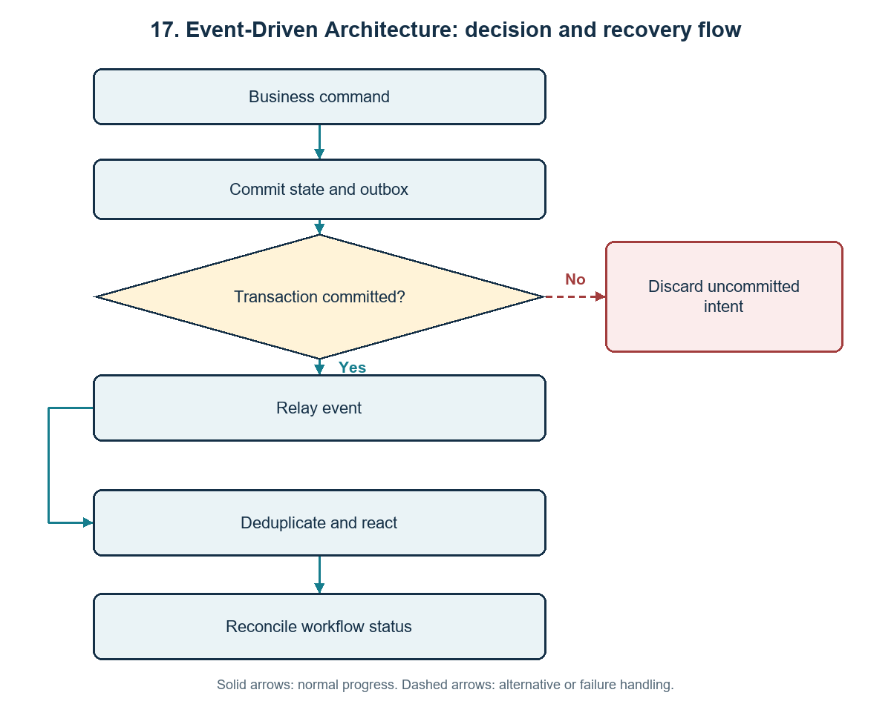

*Figure 17. 17. Event-Driven Architecture: decision and recovery flow.* Start at "Business command" and move to "Commit state and outbox". At "Transaction committed?", the Yes branch goes to "Relay event" and the No branch goes to "Discard uncommitted intent". Follow the arrows to the terminal or recovery outcome; a dashed branch is not an implicit success. Source: [editable Mermaid](diagrams/topic-017.mmd).


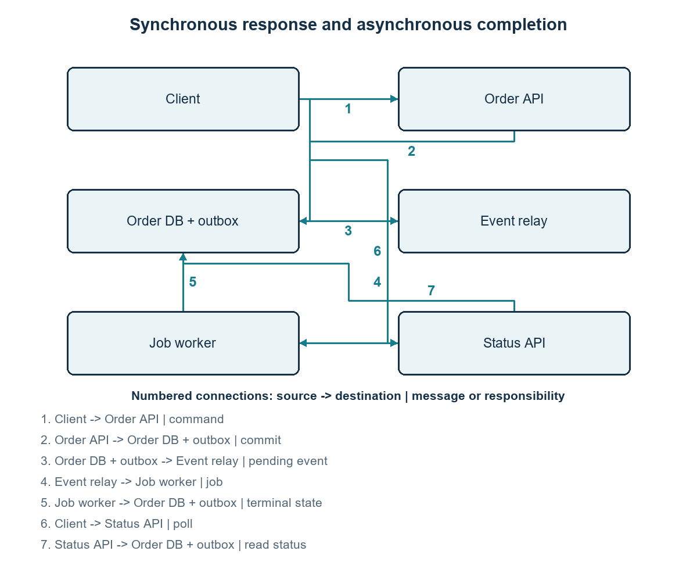

*Figure 120. Synchronous response and asynchronous completion.* Durable acceptance is an earlier milestone than business completion. A status API exposes the distinction. Source: [editable Mermaid](diagrams/arch-sync-async.mmd).


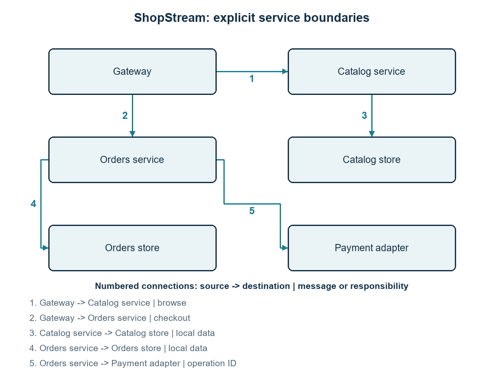

*Figure 114. ShopStream: explicit service boundaries.* Separate services own data and communicate through contracts. This adds independent scaling and independent failure states. Source: [editable Mermaid](diagrams/arch-microservices.mmd).


#### 6. Step-by-step example

1. Order O and outbox event E commit together.

2. The relay publishes E but crashes before recording success.

3. It republishes E after restart.

4. Inventory's unique inbox ID rejects the duplicate while the valid first delivery reserves stock once.

#### 7. Implementation

The complete runnable module is [examples/orders.py](examples/orders.py); run `python orders.py` from the examples directory. The following excerpt isolates `consume_notification`. Required imports, surrounding definitions, expected output, and limitations are in the complete module and [lab guide](examples/README.md).

```python
def consume_notification(path, event_id, order_id):
    """Inbox and LOCAL effect share one transaction. External email is not atomic here."""
    with closing(connect(path)) as db, db:
        inserted = db.execute("INSERT OR IGNORE INTO inbox VALUES (?)", (event_id,)).rowcount
        if not inserted:
            return False
        db.execute("INSERT INTO notifications VALUES (?,?)", (order_id, "ready-to-send"))
        return True
```

Read the state changes in this excerpt alongside the mechanism above. The lab is a model of its stated boundary; it does not establish the behavior of a distributed deployment or an external provider. Check the assertions in [test_examples.py](examples/test_examples.py) and compare your output with [recorded outputs](examples/actual_outputs/).

#### 8. Production use cases

ShopStream's order service records that an order was placed; other services react. This reduces direct coupling but makes the overall workflow harder to see and debug. Order O and outbox event E commit together.

#### 9. Advantages and disadvantages

Events support asynchronous fanout and independent scaling. Direct RPC is easier for immediate queries and small workflows. Event sourcing stores state as an event history; using events for integration does not require event sourcing.

#### 10. Common mistakes and debugging

Writing the database then publishing without an outbox loses events between the two steps. Publishing before commit can announce rolled-back state. Long event chains can hide cycles and unbounded work; document ownership and terminal states.

#### 11. Comparison with related concepts

| Decision | Engineering interpretation |
|---|---|
| What this topic contributes | An event-driven system reacts to recorded facts instead of coordinating every action through direct calls. |
| Nearest alternatives and limits | Events support asynchronous fanout and independent scaling. Direct RPC is easier for immediate queries and small workflows. Event sourcing stores state as an event history; using events for integration does not require event sourcing. |
| Combined design | Read [14. Idempotency](#topic-014) and [15. Message Queues](#topic-015); identify which layer owns each invariant rather than assuming their guarantees are interchangeable. |

#### 12. Interview preparation

**17.1 - Conceptual; Beginner. A teammate wants to add event-driven architecture everywhere. What concrete need should justify it?**

**Model answer:** An event-driven system reacts to recorded facts instead of coordinating every action through direct calls. ShopStream's order service records that an order was placed; other services react. This reduces direct coupling but makes the overall workflow harder to see and debug. Events support asynchronous fanout and independent scaling.

**17.2 - Conceptual; Intermediate. What must be represented or coordinated for event-driven architecture to work correctly?**

**Model answer:** Commit domain state and an outbox row in the same local transaction. A relay publishes the row and marks progress; it can publish twice after a crash. Consumers use an inbox or unique event ID to apply local changes atomically. Carry entity version to detect stale or out-of-order events and trace IDs to connect the workflow.

**17.3 - Conceptual; Beginner. Explain the analogy, then identify where it stops being a trustworthy model.**

**Model answer:** A notice that a parcel arrived triggers several independent tasks. The notice describes something that happened; it is different from an instruction ordering a specific worker to act. Events and commands should preserve that distinction. The implementation must still follow the explicit state and failure rules described in the mechanism; an analogy cannot establish a delivery, timing, or security guarantee.

**17.4 - Conceptual; Intermediate. Which nearby alternative would you compare with event-driven architecture, and what changes the choice?**

**Model answer:** Events support asynchronous fanout and independent scaling. Direct RPC is easier for immediate queries and small workflows. Event sourcing stores state as an event history; using events for integration does not require event sourcing.

**17.5 - Conceptual; Intermediate. How can an apparently functioning implementation still violate the intended contract?**

**Model answer:** Writing the database then publishing without an outbox loses events between the two steps. Publishing before commit can announce rolled-back state. Long event chains can hide cycles and unbounded work; document ownership and terminal states.

**17.6 - Scenario; Intermediate. Walk through the worked ShopStream example. What evidence establishes the outcome, and what remains an assumption?**

**Model answer:** Order O and outbox event E commit together. The relay publishes E but crashes before recording success. It republishes E after restart. Inventory's unique inbox ID rejects the duplicate while the valid first delivery reserves stock once. Verify the stated state transition or measurement at the responsible boundary. The numerical values, when present, are assumptions or deterministic examples rather than vendor performance guarantees.

**17.7 - Scenario; Advanced. You must validate this behavior before rollout. What experiment would expose a false correctness claim?**

**Model answer:** Crash a relay after publish and verify one inventory change. Delay event version 2 until after version 3 and define stale handling. Draw the full order workflow including compensations, ownership, and a timeout for stuck intermediate states. Record the starting state, injected condition, observed result, and invariant. A successful startup alone does not demonstrate the behavior under test.

**17.8 - Scenario; Advanced. A change involving event-driven architecture produces a customer-visible regression. How would you investigate and choose a safe response?**

**Model answer:** Writing the database then publishing without an outbox loses events between the two steps. Publishing before commit can announce rolled-back state. Long event chains can hide cycles and unbounded work; document ownership and terminal states. Local atomicity plus replay does not instantly produce global consistency. Expose pending states and reconciliation jobs. A healthy broker and healthy consumers can still produce an incorrect system if event semantics disagree, versions are reordered, or one subscription silently stops advancing.

**17.9 - Advanced follow-up; Expert. Which hidden assumptions become important under failure, scale, or a changed workload?**

**Model answer:** Local atomicity plus replay does not instantly produce global consistency. Expose pending states and reconciliation jobs. A healthy broker and healthy consumers can still produce an incorrect system if event semantics disagree, versions are reordered, or one subscription silently stops advancing.

**17.10 - Advanced follow-up; Expert. How does this design interact with idempotency and message queues?**

**Model answer:** Commit domain state and an outbox row in the same local transaction. Accept a client-generated operation key scoped to tenant and endpoint. Publish durably according to broker guarantees, deliver to a consumer, reserve or hide it for a visibility interval, process the side effect, then acknowledge. Specify which component owns each decision and trace a failure across the combined boundary. Do not infer one component's guarantee from another component's name.

**Common incorrect answer:** "Adding the component makes the guarantee automatic." This is wrong because the mechanism depends on specific state, boundaries, and failure assumptions. Writing the database then publishing without an outbox loses events between the two steps.

**A deeper interviewer probe:** Change the timing, workload, or failure condition described in the advanced answer. Ask which invariant still holds, what observation would disprove it, and whether the fallback changes the user contract. Local atomicity plus replay does not instantly produce global consistency.

#### 13. Exercises and solution walkthroughs

**Beginner exercise:** Reproduce the worked example for event-driven architecture on paper. Record the initial state, each transition, and the result before reading the walkthrough.

**Beginner solution:** Order O and outbox event E commit together. The relay publishes E but crashes before recording success. It republishes E after restart. Inventory's unique inbox ID rejects the duplicate while the valid first delivery reserves stock once.

**Intermediate exercise:** Crash a relay after publish and verify one inventory change. Write the observable assertion and identify which component owns it.

**Intermediate solution:** Crash a relay after publish and verify one inventory change. Delay event version 2 until after version 3 and define stale handling. Draw the full order workflow including compensations, ownership, and a timeout for stuck intermediate states. Use the provided lab where applicable; for platform behavior, record the runtime version and actual evidence instead of treating a diagram as a test.

**Advanced exercise:** Extend the example to a failure or scale condition described below. State the guarantee you retain, the one you relax if necessary, and a safe recovery procedure.

**Advanced solution:** Local atomicity plus replay does not instantly produce global consistency. Expose pending states and reconciliation jobs. A healthy broker and healthy consumers can still produce an incorrect system if event semantics disagree, versions are reordered, or one subscription silently stops advancing. Writing the database then publishing without an outbox loses events between the two steps. A complete solution identifies a detection signal, a bounded action, and a verification of the business outcome.

#### 14. Key takeaways

- An event-driven system reacts to recorded facts instead of coordinating every action through direct calls.

- Commit domain state and an outbox row in the same local transaction.

- Events support asynchronous fanout and independent scaling.

- Writing the database then publishing without an outbox loses events between the two steps.

- Local atomicity plus replay does not instantly produce global consistency.


**When to use it:** ShopStream's order service records that an order was placed; other services react. This reduces direct coupling but makes the overall workflow harder to see and debug.

**Terminology:** See this topic's glossary entry and the linked related terms. **Continue with:** [14. Idempotency](#topic-014), [15. Message Queues](#topic-015), [16. Pub/Sub](#topic-016), [19. Saga Pattern](#topic-019).
<a id="topic-018"></a>

### 18. Distributed Transactions

Prerequisites and related reading: [19. Saga Pattern](#topic-019), [32. Replication](#topic-032), [33. Leader Election](#topic-033), [37. Pessimistic Locking](#topic-037).

#### 1. Simple explanation

A distributed transaction coordinates changes across multiple transactional participants.

#### 2. The problem it solves

ShopStream might need inventory and billing to agree on a commit decision. Independent local commits cannot guarantee all-or-nothing behavior when a process or network fails between them.

#### 3. Intuitive analogy

Two departments reserve resources, then wait for a coordinator's final approval. If the coordinator disappears, reservations remain uncertain. Real protocols need durable decision records rather than informal promises.

#### 4. Technical working mechanism

1. In two-phase commit, a coordinator asks participants to prepare.

2. Each participant durably records readiness and holds required resources.

3. If all vote yes, the coordinator durably records commit and sends that decision; otherwise it aborts.

4. Participants recover using their logs and the coordinator decision.

5. A prepared participant may block when it cannot learn the final outcome.


**Boundary and advanced reasoning.** Atomic commit and consensus solve related but different problems. Consensus can replicate a coordinator's decision, yet every participant must still honor its transaction protocol and recover durable state. ACID isolation also needs explicit treatment; atomic outcome alone does not prevent every concurrent anomaly.

#### 5. Architecture and diagrams

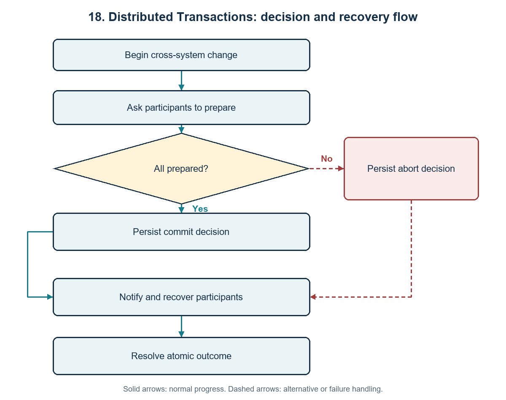

*Figure 18. 18. Distributed Transactions: decision and recovery flow.* Start at "Begin cross-system change" and move to "Ask participants to prepare". At "All prepared?", the Yes branch goes to "Persist commit decision" and the No branch goes to "Persist abort decision". Follow the arrows to the terminal or recovery outcome; a dashed branch is not an implicit success. Source: [editable Mermaid](diagrams/topic-018.mmd).


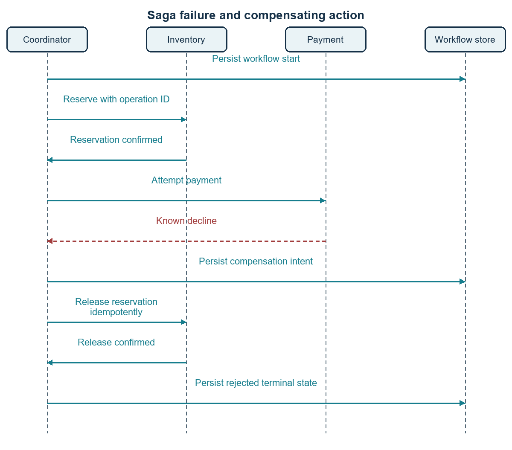

*Figure 144. Saga failure and compensating action.* Only a known payment decline takes this path. An unknown payment outcome first requires reconciliation; failed compensation remains durably pending. Source: [editable Mermaid](diagrams/seq-saga.mmd).


#### 6. Step-by-step example

1. Inventory prepares a reservation and billing prepares a ledger entry.

2. The coordinator records commit, then loses connectivity before notifying billing.

3. Billing must not guess abort simply because of a timeout; recovery must obtain the durable decision and finish commit.

#### 7. Implementation

For this topic, the worked scenario and the exercise below are the direct practical implementation of the reasoning. A standalone toy implementation would hide important platform or protocol guarantees. Use the relevant official implementation or managed runtime for real deployment, and validate its actual contract.

The associated [examples/messaging.py](examples/messaging.py) illustrates a related local boundary, not a full implementation of distributed transactions. [The lab guide](examples/README.md) distinguishes executable simulations, configurations, and design exercises.

#### 8. Production use cases

ShopStream might need inventory and billing to agree on a commit decision. Independent local commits cannot guarantee all-or-nothing behavior when a process or network fails between them. Inventory prepares a reservation and billing prepares a ledger entry.

#### 9. Advantages and disadvantages

A single-database transaction is usually simpler and should be preferred where the data boundary permits it. Two-phase commit preserves atomic outcome across supporting participants but adds latency and availability coupling. Sagas instead use committed steps and semantic compensation.

#### 10. Common mistakes and debugging

Calling two REST APIs inside a local SQL transaction does not create a distributed transaction. Holding locks during slow remote calls increases contention. A transaction timeout is not always permission to reverse a participant that already prepared.

#### 11. Comparison with related concepts

| Decision | Engineering interpretation |
|---|---|
| What this topic contributes | A distributed transaction coordinates changes across multiple transactional participants. |
| Nearest alternatives and limits | A single-database transaction is usually simpler and should be preferred where the data boundary permits it. Two-phase commit preserves atomic outcome across supporting participants but adds latency and availability coupling. Sagas instead use committed steps and semantic compensation. |
| Combined design | Read [19. Saga Pattern](#topic-019) and [32. Replication](#topic-032); identify which layer owns each invariant rather than assuming their guarantees are interchangeable. |

#### 12. Interview preparation

**18.1 - Conceptual; Beginner. A teammate wants to add distributed transactions everywhere. What concrete need should justify it?**

**Model answer:** A distributed transaction coordinates changes across multiple transactional participants. ShopStream might need inventory and billing to agree on a commit decision. Independent local commits cannot guarantee all-or-nothing behavior when a process or network fails between them. A single-database transaction is usually simpler and should be preferred where the data boundary permits it.

**18.2 - Conceptual; Intermediate. What must be represented or coordinated for distributed transactions to work correctly?**

**Model answer:** In two-phase commit, a coordinator asks participants to prepare. Each participant durably records readiness and holds required resources. If all vote yes, the coordinator durably records commit and sends that decision; otherwise it aborts. Participants recover using their logs and the coordinator decision. A prepared participant may block when it cannot learn the final outcome.

**18.3 - Conceptual; Beginner. Explain the analogy, then identify where it stops being a trustworthy model.**

**Model answer:** Two departments reserve resources, then wait for a coordinator's final approval. If the coordinator disappears, reservations remain uncertain. Real protocols need durable decision records rather than informal promises. The implementation must still follow the explicit state and failure rules described in the mechanism; an analogy cannot establish a delivery, timing, or security guarantee.

**18.4 - Conceptual; Intermediate. Which nearby alternative would you compare with distributed transactions, and what changes the choice?**

**Model answer:** A single-database transaction is usually simpler and should be preferred where the data boundary permits it. Two-phase commit preserves atomic outcome across supporting participants but adds latency and availability coupling. Sagas instead use committed steps and semantic compensation.

**18.5 - Conceptual; Intermediate. How can an apparently functioning implementation still violate the intended contract?**

**Model answer:** Calling two REST APIs inside a local SQL transaction does not create a distributed transaction. Holding locks during slow remote calls increases contention. A transaction timeout is not always permission to reverse a participant that already prepared.

**18.6 - Scenario; Intermediate. Walk through the worked ShopStream example. What evidence establishes the outcome, and what remains an assumption?**

**Model answer:** Inventory prepares a reservation and billing prepares a ledger entry. The coordinator records commit, then loses connectivity before notifying billing. Billing must not guess abort simply because of a timeout; recovery must obtain the durable decision and finish commit. Verify the stated state transition or measurement at the responsible boundary. The numerical values, when present, are assumptions or deterministic examples rather than vendor performance guarantees.

**18.7 - Scenario; Advanced. You must validate this behavior before rollout. What experiment would expose a false correctness claim?**

**Model answer:** Write a prepare/commit timeline for two participants. Stop the coordinator after recording commit and derive each recovery action. Redesign the same purchase as a Saga and identify the weaker isolation and customer-visible pending state. Record the starting state, injected condition, observed result, and invariant. A successful startup alone does not demonstrate the behavior under test.

**18.8 - Scenario; Advanced. A change involving distributed transactions produces a customer-visible regression. How would you investigate and choose a safe response?**

**Model answer:** Calling two REST APIs inside a local SQL transaction does not create a distributed transaction. Holding locks during slow remote calls increases contention. A transaction timeout is not always permission to reverse a participant that already prepared. Atomic commit and consensus solve related but different problems. Consensus can replicate a coordinator's decision, yet every participant must still honor its transaction protocol and recover durable state. ACID isolation also needs explicit treatment; atomic outcome alone does not prevent every concurrent anomaly.

**18.9 - Advanced follow-up; Expert. Which hidden assumptions become important under failure, scale, or a changed workload?**

**Model answer:** Atomic commit and consensus solve related but different problems. Consensus can replicate a coordinator's decision, yet every participant must still honor its transaction protocol and recover durable state. ACID isolation also needs explicit treatment; atomic outcome alone does not prevent every concurrent anomaly.

**18.10 - Advanced follow-up; Expert. How does this design interact with saga pattern and replication?**

**Model answer:** In two-phase commit, a coordinator asks participants to prepare. Persist a workflow ID and current state. Capture committed changes in a log, transmit them, apply them in order within the guaranteed domain, and track durable progress. Specify which component owns each decision and trace a failure across the combined boundary. Do not infer one component's guarantee from another component's name.

**Common incorrect answer:** "Adding the component makes the guarantee automatic." This is wrong because the mechanism depends on specific state, boundaries, and failure assumptions. Calling two REST APIs inside a local SQL transaction does not create a distributed transaction.

**A deeper interviewer probe:** Change the timing, workload, or failure condition described in the advanced answer. Ask which invariant still holds, what observation would disprove it, and whether the fallback changes the user contract. Atomic commit and consensus solve related but different problems.

#### 13. Exercises and solution walkthroughs

**Beginner exercise:** Reproduce the worked example for distributed transactions on paper. Record the initial state, each transition, and the result before reading the walkthrough.

**Beginner solution:** Inventory prepares a reservation and billing prepares a ledger entry. The coordinator records commit, then loses connectivity before notifying billing. Billing must not guess abort simply because of a timeout; recovery must obtain the durable decision and finish commit.

**Intermediate exercise:** Write a prepare/commit timeline for two participants. Write the observable assertion and identify which component owns it.

**Intermediate solution:** Write a prepare/commit timeline for two participants. Stop the coordinator after recording commit and derive each recovery action. Redesign the same purchase as a Saga and identify the weaker isolation and customer-visible pending state. Use the provided lab where applicable; for platform behavior, record the runtime version and actual evidence instead of treating a diagram as a test.

**Advanced exercise:** Extend the example to a failure or scale condition described below. State the guarantee you retain, the one you relax if necessary, and a safe recovery procedure.

**Advanced solution:** Atomic commit and consensus solve related but different problems. Consensus can replicate a coordinator's decision, yet every participant must still honor its transaction protocol and recover durable state. ACID isolation also needs explicit treatment; atomic outcome alone does not prevent every concurrent anomaly. Calling two REST APIs inside a local SQL transaction does not create a distributed transaction. A complete solution identifies a detection signal, a bounded action, and a verification of the business outcome.

#### 14. Key takeaways

- A distributed transaction coordinates changes across multiple transactional participants.

- In two-phase commit, a coordinator asks participants to prepare.

- A single-database transaction is usually simpler and should be preferred where the data boundary permits it.

- Calling two REST APIs inside a local SQL transaction does not create a distributed transaction.

- Atomic commit and consensus solve related but different problems.


**When to use it:** ShopStream might need inventory and billing to agree on a commit decision. Independent local commits cannot guarantee all-or-nothing behavior when a process or network fails between them.

**Terminology:** See this topic's glossary entry and the linked related terms. **Continue with:** [19. Saga Pattern](#topic-019), [32. Replication](#topic-032), [33. Leader Election](#topic-033), [37. Pessimistic Locking](#topic-037).

**Official verification references:** [PostgreSQL transaction isolation](https://www.postgresql.org/docs/current/transaction-iso.html). These references verify the named protocol or platform details; the examples, diagrams, and numerical assumptions are original teaching material.
<a id="topic-019"></a>

### 19. Saga Pattern

Prerequisites and related reading: [14. Idempotency](#topic-014), [17. Event-Driven Architecture](#topic-017), [18. Distributed Transactions](#topic-018), [109. Production Incidents](#topic-109).

#### 1. Simple explanation

A Saga implements a business workflow as local transactions with compensating actions.

#### 2. The problem it solves

ShopStream reserves stock, requests payment, and confirms an order without holding one database transaction across services. If a later step fails, earlier effects need business-specific correction.

#### 3. Intuitive analogy

A travel agent books a flight and hotel separately. Cancelling a flight can incur a fee and cannot undo the historical booking. Compensation similarly repairs business state rather than erasing time.

#### 4. Technical working mechanism

1. Persist a workflow ID and current state.

2. Execute each step with an idempotency key, record its outcome, and advance only after a known result.

3. On failure, run compensations in a suitable dependency order, retrying them durably.

4. Orchestration uses a coordinator; choreography lets events trigger steps.

5. Both require deadlines, deduplication, and reconciliation.


**Boundary and advanced reasoning.** Choose a pivot after which the workflow should roll forward rather than compensate. For shipping, dispatch may be such a point. Define manual repair for irrecoverable cases and monitor age by workflow state; aggregate service health cannot reveal every stuck business transaction.

#### 5. Architecture and diagrams

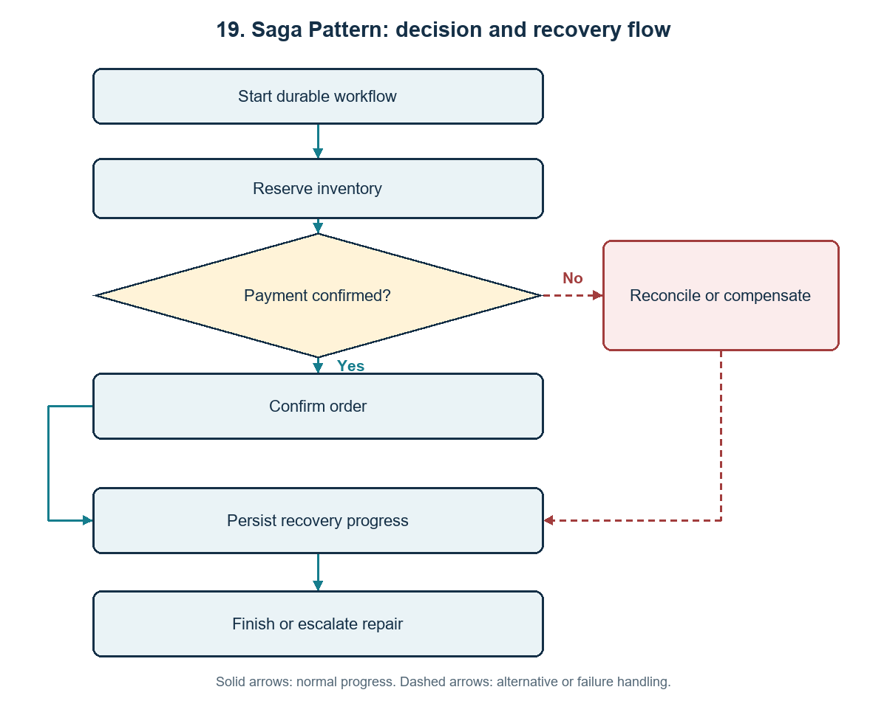

*Figure 19. 19. Saga Pattern: decision and recovery flow.* Start at "Start durable workflow" and move to "Reserve inventory". At "Payment confirmed?", the Yes branch goes to "Confirm order" and the No branch goes to "Reconcile or compensate". Follow the arrows to the terminal or recovery outcome; a dashed branch is not an implicit success. Source: [editable Mermaid](diagrams/topic-019.mmd).


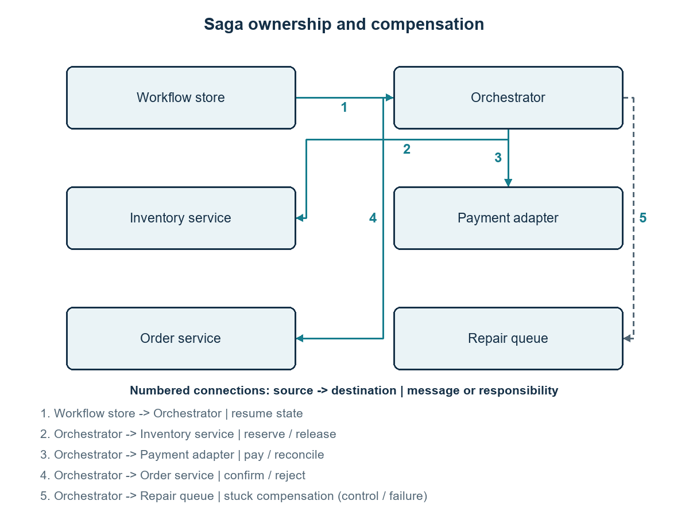

*Figure 121. Saga ownership and compensation.* The orchestrator persists progress and handles unknown outcomes. Compensation is a retryable business action, not time reversal. Source: [editable Mermaid](diagrams/arch-saga.mmd).


#### 6. Step-by-step example

1. Reserve inventory succeeds.

2. Payment is declined, so release inventory and mark the order rejected.

3. If payment times out, first reconcile the payment ID; immediately releasing stock and later discovering a successful charge creates a paid-but-unfulfillable order.

#### 7. Implementation

The complete runnable module is [examples/messaging.py](examples/messaging.py); run `python messaging.py` from the examples directory. The following excerpt isolates `OrderSaga`. Required imports, surrounding definitions, expected output, and limitations are in the complete module and [lab guide](examples/README.md).

```python
class OrderSaga:
    """Persist these fields in a real workflow store. Provider outcome is simulated."""
    def __init__(self):
        self.state = "new"
        self.reserved = False
        self.history = ["new"]

    def transition(self, state):
        self.state = state
        self.history.append(state)

    def start(self, payment_outcome, compensation_fails=False):
        if self.state != "new":
            return self.state
        self.reserved = True
        self.transition("reserved")
        if payment_outcome == "confirmed":
            self.transition("confirmed")
        elif payment_outcome == "unknown":
            self.transition("reconcile-payment")
        elif payment_outcome == "declined":
            self.transition("compensating")
            if compensation_fails:
                self.transition("compensation-pending")
            else:
                self.release()
        else:
            raise ValueError("invalid provider outcome")
        return self.state

    def release(self):
        if self.state not in {"compensating", "compensation-pending"}:
            raise ValueError("cannot release before a known failure decision")
        self.reserved = False
        self.transition("rejected")
```

Read the state changes in this excerpt alongside the mechanism above. The lab is a model of its stated boundary; it does not establish the behavior of a distributed deployment or an external provider. Check the assertions in [test_examples.py](examples/test_examples.py) and compare your output with [recorded outputs](examples/actual_outputs/).

#### 8. Production use cases

ShopStream reserves stock, requests payment, and confirms an order without holding one database transaction across services. If a later step fails, earlier effects need business-specific correction. Reserve inventory succeeds.

#### 9. Advantages and disadvantages

Sagas avoid long cross-service locks and accommodate heterogeneous APIs. They expose intermediate states and require careful compensation. A refund is not identical to an uncharged payment, and some actions, such as sending an email, are not reversible.

#### 10. Common mistakes and debugging

Treating compensation as guaranteed success leaves stuck workflows. Missing persistence loses progress on restart. Concurrent Sagas can violate invariants unless reservations, version checks, or semantic locks protect shared resources.

#### 11. Comparison with related concepts

| Decision | Engineering interpretation |
|---|---|
| What this topic contributes | A Saga implements a business workflow as local transactions with compensating actions. |
| Nearest alternatives and limits | Sagas avoid long cross-service locks and accommodate heterogeneous APIs. They expose intermediate states and require careful compensation. A refund is not identical to an uncharged payment, and some actions, such as sending an email, are not reversible. |
| Combined design | Read [14. Idempotency](#topic-014) and [17. Event-Driven Architecture](#topic-017); identify which layer owns each invariant rather than assuming their guarantees are interchangeable. |

#### 12. Interview preparation

**19.1 - Conceptual; Beginner. A teammate wants to add saga pattern everywhere. What concrete need should justify it?**

**Model answer:** A Saga implements a business workflow as local transactions with compensating actions. ShopStream reserves stock, requests payment, and confirms an order without holding one database transaction across services. If a later step fails, earlier effects need business-specific correction. Sagas avoid long cross-service locks and accommodate heterogeneous APIs.

**19.2 - Conceptual; Intermediate. What must be represented or coordinated for saga pattern to work correctly?**

**Model answer:** Persist a workflow ID and current state. Execute each step with an idempotency key, record its outcome, and advance only after a known result. On failure, run compensations in a suitable dependency order, retrying them durably. Orchestration uses a coordinator; choreography lets events trigger steps. Both require deadlines, deduplication, and reconciliation.

**19.3 - Conceptual; Beginner. Explain the analogy, then identify where it stops being a trustworthy model.**

**Model answer:** A travel agent books a flight and hotel separately. Cancelling a flight can incur a fee and cannot undo the historical booking. Compensation similarly repairs business state rather than erasing time. The implementation must still follow the explicit state and failure rules described in the mechanism; an analogy cannot establish a delivery, timing, or security guarantee.

**19.4 - Conceptual; Intermediate. Which nearby alternative would you compare with saga pattern, and what changes the choice?**

**Model answer:** Sagas avoid long cross-service locks and accommodate heterogeneous APIs. They expose intermediate states and require careful compensation. A refund is not identical to an uncharged payment, and some actions, such as sending an email, are not reversible.

**19.5 - Conceptual; Intermediate. How can an apparently functioning implementation still violate the intended contract?**

**Model answer:** Treating compensation as guaranteed success leaves stuck workflows. Missing persistence loses progress on restart. Concurrent Sagas can violate invariants unless reservations, version checks, or semantic locks protect shared resources.

**19.6 - Scenario; Intermediate. Walk through the worked ShopStream example. What evidence establishes the outcome, and what remains an assumption?**

**Model answer:** Reserve inventory succeeds. Payment is declined, so release inventory and mark the order rejected. If payment times out, first reconcile the payment ID; immediately releasing stock and later discovering a successful charge creates a paid-but-unfulfillable order. Verify the stated state transition or measurement at the responsible boundary. The numerical values, when present, are assumptions or deterministic examples rather than vendor performance guarantees.

**19.7 - Scenario; Advanced. You must validate this behavior before rollout. What experiment would expose a false correctness claim?**

**Model answer:** Simulate payment decline and assert inventory is released once. Fail the compensation and persist a retry. Design a reconciliation view listing workflow ID, last successful step, unknown outcomes, and safe operator actions. Record the starting state, injected condition, observed result, and invariant. A successful startup alone does not demonstrate the behavior under test.

**19.8 - Scenario; Advanced. A change involving saga pattern produces a customer-visible regression. How would you investigate and choose a safe response?**

**Model answer:** Treating compensation as guaranteed success leaves stuck workflows. Missing persistence loses progress on restart. Concurrent Sagas can violate invariants unless reservations, version checks, or semantic locks protect shared resources. Choose a pivot after which the workflow should roll forward rather than compensate. For shipping, dispatch may be such a point. Define manual repair for irrecoverable cases and monitor age by workflow state; aggregate service health cannot reveal every stuck business transaction.

**19.9 - Advanced follow-up; Expert. Which hidden assumptions become important under failure, scale, or a changed workload?**

**Model answer:** Choose a pivot after which the workflow should roll forward rather than compensate. For shipping, dispatch may be such a point. Define manual repair for irrecoverable cases and monitor age by workflow state; aggregate service health cannot reveal every stuck business transaction.

**19.10 - Advanced follow-up; Expert. How does this design interact with idempotency and event-driven architecture?**

**Model answer:** Persist a workflow ID and current state. Accept a client-generated operation key scoped to tenant and endpoint. Commit domain state and an outbox row in the same local transaction. Specify which component owns each decision and trace a failure across the combined boundary. Do not infer one component's guarantee from another component's name.

**Common incorrect answer:** "Adding the component makes the guarantee automatic." This is wrong because the mechanism depends on specific state, boundaries, and failure assumptions. Treating compensation as guaranteed success leaves stuck workflows.

**A deeper interviewer probe:** Change the timing, workload, or failure condition described in the advanced answer. Ask which invariant still holds, what observation would disprove it, and whether the fallback changes the user contract. Choose a pivot after which the workflow should roll forward rather than compensate.

#### 13. Exercises and solution walkthroughs

**Beginner exercise:** Reproduce the worked example for saga pattern on paper. Record the initial state, each transition, and the result before reading the walkthrough.

**Beginner solution:** Reserve inventory succeeds. Payment is declined, so release inventory and mark the order rejected. If payment times out, first reconcile the payment ID; immediately releasing stock and later discovering a successful charge creates a paid-but-unfulfillable order.

**Intermediate exercise:** Simulate payment decline and assert inventory is released once. Write the observable assertion and identify which component owns it.

**Intermediate solution:** Simulate payment decline and assert inventory is released once. Fail the compensation and persist a retry. Design a reconciliation view listing workflow ID, last successful step, unknown outcomes, and safe operator actions. Use the provided lab where applicable; for platform behavior, record the runtime version and actual evidence instead of treating a diagram as a test.

**Advanced exercise:** Extend the example to a failure or scale condition described below. State the guarantee you retain, the one you relax if necessary, and a safe recovery procedure.

**Advanced solution:** Choose a pivot after which the workflow should roll forward rather than compensate. For shipping, dispatch may be such a point. Define manual repair for irrecoverable cases and monitor age by workflow state; aggregate service health cannot reveal every stuck business transaction. Treating compensation as guaranteed success leaves stuck workflows. A complete solution identifies a detection signal, a bounded action, and a verification of the business outcome.

#### 14. Key takeaways

- A Saga implements a business workflow as local transactions with compensating actions.

- Persist a workflow ID and current state.

- Sagas avoid long cross-service locks and accommodate heterogeneous APIs.

- Treating compensation as guaranteed success leaves stuck workflows.

- Choose a pivot after which the workflow should roll forward rather than compensate.


**When to use it:** ShopStream reserves stock, requests payment, and confirms an order without holding one database transaction across services. If a later step fails, earlier effects need business-specific correction.

**Terminology:** See this topic's glossary entry and the linked related terms. **Continue with:** [14. Idempotency](#topic-014), [17. Event-Driven Architecture](#topic-017), [18. Distributed Transactions](#topic-018), [109. Production Incidents](#topic-109).
<a id="topic-020"></a>

### 20. Dead Letter Queues

Prerequisites and related reading: [15. Message Queues](#topic-015), [16. Pub/Sub](#topic-016), [82. Schema Versioning](#topic-082), [109. Production Incidents](#topic-109).

#### 1. Simple explanation

A dead letter queue isolates messages that cannot be processed under the normal retry policy.

#### 2. The problem it solves

One malformed receipt job should not monopolize ShopStream's notification workers forever. Moving it aside preserves evidence and lets valid work progress; it does not count as successful business completion.

#### 3. Intuitive analogy

A postal service puts undeliverable letters in a separate office for investigation. The letters still need resolution, and blindly returning all of them to the same address repeats the failure.

#### 4. Technical working mechanism

1. Classify permanent and transient errors, record attempts, and move exhausted messages with their original IDs, timestamps, payload version, and sanitized error metadata.

2. Restrict access because payloads may contain personal information.

3. Alert on arrival and age.

4. Replay through a controlled tool after correcting the cause, preserving deduplication keys and limiting replay rate.


**Boundary and advanced reasoning.** Redrive can reorder messages relative to newer events. Compare entity versions or reconcile from authoritative state. If a failed payment event is replayed days later, its business intent may have expired even though the message is technically valid.

#### 5. Architecture and diagrams

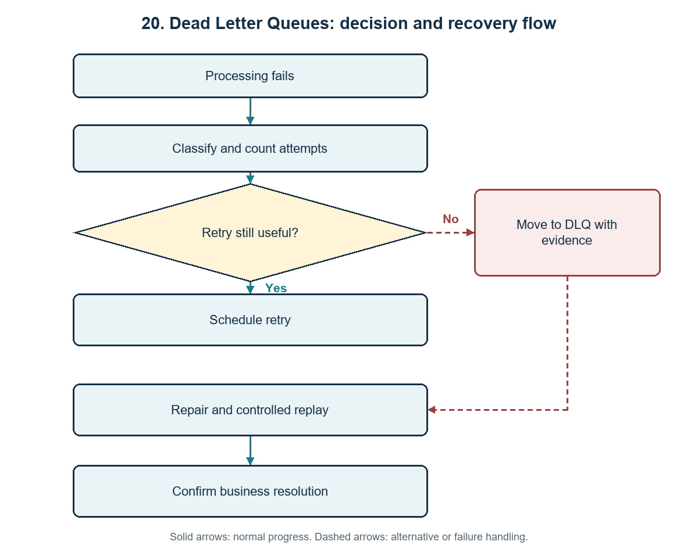

*Figure 20. 20. Dead Letter Queues: decision and recovery flow.* Start at "Processing fails" and move to "Classify and count attempts". At "Retry still useful?", the Yes branch goes to "Schedule retry" and the No branch goes to "Move to DLQ with evidence". Follow the arrows to the terminal or recovery outcome; a dashed branch is not an implicit success. Source: [editable Mermaid](diagrams/topic-020.mmd).


#### 6. Step-by-step example

1. An email event lacks a required address.

2. Three attempts fail, then it enters the DLQ.

3. An engineer corrects the producer contract and repairs only recoverable records.

4. Replay retains the event ID so a previously completed external effect is not repeated.

#### 7. Implementation

The complete runnable module is [examples/messaging.py](examples/messaging.py); run `python messaging.py` from the examples directory. The following excerpt isolates `process_queue`. Required imports, surrounding definitions, expected output, and limitations are in the complete module and [lab guide](examples/README.md).

```python
def process_queue(jobs, max_attempts=3):
    queue, completed, dead = deque(jobs), set(), []
    effect_count = 0
    while queue:
        job = queue.popleft()
        if job.event_id in completed:
            continue
        job.attempts += 1
        if job.payload == "poison":
            if job.attempts < max_attempts:
                queue.append(job)
            else:
                dead.append(job)
            continue
        effect_count += 1
        completed.add(job.event_id)
    return effect_count, completed, dead
```

Read the state changes in this excerpt alongside the mechanism above. The lab is a model of its stated boundary; it does not establish the behavior of a distributed deployment or an external provider. Check the assertions in [test_examples.py](examples/test_examples.py) and compare your output with [recorded outputs](examples/actual_outputs/).

#### 8. Production use cases

One malformed receipt job should not monopolize ShopStream's notification workers forever. Moving it aside preserves evidence and lets valid work progress; it does not count as successful business completion. An email event lacks a required address.

#### 9. Advantages and disadvantages

Immediate rejection is suitable for invalid synchronous requests. DLQs preserve asynchronous evidence. Unlimited retries may eventually handle outages but waste capacity on permanent errors. Some ordering requirements mean skipping one record must pause its entity stream rather than silently advance.

#### 10. Common mistakes and debugging

A DLQ without an owner becomes a hidden data-loss sink. Bulk replay during peak traffic causes another outage. Track terminal outcomes separately from merely moving messages, and define retention and deletion policy.

#### 11. Comparison with related concepts

| Decision | Engineering interpretation |
|---|---|
| What this topic contributes | A dead letter queue isolates messages that cannot be processed under the normal retry policy. |
| Nearest alternatives and limits | Immediate rejection is suitable for invalid synchronous requests. DLQs preserve asynchronous evidence. Unlimited retries may eventually handle outages but waste capacity on permanent errors. Some ordering requirements mean skipping one record must pause its entity stream rather than silently advance. |
| Combined design | Read [15. Message Queues](#topic-015) and [16. Pub/Sub](#topic-016); identify which layer owns each invariant rather than assuming their guarantees are interchangeable. |

#### 12. Interview preparation

**20.1 - Conceptual; Beginner. A teammate wants to add dead letter queues everywhere. What concrete need should justify it?**

**Model answer:** A dead letter queue isolates messages that cannot be processed under the normal retry policy. One malformed receipt job should not monopolize ShopStream's notification workers forever. Moving it aside preserves evidence and lets valid work progress; it does not count as successful business completion. Immediate rejection is suitable for invalid synchronous requests.

**20.2 - Conceptual; Intermediate. What must be represented or coordinated for dead letter queues to work correctly?**

**Model answer:** Classify permanent and transient errors, record attempts, and move exhausted messages with their original IDs, timestamps, payload version, and sanitized error metadata. Restrict access because payloads may contain personal information. Alert on arrival and age. Replay through a controlled tool after correcting the cause, preserving deduplication keys and limiting replay rate.

**20.3 - Conceptual; Beginner. Explain the analogy, then identify where it stops being a trustworthy model.**

**Model answer:** A postal service puts undeliverable letters in a separate office for investigation. The letters still need resolution, and blindly returning all of them to the same address repeats the failure. The implementation must still follow the explicit state and failure rules described in the mechanism; an analogy cannot establish a delivery, timing, or security guarantee.

**20.4 - Conceptual; Intermediate. Which nearby alternative would you compare with dead letter queues, and what changes the choice?**

**Model answer:** Immediate rejection is suitable for invalid synchronous requests. DLQs preserve asynchronous evidence. Unlimited retries may eventually handle outages but waste capacity on permanent errors. Some ordering requirements mean skipping one record must pause its entity stream rather than silently advance.

**20.5 - Conceptual; Intermediate. How can an apparently functioning implementation still violate the intended contract?**

**Model answer:** A DLQ without an owner becomes a hidden data-loss sink. Bulk replay during peak traffic causes another outage. Track terminal outcomes separately from merely moving messages, and define retention and deletion policy.

**20.6 - Scenario; Intermediate. Walk through the worked ShopStream example. What evidence establishes the outcome, and what remains an assumption?**

**Model answer:** An email event lacks a required address. Three attempts fail, then it enters the DLQ. An engineer corrects the producer contract and repairs only recoverable records. Replay retains the event ID so a previously completed external effect is not repeated. Verify the stated state transition or measurement at the responsible boundary. The numerical values, when present, are assumptions or deterministic examples rather than vendor performance guarantees.

**20.7 - Scenario; Advanced. You must validate this behavior before rollout. What experiment would expose a false correctness claim?**

**Model answer:** Fail a job three times and inspect its terminal metadata. Correct a compatible payload and replay at a bounded rate. For an ordered inventory stream, explain whether to pause the key or rebuild its projection from the source of truth. Record the starting state, injected condition, observed result, and invariant. A successful startup alone does not demonstrate the behavior under test.

**20.8 - Scenario; Advanced. A change involving dead letter queues produces a customer-visible regression. How would you investigate and choose a safe response?**

**Model answer:** A DLQ without an owner becomes a hidden data-loss sink. Bulk replay during peak traffic causes another outage. Track terminal outcomes separately from merely moving messages, and define retention and deletion policy. Redrive can reorder messages relative to newer events. Compare entity versions or reconcile from authoritative state. If a failed payment event is replayed days later, its business intent may have expired even though the message is technically valid.

**20.9 - Advanced follow-up; Expert. Which hidden assumptions become important under failure, scale, or a changed workload?**

**Model answer:** Redrive can reorder messages relative to newer events. Compare entity versions or reconcile from authoritative state. If a failed payment event is replayed days later, its business intent may have expired even though the message is technically valid.

**20.10 - Advanced follow-up; Expert. How does this design interact with message queues and pub/sub?**

**Model answer:** Classify permanent and transient errors, record attempts, and move exhausted messages with their original IDs, timestamps, payload version, and sanitized error metadata. Publish durably according to broker guarantees, deliver to a consumer, reserve or hide it for a visibility interval, process the side effect, then acknowledge. Publish an event to a topic, route it to subscriptions, retain it according to policy, and let each subscriber track its own progress. Specify which component owns each decision and trace a failure across the combined boundary. Do not infer one component's guarantee from another component's name.

**Common incorrect answer:** "Adding the component makes the guarantee automatic." This is wrong because the mechanism depends on specific state, boundaries, and failure assumptions. A DLQ without an owner becomes a hidden data-loss sink.

**A deeper interviewer probe:** Change the timing, workload, or failure condition described in the advanced answer. Ask which invariant still holds, what observation would disprove it, and whether the fallback changes the user contract. Redrive can reorder messages relative to newer events.

#### 13. Exercises and solution walkthroughs

**Beginner exercise:** Reproduce the worked example for dead letter queues on paper. Record the initial state, each transition, and the result before reading the walkthrough.

**Beginner solution:** An email event lacks a required address. Three attempts fail, then it enters the DLQ. An engineer corrects the producer contract and repairs only recoverable records. Replay retains the event ID so a previously completed external effect is not repeated.

**Intermediate exercise:** Fail a job three times and inspect its terminal metadata. Write the observable assertion and identify which component owns it.

**Intermediate solution:** Fail a job three times and inspect its terminal metadata. Correct a compatible payload and replay at a bounded rate. For an ordered inventory stream, explain whether to pause the key or rebuild its projection from the source of truth. Use the provided lab where applicable; for platform behavior, record the runtime version and actual evidence instead of treating a diagram as a test.

**Advanced exercise:** Extend the example to a failure or scale condition described below. State the guarantee you retain, the one you relax if necessary, and a safe recovery procedure.

**Advanced solution:** Redrive can reorder messages relative to newer events. Compare entity versions or reconcile from authoritative state. If a failed payment event is replayed days later, its business intent may have expired even though the message is technically valid. A DLQ without an owner becomes a hidden data-loss sink. A complete solution identifies a detection signal, a bounded action, and a verification of the business outcome.

#### 14. Key takeaways

- A dead letter queue isolates messages that cannot be processed under the normal retry policy.

- Classify permanent and transient errors, record attempts, and move exhausted messages with their original IDs, timestamps, payload version, and sanitized error metadata.

- Immediate rejection is suitable for invalid synchronous requests.

- A DLQ without an owner becomes a hidden data-loss sink.

- Redrive can reorder messages relative to newer events.


**When to use it:** One malformed receipt job should not monopolize ShopStream's notification workers forever. Moving it aside preserves evidence and lets valid work progress; it does not count as successful business completion.

**Terminology:** See this topic's glossary entry and the linked related terms. **Continue with:** [15. Message Queues](#topic-015), [16. Pub/Sub](#topic-016), [82. Schema Versioning](#topic-082), [109. Production Incidents](#topic-109).
<a id="topic-021"></a>

### 21. Cron Jobs

Prerequisites and related reading: [14. Idempotency](#topic-014), [38. Distributed Locks](#topic-038), [96. Clock Skew](#topic-096).

#### 1. Simple explanation

Cron-style scheduling starts work according to time rules.

#### 2. The problem it solves

ShopStream needs periodic reconciliation, expired-reservation cleanup, and reports. Scheduling decides when to attempt work; it does not guarantee one successful execution per business period.

#### 3. Intuitive analogy

An alarm clock tells a student when to study. A missed alarm does not prove the lesson happened, and two alarms can ring for the same session. A durable completion record is the equivalent of a study log.

#### 4. Technical working mechanism

1. Evaluate the schedule in an explicit timezone, create a run identity from job and business interval, acquire bounded ownership, and record completion.

2. Define overlap, missed-run, retry, and catch-up behavior.

3. Use idempotent database changes and checkpoints for long scans.

4. Separate scheduled time from actual start and completion time.


**Boundary and advanced reasoning.** A distributed lease alone does not prevent a paused old worker from continuing after expiry. Use fencing or idempotent writes scoped to the run ID. Catch-up policies should cap backlog so recovery does not launch hundreds of expensive scans simultaneously.

#### 5. Architecture and diagrams

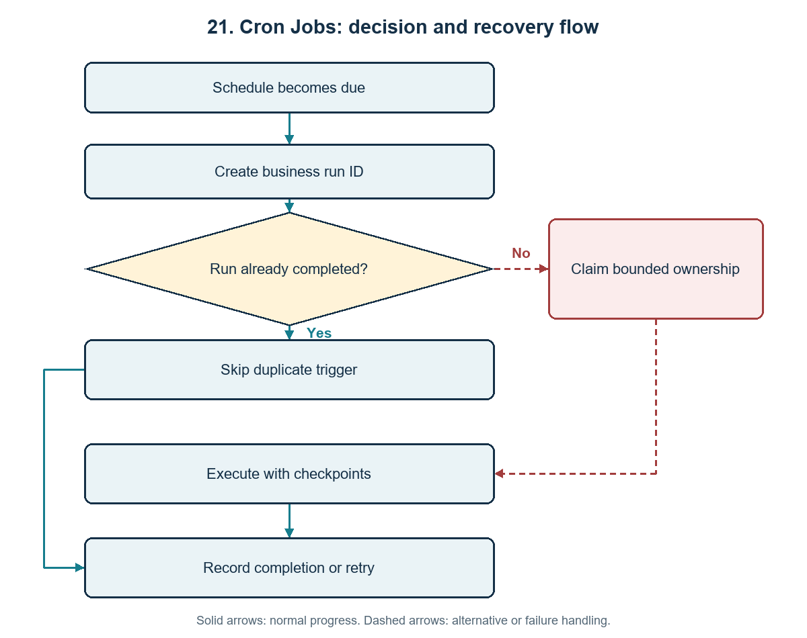

*Figure 21. 21. Cron Jobs: decision and recovery flow.* Start at "Schedule becomes due" and move to "Create business run ID". At "Run already completed?", the Yes branch goes to "Skip duplicate trigger" and the No branch goes to "Claim bounded ownership". Follow the arrows to the terminal or recovery outcome; a dashed branch is not an implicit success. Source: [editable Mermaid](diagrams/topic-021.mmd).


#### 6. Step-by-step example

1. A daily settlement job uses business date 2026-10-18 as its unique key.

2. Two scheduler instances race, but a database uniqueness constraint allows one logical settlement.

3. A crash resumes from a checkpoint; a duplicate trigger reads the existing run status.

#### 7. Implementation

The complete runnable module is [examples/messaging.py](examples/messaging.py); run `python messaging.py` from the examples directory. The following excerpt isolates `settle_once`. Required imports, surrounding definitions, expected output, and limitations are in the complete module and [lab guide](examples/README.md).

```python
def settle_once(completed_periods, business_date):
    """Set model only: a real scheduler needs a durable unique constraint."""
    if business_date in completed_periods:
        return False
    completed_periods.add(business_date)
    return True
```

Read the state changes in this excerpt alongside the mechanism above. The lab is a model of its stated boundary; it does not establish the behavior of a distributed deployment or an external provider. Check the assertions in [test_examples.py](examples/test_examples.py) and compare your output with [recorded outputs](examples/actual_outputs/).

#### 8. Production use cases

ShopStream needs periodic reconciliation, expired-reservation cleanup, and reports. Scheduling decides when to attempt work; it does not guarantee one successful execution per business period. A daily settlement job uses business date 2026-10-18 as its unique key.

#### 9. Advantages and disadvantages

Fixed-interval timers are useful for local maintenance; durable schedulers recover missed runs. Event-triggered work is fresher but needs reliable event production. Cron expressions differ across implementations, including field count and timezone support.

#### 10. Common mistakes and debugging

Local daylight-saving changes can skip or repeat wall-clock times. A job taking longer than its interval overlaps. Treating process exit zero as proof of correct output hides empty or partial results. Monitor freshness and expected row counts.

#### 11. Comparison with related concepts

| Decision | Engineering interpretation |
|---|---|
| What this topic contributes | Cron-style scheduling starts work according to time rules. |
| Nearest alternatives and limits | Fixed-interval timers are useful for local maintenance; durable schedulers recover missed runs. Event-triggered work is fresher but needs reliable event production. Cron expressions differ across implementations, including field count and timezone support. |
| Combined design | Read [14. Idempotency](#topic-014) and [38. Distributed Locks](#topic-038); identify which layer owns each invariant rather than assuming their guarantees are interchangeable. |

#### 12. Interview preparation

**21.1 - Conceptual; Beginner. A teammate wants to add cron jobs everywhere. What concrete need should justify it?**

**Model answer:** Cron-style scheduling starts work according to time rules. ShopStream needs periodic reconciliation, expired-reservation cleanup, and reports. Scheduling decides when to attempt work; it does not guarantee one successful execution per business period. Fixed-interval timers are useful for local maintenance; durable schedulers recover missed runs.

**21.2 - Conceptual; Intermediate. What must be represented or coordinated for cron jobs to work correctly?**

**Model answer:** Evaluate the schedule in an explicit timezone, create a run identity from job and business interval, acquire bounded ownership, and record completion. Define overlap, missed-run, retry, and catch-up behavior. Use idempotent database changes and checkpoints for long scans. Separate scheduled time from actual start and completion time.

**21.3 - Conceptual; Beginner. Explain the analogy, then identify where it stops being a trustworthy model.**

**Model answer:** An alarm clock tells a student when to study. A missed alarm does not prove the lesson happened, and two alarms can ring for the same session. A durable completion record is the equivalent of a study log. The implementation must still follow the explicit state and failure rules described in the mechanism; an analogy cannot establish a delivery, timing, or security guarantee.

**21.4 - Conceptual; Intermediate. Which nearby alternative would you compare with cron jobs, and what changes the choice?**

**Model answer:** Fixed-interval timers are useful for local maintenance; durable schedulers recover missed runs. Event-triggered work is fresher but needs reliable event production. Cron expressions differ across implementations, including field count and timezone support.

**21.5 - Conceptual; Intermediate. How can an apparently functioning implementation still violate the intended contract?**

**Model answer:** Local daylight-saving changes can skip or repeat wall-clock times. A job taking longer than its interval overlaps. Treating process exit zero as proof of correct output hides empty or partial results. Monitor freshness and expected row counts.

**21.6 - Scenario; Intermediate. Walk through the worked ShopStream example. What evidence establishes the outcome, and what remains an assumption?**

**Model answer:** A daily settlement job uses business date 2026-10-18 as its unique key. Two scheduler instances race, but a database uniqueness constraint allows one logical settlement. A crash resumes from a checkpoint; a duplicate trigger reads the existing run status. Verify the stated state transition or measurement at the responsible boundary. The numerical values, when present, are assumptions or deterministic examples rather than vendor performance guarantees.

**21.7 - Scenario; Advanced. You must validate this behavior before rollout. What experiment would expose a false correctness claim?**

**Model answer:** Simulate two triggers for one date and assert one result. Interrupt a paginated cleanup after its first checkpoint. Specify whether three missed daily runs should run separately, merge into one interval, or require manual reconciliation. Record the starting state, injected condition, observed result, and invariant. A successful startup alone does not demonstrate the behavior under test.

**21.8 - Scenario; Advanced. A change involving cron jobs produces a customer-visible regression. How would you investigate and choose a safe response?**

**Model answer:** Local daylight-saving changes can skip or repeat wall-clock times. A job taking longer than its interval overlaps. Treating process exit zero as proof of correct output hides empty or partial results. Monitor freshness and expected row counts. A distributed lease alone does not prevent a paused old worker from continuing after expiry. Use fencing or idempotent writes scoped to the run ID. Catch-up policies should cap backlog so recovery does not launch hundreds of expensive scans simultaneously.

**21.9 - Advanced follow-up; Expert. Which hidden assumptions become important under failure, scale, or a changed workload?**

**Model answer:** A distributed lease alone does not prevent a paused old worker from continuing after expiry. Use fencing or idempotent writes scoped to the run ID. Catch-up policies should cap backlog so recovery does not launch hundreds of expensive scans simultaneously.

**21.10 - Advanced follow-up; Expert. How does this design interact with idempotency and distributed locks?**

**Model answer:** Evaluate the schedule in an explicit timezone, create a run identity from job and business interval, acquire bounded ownership, and record completion. Accept a client-generated operation key scoped to tenant and endpoint. Acquire ownership atomically with a unique owner ID and expiry. Specify which component owns each decision and trace a failure across the combined boundary. Do not infer one component's guarantee from another component's name.

**Common incorrect answer:** "Adding the component makes the guarantee automatic." This is wrong because the mechanism depends on specific state, boundaries, and failure assumptions. Local daylight-saving changes can skip or repeat wall-clock times.

**A deeper interviewer probe:** Change the timing, workload, or failure condition described in the advanced answer. Ask which invariant still holds, what observation would disprove it, and whether the fallback changes the user contract. A distributed lease alone does not prevent a paused old worker from continuing after expiry.

#### 13. Exercises and solution walkthroughs

**Beginner exercise:** Reproduce the worked example for cron jobs on paper. Record the initial state, each transition, and the result before reading the walkthrough.

**Beginner solution:** A daily settlement job uses business date 2026-10-18 as its unique key. Two scheduler instances race, but a database uniqueness constraint allows one logical settlement. A crash resumes from a checkpoint; a duplicate trigger reads the existing run status.

**Intermediate exercise:** Simulate two triggers for one date and assert one result. Write the observable assertion and identify which component owns it.

**Intermediate solution:** Simulate two triggers for one date and assert one result. Interrupt a paginated cleanup after its first checkpoint. Specify whether three missed daily runs should run separately, merge into one interval, or require manual reconciliation. Use the provided lab where applicable; for platform behavior, record the runtime version and actual evidence instead of treating a diagram as a test.

**Advanced exercise:** Extend the example to a failure or scale condition described below. State the guarantee you retain, the one you relax if necessary, and a safe recovery procedure.

**Advanced solution:** A distributed lease alone does not prevent a paused old worker from continuing after expiry. Use fencing or idempotent writes scoped to the run ID. Catch-up policies should cap backlog so recovery does not launch hundreds of expensive scans simultaneously. Local daylight-saving changes can skip or repeat wall-clock times. A complete solution identifies a detection signal, a bounded action, and a verification of the business outcome.

#### 14. Key takeaways

- Cron-style scheduling starts work according to time rules.

- Evaluate the schedule in an explicit timezone, create a run identity from job and business interval, acquire bounded ownership, and record completion.

- Fixed-interval timers are useful for local maintenance; durable schedulers recover missed runs.

- Local daylight-saving changes can skip or repeat wall-clock times.

- A distributed lease alone does not prevent a paused old worker from continuing after expiry.


**When to use it:** ShopStream needs periodic reconciliation, expired-reservation cleanup, and reports. Scheduling decides when to attempt work; it does not guarantee one successful execution per business period.

**Terminology:** See this topic's glossary entry and the linked related terms. **Continue with:** [14. Idempotency](#topic-014), [38. Distributed Locks](#topic-038), [96. Clock Skew](#topic-096).
<a id="topic-033"></a>

### 33. Leader Election

Prerequisites and related reading: [32. Replication](#topic-032), [34. CAP Theorem](#topic-034), [38. Distributed Locks](#topic-038), [95. Network Partitions](#topic-095).

#### 1. Simple explanation

Leader election chooses a coordinator among replicas.

#### 2. The problem it solves

ShopStream's replicated metadata service needs one authority for ordering changes. Detecting silence is not proof of failure, so safe election must handle delayed messages and partitioned nodes.

#### 3. Intuitive analogy

A committee elects a chair with a majority vote. A chair isolated from the committee cannot keep making binding decisions alone. Software additionally needs numbered terms to reject messages from an old chair.

#### 4. Technical working mechanism

1. In a quorum-based consensus protocol, nodes use election timeouts, increasing terms, durable votes, and log freshness checks.

2. A majority elects a leader; overlapping majorities prevent two independent majorities for the same membership.

3. The leader replicates entries and commits according to protocol rules.

4. Old leaders must lose authority and external resources may need fencing tokens.


**Boundary and advanced reasoning.** Safety means conflicting decisions are not committed; liveness means progress eventually occurs under stated conditions. A protocol can preserve safety while unavailable. Leader leases require bounded clock assumptions; term-based log protocols and external fencing address different hazards.

#### 5. Architecture and diagrams

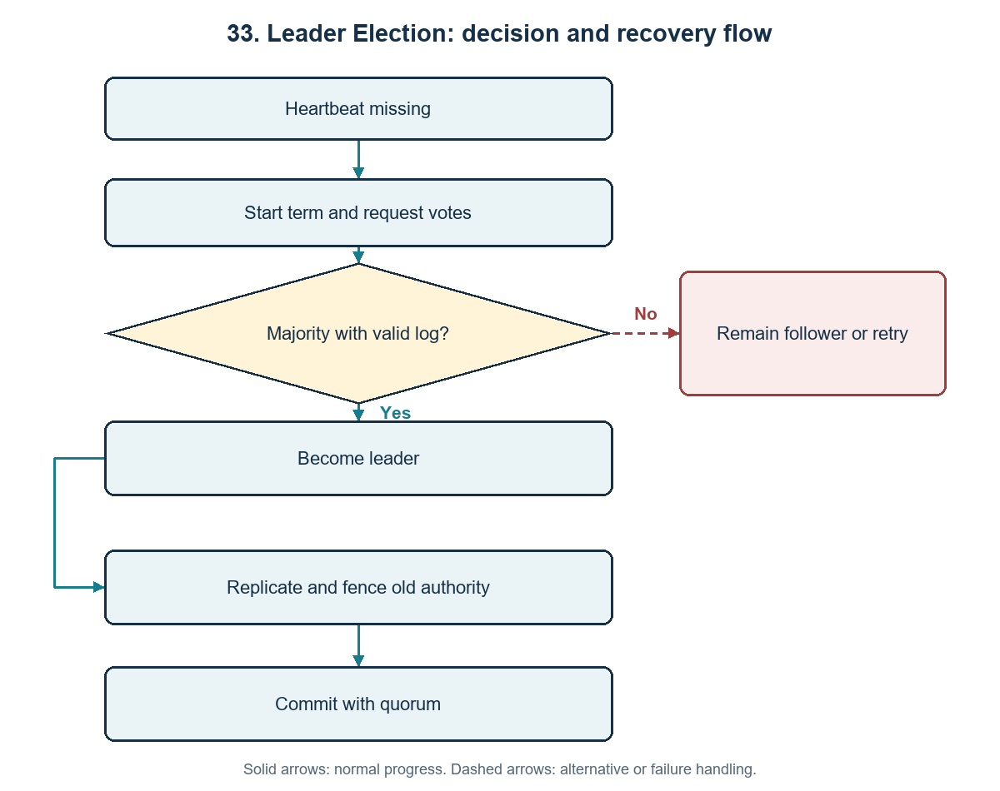

*Figure 33. 33. Leader Election: decision and recovery flow.* Start at "Heartbeat missing" and move to "Start term and request votes". At "Majority with valid log?", the Yes branch goes to "Become leader" and the No branch goes to "Remain follower or retry". Follow the arrows to the terminal or recovery outcome; a dashed branch is not an implicit success. Source: [editable Mermaid](diagrams/topic-033.mmd).


#### 6. Step-by-step example

1. Five nodes split into groups of three and two.

2. Only the group of three can form a majority and make progress under the assumed protocol.

3. The isolated old leader may still run, but its term or fencing token must prevent stale external writes.

#### 7. Implementation

The complete runnable module is [examples/algorithms.py](examples/algorithms.py); run `python algorithms.py` from the examples directory. The following excerpt isolates `quorum_available`. Required imports, surrounding definitions, expected output, and limitations are in the complete module and [lab guide](examples/README.md).

```python
def quorum_available(reachable, cluster_size):
    """Arithmetic only: not a leader-election/consensus implementation."""
    return reachable >= cluster_size // 2 + 1
```

Read the state changes in this excerpt alongside the mechanism above. The lab is a model of its stated boundary; it does not establish the behavior of a distributed deployment or an external provider. Check the assertions in [test_examples.py](examples/test_examples.py) and compare your output with [recorded outputs](examples/actual_outputs/).

#### 8. Production use cases

ShopStream's replicated metadata service needs one authority for ordering changes. Detecting silence is not proof of failure, so safe election must handle delayed messages and partitioned nodes. Five nodes split into groups of three and two.

#### 9. Advantages and disadvantages

A coordination service can provide election primitives, but a simplistic lock is not a complete consensus algorithm. Majority availability tolerates at most two unavailable nodes out of five; it does not protect against every correlated failure or Byzantine behavior.

#### 10. Common mistakes and debugging

Electing the node with the fastest clock is unsafe. Short timeouts cause election churn under pauses. Changing membership without a safe protocol can destroy quorum intersection. Use established implementations and test network delay and restart behavior.

#### 11. Comparison with related concepts

| Decision | Engineering interpretation |
|---|---|
| What this topic contributes | Leader election chooses a coordinator among replicas. |
| Nearest alternatives and limits | A coordination service can provide election primitives, but a simplistic lock is not a complete consensus algorithm. Majority availability tolerates at most two unavailable nodes out of five; it does not protect against every correlated failure or Byzantine behavior. |
| Combined design | Read [32. Replication](#topic-032) and [34. CAP Theorem](#topic-034); identify which layer owns each invariant rather than assuming their guarantees are interchangeable. |

#### 12. Interview preparation

**33.1 - Conceptual; Beginner. A teammate wants to add leader election everywhere. What concrete need should justify it?**

**Model answer:** Leader election chooses a coordinator among replicas. ShopStream's replicated metadata service needs one authority for ordering changes. Detecting silence is not proof of failure, so safe election must handle delayed messages and partitioned nodes. A coordination service can provide election primitives, but a simplistic lock is not a complete consensus algorithm.

**33.2 - Conceptual; Intermediate. What must be represented or coordinated for leader election to work correctly?**

**Model answer:** In a quorum-based consensus protocol, nodes use election timeouts, increasing terms, durable votes, and log freshness checks. A majority elects a leader; overlapping majorities prevent two independent majorities for the same membership. The leader replicates entries and commits according to protocol rules. Old leaders must lose authority and external resources may need fencing tokens.

**33.3 - Conceptual; Beginner. Explain the analogy, then identify where it stops being a trustworthy model.**

**Model answer:** A committee elects a chair with a majority vote. A chair isolated from the committee cannot keep making binding decisions alone. Software additionally needs numbered terms to reject messages from an old chair. The implementation must still follow the explicit state and failure rules described in the mechanism; an analogy cannot establish a delivery, timing, or security guarantee.

**33.4 - Conceptual; Intermediate. Which nearby alternative would you compare with leader election, and what changes the choice?**

**Model answer:** A coordination service can provide election primitives, but a simplistic lock is not a complete consensus algorithm. Majority availability tolerates at most two unavailable nodes out of five; it does not protect against every correlated failure or Byzantine behavior.

**33.5 - Conceptual; Intermediate. How can an apparently functioning implementation still violate the intended contract?**

**Model answer:** Electing the node with the fastest clock is unsafe. Short timeouts cause election churn under pauses. Changing membership without a safe protocol can destroy quorum intersection. Use established implementations and test network delay and restart behavior.

**33.6 - Scenario; Intermediate. Walk through the worked ShopStream example. What evidence establishes the outcome, and what remains an assumption?**

**Model answer:** Five nodes split into groups of three and two. Only the group of three can form a majority and make progress under the assumed protocol. The isolated old leader may still run, but its term or fencing token must prevent stale external writes. Verify the stated state transition or measurement at the responsible boundary. The numerical values, when present, are assumptions or deterministic examples rather than vendor performance guarantees.

**33.7 - Scenario; Advanced. You must validate this behavior before rollout. What experiment would expose a false correctness claim?**

**Model answer:** Enumerate all majorities of three nodes and show intersection. Partition a five-node diagram into 3/2 and mark where writes may succeed. Describe how a paused former leader is rejected after a new term begins. Record the starting state, injected condition, observed result, and invariant. A successful startup alone does not demonstrate the behavior under test.

**33.8 - Scenario; Advanced. A change involving leader election produces a customer-visible regression. How would you investigate and choose a safe response?**

**Model answer:** Electing the node with the fastest clock is unsafe. Short timeouts cause election churn under pauses. Changing membership without a safe protocol can destroy quorum intersection. Use established implementations and test network delay and restart behavior. Safety means conflicting decisions are not committed; liveness means progress eventually occurs under stated conditions. A protocol can preserve safety while unavailable. Leader leases require bounded clock assumptions; term-based log protocols and external fencing address different hazards.

**33.9 - Advanced follow-up; Expert. Which hidden assumptions become important under failure, scale, or a changed workload?**

**Model answer:** Safety means conflicting decisions are not committed; liveness means progress eventually occurs under stated conditions. A protocol can preserve safety while unavailable. Leader leases require bounded clock assumptions; term-based log protocols and external fencing address different hazards.

**33.10 - Advanced follow-up; Expert. How does this design interact with replication and cap theorem?**

**Model answer:** In a quorum-based consensus protocol, nodes use election timeouts, increasing terms, durable votes, and log freshness checks. Capture committed changes in a log, transmit them, apply them in order within the guaranteed domain, and track durable progress. Model a register with reads and writes. Specify which component owns each decision and trace a failure across the combined boundary. Do not infer one component's guarantee from another component's name.

**Common incorrect answer:** "Adding the component makes the guarantee automatic." This is wrong because the mechanism depends on specific state, boundaries, and failure assumptions. Electing the node with the fastest clock is unsafe.

**A deeper interviewer probe:** Change the timing, workload, or failure condition described in the advanced answer. Ask which invariant still holds, what observation would disprove it, and whether the fallback changes the user contract. Safety means conflicting decisions are not committed; liveness means progress eventually occurs under stated conditions.

#### 13. Exercises and solution walkthroughs

**Beginner exercise:** Reproduce the worked example for leader election on paper. Record the initial state, each transition, and the result before reading the walkthrough.

**Beginner solution:** Five nodes split into groups of three and two. Only the group of three can form a majority and make progress under the assumed protocol. The isolated old leader may still run, but its term or fencing token must prevent stale external writes.

**Intermediate exercise:** Enumerate all majorities of three nodes and show intersection. Write the observable assertion and identify which component owns it.

**Intermediate solution:** Enumerate all majorities of three nodes and show intersection. Partition a five-node diagram into 3/2 and mark where writes may succeed. Describe how a paused former leader is rejected after a new term begins. Use the provided lab where applicable; for platform behavior, record the runtime version and actual evidence instead of treating a diagram as a test.

**Advanced exercise:** Extend the example to a failure or scale condition described below. State the guarantee you retain, the one you relax if necessary, and a safe recovery procedure.

**Advanced solution:** Safety means conflicting decisions are not committed; liveness means progress eventually occurs under stated conditions. A protocol can preserve safety while unavailable. Leader leases require bounded clock assumptions; term-based log protocols and external fencing address different hazards. Electing the node with the fastest clock is unsafe. A complete solution identifies a detection signal, a bounded action, and a verification of the business outcome.

#### 14. Key takeaways

- Leader election chooses a coordinator among replicas.

- In a quorum-based consensus protocol, nodes use election timeouts, increasing terms, durable votes, and log freshness checks.

- A coordination service can provide election primitives, but a simplistic lock is not a complete consensus algorithm.

- Electing the node with the fastest clock is unsafe.

- Safety means conflicting decisions are not committed; liveness means progress eventually occurs under stated conditions.


**When to use it:** ShopStream's replicated metadata service needs one authority for ordering changes. Detecting silence is not proof of failure, so safe election must handle delayed messages and partitioned nodes.

**Terminology:** See this topic's glossary entry and the linked related terms. **Continue with:** [32. Replication](#topic-032), [34. CAP Theorem](#topic-034), [38. Distributed Locks](#topic-038), [95. Network Partitions](#topic-095).
<a id="topic-034"></a>

### 34. CAP Theorem

Prerequisites and related reading: [33. Leader Election](#topic-033), [35. Eventual Consistency](#topic-035), [86. Multi-Region Deployment](#topic-086), [95. Network Partitions](#topic-095).

#### 1. Simple explanation

CAP explains a limit during a network partition: a distributed service cannot guarantee both linearizable behavior and a response for every request to a nonfailed node under the theorem's assumptions.

#### 2. The problem it solves

It is not a permanent menu where every database simply picks two letters.

#### 3. Intuitive analogy

Two bank branches lose their communication link. If both promise an immediately current shared balance, neither can safely invent what the other accepted. They must restrict some operations or permit observations that do not behave like one instantaneously shared register.

#### 4. Technical working mechanism

1. Model a register with reads and writes.

2. Partition communication between replicas.

3. A write accepted on one side cannot be communicated to the other.

4. The other side must either delay/reject a read that requires the new value or answer without guaranteeing linearizability.

5. Specify which operations remain available and what consistency model they actually provide.


**Boundary and advanced reasoning.** Many systems make different choices per operation. A shopping site can serve cached descriptions while blocking checkout for an uncertain inventory owner. Explain the partition, read/write contract, and failure response before applying labels such as CP or AP.

#### 5. Architecture and diagrams

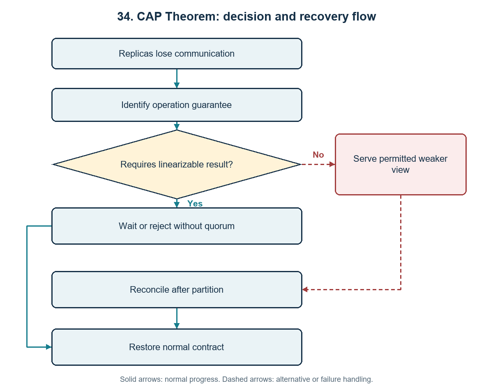

*Figure 34. 34. CAP Theorem: decision and recovery flow.* Start at "Replicas lose communication" and move to "Identify operation guarantee". At "Requires linearizable result?", the Yes branch goes to "Wait or reject without quorum" and the No branch goes to "Serve permitted weaker view". Follow the arrows to the terminal or recovery outcome; a dashed branch is not an implicit success. Source: [editable Mermaid](diagrams/topic-034.mmd).


#### 6. Step-by-step example

1. Region A accepts setting stock to zero while B is isolated.

2. B cannot both answer every read immediately and guarantee it returns the latest globally ordered value.

3. For checkout, refuse unsafe reservations; for catalog descriptions, accept a stale read if the product contract allows it.

#### 7. Implementation

For this topic, the worked scenario and the exercise below are the direct practical implementation of the reasoning. A standalone toy implementation would hide important platform or protocol guarantees. Use the relevant official implementation or managed runtime for real deployment, and validate its actual contract.

The associated [examples/algorithms.py](examples/algorithms.py) illustrates a related local boundary, not a full implementation of cap theorem. [The lab guide](examples/README.md) distinguishes executable simulations, configurations, and design exercises.

#### 8. Production use cases

It is not a permanent menu where every database simply picks two letters. Region A accepts setting stock to zero while B is isolated.

#### 9. Advantages and disadvantages

CAP consistency means linearizability, not every possible meaning of consistency or ACID's C. CAP availability is a formal response property, not a monthly uptime percentage. Outside partitions, latency and consistency trade-offs still matter but are not the same theorem.

#### 10. Common mistakes and debugging

Saying a system is CA because partitions are rare ignores the failure case. Saying eventual consistency means random corruption is also wrong; convergence needs explicit replication and conflict-resolution behavior.

#### 11. Comparison with related concepts

| Decision | Engineering interpretation |
|---|---|
| What this topic contributes | CAP explains a limit during a network partition: a distributed service cannot guarantee both linearizable behavior and a response for every request to a nonfailed node under the theorem's assumptions. |
| Nearest alternatives and limits | CAP consistency means linearizability, not every possible meaning of consistency or ACID's C. CAP availability is a formal response property, not a monthly uptime percentage. Outside partitions, latency and consistency trade-offs still matter but are not the same theorem. |
| Combined design | Read [33. Leader Election](#topic-033) and [35. Eventual Consistency](#topic-035); identify which layer owns each invariant rather than assuming their guarantees are interchangeable. |

#### 12. Interview preparation

**34.1 - Conceptual; Beginner. A teammate wants to add cap theorem everywhere. What concrete need should justify it?**

**Model answer:** CAP explains a limit during a network partition: a distributed service cannot guarantee both linearizable behavior and a response for every request to a nonfailed node under the theorem's assumptions. It is not a permanent menu where every database simply picks two letters. CAP consistency means linearizability, not every possible meaning of consistency or ACID's C.

**34.2 - Conceptual; Intermediate. What must be represented or coordinated for cap theorem to work correctly?**

**Model answer:** Model a register with reads and writes. Partition communication between replicas. A write accepted on one side cannot be communicated to the other. The other side must either delay/reject a read that requires the new value or answer without guaranteeing linearizability. Specify which operations remain available and what consistency model they actually provide.

**34.3 - Conceptual; Beginner. Explain the analogy, then identify where it stops being a trustworthy model.**

**Model answer:** Two bank branches lose their communication link. If both promise an immediately current shared balance, neither can safely invent what the other accepted. They must restrict some operations or permit observations that do not behave like one instantaneously shared register. The implementation must still follow the explicit state and failure rules described in the mechanism; an analogy cannot establish a delivery, timing, or security guarantee.

**34.4 - Conceptual; Intermediate. Which nearby alternative would you compare with cap theorem, and what changes the choice?**

**Model answer:** CAP consistency means linearizability, not every possible meaning of consistency or ACID's C. CAP availability is a formal response property, not a monthly uptime percentage. Outside partitions, latency and consistency trade-offs still matter but are not the same theorem.

**34.5 - Conceptual; Intermediate. How can an apparently functioning implementation still violate the intended contract?**

**Model answer:** Saying a system is CA because partitions are rare ignores the failure case. Saying eventual consistency means random corruption is also wrong; convergence needs explicit replication and conflict-resolution behavior.

**34.6 - Scenario; Intermediate. Walk through the worked ShopStream example. What evidence establishes the outcome, and what remains an assumption?**

**Model answer:** Region A accepts setting stock to zero while B is isolated. B cannot both answer every read immediately and guarantee it returns the latest globally ordered value. For checkout, refuse unsafe reservations; for catalog descriptions, accept a stale read if the product contract allows it. Verify the stated state transition or measurement at the responsible boundary. The numerical values, when present, are assumptions or deterministic examples rather than vendor performance guarantees.

**34.7 - Scenario; Advanced. You must validate this behavior before rollout. What experiment would expose a false correctness claim?**

**Model answer:** Draw a two-region partition and place one write on A. List possible B responses and which guarantee each gives up. Design separate browsing and purchase contracts with clear user-visible degraded behavior. Record the starting state, injected condition, observed result, and invariant. A successful startup alone does not demonstrate the behavior under test.

**34.8 - Scenario; Advanced. A change involving cap theorem produces a customer-visible regression. How would you investigate and choose a safe response?**

**Model answer:** Saying a system is CA because partitions are rare ignores the failure case. Saying eventual consistency means random corruption is also wrong; convergence needs explicit replication and conflict-resolution behavior. Many systems make different choices per operation. A shopping site can serve cached descriptions while blocking checkout for an uncertain inventory owner. Explain the partition, read/write contract, and failure response before applying labels such as CP or AP.

**34.9 - Advanced follow-up; Expert. Which hidden assumptions become important under failure, scale, or a changed workload?**

**Model answer:** Many systems make different choices per operation. A shopping site can serve cached descriptions while blocking checkout for an uncertain inventory owner. Explain the partition, read/write contract, and failure response before applying labels such as CP or AP.

**34.10 - Advanced follow-up; Expert. How does this design interact with leader election and eventual consistency?**

**Model answer:** Model a register with reads and writes. In a quorum-based consensus protocol, nodes use election timeouts, increasing terms, durable votes, and log freshness checks. Propagate changes through logs or events, identify entities and versions, apply a defined merge rule, and repair missed updates. Specify which component owns each decision and trace a failure across the combined boundary. Do not infer one component's guarantee from another component's name.

**Common incorrect answer:** "Adding the component makes the guarantee automatic." This is wrong because the mechanism depends on specific state, boundaries, and failure assumptions. Saying a system is CA because partitions are rare ignores the failure case.

**A deeper interviewer probe:** Change the timing, workload, or failure condition described in the advanced answer. Ask which invariant still holds, what observation would disprove it, and whether the fallback changes the user contract. Many systems make different choices per operation.

#### 13. Exercises and solution walkthroughs

**Beginner exercise:** Reproduce the worked example for cap theorem on paper. Record the initial state, each transition, and the result before reading the walkthrough.

**Beginner solution:** Region A accepts setting stock to zero while B is isolated. B cannot both answer every read immediately and guarantee it returns the latest globally ordered value. For checkout, refuse unsafe reservations; for catalog descriptions, accept a stale read if the product contract allows it.

**Intermediate exercise:** Draw a two-region partition and place one write on A. Write the observable assertion and identify which component owns it.

**Intermediate solution:** Draw a two-region partition and place one write on A. List possible B responses and which guarantee each gives up. Design separate browsing and purchase contracts with clear user-visible degraded behavior. Use the provided lab where applicable; for platform behavior, record the runtime version and actual evidence instead of treating a diagram as a test.

**Advanced exercise:** Extend the example to a failure or scale condition described below. State the guarantee you retain, the one you relax if necessary, and a safe recovery procedure.

**Advanced solution:** Many systems make different choices per operation. A shopping site can serve cached descriptions while blocking checkout for an uncertain inventory owner. Explain the partition, read/write contract, and failure response before applying labels such as CP or AP. Saying a system is CA because partitions are rare ignores the failure case. A complete solution identifies a detection signal, a bounded action, and a verification of the business outcome.

#### 14. Key takeaways

- CAP explains a limit during a network partition: a distributed service cannot guarantee both linearizable behavior and a response for every request to a nonfailed node under the theorem's assumptions.

- Model a register with reads and writes.

- CAP consistency means linearizability, not every possible meaning of consistency or ACID's C.

- Saying a system is CA because partitions are rare ignores the failure case.

- Many systems make different choices per operation.


**When to use it:** It is not a permanent menu where every database simply picks two letters.

**Terminology:** See this topic's glossary entry and the linked related terms. **Continue with:** [33. Leader Election](#topic-033), [35. Eventual Consistency](#topic-035), [86. Multi-Region Deployment](#topic-086), [95. Network Partitions](#topic-095).
<a id="topic-035"></a>

### 35. Eventual Consistency

Prerequisites and related reading: [16. Pub/Sub](#topic-016), [29. Read Replicas](#topic-029), [32. Replication](#topic-032), [96. Clock Skew](#topic-096).

#### 1. Simple explanation

Eventual consistency allows replicas to differ temporarily but requires convergence under appropriate delivery and update assumptions.

#### 2. The problem it solves

ShopStream's search index may show a product update after a delay. The acceptable delay and behavior during it are product requirements, not implementation trivia.

#### 3. Intuitive analogy

Classmates share corrected lecture notes over time. If all corrections arrive and conflicts have a common rule, their notes converge. Merely exchanging pages does not ensure agreement when edits conflict.

#### 4. Technical working mechanism

1. Propagate changes through logs or events, identify entities and versions, apply a defined merge rule, and repair missed updates.

2. Provide idempotent processing and ordered application where required.

3. Define read-your-writes or monotonic-read guarantees separately; eventual convergence alone supplies neither.

4. Monitor lag and convergence failures.


**Boundary and advanced reasoning.** CRDTs converge by carefully designed merge algebra under stated assumptions, not by making all business operations commutative. Deletions need tombstones or comparable metadata until old copies cannot resurrect data. Retention and repair policy are part of correctness.

#### 5. Architecture and diagrams


*Figure 35. 35. Eventual Consistency: decision and recovery flow.* Start at "Change committed" and move to "Propagate versioned update". At "Update newer or mergeable?", the Yes branch goes to "Apply deterministic merge" and the No branch goes to "Ignore stale or quarantine conflict". Follow the arrows to the terminal or recovery outcome; a dashed branch is not an implicit success. Source: [editable Mermaid](diagrams/topic-035.mmd).


#### 6. Step-by-step example

1. Product price version 8 reaches search after version 9 because one delivery was delayed.

2. Applying every arrival blindly reverts the index.

3. Compare entity versions and discard version 8, or rebuild the projection from the authoritative row.

#### 7. Implementation

The complete runnable module is [examples/algorithms.py](examples/algorithms.py); run `python algorithms.py` from the examples directory. The following excerpt isolates `apply_newer`. Required imports, surrounding definitions, expected output, and limitations are in the complete module and [lab guide](examples/README.md).

```python
def apply_newer(projection, entity, version, value):
    old = projection.get(entity)
    if old is None or version > old[0]:
        projection[entity] = (version, value)
        return True
    return False
```

Read the state changes in this excerpt alongside the mechanism above. The lab is a model of its stated boundary; it does not establish the behavior of a distributed deployment or an external provider. Check the assertions in [test_examples.py](examples/test_examples.py) and compare your output with [recorded outputs](examples/actual_outputs/).

#### 8. Production use cases

ShopStream's search index may show a product update after a delay. The acceptable delay and behavior during it are product requirements, not implementation trivia. Product price version 8 reaches search after version 9 because one delivery was delayed.

#### 9. Advantages and disadvantages

Stronger consistency simplifies some reasoning but may add coordination latency or reduce availability under partition. Eventual consistency suits projections and tolerant reads. Inventory deductions and financial invariants require stronger protection or carefully designed reservations and reconciliation.

#### 10. Common mistakes and debugging

Last-write-wins based on unsynchronized wall clocks can lose a valid update. No specified conflict rule means no justified convergence claim. A queue that is permanently growing violates practical freshness even if eventual delivery is theoretically possible.

#### 11. Comparison with related concepts

| Decision | Engineering interpretation |
|---|---|
| What this topic contributes | Eventual consistency allows replicas to differ temporarily but requires convergence under appropriate delivery and update assumptions. |
| Nearest alternatives and limits | Stronger consistency simplifies some reasoning but may add coordination latency or reduce availability under partition. Eventual consistency suits projections and tolerant reads. Inventory deductions and financial invariants require stronger protection or carefully designed reservations and reconciliation. |
| Combined design | Read [16. Pub/Sub](#topic-016) and [29. Read Replicas](#topic-029); identify which layer owns each invariant rather than assuming their guarantees are interchangeable. |

#### 12. Interview preparation

**35.1 - Conceptual; Beginner. A teammate wants to add eventual consistency everywhere. What concrete need should justify it?**

**Model answer:** Eventual consistency allows replicas to differ temporarily but requires convergence under appropriate delivery and update assumptions. ShopStream's search index may show a product update after a delay. The acceptable delay and behavior during it are product requirements, not implementation trivia. Stronger consistency simplifies some reasoning but may add coordination latency or reduce availability under partition.

**35.2 - Conceptual; Intermediate. What must be represented or coordinated for eventual consistency to work correctly?**

**Model answer:** Propagate changes through logs or events, identify entities and versions, apply a defined merge rule, and repair missed updates. Provide idempotent processing and ordered application where required. Define read-your-writes or monotonic-read guarantees separately; eventual convergence alone supplies neither. Monitor lag and convergence failures.

**35.3 - Conceptual; Beginner. Explain the analogy, then identify where it stops being a trustworthy model.**

**Model answer:** Classmates share corrected lecture notes over time. If all corrections arrive and conflicts have a common rule, their notes converge. Merely exchanging pages does not ensure agreement when edits conflict. The implementation must still follow the explicit state and failure rules described in the mechanism; an analogy cannot establish a delivery, timing, or security guarantee.

**35.4 - Conceptual; Intermediate. Which nearby alternative would you compare with eventual consistency, and what changes the choice?**

**Model answer:** Stronger consistency simplifies some reasoning but may add coordination latency or reduce availability under partition. Eventual consistency suits projections and tolerant reads. Inventory deductions and financial invariants require stronger protection or carefully designed reservations and reconciliation.

**35.5 - Conceptual; Intermediate. How can an apparently functioning implementation still violate the intended contract?**

**Model answer:** Last-write-wins based on unsynchronized wall clocks can lose a valid update. No specified conflict rule means no justified convergence claim. A queue that is permanently growing violates practical freshness even if eventual delivery is theoretically possible.

**35.6 - Scenario; Intermediate. Walk through the worked ShopStream example. What evidence establishes the outcome, and what remains an assumption?**

**Model answer:** Product price version 8 reaches search after version 9 because one delivery was delayed. Applying every arrival blindly reverts the index. Compare entity versions and discard version 8, or rebuild the projection from the authoritative row. Verify the stated state transition or measurement at the responsible boundary. The numerical values, when present, are assumptions or deterministic examples rather than vendor performance guarantees.

**35.7 - Scenario; Advanced. You must validate this behavior before rollout. What experiment would expose a false correctness claim?**

**Model answer:** Deliver versions 1, 3, 2 and verify the projection ends at 3. Simulate a missed event and rebuild from a snapshot. Specify a maximum tolerated search lag and an alert based on event age rather than process health. Record the starting state, injected condition, observed result, and invariant. A successful startup alone does not demonstrate the behavior under test.

**35.8 - Scenario; Advanced. A change involving eventual consistency produces a customer-visible regression. How would you investigate and choose a safe response?**

**Model answer:** Last-write-wins based on unsynchronized wall clocks can lose a valid update. No specified conflict rule means no justified convergence claim. A queue that is permanently growing violates practical freshness even if eventual delivery is theoretically possible. CRDTs converge by carefully designed merge algebra under stated assumptions, not by making all business operations commutative. Deletions need tombstones or comparable metadata until old copies cannot resurrect data. Retention and repair policy are part of correctness.

**35.9 - Advanced follow-up; Expert. Which hidden assumptions become important under failure, scale, or a changed workload?**

**Model answer:** CRDTs converge by carefully designed merge algebra under stated assumptions, not by making all business operations commutative. Deletions need tombstones or comparable metadata until old copies cannot resurrect data. Retention and repair policy are part of correctness.

**35.10 - Advanced follow-up; Expert. How does this design interact with pub/sub and read replicas?**

**Model answer:** Propagate changes through logs or events, identify entities and versions, apply a defined merge rule, and repair missed updates. Publish an event to a topic, route it to subscriptions, retain it according to policy, and let each subscriber track its own progress. The primary writes a replication log. Specify which component owns each decision and trace a failure across the combined boundary. Do not infer one component's guarantee from another component's name.

**Common incorrect answer:** "Adding the component makes the guarantee automatic." This is wrong because the mechanism depends on specific state, boundaries, and failure assumptions. Last-write-wins based on unsynchronized wall clocks can lose a valid update.

**A deeper interviewer probe:** Change the timing, workload, or failure condition described in the advanced answer. Ask which invariant still holds, what observation would disprove it, and whether the fallback changes the user contract. CRDTs converge by carefully designed merge algebra under stated assumptions, not by making all business operations commutative.

#### 13. Exercises and solution walkthroughs

**Beginner exercise:** Reproduce the worked example for eventual consistency on paper. Record the initial state, each transition, and the result before reading the walkthrough.

**Beginner solution:** Product price version 8 reaches search after version 9 because one delivery was delayed. Applying every arrival blindly reverts the index. Compare entity versions and discard version 8, or rebuild the projection from the authoritative row.

**Intermediate exercise:** Deliver versions 1, 3, 2 and verify the projection ends at 3. Write the observable assertion and identify which component owns it.

**Intermediate solution:** Deliver versions 1, 3, 2 and verify the projection ends at 3. Simulate a missed event and rebuild from a snapshot. Specify a maximum tolerated search lag and an alert based on event age rather than process health. Use the provided lab where applicable; for platform behavior, record the runtime version and actual evidence instead of treating a diagram as a test.

**Advanced exercise:** Extend the example to a failure or scale condition described below. State the guarantee you retain, the one you relax if necessary, and a safe recovery procedure.

**Advanced solution:** CRDTs converge by carefully designed merge algebra under stated assumptions, not by making all business operations commutative. Deletions need tombstones or comparable metadata until old copies cannot resurrect data. Retention and repair policy are part of correctness. Last-write-wins based on unsynchronized wall clocks can lose a valid update. A complete solution identifies a detection signal, a bounded action, and a verification of the business outcome.

#### 14. Key takeaways

- Eventual consistency allows replicas to differ temporarily but requires convergence under appropriate delivery and update assumptions.

- Propagate changes through logs or events, identify entities and versions, apply a defined merge rule, and repair missed updates.

- Stronger consistency simplifies some reasoning but may add coordination latency or reduce availability under partition.

- Last-write-wins based on unsynchronized wall clocks can lose a valid update.

- CRDTs converge by carefully designed merge algebra under stated assumptions, not by making all business operations commutative.


**When to use it:** ShopStream's search index may show a product update after a delay. The acceptable delay and behavior during it are product requirements, not implementation trivia.

**Terminology:** See this topic's glossary entry and the linked related terms. **Continue with:** [16. Pub/Sub](#topic-016), [29. Read Replicas](#topic-029), [32. Replication](#topic-032), [96. Clock Skew](#topic-096).
<a id="topic-038"></a>

### 38. Distributed Locks

Prerequisites and related reading: [14. Idempotency](#topic-014), [33. Leader Election](#topic-033), [37. Pessimistic Locking](#topic-037), [96. Clock Skew](#topic-096).

#### 1. Simple explanation

A distributed lock coordinates exclusive work across processes or machines.

#### 2. The problem it solves

ShopStream might use one to prevent overlapping reconciliation runs. Network delays and process pauses make ownership uncertain, so a lease alone is not proof that old work has stopped.

#### 3. Intuitive analogy

A time-limited equipment rental expires, but the renter might still hold the equipment. A new renter needs a way to reject actions from the expired holder. Fencing tokens provide that additional control.

#### 4. Technical working mechanism

1. Acquire ownership atomically with a unique owner ID and expiry.

2. Renew before expiry under a bounded policy.

3. Release only if the stored owner still matches.

4. Issue a monotonically increasing fencing token and require the protected resource to reject older tokens.

5. Use monotonic elapsed time locally and understand the lock service's consistency guarantees.


**Boundary and advanced reasoning.** Some external APIs cannot enforce fencing. Then design idempotent effects, durable operation IDs, and reconciliation rather than claiming perfect mutual exclusion. Lock availability during a partition must be chosen consistently with the safety requirements of the resource.

#### 5. Architecture and diagrams

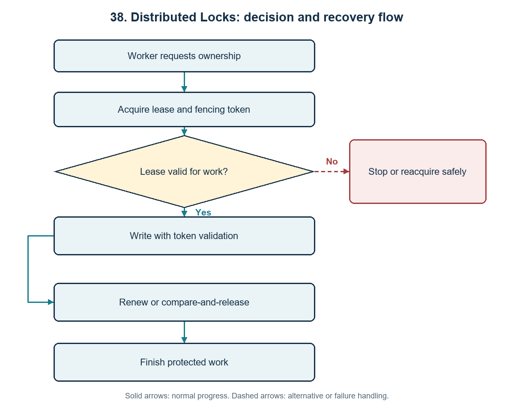

*Figure 38. 38. Distributed Locks: decision and recovery flow.* Start at "Worker requests ownership" and move to "Acquire lease and fencing token". At "Lease valid for work?", the Yes branch goes to "Write with token validation" and the No branch goes to "Stop or reacquire safely". Follow the arrows to the terminal or recovery outcome; a dashed branch is not an implicit success. Source: [editable Mermaid](diagrams/topic-038.mmd).


#### 6. Step-by-step example

1. Worker A holds token 8 and pauses.

2. Its lease expires; B acquires token 9 and writes.

3. A resumes with token 8.

4. The storage layer rejects A's write because 8 is older than the last accepted token, preventing stale-owner damage.

#### 7. Implementation

The complete runnable module is [examples/concurrency.py](examples/concurrency.py); run `python concurrency.py` from the examples directory. The following excerpt isolates `FencedLedger`. Required imports, surrounding definitions, expected output, and limitations are in the complete module and [lab guide](examples/README.md).

```python
class FencedLedger:
    """Resource-side enforcement model; token issuance must be safe elsewhere."""
    def __init__(self):
        self.last_token, self.value = -1, None

    def write(self, token, value):
        if token < self.last_token:
            raise ValueError("stale fencing token")
        self.last_token, self.value = token, value
```

Read the state changes in this excerpt alongside the mechanism above. The lab is a model of its stated boundary; it does not establish the behavior of a distributed deployment or an external provider. Check the assertions in [test_examples.py](examples/test_examples.py) and compare your output with [recorded outputs](examples/actual_outputs/).

#### 8. Production use cases

ShopStream might use one to prevent overlapping reconciliation runs. Network delays and process pauses make ownership uncertain, so a lease alone is not proof that old work has stopped. Worker A holds token 8 and pauses.

#### 9. Advantages and disadvantages

A database transaction or unique constraint often protects an invariant more directly. Distributed locks help coordinate external work but add a dependency and subtle failure modes. Fencing is effective only if the actual protected resource enforces it.

#### 10. Common mistakes and debugging

Unconditionally deleting a lock can remove another worker's renewed ownership. Assuming a lease expiry kills the old process is unsafe. Clock drift and long garbage-collection pauses invalidate casual timing assumptions.

#### 11. Comparison with related concepts

| Decision | Engineering interpretation |
|---|---|
| What this topic contributes | A distributed lock coordinates exclusive work across processes or machines. |
| Nearest alternatives and limits | A database transaction or unique constraint often protects an invariant more directly. Distributed locks help coordinate external work but add a dependency and subtle failure modes. Fencing is effective only if the actual protected resource enforces it. |
| Combined design | Read [14. Idempotency](#topic-014) and [33. Leader Election](#topic-033); identify which layer owns each invariant rather than assuming their guarantees are interchangeable. |

#### 12. Interview preparation

**38.1 - Conceptual; Beginner. A teammate wants to add distributed locks everywhere. What concrete need should justify it?**

**Model answer:** A distributed lock coordinates exclusive work across processes or machines. ShopStream might use one to prevent overlapping reconciliation runs. Network delays and process pauses make ownership uncertain, so a lease alone is not proof that old work has stopped. A database transaction or unique constraint often protects an invariant more directly.

**38.2 - Conceptual; Intermediate. What must be represented or coordinated for distributed locks to work correctly?**

**Model answer:** Acquire ownership atomically with a unique owner ID and expiry. Renew before expiry under a bounded policy. Release only if the stored owner still matches. Issue a monotonically increasing fencing token and require the protected resource to reject older tokens. Use monotonic elapsed time locally and understand the lock service's consistency guarantees.

**38.3 - Conceptual; Beginner. Explain the analogy, then identify where it stops being a trustworthy model.**

**Model answer:** A time-limited equipment rental expires, but the renter might still hold the equipment. A new renter needs a way to reject actions from the expired holder. Fencing tokens provide that additional control. The implementation must still follow the explicit state and failure rules described in the mechanism; an analogy cannot establish a delivery, timing, or security guarantee.

**38.4 - Conceptual; Intermediate. Which nearby alternative would you compare with distributed locks, and what changes the choice?**

**Model answer:** A database transaction or unique constraint often protects an invariant more directly. Distributed locks help coordinate external work but add a dependency and subtle failure modes. Fencing is effective only if the actual protected resource enforces it.

**38.5 - Conceptual; Intermediate. How can an apparently functioning implementation still violate the intended contract?**

**Model answer:** Unconditionally deleting a lock can remove another worker's renewed ownership. Assuming a lease expiry kills the old process is unsafe. Clock drift and long garbage-collection pauses invalidate casual timing assumptions.

**38.6 - Scenario; Intermediate. Walk through the worked ShopStream example. What evidence establishes the outcome, and what remains an assumption?**

**Model answer:** Worker A holds token 8 and pauses. Its lease expires; B acquires token 9 and writes. A resumes with token 8. The storage layer rejects A's write because 8 is older than the last accepted token, preventing stale-owner damage. Verify the stated state transition or measurement at the responsible boundary. The numerical values, when present, are assumptions or deterministic examples rather than vendor performance guarantees.

**38.7 - Scenario; Advanced. You must validate this behavior before rollout. What experiment would expose a false correctness claim?**

**Model answer:** Simulate A pausing past lease expiry and B taking over. Reject A's stale token in a ledger. Explain why a lock around an email send cannot guarantee one email if the provider neither deduplicates nor honors fencing. Record the starting state, injected condition, observed result, and invariant. A successful startup alone does not demonstrate the behavior under test.

**38.8 - Scenario; Advanced. A change involving distributed locks produces a customer-visible regression. How would you investigate and choose a safe response?**

**Model answer:** Unconditionally deleting a lock can remove another worker's renewed ownership. Assuming a lease expiry kills the old process is unsafe. Clock drift and long garbage-collection pauses invalidate casual timing assumptions. Some external APIs cannot enforce fencing. Then design idempotent effects, durable operation IDs, and reconciliation rather than claiming perfect mutual exclusion. Lock availability during a partition must be chosen consistently with the safety requirements of the resource.

**38.9 - Advanced follow-up; Expert. Which hidden assumptions become important under failure, scale, or a changed workload?**

**Model answer:** Some external APIs cannot enforce fencing. Then design idempotent effects, durable operation IDs, and reconciliation rather than claiming perfect mutual exclusion. Lock availability during a partition must be chosen consistently with the safety requirements of the resource.

**38.10 - Advanced follow-up; Expert. How does this design interact with idempotency and leader election?**

**Model answer:** Acquire ownership atomically with a unique owner ID and expiry. Accept a client-generated operation key scoped to tenant and endpoint. In a quorum-based consensus protocol, nodes use election timeouts, increasing terms, durable votes, and log freshness checks. Specify which component owns each decision and trace a failure across the combined boundary. Do not infer one component's guarantee from another component's name.

**Common incorrect answer:** "Adding the component makes the guarantee automatic." This is wrong because the mechanism depends on specific state, boundaries, and failure assumptions. Unconditionally deleting a lock can remove another worker's renewed ownership.

**A deeper interviewer probe:** Change the timing, workload, or failure condition described in the advanced answer. Ask which invariant still holds, what observation would disprove it, and whether the fallback changes the user contract. Some external APIs cannot enforce fencing.

#### 13. Exercises and solution walkthroughs

**Beginner exercise:** Reproduce the worked example for distributed locks on paper. Record the initial state, each transition, and the result before reading the walkthrough.

**Beginner solution:** Worker A holds token 8 and pauses. Its lease expires; B acquires token 9 and writes. A resumes with token 8. The storage layer rejects A's write because 8 is older than the last accepted token, preventing stale-owner damage.

**Intermediate exercise:** Simulate A pausing past lease expiry and B taking over. Write the observable assertion and identify which component owns it.

**Intermediate solution:** Simulate A pausing past lease expiry and B taking over. Reject A's stale token in a ledger. Explain why a lock around an email send cannot guarantee one email if the provider neither deduplicates nor honors fencing. Use the provided lab where applicable; for platform behavior, record the runtime version and actual evidence instead of treating a diagram as a test.

**Advanced exercise:** Extend the example to a failure or scale condition described below. State the guarantee you retain, the one you relax if necessary, and a safe recovery procedure.

**Advanced solution:** Some external APIs cannot enforce fencing. Then design idempotent effects, durable operation IDs, and reconciliation rather than claiming perfect mutual exclusion. Lock availability during a partition must be chosen consistently with the safety requirements of the resource. Unconditionally deleting a lock can remove another worker's renewed ownership. A complete solution identifies a detection signal, a bounded action, and a verification of the business outcome.

#### 14. Key takeaways

- A distributed lock coordinates exclusive work across processes or machines.

- Acquire ownership atomically with a unique owner ID and expiry.

- A database transaction or unique constraint often protects an invariant more directly.

- Unconditionally deleting a lock can remove another worker's renewed ownership.

- Some external APIs cannot enforce fencing.


**When to use it:** ShopStream might use one to prevent overlapping reconciliation runs. Network delays and process pauses make ownership uncertain, so a lease alone is not proof that old work has stopped.

**Terminology:** See this topic's glossary entry and the linked related terms. **Continue with:** [14. Idempotency](#topic-014), [33. Leader Election](#topic-033), [37. Pessimistic Locking](#topic-037), [96. Clock Skew](#topic-096).
<a id="topic-095"></a>

### 95. Network Partitions

Prerequisites and related reading: [33. Leader Election](#topic-033), [34. CAP Theorem](#topic-034), [38. Distributed Locks](#topic-038), [85. Failover](#topic-085), [96. Clock Skew](#topic-096).

#### 1. Simple explanation

A network partition prevents some components from communicating while others remain reachable.

#### 2. The problem it solves

ShopStream's two database nodes can both be alive yet unable to exchange updates. Failures are partial and observer-dependent, which makes automatic recovery difficult.

#### 3. Intuitive analogy

A bridge closes between two functioning towns. Each town's shops remain open, but neither can know immediately what the other sold. Being locally healthy does not imply globally coordinated service.

#### 4. Technical working mechanism

1. Detect missing communication using timeouts while recognizing uncertainty.

2. Define which side retains authority through quorum or ownership rules.

3. Fence stale writers, preserve logs, and serve only operations allowed by the consistency contract.

4. After communication returns, reconcile state and replay safely rather than merging blindly.


**Boundary and advanced reasoning.** Asymmetric partitions allow A to reach B while replies or reverse calls fail. Test direction, protocol, DNS, TLS, and firewall behavior separately. Restoration can cause a replay storm, so bound catch-up and protect live traffic.

#### 5. Architecture and diagrams


*Figure 95. 95. Network Partitions: decision and recovery flow.* Start at "Communication fails" and move to "Determine affected paths and authority". At "Operation safe with available quorum?", the Yes branch goes to "Continue permitted work" and the No branch goes to "Reject or defer unsafe operation". Follow the arrows to the terminal or recovery outcome; a dashed branch is not an implicit success. Source: [editable Mermaid](diagrams/topic-095.mmd).


#### 6. Step-by-step example

1. Orders in region A can reach payment but not inventory.

2. Payment and inventory both report local health.

3. Checkout still fails because the required path is broken.

4. Traces and synthetic cross-component tests reveal the partition that local probes miss.

#### 7. Implementation

For this topic, the worked scenario and the exercise below are the direct practical implementation of the reasoning. A standalone toy implementation would hide important platform or protocol guarantees. Use the relevant official implementation or managed runtime for real deployment, and validate its actual contract.

The associated [examples/algorithms.py](examples/algorithms.py) illustrates a related local boundary, not a full implementation of network partitions. [The lab guide](examples/README.md) distinguishes executable simulations, configurations, and design exercises.

#### 8. Production use cases

ShopStream's two database nodes can both be alive yet unable to exchange updates. Failures are partial and observer-dependent, which makes automatic recovery difficult. Orders in region A can reach payment but not inventory.

#### 9. Advantages and disadvantages

A partition differs from a process crash, packet loss, or high latency, although observations can look similar. CAP applies to the impossibility of particular combined guarantees under partitions. Retrying does not restore a severed network and can amplify pressure.

#### 10. Common mistakes and debugging

Promoting every isolated replica creates split brain. Treating all timeouts as definitive death causes unsafe ownership changes. Failure detectors need safe actions under false suspicion, not merely aggressive thresholds.

#### 11. Comparison with related concepts

| Decision | Engineering interpretation |
|---|---|
| What this topic contributes | A network partition prevents some components from communicating while others remain reachable. |
| Nearest alternatives and limits | A partition differs from a process crash, packet loss, or high latency, although observations can look similar. CAP applies to the impossibility of particular combined guarantees under partitions. Retrying does not restore a severed network and can amplify pressure. |
| Combined design | Read [33. Leader Election](#topic-033) and [34. CAP Theorem](#topic-034); identify which layer owns each invariant rather than assuming their guarantees are interchangeable. |

#### 12. Interview preparation

**95.1 - Conceptual; Beginner. A teammate wants to add network partitions everywhere. What concrete need should justify it?**

**Model answer:** A network partition prevents some components from communicating while others remain reachable. ShopStream's two database nodes can both be alive yet unable to exchange updates. Failures are partial and observer-dependent, which makes automatic recovery difficult. A partition differs from a process crash, packet loss, or high latency, although observations can look similar.

**95.2 - Conceptual; Intermediate. What must be represented or coordinated for network partitions to work correctly?**

**Model answer:** Detect missing communication using timeouts while recognizing uncertainty. Define which side retains authority through quorum or ownership rules. Fence stale writers, preserve logs, and serve only operations allowed by the consistency contract. After communication returns, reconcile state and replay safely rather than merging blindly.

**95.3 - Conceptual; Beginner. Explain the analogy, then identify where it stops being a trustworthy model.**

**Model answer:** A bridge closes between two functioning towns. Each town's shops remain open, but neither can know immediately what the other sold. Being locally healthy does not imply globally coordinated service. The implementation must still follow the explicit state and failure rules described in the mechanism; an analogy cannot establish a delivery, timing, or security guarantee.

**95.4 - Conceptual; Intermediate. Which nearby alternative would you compare with network partitions, and what changes the choice?**

**Model answer:** A partition differs from a process crash, packet loss, or high latency, although observations can look similar. CAP applies to the impossibility of particular combined guarantees under partitions. Retrying does not restore a severed network and can amplify pressure.

**95.5 - Conceptual; Intermediate. How can an apparently functioning implementation still violate the intended contract?**

**Model answer:** Promoting every isolated replica creates split brain. Treating all timeouts as definitive death causes unsafe ownership changes. Failure detectors need safe actions under false suspicion, not merely aggressive thresholds.

**95.6 - Scenario; Intermediate. Walk through the worked ShopStream example. What evidence establishes the outcome, and what remains an assumption?**

**Model answer:** Orders in region A can reach payment but not inventory. Payment and inventory both report local health. Checkout still fails because the required path is broken. Traces and synthetic cross-component tests reveal the partition that local probes miss. Verify the stated state transition or measurement at the responsible boundary. The numerical values, when present, are assumptions or deterministic examples rather than vendor performance guarantees.

**95.7 - Scenario; Advanced. You must validate this behavior before rollout. What experiment would expose a false correctness claim?**

**Model answer:** Draw a partial connectivity matrix for three services. Mark which user journeys fail despite healthy processes. Plan recovery that fences authority, replays idempotently, and throttles accumulated work after the link returns. Record the starting state, injected condition, observed result, and invariant. A successful startup alone does not demonstrate the behavior under test.

**95.8 - Scenario; Advanced. A change involving network partitions produces a customer-visible regression. How would you investigate and choose a safe response?**

**Model answer:** Promoting every isolated replica creates split brain. Treating all timeouts as definitive death causes unsafe ownership changes. Failure detectors need safe actions under false suspicion, not merely aggressive thresholds. Asymmetric partitions allow A to reach B while replies or reverse calls fail. Test direction, protocol, DNS, TLS, and firewall behavior separately. Restoration can cause a replay storm, so bound catch-up and protect live traffic.

**95.9 - Advanced follow-up; Expert. Which hidden assumptions become important under failure, scale, or a changed workload?**

**Model answer:** Asymmetric partitions allow A to reach B while replies or reverse calls fail. Test direction, protocol, DNS, TLS, and firewall behavior separately. Restoration can cause a replay storm, so bound catch-up and protect live traffic.

**95.10 - Advanced follow-up; Expert. How does this design interact with leader election and cap theorem?**

**Model answer:** Detect missing communication using timeouts while recognizing uncertainty. In a quorum-based consensus protocol, nodes use election timeouts, increasing terms, durable votes, and log freshness checks. Model a register with reads and writes. Specify which component owns each decision and trace a failure across the combined boundary. Do not infer one component's guarantee from another component's name.

**Common incorrect answer:** "Adding the component makes the guarantee automatic." This is wrong because the mechanism depends on specific state, boundaries, and failure assumptions. Promoting every isolated replica creates split brain.

**A deeper interviewer probe:** Change the timing, workload, or failure condition described in the advanced answer. Ask which invariant still holds, what observation would disprove it, and whether the fallback changes the user contract. Asymmetric partitions allow A to reach B while replies or reverse calls fail.

#### 13. Exercises and solution walkthroughs

**Beginner exercise:** Reproduce the worked example for network partitions on paper. Record the initial state, each transition, and the result before reading the walkthrough.

**Beginner solution:** Orders in region A can reach payment but not inventory. Payment and inventory both report local health. Checkout still fails because the required path is broken. Traces and synthetic cross-component tests reveal the partition that local probes miss.

**Intermediate exercise:** Draw a partial connectivity matrix for three services. Write the observable assertion and identify which component owns it.

**Intermediate solution:** Draw a partial connectivity matrix for three services. Mark which user journeys fail despite healthy processes. Plan recovery that fences authority, replays idempotently, and throttles accumulated work after the link returns. Use the provided lab where applicable; for platform behavior, record the runtime version and actual evidence instead of treating a diagram as a test.

**Advanced exercise:** Extend the example to a failure or scale condition described below. State the guarantee you retain, the one you relax if necessary, and a safe recovery procedure.

**Advanced solution:** Asymmetric partitions allow A to reach B while replies or reverse calls fail. Test direction, protocol, DNS, TLS, and firewall behavior separately. Restoration can cause a replay storm, so bound catch-up and protect live traffic. Promoting every isolated replica creates split brain. A complete solution identifies a detection signal, a bounded action, and a verification of the business outcome.

#### 14. Key takeaways

- A network partition prevents some components from communicating while others remain reachable.

- Detect missing communication using timeouts while recognizing uncertainty.

- A partition differs from a process crash, packet loss, or high latency, although observations can look similar.

- Promoting every isolated replica creates split brain.

- Asymmetric partitions allow A to reach B while replies or reverse calls fail.


**When to use it:** ShopStream's two database nodes can both be alive yet unable to exchange updates. Failures are partial and observer-dependent, which makes automatic recovery difficult.

**Terminology:** See this topic's glossary entry and the linked related terms. **Continue with:** [33. Leader Election](#topic-033), [34. CAP Theorem](#topic-034), [38. Distributed Locks](#topic-038), [85. Failover](#topic-085), [96. Clock Skew](#topic-096).
<a id="topic-096"></a>

### 96. Clock Skew

Prerequisites and related reading: [11. Timeouts](#topic-011), [33. Leader Election](#topic-033), [38. Distributed Locks](#topic-038), [70. JWT Rotation](#topic-070).

#### 1. Simple explanation

Clock skew is disagreement between clocks.

#### 2. The problem it solves

ShopStream cannot assume timestamps from different machines establish a perfect event order. Clock adjustments and drift can also break expiry or duration logic if the wrong clock is used.

#### 3. Intuitive analogy

Two wall clocks show different times, so comparing their diary entries can reverse apparent order. A stopwatch measures one local duration more reliably, but it cannot directly compare events in different buildings.

#### 4. Technical working mechanism

1. Use wall time for human timestamps and monotonic clocks for local elapsed time.

2. Synchronize machines and monitor offset, while allowing for imperfect bounds.

3. Use sequence numbers, causal metadata, or logical clocks when ordering requires more than approximate time.

4. Token validation may allow small explicit skew, not unlimited grace.


**Boundary and advanced reasoning.** If event A causally precedes B, logical timestamps can reflect that order; the reverse implication does not generally hold. For exact cross-system ordering, use an authoritative log or consensus-backed sequence where the requirements justify its cost.

#### 5. Architecture and diagrams

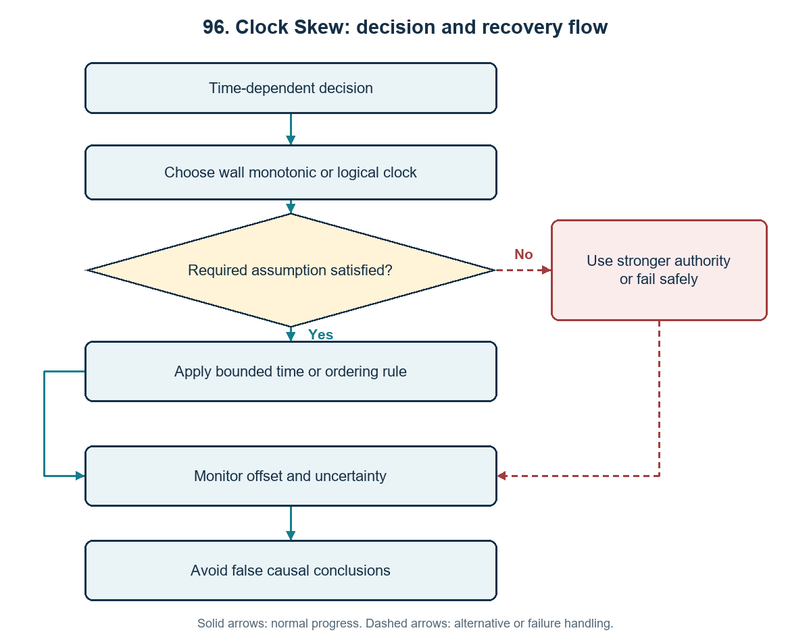

*Figure 96. 96. Clock Skew: decision and recovery flow.* Start at "Time-dependent decision" and move to "Choose wall monotonic or logical clock". At "Required assumption satisfied?", the Yes branch goes to "Apply bounded time or ordering rule" and the No branch goes to "Use stronger authority or fail safely". Follow the arrows to the terminal or recovery outcome; a dashed branch is not an implicit success. Source: [editable Mermaid](diagrams/topic-096.mmd).


*Figure 185. Clock labels can contradict causal order.* The receiving host clock is behind. Use causal links for ordering and monotonic local clocks for elapsed time. Source: [editable SVG](diagrams/ill-clock.svg).


#### 6. Step-by-step example

1. A token expires at 12:00, but one server's wall clock reads 12:03.

2. It rejects the token early.

3. A cache using a wall-clock difference can accidentally extend or shorten TTL after a clock step.

4. Monotonic elapsed time prevents that local-duration problem.

#### 7. Implementation

For this topic, the worked scenario and the exercise below are the direct practical implementation of the reasoning. A standalone toy implementation would hide important platform or protocol guarantees. Use the relevant official implementation or managed runtime for real deployment, and validate its actual contract.

The associated [examples/algorithms.py](examples/algorithms.py) illustrates a related local boundary, not a full implementation of clock skew. [The lab guide](examples/README.md) distinguishes executable simulations, configurations, and design exercises.

#### 8. Production use cases

ShopStream cannot assume timestamps from different machines establish a perfect event order. Clock adjustments and drift can also break expiry or duration logic if the wrong clock is used. A token expires at 12:00, but one server's wall clock reads 12:03.

#### 9. Advantages and disadvantages

NTP improves synchronization but does not create a perfect global clock. Lamport clocks preserve a causal ordering implication, not physical duration. Hybrid logical clocks combine physical estimates with logical ordering under a defined algorithm.

#### 10. Common mistakes and debugging

Last-write-wins based solely on wall time can discard a later causal update. Measuring latency by subtracting timestamps from different hosts adds skew error. A distributed lease needs explicit timing assumptions and fencing, not faith in synchronized clocks.

#### 11. Comparison with related concepts

| Decision | Engineering interpretation |
|---|---|
| What this topic contributes | Clock skew is disagreement between clocks. |
| Nearest alternatives and limits | NTP improves synchronization but does not create a perfect global clock. Lamport clocks preserve a causal ordering implication, not physical duration. Hybrid logical clocks combine physical estimates with logical ordering under a defined algorithm. |
| Combined design | Read [11. Timeouts](#topic-011) and [33. Leader Election](#topic-033); identify which layer owns each invariant rather than assuming their guarantees are interchangeable. |

#### 12. Interview preparation

**96.1 - Conceptual; Beginner. A teammate wants to add clock skew everywhere. What concrete need should justify it?**

**Model answer:** Clock skew is disagreement between clocks. ShopStream cannot assume timestamps from different machines establish a perfect event order. Clock adjustments and drift can also break expiry or duration logic if the wrong clock is used. NTP improves synchronization but does not create a perfect global clock.

**96.2 - Conceptual; Intermediate. What must be represented or coordinated for clock skew to work correctly?**

**Model answer:** Use wall time for human timestamps and monotonic clocks for local elapsed time. Synchronize machines and monitor offset, while allowing for imperfect bounds. Use sequence numbers, causal metadata, or logical clocks when ordering requires more than approximate time. Token validation may allow small explicit skew, not unlimited grace.

**96.3 - Conceptual; Beginner. Explain the analogy, then identify where it stops being a trustworthy model.**

**Model answer:** Two wall clocks show different times, so comparing their diary entries can reverse apparent order. A stopwatch measures one local duration more reliably, but it cannot directly compare events in different buildings. The implementation must still follow the explicit state and failure rules described in the mechanism; an analogy cannot establish a delivery, timing, or security guarantee.

**96.4 - Conceptual; Intermediate. Which nearby alternative would you compare with clock skew, and what changes the choice?**

**Model answer:** NTP improves synchronization but does not create a perfect global clock. Lamport clocks preserve a causal ordering implication, not physical duration. Hybrid logical clocks combine physical estimates with logical ordering under a defined algorithm.

**96.5 - Conceptual; Intermediate. How can an apparently functioning implementation still violate the intended contract?**

**Model answer:** Last-write-wins based solely on wall time can discard a later causal update. Measuring latency by subtracting timestamps from different hosts adds skew error. A distributed lease needs explicit timing assumptions and fencing, not faith in synchronized clocks.

**96.6 - Scenario; Intermediate. Walk through the worked ShopStream example. What evidence establishes the outcome, and what remains an assumption?**

**Model answer:** A token expires at 12:00, but one server's wall clock reads 12:03. It rejects the token early. A cache using a wall-clock difference can accidentally extend or shorten TTL after a clock step. Monotonic elapsed time prevents that local-duration problem. Verify the stated state transition or measurement at the responsible boundary. The numerical values, when present, are assumptions or deterministic examples rather than vendor performance guarantees.

**96.7 - Scenario; Advanced. You must validate this behavior before rollout. What experiment would expose a false correctness claim?**

**Model answer:** Simulate two machines with a three-minute offset and validate token behavior. Compare wall-time and monotonic TTL calculations under a clock step. Order events with a Lamport counter and explain which concurrent events remain arbitrarily ordered. Record the starting state, injected condition, observed result, and invariant. A successful startup alone does not demonstrate the behavior under test.

**96.8 - Scenario; Advanced. A change involving clock skew produces a customer-visible regression. How would you investigate and choose a safe response?**

**Model answer:** Last-write-wins based solely on wall time can discard a later causal update. Measuring latency by subtracting timestamps from different hosts adds skew error. A distributed lease needs explicit timing assumptions and fencing, not faith in synchronized clocks. If event A causally precedes B, logical timestamps can reflect that order; the reverse implication does not generally hold. For exact cross-system ordering, use an authoritative log or consensus-backed sequence where the requirements justify its cost.

**96.9 - Advanced follow-up; Expert. Which hidden assumptions become important under failure, scale, or a changed workload?**

**Model answer:** If event A causally precedes B, logical timestamps can reflect that order; the reverse implication does not generally hold. For exact cross-system ordering, use an authoritative log or consensus-backed sequence where the requirements justify its cost.

**96.10 - Advanced follow-up; Expert. How does this design interact with timeouts and leader election?**

**Model answer:** Use wall time for human timestamps and monotonic clocks for local elapsed time. Establish an end-to-end deadline using a monotonic clock. In a quorum-based consensus protocol, nodes use election timeouts, increasing terms, durable votes, and log freshness checks. Specify which component owns each decision and trace a failure across the combined boundary. Do not infer one component's guarantee from another component's name.

**Common incorrect answer:** "Adding the component makes the guarantee automatic." This is wrong because the mechanism depends on specific state, boundaries, and failure assumptions. Last-write-wins based solely on wall time can discard a later causal update.

**A deeper interviewer probe:** Change the timing, workload, or failure condition described in the advanced answer. Ask which invariant still holds, what observation would disprove it, and whether the fallback changes the user contract. If event A causally precedes B, logical timestamps can reflect that order; the reverse implication does not generally hold.

#### 13. Exercises and solution walkthroughs

**Beginner exercise:** Reproduce the worked example for clock skew on paper. Record the initial state, each transition, and the result before reading the walkthrough.

**Beginner solution:** A token expires at 12:00, but one server's wall clock reads 12:03. It rejects the token early. A cache using a wall-clock difference can accidentally extend or shorten TTL after a clock step. Monotonic elapsed time prevents that local-duration problem.

**Intermediate exercise:** Simulate two machines with a three-minute offset and validate token behavior. Write the observable assertion and identify which component owns it.

**Intermediate solution:** Simulate two machines with a three-minute offset and validate token behavior. Compare wall-time and monotonic TTL calculations under a clock step. Order events with a Lamport counter and explain which concurrent events remain arbitrarily ordered. Use the provided lab where applicable; for platform behavior, record the runtime version and actual evidence instead of treating a diagram as a test.

**Advanced exercise:** Extend the example to a failure or scale condition described below. State the guarantee you retain, the one you relax if necessary, and a safe recovery procedure.

**Advanced solution:** If event A causally precedes B, logical timestamps can reflect that order; the reverse implication does not generally hold. For exact cross-system ordering, use an authoritative log or consensus-backed sequence where the requirements justify its cost. Last-write-wins based solely on wall time can discard a later causal update. A complete solution identifies a detection signal, a bounded action, and a verification of the business outcome.

#### 14. Key takeaways

- Clock skew is disagreement between clocks.

- Use wall time for human timestamps and monotonic clocks for local elapsed time.

- NTP improves synchronization but does not create a perfect global clock.

- Last-write-wins based solely on wall time can discard a later causal update.

- If event A causally precedes B, logical timestamps can reflect that order; the reverse implication does not generally hold.


**When to use it:** ShopStream cannot assume timestamps from different machines establish a perfect event order. Clock adjustments and drift can also break expiry or duration logic if the wrong clock is used.

**Terminology:** See this topic's glossary entry and the linked related terms. **Continue with:** [11. Timeouts](#topic-011), [33. Leader Election](#topic-033), [38. Distributed Locks](#topic-038), [70. JWT Rotation](#topic-070).


## Part V. Concurrency, Runtime, and Performance

<a id="topic-039"></a>

### 39. Race Conditions

Prerequisites and related reading: [14. Idempotency](#topic-014), [36. Optimistic Locking](#topic-036), [37. Pessimistic Locking](#topic-037), [43. Thread Safety](#topic-043).

#### 1. Simple explanation

A race condition occurs when correctness depends on the timing of concurrent operations.

#### 2. The problem it solves

Two ShopStream requests can both read stock=1 and each sell the last unit. Every individual line can look reasonable while their interleaving violates the business rule.

#### 3. Intuitive analogy

Two people see the final empty parking space and both begin entering it. Checking availability separately from occupying the space leaves a dangerous gap. The combined operation needs coordination.

#### 4. Technical working mechanism

1. Identify shared mutable state and the invariant.

2. Enumerate read-modify-write steps and possible interleavings.

3. Protect the whole critical section with a suitable lock, atomic operation, database constraint, conditional update, or message ownership model.

4. A process-local lock cannot coordinate separate application replicas.


**Boundary and advanced reasoning.** Deterministic barriers can force the harmful interleaving in a test. Record operation IDs and versions to reconstruct incidents. Choose the narrowest correct coordination boundary, then measure contention and ensure retries preserve the intended invariant.

#### 5. Architecture and diagrams


*Figure 39. 39. Race Conditions: decision and recovery flow.* Start at "Concurrent requests arrive" and move to "Identify shared invariant". At "Operation protected atomically?", the Yes branch goes to "Apply coordinated update" and the No branch goes to "Expose harmful interleaving". Follow the arrows to the terminal or recovery outcome; a dashed branch is not an implicit success. Source: [editable Mermaid](diagrams/topic-039.mmd).


#### 6. Step-by-step example

1. A reads 1, B reads 1, A writes 0, B writes 0.

2. The final value looks valid but two sales occurred.

3. UPDATE inventory SET stock=stock-1 WHERE stock>0 RETURNING stock makes admission and decrement one guarded database operation.

#### 7. Implementation

The complete runnable module is [examples/concurrency.py](examples/concurrency.py); run `python concurrency.py` from the examples directory. The following excerpt isolates `lost_update_schedule`. Required imports, surrounding definitions, expected output, and limitations are in the complete module and [lab guide](examples/README.md).

```python
def lost_update_schedule():
    stock = 1
    read_a, read_b = stock, stock
    stock = read_a - 1
    stock = read_b - 1
    return {"sales": 2, "final_stock": stock}
```

Read the state changes in this excerpt alongside the mechanism above. The lab is a model of its stated boundary; it does not establish the behavior of a distributed deployment or an external provider. Check the assertions in [test_examples.py](examples/test_examples.py) and compare your output with [recorded outputs](examples/actual_outputs/).

#### 8. Production use cases

Two ShopStream requests can both read stock=1 and each sell the last unit. Every individual line can look reasonable while their interleaving violates the business rule. A reads 1, B reads 1, A writes 0, B writes 0.

#### 9. Advantages and disadvantages

Data races refer more narrowly to unsynchronized memory access under a language's memory model. Logical races can exist even with thread-safe containers and transactions. Idempotency handles repeated intent; concurrency control handles competing distinct intents.

#### 10. Common mistakes and debugging

Testing only sequentially misses the bug. Adding sleep changes probability, not correctness. The Python interpreter's execution model does not make multi-step application invariants automatically atomic across threads, processes, or database calls.

#### 11. Comparison with related concepts

| Decision | Engineering interpretation |
|---|---|
| What this topic contributes | A race condition occurs when correctness depends on the timing of concurrent operations. |
| Nearest alternatives and limits | Data races refer more narrowly to unsynchronized memory access under a language's memory model. Logical races can exist even with thread-safe containers and transactions. Idempotency handles repeated intent; concurrency control handles competing distinct intents. |
| Combined design | Read [14. Idempotency](#topic-014) and [36. Optimistic Locking](#topic-036); identify which layer owns each invariant rather than assuming their guarantees are interchangeable. |

#### 12. Interview preparation

**39.1 - Conceptual; Beginner. A teammate wants to add race conditions everywhere. What concrete need should justify it?**

**Model answer:** A race condition occurs when correctness depends on the timing of concurrent operations. Two ShopStream requests can both read stock=1 and each sell the last unit. Every individual line can look reasonable while their interleaving violates the business rule. Data races refer more narrowly to unsynchronized memory access under a language's memory model.

**39.2 - Conceptual; Intermediate. What must be represented or coordinated for race conditions to work correctly?**

**Model answer:** Identify shared mutable state and the invariant. Enumerate read-modify-write steps and possible interleavings. Protect the whole critical section with a suitable lock, atomic operation, database constraint, conditional update, or message ownership model. A process-local lock cannot coordinate separate application replicas.

**39.3 - Conceptual; Beginner. Explain the analogy, then identify where it stops being a trustworthy model.**

**Model answer:** Two people see the final empty parking space and both begin entering it. Checking availability separately from occupying the space leaves a dangerous gap. The combined operation needs coordination. The implementation must still follow the explicit state and failure rules described in the mechanism; an analogy cannot establish a delivery, timing, or security guarantee.

**39.4 - Conceptual; Intermediate. Which nearby alternative would you compare with race conditions, and what changes the choice?**

**Model answer:** Data races refer more narrowly to unsynchronized memory access under a language's memory model. Logical races can exist even with thread-safe containers and transactions. Idempotency handles repeated intent; concurrency control handles competing distinct intents.

**39.5 - Conceptual; Intermediate. How can an apparently functioning implementation still violate the intended contract?**

**Model answer:** Testing only sequentially misses the bug. Adding sleep changes probability, not correctness. The Python interpreter's execution model does not make multi-step application invariants automatically atomic across threads, processes, or database calls.

**39.6 - Scenario; Intermediate. Walk through the worked ShopStream example. What evidence establishes the outcome, and what remains an assumption?**

**Model answer:** A reads 1, B reads 1, A writes 0, B writes 0. The final value looks valid but two sales occurred. UPDATE inventory SET stock=stock-1 WHERE stock>0 RETURNING stock makes admission and decrement one guarded database operation. Verify the stated state transition or measurement at the responsible boundary. The numerical values, when present, are assumptions or deterministic examples rather than vendor performance guarantees.

**39.7 - Scenario; Advanced. You must validate this behavior before rollout. What experiment would expose a false correctness claim?**

**Model answer:** Force two readers to observe the same initial stock with a barrier. Demonstrate the lost-update schedule without relying on random timing. Replace it with a conditional update and assert that exactly one purchase succeeds. Record the starting state, injected condition, observed result, and invariant. A successful startup alone does not demonstrate the behavior under test.

**39.8 - Scenario; Advanced. A change involving race conditions produces a customer-visible regression. How would you investigate and choose a safe response?**

**Model answer:** Testing only sequentially misses the bug. Adding sleep changes probability, not correctness. The Python interpreter's execution model does not make multi-step application invariants automatically atomic across threads, processes, or database calls. Deterministic barriers can force the harmful interleaving in a test. Record operation IDs and versions to reconstruct incidents. Choose the narrowest correct coordination boundary, then measure contention and ensure retries preserve the intended invariant.

**39.9 - Advanced follow-up; Expert. Which hidden assumptions become important under failure, scale, or a changed workload?**

**Model answer:** Deterministic barriers can force the harmful interleaving in a test. Record operation IDs and versions to reconstruct incidents. Choose the narrowest correct coordination boundary, then measure contention and ensure retries preserve the intended invariant.

**39.10 - Advanced follow-up; Expert. How does this design interact with idempotency and optimistic locking?**

**Model answer:** Identify shared mutable state and the invariant. Accept a client-generated operation key scoped to tenant and endpoint. Read a row and version, compute the proposed change, then atomically UPDATE with WHERE id=? Specify which component owns each decision and trace a failure across the combined boundary. Do not infer one component's guarantee from another component's name.

**Common incorrect answer:** "Adding the component makes the guarantee automatic." This is wrong because the mechanism depends on specific state, boundaries, and failure assumptions. Testing only sequentially misses the bug.

**A deeper interviewer probe:** Change the timing, workload, or failure condition described in the advanced answer. Ask which invariant still holds, what observation would disprove it, and whether the fallback changes the user contract. Deterministic barriers can force the harmful interleaving in a test.

#### 13. Exercises and solution walkthroughs

**Beginner exercise:** Reproduce the worked example for race conditions on paper. Record the initial state, each transition, and the result before reading the walkthrough.

**Beginner solution:** A reads 1, B reads 1, A writes 0, B writes 0. The final value looks valid but two sales occurred. UPDATE inventory SET stock=stock-1 WHERE stock>0 RETURNING stock makes admission and decrement one guarded database operation.

**Intermediate exercise:** Force two readers to observe the same initial stock with a barrier. Write the observable assertion and identify which component owns it.

**Intermediate solution:** Force two readers to observe the same initial stock with a barrier. Demonstrate the lost-update schedule without relying on random timing. Replace it with a conditional update and assert that exactly one purchase succeeds. Use the provided lab where applicable; for platform behavior, record the runtime version and actual evidence instead of treating a diagram as a test.

**Advanced exercise:** Extend the example to a failure or scale condition described below. State the guarantee you retain, the one you relax if necessary, and a safe recovery procedure.

**Advanced solution:** Deterministic barriers can force the harmful interleaving in a test. Record operation IDs and versions to reconstruct incidents. Choose the narrowest correct coordination boundary, then measure contention and ensure retries preserve the intended invariant. Testing only sequentially misses the bug. A complete solution identifies a detection signal, a bounded action, and a verification of the business outcome.

#### 14. Key takeaways

- A race condition occurs when correctness depends on the timing of concurrent operations.

- Identify shared mutable state and the invariant.

- Data races refer more narrowly to unsynchronized memory access under a language's memory model.

- Testing only sequentially misses the bug.

- Deterministic barriers can force the harmful interleaving in a test.


**When to use it:** Two ShopStream requests can both read stock=1 and each sell the last unit. Every individual line can look reasonable while their interleaving violates the business rule.

**Terminology:** See this topic's glossary entry and the linked related terms. **Continue with:** [14. Idempotency](#topic-014), [36. Optimistic Locking](#topic-036), [37. Pessimistic Locking](#topic-037), [43. Thread Safety](#topic-043).

**Official verification references:** [PostgreSQL transaction isolation](https://www.postgresql.org/docs/current/transaction-iso.html). These references verify the named protocol or platform details; the examples, diagrams, and numerical assumptions are original teaching material.
<a id="topic-040"></a>

### 40. Deadlocks

Prerequisites and related reading: [28. Connection Pooling](#topic-028), [37. Pessimistic Locking](#topic-037), [39. Race Conditions](#topic-039), [43. Thread Safety](#topic-043).

#### 1. Simple explanation

A deadlock is a cycle of operations waiting for resources held by one another.

#### 2. The problem it solves

ShopStream transfers stock between two warehouses; one transaction locks A then B while another locks B then A. Neither can finish without intervention.

#### 3. Intuitive analogy

Two delivery trucks meet in a narrow lane and each refuses to reverse. More engine power does not help. The system needs an ordering rule, a release, or a controlled retry.

#### 4. Technical working mechanism

1. Build a wait-for graph: an edge points from a waiting transaction to the holder it needs.

2. A cycle indicates deadlock for the modeled exclusive resources.

3. Databases can detect cycles and abort a victim.

4. Applications must roll back the entire failed transaction and retry only under a bounded safe policy.

5. A consistent global lock order prevents many cycles.


**Boundary and advanced reasoning.** Distributed workflows can deadlock outside a single database's detector. Service A waits for B while B waits for A through synchronous callbacks or exhausted pools. Draw both resource and call dependencies; local health checks can remain green while global progress stops.

#### 5. Architecture and diagrams


*Figure 40. 40. Deadlocks: decision and recovery flow.* Start at "Operation waits for lock" and move to "Build wait-for dependencies". At "Cycle detected?", the Yes branch goes to "Abort selected victim" and the No branch goes to "Continue bounded waiting". Follow the arrows to the terminal or recovery outcome; a dashed branch is not an implicit success. Source: [editable Mermaid](diagrams/topic-040.mmd).


#### 6. Step-by-step example

1. T1 owns row A and waits for B.

2. T2 owns B and waits for A.

3. The database aborts T2.

4. T1 completes; T2 starts a fresh transaction with new reads and locks A before B, eliminating that cycle.

#### 7. Implementation

The complete runnable module is [examples/concurrency.py](examples/concurrency.py); run `python concurrency.py` from the examples directory. The following excerpt isolates `has_cycle`. Required imports, surrounding definitions, expected output, and limitations are in the complete module and [lab guide](examples/README.md).

```python
def has_cycle(graph):
    visiting, finished = set(), set()
    def visit(node):
        if node in visiting:
            return True
        if node in finished:
            return False
        visiting.add(node)
        if any(visit(child) for child in graph.get(node, [])):
            return True
        visiting.remove(node)
        finished.add(node)
        return False
    return any(visit(node) for node in graph)
```

Read the state changes in this excerpt alongside the mechanism above. The lab is a model of its stated boundary; it does not establish the behavior of a distributed deployment or an external provider. Check the assertions in [test_examples.py](examples/test_examples.py) and compare your output with [recorded outputs](examples/actual_outputs/).

#### 8. Production use cases

ShopStream transfers stock between two warehouses; one transaction locks A then B while another locks B then A. Neither can finish without intervention. T1 owns row A and waits for B.

#### 9. Advantages and disadvantages

A long lock wait is not necessarily a deadlock; its holder may eventually finish. Starvation is indefinite lack of progress without a cycle. Lock timeouts bound waiting but may abort useful work and do not explain the dependency chain.

#### 10. Common mistakes and debugging

Retrying only the last SQL statement after transaction abort is incorrect. Ignoring lock order in rare maintenance code preserves the hazard. Capture deadlock diagnostics and query context without exposing sensitive parameters.

#### 11. Comparison with related concepts

| Decision | Engineering interpretation |
|---|---|
| What this topic contributes | A deadlock is a cycle of operations waiting for resources held by one another. |
| Nearest alternatives and limits | A long lock wait is not necessarily a deadlock; its holder may eventually finish. Starvation is indefinite lack of progress without a cycle. Lock timeouts bound waiting but may abort useful work and do not explain the dependency chain. |
| Combined design | Read [28. Connection Pooling](#topic-028) and [37. Pessimistic Locking](#topic-037); identify which layer owns each invariant rather than assuming their guarantees are interchangeable. |

#### 12. Interview preparation

**40.1 - Conceptual; Beginner. A teammate wants to add deadlocks everywhere. What concrete need should justify it?**

**Model answer:** A deadlock is a cycle of operations waiting for resources held by one another. ShopStream transfers stock between two warehouses; one transaction locks A then B while another locks B then A. Neither can finish without intervention. A long lock wait is not necessarily a deadlock; its holder may eventually finish.

**40.2 - Conceptual; Intermediate. What must be represented or coordinated for deadlocks to work correctly?**

**Model answer:** Build a wait-for graph: an edge points from a waiting transaction to the holder it needs. A cycle indicates deadlock for the modeled exclusive resources. Databases can detect cycles and abort a victim. Applications must roll back the entire failed transaction and retry only under a bounded safe policy. A consistent global lock order prevents many cycles.

**40.3 - Conceptual; Beginner. Explain the analogy, then identify where it stops being a trustworthy model.**

**Model answer:** Two delivery trucks meet in a narrow lane and each refuses to reverse. More engine power does not help. The system needs an ordering rule, a release, or a controlled retry. The implementation must still follow the explicit state and failure rules described in the mechanism; an analogy cannot establish a delivery, timing, or security guarantee.

**40.4 - Conceptual; Intermediate. Which nearby alternative would you compare with deadlocks, and what changes the choice?**

**Model answer:** A long lock wait is not necessarily a deadlock; its holder may eventually finish. Starvation is indefinite lack of progress without a cycle. Lock timeouts bound waiting but may abort useful work and do not explain the dependency chain.

**40.5 - Conceptual; Intermediate. How can an apparently functioning implementation still violate the intended contract?**

**Model answer:** Retrying only the last SQL statement after transaction abort is incorrect. Ignoring lock order in rare maintenance code preserves the hazard. Capture deadlock diagnostics and query context without exposing sensitive parameters.

**40.6 - Scenario; Intermediate. Walk through the worked ShopStream example. What evidence establishes the outcome, and what remains an assumption?**

**Model answer:** T1 owns row A and waits for B. T2 owns B and waits for A. The database aborts T2. T1 completes; T2 starts a fresh transaction with new reads and locks A before B, eliminating that cycle. Verify the stated state transition or measurement at the responsible boundary. The numerical values, when present, are assumptions or deterministic examples rather than vendor performance guarantees.

**40.7 - Scenario; Advanced. You must validate this behavior before rollout. What experiment would expose a false correctness claim?**

**Model answer:** Construct the two-row cycle in an isolated database. Read the victim error and retry the full transaction. Draw a pool deadlock where all workers hold one resource while waiting for tasks that require those same workers. Record the starting state, injected condition, observed result, and invariant. A successful startup alone does not demonstrate the behavior under test.

**40.8 - Scenario; Advanced. A change involving deadlocks produces a customer-visible regression. How would you investigate and choose a safe response?**

**Model answer:** Retrying only the last SQL statement after transaction abort is incorrect. Ignoring lock order in rare maintenance code preserves the hazard. Capture deadlock diagnostics and query context without exposing sensitive parameters. Distributed workflows can deadlock outside a single database's detector. Service A waits for B while B waits for A through synchronous callbacks or exhausted pools. Draw both resource and call dependencies; local health checks can remain green while global progress stops.

**40.9 - Advanced follow-up; Expert. Which hidden assumptions become important under failure, scale, or a changed workload?**

**Model answer:** Distributed workflows can deadlock outside a single database's detector. Service A waits for B while B waits for A through synchronous callbacks or exhausted pools. Draw both resource and call dependencies; local health checks can remain green while global progress stops.

**40.10 - Advanced follow-up; Expert. How does this design interact with connection pooling and pessimistic locking?**

**Model answer:** Build a wait-for graph: an edge points from a waiting transaction to the holder it needs. Acquire a connection with a timeout, execute a short transaction, commit or roll back, and release in a guaranteed cleanup path. Start a transaction, acquire the required row locks such as SELECT FOR UPDATE, inspect current values, perform changes, and commit promptly. Specify which component owns each decision and trace a failure across the combined boundary. Do not infer one component's guarantee from another component's name.

**Common incorrect answer:** "Adding the component makes the guarantee automatic." This is wrong because the mechanism depends on specific state, boundaries, and failure assumptions. Retrying only the last SQL statement after transaction abort is incorrect.

**A deeper interviewer probe:** Change the timing, workload, or failure condition described in the advanced answer. Ask which invariant still holds, what observation would disprove it, and whether the fallback changes the user contract. Distributed workflows can deadlock outside a single database's detector.

#### 13. Exercises and solution walkthroughs

**Beginner exercise:** Reproduce the worked example for deadlocks on paper. Record the initial state, each transition, and the result before reading the walkthrough.

**Beginner solution:** T1 owns row A and waits for B. T2 owns B and waits for A. The database aborts T2. T1 completes; T2 starts a fresh transaction with new reads and locks A before B, eliminating that cycle.

**Intermediate exercise:** Construct the two-row cycle in an isolated database. Write the observable assertion and identify which component owns it.

**Intermediate solution:** Construct the two-row cycle in an isolated database. Read the victim error and retry the full transaction. Draw a pool deadlock where all workers hold one resource while waiting for tasks that require those same workers. Use the provided lab where applicable; for platform behavior, record the runtime version and actual evidence instead of treating a diagram as a test.

**Advanced exercise:** Extend the example to a failure or scale condition described below. State the guarantee you retain, the one you relax if necessary, and a safe recovery procedure.

**Advanced solution:** Distributed workflows can deadlock outside a single database's detector. Service A waits for B while B waits for A through synchronous callbacks or exhausted pools. Draw both resource and call dependencies; local health checks can remain green while global progress stops. Retrying only the last SQL statement after transaction abort is incorrect. A complete solution identifies a detection signal, a bounded action, and a verification of the business outcome.

#### 14. Key takeaways

- A deadlock is a cycle of operations waiting for resources held by one another.

- Build a wait-for graph: an edge points from a waiting transaction to the holder it needs.

- A long lock wait is not necessarily a deadlock; its holder may eventually finish.

- Retrying only the last SQL statement after transaction abort is incorrect.

- Distributed workflows can deadlock outside a single database's detector.


**When to use it:** ShopStream transfers stock between two warehouses; one transaction locks A then B while another locks B then A. Neither can finish without intervention.

**Terminology:** See this topic's glossary entry and the linked related terms. **Continue with:** [28. Connection Pooling](#topic-028), [37. Pessimistic Locking](#topic-037), [39. Race Conditions](#topic-039), [43. Thread Safety](#topic-043).
<a id="topic-041"></a>

### 41. Memory Leaks

Prerequisites and related reading: [42. Garbage Collection](#topic-042), [43. Thread Safety](#topic-043), [44. Backpressure](#topic-044), [59. Logging](#topic-059).

#### 1. Simple explanation

A memory leak is retained memory that the program no longer needs.

#### 2. The problem it solves

In garbage-collected applications, objects can still be reachable through caches, listeners, or globals and therefore never reclaimed. ShopStream may run normally for hours before memory pressure causes latency or termination.

#### 3. Intuitive analogy

A storeroom keeps every obsolete receipt because nobody removes it from the filing list. A cleaner cannot discard items still marked as required. Garbage collection follows reachability, not business usefulness.

#### 4. Technical working mechanism

1. Establish a steady workload and track heap, process resident memory, allocation rate, and object counts over time.

2. Compare heap snapshots to find growing retainers.

3. Inspect unbounded caches, subscriptions, queues, tasks, and native allocations.

4. Fix lifecycle ownership and bounds, then repeat a soak test through several cleanup cycles.


**Boundary and advanced reasoning.** AI servers may retain tensors through computation graphs or per-request references; model weights themselves are an expected persistent working set. Separate host memory, device memory, and cache allocations. Compare steady-state bounds by model version and concurrency before labeling growth a leak.

#### 5. Architecture and diagrams


*Figure 41. 41. Memory Leaks: decision and recovery flow.* Start at "Memory rises over time" and move to "Measure heap and native usage". At "Growth exceeds expected working set?", the Yes branch goes to "Find retaining references" and the No branch goes to "Confirm bounded workload behavior". Follow the arrows to the terminal or recovery outcome; a dashed branch is not an implicit success. Source: [editable Mermaid](diagrams/topic-041.mmd).


#### 6. Step-by-step example

1. Each request appends its full payload to a global debug list.

2. At an assumed 50 KB per request and 100 requests/second, retained payload grows about 5 MB/second before object overhead.

3. Removing the reference or using bounded sampled metadata stops growth.

#### 7. Implementation

The complete runnable module is [examples/concurrency.py](examples/concurrency.py); run `python concurrency.py` from the examples directory. The following excerpt isolates `retention_demo`. Required imports, surrounding definitions, expected output, and limitations are in the complete module and [lab guide](examples/README.md).

```python
def retention_demo():
    tracemalloc.start()
    before = tracemalloc.get_traced_memory()[0]
    retained = [bytearray(1024) for _ in range(2000)]
    during = tracemalloc.get_traced_memory()[0]
    retained.clear()
    after = tracemalloc.get_traced_memory()[0]
    tracemalloc.stop()
    return {"grew": during > before + 1_000_000, "released": after < during / 2}
```

Read the state changes in this excerpt alongside the mechanism above. The lab is a model of its stated boundary; it does not establish the behavior of a distributed deployment or an external provider. Check the assertions in [test_examples.py](examples/test_examples.py) and compare your output with [recorded outputs](examples/actual_outputs/).

#### 8. Production use cases

In garbage-collected applications, objects can still be reachable through caches, listeners, or globals and therefore never reclaimed. ShopStream may run normally for hours before memory pressure causes latency or termination. Each request appends its full payload to a global debug list.

#### 9. Advantages and disadvantages

A leak differs from a legitimate large working set, allocator fragmentation, or a temporary spike. A higher memory limit delays failure but does not fix unbounded growth. Profilers add overhead and may require controlled sampling in production.

#### 10. Common mistakes and debugging

Watching only language heap misses native buffers and GPU allocations. Forcing garbage collection cannot reclaim reachable objects. Logging full request bodies can create both memory growth and privacy exposure.

#### 11. Comparison with related concepts

| Decision | Engineering interpretation |
|---|---|
| What this topic contributes | A memory leak is retained memory that the program no longer needs. |
| Nearest alternatives and limits | A leak differs from a legitimate large working set, allocator fragmentation, or a temporary spike. A higher memory limit delays failure but does not fix unbounded growth. Profilers add overhead and may require controlled sampling in production. |
| Combined design | Read [42. Garbage Collection](#topic-042) and [43. Thread Safety](#topic-043); identify which layer owns each invariant rather than assuming their guarantees are interchangeable. |

#### 12. Interview preparation

**41.1 - Conceptual; Beginner. A teammate wants to add memory leaks everywhere. What concrete need should justify it?**

**Model answer:** A memory leak is retained memory that the program no longer needs. In garbage-collected applications, objects can still be reachable through caches, listeners, or globals and therefore never reclaimed. ShopStream may run normally for hours before memory pressure causes latency or termination. A leak differs from a legitimate large working set, allocator fragmentation, or a temporary spike.

**41.2 - Conceptual; Intermediate. What must be represented or coordinated for memory leaks to work correctly?**

**Model answer:** Establish a steady workload and track heap, process resident memory, allocation rate, and object counts over time. Compare heap snapshots to find growing retainers. Inspect unbounded caches, subscriptions, queues, tasks, and native allocations. Fix lifecycle ownership and bounds, then repeat a soak test through several cleanup cycles.

**41.3 - Conceptual; Beginner. Explain the analogy, then identify where it stops being a trustworthy model.**

**Model answer:** A storeroom keeps every obsolete receipt because nobody removes it from the filing list. A cleaner cannot discard items still marked as required. Garbage collection follows reachability, not business usefulness. The implementation must still follow the explicit state and failure rules described in the mechanism; an analogy cannot establish a delivery, timing, or security guarantee.

**41.4 - Conceptual; Intermediate. Which nearby alternative would you compare with memory leaks, and what changes the choice?**

**Model answer:** A leak differs from a legitimate large working set, allocator fragmentation, or a temporary spike. A higher memory limit delays failure but does not fix unbounded growth. Profilers add overhead and may require controlled sampling in production.

**41.5 - Conceptual; Intermediate. How can an apparently functioning implementation still violate the intended contract?**

**Model answer:** Watching only language heap misses native buffers and GPU allocations. Forcing garbage collection cannot reclaim reachable objects. Logging full request bodies can create both memory growth and privacy exposure.

**41.6 - Scenario; Intermediate. Walk through the worked ShopStream example. What evidence establishes the outcome, and what remains an assumption?**

**Model answer:** Each request appends its full payload to a global debug list. At an assumed 50 KB per request and 100 requests/second, retained payload grows about 5 MB/second before object overhead. Removing the reference or using bounded sampled metadata stops growth. Verify the stated state transition or measurement at the responsible boundary. The numerical values, when present, are assumptions or deterministic examples rather than vendor performance guarantees.

**41.7 - Scenario; Advanced. You must validate this behavior before rollout. What experiment would expose a false correctness claim?**

**Model answer:** Run the bounded-versus-unbounded retention demo and compare traced allocations. Release references and collect again. Design a one-hour soak test with acceptance criteria for post-GC heap, resident memory, queue depth, and throughput. Record the starting state, injected condition, observed result, and invariant. A successful startup alone does not demonstrate the behavior under test.

**41.8 - Scenario; Advanced. A change involving memory leaks produces a customer-visible regression. How would you investigate and choose a safe response?**

**Model answer:** Watching only language heap misses native buffers and GPU allocations. Forcing garbage collection cannot reclaim reachable objects. Logging full request bodies can create both memory growth and privacy exposure. AI servers may retain tensors through computation graphs or per-request references; model weights themselves are an expected persistent working set. Separate host memory, device memory, and cache allocations. Compare steady-state bounds by model version and concurrency before labeling growth a leak.

**41.9 - Advanced follow-up; Expert. Which hidden assumptions become important under failure, scale, or a changed workload?**

**Model answer:** AI servers may retain tensors through computation graphs or per-request references; model weights themselves are an expected persistent working set. Separate host memory, device memory, and cache allocations. Compare steady-state bounds by model version and concurrency before labeling growth a leak.

**41.10 - Advanced follow-up; Expert. How does this design interact with garbage collection and thread safety?**

**Model answer:** Establish a steady workload and track heap, process resident memory, allocation rate, and object counts over time. A tracing collector starts from roots such as stacks and globals, marks reachable objects, and reclaims unmarked ones. Define shared state and its invariant. Specify which component owns each decision and trace a failure across the combined boundary. Do not infer one component's guarantee from another component's name.

**Common incorrect answer:** "Adding the component makes the guarantee automatic." This is wrong because the mechanism depends on specific state, boundaries, and failure assumptions. Watching only language heap misses native buffers and GPU allocations.

**A deeper interviewer probe:** Change the timing, workload, or failure condition described in the advanced answer. Ask which invariant still holds, what observation would disprove it, and whether the fallback changes the user contract. AI servers may retain tensors through computation graphs or per-request references; model weights themselves are an expected persistent working set.

#### 13. Exercises and solution walkthroughs

**Beginner exercise:** Reproduce the worked example for memory leaks on paper. Record the initial state, each transition, and the result before reading the walkthrough.

**Beginner solution:** Each request appends its full payload to a global debug list. At an assumed 50 KB per request and 100 requests/second, retained payload grows about 5 MB/second before object overhead. Removing the reference or using bounded sampled metadata stops growth.

**Intermediate exercise:** Run the bounded-versus-unbounded retention demo and compare traced allocations. Write the observable assertion and identify which component owns it.

**Intermediate solution:** Run the bounded-versus-unbounded retention demo and compare traced allocations. Release references and collect again. Design a one-hour soak test with acceptance criteria for post-GC heap, resident memory, queue depth, and throughput. Use the provided lab where applicable; for platform behavior, record the runtime version and actual evidence instead of treating a diagram as a test.

**Advanced exercise:** Extend the example to a failure or scale condition described below. State the guarantee you retain, the one you relax if necessary, and a safe recovery procedure.

**Advanced solution:** AI servers may retain tensors through computation graphs or per-request references; model weights themselves are an expected persistent working set. Separate host memory, device memory, and cache allocations. Compare steady-state bounds by model version and concurrency before labeling growth a leak. Watching only language heap misses native buffers and GPU allocations. A complete solution identifies a detection signal, a bounded action, and a verification of the business outcome.

#### 14. Key takeaways

- A memory leak is retained memory that the program no longer needs.

- Establish a steady workload and track heap, process resident memory, allocation rate, and object counts over time.

- A leak differs from a legitimate large working set, allocator fragmentation, or a temporary spike.

- Watching only language heap misses native buffers and GPU allocations.

- AI servers may retain tensors through computation graphs or per-request references; model weights themselves are an expected persistent working set.


**When to use it:** In garbage-collected applications, objects can still be reachable through caches, listeners, or globals and therefore never reclaimed. ShopStream may run normally for hours before memory pressure causes latency or termination.

**Terminology:** See this topic's glossary entry and the linked related terms. **Continue with:** [42. Garbage Collection](#topic-042), [43. Thread Safety](#topic-043), [44. Backpressure](#topic-044), [59. Logging](#topic-059).
<a id="topic-042"></a>

### 42. Garbage Collection

Prerequisites and related reading: [38. Distributed Locks](#topic-038), [41. Memory Leaks](#topic-041), [43. Thread Safety](#topic-043), [93. P99 Latency](#topic-093).

#### 1. Simple explanation

Garbage collection reclaims memory that a program can no longer reach.

#### 2. The problem it solves

It reduces manual memory-management work, but it does not decide whether reachable objects are still useful. ShopStream still needs bounded caches, explicit connection cleanup, and monitoring for allocation pressure.

#### 3. Intuitive analogy

A cleaner removes documents that no active filing list references. Documents on an obsolete but still registered list remain. The analogy explains reachability, though real collectors also manage generations, relocation, and concurrency.

#### 4. Technical working mechanism

1. A tracing collector starts from roots such as stacks and globals, marks reachable objects, and reclaims unmarked ones.

2. Generational collectors exploit many objects dying young.

3. Some compact memory; some perform substantial work concurrently with barriers that track mutations.

4. Reference counting reclaims objects when counts reach zero but needs additional handling for cycles; CPython combines mechanisms whose details vary by version and build.


**Boundary and advanced reasoning.** Pause time can correlate with P99 latency and expired distributed leases. Measure allocation rate, live heap after collection, pause histograms, and CPU overhead together. Reduce avoidable object churn before tuning obscure collector parameters.

#### 5. Architecture and diagrams


*Figure 42. 42. Garbage Collection: decision and recovery flow.* Start at "Allocation pressure rises" and move to "Find reachable objects". At "Object still reachable?", the Yes branch goes to "Retain live object" and the No branch goes to "Reclaim unreachable memory". Follow the arrows to the terminal or recovery outcome; a dashed branch is not an implicit success. Source: [editable Mermaid](diagrams/topic-042.mmd).


#### 6. Step-by-step example

1. A request creates temporary parsed objects, returns, and releases references.

2. They become reclaimable.

3. A global cache retains the parsed object, so collection cannot remove it.

4. High allocation rate can cause frequent collections even without a leak.

#### 7. Implementation

For this topic, the worked scenario and the exercise below are the direct practical implementation of the reasoning. A standalone toy implementation would hide important platform or protocol guarantees. Use the relevant official implementation or managed runtime for real deployment, and validate its actual contract.

The associated [examples/concurrency.py](examples/concurrency.py) illustrates a related local boundary, not a full implementation of garbage collection. [The lab guide](examples/README.md) distinguishes executable simulations, configurations, and design exercises.

#### 8. Production use cases

It reduces manual memory-management work, but it does not decide whether reachable objects are still useful. ShopStream still needs bounded caches, explicit connection cleanup, and monitoring for allocation pressure. A request creates temporary parsed objects, returns, and releases references.

#### 9. Advantages and disadvantages

Automatic collection improves safety but consumes CPU and may introduce pauses. Manual management offers control with use-after-free and leak risks. Runtime and collector choice change the latency profile; there is no universal pause bound.

#### 10. Common mistakes and debugging

Calling collect on every request can worsen latency. Assuming free heap equals lower process resident memory ignores allocators and operating-system behavior. Files, sockets, and locks need deterministic cleanup rather than waiting for object reclamation.

#### 11. Comparison with related concepts

| Decision | Engineering interpretation |
|---|---|
| What this topic contributes | Garbage collection reclaims memory that a program can no longer reach. |
| Nearest alternatives and limits | Automatic collection improves safety but consumes CPU and may introduce pauses. Manual management offers control with use-after-free and leak risks. Runtime and collector choice change the latency profile; there is no universal pause bound. |
| Combined design | Read [38. Distributed Locks](#topic-038) and [41. Memory Leaks](#topic-041); identify which layer owns each invariant rather than assuming their guarantees are interchangeable. |

#### 12. Interview preparation

**42.1 - Conceptual; Beginner. A teammate wants to add garbage collection everywhere. What concrete need should justify it?**

**Model answer:** Garbage collection reclaims memory that a program can no longer reach. It reduces manual memory-management work, but it does not decide whether reachable objects are still useful. ShopStream still needs bounded caches, explicit connection cleanup, and monitoring for allocation pressure. Automatic collection improves safety but consumes CPU and may introduce pauses.

**42.2 - Conceptual; Intermediate. What must be represented or coordinated for garbage collection to work correctly?**

**Model answer:** A tracing collector starts from roots such as stacks and globals, marks reachable objects, and reclaims unmarked ones. Generational collectors exploit many objects dying young. Some compact memory; some perform substantial work concurrently with barriers that track mutations. Reference counting reclaims objects when counts reach zero but needs additional handling for cycles; CPython combines mechanisms whose details vary by version and build.

**42.3 - Conceptual; Beginner. Explain the analogy, then identify where it stops being a trustworthy model.**

**Model answer:** A cleaner removes documents that no active filing list references. Documents on an obsolete but still registered list remain. The analogy explains reachability, though real collectors also manage generations, relocation, and concurrency. The implementation must still follow the explicit state and failure rules described in the mechanism; an analogy cannot establish a delivery, timing, or security guarantee.

**42.4 - Conceptual; Intermediate. Which nearby alternative would you compare with garbage collection, and what changes the choice?**

**Model answer:** Automatic collection improves safety but consumes CPU and may introduce pauses. Manual management offers control with use-after-free and leak risks. Runtime and collector choice change the latency profile; there is no universal pause bound.

**42.5 - Conceptual; Intermediate. How can an apparently functioning implementation still violate the intended contract?**

**Model answer:** Calling collect on every request can worsen latency. Assuming free heap equals lower process resident memory ignores allocators and operating-system behavior. Files, sockets, and locks need deterministic cleanup rather than waiting for object reclamation.

**42.6 - Scenario; Intermediate. Walk through the worked ShopStream example. What evidence establishes the outcome, and what remains an assumption?**

**Model answer:** A request creates temporary parsed objects, returns, and releases references. They become reclaimable. A global cache retains the parsed object, so collection cannot remove it. High allocation rate can cause frequent collections even without a leak. Verify the stated state transition or measurement at the responsible boundary. The numerical values, when present, are assumptions or deterministic examples rather than vendor performance guarantees.

**42.7 - Scenario; Advanced. You must validate this behavior before rollout. What experiment would expose a false correctness claim?**

**Model answer:** Create a reference cycle and inspect reclamation in the Python lab. Retain one root and explain why collection cannot free it. Correlate synthetic pauses with request latency while preserving the distinction between a leak and allocation churn. Record the starting state, injected condition, observed result, and invariant. A successful startup alone does not demonstrate the behavior under test.

**42.8 - Scenario; Advanced. A change involving garbage collection produces a customer-visible regression. How would you investigate and choose a safe response?**

**Model answer:** Calling collect on every request can worsen latency. Assuming free heap equals lower process resident memory ignores allocators and operating-system behavior. Files, sockets, and locks need deterministic cleanup rather than waiting for object reclamation. Pause time can correlate with P99 latency and expired distributed leases. Measure allocation rate, live heap after collection, pause histograms, and CPU overhead together. Reduce avoidable object churn before tuning obscure collector parameters.

**42.9 - Advanced follow-up; Expert. Which hidden assumptions become important under failure, scale, or a changed workload?**

**Model answer:** Pause time can correlate with P99 latency and expired distributed leases. Measure allocation rate, live heap after collection, pause histograms, and CPU overhead together. Reduce avoidable object churn before tuning obscure collector parameters.

**42.10 - Advanced follow-up; Expert. How does this design interact with distributed locks and memory leaks?**

**Model answer:** A tracing collector starts from roots such as stacks and globals, marks reachable objects, and reclaims unmarked ones. Acquire ownership atomically with a unique owner ID and expiry. Establish a steady workload and track heap, process resident memory, allocation rate, and object counts over time. Specify which component owns each decision and trace a failure across the combined boundary. Do not infer one component's guarantee from another component's name.

**Common incorrect answer:** "Adding the component makes the guarantee automatic." This is wrong because the mechanism depends on specific state, boundaries, and failure assumptions. Calling collect on every request can worsen latency.

**A deeper interviewer probe:** Change the timing, workload, or failure condition described in the advanced answer. Ask which invariant still holds, what observation would disprove it, and whether the fallback changes the user contract. Pause time can correlate with P99 latency and expired distributed leases.

#### 13. Exercises and solution walkthroughs

**Beginner exercise:** Reproduce the worked example for garbage collection on paper. Record the initial state, each transition, and the result before reading the walkthrough.

**Beginner solution:** A request creates temporary parsed objects, returns, and releases references. They become reclaimable. A global cache retains the parsed object, so collection cannot remove it. High allocation rate can cause frequent collections even without a leak.

**Intermediate exercise:** Create a reference cycle and inspect reclamation in the Python lab. Write the observable assertion and identify which component owns it.

**Intermediate solution:** Create a reference cycle and inspect reclamation in the Python lab. Retain one root and explain why collection cannot free it. Correlate synthetic pauses with request latency while preserving the distinction between a leak and allocation churn. Use the provided lab where applicable; for platform behavior, record the runtime version and actual evidence instead of treating a diagram as a test.

**Advanced exercise:** Extend the example to a failure or scale condition described below. State the guarantee you retain, the one you relax if necessary, and a safe recovery procedure.

**Advanced solution:** Pause time can correlate with P99 latency and expired distributed leases. Measure allocation rate, live heap after collection, pause histograms, and CPU overhead together. Reduce avoidable object churn before tuning obscure collector parameters. Calling collect on every request can worsen latency. A complete solution identifies a detection signal, a bounded action, and a verification of the business outcome.

#### 14. Key takeaways

- Garbage collection reclaims memory that a program can no longer reach.

- A tracing collector starts from roots such as stacks and globals, marks reachable objects, and reclaims unmarked ones.

- Automatic collection improves safety but consumes CPU and may introduce pauses.

- Calling collect on every request can worsen latency.

- Pause time can correlate with P99 latency and expired distributed leases.


**When to use it:** It reduces manual memory-management work, but it does not decide whether reachable objects are still useful. ShopStream still needs bounded caches, explicit connection cleanup, and monitoring for allocation pressure.

**Terminology:** See this topic's glossary entry and the linked related terms. **Continue with:** [38. Distributed Locks](#topic-038), [41. Memory Leaks](#topic-041), [43. Thread Safety](#topic-043), [93. P99 Latency](#topic-093).
<a id="topic-043"></a>

### 43. Thread Safety

Prerequisites and related reading: [39. Race Conditions](#topic-039), [40. Deadlocks](#topic-040), [42. Garbage Collection](#topic-042), [44. Backpressure](#topic-044).

#### 1. Simple explanation

Thread-safe code preserves its contract when several threads call it concurrently.

#### 2. The problem it solves

ShopStream may share a connection pool or cache across request threads. A container can be safe for individual operations while a sequence such as check-then-insert remains unsafe.

#### 3. Intuitive analogy

A shared laboratory instrument has booking rules so users cannot change its settings simultaneously. Protecting the sign-in book does not automatically protect the experiment that follows it.

#### 4. Technical working mechanism

1. Define shared state and its invariant.

2. Prefer immutable values and ownership transfer.

3. Where sharing is required, protect compound operations with locks, use atomic primitives with correct memory semantics, or communicate through thread-safe queues.

4. Keep critical sections small and avoid invoking unknown callbacks while holding locks.

5. Document reentrancy and lock order.


**Boundary and advanced reasoning.** Fine-grained locking improves concurrency but complicates ordering and debugging. Lock-free algorithms require careful memory reclamation and ordering, not simply removing locks. Start with a correct simple design and profile before pursuing advanced synchronization.

#### 5. Architecture and diagrams


*Figure 43. 43. Thread Safety: decision and recovery flow.* Start at "Concurrent call begins" and move to "Identify shared mutable state". At "Invariant protected?", the Yes branch goes to "Execute coordinated operation" and the No branch goes to "Acquire lock or transfer ownership". Follow the arrows to the terminal or recovery outcome; a dashed branch is not an implicit success. Source: [editable Mermaid](diagrams/topic-043.mmd).


#### 6. Step-by-step example

1. Two threads both check that a key is absent and then initialize it.

2. A thread-safe dictionary alone may not make the combined operation atomic.

3. A lock around the full initialization or a suitable atomic get-or-create abstraction prevents duplicate setup.

#### 7. Implementation

For this topic, the worked scenario and the exercise below are the direct practical implementation of the reasoning. A standalone toy implementation would hide important platform or protocol guarantees. Use the relevant official implementation or managed runtime for real deployment, and validate its actual contract.

The associated [examples/concurrency.py](examples/concurrency.py) illustrates a related local boundary, not a full implementation of thread safety. [The lab guide](examples/README.md) distinguishes executable simulations, configurations, and design exercises.

#### 8. Production use cases

ShopStream may share a connection pool or cache across request threads. A container can be safe for individual operations while a sequence such as check-then-insert remains unsafe. Two threads both check that a key is absent and then initialize it.

#### 9. Advantages and disadvantages

Threads share memory and suit some I/O workloads. Processes isolate memory but require serialization and communication. Async tasks can also race across await points even on one thread. Language runtime behavior does not replace an invariant-level design.

#### 10. Common mistakes and debugging

Holding a lock during slow network I/O serializes unrelated requests. Returning a mutable internal reference defeats encapsulation. Testing under one interpreter build does not prove safety across other runtimes or free-threaded configurations.

#### 11. Comparison with related concepts

| Decision | Engineering interpretation |
|---|---|
| What this topic contributes | Thread-safe code preserves its contract when several threads call it concurrently. |
| Nearest alternatives and limits | Threads share memory and suit some I/O workloads. Processes isolate memory but require serialization and communication. Async tasks can also race across await points even on one thread. Language runtime behavior does not replace an invariant-level design. |
| Combined design | Read [39. Race Conditions](#topic-039) and [40. Deadlocks](#topic-040); identify which layer owns each invariant rather than assuming their guarantees are interchangeable. |

#### 12. Interview preparation

**43.1 - Conceptual; Beginner. A teammate wants to add thread safety everywhere. What concrete need should justify it?**

**Model answer:** Thread-safe code preserves its contract when several threads call it concurrently. ShopStream may share a connection pool or cache across request threads. A container can be safe for individual operations while a sequence such as check-then-insert remains unsafe. Threads share memory and suit some I/O workloads.

**43.2 - Conceptual; Intermediate. What must be represented or coordinated for thread safety to work correctly?**

**Model answer:** Define shared state and its invariant. Prefer immutable values and ownership transfer. Where sharing is required, protect compound operations with locks, use atomic primitives with correct memory semantics, or communicate through thread-safe queues. Keep critical sections small and avoid invoking unknown callbacks while holding locks. Document reentrancy and lock order.

**43.3 - Conceptual; Beginner. Explain the analogy, then identify where it stops being a trustworthy model.**

**Model answer:** A shared laboratory instrument has booking rules so users cannot change its settings simultaneously. Protecting the sign-in book does not automatically protect the experiment that follows it. The implementation must still follow the explicit state and failure rules described in the mechanism; an analogy cannot establish a delivery, timing, or security guarantee.

**43.4 - Conceptual; Intermediate. Which nearby alternative would you compare with thread safety, and what changes the choice?**

**Model answer:** Threads share memory and suit some I/O workloads. Processes isolate memory but require serialization and communication. Async tasks can also race across await points even on one thread. Language runtime behavior does not replace an invariant-level design.

**43.5 - Conceptual; Intermediate. How can an apparently functioning implementation still violate the intended contract?**

**Model answer:** Holding a lock during slow network I/O serializes unrelated requests. Returning a mutable internal reference defeats encapsulation. Testing under one interpreter build does not prove safety across other runtimes or free-threaded configurations.

**43.6 - Scenario; Intermediate. Walk through the worked ShopStream example. What evidence establishes the outcome, and what remains an assumption?**

**Model answer:** Two threads both check that a key is absent and then initialize it. A thread-safe dictionary alone may not make the combined operation atomic. A lock around the full initialization or a suitable atomic get-or-create abstraction prevents duplicate setup. Verify the stated state transition or measurement at the responsible boundary. The numerical values, when present, are assumptions or deterministic examples rather than vendor performance guarantees.

**43.7 - Scenario; Advanced. You must validate this behavior before rollout. What experiment would expose a false correctness claim?**

**Model answer:** Protect a compound cache initialization and count actual constructions. Insert an await between read and write to illustrate an async logical race. Design ownership rules for a model object whose inference library may or may not support concurrent calls. Record the starting state, injected condition, observed result, and invariant. A successful startup alone does not demonstrate the behavior under test.

**43.8 - Scenario; Advanced. A change involving thread safety produces a customer-visible regression. How would you investigate and choose a safe response?**

**Model answer:** Holding a lock during slow network I/O serializes unrelated requests. Returning a mutable internal reference defeats encapsulation. Testing under one interpreter build does not prove safety across other runtimes or free-threaded configurations. Fine-grained locking improves concurrency but complicates ordering and debugging. Lock-free algorithms require careful memory reclamation and ordering, not simply removing locks. Start with a correct simple design and profile before pursuing advanced synchronization.

**43.9 - Advanced follow-up; Expert. Which hidden assumptions become important under failure, scale, or a changed workload?**

**Model answer:** Fine-grained locking improves concurrency but complicates ordering and debugging. Lock-free algorithms require careful memory reclamation and ordering, not simply removing locks. Start with a correct simple design and profile before pursuing advanced synchronization.

**43.10 - Advanced follow-up; Expert. How does this design interact with race conditions and deadlocks?**

**Model answer:** Define shared state and its invariant. Identify shared mutable state and the invariant. Build a wait-for graph: an edge points from a waiting transaction to the holder it needs. Specify which component owns each decision and trace a failure across the combined boundary. Do not infer one component's guarantee from another component's name.

**Common incorrect answer:** "Adding the component makes the guarantee automatic." This is wrong because the mechanism depends on specific state, boundaries, and failure assumptions. Holding a lock during slow network I/O serializes unrelated requests.

**A deeper interviewer probe:** Change the timing, workload, or failure condition described in the advanced answer. Ask which invariant still holds, what observation would disprove it, and whether the fallback changes the user contract. Fine-grained locking improves concurrency but complicates ordering and debugging.

#### 13. Exercises and solution walkthroughs

**Beginner exercise:** Reproduce the worked example for thread safety on paper. Record the initial state, each transition, and the result before reading the walkthrough.

**Beginner solution:** Two threads both check that a key is absent and then initialize it. A thread-safe dictionary alone may not make the combined operation atomic. A lock around the full initialization or a suitable atomic get-or-create abstraction prevents duplicate setup.

**Intermediate exercise:** Protect a compound cache initialization and count actual constructions. Write the observable assertion and identify which component owns it.

**Intermediate solution:** Protect a compound cache initialization and count actual constructions. Insert an await between read and write to illustrate an async logical race. Design ownership rules for a model object whose inference library may or may not support concurrent calls. Use the provided lab where applicable; for platform behavior, record the runtime version and actual evidence instead of treating a diagram as a test.

**Advanced exercise:** Extend the example to a failure or scale condition described below. State the guarantee you retain, the one you relax if necessary, and a safe recovery procedure.

**Advanced solution:** Fine-grained locking improves concurrency but complicates ordering and debugging. Lock-free algorithms require careful memory reclamation and ordering, not simply removing locks. Start with a correct simple design and profile before pursuing advanced synchronization. Holding a lock during slow network I/O serializes unrelated requests. A complete solution identifies a detection signal, a bounded action, and a verification of the business outcome.

#### 14. Key takeaways

- Thread-safe code preserves its contract when several threads call it concurrently.

- Define shared state and its invariant.

- Threads share memory and suit some I/O workloads.

- Holding a lock during slow network I/O serializes unrelated requests.

- Fine-grained locking improves concurrency but complicates ordering and debugging.


**When to use it:** ShopStream may share a connection pool or cache across request threads. A container can be safe for individual operations while a sequence such as check-then-insert remains unsafe.

**Terminology:** See this topic's glossary entry and the linked related terms. **Continue with:** [39. Race Conditions](#topic-039), [40. Deadlocks](#topic-040), [42. Garbage Collection](#topic-042), [44. Backpressure](#topic-044).
<a id="topic-044"></a>

### 44. Backpressure

Prerequisites and related reading: [1. Rate Limiting](#topic-001), [15. Message Queues](#topic-015), [28. Connection Pooling](#topic-028), [45. Autoscaling](#topic-045).

#### 1. Simple explanation

Backpressure makes a slow downstream stage constrain upstream production.

#### 2. The problem it solves

If ShopStream accepts jobs faster than workers can finish them, queues and latency grow. A bounded system must eventually wait, reject, drop permitted work, or reduce input quality.

#### 3. Intuitive analogy

A conveyor belt stops upstream loading when the next station is full. Adding an infinitely long belt only hides the mismatch while products become late. Software queues have the same limitation.

#### 4. Technical working mechanism

1. Bound queue length, in-flight requests, and per-client buffers.

2. Propagate demand or available capacity upstream.

3. Choose a policy per workload: block briefly, return 429/503, defer durably, or drop explicitly disposable events.

4. Track oldest age and enforce deadlines so expired work does not consume scarce capacity.


**Boundary and advanced reasoning.** In a multi-stage pipeline, the narrowest effective stage controls throughput. Increasing batch size may improve GPU efficiency while increasing wait time and memory. Separate interactive and batch queues, cap batch delay, and monitor per-class fairness.

#### 5. Architecture and diagrams


*Figure 44. 44. Backpressure: decision and recovery flow.* Start at "Work arrives" and move to "Inspect queue and in-flight budget". At "Capacity available?", the Yes branch goes to "Admit bounded work" and the No branch goes to "Wait reject or drop by contract". Follow the arrows to the terminal or recovery outcome; a dashed branch is not an implicit success. Source: [editable Mermaid](diagrams/topic-044.mmd).


*Figure 179. Why a queue grows under sustained overload.* Arrival minus service gives the backlog growth rate. The continuous-time estimate differs slightly from the discrete tick convention in the runnable model. Source: [editable SVG](diagrams/ill-queue.svg).


*Figure 194. Backpressure as a bounded restaurant ticket rack.* Left: arriving orders accumulate faster than one chef can finish them. Right: the same chef has a bounded rack and upstream admission pauses. The illustration is qualitative; the queue model supplies the arithmetic. Source: original generated illustration.


#### 6. Step-by-step example

1. Inference receives 120 requests/second and completes 100.

2. A 1,000-request queue fills in 50 seconds from empty under these assumptions.

3. Adding workers helps only if CPU/GPU, memory, and downstream quotas support the extra concurrency.

#### 7. Implementation

The complete runnable module is [examples/concurrency.py](examples/concurrency.py); run `python concurrency.py` from the examples directory. The following excerpt isolates `queue_model`. Required imports, surrounding definitions, expected output, and limitations are in the complete module and [lab guide](examples/README.md).

```python
def queue_model(arrivals_per_second, service_per_second, seconds, capacity):
    backlog, rejected, completed = 0, 0, 0
    history = []
    for _ in range(seconds):
        # Discrete-time model: arrivals admitted before service in each one-second tick.
        accepted = min(arrivals_per_second, max(0, capacity - backlog))
        rejected += arrivals_per_second - accepted
        backlog += accepted
        served = min(backlog, service_per_second)
        completed += served
        backlog -= served
        history.append(backlog)
    return {"backlog": backlog, "rejected": rejected, "completed": completed, "history": history}
```

Read the state changes in this excerpt alongside the mechanism above. The lab is a model of its stated boundary; it does not establish the behavior of a distributed deployment or an external provider. Check the assertions in [test_examples.py](examples/test_examples.py) and compare your output with [recorded outputs](examples/actual_outputs/).

#### 8. Production use cases

If ShopStream accepts jobs faster than workers can finish them, queues and latency grow. A bounded system must eventually wait, reject, drop permitted work, or reduce input quality. Inference receives 120 requests/second and completes 100.

#### 9. Advantages and disadvantages

Rate limits bound arrivals over time; backpressure reacts to current capacity. Autoscaling adds capacity after a delay. Queues smooth bursts but cannot stabilize sustained arrival above service rate. Admission control should protect latency-sensitive work from bulk jobs.

#### 10. Common mistakes and debugging

Unbounded asyncio tasks move the queue into memory. Dropping payment jobs silently violates durability. Blocking while holding a database connection can cause a circular resource wait. Put admission before expensive resource acquisition.

#### 11. Comparison with related concepts

| Decision | Engineering interpretation |
|---|---|
| What this topic contributes | Backpressure makes a slow downstream stage constrain upstream production. |
| Nearest alternatives and limits | Rate limits bound arrivals over time; backpressure reacts to current capacity. Autoscaling adds capacity after a delay. Queues smooth bursts but cannot stabilize sustained arrival above service rate. Admission control should protect latency-sensitive work from bulk jobs. |
| Combined design | Read [1. Rate Limiting](#topic-001) and [15. Message Queues](#topic-015); identify which layer owns each invariant rather than assuming their guarantees are interchangeable. |

#### 12. Interview preparation

**44.1 - Conceptual; Beginner. A teammate wants to add backpressure everywhere. What concrete need should justify it?**

**Model answer:** Backpressure makes a slow downstream stage constrain upstream production. If ShopStream accepts jobs faster than workers can finish them, queues and latency grow. A bounded system must eventually wait, reject, drop permitted work, or reduce input quality. Rate limits bound arrivals over time; backpressure reacts to current capacity.

**44.2 - Conceptual; Intermediate. What must be represented or coordinated for backpressure to work correctly?**

**Model answer:** Bound queue length, in-flight requests, and per-client buffers. Propagate demand or available capacity upstream. Choose a policy per workload: block briefly, return 429/503, defer durably, or drop explicitly disposable events. Track oldest age and enforce deadlines so expired work does not consume scarce capacity.

**44.3 - Conceptual; Beginner. Explain the analogy, then identify where it stops being a trustworthy model.**

**Model answer:** A conveyor belt stops upstream loading when the next station is full. Adding an infinitely long belt only hides the mismatch while products become late. Software queues have the same limitation. The implementation must still follow the explicit state and failure rules described in the mechanism; an analogy cannot establish a delivery, timing, or security guarantee.

**44.4 - Conceptual; Intermediate. Which nearby alternative would you compare with backpressure, and what changes the choice?**

**Model answer:** Rate limits bound arrivals over time; backpressure reacts to current capacity. Autoscaling adds capacity after a delay. Queues smooth bursts but cannot stabilize sustained arrival above service rate. Admission control should protect latency-sensitive work from bulk jobs.

**44.5 - Conceptual; Intermediate. How can an apparently functioning implementation still violate the intended contract?**

**Model answer:** Unbounded asyncio tasks move the queue into memory. Dropping payment jobs silently violates durability. Blocking while holding a database connection can cause a circular resource wait. Put admission before expensive resource acquisition.

**44.6 - Scenario; Intermediate. Walk through the worked ShopStream example. What evidence establishes the outcome, and what remains an assumption?**

**Model answer:** Inference receives 120 requests/second and completes 100. A 1,000-request queue fills in 50 seconds from empty under these assumptions. Adding workers helps only if CPU/GPU, memory, and downstream quotas support the extra concurrency. Verify the stated state transition or measurement at the responsible boundary. The numerical values, when present, are assumptions or deterministic examples rather than vendor performance guarantees.

**44.7 - Scenario; Advanced. You must validate this behavior before rollout. What experiment would expose a false correctness claim?**

**Model answer:** Run the queue-growth simulation and calculate time to fill. Introduce a fixed concurrency limit and observe rejected work rather than memory growth. Design two priority classes without starving lower-priority jobs indefinitely. Record the starting state, injected condition, observed result, and invariant. A successful startup alone does not demonstrate the behavior under test.

**44.8 - Scenario; Advanced. A change involving backpressure produces a customer-visible regression. How would you investigate and choose a safe response?**

**Model answer:** Unbounded asyncio tasks move the queue into memory. Dropping payment jobs silently violates durability. Blocking while holding a database connection can cause a circular resource wait. Put admission before expensive resource acquisition. In a multi-stage pipeline, the narrowest effective stage controls throughput. Increasing batch size may improve GPU efficiency while increasing wait time and memory. Separate interactive and batch queues, cap batch delay, and monitor per-class fairness.

**44.9 - Advanced follow-up; Expert. Which hidden assumptions become important under failure, scale, or a changed workload?**

**Model answer:** In a multi-stage pipeline, the narrowest effective stage controls throughput. Increasing batch size may improve GPU efficiency while increasing wait time and memory. Separate interactive and batch queues, cap batch delay, and monitor per-class fairness.

**44.10 - Advanced follow-up; Expert. How does this design interact with rate limiting and message queues?**

**Model answer:** Bound queue length, in-flight requests, and per-client buffers. Identify an authenticated tenant and operation, not an easily spoofed header. Publish durably according to broker guarantees, deliver to a consumer, reserve or hide it for a visibility interval, process the side effect, then acknowledge. Specify which component owns each decision and trace a failure across the combined boundary. Do not infer one component's guarantee from another component's name.

**Common incorrect answer:** "Adding the component makes the guarantee automatic." This is wrong because the mechanism depends on specific state, boundaries, and failure assumptions. Unbounded asyncio tasks move the queue into memory.

**A deeper interviewer probe:** Change the timing, workload, or failure condition described in the advanced answer. Ask which invariant still holds, what observation would disprove it, and whether the fallback changes the user contract. In a multi-stage pipeline, the narrowest effective stage controls throughput.

#### 13. Exercises and solution walkthroughs

**Beginner exercise:** Reproduce the worked example for backpressure on paper. Record the initial state, each transition, and the result before reading the walkthrough.

**Beginner solution:** Inference receives 120 requests/second and completes 100. A 1,000-request queue fills in 50 seconds from empty under these assumptions. Adding workers helps only if CPU/GPU, memory, and downstream quotas support the extra concurrency.

**Intermediate exercise:** Run the queue-growth simulation and calculate time to fill. Write the observable assertion and identify which component owns it.

**Intermediate solution:** Run the queue-growth simulation and calculate time to fill. Introduce a fixed concurrency limit and observe rejected work rather than memory growth. Design two priority classes without starving lower-priority jobs indefinitely. Use the provided lab where applicable; for platform behavior, record the runtime version and actual evidence instead of treating a diagram as a test.

**Advanced exercise:** Extend the example to a failure or scale condition described below. State the guarantee you retain, the one you relax if necessary, and a safe recovery procedure.

**Advanced solution:** In a multi-stage pipeline, the narrowest effective stage controls throughput. Increasing batch size may improve GPU efficiency while increasing wait time and memory. Separate interactive and batch queues, cap batch delay, and monitor per-class fairness. Unbounded asyncio tasks move the queue into memory. A complete solution identifies a detection signal, a bounded action, and a verification of the business outcome.

#### 14. Key takeaways

- Backpressure makes a slow downstream stage constrain upstream production.

- Bound queue length, in-flight requests, and per-client buffers.

- Rate limits bound arrivals over time; backpressure reacts to current capacity.

- Unbounded asyncio tasks move the queue into memory.

- In a multi-stage pipeline, the narrowest effective stage controls throughput.


**When to use it:** If ShopStream accepts jobs faster than workers can finish them, queues and latency grow. A bounded system must eventually wait, reject, drop permitted work, or reduce input quality.

**Terminology:** See this topic's glossary entry and the linked related terms. **Continue with:** [1. Rate Limiting](#topic-001), [15. Message Queues](#topic-015), [28. Connection Pooling](#topic-028), [45. Autoscaling](#topic-045).
<a id="topic-089"></a>

### 89. Cold Starts

Prerequisites and related reading: [7. Docker](#topic-007), [45. Autoscaling](#topic-045), [57. Liveness and Readiness Probes](#topic-057), [90. Serverless Limits](#topic-090).

#### 1. Simple explanation

A cold start is initialization work before an instance can serve useful requests.

#### 2. The problem it solves

ShopStream's inference process may load dependencies, download weights, allocate memory, and warm execution paths. A fast function body can still feel slow when startup dominates.

#### 3. Intuitive analogy

A bakery must heat the oven before the first loaf. Keeping it warm costs energy, while heating on demand delays the first customer. Demand shape determines the trade-off.

#### 4. Technical working mechanism

1. Break startup into image transfer, runtime initialization, dependency import, network setup, model loading, and warmup.

2. Measure each phase.

3. Reduce artifact size and unnecessary initialization, cache permitted artifacts, use startup probes, and consider warm capacity.

4. Do not report readiness until required initialization succeeds.


**Boundary and advanced reasoning.** Model warmup may depend on input shape, compilation, and accelerator kernels. One warmup example may not cover every production shape. Measure first-request and steady-state distributions by shape and version, then cap accepted concurrency during ramp-up.

#### 5. Architecture and diagrams


*Figure 89. 89. Cold Starts: decision and recovery flow.* Start at "New instance allocated" and move to "Load runtime artifacts and model". At "Initialization verified?", the Yes branch goes to "Mark ready and warm paths" and the No branch goes to "Retry boundedly or fail startup". Follow the arrows to the terminal or recovery outcome; a dashed branch is not an implicit success. Source: [editable Mermaid](diagrams/topic-089.mmd).


#### 6. Step-by-step example

1. A model takes an assumed 30 seconds to load but 100 ms to run.

2. A burst after scaling to zero waits far longer than the inference execution time.

3. Keeping one warm replica improves first-request latency but incurs idle cost and does not cover an arbitrarily large burst.

#### 7. Implementation

For this topic, the worked scenario and the exercise below are the direct practical implementation of the reasoning. A standalone toy implementation would hide important platform or protocol guarantees. Use the relevant official implementation or managed runtime for real deployment, and validate its actual contract.

The associated [examples/inference_api.py](examples/inference_api.py) illustrates a related local boundary, not a full implementation of cold starts. [The lab guide](examples/README.md) distinguishes executable simulations, configurations, and design exercises.

#### 8. Production use cases

ShopStream's inference process may load dependencies, download weights, allocate memory, and warm execution paths. A fast function body can still feel slow when startup dominates. A model takes an assumed 30 seconds to load but 100 ms to run.

#### 9. Advantages and disadvantages

Lazy initialization can shorten startup but moves delay to the first relevant request. Eager initialization makes readiness honest at higher startup cost. Serverless, containers, and VMs all have startup paths with different components.

#### 10. Common mistakes and debugging

Downloading unverified model artifacts during every request is slow and unsafe. Liveness killing a still-loading model creates an endless loop. Measuring only warm benchmarks hides the experience after idle periods and deployments.

#### 11. Comparison with related concepts

| Decision | Engineering interpretation |
|---|---|
| What this topic contributes | A cold start is initialization work before an instance can serve useful requests. |
| Nearest alternatives and limits | Lazy initialization can shorten startup but moves delay to the first relevant request. Eager initialization makes readiness honest at higher startup cost. Serverless, containers, and VMs all have startup paths with different components. |
| Combined design | Read [7. Docker](#topic-007) and [45. Autoscaling](#topic-045); identify which layer owns each invariant rather than assuming their guarantees are interchangeable. |

#### 12. Interview preparation

**89.1 - Conceptual; Beginner. A teammate wants to add cold starts everywhere. What concrete need should justify it?**

**Model answer:** A cold start is initialization work before an instance can serve useful requests. ShopStream's inference process may load dependencies, download weights, allocate memory, and warm execution paths. A fast function body can still feel slow when startup dominates. Lazy initialization can shorten startup but moves delay to the first relevant request.

**89.2 - Conceptual; Intermediate. What must be represented or coordinated for cold starts to work correctly?**

**Model answer:** Break startup into image transfer, runtime initialization, dependency import, network setup, model loading, and warmup. Measure each phase. Reduce artifact size and unnecessary initialization, cache permitted artifacts, use startup probes, and consider warm capacity. Do not report readiness until required initialization succeeds.

**89.3 - Conceptual; Beginner. Explain the analogy, then identify where it stops being a trustworthy model.**

**Model answer:** A bakery must heat the oven before the first loaf. Keeping it warm costs energy, while heating on demand delays the first customer. Demand shape determines the trade-off. The implementation must still follow the explicit state and failure rules described in the mechanism; an analogy cannot establish a delivery, timing, or security guarantee.

**89.4 - Conceptual; Intermediate. Which nearby alternative would you compare with cold starts, and what changes the choice?**

**Model answer:** Lazy initialization can shorten startup but moves delay to the first relevant request. Eager initialization makes readiness honest at higher startup cost. Serverless, containers, and VMs all have startup paths with different components.

**89.5 - Conceptual; Intermediate. How can an apparently functioning implementation still violate the intended contract?**

**Model answer:** Downloading unverified model artifacts during every request is slow and unsafe. Liveness killing a still-loading model creates an endless loop. Measuring only warm benchmarks hides the experience after idle periods and deployments.

**89.6 - Scenario; Intermediate. Walk through the worked ShopStream example. What evidence establishes the outcome, and what remains an assumption?**

**Model answer:** A model takes an assumed 30 seconds to load but 100 ms to run. A burst after scaling to zero waits far longer than the inference execution time. Keeping one warm replica improves first-request latency but incurs idle cost and does not cover an arbitrarily large burst. Verify the stated state transition or measurement at the responsible boundary. The numerical values, when present, are assumptions or deterministic examples rather than vendor performance guarantees.

**89.7 - Scenario; Advanced. You must validate this behavior before rollout. What experiment would expose a false correctness claim?**

**Model answer:** Time import, model setup, and first request separately in the toy API. Design a warm-capacity policy for predictable morning traffic. Explain which latency moves from startup to request time under lazy loading. Record the starting state, injected condition, observed result, and invariant. A successful startup alone does not demonstrate the behavior under test.

**89.8 - Scenario; Advanced. A change involving cold starts produces a customer-visible regression. How would you investigate and choose a safe response?**

**Model answer:** Downloading unverified model artifacts during every request is slow and unsafe. Liveness killing a still-loading model creates an endless loop. Measuring only warm benchmarks hides the experience after idle periods and deployments. Model warmup may depend on input shape, compilation, and accelerator kernels. One warmup example may not cover every production shape. Measure first-request and steady-state distributions by shape and version, then cap accepted concurrency during ramp-up.

**89.9 - Advanced follow-up; Expert. Which hidden assumptions become important under failure, scale, or a changed workload?**

**Model answer:** Model warmup may depend on input shape, compilation, and accelerator kernels. One warmup example may not cover every production shape. Measure first-request and steady-state distributions by shape and version, then cap accepted concurrency during ramp-up.

**89.10 - Advanced follow-up; Expert. How does this design interact with docker and autoscaling?**

**Model answer:** Break startup into image transfer, runtime initialization, dependency import, network setup, model loading, and warmup. Docker builds layered filesystem snapshots from a Dockerfile. Choose a workload-related signal, target utilization or backlog per worker, calculate desired capacity, respect minimum/maximum bounds, and stabilize scale-down. Specify which component owns each decision and trace a failure across the combined boundary. Do not infer one component's guarantee from another component's name.

**Common incorrect answer:** "Adding the component makes the guarantee automatic." This is wrong because the mechanism depends on specific state, boundaries, and failure assumptions. Downloading unverified model artifacts during every request is slow and unsafe.

**A deeper interviewer probe:** Change the timing, workload, or failure condition described in the advanced answer. Ask which invariant still holds, what observation would disprove it, and whether the fallback changes the user contract. Model warmup may depend on input shape, compilation, and accelerator kernels.

#### 13. Exercises and solution walkthroughs

**Beginner exercise:** Reproduce the worked example for cold starts on paper. Record the initial state, each transition, and the result before reading the walkthrough.

**Beginner solution:** A model takes an assumed 30 seconds to load but 100 ms to run. A burst after scaling to zero waits far longer than the inference execution time. Keeping one warm replica improves first-request latency but incurs idle cost and does not cover an arbitrarily large burst.

**Intermediate exercise:** Time import, model setup, and first request separately in the toy API. Write the observable assertion and identify which component owns it.

**Intermediate solution:** Time import, model setup, and first request separately in the toy API. Design a warm-capacity policy for predictable morning traffic. Explain which latency moves from startup to request time under lazy loading. Use the provided lab where applicable; for platform behavior, record the runtime version and actual evidence instead of treating a diagram as a test.

**Advanced exercise:** Extend the example to a failure or scale condition described below. State the guarantee you retain, the one you relax if necessary, and a safe recovery procedure.

**Advanced solution:** Model warmup may depend on input shape, compilation, and accelerator kernels. One warmup example may not cover every production shape. Measure first-request and steady-state distributions by shape and version, then cap accepted concurrency during ramp-up. Downloading unverified model artifacts during every request is slow and unsafe. A complete solution identifies a detection signal, a bounded action, and a verification of the business outcome.

#### 14. Key takeaways

- A cold start is initialization work before an instance can serve useful requests.

- Break startup into image transfer, runtime initialization, dependency import, network setup, model loading, and warmup.

- Lazy initialization can shorten startup but moves delay to the first relevant request.

- Downloading unverified model artifacts during every request is slow and unsafe.

- Model warmup may depend on input shape, compilation, and accelerator kernels.


**When to use it:** ShopStream's inference process may load dependencies, download weights, allocate memory, and warm execution paths. A fast function body can still feel slow when startup dominates.

**Terminology:** See this topic's glossary entry and the linked related terms. **Continue with:** [7. Docker](#topic-007), [45. Autoscaling](#topic-045), [57. Liveness and Readiness Probes](#topic-057), [90. Serverless Limits](#topic-090).
<a id="topic-090"></a>

### 90. Serverless Limits

Prerequisites and related reading: [11. Timeouts](#topic-011), [14. Idempotency](#topic-014), [28. Connection Pooling](#topic-028), [89. Cold Starts](#topic-089).

#### 1. Simple explanation

Serverless platforms manage execution infrastructure but impose resource and service quotas.

#### 2. The problem it solves

ShopStream must design around execution duration, concurrency, memory, payload, storage, and downstream connection limits. Exact limits vary by provider, product, region, and account and must be checked before deployment.

#### 3. Intuitive analogy

Renting a fully serviced meeting room removes building maintenance but still comes with capacity, booking-time, and equipment limits. Managed operation does not mean unlimited operation.

#### 4. Technical working mechanism

1. Inventory platform limits and adjustable quotas, estimate concurrent demand, bound request sizes and duration, externalize durable state, and design retry/idempotency behavior.

2. Use queues for work exceeding synchronous expectations.

3. Reuse connections where supported while accounting for scale-out multiplication.

4. Instrument throttling and cold starts separately.


**Boundary and advanced reasoning.** Platform timeout does not guarantee an external call was undone. Preserve operation IDs and reconciliation. Treat provider quotas as configuration inputs with monitoring and load tests, not as numbers copied permanently into a textbook.

#### 5. Architecture and diagrams


*Figure 90. 90. Serverless Limits: decision and recovery flow.* Start at "Invocation arrives" and move to "Check quotas and execution budget". At "Work fits synchronous limits?", the Yes branch goes to "Execute bounded idempotent task" and the No branch goes to "Reject or enqueue durable job". Follow the arrows to the terminal or recovery outcome; a dashed branch is not an implicit success. Source: [editable Mermaid](diagrams/topic-090.mmd).


#### 6. Step-by-step example

1. At 200 requests/second and an assumed average execution time of 2 seconds, average concurrency is about 400 under stable conditions.

2. A quota of 300 in this hypothetical example cannot sustain that load without throttling, queueing, shorter execution, or a quota/capacity change.

#### 7. Implementation

For this topic, the worked scenario and the exercise below are the direct practical implementation of the reasoning. A standalone toy implementation would hide important platform or protocol guarantees. Use the relevant official implementation or managed runtime for real deployment, and validate its actual contract.

The associated [examples/performance.py](examples/performance.py) illustrates a related local boundary, not a full implementation of serverless limits. [The lab guide](examples/README.md) distinguishes executable simulations, configurations, and design exercises.

#### 8. Production use cases

ShopStream must design around execution duration, concurrency, memory, payload, storage, and downstream connection limits. Exact limits vary by provider, product, region, and account and must be checked before deployment. At 200 requests/second and an assumed average execution time of 2 seconds, average concurrency is about 400 under stable conditions.

#### 9. Advantages and disadvantages

Serverless can reduce infrastructure management and suit bursty workloads. Long steady jobs, large models, specialized hardware, or strict latency may favor containers or managed serving. Billing granularity and idle behavior affect economics.

#### 10. Common mistakes and debugging

Storing the only copy of a job result in ephemeral local storage loses it on replacement. One new database connection per invocation can overwhelm the database. Assuming automatic retries are exactly-once causes duplicated effects.

#### 11. Comparison with related concepts

| Decision | Engineering interpretation |
|---|---|
| What this topic contributes | Serverless platforms manage execution infrastructure but impose resource and service quotas. |
| Nearest alternatives and limits | Serverless can reduce infrastructure management and suit bursty workloads. Long steady jobs, large models, specialized hardware, or strict latency may favor containers or managed serving. Billing granularity and idle behavior affect economics. |
| Combined design | Read [11. Timeouts](#topic-011) and [14. Idempotency](#topic-014); identify which layer owns each invariant rather than assuming their guarantees are interchangeable. |

#### 12. Interview preparation

**90.1 - Conceptual; Beginner. A teammate wants to add serverless limits everywhere. What concrete need should justify it?**

**Model answer:** Serverless platforms manage execution infrastructure but impose resource and service quotas. ShopStream must design around execution duration, concurrency, memory, payload, storage, and downstream connection limits. Exact limits vary by provider, product, region, and account and must be checked before deployment. Serverless can reduce infrastructure management and suit bursty workloads.

**90.2 - Conceptual; Intermediate. What must be represented or coordinated for serverless limits to work correctly?**

**Model answer:** Inventory platform limits and adjustable quotas, estimate concurrent demand, bound request sizes and duration, externalize durable state, and design retry/idempotency behavior. Use queues for work exceeding synchronous expectations. Reuse connections where supported while accounting for scale-out multiplication. Instrument throttling and cold starts separately.

**90.3 - Conceptual; Beginner. Explain the analogy, then identify where it stops being a trustworthy model.**

**Model answer:** Renting a fully serviced meeting room removes building maintenance but still comes with capacity, booking-time, and equipment limits. Managed operation does not mean unlimited operation. The implementation must still follow the explicit state and failure rules described in the mechanism; an analogy cannot establish a delivery, timing, or security guarantee.

**90.4 - Conceptual; Intermediate. Which nearby alternative would you compare with serverless limits, and what changes the choice?**

**Model answer:** Serverless can reduce infrastructure management and suit bursty workloads. Long steady jobs, large models, specialized hardware, or strict latency may favor containers or managed serving. Billing granularity and idle behavior affect economics.

**90.5 - Conceptual; Intermediate. How can an apparently functioning implementation still violate the intended contract?**

**Model answer:** Storing the only copy of a job result in ephemeral local storage loses it on replacement. One new database connection per invocation can overwhelm the database. Assuming automatic retries are exactly-once causes duplicated effects.

**90.6 - Scenario; Intermediate. Walk through the worked ShopStream example. What evidence establishes the outcome, and what remains an assumption?**

**Model answer:** At 200 requests/second and an assumed average execution time of 2 seconds, average concurrency is about 400 under stable conditions. A quota of 300 in this hypothetical example cannot sustain that load without throttling, queueing, shorter execution, or a quota/capacity change. Verify the stated state transition or measurement at the responsible boundary. The numerical values, when present, are assumptions or deterministic examples rather than vendor performance guarantees.

**90.7 - Scenario; Advanced. You must validate this behavior before rollout. What experiment would expose a false correctness claim?**

**Model answer:** Calculate concurrency with Little's Law. Classify a long-running inference task into synchronous acceptance plus asynchronous completion. Build a deployment checklist for actual provider limits without inventing fixed universal values. Record the starting state, injected condition, observed result, and invariant. A successful startup alone does not demonstrate the behavior under test.

**90.8 - Scenario; Advanced. A change involving serverless limits produces a customer-visible regression. How would you investigate and choose a safe response?**

**Model answer:** Storing the only copy of a job result in ephemeral local storage loses it on replacement. One new database connection per invocation can overwhelm the database. Assuming automatic retries are exactly-once causes duplicated effects. Platform timeout does not guarantee an external call was undone. Preserve operation IDs and reconciliation. Treat provider quotas as configuration inputs with monitoring and load tests, not as numbers copied permanently into a textbook.

**90.9 - Advanced follow-up; Expert. Which hidden assumptions become important under failure, scale, or a changed workload?**

**Model answer:** Platform timeout does not guarantee an external call was undone. Preserve operation IDs and reconciliation. Treat provider quotas as configuration inputs with monitoring and load tests, not as numbers copied permanently into a textbook.

**90.10 - Advanced follow-up; Expert. How does this design interact with timeouts and idempotency?**

**Model answer:** Inventory platform limits and adjustable quotas, estimate concurrent demand, bound request sizes and duration, externalize durable state, and design retry/idempotency behavior. Establish an end-to-end deadline using a monotonic clock. Accept a client-generated operation key scoped to tenant and endpoint. Specify which component owns each decision and trace a failure across the combined boundary. Do not infer one component's guarantee from another component's name.

**Common incorrect answer:** "Adding the component makes the guarantee automatic." This is wrong because the mechanism depends on specific state, boundaries, and failure assumptions. Storing the only copy of a job result in ephemeral local storage loses it on replacement.

**A deeper interviewer probe:** Change the timing, workload, or failure condition described in the advanced answer. Ask which invariant still holds, what observation would disprove it, and whether the fallback changes the user contract. Platform timeout does not guarantee an external call was undone.

#### 13. Exercises and solution walkthroughs

**Beginner exercise:** Reproduce the worked example for serverless limits on paper. Record the initial state, each transition, and the result before reading the walkthrough.

**Beginner solution:** At 200 requests/second and an assumed average execution time of 2 seconds, average concurrency is about 400 under stable conditions. A quota of 300 in this hypothetical example cannot sustain that load without throttling, queueing, shorter execution, or a quota/capacity change.

**Intermediate exercise:** Calculate concurrency with Little's Law. Write the observable assertion and identify which component owns it.

**Intermediate solution:** Calculate concurrency with Little's Law. Classify a long-running inference task into synchronous acceptance plus asynchronous completion. Build a deployment checklist for actual provider limits without inventing fixed universal values. Use the provided lab where applicable; for platform behavior, record the runtime version and actual evidence instead of treating a diagram as a test.

**Advanced exercise:** Extend the example to a failure or scale condition described below. State the guarantee you retain, the one you relax if necessary, and a safe recovery procedure.

**Advanced solution:** Platform timeout does not guarantee an external call was undone. Preserve operation IDs and reconciliation. Treat provider quotas as configuration inputs with monitoring and load tests, not as numbers copied permanently into a textbook. Storing the only copy of a job result in ephemeral local storage loses it on replacement. A complete solution identifies a detection signal, a bounded action, and a verification of the business outcome.

#### 14. Key takeaways

- Serverless platforms manage execution infrastructure but impose resource and service quotas.

- Inventory platform limits and adjustable quotas, estimate concurrent demand, bound request sizes and duration, externalize durable state, and design retry/idempotency behavior.

- Serverless can reduce infrastructure management and suit bursty workloads.

- Storing the only copy of a job result in ephemeral local storage loses it on replacement.

- Platform timeout does not guarantee an external call was undone.


**When to use it:** ShopStream must design around execution duration, concurrency, memory, payload, storage, and downstream connection limits. Exact limits vary by provider, product, region, and account and must be checked before deployment.

**Terminology:** See this topic's glossary entry and the linked related terms. **Continue with:** [11. Timeouts](#topic-011), [14. Idempotency](#topic-014), [28. Connection Pooling](#topic-028), [89. Cold Starts](#topic-089).
<a id="topic-091"></a>

### 91. Latency

Prerequisites and related reading: [11. Timeouts](#topic-011), [28. Connection Pooling](#topic-028), [92. Throughput](#topic-092), [93. P99 Latency](#topic-093), [94. Tail Latency](#topic-094).

#### 1. Simple explanation

Latency is the elapsed time for an operation from a defined start to a defined finish.

#### 2. The problem it solves

ShopStream users experience DNS, connection setup, queueing, processing, and transfer together. A server's function timer measures only part of that journey.

#### 3. Intuitive analogy

A restaurant's dining delay includes waiting for a table, ordering, cooking, and delivery. Measuring only cooking time can make an overcrowded restaurant look fast.

#### 4. Technical working mechanism

1. Define the measurement boundary and clock.

2. Decompose sequential phases and identify parallel critical paths.

3. Use monotonic clocks for durations, record distributions, and segment by operation and workload size.

4. Establish an end-to-end budget, then profile the dominant phases before optimizing code.


**Boundary and advanced reasoning.** Queueing grows sharply near saturation. In the idealized M/M/1 model, mean time in system is 1/(mu-lambda), requiring lambda<mu and strong distribution assumptions. Real systems differ, but the model explains why running at the capacity cliff is risky.

#### 5. Architecture and diagrams


*Figure 91. 91. Latency: decision and recovery flow.* Start at "Operation starts" and move to "Measure each phase with clear boundary". At "Dominant delay identified?", the Yes branch goes to "Optimize critical measured phase" and the No branch goes to "Add timing or profile evidence". Follow the arrows to the terminal or recovery outcome; a dashed branch is not an implicit success. Source: [editable Mermaid](diagrams/topic-091.mmd).


#### 6. Step-by-step example

1. DNS 20 ms, connection/TLS 60 ms, queueing 100 ms, application 40 ms, database 50 ms, and transfer 30 ms sum to 300 ms in a simplified sequential example.

2. Reusing a connection removes some setup from later requests, but not database or queue time.

#### 7. Implementation

The complete runnable module is [examples/performance.py](examples/performance.py); run `python performance.py` from the examples directory. The following excerpt isolates `capacity`. Required imports, surrounding definitions, expected output, and limitations are in the complete module and [lab guide](examples/README.md).

```python
def capacity(arrival_rate, average_seconds):
    if arrival_rate < 0 or average_seconds < 0:
        raise ValueError("negative workload")
    return arrival_rate * average_seconds
```

Read the state changes in this excerpt alongside the mechanism above. The lab is a model of its stated boundary; it does not establish the behavior of a distributed deployment or an external provider. Check the assertions in [test_examples.py](examples/test_examples.py) and compare your output with [recorded outputs](examples/actual_outputs/).

#### 8. Production use cases

ShopStream users experience DNS, connection setup, queueing, processing, and transfer together. A server's function timer measures only part of that journey. DNS 20 ms, connection/TLS 60 ms, queueing 100 ms, application 40 ms, database 50 ms, and transfer 30 ms sum to 300 ms in a simplified sequential example.

#### 9. Advantages and disadvantages

Latency is time per operation; throughput is completed operations per time. Optimizing one can worsen the other, especially through batching. Time to first byte or token differs from total completion time.

#### 10. Common mistakes and debugging

Comparing client and server timers with different boundaries yields false conclusions. Average latency hides rare stalls. A load generator that slows its submissions when the service slows can underreport overload effects through coordinated omission.

#### 11. Comparison with related concepts

| Decision | Engineering interpretation |
|---|---|
| What this topic contributes | Latency is the elapsed time for an operation from a defined start to a defined finish. |
| Nearest alternatives and limits | Latency is time per operation; throughput is completed operations per time. Optimizing one can worsen the other, especially through batching. Time to first byte or token differs from total completion time. |
| Combined design | Read [11. Timeouts](#topic-011) and [28. Connection Pooling](#topic-028); identify which layer owns each invariant rather than assuming their guarantees are interchangeable. |

#### 12. Interview preparation

**91.1 - Conceptual; Beginner. A teammate wants to add latency everywhere. What concrete need should justify it?**

**Model answer:** Latency is the elapsed time for an operation from a defined start to a defined finish. ShopStream users experience DNS, connection setup, queueing, processing, and transfer together. A server's function timer measures only part of that journey. Latency is time per operation; throughput is completed operations per time.

**91.2 - Conceptual; Intermediate. What must be represented or coordinated for latency to work correctly?**

**Model answer:** Define the measurement boundary and clock. Decompose sequential phases and identify parallel critical paths. Use monotonic clocks for durations, record distributions, and segment by operation and workload size. Establish an end-to-end budget, then profile the dominant phases before optimizing code.

**91.3 - Conceptual; Beginner. Explain the analogy, then identify where it stops being a trustworthy model.**

**Model answer:** A restaurant's dining delay includes waiting for a table, ordering, cooking, and delivery. Measuring only cooking time can make an overcrowded restaurant look fast. The implementation must still follow the explicit state and failure rules described in the mechanism; an analogy cannot establish a delivery, timing, or security guarantee.

**91.4 - Conceptual; Intermediate. Which nearby alternative would you compare with latency, and what changes the choice?**

**Model answer:** Latency is time per operation; throughput is completed operations per time. Optimizing one can worsen the other, especially through batching. Time to first byte or token differs from total completion time.

**91.5 - Conceptual; Intermediate. How can an apparently functioning implementation still violate the intended contract?**

**Model answer:** Comparing client and server timers with different boundaries yields false conclusions. Average latency hides rare stalls. A load generator that slows its submissions when the service slows can underreport overload effects through coordinated omission.

**91.6 - Scenario; Intermediate. Walk through the worked ShopStream example. What evidence establishes the outcome, and what remains an assumption?**

**Model answer:** DNS 20 ms, connection/TLS 60 ms, queueing 100 ms, application 40 ms, database 50 ms, and transfer 30 ms sum to 300 ms in a simplified sequential example. Reusing a connection removes some setup from later requests, but not database or queue time. Verify the stated state transition or measurement at the responsible boundary. The numerical values, when present, are assumptions or deterministic examples rather than vendor performance guarantees.

**91.7 - Scenario; Advanced. You must validate this behavior before rollout. What experiment would expose a false correctness claim?**

**Model answer:** Add the worked phase budget and identify the largest reducible part. Compare cold and reused connections. Design an open-loop load test with bounded safety limits and record latency from intended submission time where appropriate. Record the starting state, injected condition, observed result, and invariant. A successful startup alone does not demonstrate the behavior under test.

**91.8 - Scenario; Advanced. A change involving latency produces a customer-visible regression. How would you investigate and choose a safe response?**

**Model answer:** Comparing client and server timers with different boundaries yields false conclusions. Average latency hides rare stalls. A load generator that slows its submissions when the service slows can underreport overload effects through coordinated omission. Queueing grows sharply near saturation. In the idealized M/M/1 model, mean time in system is 1/(mu-lambda), requiring lambda<mu and strong distribution assumptions. Real systems differ, but the model explains why running at the capacity cliff is risky.

**91.9 - Advanced follow-up; Expert. Which hidden assumptions become important under failure, scale, or a changed workload?**

**Model answer:** Queueing grows sharply near saturation. In the idealized M/M/1 model, mean time in system is 1/(mu-lambda), requiring lambda<mu and strong distribution assumptions. Real systems differ, but the model explains why running at the capacity cliff is risky.

**91.10 - Advanced follow-up; Expert. How does this design interact with timeouts and connection pooling?**

**Model answer:** Define the measurement boundary and clock. Establish an end-to-end deadline using a monotonic clock. Acquire a connection with a timeout, execute a short transaction, commit or roll back, and release in a guaranteed cleanup path. Specify which component owns each decision and trace a failure across the combined boundary. Do not infer one component's guarantee from another component's name.

**Common incorrect answer:** "Adding the component makes the guarantee automatic." This is wrong because the mechanism depends on specific state, boundaries, and failure assumptions. Comparing client and server timers with different boundaries yields false conclusions.

**A deeper interviewer probe:** Change the timing, workload, or failure condition described in the advanced answer. Ask which invariant still holds, what observation would disprove it, and whether the fallback changes the user contract. Queueing grows sharply near saturation.

#### 13. Exercises and solution walkthroughs

**Beginner exercise:** Reproduce the worked example for latency on paper. Record the initial state, each transition, and the result before reading the walkthrough.

**Beginner solution:** DNS 20 ms, connection/TLS 60 ms, queueing 100 ms, application 40 ms, database 50 ms, and transfer 30 ms sum to 300 ms in a simplified sequential example. Reusing a connection removes some setup from later requests, but not database or queue time.

**Intermediate exercise:** Add the worked phase budget and identify the largest reducible part. Write the observable assertion and identify which component owns it.

**Intermediate solution:** Add the worked phase budget and identify the largest reducible part. Compare cold and reused connections. Design an open-loop load test with bounded safety limits and record latency from intended submission time where appropriate. Use the provided lab where applicable; for platform behavior, record the runtime version and actual evidence instead of treating a diagram as a test.

**Advanced exercise:** Extend the example to a failure or scale condition described below. State the guarantee you retain, the one you relax if necessary, and a safe recovery procedure.

**Advanced solution:** Queueing grows sharply near saturation. In the idealized M/M/1 model, mean time in system is 1/(mu-lambda), requiring lambda<mu and strong distribution assumptions. Real systems differ, but the model explains why running at the capacity cliff is risky. Comparing client and server timers with different boundaries yields false conclusions. A complete solution identifies a detection signal, a bounded action, and a verification of the business outcome.

#### 14. Key takeaways

- Latency is the elapsed time for an operation from a defined start to a defined finish.

- Define the measurement boundary and clock.

- Latency is time per operation; throughput is completed operations per time.

- Comparing client and server timers with different boundaries yields false conclusions.

- Queueing grows sharply near saturation.


**When to use it:** ShopStream users experience DNS, connection setup, queueing, processing, and transfer together. A server's function timer measures only part of that journey.

**Terminology:** See this topic's glossary entry and the linked related terms. **Continue with:** [11. Timeouts](#topic-011), [28. Connection Pooling](#topic-028), [92. Throughput](#topic-092), [93. P99 Latency](#topic-093), [94. Tail Latency](#topic-094).
<a id="topic-092"></a>

### 92. Throughput

Prerequisites and related reading: [44. Backpressure](#topic-044), [45. Autoscaling](#topic-045), [88. Cost Optimization](#topic-088), [91. Latency](#topic-091).

#### 1. Simple explanation

Throughput is the rate of completed useful work.

#### 2. The problem it solves

ShopStream may measure successful orders/second, bytes/second, or predictions/second. Counting accepted requests alone can hide an accumulating queue and does not prove the system is keeping up.

#### 3. Intuitive analogy

A factory's output is finished products per hour, not boxes entering the building. Work in progress grows when intake exceeds completion, even if every machine appears busy.

#### 4. Technical working mechanism

1. Define the work unit and success condition, measure arrivals and completions over explicit intervals, and track concurrency, queue length, and latency.

2. Increase load gradually to find the sustainable rate that still satisfies objectives.

3. Identify the bottleneck and distinguish burst throughput from long-duration capacity.


**Boundary and advanced reasoning.** ML throughput depends on input lengths, output lengths, batch shape, hardware, and quality requirements. Report workload distribution and successful useful outputs, not an unexplained requests/second number. Keep benchmark assumptions reproducible and avoid vendor-comparison claims without evidence.

#### 5. Architecture and diagrams


*Figure 92. 92. Throughput: decision and recovery flow.* Start at "Workload submitted" and move to "Count useful completed units". At "Completion keeps pace with arrivals?", the Yes branch goes to "Measure sustainable headroom" and the No branch goes to "Locate bottleneck and bound backlog". Follow the arrows to the terminal or recovery outcome; a dashed branch is not an implicit success. Source: [editable Mermaid](diagrams/topic-092.mmd).


#### 6. Step-by-step example

1. At 500 completions/second and average end-to-end time 0.2 seconds in a stable system, Little's Law gives average in-flight work L=lambda*W=100.

2. Doubling concurrency beyond useful capacity can increase waiting without increasing completions.

#### 7. Implementation

The complete runnable module is [examples/performance.py](examples/performance.py); run `python performance.py` from the examples directory. The following excerpt isolates `capacity`. Required imports, surrounding definitions, expected output, and limitations are in the complete module and [lab guide](examples/README.md).

```python
def capacity(arrival_rate, average_seconds):
    if arrival_rate < 0 or average_seconds < 0:
        raise ValueError("negative workload")
    return arrival_rate * average_seconds
```

Read the state changes in this excerpt alongside the mechanism above. The lab is a model of its stated boundary; it does not establish the behavior of a distributed deployment or an external provider. Check the assertions in [test_examples.py](examples/test_examples.py) and compare your output with [recorded outputs](examples/actual_outputs/).

#### 8. Production use cases

ShopStream may measure successful orders/second, bytes/second, or predictions/second. Counting accepted requests alone can hide an accumulating queue and does not prove the system is keeping up. At 500 completions/second and average end-to-end time 0.2 seconds in a stable system, Little's Law gives average in-flight work L=lambda*W=100.

#### 9. Advantages and disadvantages

Batching may improve throughput by amortizing overhead while worsening individual latency. Parallelism helps only until shared resources saturate. Bytes/second and requests/second answer different questions when payload sizes vary.

#### 10. Common mistakes and debugging

Reporting only peak one-second throughput exaggerates sustainable capacity. Including failed fast responses as success hides overload. A closed-loop benchmark can limit offered load through client waiting, so state the load model.

#### 11. Comparison with related concepts

| Decision | Engineering interpretation |
|---|---|
| What this topic contributes | Throughput is the rate of completed useful work. |
| Nearest alternatives and limits | Batching may improve throughput by amortizing overhead while worsening individual latency. Parallelism helps only until shared resources saturate. Bytes/second and requests/second answer different questions when payload sizes vary. |
| Combined design | Read [44. Backpressure](#topic-044) and [45. Autoscaling](#topic-045); identify which layer owns each invariant rather than assuming their guarantees are interchangeable. |

#### 12. Interview preparation

**92.1 - Conceptual; Beginner. A teammate wants to add throughput everywhere. What concrete need should justify it?**

**Model answer:** Throughput is the rate of completed useful work. ShopStream may measure successful orders/second, bytes/second, or predictions/second. Counting accepted requests alone can hide an accumulating queue and does not prove the system is keeping up. Batching may improve throughput by amortizing overhead while worsening individual latency.

**92.2 - Conceptual; Intermediate. What must be represented or coordinated for throughput to work correctly?**

**Model answer:** Define the work unit and success condition, measure arrivals and completions over explicit intervals, and track concurrency, queue length, and latency. Increase load gradually to find the sustainable rate that still satisfies objectives. Identify the bottleneck and distinguish burst throughput from long-duration capacity.

**92.3 - Conceptual; Beginner. Explain the analogy, then identify where it stops being a trustworthy model.**

**Model answer:** A factory's output is finished products per hour, not boxes entering the building. Work in progress grows when intake exceeds completion, even if every machine appears busy. The implementation must still follow the explicit state and failure rules described in the mechanism; an analogy cannot establish a delivery, timing, or security guarantee.

**92.4 - Conceptual; Intermediate. Which nearby alternative would you compare with throughput, and what changes the choice?**

**Model answer:** Batching may improve throughput by amortizing overhead while worsening individual latency. Parallelism helps only until shared resources saturate. Bytes/second and requests/second answer different questions when payload sizes vary.

**92.5 - Conceptual; Intermediate. How can an apparently functioning implementation still violate the intended contract?**

**Model answer:** Reporting only peak one-second throughput exaggerates sustainable capacity. Including failed fast responses as success hides overload. A closed-loop benchmark can limit offered load through client waiting, so state the load model.

**92.6 - Scenario; Intermediate. Walk through the worked ShopStream example. What evidence establishes the outcome, and what remains an assumption?**

**Model answer:** At 500 completions/second and average end-to-end time 0.2 seconds in a stable system, Little's Law gives average in-flight work L=lambda*W=100. Doubling concurrency beyond useful capacity can increase waiting without increasing completions. Verify the stated state transition or measurement at the responsible boundary. The numerical values, when present, are assumptions or deterministic examples rather than vendor performance guarantees.

**92.7 - Scenario; Advanced. You must validate this behavior before rollout. What experiment would expose a false correctness claim?**

**Model answer:** Compute L for the numerical example. Plot arrivals and completions with a growing queue. Compare batches of different sizes using both useful throughput and latency SLO compliance, not just accelerator utilization. Record the starting state, injected condition, observed result, and invariant. A successful startup alone does not demonstrate the behavior under test.

**92.8 - Scenario; Advanced. A change involving throughput produces a customer-visible regression. How would you investigate and choose a safe response?**

**Model answer:** Reporting only peak one-second throughput exaggerates sustainable capacity. Including failed fast responses as success hides overload. A closed-loop benchmark can limit offered load through client waiting, so state the load model. ML throughput depends on input lengths, output lengths, batch shape, hardware, and quality requirements. Report workload distribution and successful useful outputs, not an unexplained requests/second number. Keep benchmark assumptions reproducible and avoid vendor-comparison claims without evidence.

**92.9 - Advanced follow-up; Expert. Which hidden assumptions become important under failure, scale, or a changed workload?**

**Model answer:** ML throughput depends on input lengths, output lengths, batch shape, hardware, and quality requirements. Report workload distribution and successful useful outputs, not an unexplained requests/second number. Keep benchmark assumptions reproducible and avoid vendor-comparison claims without evidence.

**92.10 - Advanced follow-up; Expert. How does this design interact with backpressure and autoscaling?**

**Model answer:** Define the work unit and success condition, measure arrivals and completions over explicit intervals, and track concurrency, queue length, and latency. Bound queue length, in-flight requests, and per-client buffers. Choose a workload-related signal, target utilization or backlog per worker, calculate desired capacity, respect minimum/maximum bounds, and stabilize scale-down. Specify which component owns each decision and trace a failure across the combined boundary. Do not infer one component's guarantee from another component's name.

**Common incorrect answer:** "Adding the component makes the guarantee automatic." This is wrong because the mechanism depends on specific state, boundaries, and failure assumptions. Reporting only peak one-second throughput exaggerates sustainable capacity.

**A deeper interviewer probe:** Change the timing, workload, or failure condition described in the advanced answer. Ask which invariant still holds, what observation would disprove it, and whether the fallback changes the user contract. ML throughput depends on input lengths, output lengths, batch shape, hardware, and quality requirements.

#### 13. Exercises and solution walkthroughs

**Beginner exercise:** Reproduce the worked example for throughput on paper. Record the initial state, each transition, and the result before reading the walkthrough.

**Beginner solution:** At 500 completions/second and average end-to-end time 0.2 seconds in a stable system, Little's Law gives average in-flight work L=lambda*W=100. Doubling concurrency beyond useful capacity can increase waiting without increasing completions.

**Intermediate exercise:** Compute L for the numerical example. Write the observable assertion and identify which component owns it.

**Intermediate solution:** Compute L for the numerical example. Plot arrivals and completions with a growing queue. Compare batches of different sizes using both useful throughput and latency SLO compliance, not just accelerator utilization. Use the provided lab where applicable; for platform behavior, record the runtime version and actual evidence instead of treating a diagram as a test.

**Advanced exercise:** Extend the example to a failure or scale condition described below. State the guarantee you retain, the one you relax if necessary, and a safe recovery procedure.

**Advanced solution:** ML throughput depends on input lengths, output lengths, batch shape, hardware, and quality requirements. Report workload distribution and successful useful outputs, not an unexplained requests/second number. Keep benchmark assumptions reproducible and avoid vendor-comparison claims without evidence. Reporting only peak one-second throughput exaggerates sustainable capacity. A complete solution identifies a detection signal, a bounded action, and a verification of the business outcome.

#### 14. Key takeaways

- Throughput is the rate of completed useful work.

- Define the work unit and success condition, measure arrivals and completions over explicit intervals, and track concurrency, queue length, and latency.

- Batching may improve throughput by amortizing overhead while worsening individual latency.

- Reporting only peak one-second throughput exaggerates sustainable capacity.

- ML throughput depends on input lengths, output lengths, batch shape, hardware, and quality requirements.


**When to use it:** ShopStream may measure successful orders/second, bytes/second, or predictions/second. Counting accepted requests alone can hide an accumulating queue and does not prove the system is keeping up.

**Terminology:** See this topic's glossary entry and the linked related terms. **Continue with:** [44. Backpressure](#topic-044), [45. Autoscaling](#topic-045), [88. Cost Optimization](#topic-088), [91. Latency](#topic-091).
<a id="topic-093"></a>

### 93. P99 Latency

Prerequisites and related reading: [61. Metrics](#topic-061), [91. Latency](#topic-091), [92. Throughput](#topic-092), [94. Tail Latency](#topic-094).

#### 1. Simple explanation

P99 latency is a percentile threshold: roughly 99% of measured operations finish at or below it under the chosen estimation convention.

#### 2. The problem it solves

It reveals slow experiences hidden by averages. It is not the maximum, and a small sample gives an unstable estimate.

#### 3. Intuitive analogy

Ranking students' travel times shows how late the slowest few journeys are. The average can look comfortable while a minority repeatedly misses class. Which journeys are measured matters as much as the arithmetic.

#### 4. Technical working mechanism

1. Define the population, time window, success/failure inclusion, and percentile convention.

2. Sort raw samples or aggregate compatible histogram buckets.

3. For nearest-rank P99, select rank ceil(0.99*N).

4. Report sample size and bucket resolution.

5. Segment by route and workload size, and do not average per-instance percentiles.


**Boundary and advanced reasoning.** Fleet P99 requires the combined distribution. One instance with very few slow requests and another with many fast requests cannot be summarized by averaging their two P99 values. Preserve bucket counts or use a suitable mergeable sketch with documented error.

#### 5. Architecture and diagrams


*Figure 93. 93. P99 Latency: decision and recovery flow.* Start at "Collect latency population" and move to "Validate sample size and boundaries". At "Distribution data aggregatable?", the Yes branch goes to "Compute percentile from combined samples" and the No branch goes to "Avoid averaging local percentiles". Follow the arrows to the terminal or recovery outcome; a dashed branch is not an implicit success. Source: [editable Mermaid](diagrams/topic-093.mmd).


*Figure 178. How a good mean hides slow requests.* 980 fast and 20 slow requests yield a 59.6 ms mean but a 2000 ms P99. The bars are a schematic, not a scaled histogram. Source: [editable SVG](diagrams/ill-latency.svg).


#### 6. Step-by-step example

1. Of 1,000 requests, 980 take 20 ms and 20 take 2,000 ms.

2. Mean latency is 59.6 ms, while nearest-rank P99 is 2,000 ms.

3. The mean hides a severe problem for 2% of requests.

4. The lab computes this distribution exactly.

#### 7. Implementation

The complete runnable module is [examples/performance.py](examples/performance.py); run `python performance.py` from the examples directory. The following excerpt isolates `percentile`. Required imports, surrounding definitions, expected output, and limitations are in the complete module and [lab guide](examples/README.md).

```python
def percentile(samples, quantile):
    if not samples or not 0 < quantile <= 1:
        raise ValueError("nonempty samples and quantile in (0,1] required")
    ordered = sorted(samples)
    return ordered[max(0, math.ceil(len(ordered) * quantile) - 1)]
```

Read the state changes in this excerpt alongside the mechanism above. The lab is a model of its stated boundary; it does not establish the behavior of a distributed deployment or an external provider. Check the assertions in [test_examples.py](examples/test_examples.py) and compare your output with [recorded outputs](examples/actual_outputs/).

#### 8. Production use cases

It reveals slow experiences hidden by averages. It is not the maximum, and a small sample gives an unstable estimate. Of 1,000 requests, 980 take 20 ms and 20 take 2,000 ms.

#### 9. Advantages and disadvantages

Median describes the middle, P95 and P99 describe progressively smaller tails, and maximum captures the single worst sample but is noisy. Histograms estimate quantiles; exact raw-sample percentiles have storage and processing costs.

#### 10. Common mistakes and debugging

Ten samples cannot characterize a stable one-percent tail. Removing timed-out requests makes the tail look better. Comparing different traffic mixes can create an apparent regression unrelated to code.

#### 11. Comparison with related concepts

| Decision | Engineering interpretation |
|---|---|
| What this topic contributes | P99 latency is a percentile threshold: roughly 99% of measured operations finish at or below it under the chosen estimation convention. |
| Nearest alternatives and limits | Median describes the middle, P95 and P99 describe progressively smaller tails, and maximum captures the single worst sample but is noisy. Histograms estimate quantiles; exact raw-sample percentiles have storage and processing costs. |
| Combined design | Read [61. Metrics](#topic-061) and [91. Latency](#topic-091); identify which layer owns each invariant rather than assuming their guarantees are interchangeable. |

#### 12. Interview preparation

**93.1 - Conceptual; Beginner. A teammate wants to add p99 latency everywhere. What concrete need should justify it?**

**Model answer:** P99 latency is a percentile threshold: roughly 99% of measured operations finish at or below it under the chosen estimation convention. It reveals slow experiences hidden by averages. It is not the maximum, and a small sample gives an unstable estimate. Median describes the middle, P95 and P99 describe progressively smaller tails, and maximum captures the single worst sample but is noisy.

**93.2 - Conceptual; Intermediate. What must be represented or coordinated for p99 latency to work correctly?**

**Model answer:** Define the population, time window, success/failure inclusion, and percentile convention. Sort raw samples or aggregate compatible histogram buckets. For nearest-rank P99, select rank ceil(0.99*N). Report sample size and bucket resolution. Segment by route and workload size, and do not average per-instance percentiles.

**93.3 - Conceptual; Beginner. Explain the analogy, then identify where it stops being a trustworthy model.**

**Model answer:** Ranking students' travel times shows how late the slowest few journeys are. The average can look comfortable while a minority repeatedly misses class. Which journeys are measured matters as much as the arithmetic. The implementation must still follow the explicit state and failure rules described in the mechanism; an analogy cannot establish a delivery, timing, or security guarantee.

**93.4 - Conceptual; Intermediate. Which nearby alternative would you compare with p99 latency, and what changes the choice?**

**Model answer:** Median describes the middle, P95 and P99 describe progressively smaller tails, and maximum captures the single worst sample but is noisy. Histograms estimate quantiles; exact raw-sample percentiles have storage and processing costs.

**93.5 - Conceptual; Intermediate. How can an apparently functioning implementation still violate the intended contract?**

**Model answer:** Ten samples cannot characterize a stable one-percent tail. Removing timed-out requests makes the tail look better. Comparing different traffic mixes can create an apparent regression unrelated to code.

**93.6 - Scenario; Intermediate. Walk through the worked ShopStream example. What evidence establishes the outcome, and what remains an assumption?**

**Model answer:** Of 1,000 requests, 980 take 20 ms and 20 take 2,000 ms. Mean latency is 59.6 ms, while nearest-rank P99 is 2,000 ms. The mean hides a severe problem for 2% of requests. The lab computes this distribution exactly. Verify the stated state transition or measurement at the responsible boundary. The numerical values, when present, are assumptions or deterministic examples rather than vendor performance guarantees.

**93.7 - Scenario; Advanced. You must validate this behavior before rollout. What experiment would expose a false correctness claim?**

**Model answer:** Run the distribution demo and verify 59.6 ms mean and 2,000 ms P99. Merge two sample populations and compare with averaging their percentiles. Design a latency dashboard that shows sample count, timeouts, and route mix. Record the starting state, injected condition, observed result, and invariant. A successful startup alone does not demonstrate the behavior under test.

**93.8 - Scenario; Advanced. A change involving p99 latency produces a customer-visible regression. How would you investigate and choose a safe response?**

**Model answer:** Ten samples cannot characterize a stable one-percent tail. Removing timed-out requests makes the tail look better. Comparing different traffic mixes can create an apparent regression unrelated to code. Fleet P99 requires the combined distribution. One instance with very few slow requests and another with many fast requests cannot be summarized by averaging their two P99 values. Preserve bucket counts or use a suitable mergeable sketch with documented error.

**93.9 - Advanced follow-up; Expert. Which hidden assumptions become important under failure, scale, or a changed workload?**

**Model answer:** Fleet P99 requires the combined distribution. One instance with very few slow requests and another with many fast requests cannot be summarized by averaging their two P99 values. Preserve bucket counts or use a suitable mergeable sketch with documented error.

**93.10 - Advanced follow-up; Expert. How does this design interact with metrics and latency?**

**Model answer:** Define the population, time window, success/failure inclusion, and percentile convention. Use counters for cumulative events, gauges for current values, and histograms for distributions. Define the measurement boundary and clock. Specify which component owns each decision and trace a failure across the combined boundary. Do not infer one component's guarantee from another component's name.

**Common incorrect answer:** "Adding the component makes the guarantee automatic." This is wrong because the mechanism depends on specific state, boundaries, and failure assumptions. Ten samples cannot characterize a stable one-percent tail.

**A deeper interviewer probe:** Change the timing, workload, or failure condition described in the advanced answer. Ask which invariant still holds, what observation would disprove it, and whether the fallback changes the user contract. Fleet P99 requires the combined distribution.

#### 13. Exercises and solution walkthroughs

**Beginner exercise:** Reproduce the worked example for p99 latency on paper. Record the initial state, each transition, and the result before reading the walkthrough.

**Beginner solution:** Of 1,000 requests, 980 take 20 ms and 20 take 2,000 ms. Mean latency is 59.6 ms, while nearest-rank P99 is 2,000 ms. The mean hides a severe problem for 2% of requests. The lab computes this distribution exactly.

**Intermediate exercise:** Run the distribution demo and verify 59.6 ms mean and 2,000 ms P99. Write the observable assertion and identify which component owns it.

**Intermediate solution:** Run the distribution demo and verify 59.6 ms mean and 2,000 ms P99. Merge two sample populations and compare with averaging their percentiles. Design a latency dashboard that shows sample count, timeouts, and route mix. Use the provided lab where applicable; for platform behavior, record the runtime version and actual evidence instead of treating a diagram as a test.

**Advanced exercise:** Extend the example to a failure or scale condition described below. State the guarantee you retain, the one you relax if necessary, and a safe recovery procedure.

**Advanced solution:** Fleet P99 requires the combined distribution. One instance with very few slow requests and another with many fast requests cannot be summarized by averaging their two P99 values. Preserve bucket counts or use a suitable mergeable sketch with documented error. Ten samples cannot characterize a stable one-percent tail. A complete solution identifies a detection signal, a bounded action, and a verification of the business outcome.

#### 14. Key takeaways

- P99 latency is a percentile threshold: roughly 99% of measured operations finish at or below it under the chosen estimation convention.

- Define the population, time window, success/failure inclusion, and percentile convention.

- Median describes the middle, P95 and P99 describe progressively smaller tails, and maximum captures the single worst sample but is noisy.

- Ten samples cannot characterize a stable one-percent tail.

- Fleet P99 requires the combined distribution.


**When to use it:** It reveals slow experiences hidden by averages. It is not the maximum, and a small sample gives an unstable estimate.

**Terminology:** See this topic's glossary entry and the linked related terms. **Continue with:** [61. Metrics](#topic-061), [91. Latency](#topic-091), [92. Throughput](#topic-092), [94. Tail Latency](#topic-094).
<a id="topic-094"></a>

### 94. Tail Latency

Prerequisites and related reading: [10. Circuit Breakers](#topic-010), [11. Timeouts](#topic-011), [42. Garbage Collection](#topic-042), [91. Latency](#topic-091), [93. P99 Latency](#topic-093).

#### 1. Simple explanation

Tail latency describes unusually slow operations at the high end of a distribution.

#### 2. The problem it solves

ShopStream's page can wait for its slowest required dependency even when most calls are fast. Rare pauses become common at scale and under fanout.

#### 3. Intuitive analogy

A group excursion departs only when its last required traveler arrives. Even if each traveler is usually punctual, a larger group is more likely to contain someone late.

#### 4. Technical working mechanism

1. Measure high percentiles and correlate slow traces with queueing, garbage collection, locks, disk, network loss, cold starts, and workload skew.

2. Reduce variance and unnecessary fanout.

3. Use deadlines, bounded queues, isolation, and carefully controlled hedging only for safe operations with spare capacity.


**Boundary and advanced reasoning.** Tail-at-scale behavior depends on whether all branches are required, a quorum suffices, or partial results are acceptable. Design the response contract first. For inference, separate prefill, decoding, queue wait, and output length so a long answer is not mislabeled as an unexplained runtime regression.

#### 5. Architecture and diagrams


*Figure 94. 94. Tail Latency: decision and recovery flow.* Start at "Slow-tail regression observed" and move to "Trace critical path and workload mix". At "Cause identified with evidence?", the Yes branch goes to "Reduce variance or required fanout" and the No branch goes to "Gather phase and saturation data". Follow the arrows to the terminal or recovery outcome; a dashed branch is not an implicit success. Source: [editable Mermaid](diagrams/topic-094.mmd).


*Figure 192. Fanout amplifies the probability of a slow branch.* The calculation assumes independent branch events and all branches required. Correlation and partial-result contracts change the result. Source: [editable SVG](diagrams/ill-fanout.svg).


#### 6. Step-by-step example

1. If each of 100 independent required calls has a 1% chance of being slow, the chance at least one is slow is 1-0.99^100, about 63.4%.

2. Independence is an explicit simplifying assumption; correlated failures can change the result substantially.

#### 7. Implementation

The complete runnable module is [examples/performance.py](examples/performance.py); run `python performance.py` from the examples directory. The following excerpt isolates `fanout_slow_probability`. Required imports, surrounding definitions, expected output, and limitations are in the complete module and [lab guide](examples/README.md).

```python
def fanout_slow_probability(slow_probability, branches):
    if not 0 <= slow_probability <= 1 or branches < 0:
        raise ValueError("invalid probability model")
    return 1 - (1 - slow_probability) ** branches
```

Read the state changes in this excerpt alongside the mechanism above. The lab is a model of its stated boundary; it does not establish the behavior of a distributed deployment or an external provider. Check the assertions in [test_examples.py](examples/test_examples.py) and compare your output with [recorded outputs](examples/actual_outputs/).

#### 8. Production use cases

ShopStream's page can wait for its slowest required dependency even when most calls are fast. Rare pauses become common at scale and under fanout. If each of 100 independent required calls has a 1% chance of being slow, the chance at least one is slow is 1-0.99^100, about 63.4%.

#### 9. Advantages and disadvantages

Average optimization can leave tails unchanged. Hedged requests race duplicate safe work to reduce delay but add load and need cancellation/deduplication. Replication, caching, and graceful partial responses can help if the product permits their semantics.

#### 10. Common mistakes and debugging

Hedging every request during overload amplifies the cause. Raising timeouts hides failures while tying up resources. Ignoring slow tenants or large inputs in aggregate dashboards masks unfairness.

#### 11. Comparison with related concepts

| Decision | Engineering interpretation |
|---|---|
| What this topic contributes | Tail latency describes unusually slow operations at the high end of a distribution. |
| Nearest alternatives and limits | Average optimization can leave tails unchanged. Hedged requests race duplicate safe work to reduce delay but add load and need cancellation/deduplication. Replication, caching, and graceful partial responses can help if the product permits their semantics. |
| Combined design | Read [10. Circuit Breakers](#topic-010) and [11. Timeouts](#topic-011); identify which layer owns each invariant rather than assuming their guarantees are interchangeable. |

#### 12. Interview preparation

**94.1 - Conceptual; Beginner. A teammate wants to add tail latency everywhere. What concrete need should justify it?**

**Model answer:** Tail latency describes unusually slow operations at the high end of a distribution. ShopStream's page can wait for its slowest required dependency even when most calls are fast. Rare pauses become common at scale and under fanout. Average optimization can leave tails unchanged.

**94.2 - Conceptual; Intermediate. What must be represented or coordinated for tail latency to work correctly?**

**Model answer:** Measure high percentiles and correlate slow traces with queueing, garbage collection, locks, disk, network loss, cold starts, and workload skew. Reduce variance and unnecessary fanout. Use deadlines, bounded queues, isolation, and carefully controlled hedging only for safe operations with spare capacity.

**94.3 - Conceptual; Beginner. Explain the analogy, then identify where it stops being a trustworthy model.**

**Model answer:** A group excursion departs only when its last required traveler arrives. Even if each traveler is usually punctual, a larger group is more likely to contain someone late. The implementation must still follow the explicit state and failure rules described in the mechanism; an analogy cannot establish a delivery, timing, or security guarantee.

**94.4 - Conceptual; Intermediate. Which nearby alternative would you compare with tail latency, and what changes the choice?**

**Model answer:** Average optimization can leave tails unchanged. Hedged requests race duplicate safe work to reduce delay but add load and need cancellation/deduplication. Replication, caching, and graceful partial responses can help if the product permits their semantics.

**94.5 - Conceptual; Intermediate. How can an apparently functioning implementation still violate the intended contract?**

**Model answer:** Hedging every request during overload amplifies the cause. Raising timeouts hides failures while tying up resources. Ignoring slow tenants or large inputs in aggregate dashboards masks unfairness.

**94.6 - Scenario; Intermediate. Walk through the worked ShopStream example. What evidence establishes the outcome, and what remains an assumption?**

**Model answer:** If each of 100 independent required calls has a 1% chance of being slow, the chance at least one is slow is 1-0.99^100, about 63.4%. Independence is an explicit simplifying assumption; correlated failures can change the result substantially. Verify the stated state transition or measurement at the responsible boundary. The numerical values, when present, are assumptions or deterministic examples rather than vendor performance guarantees.

**94.7 - Scenario; Advanced. You must validate this behavior before rollout. What experiment would expose a false correctness claim?**

**Model answer:** Compute the fanout probability in the lab. Identify which page widgets can fail independently without blocking checkout. Design a hedge threshold and extra-work budget for an idempotent read, including cancellation and overload disablement. Record the starting state, injected condition, observed result, and invariant. A successful startup alone does not demonstrate the behavior under test.

**94.8 - Scenario; Advanced. A change involving tail latency produces a customer-visible regression. How would you investigate and choose a safe response?**

**Model answer:** Hedging every request during overload amplifies the cause. Raising timeouts hides failures while tying up resources. Ignoring slow tenants or large inputs in aggregate dashboards masks unfairness. Tail-at-scale behavior depends on whether all branches are required, a quorum suffices, or partial results are acceptable. Design the response contract first. For inference, separate prefill, decoding, queue wait, and output length so a long answer is not mislabeled as an unexplained runtime regression.

**94.9 - Advanced follow-up; Expert. Which hidden assumptions become important under failure, scale, or a changed workload?**

**Model answer:** Tail-at-scale behavior depends on whether all branches are required, a quorum suffices, or partial results are acceptable. Design the response contract first. For inference, separate prefill, decoding, queue wait, and output length so a long answer is not mislabeled as an unexplained runtime regression.

**94.10 - Advanced follow-up; Expert. How does this design interact with circuit breakers and timeouts?**

**Model answer:** Measure high percentiles and correlate slow traces with queueing, garbage collection, locks, disk, network loss, cold starts, and workload skew. In closed state, forward calls and record eligible failures. Establish an end-to-end deadline using a monotonic clock. Specify which component owns each decision and trace a failure across the combined boundary. Do not infer one component's guarantee from another component's name.

**Common incorrect answer:** "Adding the component makes the guarantee automatic." This is wrong because the mechanism depends on specific state, boundaries, and failure assumptions. Hedging every request during overload amplifies the cause.

**A deeper interviewer probe:** Change the timing, workload, or failure condition described in the advanced answer. Ask which invariant still holds, what observation would disprove it, and whether the fallback changes the user contract. Tail-at-scale behavior depends on whether all branches are required, a quorum suffices, or partial results are acceptable.

#### 13. Exercises and solution walkthroughs

**Beginner exercise:** Reproduce the worked example for tail latency on paper. Record the initial state, each transition, and the result before reading the walkthrough.

**Beginner solution:** If each of 100 independent required calls has a 1% chance of being slow, the chance at least one is slow is 1-0.99^100, about 63.4%. Independence is an explicit simplifying assumption; correlated failures can change the result substantially.

**Intermediate exercise:** Compute the fanout probability in the lab. Write the observable assertion and identify which component owns it.

**Intermediate solution:** Compute the fanout probability in the lab. Identify which page widgets can fail independently without blocking checkout. Design a hedge threshold and extra-work budget for an idempotent read, including cancellation and overload disablement. Use the provided lab where applicable; for platform behavior, record the runtime version and actual evidence instead of treating a diagram as a test.

**Advanced exercise:** Extend the example to a failure or scale condition described below. State the guarantee you retain, the one you relax if necessary, and a safe recovery procedure.

**Advanced solution:** Tail-at-scale behavior depends on whether all branches are required, a quorum suffices, or partial results are acceptable. Design the response contract first. For inference, separate prefill, decoding, queue wait, and output length so a long answer is not mislabeled as an unexplained runtime regression. Hedging every request during overload amplifies the cause. A complete solution identifies a detection signal, a bounded action, and a verification of the business outcome.

#### 14. Key takeaways

- Tail latency describes unusually slow operations at the high end of a distribution.

- Measure high percentiles and correlate slow traces with queueing, garbage collection, locks, disk, network loss, cold starts, and workload skew.

- Average optimization can leave tails unchanged.

- Hedging every request during overload amplifies the cause.

- Tail-at-scale behavior depends on whether all branches are required, a quorum suffices, or partial results are acceptable.


**When to use it:** ShopStream's page can wait for its slowest required dependency even when most calls are fast. Rare pauses become common at scale and under fanout.

**Terminology:** See this topic's glossary entry and the linked related terms. **Continue with:** [10. Circuit Breakers](#topic-010), [11. Timeouts](#topic-011), [42. Garbage Collection](#topic-042), [91. Latency](#topic-091), [93. P99 Latency](#topic-093).


## Part VI. Scaling, Caching, and Delivery

<a id="topic-002"></a>

### 2. Caching

Prerequisites and related reading: [48. CDN](#topic-048), [49. Edge Caching](#topic-049), [50. Cache Invalidation](#topic-050), [14. Idempotency](#topic-014).

#### 1. Simple explanation

A cache keeps a reusable copy near the reader.

#### 2. The problem it solves

ShopStream repeatedly reads the same product description, although the database changes it infrequently. Recomputing or refetching every copy wastes latency and capacity. A cache introduces a second version of truth, so freshness becomes part of the API contract.

#### 3. Intuitive analogy

A student keeps frequently used books on a desk instead of walking to the library. The desk is small and an old edition may become incorrect. Unlike books, cache copies can expire independently and disappear without notice.

#### 4. Technical working mechanism

1. Construct keys from every input that changes the result: tenant, product, locale, permissions where necessary, and model version for predictions.

2. Cache-aside checks the key, reads the origin on a miss, and stores the result with a TTL.

3. Eviction removes entries under space pressure; expiration removes entries because of age.

4. Coalesce simultaneous misses per key, add TTL jitter, and bound origin concurrency.

5. Briefly negative-cache legitimate not-found results to prevent penetration.


**Boundary and advanced reasoning.** A 95% hit ratio at 20,000 requests/second means 1,000 origin reads/second. A total flush demands 20,000, twenty times more. Prewarming, gradual expiry, request coalescing, and load shedding address different parts of that surge. Do not cache nondeterministic model output without deciding whether repeat answers are acceptable.

#### 5. Architecture and diagrams


*Figure 2. 2. Caching: decision and recovery flow.* Start at "Read request" and move to "Construct scoped key". At "Fresh entry exists?", the Yes branch goes to "Return cached copy" and the No branch goes to "Read bounded origin". Follow the arrows to the terminal or recovery outcome; a dashed branch is not an implicit success. Source: [editable Mermaid](diagrams/topic-002.mmd).


*Figure 117. Local and shared cache placement.* Local and shared caches reduce different costs. The source transaction and invalidation path determine freshness. Source: [editable Mermaid](diagrams/arch-cache.mmd).


*Figure 138. Cache miss and bounded origin read.* A miss reaches the origin; a hit would return earlier. Concurrent refresh and update races require the policies in Topic 50. Source: [editable Mermaid](diagrams/seq-cache.mmd).


*Figure 177. Cache entry lifecycle.* Expiration and eviction are different causes of absence. Refresh ownership limits a stampede. Source: [editable Mermaid](diagrams/state-cache.mmd).


#### 6. Step-by-step example

1. Product 42 misses at t=0, loads from PostgreSQL, and is cached for 30 seconds.

2. A read at t=5 hits.

3. A price update at t=10 commits before invalidating.

4. A racing reader can repopulate an old value, so use versions or a freshness rule for checkout; never trust the browsing cache as the final price authority.

#### 7. Implementation

The complete runnable module is [examples/algorithms.py](examples/algorithms.py); run `python algorithms.py` from the examples directory. The following excerpt isolates `TTLCache`. Required imports, surrounding definitions, expected output, and limitations are in the complete module and [lab guide](examples/README.md).

```python
class TTLCache:
    """Bounded, local, non-concurrent cache with deterministic insertion eviction."""
    def __init__(self, clock, max_entries=100):
        if max_entries <= 0:
            raise ValueError("max_entries must be positive")
        self.clock, self.max_entries, self.entries = clock, max_entries, {}

    def put(self, key, value, ttl):
        if ttl <= 0:
            raise ValueError("ttl must be positive")
        self.entries.pop(key, None)
        if len(self.entries) >= self.max_entries:
            self.entries.pop(next(iter(self.entries)))
        self.entries[key] = (value, self.clock.now + ttl)

    def get(self, key):
        item = self.entries.get(key)
        if item is None:
            return None
        value, expiry = item
        if self.clock.now >= expiry:
            del self.entries[key]
            return None
        return value
```

Read the state changes in this excerpt alongside the mechanism above. The lab is a model of its stated boundary; it does not establish the behavior of a distributed deployment or an external provider. Check the assertions in [test_examples.py](examples/test_examples.py) and compare your output with [recorded outputs](examples/actual_outputs/).

#### 8. Production use cases

ShopStream repeatedly reads the same product description, although the database changes it infrequently. Recomputing or refetching every copy wastes latency and capacity. A cache introduces a second version of truth, so freshness becomes part of the API contract. Product 42 misses at t=0, loads from PostgreSQL, and is cached for 30 seconds.

#### 9. Advantages and disadvantages

Local caches are fast but diverge across processes. Shared caches coordinate more easily but add network and outage costs. Write-through updates the cache during writes; write-behind risks losing buffered changes. TTL is a staleness bound only when refresh and stale-serving policies are understood.

#### 10. Common mistakes and debugging

A cache outage can send all traffic to an origin sized for misses. Limit fallback traffic and serve explicitly permitted stale content. Never share private responses using a public key. Measure hit ratio alongside miss latency and origin load; a high hit ratio can still hide expensive misses.

#### 11. Comparison with related concepts

| Decision | Engineering interpretation |
|---|---|
| What this topic contributes | A cache keeps a reusable copy near the reader. |
| Nearest alternatives and limits | Local caches are fast but diverge across processes. Shared caches coordinate more easily but add network and outage costs. Write-through updates the cache during writes; write-behind risks losing buffered changes. TTL is a staleness bound only when refresh and stale-serving policies are understood. |
| Combined design | Read [48. CDN](#topic-048) and [49. Edge Caching](#topic-049); identify which layer owns each invariant rather than assuming their guarantees are interchangeable. |

#### 12. Interview preparation

**2.1 - Conceptual; Beginner. A teammate wants to add caching everywhere. What concrete need should justify it?**

**Model answer:** A cache keeps a reusable copy near the reader. ShopStream repeatedly reads the same product description, although the database changes it infrequently. Recomputing or refetching every copy wastes latency and capacity. A cache introduces a second version of truth, so freshness becomes part of the API contract. Local caches are fast but diverge across processes.

**2.2 - Conceptual; Intermediate. What must be represented or coordinated for caching to work correctly?**

**Model answer:** Construct keys from every input that changes the result: tenant, product, locale, permissions where necessary, and model version for predictions. Cache-aside checks the key, reads the origin on a miss, and stores the result with a TTL. Eviction removes entries under space pressure; expiration removes entries because of age. Coalesce simultaneous misses per key, add TTL jitter, and bound origin concurrency. Briefly negative-cache legitimate not-found results to prevent penetration.

**2.3 - Conceptual; Beginner. Explain the analogy, then identify where it stops being a trustworthy model.**

**Model answer:** A student keeps frequently used books on a desk instead of walking to the library. The desk is small and an old edition may become incorrect. Unlike books, cache copies can expire independently and disappear without notice. The implementation must still follow the explicit state and failure rules described in the mechanism; an analogy cannot establish a delivery, timing, or security guarantee.

**2.4 - Conceptual; Intermediate. Which nearby alternative would you compare with caching, and what changes the choice?**

**Model answer:** Local caches are fast but diverge across processes. Shared caches coordinate more easily but add network and outage costs. Write-through updates the cache during writes; write-behind risks losing buffered changes. TTL is a staleness bound only when refresh and stale-serving policies are understood.

**2.5 - Conceptual; Intermediate. How can an apparently functioning implementation still violate the intended contract?**

**Model answer:** A cache outage can send all traffic to an origin sized for misses. Limit fallback traffic and serve explicitly permitted stale content. Never share private responses using a public key. Measure hit ratio alongside miss latency and origin load; a high hit ratio can still hide expensive misses.

**2.6 - Scenario; Intermediate. Walk through the worked ShopStream example. What evidence establishes the outcome, and what remains an assumption?**

**Model answer:** Product 42 misses at t=0, loads from PostgreSQL, and is cached for 30 seconds. A read at t=5 hits. A price update at t=10 commits before invalidating. A racing reader can repopulate an old value, so use versions or a freshness rule for checkout; never trust the browsing cache as the final price authority. Verify the stated state transition or measurement at the responsible boundary. The numerical values, when present, are assumptions or deterministic examples rather than vendor performance guarantees.

**2.7 - Scenario; Advanced. You must validate this behavior before rollout. What experiment would expose a false correctness claim?**

**Model answer:** Run the TTL demo, advance its fake clock, and count origin calls. Add ten callers to one expired key and assert one refresh. Design a price-change race test with a delayed reader; a versioned value must not overwrite a newer version. Record the starting state, injected condition, observed result, and invariant. A successful startup alone does not demonstrate the behavior under test.

**2.8 - Scenario; Advanced. A change involving caching produces a customer-visible regression. How would you investigate and choose a safe response?**

**Model answer:** A cache outage can send all traffic to an origin sized for misses. Limit fallback traffic and serve explicitly permitted stale content. Never share private responses using a public key. Measure hit ratio alongside miss latency and origin load; a high hit ratio can still hide expensive misses. A 95% hit ratio at 20,000 requests/second means 1,000 origin reads/second. A total flush demands 20,000, twenty times more. Prewarming, gradual expiry, request coalescing, and load shedding address different parts of that surge. Do not cache nondeterministic model output without deciding whether repeat answers are acceptable.

**2.9 - Advanced follow-up; Expert. Which hidden assumptions become important under failure, scale, or a changed workload?**

**Model answer:** A 95% hit ratio at 20,000 requests/second means 1,000 origin reads/second. A total flush demands 20,000, twenty times more. Prewarming, gradual expiry, request coalescing, and load shedding address different parts of that surge. Do not cache nondeterministic model output without deciding whether repeat answers are acceptable.

**2.10 - Advanced follow-up; Expert. How does this design interact with cdn and edge caching?**

**Model answer:** Construct keys from every input that changes the result: tenant, product, locale, permissions where necessary, and model version for predictions. DNS or another routing mechanism selects an edge. Define cacheability, key dimensions, TTL, revalidation, and stale behavior. Specify which component owns each decision and trace a failure across the combined boundary. Do not infer one component's guarantee from another component's name.

**Common incorrect answer:** "Adding the component makes the guarantee automatic." This is wrong because the mechanism depends on specific state, boundaries, and failure assumptions. A cache outage can send all traffic to an origin sized for misses.

**A deeper interviewer probe:** Change the timing, workload, or failure condition described in the advanced answer. Ask which invariant still holds, what observation would disprove it, and whether the fallback changes the user contract. A 95% hit ratio at 20,000 requests/second means 1,000 origin reads/second.

#### 13. Exercises and solution walkthroughs

**Beginner exercise:** Reproduce the worked example for caching on paper. Record the initial state, each transition, and the result before reading the walkthrough.

**Beginner solution:** Product 42 misses at t=0, loads from PostgreSQL, and is cached for 30 seconds. A read at t=5 hits. A price update at t=10 commits before invalidating. A racing reader can repopulate an old value, so use versions or a freshness rule for checkout; never trust the browsing cache as the final price authority.

**Intermediate exercise:** Run the TTL demo, advance its fake clock, and count origin calls. Write the observable assertion and identify which component owns it.

**Intermediate solution:** Run the TTL demo, advance its fake clock, and count origin calls. Add ten callers to one expired key and assert one refresh. Design a price-change race test with a delayed reader; a versioned value must not overwrite a newer version. Use the provided lab where applicable; for platform behavior, record the runtime version and actual evidence instead of treating a diagram as a test.

**Advanced exercise:** Extend the example to a failure or scale condition described below. State the guarantee you retain, the one you relax if necessary, and a safe recovery procedure.

**Advanced solution:** A 95% hit ratio at 20,000 requests/second means 1,000 origin reads/second. A total flush demands 20,000, twenty times more. Prewarming, gradual expiry, request coalescing, and load shedding address different parts of that surge. Do not cache nondeterministic model output without deciding whether repeat answers are acceptable. A cache outage can send all traffic to an origin sized for misses. A complete solution identifies a detection signal, a bounded action, and a verification of the business outcome.

#### 14. Key takeaways

- A cache keeps a reusable copy near the reader.

- Construct keys from every input that changes the result: tenant, product, locale, permissions where necessary, and model version for predictions.

- Local caches are fast but diverge across processes.

- A cache outage can send all traffic to an origin sized for misses.

- A 95% hit ratio at 20,000 requests/second means 1,000 origin reads/second.


**When to use it:** ShopStream repeatedly reads the same product description, although the database changes it infrequently. Recomputing or refetching every copy wastes latency and capacity. A cache introduces a second version of truth, so freshness becomes part of the API contract.

**Terminology:** See this topic's glossary entry and the linked related terms. **Continue with:** [48. CDN](#topic-048), [49. Edge Caching](#topic-049), [50. Cache Invalidation](#topic-050), [14. Idempotency](#topic-014).
<a id="topic-045"></a>

### 45. Autoscaling

Prerequisites and related reading: [8. Kubernetes](#topic-008), [28. Connection Pooling](#topic-028), [44. Backpressure](#topic-044), [46. Horizontal Scaling](#topic-046).

#### 1. Simple explanation

Autoscaling changes capacity in response to demand or schedules.

#### 2. The problem it solves

ShopStream can add API replicas during a sale, but new capacity takes time to start. Scaling is a feedback controller whose delays and signals determine stability.

#### 3. Intuitive analogy

A supermarket opens checkout lanes when queues grow. Hiring a cashier takes time, and opening lanes does not help if the card-payment terminal is the bottleneck. Capacity must target the limiting resource.

#### 4. Technical working mechanism

1. Choose a workload-related signal, target utilization or backlog per worker, calculate desired capacity, respect minimum/maximum bounds, and stabilize scale-down.

2. Account for readiness delay and cold starts.

3. Kubernetes HPA behavior depends on metric availability, resource requests, and configured policies.

4. Reserve database connection and downstream budgets across maximum replicas.


**Boundary and advanced reasoning.** A stable controller includes hysteresis, cooldown or stabilization, and explicit limits. Scale tests should include burst slope, startup distribution, quota exhaustion, and dependency capacity. Availability requires enough warm headroom for failures before the controller reacts.

#### 5. Architecture and diagrams


*Figure 45. 45. Autoscaling: decision and recovery flow.* Start at "Observe demand and saturation" and move to "Compute target capacity". At "Change exceeds policy thresholds?", the Yes branch goes to "Add or remove bounded replicas" and the No branch goes to "Keep current capacity". Follow the arrows to the terminal or recovery outcome; a dashed branch is not an implicit success. Source: [editable Mermaid](diagrams/topic-045.mmd).


#### 6. Step-by-step example

1. Four workers each complete an assumed 25 jobs/second.

2. Demand rises to 150 jobs/second.

3. Six are needed just to match demand; more may be required for headroom and draining backlog.

4. If startup takes two minutes, 6,000 excess jobs can accumulate at a 50/second deficit.

#### 7. Implementation

The complete runnable module is [examples/concurrency.py](examples/concurrency.py); run `python concurrency.py` from the examples directory. The following excerpt isolates `desired_workers`. Required imports, surrounding definitions, expected output, and limitations are in the complete module and [lab guide](examples/README.md).

```python
def desired_workers(arrival_rate, rate_per_worker, target_utilization=0.7):
    if arrival_rate < 0 or rate_per_worker <= 0 or not 0 < target_utilization <= 1:
        raise ValueError("invalid capacity model")
    return math.ceil(arrival_rate / (rate_per_worker * target_utilization))
```

Read the state changes in this excerpt alongside the mechanism above. The lab is a model of its stated boundary; it does not establish the behavior of a distributed deployment or an external provider. Check the assertions in [test_examples.py](examples/test_examples.py) and compare your output with [recorded outputs](examples/actual_outputs/).

#### 8. Production use cases

ShopStream can add API replicas during a sale, but new capacity takes time to start. Scaling is a feedback controller whose delays and signals determine stability. Four workers each complete an assumed 25 jobs/second.

#### 9. Advantages and disadvantages

Reactive scaling follows observed demand; scheduled scaling anticipates known peaks. CPU works for CPU-bound tasks but may miss queueing or blocked I/O. GPU memory and batching behavior complicate linear replica assumptions.

#### 10. Common mistakes and debugging

Scaling on high latency alone can worsen an overloaded database. Missing metrics should not be interpreted as zero demand. Rapid scale-down creates oscillation and cold-start penalties. Track desired, ready, and actually serving capacity separately.

#### 11. Comparison with related concepts

| Decision | Engineering interpretation |
|---|---|
| What this topic contributes | Autoscaling changes capacity in response to demand or schedules. |
| Nearest alternatives and limits | Reactive scaling follows observed demand; scheduled scaling anticipates known peaks. CPU works for CPU-bound tasks but may miss queueing or blocked I/O. GPU memory and batching behavior complicate linear replica assumptions. |
| Combined design | Read [8. Kubernetes](#topic-008) and [28. Connection Pooling](#topic-028); identify which layer owns each invariant rather than assuming their guarantees are interchangeable. |

#### 12. Interview preparation

**45.1 - Conceptual; Beginner. A teammate wants to add autoscaling everywhere. What concrete need should justify it?**

**Model answer:** Autoscaling changes capacity in response to demand or schedules. ShopStream can add API replicas during a sale, but new capacity takes time to start. Scaling is a feedback controller whose delays and signals determine stability. Reactive scaling follows observed demand; scheduled scaling anticipates known peaks.

**45.2 - Conceptual; Intermediate. What must be represented or coordinated for autoscaling to work correctly?**

**Model answer:** Choose a workload-related signal, target utilization or backlog per worker, calculate desired capacity, respect minimum/maximum bounds, and stabilize scale-down. Account for readiness delay and cold starts. Kubernetes HPA behavior depends on metric availability, resource requests, and configured policies. Reserve database connection and downstream budgets across maximum replicas.

**45.3 - Conceptual; Beginner. Explain the analogy, then identify where it stops being a trustworthy model.**

**Model answer:** A supermarket opens checkout lanes when queues grow. Hiring a cashier takes time, and opening lanes does not help if the card-payment terminal is the bottleneck. Capacity must target the limiting resource. The implementation must still follow the explicit state and failure rules described in the mechanism; an analogy cannot establish a delivery, timing, or security guarantee.

**45.4 - Conceptual; Intermediate. Which nearby alternative would you compare with autoscaling, and what changes the choice?**

**Model answer:** Reactive scaling follows observed demand; scheduled scaling anticipates known peaks. CPU works for CPU-bound tasks but may miss queueing or blocked I/O. GPU memory and batching behavior complicate linear replica assumptions.

**45.5 - Conceptual; Intermediate. How can an apparently functioning implementation still violate the intended contract?**

**Model answer:** Scaling on high latency alone can worsen an overloaded database. Missing metrics should not be interpreted as zero demand. Rapid scale-down creates oscillation and cold-start penalties. Track desired, ready, and actually serving capacity separately.

**45.6 - Scenario; Intermediate. Walk through the worked ShopStream example. What evidence establishes the outcome, and what remains an assumption?**

**Model answer:** Four workers each complete an assumed 25 jobs/second. Demand rises to 150 jobs/second. Six are needed just to match demand; more may be required for headroom and draining backlog. If startup takes two minutes, 6,000 excess jobs can accumulate at a 50/second deficit. Verify the stated state transition or measurement at the responsible boundary. The numerical values, when present, are assumptions or deterministic examples rather than vendor performance guarantees.

**45.7 - Scenario; Advanced. You must validate this behavior before rollout. What experiment would expose a false correctness claim?**

**Model answer:** Calculate replicas from arrival rate and measured service rate, then add failure headroom. Simulate a startup delay and backlog. Design an inference policy using queue age plus GPU utilization without treating 100% utilization as the sole objective. Record the starting state, injected condition, observed result, and invariant. A successful startup alone does not demonstrate the behavior under test.

**45.8 - Scenario; Advanced. A change involving autoscaling produces a customer-visible regression. How would you investigate and choose a safe response?**

**Model answer:** Scaling on high latency alone can worsen an overloaded database. Missing metrics should not be interpreted as zero demand. Rapid scale-down creates oscillation and cold-start penalties. Track desired, ready, and actually serving capacity separately. A stable controller includes hysteresis, cooldown or stabilization, and explicit limits. Scale tests should include burst slope, startup distribution, quota exhaustion, and dependency capacity. Availability requires enough warm headroom for failures before the controller reacts.

**45.9 - Advanced follow-up; Expert. Which hidden assumptions become important under failure, scale, or a changed workload?**

**Model answer:** A stable controller includes hysteresis, cooldown or stabilization, and explicit limits. Scale tests should include burst slope, startup distribution, quota exhaustion, and dependency capacity. Availability requires enough warm headroom for failures before the controller reacts.

**45.10 - Advanced follow-up; Expert. How does this design interact with kubernetes and connection pooling?**

**Model answer:** Choose a workload-related signal, target utilization or backlog per worker, calculate desired capacity, respect minimum/maximum bounds, and stabilize scale-down. The API server stores accepted objects through the control plane. Acquire a connection with a timeout, execute a short transaction, commit or roll back, and release in a guaranteed cleanup path. Specify which component owns each decision and trace a failure across the combined boundary. Do not infer one component's guarantee from another component's name.

**Common incorrect answer:** "Adding the component makes the guarantee automatic." This is wrong because the mechanism depends on specific state, boundaries, and failure assumptions. Scaling on high latency alone can worsen an overloaded database.

**A deeper interviewer probe:** Change the timing, workload, or failure condition described in the advanced answer. Ask which invariant still holds, what observation would disprove it, and whether the fallback changes the user contract. A stable controller includes hysteresis, cooldown or stabilization, and explicit limits.

#### 13. Exercises and solution walkthroughs

**Beginner exercise:** Reproduce the worked example for autoscaling on paper. Record the initial state, each transition, and the result before reading the walkthrough.

**Beginner solution:** Four workers each complete an assumed 25 jobs/second. Demand rises to 150 jobs/second. Six are needed just to match demand; more may be required for headroom and draining backlog. If startup takes two minutes, 6,000 excess jobs can accumulate at a 50/second deficit.

**Intermediate exercise:** Calculate replicas from arrival rate and measured service rate, then add failure headroom. Write the observable assertion and identify which component owns it.

**Intermediate solution:** Calculate replicas from arrival rate and measured service rate, then add failure headroom. Simulate a startup delay and backlog. Design an inference policy using queue age plus GPU utilization without treating 100% utilization as the sole objective. Use the provided lab where applicable; for platform behavior, record the runtime version and actual evidence instead of treating a diagram as a test.

**Advanced exercise:** Extend the example to a failure or scale condition described below. State the guarantee you retain, the one you relax if necessary, and a safe recovery procedure.

**Advanced solution:** A stable controller includes hysteresis, cooldown or stabilization, and explicit limits. Scale tests should include burst slope, startup distribution, quota exhaustion, and dependency capacity. Availability requires enough warm headroom for failures before the controller reacts. Scaling on high latency alone can worsen an overloaded database. A complete solution identifies a detection signal, a bounded action, and a verification of the business outcome.

#### 14. Key takeaways

- Autoscaling changes capacity in response to demand or schedules.

- Choose a workload-related signal, target utilization or backlog per worker, calculate desired capacity, respect minimum/maximum bounds, and stabilize scale-down.

- Reactive scaling follows observed demand; scheduled scaling anticipates known peaks.

- Scaling on high latency alone can worsen an overloaded database.

- A stable controller includes hysteresis, cooldown or stabilization, and explicit limits.


**When to use it:** ShopStream can add API replicas during a sale, but new capacity takes time to start. Scaling is a feedback controller whose delays and signals determine stability.

**Terminology:** See this topic's glossary entry and the linked related terms. **Continue with:** [8. Kubernetes](#topic-008), [28. Connection Pooling](#topic-028), [44. Backpressure](#topic-044), [46. Horizontal Scaling](#topic-046).
<a id="topic-046"></a>

### 46. Horizontal Scaling

Prerequisites and related reading: [3. Load Balancing](#topic-003), [30. Sharding](#topic-030), [45. Autoscaling](#topic-045), [47. Vertical Scaling](#topic-047).

#### 1. Simple explanation

Horizontal scaling adds machines or process instances.

#### 2. The problem it solves

ShopStream can spread independent requests across API replicas. It works best when state and coordination are designed for multiple workers; duplicating a process does not automatically distribute its state correctly.

#### 3. Intuitive analogy

A bakery opens more checkout counters. Customers move faster if checkout is the bottleneck, but all counters still depend on the same oven. Shared dependencies set the eventual limit.

#### 4. Technical working mechanism

1. Externalize durable state, make requests safely repeatable, distribute traffic, partition or coordinate background work, and cap aggregate dependency usage.

2. Identify local caches and sessions that become inconsistent across replicas.

3. Measure scale efficiency as throughput improvement divided by added resources at a fixed latency target.


**Boundary and advanced reasoning.** Amdahl's Law bounds speedup when a fraction of work remains serial: speedup=1/(s+(1-s)/N). With s=0.1 and N=10, maximum modeled speedup is about 5.26, even before communication overhead. Measure the serial fraction rather than assuming linear scaling.

#### 5. Architecture and diagrams


*Figure 46. 46. Horizontal Scaling: decision and recovery flow.* Start at "Demand exceeds current capacity" and move to "Locate parallelizable work". At "Shared bottleneck has headroom?", the Yes branch goes to "Add interchangeable replicas" and the No branch goes to "Improve or partition bottleneck". Follow the arrows to the terminal or recovery outcome; a dashed branch is not an implicit success. Source: [editable Mermaid](diagrams/topic-046.mmd).


*Figure 180. Vertical and horizontal capacity.* A larger host and more hosts solve different constraints. Shared bottlenecks and failure domains still matter. Source: [editable SVG](diagrams/ill-scaling.svg).


#### 6. Step-by-step example

1. One API process handles an assumed 200 requests/second.

2. Four might approach 800 only if database, network, locks, and load distribution permit it.

3. If the database saturates at 500, API replicas cannot exceed that useful throughput without changing the bottleneck.

#### 7. Implementation

For this topic, the worked scenario and the exercise below are the direct practical implementation of the reasoning. A standalone toy implementation would hide important platform or protocol guarantees. Use the relevant official implementation or managed runtime for real deployment, and validate its actual contract.

The associated [examples/algorithms.py](examples/algorithms.py) illustrates a related local boundary, not a full implementation of horizontal scaling. [The lab guide](examples/README.md) distinguishes executable simulations, configurations, and design exercises.

#### 8. Production use cases

ShopStream can spread independent requests across API replicas. It works best when state and coordination are designed for multiple workers; duplicating a process does not automatically distribute its state correctly. One API process handles an assumed 200 requests/second.

#### 9. Advantages and disadvantages

Horizontal scaling offers fault isolation and incremental capacity but adds distributed coordination. Vertical scaling is simpler within one host's limits. A modular monolith can scale horizontally; microservices are not a prerequisite.

#### 10. Common mistakes and debugging

Local file uploads disappear from requests routed to another replica. In-process schedulers duplicate work. Per-pod quotas multiply global budgets. Inventory every local state item before increasing replica count.

#### 11. Comparison with related concepts

| Decision | Engineering interpretation |
|---|---|
| What this topic contributes | Horizontal scaling adds machines or process instances. |
| Nearest alternatives and limits | Horizontal scaling offers fault isolation and incremental capacity but adds distributed coordination. Vertical scaling is simpler within one host's limits. A modular monolith can scale horizontally; microservices are not a prerequisite. |
| Combined design | Read [3. Load Balancing](#topic-003) and [30. Sharding](#topic-030); identify which layer owns each invariant rather than assuming their guarantees are interchangeable. |

#### 12. Interview preparation

**46.1 - Conceptual; Beginner. A teammate wants to add horizontal scaling everywhere. What concrete need should justify it?**

**Model answer:** Horizontal scaling adds machines or process instances. ShopStream can spread independent requests across API replicas. It works best when state and coordination are designed for multiple workers; duplicating a process does not automatically distribute its state correctly. Horizontal scaling offers fault isolation and incremental capacity but adds distributed coordination.

**46.2 - Conceptual; Intermediate. What must be represented or coordinated for horizontal scaling to work correctly?**

**Model answer:** Externalize durable state, make requests safely repeatable, distribute traffic, partition or coordinate background work, and cap aggregate dependency usage. Identify local caches and sessions that become inconsistent across replicas. Measure scale efficiency as throughput improvement divided by added resources at a fixed latency target.

**46.3 - Conceptual; Beginner. Explain the analogy, then identify where it stops being a trustworthy model.**

**Model answer:** A bakery opens more checkout counters. Customers move faster if checkout is the bottleneck, but all counters still depend on the same oven. Shared dependencies set the eventual limit. The implementation must still follow the explicit state and failure rules described in the mechanism; an analogy cannot establish a delivery, timing, or security guarantee.

**46.4 - Conceptual; Intermediate. Which nearby alternative would you compare with horizontal scaling, and what changes the choice?**

**Model answer:** Horizontal scaling offers fault isolation and incremental capacity but adds distributed coordination. Vertical scaling is simpler within one host's limits. A modular monolith can scale horizontally; microservices are not a prerequisite.

**46.5 - Conceptual; Intermediate. How can an apparently functioning implementation still violate the intended contract?**

**Model answer:** Local file uploads disappear from requests routed to another replica. In-process schedulers duplicate work. Per-pod quotas multiply global budgets. Inventory every local state item before increasing replica count.

**46.6 - Scenario; Intermediate. Walk through the worked ShopStream example. What evidence establishes the outcome, and what remains an assumption?**

**Model answer:** One API process handles an assumed 200 requests/second. Four might approach 800 only if database, network, locks, and load distribution permit it. If the database saturates at 500, API replicas cannot exceed that useful throughput without changing the bottleneck. Verify the stated state transition or measurement at the responsible boundary. The numerical values, when present, are assumptions or deterministic examples rather than vendor performance guarantees.

**46.7 - Scenario; Advanced. You must validate this behavior before rollout. What experiment would expose a false correctness claim?**

**Model answer:** Model throughput with a shared database ceiling. List which ShopStream state can be local, shared, or partitioned. Design a two-replica deployment and verify session continuity, upload access, and one logical scheduled job. Record the starting state, injected condition, observed result, and invariant. A successful startup alone does not demonstrate the behavior under test.

**46.8 - Scenario; Advanced. A change involving horizontal scaling produces a customer-visible regression. How would you investigate and choose a safe response?**

**Model answer:** Local file uploads disappear from requests routed to another replica. In-process schedulers duplicate work. Per-pod quotas multiply global budgets. Inventory every local state item before increasing replica count. Amdahl's Law bounds speedup when a fraction of work remains serial: speedup=1/(s+(1-s)/N). With s=0.1 and N=10, maximum modeled speedup is about 5.26, even before communication overhead. Measure the serial fraction rather than assuming linear scaling.

**46.9 - Advanced follow-up; Expert. Which hidden assumptions become important under failure, scale, or a changed workload?**

**Model answer:** Amdahl's Law bounds speedup when a fraction of work remains serial: speedup=1/(s+(1-s)/N). With s=0.1 and N=10, maximum modeled speedup is about 5.26, even before communication overhead. Measure the serial fraction rather than assuming linear scaling.

**46.10 - Advanced follow-up; Expert. How does this design interact with load balancing and sharding?**

**Model answer:** Externalize durable state, make requests safely repeatable, distribute traffic, partition or coordinate background work, and cap aggregate dependency usage. Discover backends, evaluate health, select one, establish or reuse a connection, and forward traffic. Choose a key aligned with common transactions, map keys to shards through ranges, hashes, or a directory, and route requests accordingly. Specify which component owns each decision and trace a failure across the combined boundary. Do not infer one component's guarantee from another component's name.

**Common incorrect answer:** "Adding the component makes the guarantee automatic." This is wrong because the mechanism depends on specific state, boundaries, and failure assumptions. Local file uploads disappear from requests routed to another replica.

**A deeper interviewer probe:** Change the timing, workload, or failure condition described in the advanced answer. Ask which invariant still holds, what observation would disprove it, and whether the fallback changes the user contract. Amdahl's Law bounds speedup when a fraction of work remains serial: speedup=1/(s+(1-s)/N).

#### 13. Exercises and solution walkthroughs

**Beginner exercise:** Reproduce the worked example for horizontal scaling on paper. Record the initial state, each transition, and the result before reading the walkthrough.

**Beginner solution:** One API process handles an assumed 200 requests/second. Four might approach 800 only if database, network, locks, and load distribution permit it. If the database saturates at 500, API replicas cannot exceed that useful throughput without changing the bottleneck.

**Intermediate exercise:** Model throughput with a shared database ceiling. Write the observable assertion and identify which component owns it.

**Intermediate solution:** Model throughput with a shared database ceiling. List which ShopStream state can be local, shared, or partitioned. Design a two-replica deployment and verify session continuity, upload access, and one logical scheduled job. Use the provided lab where applicable; for platform behavior, record the runtime version and actual evidence instead of treating a diagram as a test.

**Advanced exercise:** Extend the example to a failure or scale condition described below. State the guarantee you retain, the one you relax if necessary, and a safe recovery procedure.

**Advanced solution:** Amdahl's Law bounds speedup when a fraction of work remains serial: speedup=1/(s+(1-s)/N). With s=0.1 and N=10, maximum modeled speedup is about 5.26, even before communication overhead. Measure the serial fraction rather than assuming linear scaling. Local file uploads disappear from requests routed to another replica. A complete solution identifies a detection signal, a bounded action, and a verification of the business outcome.

#### 14. Key takeaways

- Horizontal scaling adds machines or process instances.

- Externalize durable state, make requests safely repeatable, distribute traffic, partition or coordinate background work, and cap aggregate dependency usage.

- Horizontal scaling offers fault isolation and incremental capacity but adds distributed coordination.

- Local file uploads disappear from requests routed to another replica.

- Amdahl's Law bounds speedup when a fraction of work remains serial: speedup=1/(s+(1-s)/N).


**When to use it:** ShopStream can spread independent requests across API replicas. It works best when state and coordination are designed for multiple workers; duplicating a process does not automatically distribute its state correctly.

**Terminology:** See this topic's glossary entry and the linked related terms. **Continue with:** [3. Load Balancing](#topic-003), [30. Sharding](#topic-030), [45. Autoscaling](#topic-045), [47. Vertical Scaling](#topic-047).
<a id="topic-047"></a>

### 47. Vertical Scaling

Prerequisites and related reading: [26. Query Optimization](#topic-026), [41. Memory Leaks](#topic-041), [46. Horizontal Scaling](#topic-046), [88. Cost Optimization](#topic-088).

#### 1. Simple explanation

Vertical scaling gives one machine more CPU, memory, storage performance, or accelerator capacity.

#### 2. The problem it solves

ShopStream may gain substantial headroom by upgrading a database server. This is often simpler than immediately introducing sharding or distributed coordination.

#### 3. Intuitive analogy

Replacing a small oven with a larger one increases one kitchen's capacity. There is still one kitchen, and the larger oven may require downtime and a larger power supply.

#### 4. Technical working mechanism

1. Profile the limiting resource, choose a larger resource class, estimate migration or restart impact, and benchmark the representative workload.

2. More memory can improve cache residency; faster storage helps I/O-bound workloads; more cores help only parallel work.

3. Check NUMA, licensing, connection settings, and storage limits where relevant.


**Boundary and advanced reasoning.** A larger primary can make recovery slower if backups, replica capacity, and restore bandwidth do not scale with it. Ensure the standby can carry the full workload and that maintenance windows and recovery targets remain realistic.

#### 5. Architecture and diagrams


*Figure 47. 47. Vertical Scaling: decision and recovery flow.* Start at "Capacity limit observed" and move to "Profile limiting resource". At "Larger host addresses bottleneck?", the Yes branch goes to "Resize through controlled change" and the No branch goes to "Optimize workload instead". Follow the arrows to the terminal or recovery outcome; a dashed branch is not an implicit success. Source: [editable Mermaid](diagrams/topic-047.mmd).


#### 6. Step-by-step example

1. A database working set is an assumed 80 GB on a 32 GB host.

2. Moving to 128 GB may reduce disk reads if the working set fits and caching behavior supports it.

3. It does not fix a lock-serialized transaction or a missing query predicate.

#### 7. Implementation

For this topic, the worked scenario and the exercise below are the direct practical implementation of the reasoning. A standalone toy implementation would hide important platform or protocol guarantees. Use the relevant official implementation or managed runtime for real deployment, and validate its actual contract.

The associated [examples/performance.py](examples/performance.py) illustrates a related local boundary, not a full implementation of vertical scaling. [The lab guide](examples/README.md) distinguishes executable simulations, configurations, and design exercises.

#### 8. Production use cases

ShopStream may gain substantial headroom by upgrading a database server. This is often simpler than immediately introducing sharding or distributed coordination. A database working set is an assumed 80 GB on a 32 GB host.

#### 9. Advantages and disadvantages

Vertical scaling simplifies state and operations but has finite ceilings and may preserve a large failure domain. Horizontal scaling offers additional replicas but introduces coordination. The two strategies can be combined.

#### 10. Common mistakes and debugging

Buying more CPU for lock contention wastes money. Treating vendor size ratios as guaranteed throughput ratios ignores memory bandwidth and storage caps. Remeasure cost per useful operation and failover behavior after a resize.

#### 11. Comparison with related concepts

| Decision | Engineering interpretation |
|---|---|
| What this topic contributes | Vertical scaling gives one machine more CPU, memory, storage performance, or accelerator capacity. |
| Nearest alternatives and limits | Vertical scaling simplifies state and operations but has finite ceilings and may preserve a large failure domain. Horizontal scaling offers additional replicas but introduces coordination. The two strategies can be combined. |
| Combined design | Read [26. Query Optimization](#topic-026) and [41. Memory Leaks](#topic-041); identify which layer owns each invariant rather than assuming their guarantees are interchangeable. |

#### 12. Interview preparation

**47.1 - Conceptual; Beginner. A teammate wants to add vertical scaling everywhere. What concrete need should justify it?**

**Model answer:** Vertical scaling gives one machine more CPU, memory, storage performance, or accelerator capacity. ShopStream may gain substantial headroom by upgrading a database server. This is often simpler than immediately introducing sharding or distributed coordination. Vertical scaling simplifies state and operations but has finite ceilings and may preserve a large failure domain.

**47.2 - Conceptual; Intermediate. What must be represented or coordinated for vertical scaling to work correctly?**

**Model answer:** Profile the limiting resource, choose a larger resource class, estimate migration or restart impact, and benchmark the representative workload. More memory can improve cache residency; faster storage helps I/O-bound workloads; more cores help only parallel work. Check NUMA, licensing, connection settings, and storage limits where relevant.

**47.3 - Conceptual; Beginner. Explain the analogy, then identify where it stops being a trustworthy model.**

**Model answer:** Replacing a small oven with a larger one increases one kitchen's capacity. There is still one kitchen, and the larger oven may require downtime and a larger power supply. The implementation must still follow the explicit state and failure rules described in the mechanism; an analogy cannot establish a delivery, timing, or security guarantee.

**47.4 - Conceptual; Intermediate. Which nearby alternative would you compare with vertical scaling, and what changes the choice?**

**Model answer:** Vertical scaling simplifies state and operations but has finite ceilings and may preserve a large failure domain. Horizontal scaling offers additional replicas but introduces coordination. The two strategies can be combined.

**47.5 - Conceptual; Intermediate. How can an apparently functioning implementation still violate the intended contract?**

**Model answer:** Buying more CPU for lock contention wastes money. Treating vendor size ratios as guaranteed throughput ratios ignores memory bandwidth and storage caps. Remeasure cost per useful operation and failover behavior after a resize.

**47.6 - Scenario; Intermediate. Walk through the worked ShopStream example. What evidence establishes the outcome, and what remains an assumption?**

**Model answer:** A database working set is an assumed 80 GB on a 32 GB host. Moving to 128 GB may reduce disk reads if the working set fits and caching behavior supports it. It does not fix a lock-serialized transaction or a missing query predicate. Verify the stated state transition or measurement at the responsible boundary. The numerical values, when present, are assumptions or deterministic examples rather than vendor performance guarantees.

**47.7 - Scenario; Advanced. You must validate this behavior before rollout. What experiment would expose a false correctness claim?**

**Model answer:** Match CPU, memory, disk, and lock bottlenecks to suitable interventions. Compare two hypothetical sizes by cost per SLO-compliant request. Design a resize plan with rollback, replica compatibility, and post-change evidence. Record the starting state, injected condition, observed result, and invariant. A successful startup alone does not demonstrate the behavior under test.

**47.8 - Scenario; Advanced. A change involving vertical scaling produces a customer-visible regression. How would you investigate and choose a safe response?**

**Model answer:** Buying more CPU for lock contention wastes money. Treating vendor size ratios as guaranteed throughput ratios ignores memory bandwidth and storage caps. Remeasure cost per useful operation and failover behavior after a resize. A larger primary can make recovery slower if backups, replica capacity, and restore bandwidth do not scale with it. Ensure the standby can carry the full workload and that maintenance windows and recovery targets remain realistic.

**47.9 - Advanced follow-up; Expert. Which hidden assumptions become important under failure, scale, or a changed workload?**

**Model answer:** A larger primary can make recovery slower if backups, replica capacity, and restore bandwidth do not scale with it. Ensure the standby can carry the full workload and that maintenance windows and recovery targets remain realistic.

**47.10 - Advanced follow-up; Expert. How does this design interact with query optimization and memory leaks?**

**Model answer:** Profile the limiting resource, choose a larger resource class, estimate migration or restart impact, and benchmark the representative workload. Capture a representative slow query and parameters. Establish a steady workload and track heap, process resident memory, allocation rate, and object counts over time. Specify which component owns each decision and trace a failure across the combined boundary. Do not infer one component's guarantee from another component's name.

**Common incorrect answer:** "Adding the component makes the guarantee automatic." This is wrong because the mechanism depends on specific state, boundaries, and failure assumptions. Buying more CPU for lock contention wastes money.

**A deeper interviewer probe:** Change the timing, workload, or failure condition described in the advanced answer. Ask which invariant still holds, what observation would disprove it, and whether the fallback changes the user contract. A larger primary can make recovery slower if backups, replica capacity, and restore bandwidth do not scale with it.

#### 13. Exercises and solution walkthroughs

**Beginner exercise:** Reproduce the worked example for vertical scaling on paper. Record the initial state, each transition, and the result before reading the walkthrough.

**Beginner solution:** A database working set is an assumed 80 GB on a 32 GB host. Moving to 128 GB may reduce disk reads if the working set fits and caching behavior supports it. It does not fix a lock-serialized transaction or a missing query predicate.

**Intermediate exercise:** Match CPU, memory, disk, and lock bottlenecks to suitable interventions. Write the observable assertion and identify which component owns it.

**Intermediate solution:** Match CPU, memory, disk, and lock bottlenecks to suitable interventions. Compare two hypothetical sizes by cost per SLO-compliant request. Design a resize plan with rollback, replica compatibility, and post-change evidence. Use the provided lab where applicable; for platform behavior, record the runtime version and actual evidence instead of treating a diagram as a test.

**Advanced exercise:** Extend the example to a failure or scale condition described below. State the guarantee you retain, the one you relax if necessary, and a safe recovery procedure.

**Advanced solution:** A larger primary can make recovery slower if backups, replica capacity, and restore bandwidth do not scale with it. Ensure the standby can carry the full workload and that maintenance windows and recovery targets remain realistic. Buying more CPU for lock contention wastes money. A complete solution identifies a detection signal, a bounded action, and a verification of the business outcome.

#### 14. Key takeaways

- Vertical scaling gives one machine more CPU, memory, storage performance, or accelerator capacity.

- Profile the limiting resource, choose a larger resource class, estimate migration or restart impact, and benchmark the representative workload.

- Vertical scaling simplifies state and operations but has finite ceilings and may preserve a large failure domain.

- Buying more CPU for lock contention wastes money.

- A larger primary can make recovery slower if backups, replica capacity, and restore bandwidth do not scale with it.


**When to use it:** ShopStream may gain substantial headroom by upgrading a database server. This is often simpler than immediately introducing sharding or distributed coordination.

**Terminology:** See this topic's glossary entry and the linked related terms. **Continue with:** [26. Query Optimization](#topic-026), [41. Memory Leaks](#topic-041), [46. Horizontal Scaling](#topic-046), [88. Cost Optimization](#topic-088).
<a id="topic-048"></a>

### 48. CDN

Prerequisites and related reading: [2. Caching](#topic-002), [49. Edge Caching](#topic-049), [50. Cache Invalidation](#topic-050), [97. DNS](#topic-097).

#### 1. Simple explanation

A content delivery network serves content from geographically distributed edge locations.

#### 2. The problem it solves

ShopStream's product images and video segments can reach users without every request traveling to the origin. The CDN reduces distance and origin load, subject to cache policy and request routing.

#### 3. Intuitive analogy

A publisher stocks popular books in local shops instead of shipping every copy from one warehouse. Rare books still come from the warehouse, and changing an edition requires managing old stock.

#### 4. Technical working mechanism

1. DNS or another routing mechanism selects an edge.

2. The edge checks a cache key and freshness policy, serves a hit, or retrieves from the origin and stores an allowed response.

3. Use immutable versioned asset names, appropriate Cache-Control, compression, and origin access restrictions.

4. Signed URLs or cookies can protect private content with carefully designed cache scope.


**Boundary and advanced reasoning.** Cache hit ratio should be weighted by bytes or origin cost as well as requests. A few large uncached videos can dominate bandwidth. Multi-CDN designs reduce provider dependence but add routing, certificate, cache-policy, and observability complexity.

#### 5. Architecture and diagrams


*Figure 48. 48. CDN: decision and recovery flow.* Start at "User requests content" and move to "Route to nearby eligible edge". At "Fresh permitted cached object?", the Yes branch goes to "Serve edge object" and the No branch goes to "Fetch protected origin". Follow the arrows to the terminal or recovery outcome; a dashed branch is not an implicit success. Source: [editable Mermaid](diagrams/topic-048.mmd).


*Figure 130. CDN edge and protected origin.* Nearby edges serve permitted copies. A miss converges on origin capacity, so cold-cache behavior needs its own test. Source: [editable Mermaid](diagrams/arch-cdn.mmd).


#### 6. Step-by-step example

1. /assets/app.ab12.js is cached for a long period because changing content creates a new filename.

2. A personalized cart response is private and must not be shared across users.

3. An origin outage may permit stale images but not stale authorization decisions.

#### 7. Implementation

For this topic, the worked scenario and the exercise below are the direct practical implementation of the reasoning. A standalone toy implementation would hide important platform or protocol guarantees. Use the relevant official implementation or managed runtime for real deployment, and validate its actual contract.

The associated [examples/protocols.py](examples/protocols.py) illustrates a related local boundary, not a full implementation of cdn. [The lab guide](examples/README.md) distinguishes executable simulations, configurations, and design exercises.

#### 8. Production use cases

ShopStream's product images and video segments can reach users without every request traveling to the origin. The CDN reduces distance and origin load, subject to cache policy and request routing. /assets/app.ab12.js is cached for a long period because changing content creates a new filename.

#### 9. Advantages and disadvantages

A CDN includes delivery infrastructure and routing; edge caching is one function. Dynamic requests can benefit from nearby termination and connection reuse even when uncacheable. Purge propagation and provider features vary, so verify actual contracts.

#### 10. Common mistakes and debugging

Ignoring query strings or authorization context can leak private data. Purging everything during deployment creates an origin surge. Measure edge hit rate, origin fetch rate, regional latency, and errors independently.

#### 11. Comparison with related concepts

| Decision | Engineering interpretation |
|---|---|
| What this topic contributes | A content delivery network serves content from geographically distributed edge locations. |
| Nearest alternatives and limits | A CDN includes delivery infrastructure and routing; edge caching is one function. Dynamic requests can benefit from nearby termination and connection reuse even when uncacheable. Purge propagation and provider features vary, so verify actual contracts. |
| Combined design | Read [2. Caching](#topic-002) and [49. Edge Caching](#topic-049); identify which layer owns each invariant rather than assuming their guarantees are interchangeable. |

#### 12. Interview preparation

**48.1 - Conceptual; Beginner. A teammate wants to add cdn everywhere. What concrete need should justify it?**

**Model answer:** A content delivery network serves content from geographically distributed edge locations. ShopStream's product images and video segments can reach users without every request traveling to the origin. The CDN reduces distance and origin load, subject to cache policy and request routing. A CDN includes delivery infrastructure and routing; edge caching is one function.

**48.2 - Conceptual; Intermediate. What must be represented or coordinated for cdn to work correctly?**

**Model answer:** DNS or another routing mechanism selects an edge. The edge checks a cache key and freshness policy, serves a hit, or retrieves from the origin and stores an allowed response. Use immutable versioned asset names, appropriate Cache-Control, compression, and origin access restrictions. Signed URLs or cookies can protect private content with carefully designed cache scope.

**48.3 - Conceptual; Beginner. Explain the analogy, then identify where it stops being a trustworthy model.**

**Model answer:** A publisher stocks popular books in local shops instead of shipping every copy from one warehouse. Rare books still come from the warehouse, and changing an edition requires managing old stock. The implementation must still follow the explicit state and failure rules described in the mechanism; an analogy cannot establish a delivery, timing, or security guarantee.

**48.4 - Conceptual; Intermediate. Which nearby alternative would you compare with cdn, and what changes the choice?**

**Model answer:** A CDN includes delivery infrastructure and routing; edge caching is one function. Dynamic requests can benefit from nearby termination and connection reuse even when uncacheable. Purge propagation and provider features vary, so verify actual contracts.

**48.5 - Conceptual; Intermediate. How can an apparently functioning implementation still violate the intended contract?**

**Model answer:** Ignoring query strings or authorization context can leak private data. Purging everything during deployment creates an origin surge. Measure edge hit rate, origin fetch rate, regional latency, and errors independently.

**48.6 - Scenario; Intermediate. Walk through the worked ShopStream example. What evidence establishes the outcome, and what remains an assumption?**

**Model answer:** /assets/app.ab12.js is cached for a long period because changing content creates a new filename. A personalized cart response is private and must not be shared across users. An origin outage may permit stale images but not stale authorization decisions. Verify the stated state transition or measurement at the responsible boundary. The numerical values, when present, are assumptions or deterministic examples rather than vendor performance guarantees.

**48.7 - Scenario; Advanced. You must validate this behavior before rollout. What experiment would expose a false correctness claim?**

**Model answer:** Classify public images, account pages, and signed downloads by cacheability. Version a static asset and avoid broad purge. Estimate origin bandwidth with a stated byte hit ratio and test a cache-miss surge. Record the starting state, injected condition, observed result, and invariant. A successful startup alone does not demonstrate the behavior under test.

**48.8 - Scenario; Advanced. A change involving cdn produces a customer-visible regression. How would you investigate and choose a safe response?**

**Model answer:** Ignoring query strings or authorization context can leak private data. Purging everything during deployment creates an origin surge. Measure edge hit rate, origin fetch rate, regional latency, and errors independently. Cache hit ratio should be weighted by bytes or origin cost as well as requests. A few large uncached videos can dominate bandwidth. Multi-CDN designs reduce provider dependence but add routing, certificate, cache-policy, and observability complexity.

**48.9 - Advanced follow-up; Expert. Which hidden assumptions become important under failure, scale, or a changed workload?**

**Model answer:** Cache hit ratio should be weighted by bytes or origin cost as well as requests. A few large uncached videos can dominate bandwidth. Multi-CDN designs reduce provider dependence but add routing, certificate, cache-policy, and observability complexity.

**48.10 - Advanced follow-up; Expert. How does this design interact with caching and edge caching?**

**Model answer:** DNS or another routing mechanism selects an edge. Construct keys from every input that changes the result: tenant, product, locale, permissions where necessary, and model version for predictions. Define cacheability, key dimensions, TTL, revalidation, and stale behavior. Specify which component owns each decision and trace a failure across the combined boundary. Do not infer one component's guarantee from another component's name.

**Common incorrect answer:** "Adding the component makes the guarantee automatic." This is wrong because the mechanism depends on specific state, boundaries, and failure assumptions. Ignoring query strings or authorization context can leak private data.

**A deeper interviewer probe:** Change the timing, workload, or failure condition described in the advanced answer. Ask which invariant still holds, what observation would disprove it, and whether the fallback changes the user contract. Cache hit ratio should be weighted by bytes or origin cost as well as requests.

#### 13. Exercises and solution walkthroughs

**Beginner exercise:** Reproduce the worked example for cdn on paper. Record the initial state, each transition, and the result before reading the walkthrough.

**Beginner solution:** /assets/app.ab12.js is cached for a long period because changing content creates a new filename. A personalized cart response is private and must not be shared across users. An origin outage may permit stale images but not stale authorization decisions.

**Intermediate exercise:** Classify public images, account pages, and signed downloads by cacheability. Write the observable assertion and identify which component owns it.

**Intermediate solution:** Classify public images, account pages, and signed downloads by cacheability. Version a static asset and avoid broad purge. Estimate origin bandwidth with a stated byte hit ratio and test a cache-miss surge. Use the provided lab where applicable; for platform behavior, record the runtime version and actual evidence instead of treating a diagram as a test.

**Advanced exercise:** Extend the example to a failure or scale condition described below. State the guarantee you retain, the one you relax if necessary, and a safe recovery procedure.

**Advanced solution:** Cache hit ratio should be weighted by bytes or origin cost as well as requests. A few large uncached videos can dominate bandwidth. Multi-CDN designs reduce provider dependence but add routing, certificate, cache-policy, and observability complexity. Ignoring query strings or authorization context can leak private data. A complete solution identifies a detection signal, a bounded action, and a verification of the business outcome.

#### 14. Key takeaways

- A content delivery network serves content from geographically distributed edge locations.

- DNS or another routing mechanism selects an edge.

- A CDN includes delivery infrastructure and routing; edge caching is one function.

- Ignoring query strings or authorization context can leak private data.

- Cache hit ratio should be weighted by bytes or origin cost as well as requests.


**When to use it:** ShopStream's product images and video segments can reach users without every request traveling to the origin. The CDN reduces distance and origin load, subject to cache policy and request routing.

**Terminology:** See this topic's glossary entry and the linked related terms. **Continue with:** [2. Caching](#topic-002), [49. Edge Caching](#topic-049), [50. Cache Invalidation](#topic-050), [97. DNS](#topic-097).
<a id="topic-049"></a>

### 49. Edge Caching

Prerequisites and related reading: [2. Caching](#topic-002), [48. CDN](#topic-048), [50. Cache Invalidation](#topic-050), [76. CORS](#topic-076).

#### 1. Simple explanation

Edge caching stores reusable responses near users.

#### 2. The problem it solves

It can accelerate public catalog data as well as static assets, but the cache key must capture every request dimension that changes the representation. Incorrect shared caching can become a data-isolation vulnerability.

#### 3. Intuitive analogy

Local noticeboards keep copies of central announcements. A notice for one department must not appear under another department's label. The location is useful, but correct labeling and replacement rules are essential.

#### 4. Technical working mechanism

1. Define cacheability, key dimensions, TTL, revalidation, and stale behavior.

2. ETag or Last-Modified can support conditional origin checks.

3. Vary describes selected request-header dimensions but does not replace deliberate privacy policy.

4. Normalize only safe request components and prevent untrusted inputs from influencing a stored response outside the cache key.


**Boundary and advanced reasoning.** A correct cache key is effectively a declaration of functional inputs. For AI predictions, include model artifact version, preprocessing version, tenant, and relevant generation parameters; consider privacy, nondeterminism, and whether caching is permitted at all.

#### 5. Architecture and diagrams


*Figure 49. 49. Edge Caching: decision and recovery flow.* Start at "Request reaches edge" and move to "Evaluate privacy and key". At "Response safely reusable?", the Yes branch goes to "Serve or revalidate cache" and the No branch goes to "Bypass shared cache". Follow the arrows to the terminal or recovery outcome; a dashed branch is not an implicit success. Source: [editable Mermaid](diagrams/topic-049.mmd).


#### 6. Step-by-step example

1. Product descriptions vary by locale, so language must affect the key or routing.

2. A request carrying a session cookie must not accidentally receive a shared cart response.

3. Stale-while-revalidate may serve an allowed old catalog entry while one refresh runs.

#### 7. Implementation

For this topic, the worked scenario and the exercise below are the direct practical implementation of the reasoning. A standalone toy implementation would hide important platform or protocol guarantees. Use the relevant official implementation or managed runtime for real deployment, and validate its actual contract.

The associated [examples/protocols.py](examples/protocols.py) illustrates a related local boundary, not a full implementation of edge caching. [The lab guide](examples/README.md) distinguishes executable simulations, configurations, and design exercises.

#### 8. Production use cases

It can accelerate public catalog data as well as static assets, but the cache key must capture every request dimension that changes the representation. Incorrect shared caching can become a data-isolation vulnerability. Product descriptions vary by locale, so language must affect the key or routing.

#### 9. Advantages and disadvantages

Browser caches serve one client context, shared edge caches serve many users, and application caches store internal objects. Each has different invalidation, privacy, and observability boundaries. Revalidation saves transfer but still contacts the origin.

#### 10. Common mistakes and debugging

Caching errors for too long prolongs incidents. Missing key dimensions creates cache poisoning or data leakage. Excessive dimensions destroy hit ratio. Test with two users, two locales, authorization changes, and deliberately different request headers.

#### 11. Comparison with related concepts

| Decision | Engineering interpretation |
|---|---|
| What this topic contributes | Edge caching stores reusable responses near users. |
| Nearest alternatives and limits | Browser caches serve one client context, shared edge caches serve many users, and application caches store internal objects. Each has different invalidation, privacy, and observability boundaries. Revalidation saves transfer but still contacts the origin. |
| Combined design | Read [2. Caching](#topic-002) and [48. CDN](#topic-048); identify which layer owns each invariant rather than assuming their guarantees are interchangeable. |

#### 12. Interview preparation

**49.1 - Conceptual; Beginner. A teammate wants to add edge caching everywhere. What concrete need should justify it?**

**Model answer:** Edge caching stores reusable responses near users. It can accelerate public catalog data as well as static assets, but the cache key must capture every request dimension that changes the representation. Incorrect shared caching can become a data-isolation vulnerability. Browser caches serve one client context, shared edge caches serve many users, and application caches store internal objects.

**49.2 - Conceptual; Intermediate. What must be represented or coordinated for edge caching to work correctly?**

**Model answer:** Define cacheability, key dimensions, TTL, revalidation, and stale behavior. ETag or Last-Modified can support conditional origin checks. Vary describes selected request-header dimensions but does not replace deliberate privacy policy. Normalize only safe request components and prevent untrusted inputs from influencing a stored response outside the cache key.

**49.3 - Conceptual; Beginner. Explain the analogy, then identify where it stops being a trustworthy model.**

**Model answer:** Local noticeboards keep copies of central announcements. A notice for one department must not appear under another department's label. The location is useful, but correct labeling and replacement rules are essential. The implementation must still follow the explicit state and failure rules described in the mechanism; an analogy cannot establish a delivery, timing, or security guarantee.

**49.4 - Conceptual; Intermediate. Which nearby alternative would you compare with edge caching, and what changes the choice?**

**Model answer:** Browser caches serve one client context, shared edge caches serve many users, and application caches store internal objects. Each has different invalidation, privacy, and observability boundaries. Revalidation saves transfer but still contacts the origin.

**49.5 - Conceptual; Intermediate. How can an apparently functioning implementation still violate the intended contract?**

**Model answer:** Caching errors for too long prolongs incidents. Missing key dimensions creates cache poisoning or data leakage. Excessive dimensions destroy hit ratio. Test with two users, two locales, authorization changes, and deliberately different request headers.

**49.6 - Scenario; Intermediate. Walk through the worked ShopStream example. What evidence establishes the outcome, and what remains an assumption?**

**Model answer:** Product descriptions vary by locale, so language must affect the key or routing. A request carrying a session cookie must not accidentally receive a shared cart response. Stale-while-revalidate may serve an allowed old catalog entry while one refresh runs. Verify the stated state transition or measurement at the responsible boundary. The numerical values, when present, are assumptions or deterministic examples rather than vendor performance guarantees.

**49.7 - Scenario; Advanced. You must validate this behavior before rollout. What experiment would expose a false correctness claim?**

**Model answer:** Design a key for a localized product page. Compare full retrieval with an ETag revalidation. Create a two-user test proving that a private response never becomes visible through a shared edge entry. Record the starting state, injected condition, observed result, and invariant. A successful startup alone does not demonstrate the behavior under test.

**49.8 - Scenario; Advanced. A change involving edge caching produces a customer-visible regression. How would you investigate and choose a safe response?**

**Model answer:** Caching errors for too long prolongs incidents. Missing key dimensions creates cache poisoning or data leakage. Excessive dimensions destroy hit ratio. Test with two users, two locales, authorization changes, and deliberately different request headers. A correct cache key is effectively a declaration of functional inputs. For AI predictions, include model artifact version, preprocessing version, tenant, and relevant generation parameters; consider privacy, nondeterminism, and whether caching is permitted at all.

**49.9 - Advanced follow-up; Expert. Which hidden assumptions become important under failure, scale, or a changed workload?**

**Model answer:** A correct cache key is effectively a declaration of functional inputs. For AI predictions, include model artifact version, preprocessing version, tenant, and relevant generation parameters; consider privacy, nondeterminism, and whether caching is permitted at all.

**49.10 - Advanced follow-up; Expert. How does this design interact with caching and cdn?**

**Model answer:** Define cacheability, key dimensions, TTL, revalidation, and stale behavior. Construct keys from every input that changes the result: tenant, product, locale, permissions where necessary, and model version for predictions. DNS or another routing mechanism selects an edge. Specify which component owns each decision and trace a failure across the combined boundary. Do not infer one component's guarantee from another component's name.

**Common incorrect answer:** "Adding the component makes the guarantee automatic." This is wrong because the mechanism depends on specific state, boundaries, and failure assumptions. Caching errors for too long prolongs incidents.

**A deeper interviewer probe:** Change the timing, workload, or failure condition described in the advanced answer. Ask which invariant still holds, what observation would disprove it, and whether the fallback changes the user contract. A correct cache key is effectively a declaration of functional inputs.

#### 13. Exercises and solution walkthroughs

**Beginner exercise:** Reproduce the worked example for edge caching on paper. Record the initial state, each transition, and the result before reading the walkthrough.

**Beginner solution:** Product descriptions vary by locale, so language must affect the key or routing. A request carrying a session cookie must not accidentally receive a shared cart response. Stale-while-revalidate may serve an allowed old catalog entry while one refresh runs.

**Intermediate exercise:** Design a key for a localized product page. Write the observable assertion and identify which component owns it.

**Intermediate solution:** Design a key for a localized product page. Compare full retrieval with an ETag revalidation. Create a two-user test proving that a private response never becomes visible through a shared edge entry. Use the provided lab where applicable; for platform behavior, record the runtime version and actual evidence instead of treating a diagram as a test.

**Advanced exercise:** Extend the example to a failure or scale condition described below. State the guarantee you retain, the one you relax if necessary, and a safe recovery procedure.

**Advanced solution:** A correct cache key is effectively a declaration of functional inputs. For AI predictions, include model artifact version, preprocessing version, tenant, and relevant generation parameters; consider privacy, nondeterminism, and whether caching is permitted at all. Caching errors for too long prolongs incidents. A complete solution identifies a detection signal, a bounded action, and a verification of the business outcome.

#### 14. Key takeaways

- Edge caching stores reusable responses near users.

- Define cacheability, key dimensions, TTL, revalidation, and stale behavior.

- Browser caches serve one client context, shared edge caches serve many users, and application caches store internal objects.

- Caching errors for too long prolongs incidents.

- A correct cache key is effectively a declaration of functional inputs.


**When to use it:** It can accelerate public catalog data as well as static assets, but the cache key must capture every request dimension that changes the representation. Incorrect shared caching can become a data-isolation vulnerability.

**Terminology:** See this topic's glossary entry and the linked related terms. **Continue with:** [2. Caching](#topic-002), [48. CDN](#topic-048), [50. Cache Invalidation](#topic-050), [76. CORS](#topic-076).
<a id="topic-050"></a>

### 50. Cache Invalidation

Prerequisites and related reading: [2. Caching](#topic-002), [17. Event-Driven Architecture](#topic-017), [35. Eventual Consistency](#topic-035), [49. Edge Caching](#topic-049).

#### 1. Simple explanation

Cache invalidation removes or supersedes copies after their source changes.

#### 2. The problem it solves

ShopStream can tolerate an old product description briefly, but checkout must use a valid price and available inventory. Freshness must be defined per field and operation.

#### 3. Intuitive analogy

A professor corrects an exam room on every noticeboard. Some boards may update late or receive an older notice afterward. Numbered revisions help distinguish the authoritative correction from stale copies.

#### 4. Technical working mechanism

1. Choose TTL expiry, explicit delete, versioned keys, write-through, or event-driven invalidation.

2. Commit source changes before announcing them, commonly through an outbox.

3. Handle readers that started before the update and finish after invalidation.

4. Version comparisons or source-version keys prevent stale repopulation where simple deletion is insufficient.


**Boundary and advanced reasoning.** Cross-region invalidation is a distributed protocol with propagation delay and partition behavior. Strong freshness may require bypassing caches or checking authoritative versions. Use sequence numbers and periodic reconciliation for projections rather than promising instantaneous global purge.

#### 5. Architecture and diagrams


*Figure 50. 50. Cache Invalidation: decision and recovery flow.* Start at "Source update commits" and move to "Publish versioned invalidation". At "Cache entry older than source?", the Yes branch goes to "Remove or supersede entry" and the No branch goes to "Keep current or newer entry". Follow the arrows to the terminal or recovery outcome; a dashed branch is not an implicit success. Source: [editable Mermaid](diagrams/topic-050.mmd).


#### 6. Step-by-step example

1. Reader A fetches price version 5, writer B commits version 6 and deletes the cache, then A stores version 5.

2. Deletion alone failed.

3. Store versioned values with conditional replacement, change the authoritative key version, or enforce final validation at checkout.

#### 7. Implementation

The complete runnable module is [examples/algorithms.py](examples/algorithms.py); run `python algorithms.py` from the examples directory. The following excerpt isolates `apply_newer`. Required imports, surrounding definitions, expected output, and limitations are in the complete module and [lab guide](examples/README.md).

```python
def apply_newer(projection, entity, version, value):
    old = projection.get(entity)
    if old is None or version > old[0]:
        projection[entity] = (version, value)
        return True
    return False
```

Read the state changes in this excerpt alongside the mechanism above. The lab is a model of its stated boundary; it does not establish the behavior of a distributed deployment or an external provider. Check the assertions in [test_examples.py](examples/test_examples.py) and compare your output with [recorded outputs](examples/actual_outputs/).

#### 8. Production use cases

ShopStream can tolerate an old product description briefly, but checkout must use a valid price and available inventory. Freshness must be defined per field and operation. Reader A fetches price version 5, writer B commits version 6 and deletes the cache, then A stores version 5.

#### 9. Advantages and disadvantages

TTL provides simple bounded refresh behavior under stated assumptions. Event invalidation reduces normal staleness but can be delayed or lost without repair. Versioned immutable objects simplify correctness but need garbage collection of old versions.

#### 10. Common mistakes and debugging

Broadcasting invalidations without delivery monitoring creates silent divergence. Clearing every key causes a stampede. A fixed TTL does not bound staleness if stale-on-error serving is unlimited. Document those policies separately.

#### 11. Comparison with related concepts

| Decision | Engineering interpretation |
|---|---|
| What this topic contributes | Cache invalidation removes or supersedes copies after their source changes. |
| Nearest alternatives and limits | TTL provides simple bounded refresh behavior under stated assumptions. Event invalidation reduces normal staleness but can be delayed or lost without repair. Versioned immutable objects simplify correctness but need garbage collection of old versions. |
| Combined design | Read [2. Caching](#topic-002) and [17. Event-Driven Architecture](#topic-017); identify which layer owns each invariant rather than assuming their guarantees are interchangeable. |

#### 12. Interview preparation

**50.1 - Conceptual; Beginner. A teammate wants to add cache invalidation everywhere. What concrete need should justify it?**

**Model answer:** Cache invalidation removes or supersedes copies after their source changes. ShopStream can tolerate an old product description briefly, but checkout must use a valid price and available inventory. Freshness must be defined per field and operation. TTL provides simple bounded refresh behavior under stated assumptions.

**50.2 - Conceptual; Intermediate. What must be represented or coordinated for cache invalidation to work correctly?**

**Model answer:** Choose TTL expiry, explicit delete, versioned keys, write-through, or event-driven invalidation. Commit source changes before announcing them, commonly through an outbox. Handle readers that started before the update and finish after invalidation. Version comparisons or source-version keys prevent stale repopulation where simple deletion is insufficient.

**50.3 - Conceptual; Beginner. Explain the analogy, then identify where it stops being a trustworthy model.**

**Model answer:** A professor corrects an exam room on every noticeboard. Some boards may update late or receive an older notice afterward. Numbered revisions help distinguish the authoritative correction from stale copies. The implementation must still follow the explicit state and failure rules described in the mechanism; an analogy cannot establish a delivery, timing, or security guarantee.

**50.4 - Conceptual; Intermediate. Which nearby alternative would you compare with cache invalidation, and what changes the choice?**

**Model answer:** TTL provides simple bounded refresh behavior under stated assumptions. Event invalidation reduces normal staleness but can be delayed or lost without repair. Versioned immutable objects simplify correctness but need garbage collection of old versions.

**50.5 - Conceptual; Intermediate. How can an apparently functioning implementation still violate the intended contract?**

**Model answer:** Broadcasting invalidations without delivery monitoring creates silent divergence. Clearing every key causes a stampede. A fixed TTL does not bound staleness if stale-on-error serving is unlimited. Document those policies separately.

**50.6 - Scenario; Intermediate. Walk through the worked ShopStream example. What evidence establishes the outcome, and what remains an assumption?**

**Model answer:** Reader A fetches price version 5, writer B commits version 6 and deletes the cache, then A stores version 5. Deletion alone failed. Store versioned values with conditional replacement, change the authoritative key version, or enforce final validation at checkout. Verify the stated state transition or measurement at the responsible boundary. The numerical values, when present, are assumptions or deterministic examples rather than vendor performance guarantees.

**50.7 - Scenario; Advanced. You must validate this behavior before rollout. What experiment would expose a false correctness claim?**

**Model answer:** Reproduce the delayed-reader race with controlled barriers. Fix it using version checks. Define separate freshness contracts for product descriptions, displayed prices, and the amount actually charged. Record the starting state, injected condition, observed result, and invariant. A successful startup alone does not demonstrate the behavior under test.

**50.8 - Scenario; Advanced. A change involving cache invalidation produces a customer-visible regression. How would you investigate and choose a safe response?**

**Model answer:** Broadcasting invalidations without delivery monitoring creates silent divergence. Clearing every key causes a stampede. A fixed TTL does not bound staleness if stale-on-error serving is unlimited. Document those policies separately. Cross-region invalidation is a distributed protocol with propagation delay and partition behavior. Strong freshness may require bypassing caches or checking authoritative versions. Use sequence numbers and periodic reconciliation for projections rather than promising instantaneous global purge.

**50.9 - Advanced follow-up; Expert. Which hidden assumptions become important under failure, scale, or a changed workload?**

**Model answer:** Cross-region invalidation is a distributed protocol with propagation delay and partition behavior. Strong freshness may require bypassing caches or checking authoritative versions. Use sequence numbers and periodic reconciliation for projections rather than promising instantaneous global purge.

**50.10 - Advanced follow-up; Expert. How does this design interact with caching and event-driven architecture?**

**Model answer:** Choose TTL expiry, explicit delete, versioned keys, write-through, or event-driven invalidation. Construct keys from every input that changes the result: tenant, product, locale, permissions where necessary, and model version for predictions. Commit domain state and an outbox row in the same local transaction. Specify which component owns each decision and trace a failure across the combined boundary. Do not infer one component's guarantee from another component's name.

**Common incorrect answer:** "Adding the component makes the guarantee automatic." This is wrong because the mechanism depends on specific state, boundaries, and failure assumptions. Broadcasting invalidations without delivery monitoring creates silent divergence.

**A deeper interviewer probe:** Change the timing, workload, or failure condition described in the advanced answer. Ask which invariant still holds, what observation would disprove it, and whether the fallback changes the user contract. Cross-region invalidation is a distributed protocol with propagation delay and partition behavior.

#### 13. Exercises and solution walkthroughs

**Beginner exercise:** Reproduce the worked example for cache invalidation on paper. Record the initial state, each transition, and the result before reading the walkthrough.

**Beginner solution:** Reader A fetches price version 5, writer B commits version 6 and deletes the cache, then A stores version 5. Deletion alone failed. Store versioned values with conditional replacement, change the authoritative key version, or enforce final validation at checkout.

**Intermediate exercise:** Reproduce the delayed-reader race with controlled barriers. Write the observable assertion and identify which component owns it.

**Intermediate solution:** Reproduce the delayed-reader race with controlled barriers. Fix it using version checks. Define separate freshness contracts for product descriptions, displayed prices, and the amount actually charged. Use the provided lab where applicable; for platform behavior, record the runtime version and actual evidence instead of treating a diagram as a test.

**Advanced exercise:** Extend the example to a failure or scale condition described below. State the guarantee you retain, the one you relax if necessary, and a safe recovery procedure.

**Advanced solution:** Cross-region invalidation is a distributed protocol with propagation delay and partition behavior. Strong freshness may require bypassing caches or checking authoritative versions. Use sequence numbers and periodic reconciliation for projections rather than promising instantaneous global purge. Broadcasting invalidations without delivery monitoring creates silent divergence. A complete solution identifies a detection signal, a bounded action, and a verification of the business outcome.

#### 14. Key takeaways

- Cache invalidation removes or supersedes copies after their source changes.

- Choose TTL expiry, explicit delete, versioned keys, write-through, or event-driven invalidation.

- TTL provides simple bounded refresh behavior under stated assumptions.

- Broadcasting invalidations without delivery monitoring creates silent divergence.

- Cross-region invalidation is a distributed protocol with propagation delay and partition behavior.


**When to use it:** ShopStream can tolerate an old product description briefly, but checkout must use a valid price and available inventory. Freshness must be defined per field and operation.

**Terminology:** See this topic's glossary entry and the linked related terms. **Continue with:** [2. Caching](#topic-002), [17. Event-Driven Architecture](#topic-017), [35. Eventual Consistency](#topic-035), [49. Edge Caching](#topic-049).


## Part VII. Containers, Kubernetes, and Delivery Engineering

<a id="topic-006"></a>

### 6. CI/CD

Prerequisites and related reading: [7. Docker](#topic-007), [52. Blue-Green Deployment](#topic-052), [53. Canary Releases](#topic-053), [55. Rollbacks](#topic-055), [107. Build Caching](#topic-107).

#### 1. Simple explanation

Continuous integration repeatedly combines changes and checks them.

#### 2. The problem it solves

Continuous delivery keeps a releasable artifact ready; continuous deployment automatically releases approved passing changes. ShopStream needs a repeatable path from source to production instead of manually copying files.

#### 3. Intuitive analogy

A food factory inspects ingredients, packages a batch, and tracks its destination. Rebuilding an allegedly identical batch for each store defeats traceability. Similarly, promote the same immutable artifact across environments.

#### 4. Technical working mechanism

1. Check out a fixed revision, resolve locked dependencies, run unit and integration tests, scan source and artifacts, build an image, record its digest and provenance, deploy to a test environment, verify behavior, then promote.

2. Protect deployment credentials with scoped short-lived identity.

3. Keep approval and rollback policy proportional to the change risk.


**Boundary and advanced reasoning.** A compromised build dependency can poison every deployment. Separate untrusted pull-request checks from privileged release jobs, pin third-party actions, and restrict artifact promotion. Build caches must be keyed by inputs and isolated across trust boundaries; a cache hit is not proof of artifact integrity.

#### 5. Architecture and diagrams


*Figure 6. 6. CI/CD: decision and recovery flow.* Start at "Commit received" and move to "Build and verify". At "Checks pass?", the Yes branch goes to "Publish immutable artifact" and the No branch goes to "Stop and report". Follow the arrows to the terminal or recovery outcome; a dashed branch is not an implicit success. Source: [editable Mermaid](diagrams/topic-006.mmd).


*Figure 126. Immutable artifact promotion.* One artifact digest moves through environments. Configuration and migration compatibility are reviewed alongside the binary. Source: [editable Mermaid](diagrams/arch-cicd.mmd).


*Figure 171. Deployment lifecycle.* Rollback requires compatible data and configuration; an artifact change cannot undo irreversible effects. Source: [editable Mermaid](diagrams/state-deploy.mmd).


#### 6. Step-by-step example

1. Commit A produces image digest D.

2. Staging tests D against the migration compatibility matrix.

3. A canary sends 5% of production traffic to D.

4. Error and latency checks pass over a meaningful sample, so traffic increases.

5. If they fail, routing returns to the previous digest.

#### 7. Implementation

Use the complete [configuration or SQL example](examples/ci.yml) and its setup/run instructions in [examples/README.md](examples/README.md). Read every field in the configuration against the mechanism above; file parsing and runtime behavior are different validation levels.

The configuration requires its named runtime. See the verification report before assuming it was executed here. Use a disposable local environment for database and orchestration exercises; the examples do not deploy cloud resources.

#### 8. Production use cases

Continuous delivery keeps a releasable artifact ready; continuous deployment automatically releases approved passing changes. ShopStream needs a repeatable path from source to production instead of manually copying files. Commit A produces image digest D.

#### 9. Advantages and disadvantages

More gates catch more classes of defects but lengthen feedback. Fast checks should run first. Delivery does not require automatic production deployment. A passing pipeline cannot prove correctness for untested production data or dependency failures.

#### 10. Common mistakes and debugging

Rebuilding after testing ships different bytes. Mutable tags hide what actually ran. Parallel migration jobs can conflict. Store evidence, serialize sensitive steps, and check old/new application compatibility before rollout.

#### 11. Comparison with related concepts

| Decision | Engineering interpretation |
|---|---|
| What this topic contributes | Continuous integration repeatedly combines changes and checks them. |
| Nearest alternatives and limits | More gates catch more classes of defects but lengthen feedback. Fast checks should run first. Delivery does not require automatic production deployment. A passing pipeline cannot prove correctness for untested production data or dependency failures. |
| Combined design | Read [7. Docker](#topic-007) and [52. Blue-Green Deployment](#topic-052); identify which layer owns each invariant rather than assuming their guarantees are interchangeable. |

#### 12. Interview preparation

**6.1 - Conceptual; Beginner. A teammate wants to add ci/cd everywhere. What concrete need should justify it?**

**Model answer:** Continuous integration repeatedly combines changes and checks them. Continuous delivery keeps a releasable artifact ready; continuous deployment automatically releases approved passing changes. ShopStream needs a repeatable path from source to production instead of manually copying files. More gates catch more classes of defects but lengthen feedback.

**6.2 - Conceptual; Intermediate. What must be represented or coordinated for ci/cd to work correctly?**

**Model answer:** Check out a fixed revision, resolve locked dependencies, run unit and integration tests, scan source and artifacts, build an image, record its digest and provenance, deploy to a test environment, verify behavior, then promote. Protect deployment credentials with scoped short-lived identity. Keep approval and rollback policy proportional to the change risk.

**6.3 - Conceptual; Beginner. Explain the analogy, then identify where it stops being a trustworthy model.**

**Model answer:** A food factory inspects ingredients, packages a batch, and tracks its destination. Rebuilding an allegedly identical batch for each store defeats traceability. Similarly, promote the same immutable artifact across environments. The implementation must still follow the explicit state and failure rules described in the mechanism; an analogy cannot establish a delivery, timing, or security guarantee.

**6.4 - Conceptual; Intermediate. Which nearby alternative would you compare with ci/cd, and what changes the choice?**

**Model answer:** More gates catch more classes of defects but lengthen feedback. Fast checks should run first. Delivery does not require automatic production deployment. A passing pipeline cannot prove correctness for untested production data or dependency failures.

**6.5 - Conceptual; Intermediate. How can an apparently functioning implementation still violate the intended contract?**

**Model answer:** Rebuilding after testing ships different bytes. Mutable tags hide what actually ran. Parallel migration jobs can conflict. Store evidence, serialize sensitive steps, and check old/new application compatibility before rollout.

**6.6 - Scenario; Intermediate. Walk through the worked ShopStream example. What evidence establishes the outcome, and what remains an assumption?**

**Model answer:** Commit A produces image digest D. Staging tests D against the migration compatibility matrix. A canary sends 5% of production traffic to D. Error and latency checks pass over a meaningful sample, so traffic increases. If they fail, routing returns to the previous digest. Verify the stated state transition or measurement at the responsible boundary. The numerical values, when present, are assumptions or deterministic examples rather than vendor performance guarantees.

**6.7 - Scenario; Advanced. You must validate this behavior before rollout. What experiment would expose a false correctness claim?**

**Model answer:** Run tests against a fixed commit and record an artifact hash. Intentionally fail one check and verify promotion stops. Design a rollback drill where the database has already expanded; old code must remain compatible with the added schema. Record the starting state, injected condition, observed result, and invariant. A successful startup alone does not demonstrate the behavior under test.

**6.8 - Scenario; Advanced. A change involving ci/cd produces a customer-visible regression. How would you investigate and choose a safe response?**

**Model answer:** Rebuilding after testing ships different bytes. Mutable tags hide what actually ran. Parallel migration jobs can conflict. Store evidence, serialize sensitive steps, and check old/new application compatibility before rollout. A compromised build dependency can poison every deployment. Separate untrusted pull-request checks from privileged release jobs, pin third-party actions, and restrict artifact promotion. Build caches must be keyed by inputs and isolated across trust boundaries; a cache hit is not proof of artifact integrity.

**6.9 - Advanced follow-up; Expert. Which hidden assumptions become important under failure, scale, or a changed workload?**

**Model answer:** A compromised build dependency can poison every deployment. Separate untrusted pull-request checks from privileged release jobs, pin third-party actions, and restrict artifact promotion. Build caches must be keyed by inputs and isolated across trust boundaries; a cache hit is not proof of artifact integrity.

**6.10 - Advanced follow-up; Expert. How does this design interact with docker and blue-green deployment?**

**Model answer:** Check out a fixed revision, resolve locked dependencies, run unit and integration tests, scan source and artifacts, build an image, record its digest and provenance, deploy to a test environment, verify behavior, then promote. Docker builds layered filesystem snapshots from a Dockerfile. Build one immutable artifact, deploy green, apply backward-compatible schema expansion, warm dependencies, run checks, switch a controlled portion or all routing, and drain blue. Specify which component owns each decision and trace a failure across the combined boundary. Do not infer one component's guarantee from another component's name.

**Common incorrect answer:** "Adding the component makes the guarantee automatic." This is wrong because the mechanism depends on specific state, boundaries, and failure assumptions. Rebuilding after testing ships different bytes.

**A deeper interviewer probe:** Change the timing, workload, or failure condition described in the advanced answer. Ask which invariant still holds, what observation would disprove it, and whether the fallback changes the user contract. A compromised build dependency can poison every deployment.

#### 13. Exercises and solution walkthroughs

**Beginner exercise:** Reproduce the worked example for ci/cd on paper. Record the initial state, each transition, and the result before reading the walkthrough.

**Beginner solution:** Commit A produces image digest D. Staging tests D against the migration compatibility matrix. A canary sends 5% of production traffic to D. Error and latency checks pass over a meaningful sample, so traffic increases. If they fail, routing returns to the previous digest.

**Intermediate exercise:** Run tests against a fixed commit and record an artifact hash. Write the observable assertion and identify which component owns it.

**Intermediate solution:** Run tests against a fixed commit and record an artifact hash. Intentionally fail one check and verify promotion stops. Design a rollback drill where the database has already expanded; old code must remain compatible with the added schema. Use the provided lab where applicable; for platform behavior, record the runtime version and actual evidence instead of treating a diagram as a test.

**Advanced exercise:** Extend the example to a failure or scale condition described below. State the guarantee you retain, the one you relax if necessary, and a safe recovery procedure.

**Advanced solution:** A compromised build dependency can poison every deployment. Separate untrusted pull-request checks from privileged release jobs, pin third-party actions, and restrict artifact promotion. Build caches must be keyed by inputs and isolated across trust boundaries; a cache hit is not proof of artifact integrity. Rebuilding after testing ships different bytes. A complete solution identifies a detection signal, a bounded action, and a verification of the business outcome.

#### 14. Key takeaways

- Continuous integration repeatedly combines changes and checks them.

- Check out a fixed revision, resolve locked dependencies, run unit and integration tests, scan source and artifacts, build an image, record its digest and provenance, deploy to a test environment, verify behavior, then promote.

- More gates catch more classes of defects but lengthen feedback.

- Rebuilding after testing ships different bytes.

- A compromised build dependency can poison every deployment.


**When to use it:** Continuous delivery keeps a releasable artifact ready; continuous deployment automatically releases approved passing changes. ShopStream needs a repeatable path from source to production instead of manually copying files.

**Terminology:** See this topic's glossary entry and the linked related terms. **Continue with:** [7. Docker](#topic-007), [52. Blue-Green Deployment](#topic-052), [53. Canary Releases](#topic-053), [55. Rollbacks](#topic-055), [107. Build Caching](#topic-107).
<a id="topic-007"></a>

### 7. Docker

Prerequisites and related reading: [6. CI/CD](#topic-006), [8. Kubernetes](#topic-008), [41. Memory Leaks](#topic-041), [104. Infrastructure as Code](#topic-104).

#### 1. Simple explanation

A container packages an application's user-space dependencies and runs an isolated process.

#### 2. The problem it solves

ShopStream can ship the same filesystem image to development and deployment machines. Containers still depend on the host kernel, runtime, network, and storage configuration.

#### 3. Intuitive analogy

A standardized shipping container carries a prepared load, while the ship supplies propulsion and space. The package does not contain an entire independent ocean. A container is likewise not a complete virtual machine with its own kernel.

#### 4. Technical working mechanism

1. Docker builds layered filesystem snapshots from a Dockerfile.

2. Namespaces isolate process and network views; cgroups account for and limit resources.

3. A writable container layer is disposable.

4. Multi-stage builds compile or install artifacts in one stage and copy only runtime needs into another.

5. Run as a non-root user, pass signals correctly, and mount durable data outside the disposable layer.


**Boundary and advanced reasoning.** A memory limit can cause process termination rather than graceful garbage collection. CPU limits can create throttling and tail latency. Test signal handling, graceful shutdown, and read-only filesystem operation. Image scanning complements provenance and runtime controls; it cannot prove application security.

#### 5. Architecture and diagrams


*Figure 7. 7. Docker: decision and recovery flow.* Start at "Docker build" and move to "Create immutable layers". At "Runtime configuration valid?", the Yes branch goes to "Start isolated process" and the No branch goes to "Fail with diagnostics". Follow the arrows to the terminal or recovery outcome; a dashed branch is not an implicit success. Source: [editable Mermaid](diagrams/topic-007.mmd).


*Figure 124. Container image and host boundary.* The container shares the host kernel. Durable storage and network configuration are outside its disposable writable layer. Source: [editable Mermaid](diagrams/arch-docker.mmd).


#### 6. Step-by-step example

1. Build the inference example into an image, start it on port 8000, and call its readiness endpoint.

2. Stop the container and create another from the same image.

3. Its code is identical, but memory state and unmounted local files are gone.

#### 7. Implementation

Use the complete [configuration or SQL example](examples/Dockerfile) and its setup/run instructions in [examples/README.md](examples/README.md). Read every field in the configuration against the mechanism above; file parsing and runtime behavior are different validation levels.

The configuration requires its named runtime. See the verification report before assuming it was executed here. Use a disposable local environment for database and orchestration exercises; the examples do not deploy cloud resources.

#### 8. Production use cases

ShopStream can ship the same filesystem image to development and deployment machines. Containers still depend on the host kernel, runtime, network, and storage configuration. Build the inference example into an image, start it on port 8000, and call its readiness endpoint.

#### 9. Advantages and disadvantages

Virtual machines isolate kernels and support different guest operating systems; containers generally start with less overhead but share the host kernel. Smaller images reduce transfer and attack surface, yet excessive minimalism can make debugging and compatibility harder.

#### 10. Common mistakes and debugging

Putting secrets in a build argument or copied file can leave them in image layers. Running as root expands impact. Using latest makes rebuilds drift. Keep build context small, pin reviewed base digests in release workflows, and rebuild for security updates.

#### 11. Comparison with related concepts

| Decision | Engineering interpretation |
|---|---|
| What this topic contributes | A container packages an application's user-space dependencies and runs an isolated process. |
| Nearest alternatives and limits | Virtual machines isolate kernels and support different guest operating systems; containers generally start with less overhead but share the host kernel. Smaller images reduce transfer and attack surface, yet excessive minimalism can make debugging and compatibility harder. |
| Combined design | Read [6. CI/CD](#topic-006) and [8. Kubernetes](#topic-008); identify which layer owns each invariant rather than assuming their guarantees are interchangeable. |

#### 12. Interview preparation

**7.1 - Conceptual; Beginner. A teammate wants to add docker everywhere. What concrete need should justify it?**

**Model answer:** A container packages an application's user-space dependencies and runs an isolated process. ShopStream can ship the same filesystem image to development and deployment machines. Containers still depend on the host kernel, runtime, network, and storage configuration. Virtual machines isolate kernels and support different guest operating systems; containers generally start with less overhead but share the host kernel.

**7.2 - Conceptual; Intermediate. What must be represented or coordinated for docker to work correctly?**

**Model answer:** Docker builds layered filesystem snapshots from a Dockerfile. Namespaces isolate process and network views; cgroups account for and limit resources. A writable container layer is disposable. Multi-stage builds compile or install artifacts in one stage and copy only runtime needs into another. Run as a non-root user, pass signals correctly, and mount durable data outside the disposable layer.

**7.3 - Conceptual; Beginner. Explain the analogy, then identify where it stops being a trustworthy model.**

**Model answer:** A standardized shipping container carries a prepared load, while the ship supplies propulsion and space. The package does not contain an entire independent ocean. A container is likewise not a complete virtual machine with its own kernel. The implementation must still follow the explicit state and failure rules described in the mechanism; an analogy cannot establish a delivery, timing, or security guarantee.

**7.4 - Conceptual; Intermediate. Which nearby alternative would you compare with docker, and what changes the choice?**

**Model answer:** Virtual machines isolate kernels and support different guest operating systems; containers generally start with less overhead but share the host kernel. Smaller images reduce transfer and attack surface, yet excessive minimalism can make debugging and compatibility harder.

**7.5 - Conceptual; Intermediate. How can an apparently functioning implementation still violate the intended contract?**

**Model answer:** Putting secrets in a build argument or copied file can leave them in image layers. Running as root expands impact. Using latest makes rebuilds drift. Keep build context small, pin reviewed base digests in release workflows, and rebuild for security updates.

**7.6 - Scenario; Intermediate. Walk through the worked ShopStream example. What evidence establishes the outcome, and what remains an assumption?**

**Model answer:** Build the inference example into an image, start it on port 8000, and call its readiness endpoint. Stop the container and create another from the same image. Its code is identical, but memory state and unmounted local files are gone. Verify the stated state transition or measurement at the responsible boundary. The numerical values, when present, are assumptions or deterministic examples rather than vendor performance guarantees.

**7.7 - Scenario; Advanced. You must validate this behavior before rollout. What experiment would expose a false correctness claim?**

**Model answer:** Build and inspect the supplied Dockerfile. Confirm the process user is non-root and health endpoints answer. Restart after writing an unmounted file, then explain why production databases require managed persistence and tested backups. Record the starting state, injected condition, observed result, and invariant. A successful startup alone does not demonstrate the behavior under test.

**7.8 - Scenario; Advanced. A change involving docker produces a customer-visible regression. How would you investigate and choose a safe response?**

**Model answer:** Putting secrets in a build argument or copied file can leave them in image layers. Running as root expands impact. Using latest makes rebuilds drift. Keep build context small, pin reviewed base digests in release workflows, and rebuild for security updates. A memory limit can cause process termination rather than graceful garbage collection. CPU limits can create throttling and tail latency. Test signal handling, graceful shutdown, and read-only filesystem operation. Image scanning complements provenance and runtime controls; it cannot prove application security.

**7.9 - Advanced follow-up; Expert. Which hidden assumptions become important under failure, scale, or a changed workload?**

**Model answer:** A memory limit can cause process termination rather than graceful garbage collection. CPU limits can create throttling and tail latency. Test signal handling, graceful shutdown, and read-only filesystem operation. Image scanning complements provenance and runtime controls; it cannot prove application security.

**7.10 - Advanced follow-up; Expert. How does this design interact with ci/cd and kubernetes?**

**Model answer:** Docker builds layered filesystem snapshots from a Dockerfile. Check out a fixed revision, resolve locked dependencies, run unit and integration tests, scan source and artifacts, build an image, record its digest and provenance, deploy to a test environment, verify behavior, then promote. The API server stores accepted objects through the control plane. Specify which component owns each decision and trace a failure across the combined boundary. Do not infer one component's guarantee from another component's name.

**Common incorrect answer:** "Adding the component makes the guarantee automatic." This is wrong because the mechanism depends on specific state, boundaries, and failure assumptions. Putting secrets in a build argument or copied file can leave them in image layers.

**A deeper interviewer probe:** Change the timing, workload, or failure condition described in the advanced answer. Ask which invariant still holds, what observation would disprove it, and whether the fallback changes the user contract. A memory limit can cause process termination rather than graceful garbage collection.

#### 13. Exercises and solution walkthroughs

**Beginner exercise:** Reproduce the worked example for docker on paper. Record the initial state, each transition, and the result before reading the walkthrough.

**Beginner solution:** Build the inference example into an image, start it on port 8000, and call its readiness endpoint. Stop the container and create another from the same image. Its code is identical, but memory state and unmounted local files are gone.

**Intermediate exercise:** Build and inspect the supplied Dockerfile. Write the observable assertion and identify which component owns it.

**Intermediate solution:** Build and inspect the supplied Dockerfile. Confirm the process user is non-root and health endpoints answer. Restart after writing an unmounted file, then explain why production databases require managed persistence and tested backups. Use the provided lab where applicable; for platform behavior, record the runtime version and actual evidence instead of treating a diagram as a test.

**Advanced exercise:** Extend the example to a failure or scale condition described below. State the guarantee you retain, the one you relax if necessary, and a safe recovery procedure.

**Advanced solution:** A memory limit can cause process termination rather than graceful garbage collection. CPU limits can create throttling and tail latency. Test signal handling, graceful shutdown, and read-only filesystem operation. Image scanning complements provenance and runtime controls; it cannot prove application security. Putting secrets in a build argument or copied file can leave them in image layers. A complete solution identifies a detection signal, a bounded action, and a verification of the business outcome.

#### 14. Key takeaways

- A container packages an application's user-space dependencies and runs an isolated process.

- Docker builds layered filesystem snapshots from a Dockerfile.

- Virtual machines isolate kernels and support different guest operating systems; containers generally start with less overhead but share the host kernel.

- Putting secrets in a build argument or copied file can leave them in image layers.

- A memory limit can cause process termination rather than graceful garbage collection.


**When to use it:** ShopStream can ship the same filesystem image to development and deployment machines. Containers still depend on the host kernel, runtime, network, and storage configuration.

**Terminology:** See this topic's glossary entry and the linked related terms. **Continue with:** [6. CI/CD](#topic-006), [8. Kubernetes](#topic-008), [41. Memory Leaks](#topic-041), [104. Infrastructure as Code](#topic-104).

**Official verification references:** [Docker multi-stage builds](https://docs.docker.com/build/building/multi-stage/). These references verify the named protocol or platform details; the examples, diagrams, and numerical assumptions are original teaching material.
<a id="topic-008"></a>

### 8. Kubernetes

Prerequisites and related reading: [9. Service Discovery](#topic-009), [45. Autoscaling](#topic-045), [54. Rolling Deployments](#topic-054), [57. Liveness and Readiness Probes](#topic-057), [106. Helm Charts](#topic-106).

#### 1. Simple explanation

Kubernetes continually tries to make running workloads match declared desired state.

#### 2. The problem it solves

ShopStream can ask for three API replicas and have failed Pods replaced. It provides orchestration, not automatic application correctness, database durability, or unlimited capacity.

#### 3. Intuitive analogy

A facilities team keeps a campus stocked with a requested number of classrooms. It can replace an unusable room, but cannot fix a broken lesson plan. Kubernetes similarly recreates processes without understanding business invariants.

#### 4. Technical working mechanism

1. The API server stores accepted objects through the control plane.

2. Controllers reconcile Deployments and ReplicaSets.

3. The scheduler places unscheduled Pods using requests, constraints, and available capacity.

4. Node kubelets start containers and execute probes.

5. Services provide stable routing to eligible endpoints; ConfigMaps supply non-secret settings and Secrets require careful access and encryption configuration.


**Boundary and advanced reasoning.** Healthy control-plane objects do not guarantee an end-to-end working path. DNS, network policy, ingress, TLS, application routing, and database credentials can fail independently. Debug from the user request inward, comparing desired state to actual endpoints before restarting everything.

#### 5. Architecture and diagrams


*Figure 8. 8. Kubernetes: decision and recovery flow.* Start at "Desired replicas submitted" and move to "Reconcile and schedule". At "Pod starts successfully?", the Yes branch goes to "Run probes" and the No branch goes to "Report events and retry". Follow the arrows to the terminal or recovery outcome; a dashed branch is not an implicit success. Source: [editable Mermaid](diagrams/topic-008.mmd).


*Figure 125. Kubernetes control and serving paths.* Controllers reconcile desired state; kubelets run workloads. Service eligibility depends on readiness and endpoint updates. Source: [editable Mermaid](diagrams/arch-kubernetes.mmd).


*Figure 142. Deployment and health gates.* Startup gates other probes. Readiness controls routing eligibility; liveness has a separate restart purpose. Source: [editable Mermaid](diagrams/seq-k8s.mmd).


#### 6. Step-by-step example

1. A Deployment requests three Pods.

2. One node fails, failure detection updates state, and replacement Pods are scheduled if capacity exists.

3. A Service routes only to ready endpoints.

4. Existing connections can still break during the transition, so clients need deadlines and safe retry behavior.

#### 7. Implementation

Use the complete [configuration or SQL example](examples/k8s.yaml) and its setup/run instructions in [examples/README.md](examples/README.md). Read every field in the configuration against the mechanism above; file parsing and runtime behavior are different validation levels.

The configuration requires its named runtime. See the verification report before assuming it was executed here. Use a disposable local environment for database and orchestration exercises; the examples do not deploy cloud resources.

#### 8. Production use cases

ShopStream can ask for three API replicas and have failed Pods replaced. It provides orchestration, not automatic application correctness, database durability, or unlimited capacity. A Deployment requests three Pods.

#### 9. Advantages and disadvantages

A simple VM or managed application platform can be easier for a small service. Kubernetes adds a flexible control plane but demands networking, upgrades, policy, capacity, and observability expertise. A Pod is a scheduling unit, not a durable machine identity.

#### 10. Common mistakes and debugging

Omitting requests distorts scheduling. Tight memory limits cause OOM termination. Broken readiness hides all endpoints. A Service selector that matches no Pods produces an apparently deployed but unreachable application. Inspect events, endpoints, and per-container logs.

#### 11. Comparison with related concepts

| Decision | Engineering interpretation |
|---|---|
| What this topic contributes | Kubernetes continually tries to make running workloads match declared desired state. |
| Nearest alternatives and limits | A simple VM or managed application platform can be easier for a small service. Kubernetes adds a flexible control plane but demands networking, upgrades, policy, capacity, and observability expertise. A Pod is a scheduling unit, not a durable machine identity. |
| Combined design | Read [9. Service Discovery](#topic-009) and [45. Autoscaling](#topic-045); identify which layer owns each invariant rather than assuming their guarantees are interchangeable. |

#### 12. Interview preparation

**8.1 - Conceptual; Beginner. A teammate wants to add kubernetes everywhere. What concrete need should justify it?**

**Model answer:** Kubernetes continually tries to make running workloads match declared desired state. ShopStream can ask for three API replicas and have failed Pods replaced. It provides orchestration, not automatic application correctness, database durability, or unlimited capacity. A simple VM or managed application platform can be easier for a small service.

**8.2 - Conceptual; Intermediate. What must be represented or coordinated for kubernetes to work correctly?**

**Model answer:** The API server stores accepted objects through the control plane. Controllers reconcile Deployments and ReplicaSets. The scheduler places unscheduled Pods using requests, constraints, and available capacity. Node kubelets start containers and execute probes. Services provide stable routing to eligible endpoints; ConfigMaps supply non-secret settings and Secrets require careful access and encryption configuration.

**8.3 - Conceptual; Beginner. Explain the analogy, then identify where it stops being a trustworthy model.**

**Model answer:** A facilities team keeps a campus stocked with a requested number of classrooms. It can replace an unusable room, but cannot fix a broken lesson plan. Kubernetes similarly recreates processes without understanding business invariants. The implementation must still follow the explicit state and failure rules described in the mechanism; an analogy cannot establish a delivery, timing, or security guarantee.

**8.4 - Conceptual; Intermediate. Which nearby alternative would you compare with kubernetes, and what changes the choice?**

**Model answer:** A simple VM or managed application platform can be easier for a small service. Kubernetes adds a flexible control plane but demands networking, upgrades, policy, capacity, and observability expertise. A Pod is a scheduling unit, not a durable machine identity.

**8.5 - Conceptual; Intermediate. How can an apparently functioning implementation still violate the intended contract?**

**Model answer:** Omitting requests distorts scheduling. Tight memory limits cause OOM termination. Broken readiness hides all endpoints. A Service selector that matches no Pods produces an apparently deployed but unreachable application. Inspect events, endpoints, and per-container logs.

**8.6 - Scenario; Intermediate. Walk through the worked ShopStream example. What evidence establishes the outcome, and what remains an assumption?**

**Model answer:** A Deployment requests three Pods. One node fails, failure detection updates state, and replacement Pods are scheduled if capacity exists. A Service routes only to ready endpoints. Existing connections can still break during the transition, so clients need deadlines and safe retry behavior. Verify the stated state transition or measurement at the responsible boundary. The numerical values, when present, are assumptions or deterministic examples rather than vendor performance guarantees.

**8.7 - Scenario; Advanced. You must validate this behavior before rollout. What experiment would expose a false correctness claim?**

**Model answer:** Render the supplied Deployment and Service, match labels by hand, and inspect resource budgets. In a local cluster, make readiness fail and observe endpoint removal without assuming a restart. Then simulate an unavailable node and measure recovery time. Record the starting state, injected condition, observed result, and invariant. A successful startup alone does not demonstrate the behavior under test.

**8.8 - Scenario; Advanced. A change involving kubernetes produces a customer-visible regression. How would you investigate and choose a safe response?**

**Model answer:** Omitting requests distorts scheduling. Tight memory limits cause OOM termination. Broken readiness hides all endpoints. A Service selector that matches no Pods produces an apparently deployed but unreachable application. Inspect events, endpoints, and per-container logs. Healthy control-plane objects do not guarantee an end-to-end working path. DNS, network policy, ingress, TLS, application routing, and database credentials can fail independently. Debug from the user request inward, comparing desired state to actual endpoints before restarting everything.

**8.9 - Advanced follow-up; Expert. Which hidden assumptions become important under failure, scale, or a changed workload?**

**Model answer:** Healthy control-plane objects do not guarantee an end-to-end working path. DNS, network policy, ingress, TLS, application routing, and database credentials can fail independently. Debug from the user request inward, comparing desired state to actual endpoints before restarting everything.

**8.10 - Advanced follow-up; Expert. How does this design interact with service discovery and autoscaling?**

**Model answer:** The API server stores accepted objects through the control plane. Instances register or controllers publish membership. Choose a workload-related signal, target utilization or backlog per worker, calculate desired capacity, respect minimum/maximum bounds, and stabilize scale-down. Specify which component owns each decision and trace a failure across the combined boundary. Do not infer one component's guarantee from another component's name.

**Common incorrect answer:** "Adding the component makes the guarantee automatic." This is wrong because the mechanism depends on specific state, boundaries, and failure assumptions. Omitting requests distorts scheduling.

**A deeper interviewer probe:** Change the timing, workload, or failure condition described in the advanced answer. Ask which invariant still holds, what observation would disprove it, and whether the fallback changes the user contract. Healthy control-plane objects do not guarantee an end-to-end working path.

#### 13. Exercises and solution walkthroughs

**Beginner exercise:** Reproduce the worked example for kubernetes on paper. Record the initial state, each transition, and the result before reading the walkthrough.

**Beginner solution:** A Deployment requests three Pods. One node fails, failure detection updates state, and replacement Pods are scheduled if capacity exists. A Service routes only to ready endpoints. Existing connections can still break during the transition, so clients need deadlines and safe retry behavior.

**Intermediate exercise:** Render the supplied Deployment and Service, match labels by hand, and inspect resource budgets. Write the observable assertion and identify which component owns it.

**Intermediate solution:** Render the supplied Deployment and Service, match labels by hand, and inspect resource budgets. In a local cluster, make readiness fail and observe endpoint removal without assuming a restart. Then simulate an unavailable node and measure recovery time. Use the provided lab where applicable; for platform behavior, record the runtime version and actual evidence instead of treating a diagram as a test.

**Advanced exercise:** Extend the example to a failure or scale condition described below. State the guarantee you retain, the one you relax if necessary, and a safe recovery procedure.

**Advanced solution:** Healthy control-plane objects do not guarantee an end-to-end working path. DNS, network policy, ingress, TLS, application routing, and database credentials can fail independently. Debug from the user request inward, comparing desired state to actual endpoints before restarting everything. Omitting requests distorts scheduling. A complete solution identifies a detection signal, a bounded action, and a verification of the business outcome.

#### 14. Key takeaways

- Kubernetes continually tries to make running workloads match declared desired state.

- The API server stores accepted objects through the control plane.

- A simple VM or managed application platform can be easier for a small service.

- Omitting requests distorts scheduling.

- Healthy control-plane objects do not guarantee an end-to-end working path.


**When to use it:** ShopStream can ask for three API replicas and have failed Pods replaced. It provides orchestration, not automatic application correctness, database durability, or unlimited capacity.

**Terminology:** See this topic's glossary entry and the linked related terms. **Continue with:** [9. Service Discovery](#topic-009), [45. Autoscaling](#topic-045), [54. Rolling Deployments](#topic-054), [57. Liveness and Readiness Probes](#topic-057), [106. Helm Charts](#topic-106).

**Official verification references:** [Kubernetes probe semantics](https://kubernetes.io/docs/concepts/workloads/pods/probes/). These references verify the named protocol or platform details; the examples, diagrams, and numerical assumptions are original teaching material.
<a id="topic-009"></a>

### 9. Service Discovery

Prerequisites and related reading: [3. Load Balancing](#topic-003), [8. Kubernetes](#topic-008), [56. Health Checks](#topic-056), [97. DNS](#topic-097).

#### 1. Simple explanation

Service discovery maps a logical service name to current reachable instances.

#### 2. The problem it solves

ShopStream's order service must find inventory even as containers are replaced. Hard-coding ephemeral IP addresses makes ordinary scaling and recovery break callers.

#### 3. Intuitive analogy

A university directory lists current office locations. A cached directory may still point to an old building. Discovery provides addresses; it does not guarantee the person inside is ready to help.

#### 4. Technical working mechanism

1. Instances register or controllers publish membership.

2. A registry, DNS resolver, or platform endpoint store supplies addresses.

3. Clients or proxies cache results, select an instance, and refresh after expiry or failure.

4. Separate membership from health: a registered instance may be draining or unable to serve.

5. Use authenticated registration and bounded cache lifetime.


**Boundary and advanced reasoning.** During registry failure, a last-known-good list may preserve traffic but include stale instances. Define whether stale membership is allowed and for how long. Security-sensitive endpoint changes may require immediate revocation at the transport or authorization layer, beyond discovery cache expiry.

#### 5. Architecture and diagrams


*Figure 9. 9. Service Discovery: decision and recovery flow.* Start at "Caller needs service" and move to "Resolve logical name". At "Usable endpoints found?", the Yes branch goes to "Choose ready instance" and the No branch goes to "Use allowed stale list or fail". Follow the arrows to the terminal or recovery outcome; a dashed branch is not an implicit success. Source: [editable Mermaid](diagrams/topic-009.mmd).


#### 6. Step-by-step example

1. inventory resolves to two ready endpoints.

2. One Pod terminates, endpoint membership changes, but a client retains its old connection.

3. Connection draining and retrying a safe operation against a fresh endpoint bridge the propagation delay.

#### 7. Implementation

Use the complete [configuration or SQL example](examples/k8s.yaml) and its setup/run instructions in [examples/README.md](examples/README.md). Read every field in the configuration against the mechanism above; file parsing and runtime behavior are different validation levels.

The configuration requires its named runtime. See the verification report before assuming it was executed here. Use a disposable local environment for database and orchestration exercises; the examples do not deploy cloud resources.

#### 8. Production use cases

ShopStream's order service must find inventory even as containers are replaced. Hard-coding ephemeral IP addresses makes ordinary scaling and recovery break callers. inventory resolves to two ready endpoints.

#### 9. Advantages and disadvantages

Server-side discovery centralizes routing in a proxy. Client-side discovery removes that hop but distributes complexity. DNS is widely compatible but caches and connection reuse can delay changes. A service mesh can distribute endpoint updates more actively.

#### 10. Common mistakes and debugging

Treating DNS TTL as an exact global cutover timer ignores application and resolver caches. Registration before readiness directs traffic too early. Monitor discovery freshness, empty endpoint sets, and resolution failures separately from backend response errors.

#### 11. Comparison with related concepts

| Decision | Engineering interpretation |
|---|---|
| What this topic contributes | Service discovery maps a logical service name to current reachable instances. |
| Nearest alternatives and limits | Server-side discovery centralizes routing in a proxy. Client-side discovery removes that hop but distributes complexity. DNS is widely compatible but caches and connection reuse can delay changes. A service mesh can distribute endpoint updates more actively. |
| Combined design | Read [3. Load Balancing](#topic-003) and [8. Kubernetes](#topic-008); identify which layer owns each invariant rather than assuming their guarantees are interchangeable. |

#### 12. Interview preparation

**9.1 - Conceptual; Beginner. A teammate wants to add service discovery everywhere. What concrete need should justify it?**

**Model answer:** Service discovery maps a logical service name to current reachable instances. ShopStream's order service must find inventory even as containers are replaced. Hard-coding ephemeral IP addresses makes ordinary scaling and recovery break callers. Server-side discovery centralizes routing in a proxy.

**9.2 - Conceptual; Intermediate. What must be represented or coordinated for service discovery to work correctly?**

**Model answer:** Instances register or controllers publish membership. A registry, DNS resolver, or platform endpoint store supplies addresses. Clients or proxies cache results, select an instance, and refresh after expiry or failure. Separate membership from health: a registered instance may be draining or unable to serve. Use authenticated registration and bounded cache lifetime.

**9.3 - Conceptual; Beginner. Explain the analogy, then identify where it stops being a trustworthy model.**

**Model answer:** A university directory lists current office locations. A cached directory may still point to an old building. Discovery provides addresses; it does not guarantee the person inside is ready to help. The implementation must still follow the explicit state and failure rules described in the mechanism; an analogy cannot establish a delivery, timing, or security guarantee.

**9.4 - Conceptual; Intermediate. Which nearby alternative would you compare with service discovery, and what changes the choice?**

**Model answer:** Server-side discovery centralizes routing in a proxy. Client-side discovery removes that hop but distributes complexity. DNS is widely compatible but caches and connection reuse can delay changes. A service mesh can distribute endpoint updates more actively.

**9.5 - Conceptual; Intermediate. How can an apparently functioning implementation still violate the intended contract?**

**Model answer:** Treating DNS TTL as an exact global cutover timer ignores application and resolver caches. Registration before readiness directs traffic too early. Monitor discovery freshness, empty endpoint sets, and resolution failures separately from backend response errors.

**9.6 - Scenario; Intermediate. Walk through the worked ShopStream example. What evidence establishes the outcome, and what remains an assumption?**

**Model answer:** inventory resolves to two ready endpoints. One Pod terminates, endpoint membership changes, but a client retains its old connection. Connection draining and retrying a safe operation against a fresh endpoint bridge the propagation delay. Verify the stated state transition or measurement at the responsible boundary. The numerical values, when present, are assumptions or deterministic examples rather than vendor performance guarantees.

**9.7 - Scenario; Advanced. You must validate this behavior before rollout. What experiment would expose a false correctness claim?**

**Model answer:** Replace one logical endpoint and trace which caches retain it. Add a failed lookup while a valid cached entry exists. Decide whether to use stale data, documenting freshness, failover, and security implications. Record the starting state, injected condition, observed result, and invariant. A successful startup alone does not demonstrate the behavior under test.

**9.8 - Scenario; Advanced. A change involving service discovery produces a customer-visible regression. How would you investigate and choose a safe response?**

**Model answer:** Treating DNS TTL as an exact global cutover timer ignores application and resolver caches. Registration before readiness directs traffic too early. Monitor discovery freshness, empty endpoint sets, and resolution failures separately from backend response errors. During registry failure, a last-known-good list may preserve traffic but include stale instances. Define whether stale membership is allowed and for how long. Security-sensitive endpoint changes may require immediate revocation at the transport or authorization layer, beyond discovery cache expiry.

**9.9 - Advanced follow-up; Expert. Which hidden assumptions become important under failure, scale, or a changed workload?**

**Model answer:** During registry failure, a last-known-good list may preserve traffic but include stale instances. Define whether stale membership is allowed and for how long. Security-sensitive endpoint changes may require immediate revocation at the transport or authorization layer, beyond discovery cache expiry.

**9.10 - Advanced follow-up; Expert. How does this design interact with load balancing and kubernetes?**

**Model answer:** Instances register or controllers publish membership. Discover backends, evaluate health, select one, establish or reuse a connection, and forward traffic. The API server stores accepted objects through the control plane. Specify which component owns each decision and trace a failure across the combined boundary. Do not infer one component's guarantee from another component's name.

**Common incorrect answer:** "Adding the component makes the guarantee automatic." This is wrong because the mechanism depends on specific state, boundaries, and failure assumptions. Treating DNS TTL as an exact global cutover timer ignores application and resolver caches.

**A deeper interviewer probe:** Change the timing, workload, or failure condition described in the advanced answer. Ask which invariant still holds, what observation would disprove it, and whether the fallback changes the user contract. During registry failure, a last-known-good list may preserve traffic but include stale instances.

#### 13. Exercises and solution walkthroughs

**Beginner exercise:** Reproduce the worked example for service discovery on paper. Record the initial state, each transition, and the result before reading the walkthrough.

**Beginner solution:** inventory resolves to two ready endpoints. One Pod terminates, endpoint membership changes, but a client retains its old connection. Connection draining and retrying a safe operation against a fresh endpoint bridge the propagation delay.

**Intermediate exercise:** Replace one logical endpoint and trace which caches retain it. Write the observable assertion and identify which component owns it.

**Intermediate solution:** Replace one logical endpoint and trace which caches retain it. Add a failed lookup while a valid cached entry exists. Decide whether to use stale data, documenting freshness, failover, and security implications. Use the provided lab where applicable; for platform behavior, record the runtime version and actual evidence instead of treating a diagram as a test.

**Advanced exercise:** Extend the example to a failure or scale condition described below. State the guarantee you retain, the one you relax if necessary, and a safe recovery procedure.

**Advanced solution:** During registry failure, a last-known-good list may preserve traffic but include stale instances. Define whether stale membership is allowed and for how long. Security-sensitive endpoint changes may require immediate revocation at the transport or authorization layer, beyond discovery cache expiry. Treating DNS TTL as an exact global cutover timer ignores application and resolver caches. A complete solution identifies a detection signal, a bounded action, and a verification of the business outcome.

#### 14. Key takeaways

- Service discovery maps a logical service name to current reachable instances.

- Instances register or controllers publish membership.

- Server-side discovery centralizes routing in a proxy.

- Treating DNS TTL as an exact global cutover timer ignores application and resolver caches.

- During registry failure, a last-known-good list may preserve traffic but include stale instances.


**When to use it:** ShopStream's order service must find inventory even as containers are replaced. Hard-coding ephemeral IP addresses makes ordinary scaling and recovery break callers.

**Terminology:** See this topic's glossary entry and the linked related terms. **Continue with:** [3. Load Balancing](#topic-003), [8. Kubernetes](#topic-008), [56. Health Checks](#topic-056), [97. DNS](#topic-097).
<a id="topic-051"></a>

### 51. Feature Flags

Prerequisites and related reading: [53. Canary Releases](#topic-053), [55. Rollbacks](#topic-055), [68. IAM](#topic-068), [102. API Versioning](#topic-102).

#### 1. Simple explanation

A feature flag chooses behavior at runtime without rebuilding the application.

#### 2. The problem it solves

ShopStream can enable a new checkout for a small cohort and disable it quickly. The old and new paths must both remain safe and observable while the flag exists.

#### 3. Intuitive analogy

A theater rehearses a new lighting arrangement for selected performances using a control switch. A switch cannot reverse scenery already demolished. Likewise, flags cannot undo irreversible data changes.

#### 4. Technical working mechanism

1. Define an owner, purpose, default, expiry, and targeting rule.

2. Evaluate consistently using a stable subject key, record the flag version in telemetry, and cache configuration with an explicit failure default.

3. Restrict flag-edit permissions and audit changes.

4. Remove obsolete flags and dead branches after rollout.


**Boundary and advanced reasoning.** A flag service outage can become an application outage if every request depends on a live lookup. Use validated cached configuration and safe defaults. For model releases, include model version, eligibility, quality guardrails, and a rollback-compatible feature pipeline.

#### 5. Architecture and diagrams


*Figure 51. 51. Feature Flags: decision and recovery flow.* Start at "Request arrives" and move to "Load validated flag configuration". At "Subject matches enabled cohort?", the Yes branch goes to "Execute new path" and the No branch goes to "Execute established path". Follow the arrows to the terminal or recovery outcome; a dashed branch is not an implicit success. Source: [editable Mermaid](diagrams/topic-051.mmd).


#### 6. Step-by-step example

1. Hash customer ID into 100 buckets and enable the new checkout for buckets below 5.

2. The same customer stays in the cohort.

3. If errors rise, disable the flag while preserving compatibility with orders already created by the new path.

#### 7. Implementation

The complete runnable module is [examples/algorithms.py](examples/algorithms.py); run `python algorithms.py` from the examples directory. The following excerpt isolates `enabled_for`. Required imports, surrounding definitions, expected output, and limitations are in the complete module and [lab guide](examples/README.md).

```python
def enabled_for(subject, percentage):
    if not 0 <= percentage <= 100:
        raise ValueError("percentage outside range")
    return shard_for(subject, 100) < percentage
```

Read the state changes in this excerpt alongside the mechanism above. The lab is a model of its stated boundary; it does not establish the behavior of a distributed deployment or an external provider. Check the assertions in [test_examples.py](examples/test_examples.py) and compare your output with [recorded outputs](examples/actual_outputs/).

#### 8. Production use cases

ShopStream can enable a new checkout for a small cohort and disable it quickly. The old and new paths must both remain safe and observable while the flag exists. Hash customer ID into 100 buckets and enable the new checkout for buckets below 5.

#### 9. Advantages and disadvantages

Deployment controls which code is present; flags control which behavior runs. Experiments need statistical design and guardrails beyond random routing. Release flags, operational kill switches, and permission controls have different lifecycle requirements.

#### 10. Common mistakes and debugging

Randomly selecting per request creates inconsistent user experiences. Using a flag as the only authorization check is unsafe. Testing each flag independently misses interactions; reduce simultaneous flags and cover high-risk combinations.

#### 11. Comparison with related concepts

| Decision | Engineering interpretation |
|---|---|
| What this topic contributes | A feature flag chooses behavior at runtime without rebuilding the application. |
| Nearest alternatives and limits | Deployment controls which code is present; flags control which behavior runs. Experiments need statistical design and guardrails beyond random routing. Release flags, operational kill switches, and permission controls have different lifecycle requirements. |
| Combined design | Read [53. Canary Releases](#topic-053) and [55. Rollbacks](#topic-055); identify which layer owns each invariant rather than assuming their guarantees are interchangeable. |

#### 12. Interview preparation

**51.1 - Conceptual; Beginner. A teammate wants to add feature flags everywhere. What concrete need should justify it?**

**Model answer:** A feature flag chooses behavior at runtime without rebuilding the application. ShopStream can enable a new checkout for a small cohort and disable it quickly. The old and new paths must both remain safe and observable while the flag exists. Deployment controls which code is present; flags control which behavior runs.

**51.2 - Conceptual; Intermediate. What must be represented or coordinated for feature flags to work correctly?**

**Model answer:** Define an owner, purpose, default, expiry, and targeting rule. Evaluate consistently using a stable subject key, record the flag version in telemetry, and cache configuration with an explicit failure default. Restrict flag-edit permissions and audit changes. Remove obsolete flags and dead branches after rollout.

**51.3 - Conceptual; Beginner. Explain the analogy, then identify where it stops being a trustworthy model.**

**Model answer:** A theater rehearses a new lighting arrangement for selected performances using a control switch. A switch cannot reverse scenery already demolished. Likewise, flags cannot undo irreversible data changes. The implementation must still follow the explicit state and failure rules described in the mechanism; an analogy cannot establish a delivery, timing, or security guarantee.

**51.4 - Conceptual; Intermediate. Which nearby alternative would you compare with feature flags, and what changes the choice?**

**Model answer:** Deployment controls which code is present; flags control which behavior runs. Experiments need statistical design and guardrails beyond random routing. Release flags, operational kill switches, and permission controls have different lifecycle requirements.

**51.5 - Conceptual; Intermediate. How can an apparently functioning implementation still violate the intended contract?**

**Model answer:** Randomly selecting per request creates inconsistent user experiences. Using a flag as the only authorization check is unsafe. Testing each flag independently misses interactions; reduce simultaneous flags and cover high-risk combinations.

**51.6 - Scenario; Intermediate. Walk through the worked ShopStream example. What evidence establishes the outcome, and what remains an assumption?**

**Model answer:** Hash customer ID into 100 buckets and enable the new checkout for buckets below 5. The same customer stays in the cohort. If errors rise, disable the flag while preserving compatibility with orders already created by the new path. Verify the stated state transition or measurement at the responsible boundary. The numerical values, when present, are assumptions or deterministic examples rather than vendor performance guarantees.

**51.7 - Scenario; Advanced. You must validate this behavior before rollout. What experiment would expose a false correctness claim?**

**Model answer:** Assign stable cohorts in the algorithms lab. Simulate missing configuration and verify the documented default. Design removal criteria and an expiry date for a temporary checkout flag, including data compatibility checks. Record the starting state, injected condition, observed result, and invariant. A successful startup alone does not demonstrate the behavior under test.

**51.8 - Scenario; Advanced. A change involving feature flags produces a customer-visible regression. How would you investigate and choose a safe response?**

**Model answer:** Randomly selecting per request creates inconsistent user experiences. Using a flag as the only authorization check is unsafe. Testing each flag independently misses interactions; reduce simultaneous flags and cover high-risk combinations. A flag service outage can become an application outage if every request depends on a live lookup. Use validated cached configuration and safe defaults. For model releases, include model version, eligibility, quality guardrails, and a rollback-compatible feature pipeline.

**51.9 - Advanced follow-up; Expert. Which hidden assumptions become important under failure, scale, or a changed workload?**

**Model answer:** A flag service outage can become an application outage if every request depends on a live lookup. Use validated cached configuration and safe defaults. For model releases, include model version, eligibility, quality guardrails, and a rollback-compatible feature pipeline.

**51.10 - Advanced follow-up; Expert. How does this design interact with canary releases and rollbacks?**

**Model answer:** Define an owner, purpose, default, expiry, and targeting rule. Define eligibility and stable assignment, deploy the candidate, compare it with a control over equivalent traffic, and monitor error, latency, saturation, and business outcomes. Define rollback triggers and an owner before release. Specify which component owns each decision and trace a failure across the combined boundary. Do not infer one component's guarantee from another component's name.

**Common incorrect answer:** "Adding the component makes the guarantee automatic." This is wrong because the mechanism depends on specific state, boundaries, and failure assumptions. Randomly selecting per request creates inconsistent user experiences.

**A deeper interviewer probe:** Change the timing, workload, or failure condition described in the advanced answer. Ask which invariant still holds, what observation would disprove it, and whether the fallback changes the user contract. A flag service outage can become an application outage if every request depends on a live lookup.

#### 13. Exercises and solution walkthroughs

**Beginner exercise:** Reproduce the worked example for feature flags on paper. Record the initial state, each transition, and the result before reading the walkthrough.

**Beginner solution:** Hash customer ID into 100 buckets and enable the new checkout for buckets below 5. The same customer stays in the cohort. If errors rise, disable the flag while preserving compatibility with orders already created by the new path.

**Intermediate exercise:** Assign stable cohorts in the algorithms lab. Write the observable assertion and identify which component owns it.

**Intermediate solution:** Assign stable cohorts in the algorithms lab. Simulate missing configuration and verify the documented default. Design removal criteria and an expiry date for a temporary checkout flag, including data compatibility checks. Use the provided lab where applicable; for platform behavior, record the runtime version and actual evidence instead of treating a diagram as a test.

**Advanced exercise:** Extend the example to a failure or scale condition described below. State the guarantee you retain, the one you relax if necessary, and a safe recovery procedure.

**Advanced solution:** A flag service outage can become an application outage if every request depends on a live lookup. Use validated cached configuration and safe defaults. For model releases, include model version, eligibility, quality guardrails, and a rollback-compatible feature pipeline. Randomly selecting per request creates inconsistent user experiences. A complete solution identifies a detection signal, a bounded action, and a verification of the business outcome.

#### 14. Key takeaways

- A feature flag chooses behavior at runtime without rebuilding the application.

- Define an owner, purpose, default, expiry, and targeting rule.

- Deployment controls which code is present; flags control which behavior runs.

- Randomly selecting per request creates inconsistent user experiences.

- A flag service outage can become an application outage if every request depends on a live lookup.


**When to use it:** ShopStream can enable a new checkout for a small cohort and disable it quickly. The old and new paths must both remain safe and observable while the flag exists.

**Terminology:** See this topic's glossary entry and the linked related terms. **Continue with:** [53. Canary Releases](#topic-053), [55. Rollbacks](#topic-055), [68. IAM](#topic-068), [102. API Versioning](#topic-102).
<a id="topic-052"></a>

### 52. Blue-Green Deployment

Prerequisites and related reading: [6. CI/CD](#topic-006), [53. Canary Releases](#topic-053), [54. Rolling Deployments](#topic-054), [55. Rollbacks](#topic-055), [81. Database Migrations](#topic-081).

#### 1. Simple explanation

Blue-green deployment maintains two application environments and switches traffic from the current one to a prepared replacement.

#### 2. The problem it solves

ShopStream can verify green while blue still serves users. A quick routing reversal helps recovery only if data and external effects remain compatible.

#### 3. Intuitive analogy

A restaurant prepares a new dining room before moving guests. Both rooms may share one kitchen, so a kitchen change can break both rooms despite the separate entrances.

#### 4. Technical working mechanism

1. Build one immutable artifact, deploy green, apply backward-compatible schema expansion, warm dependencies, run checks, switch a controlled portion or all routing, and drain blue.

2. Keep blue available for a defined rollback window.

3. Track environment identity and verify real user journeys after cutover.


**Boundary and advanced reasoning.** Rollback is a business-state decision as well as a routing action. New code may create records old code cannot interpret or send irreversible notifications. Use expand-and-contract, versioned events, and explicit rollback boundaries.

#### 5. Architecture and diagrams


*Figure 52. 52. Blue-Green Deployment: decision and recovery flow.* Start at "Prepare green environment" and move to "Verify artifact and compatibility". At "Green passes checks?", the Yes branch goes to "Switch traffic and drain blue" and the No branch goes to "Keep blue serving". Follow the arrows to the terminal or recovery outcome; a dashed branch is not an implicit success. Source: [editable Mermaid](diagrams/topic-052.mmd).


#### 6. Step-by-step example

1. Blue uses column full_name; green supports both full_name and display_name during migration.

2. Switching traffic back remains safe because the old column still exists and writes preserve compatibility.

3. Dropping it before blue retires makes routing rollback ineffective.

#### 7. Implementation

For this topic, the worked scenario and the exercise below are the direct practical implementation of the reasoning. A standalone toy implementation would hide important platform or protocol guarantees. Use the relevant official implementation or managed runtime for real deployment, and validate its actual contract.

The associated [examples/k8s.yaml](examples/k8s.yaml) illustrates a related local boundary, not a full implementation of blue-green deployment. [The lab guide](examples/README.md) distinguishes executable simulations, configurations, and design exercises.

#### 8. Production use cases

ShopStream can verify green while blue still serves users. A quick routing reversal helps recovery only if data and external effects remain compatible. Blue uses column full_name; green supports both full_name and display_name during migration.

#### 9. Advantages and disadvantages

Blue-green can switch quickly and isolate application changes but may require near-double capacity. Canary gradually changes exposure. Rolling deployment replaces instances in place and usually uses less spare capacity.

#### 10. Common mistakes and debugging

Forgetting long-lived connections leaves old traffic active. Two environments can run duplicate scheduled jobs. Shared databases and caches remain shared failure domains. Test worker ownership and environment-specific side effects before switching.

#### 11. Comparison with related concepts

| Decision | Engineering interpretation |
|---|---|
| What this topic contributes | Blue-green deployment maintains two application environments and switches traffic from the current one to a prepared replacement. |
| Nearest alternatives and limits | Blue-green can switch quickly and isolate application changes but may require near-double capacity. Canary gradually changes exposure. Rolling deployment replaces instances in place and usually uses less spare capacity. |
| Combined design | Read [6. CI/CD](#topic-006) and [53. Canary Releases](#topic-053); identify which layer owns each invariant rather than assuming their guarantees are interchangeable. |

#### 12. Interview preparation

**52.1 - Conceptual; Beginner. A teammate wants to add blue-green deployment everywhere. What concrete need should justify it?**

**Model answer:** Blue-green deployment maintains two application environments and switches traffic from the current one to a prepared replacement. ShopStream can verify green while blue still serves users. A quick routing reversal helps recovery only if data and external effects remain compatible. Blue-green can switch quickly and isolate application changes but may require near-double capacity.

**52.2 - Conceptual; Intermediate. What must be represented or coordinated for blue-green deployment to work correctly?**

**Model answer:** Build one immutable artifact, deploy green, apply backward-compatible schema expansion, warm dependencies, run checks, switch a controlled portion or all routing, and drain blue. Keep blue available for a defined rollback window. Track environment identity and verify real user journeys after cutover.

**52.3 - Conceptual; Beginner. Explain the analogy, then identify where it stops being a trustworthy model.**

**Model answer:** A restaurant prepares a new dining room before moving guests. Both rooms may share one kitchen, so a kitchen change can break both rooms despite the separate entrances. The implementation must still follow the explicit state and failure rules described in the mechanism; an analogy cannot establish a delivery, timing, or security guarantee.

**52.4 - Conceptual; Intermediate. Which nearby alternative would you compare with blue-green deployment, and what changes the choice?**

**Model answer:** Blue-green can switch quickly and isolate application changes but may require near-double capacity. Canary gradually changes exposure. Rolling deployment replaces instances in place and usually uses less spare capacity.

**52.5 - Conceptual; Intermediate. How can an apparently functioning implementation still violate the intended contract?**

**Model answer:** Forgetting long-lived connections leaves old traffic active. Two environments can run duplicate scheduled jobs. Shared databases and caches remain shared failure domains. Test worker ownership and environment-specific side effects before switching.

**52.6 - Scenario; Intermediate. Walk through the worked ShopStream example. What evidence establishes the outcome, and what remains an assumption?**

**Model answer:** Blue uses column full_name; green supports both full_name and display_name during migration. Switching traffic back remains safe because the old column still exists and writes preserve compatibility. Dropping it before blue retires makes routing rollback ineffective. Verify the stated state transition or measurement at the responsible boundary. The numerical values, when present, are assumptions or deterministic examples rather than vendor performance guarantees.

**52.7 - Scenario; Advanced. You must validate this behavior before rollout. What experiment would expose a false correctness claim?**

**Model answer:** Draw blue and green sharing a database. Write cutover and reversal checks. Add a background scheduler and explain how to ensure one logical job while both environments are running. Record the starting state, injected condition, observed result, and invariant. A successful startup alone does not demonstrate the behavior under test.

**52.8 - Scenario; Advanced. A change involving blue-green deployment produces a customer-visible regression. How would you investigate and choose a safe response?**

**Model answer:** Forgetting long-lived connections leaves old traffic active. Two environments can run duplicate scheduled jobs. Shared databases and caches remain shared failure domains. Test worker ownership and environment-specific side effects before switching. Rollback is a business-state decision as well as a routing action. New code may create records old code cannot interpret or send irreversible notifications. Use expand-and-contract, versioned events, and explicit rollback boundaries.

**52.9 - Advanced follow-up; Expert. Which hidden assumptions become important under failure, scale, or a changed workload?**

**Model answer:** Rollback is a business-state decision as well as a routing action. New code may create records old code cannot interpret or send irreversible notifications. Use expand-and-contract, versioned events, and explicit rollback boundaries.

**52.10 - Advanced follow-up; Expert. How does this design interact with ci/cd and canary releases?**

**Model answer:** Build one immutable artifact, deploy green, apply backward-compatible schema expansion, warm dependencies, run checks, switch a controlled portion or all routing, and drain blue. Check out a fixed revision, resolve locked dependencies, run unit and integration tests, scan source and artifacts, build an image, record its digest and provenance, deploy to a test environment, verify behavior, then promote. Define eligibility and stable assignment, deploy the candidate, compare it with a control over equivalent traffic, and monitor error, latency, saturation, and business outcomes. Specify which component owns each decision and trace a failure across the combined boundary. Do not infer one component's guarantee from another component's name.

**Common incorrect answer:** "Adding the component makes the guarantee automatic." This is wrong because the mechanism depends on specific state, boundaries, and failure assumptions. Forgetting long-lived connections leaves old traffic active.

**A deeper interviewer probe:** Change the timing, workload, or failure condition described in the advanced answer. Ask which invariant still holds, what observation would disprove it, and whether the fallback changes the user contract. Rollback is a business-state decision as well as a routing action.

#### 13. Exercises and solution walkthroughs

**Beginner exercise:** Reproduce the worked example for blue-green deployment on paper. Record the initial state, each transition, and the result before reading the walkthrough.

**Beginner solution:** Blue uses column full_name; green supports both full_name and display_name during migration. Switching traffic back remains safe because the old column still exists and writes preserve compatibility. Dropping it before blue retires makes routing rollback ineffective.

**Intermediate exercise:** Draw blue and green sharing a database. Write the observable assertion and identify which component owns it.

**Intermediate solution:** Draw blue and green sharing a database. Write cutover and reversal checks. Add a background scheduler and explain how to ensure one logical job while both environments are running. Use the provided lab where applicable; for platform behavior, record the runtime version and actual evidence instead of treating a diagram as a test.

**Advanced exercise:** Extend the example to a failure or scale condition described below. State the guarantee you retain, the one you relax if necessary, and a safe recovery procedure.

**Advanced solution:** Rollback is a business-state decision as well as a routing action. New code may create records old code cannot interpret or send irreversible notifications. Use expand-and-contract, versioned events, and explicit rollback boundaries. Forgetting long-lived connections leaves old traffic active. A complete solution identifies a detection signal, a bounded action, and a verification of the business outcome.

#### 14. Key takeaways

- Blue-green deployment maintains two application environments and switches traffic from the current one to a prepared replacement.

- Build one immutable artifact, deploy green, apply backward-compatible schema expansion, warm dependencies, run checks, switch a controlled portion or all routing, and drain blue.

- Blue-green can switch quickly and isolate application changes but may require near-double capacity.

- Forgetting long-lived connections leaves old traffic active.

- Rollback is a business-state decision as well as a routing action.


**When to use it:** ShopStream can verify green while blue still serves users. A quick routing reversal helps recovery only if data and external effects remain compatible.

**Terminology:** See this topic's glossary entry and the linked related terms. **Continue with:** [6. CI/CD](#topic-006), [53. Canary Releases](#topic-053), [54. Rolling Deployments](#topic-054), [55. Rollbacks](#topic-055), [81. Database Migrations](#topic-081).
<a id="topic-053"></a>

### 53. Canary Releases

Prerequisites and related reading: [51. Feature Flags](#topic-051), [52. Blue-Green Deployment](#topic-052), [55. Rollbacks](#topic-055), [93. P99 Latency](#topic-093).

#### 1. Simple explanation

A canary release exposes a change to a limited population before broad rollout.

#### 2. The problem it solves

ShopStream can discover a checkout regression while only a small cohort is affected. The canary needs meaningful traffic and clear success criteria, not merely a timer.

#### 3. Intuitive analogy

A chef serves a new recipe to a small tasting group. If the group contains only staff who never order the difficult dish, it cannot predict general customer experience. Representative cohorts matter.

#### 4. Technical working mechanism

1. Define eligibility and stable assignment, deploy the candidate, compare it with a control over equivalent traffic, and monitor error, latency, saturation, and business outcomes.

2. Require sufficient samples and observation windows.

3. Promote in stages, stop on guardrail violation, and preserve artifact and configuration identities.


**Boundary and advanced reasoning.** Sequentially checking metrics until they look good can bias statistical conclusions. Use a predefined analysis policy and operational guardrails. For delayed outcomes such as fraud or recommendation quality, retain shadow evaluation and longer observation before full promotion.

#### 5. Architecture and diagrams


*Figure 53. 53. Canary Releases: decision and recovery flow.* Start at "Candidate ready" and move to "Route stable small cohort". At "Guardrails pass with enough evidence?", the Yes branch goes to "Increase exposure" and the No branch goes to "Stop and revert traffic". Follow the arrows to the terminal or recovery outcome; a dashed branch is not an implicit success. Source: [editable Mermaid](diagrams/topic-053.mmd).


#### 6. Step-by-step example

1. Send 5% of eligible checkout traffic to version B.

2. Compare P99, payment failure, and successful-order rates by version.

3. A model canary also measures quality and harmful-output guardrails; fast HTTP 200 responses do not prove useful predictions.

#### 7. Implementation

For this topic, the worked scenario and the exercise below are the direct practical implementation of the reasoning. A standalone toy implementation would hide important platform or protocol guarantees. Use the relevant official implementation or managed runtime for real deployment, and validate its actual contract.

The associated [examples/performance.py](examples/performance.py) illustrates a related local boundary, not a full implementation of canary releases. [The lab guide](examples/README.md) distinguishes executable simulations, configurations, and design exercises.

#### 8. Production use cases

ShopStream can discover a checkout regression while only a small cohort is affected. The canary needs meaningful traffic and clear success criteria, not merely a timer. Send 5% of eligible checkout traffic to version B.

#### 9. Advantages and disadvantages

Canary reduces blast radius but increases comparison and routing complexity. Blue-green offers fast whole-environment switching. A/B experiments estimate product effects, while canaries primarily control release risk; either can use cohorts but their decision criteria differ.

#### 10. Common mistakes and debugging

Comparing different customer populations creates confounding. A small sample cannot reliably estimate a rare P99 or error event. Shared dependencies can make both canary and control degrade, hiding the cause.

#### 11. Comparison with related concepts

| Decision | Engineering interpretation |
|---|---|
| What this topic contributes | A canary release exposes a change to a limited population before broad rollout. |
| Nearest alternatives and limits | Canary reduces blast radius but increases comparison and routing complexity. Blue-green offers fast whole-environment switching. A/B experiments estimate product effects, while canaries primarily control release risk; either can use cohorts but their decision criteria differ. |
| Combined design | Read [51. Feature Flags](#topic-051) and [52. Blue-Green Deployment](#topic-052); identify which layer owns each invariant rather than assuming their guarantees are interchangeable. |

#### 12. Interview preparation

**53.1 - Conceptual; Beginner. A teammate wants to add canary releases everywhere. What concrete need should justify it?**

**Model answer:** A canary release exposes a change to a limited population before broad rollout. ShopStream can discover a checkout regression while only a small cohort is affected. The canary needs meaningful traffic and clear success criteria, not merely a timer. Canary reduces blast radius but increases comparison and routing complexity.

**53.2 - Conceptual; Intermediate. What must be represented or coordinated for canary releases to work correctly?**

**Model answer:** Define eligibility and stable assignment, deploy the candidate, compare it with a control over equivalent traffic, and monitor error, latency, saturation, and business outcomes. Require sufficient samples and observation windows. Promote in stages, stop on guardrail violation, and preserve artifact and configuration identities.

**53.3 - Conceptual; Beginner. Explain the analogy, then identify where it stops being a trustworthy model.**

**Model answer:** A chef serves a new recipe to a small tasting group. If the group contains only staff who never order the difficult dish, it cannot predict general customer experience. Representative cohorts matter. The implementation must still follow the explicit state and failure rules described in the mechanism; an analogy cannot establish a delivery, timing, or security guarantee.

**53.4 - Conceptual; Intermediate. Which nearby alternative would you compare with canary releases, and what changes the choice?**

**Model answer:** Canary reduces blast radius but increases comparison and routing complexity. Blue-green offers fast whole-environment switching. A/B experiments estimate product effects, while canaries primarily control release risk; either can use cohorts but their decision criteria differ.

**53.5 - Conceptual; Intermediate. How can an apparently functioning implementation still violate the intended contract?**

**Model answer:** Comparing different customer populations creates confounding. A small sample cannot reliably estimate a rare P99 or error event. Shared dependencies can make both canary and control degrade, hiding the cause.

**53.6 - Scenario; Intermediate. Walk through the worked ShopStream example. What evidence establishes the outcome, and what remains an assumption?**

**Model answer:** Send 5% of eligible checkout traffic to version B. Compare P99, payment failure, and successful-order rates by version. A model canary also measures quality and harmful-output guardrails; fast HTTP 200 responses do not prove useful predictions. Verify the stated state transition or measurement at the responsible boundary. The numerical values, when present, are assumptions or deterministic examples rather than vendor performance guarantees.

**53.7 - Scenario; Advanced. You must validate this behavior before rollout. What experiment would expose a false correctness claim?**

**Model answer:** Define three guardrails and a minimum sample for checkout. Show why ten requests cannot support a stable P99 conclusion. Plan a model canary with latency, cost, quality, and rollback-compatible preprocessing. Record the starting state, injected condition, observed result, and invariant. A successful startup alone does not demonstrate the behavior under test.

**53.8 - Scenario; Advanced. A change involving canary releases produces a customer-visible regression. How would you investigate and choose a safe response?**

**Model answer:** Comparing different customer populations creates confounding. A small sample cannot reliably estimate a rare P99 or error event. Shared dependencies can make both canary and control degrade, hiding the cause. Sequentially checking metrics until they look good can bias statistical conclusions. Use a predefined analysis policy and operational guardrails. For delayed outcomes such as fraud or recommendation quality, retain shadow evaluation and longer observation before full promotion.

**53.9 - Advanced follow-up; Expert. Which hidden assumptions become important under failure, scale, or a changed workload?**

**Model answer:** Sequentially checking metrics until they look good can bias statistical conclusions. Use a predefined analysis policy and operational guardrails. For delayed outcomes such as fraud or recommendation quality, retain shadow evaluation and longer observation before full promotion.

**53.10 - Advanced follow-up; Expert. How does this design interact with feature flags and blue-green deployment?**

**Model answer:** Define eligibility and stable assignment, deploy the candidate, compare it with a control over equivalent traffic, and monitor error, latency, saturation, and business outcomes. Define an owner, purpose, default, expiry, and targeting rule. Build one immutable artifact, deploy green, apply backward-compatible schema expansion, warm dependencies, run checks, switch a controlled portion or all routing, and drain blue. Specify which component owns each decision and trace a failure across the combined boundary. Do not infer one component's guarantee from another component's name.

**Common incorrect answer:** "Adding the component makes the guarantee automatic." This is wrong because the mechanism depends on specific state, boundaries, and failure assumptions. Comparing different customer populations creates confounding.

**A deeper interviewer probe:** Change the timing, workload, or failure condition described in the advanced answer. Ask which invariant still holds, what observation would disprove it, and whether the fallback changes the user contract. Sequentially checking metrics until they look good can bias statistical conclusions.

#### 13. Exercises and solution walkthroughs

**Beginner exercise:** Reproduce the worked example for canary releases on paper. Record the initial state, each transition, and the result before reading the walkthrough.

**Beginner solution:** Send 5% of eligible checkout traffic to version B. Compare P99, payment failure, and successful-order rates by version. A model canary also measures quality and harmful-output guardrails; fast HTTP 200 responses do not prove useful predictions.

**Intermediate exercise:** Define three guardrails and a minimum sample for checkout. Write the observable assertion and identify which component owns it.

**Intermediate solution:** Define three guardrails and a minimum sample for checkout. Show why ten requests cannot support a stable P99 conclusion. Plan a model canary with latency, cost, quality, and rollback-compatible preprocessing. Use the provided lab where applicable; for platform behavior, record the runtime version and actual evidence instead of treating a diagram as a test.

**Advanced exercise:** Extend the example to a failure or scale condition described below. State the guarantee you retain, the one you relax if necessary, and a safe recovery procedure.

**Advanced solution:** Sequentially checking metrics until they look good can bias statistical conclusions. Use a predefined analysis policy and operational guardrails. For delayed outcomes such as fraud or recommendation quality, retain shadow evaluation and longer observation before full promotion. Comparing different customer populations creates confounding. A complete solution identifies a detection signal, a bounded action, and a verification of the business outcome.

#### 14. Key takeaways

- A canary release exposes a change to a limited population before broad rollout.

- Define eligibility and stable assignment, deploy the candidate, compare it with a control over equivalent traffic, and monitor error, latency, saturation, and business outcomes.

- Canary reduces blast radius but increases comparison and routing complexity.

- Comparing different customer populations creates confounding.

- Sequentially checking metrics until they look good can bias statistical conclusions.


**When to use it:** ShopStream can discover a checkout regression while only a small cohort is affected. The canary needs meaningful traffic and clear success criteria, not merely a timer.

**Terminology:** See this topic's glossary entry and the linked related terms. **Continue with:** [51. Feature Flags](#topic-051), [52. Blue-Green Deployment](#topic-052), [55. Rollbacks](#topic-055), [93. P99 Latency](#topic-093).
<a id="topic-054"></a>

### 54. Rolling Deployments

Prerequisites and related reading: [8. Kubernetes](#topic-008), [28. Connection Pooling](#topic-028), [55. Rollbacks](#topic-055), [57. Liveness and Readiness Probes](#topic-057), [81. Database Migrations](#topic-081).

#### 1. Simple explanation

A rolling deployment replaces application instances gradually.

#### 2. The problem it solves

ShopStream can keep serving while old and new versions coexist. That coexistence is the central compatibility requirement: APIs, events, caches, and database schemas must work for both versions.

#### 3. Intuitive analogy

A bus company replaces vehicles one at a time while maintaining service. New and old buses must still use compatible stops and tickets during the transition.

#### 4. Technical working mechanism

1. Define desired replicas, maximum unavailable capacity, and allowed surge.

2. Start new instances, wait for startup and readiness, route traffic, then drain and stop old instances.

3. Respect graceful termination and connection draining.

4. Kubernetes progress and rollout status are evidence about orchestration, not a substitute for application-level success metrics.


**Boundary and advanced reasoning.** Long-running jobs need lease handoff or checkpointing independent of HTTP draining. A PodDisruptionBudget influences certain voluntary disruptions but is not a universal shield against failures or all rollout behavior. Inspect the actual controller and disruption semantics.

#### 5. Architecture and diagrams


*Figure 54. 54. Rolling Deployments: decision and recovery flow.* Start at "New revision declared" and move to "Start surge within limits". At "New instance ready?", the Yes branch goes to "Route traffic and drain old" and the No branch goes to "Pause progress and diagnose". Follow the arrows to the terminal or recovery outcome; a dashed branch is not an implicit success. Source: [editable Mermaid](diagrams/topic-054.mmd).


#### 6. Step-by-step example

1. With four replicas, maxUnavailable=0 and maxSurge=1 permits a fifth Pod before an old one is removed.

2. This requires capacity for the extra Pod and any additional database connections.

3. If the new Pod never becomes ready, the rollout should stall safely.

#### 7. Implementation

Use the complete [configuration or SQL example](examples/k8s.yaml) and its setup/run instructions in [examples/README.md](examples/README.md). Read every field in the configuration against the mechanism above; file parsing and runtime behavior are different validation levels.

The configuration requires its named runtime. See the verification report before assuming it was executed here. Use a disposable local environment for database and orchestration exercises; the examples do not deploy cloud resources.

#### 8. Production use cases

ShopStream can keep serving while old and new versions coexist. That coexistence is the central compatibility requirement: APIs, events, caches, and database schemas must work for both versions. With four replicas, maxUnavailable=0 and maxSurge=1 permits a fifth Pod before an old one is removed.

#### 9. Advantages and disadvantages

Rolling updates use less duplicate capacity than full blue-green but take longer and produce mixed versions. Recreate deployment is simpler but causes interruption. Canary controls exposure; a rolling deployment can still unintentionally expose many users quickly.

#### 10. Common mistakes and debugging

Readiness passing before model loading completes sends traffic too early. A destructive schema migration breaks old Pods. Termination without draining interrupts requests. Test both old-reader/new-writer and new-reader/old-writer combinations.

#### 11. Comparison with related concepts

| Decision | Engineering interpretation |
|---|---|
| What this topic contributes | A rolling deployment replaces application instances gradually. |
| Nearest alternatives and limits | Rolling updates use less duplicate capacity than full blue-green but take longer and produce mixed versions. Recreate deployment is simpler but causes interruption. Canary controls exposure; a rolling deployment can still unintentionally expose many users quickly. |
| Combined design | Read [8. Kubernetes](#topic-008) and [28. Connection Pooling](#topic-028); identify which layer owns each invariant rather than assuming their guarantees are interchangeable. |

#### 12. Interview preparation

**54.1 - Conceptual; Beginner. A teammate wants to add rolling deployments everywhere. What concrete need should justify it?**

**Model answer:** A rolling deployment replaces application instances gradually. ShopStream can keep serving while old and new versions coexist. That coexistence is the central compatibility requirement: APIs, events, caches, and database schemas must work for both versions. Rolling updates use less duplicate capacity than full blue-green but take longer and produce mixed versions.

**54.2 - Conceptual; Intermediate. What must be represented or coordinated for rolling deployments to work correctly?**

**Model answer:** Define desired replicas, maximum unavailable capacity, and allowed surge. Start new instances, wait for startup and readiness, route traffic, then drain and stop old instances. Respect graceful termination and connection draining. Kubernetes progress and rollout status are evidence about orchestration, not a substitute for application-level success metrics.

**54.3 - Conceptual; Beginner. Explain the analogy, then identify where it stops being a trustworthy model.**

**Model answer:** A bus company replaces vehicles one at a time while maintaining service. New and old buses must still use compatible stops and tickets during the transition. The implementation must still follow the explicit state and failure rules described in the mechanism; an analogy cannot establish a delivery, timing, or security guarantee.

**54.4 - Conceptual; Intermediate. Which nearby alternative would you compare with rolling deployments, and what changes the choice?**

**Model answer:** Rolling updates use less duplicate capacity than full blue-green but take longer and produce mixed versions. Recreate deployment is simpler but causes interruption. Canary controls exposure; a rolling deployment can still unintentionally expose many users quickly.

**54.5 - Conceptual; Intermediate. How can an apparently functioning implementation still violate the intended contract?**

**Model answer:** Readiness passing before model loading completes sends traffic too early. A destructive schema migration breaks old Pods. Termination without draining interrupts requests. Test both old-reader/new-writer and new-reader/old-writer combinations.

**54.6 - Scenario; Intermediate. Walk through the worked ShopStream example. What evidence establishes the outcome, and what remains an assumption?**

**Model answer:** With four replicas, maxUnavailable=0 and maxSurge=1 permits a fifth Pod before an old one is removed. This requires capacity for the extra Pod and any additional database connections. If the new Pod never becomes ready, the rollout should stall safely. Verify the stated state transition or measurement at the responsible boundary. The numerical values, when present, are assumptions or deterministic examples rather than vendor performance guarantees.

**54.7 - Scenario; Advanced. You must validate this behavior before rollout. What experiment would expose a false correctness claim?**

**Model answer:** Calculate peak Pods and connection budget for a surge. Force readiness failure and inspect rollout progress. Design a worker rollout that stops claiming new jobs, completes or checkpoints owned jobs, and safely hands them off. Record the starting state, injected condition, observed result, and invariant. A successful startup alone does not demonstrate the behavior under test.

**54.8 - Scenario; Advanced. A change involving rolling deployments produces a customer-visible regression. How would you investigate and choose a safe response?**

**Model answer:** Readiness passing before model loading completes sends traffic too early. A destructive schema migration breaks old Pods. Termination without draining interrupts requests. Test both old-reader/new-writer and new-reader/old-writer combinations. Long-running jobs need lease handoff or checkpointing independent of HTTP draining. A PodDisruptionBudget influences certain voluntary disruptions but is not a universal shield against failures or all rollout behavior. Inspect the actual controller and disruption semantics.

**54.9 - Advanced follow-up; Expert. Which hidden assumptions become important under failure, scale, or a changed workload?**

**Model answer:** Long-running jobs need lease handoff or checkpointing independent of HTTP draining. A PodDisruptionBudget influences certain voluntary disruptions but is not a universal shield against failures or all rollout behavior. Inspect the actual controller and disruption semantics.

**54.10 - Advanced follow-up; Expert. How does this design interact with kubernetes and connection pooling?**

**Model answer:** Define desired replicas, maximum unavailable capacity, and allowed surge. The API server stores accepted objects through the control plane. Acquire a connection with a timeout, execute a short transaction, commit or roll back, and release in a guaranteed cleanup path. Specify which component owns each decision and trace a failure across the combined boundary. Do not infer one component's guarantee from another component's name.

**Common incorrect answer:** "Adding the component makes the guarantee automatic." This is wrong because the mechanism depends on specific state, boundaries, and failure assumptions. Readiness passing before model loading completes sends traffic too early.

**A deeper interviewer probe:** Change the timing, workload, or failure condition described in the advanced answer. Ask which invariant still holds, what observation would disprove it, and whether the fallback changes the user contract. Long-running jobs need lease handoff or checkpointing independent of HTTP draining.

#### 13. Exercises and solution walkthroughs

**Beginner exercise:** Reproduce the worked example for rolling deployments on paper. Record the initial state, each transition, and the result before reading the walkthrough.

**Beginner solution:** With four replicas, maxUnavailable=0 and maxSurge=1 permits a fifth Pod before an old one is removed. This requires capacity for the extra Pod and any additional database connections. If the new Pod never becomes ready, the rollout should stall safely.

**Intermediate exercise:** Calculate peak Pods and connection budget for a surge. Write the observable assertion and identify which component owns it.

**Intermediate solution:** Calculate peak Pods and connection budget for a surge. Force readiness failure and inspect rollout progress. Design a worker rollout that stops claiming new jobs, completes or checkpoints owned jobs, and safely hands them off. Use the provided lab where applicable; for platform behavior, record the runtime version and actual evidence instead of treating a diagram as a test.

**Advanced exercise:** Extend the example to a failure or scale condition described below. State the guarantee you retain, the one you relax if necessary, and a safe recovery procedure.

**Advanced solution:** Long-running jobs need lease handoff or checkpointing independent of HTTP draining. A PodDisruptionBudget influences certain voluntary disruptions but is not a universal shield against failures or all rollout behavior. Inspect the actual controller and disruption semantics. Readiness passing before model loading completes sends traffic too early. A complete solution identifies a detection signal, a bounded action, and a verification of the business outcome.

#### 14. Key takeaways

- A rolling deployment replaces application instances gradually.

- Define desired replicas, maximum unavailable capacity, and allowed surge.

- Rolling updates use less duplicate capacity than full blue-green but take longer and produce mixed versions.

- Readiness passing before model loading completes sends traffic too early.

- Long-running jobs need lease handoff or checkpointing independent of HTTP draining.


**When to use it:** ShopStream can keep serving while old and new versions coexist. That coexistence is the central compatibility requirement: APIs, events, caches, and database schemas must work for both versions.

**Terminology:** See this topic's glossary entry and the linked related terms. **Continue with:** [8. Kubernetes](#topic-008), [28. Connection Pooling](#topic-028), [55. Rollbacks](#topic-055), [57. Liveness and Readiness Probes](#topic-057), [81. Database Migrations](#topic-081).
<a id="topic-055"></a>

### 55. Rollbacks

Prerequisites and related reading: [51. Feature Flags](#topic-051), [52. Blue-Green Deployment](#topic-052), [53. Canary Releases](#topic-053), [81. Database Migrations](#topic-081), [109. Production Incidents](#topic-109).

#### 1. Simple explanation

A rollback returns a system to a previously acceptable state after a harmful change.

#### 2. The problem it solves

Switching application versions is only one part. ShopStream must consider configuration, schema, model artifacts, and irreversible effects produced since deployment.

#### 3. Intuitive analogy

Reverting a recipe does not uncook meals already served. A software rollback likewise cannot erase sent emails, shipped parcels, or externally committed payments.

#### 4. Technical working mechanism

1. Define rollback triggers and an owner before release.

2. Preserve known-good artifacts and configuration, verify compatibility with current data, route or deploy the old version, and monitor recovery.

3. Prefer forward repair when the old version cannot safely read new state.

4. Record the decision and preserve incident evidence.


**Boundary and advanced reasoning.** Model rollback must bind model weights, tokenizer, feature schema, preprocessing, and serving configuration. A weight file alone may be incompatible. Separate service reliability recovery from delayed quality validation and keep both visible.

#### 5. Architecture and diagrams


*Figure 55. 55. Rollbacks: decision and recovery flow.* Start at "Regression detected" and move to "Identify change and data effects". At "Previous version compatible?", the Yes branch goes to "Restore known-good release" and the No branch goes to "Apply controlled forward repair". Follow the arrows to the terminal or recovery outcome; a dashed branch is not an implicit success. Source: [editable Mermaid](diagrams/topic-055.mmd).


#### 6. Step-by-step example

1. A new order writer adds a nullable field while maintaining old fields.

2. Reverting the API is safe.

3. If it instead renames a required column and drops the old one, the previous binary fails; restore compatibility or roll forward rather than assuming an image rollback fixes it.

#### 7. Implementation

For this topic, the worked scenario and the exercise below are the direct practical implementation of the reasoning. A standalone toy implementation would hide important platform or protocol guarantees. Use the relevant official implementation or managed runtime for real deployment, and validate its actual contract.

The associated [examples/k8s.yaml](examples/k8s.yaml) illustrates a related local boundary, not a full implementation of rollbacks. [The lab guide](examples/README.md) distinguishes executable simulations, configurations, and design exercises.

#### 8. Production use cases

Switching application versions is only one part. ShopStream must consider configuration, schema, model artifacts, and irreversible effects produced since deployment. A new order writer adds a nullable field while maintaining old fields.

#### 9. Advantages and disadvantages

Rollback can be fast when changes are reversible. Forward fixes may be safer for data transformations. Restoring a backup is disaster recovery with possible data loss and longer downtime, not an ordinary code rollback.

#### 10. Common mistakes and debugging

Automatically reverting on a noisy single metric can oscillate versions. Forgetting cache or event schema changes creates delayed failures. Keep a compatibility matrix and test reversal in staging with representative data.

#### 11. Comparison with related concepts

| Decision | Engineering interpretation |
|---|---|
| What this topic contributes | A rollback returns a system to a previously acceptable state after a harmful change. |
| Nearest alternatives and limits | Rollback can be fast when changes are reversible. Forward fixes may be safer for data transformations. Restoring a backup is disaster recovery with possible data loss and longer downtime, not an ordinary code rollback. |
| Combined design | Read [51. Feature Flags](#topic-051) and [52. Blue-Green Deployment](#topic-052); identify which layer owns each invariant rather than assuming their guarantees are interchangeable. |

#### 12. Interview preparation

**55.1 - Conceptual; Beginner. A teammate wants to add rollbacks everywhere. What concrete need should justify it?**

**Model answer:** A rollback returns a system to a previously acceptable state after a harmful change. Switching application versions is only one part. ShopStream must consider configuration, schema, model artifacts, and irreversible effects produced since deployment. Rollback can be fast when changes are reversible.

**55.2 - Conceptual; Intermediate. What must be represented or coordinated for rollbacks to work correctly?**

**Model answer:** Define rollback triggers and an owner before release. Preserve known-good artifacts and configuration, verify compatibility with current data, route or deploy the old version, and monitor recovery. Prefer forward repair when the old version cannot safely read new state. Record the decision and preserve incident evidence.

**55.3 - Conceptual; Beginner. Explain the analogy, then identify where it stops being a trustworthy model.**

**Model answer:** Reverting a recipe does not uncook meals already served. A software rollback likewise cannot erase sent emails, shipped parcels, or externally committed payments. The implementation must still follow the explicit state and failure rules described in the mechanism; an analogy cannot establish a delivery, timing, or security guarantee.

**55.4 - Conceptual; Intermediate. Which nearby alternative would you compare with rollbacks, and what changes the choice?**

**Model answer:** Rollback can be fast when changes are reversible. Forward fixes may be safer for data transformations. Restoring a backup is disaster recovery with possible data loss and longer downtime, not an ordinary code rollback.

**55.5 - Conceptual; Intermediate. How can an apparently functioning implementation still violate the intended contract?**

**Model answer:** Automatically reverting on a noisy single metric can oscillate versions. Forgetting cache or event schema changes creates delayed failures. Keep a compatibility matrix and test reversal in staging with representative data.

**55.6 - Scenario; Intermediate. Walk through the worked ShopStream example. What evidence establishes the outcome, and what remains an assumption?**

**Model answer:** A new order writer adds a nullable field while maintaining old fields. Reverting the API is safe. If it instead renames a required column and drops the old one, the previous binary fails; restore compatibility or roll forward rather than assuming an image rollback fixes it. Verify the stated state transition or measurement at the responsible boundary. The numerical values, when present, are assumptions or deterministic examples rather than vendor performance guarantees.

**55.7 - Scenario; Advanced. You must validate this behavior before rollout. What experiment would expose a false correctness claim?**

**Model answer:** Classify three changes as reversible, conditionally reversible, or irreversible. Revert a feature flag and verify existing records still work. Write a rollback runbook with evidence thresholds, stop conditions, and post-recovery checks. Record the starting state, injected condition, observed result, and invariant. A successful startup alone does not demonstrate the behavior under test.

**55.8 - Scenario; Advanced. A change involving rollbacks produces a customer-visible regression. How would you investigate and choose a safe response?**

**Model answer:** Automatically reverting on a noisy single metric can oscillate versions. Forgetting cache or event schema changes creates delayed failures. Keep a compatibility matrix and test reversal in staging with representative data. Model rollback must bind model weights, tokenizer, feature schema, preprocessing, and serving configuration. A weight file alone may be incompatible. Separate service reliability recovery from delayed quality validation and keep both visible.

**55.9 - Advanced follow-up; Expert. Which hidden assumptions become important under failure, scale, or a changed workload?**

**Model answer:** Model rollback must bind model weights, tokenizer, feature schema, preprocessing, and serving configuration. A weight file alone may be incompatible. Separate service reliability recovery from delayed quality validation and keep both visible.

**55.10 - Advanced follow-up; Expert. How does this design interact with feature flags and blue-green deployment?**

**Model answer:** Define rollback triggers and an owner before release. Define an owner, purpose, default, expiry, and targeting rule. Build one immutable artifact, deploy green, apply backward-compatible schema expansion, warm dependencies, run checks, switch a controlled portion or all routing, and drain blue. Specify which component owns each decision and trace a failure across the combined boundary. Do not infer one component's guarantee from another component's name.

**Common incorrect answer:** "Adding the component makes the guarantee automatic." This is wrong because the mechanism depends on specific state, boundaries, and failure assumptions. Automatically reverting on a noisy single metric can oscillate versions.

**A deeper interviewer probe:** Change the timing, workload, or failure condition described in the advanced answer. Ask which invariant still holds, what observation would disprove it, and whether the fallback changes the user contract. Model rollback must bind model weights, tokenizer, feature schema, preprocessing, and serving configuration.

#### 13. Exercises and solution walkthroughs

**Beginner exercise:** Reproduce the worked example for rollbacks on paper. Record the initial state, each transition, and the result before reading the walkthrough.

**Beginner solution:** A new order writer adds a nullable field while maintaining old fields. Reverting the API is safe. If it instead renames a required column and drops the old one, the previous binary fails; restore compatibility or roll forward rather than assuming an image rollback fixes it.

**Intermediate exercise:** Classify three changes as reversible, conditionally reversible, or irreversible. Write the observable assertion and identify which component owns it.

**Intermediate solution:** Classify three changes as reversible, conditionally reversible, or irreversible. Revert a feature flag and verify existing records still work. Write a rollback runbook with evidence thresholds, stop conditions, and post-recovery checks. Use the provided lab where applicable; for platform behavior, record the runtime version and actual evidence instead of treating a diagram as a test.

**Advanced exercise:** Extend the example to a failure or scale condition described below. State the guarantee you retain, the one you relax if necessary, and a safe recovery procedure.

**Advanced solution:** Model rollback must bind model weights, tokenizer, feature schema, preprocessing, and serving configuration. A weight file alone may be incompatible. Separate service reliability recovery from delayed quality validation and keep both visible. Automatically reverting on a noisy single metric can oscillate versions. A complete solution identifies a detection signal, a bounded action, and a verification of the business outcome.

#### 14. Key takeaways

- A rollback returns a system to a previously acceptable state after a harmful change.

- Define rollback triggers and an owner before release.

- Rollback can be fast when changes are reversible.

- Automatically reverting on a noisy single metric can oscillate versions.

- Model rollback must bind model weights, tokenizer, feature schema, preprocessing, and serving configuration.


**When to use it:** Switching application versions is only one part. ShopStream must consider configuration, schema, model artifacts, and irreversible effects produced since deployment.

**Terminology:** See this topic's glossary entry and the linked related terms. **Continue with:** [51. Feature Flags](#topic-051), [52. Blue-Green Deployment](#topic-052), [53. Canary Releases](#topic-053), [81. Database Migrations](#topic-081), [109. Production Incidents](#topic-109).
<a id="topic-056"></a>

### 56. Health Checks

Prerequisites and related reading: [3. Load Balancing](#topic-003), [8. Kubernetes](#topic-008), [57. Liveness and Readiness Probes](#topic-057), [58. Monitoring](#topic-058).

#### 1. Simple explanation

A health check is a targeted observation used to decide whether a component can perform a particular role.

#### 2. The problem it solves

ShopStream needs more than a process returning 200: a user must be able to browse and place a valid order. Different checks answer different questions.

#### 3. Intuitive analogy

A car dashboard light confirms the engine is running, while a road test confirms the car can travel. One test cannot represent every aspect of service health.

#### 4. Technical working mechanism

1. Define the consumer and action for each check: restart, route, alert, or synthetic validation.

2. Use cheap local checks for frequent routing decisions and deeper synthetic transactions for user journeys.

3. Bound check duration, avoid destructive side effects, and distinguish dependency degradation from local unrecoverable failure.


**Boundary and advanced reasoning.** Health is scoped and time-dependent. An instance may serve reads but not writes, or one tenant may fail while aggregate checks pass. Model degraded capabilities and monitor real traffic in addition to binary health endpoints.

#### 5. Architecture and diagrams


*Figure 56. 56. Health Checks: decision and recovery flow.* Start at "Health observation due" and move to "Evaluate scoped capability". At "Check succeeds within deadline?", the Yes branch goes to "Keep eligible status" and the No branch goes to "Apply matching routing or alert action". Follow the arrows to the terminal or recovery outcome; a dashed branch is not an implicit success. Source: [editable Mermaid](diagrams/topic-056.mmd).


#### 6. Step-by-step example

1. /live confirms the event loop can respond. /ready confirms required startup is complete.

2. A periodic synthetic order in an isolated test tenant checks routing, authorization, database, and workflow behavior, then cleans up according to a safe contract.

#### 7. Implementation

For this topic, the worked scenario and the exercise below are the direct practical implementation of the reasoning. A standalone toy implementation would hide important platform or protocol guarantees. Use the relevant official implementation or managed runtime for real deployment, and validate its actual contract.

The associated [examples/inference_api.py](examples/inference_api.py) illustrates a related local boundary, not a full implementation of health checks. [The lab guide](examples/README.md) distinguishes executable simulations, configurations, and design exercises.

#### 8. Production use cases

ShopStream needs more than a process returning 200: a user must be able to browse and place a valid order. Different checks answer different questions. /live confirms the event loop can respond. /ready confirms required startup is complete.

#### 9. Advantages and disadvantages

Black-box checks observe outcomes from outside. White-box checks inspect internal state. Deep checks catch more failures but add load and dependencies; shallow checks are cheap but can report healthy while users fail.

#### 10. Common mistakes and debugging

A database outage causing every liveness probe to fail restarts healthy applications and worsens recovery. An unrestricted diagnostic endpoint can expose internals. Restrict sensitive detail and return stable machine-readable status.

#### 11. Comparison with related concepts

| Decision | Engineering interpretation |
|---|---|
| What this topic contributes | A health check is a targeted observation used to decide whether a component can perform a particular role. |
| Nearest alternatives and limits | Black-box checks observe outcomes from outside. White-box checks inspect internal state. Deep checks catch more failures but add load and dependencies; shallow checks are cheap but can report healthy while users fail. |
| Combined design | Read [3. Load Balancing](#topic-003) and [8. Kubernetes](#topic-008); identify which layer owns each invariant rather than assuming their guarantees are interchangeable. |

#### 12. Interview preparation

**56.1 - Conceptual; Beginner. A teammate wants to add health checks everywhere. What concrete need should justify it?**

**Model answer:** A health check is a targeted observation used to decide whether a component can perform a particular role. ShopStream needs more than a process returning 200: a user must be able to browse and place a valid order. Different checks answer different questions. Black-box checks observe outcomes from outside.

**56.2 - Conceptual; Intermediate. What must be represented or coordinated for health checks to work correctly?**

**Model answer:** Define the consumer and action for each check: restart, route, alert, or synthetic validation. Use cheap local checks for frequent routing decisions and deeper synthetic transactions for user journeys. Bound check duration, avoid destructive side effects, and distinguish dependency degradation from local unrecoverable failure.

**56.3 - Conceptual; Beginner. Explain the analogy, then identify where it stops being a trustworthy model.**

**Model answer:** A car dashboard light confirms the engine is running, while a road test confirms the car can travel. One test cannot represent every aspect of service health. The implementation must still follow the explicit state and failure rules described in the mechanism; an analogy cannot establish a delivery, timing, or security guarantee.

**56.4 - Conceptual; Intermediate. Which nearby alternative would you compare with health checks, and what changes the choice?**

**Model answer:** Black-box checks observe outcomes from outside. White-box checks inspect internal state. Deep checks catch more failures but add load and dependencies; shallow checks are cheap but can report healthy while users fail.

**56.5 - Conceptual; Intermediate. How can an apparently functioning implementation still violate the intended contract?**

**Model answer:** A database outage causing every liveness probe to fail restarts healthy applications and worsens recovery. An unrestricted diagnostic endpoint can expose internals. Restrict sensitive detail and return stable machine-readable status.

**56.6 - Scenario; Intermediate. Walk through the worked ShopStream example. What evidence establishes the outcome, and what remains an assumption?**

**Model answer:** /live confirms the event loop can respond. /ready confirms required startup is complete. A periodic synthetic order in an isolated test tenant checks routing, authorization, database, and workflow behavior, then cleans up according to a safe contract. Verify the stated state transition or measurement at the responsible boundary. The numerical values, when present, are assumptions or deterministic examples rather than vendor performance guarantees.

**56.7 - Scenario; Advanced. You must validate this behavior before rollout. What experiment would expose a false correctness claim?**

**Model answer:** Define separate live, ready, and synthetic checks. Disconnect a dependency and predict each action. Design a safe synthetic checkout that exercises critical paths without charging a real customer or polluting business analytics. Record the starting state, injected condition, observed result, and invariant. A successful startup alone does not demonstrate the behavior under test.

**56.8 - Scenario; Advanced. A change involving health checks produces a customer-visible regression. How would you investigate and choose a safe response?**

**Model answer:** A database outage causing every liveness probe to fail restarts healthy applications and worsens recovery. An unrestricted diagnostic endpoint can expose internals. Restrict sensitive detail and return stable machine-readable status. Health is scoped and time-dependent. An instance may serve reads but not writes, or one tenant may fail while aggregate checks pass. Model degraded capabilities and monitor real traffic in addition to binary health endpoints.

**56.9 - Advanced follow-up; Expert. Which hidden assumptions become important under failure, scale, or a changed workload?**

**Model answer:** Health is scoped and time-dependent. An instance may serve reads but not writes, or one tenant may fail while aggregate checks pass. Model degraded capabilities and monitor real traffic in addition to binary health endpoints.

**56.10 - Advanced follow-up; Expert. How does this design interact with load balancing and kubernetes?**

**Model answer:** Define the consumer and action for each check: restart, route, alert, or synthetic validation. Discover backends, evaluate health, select one, establish or reuse a connection, and forward traffic. The API server stores accepted objects through the control plane. Specify which component owns each decision and trace a failure across the combined boundary. Do not infer one component's guarantee from another component's name.

**Common incorrect answer:** "Adding the component makes the guarantee automatic." This is wrong because the mechanism depends on specific state, boundaries, and failure assumptions. A database outage causing every liveness probe to fail restarts healthy applications and worsens recovery.

**A deeper interviewer probe:** Change the timing, workload, or failure condition described in the advanced answer. Ask which invariant still holds, what observation would disprove it, and whether the fallback changes the user contract. Health is scoped and time-dependent.

#### 13. Exercises and solution walkthroughs

**Beginner exercise:** Reproduce the worked example for health checks on paper. Record the initial state, each transition, and the result before reading the walkthrough.

**Beginner solution:** /live confirms the event loop can respond. /ready confirms required startup is complete. A periodic synthetic order in an isolated test tenant checks routing, authorization, database, and workflow behavior, then cleans up according to a safe contract.

**Intermediate exercise:** Define separate live, ready, and synthetic checks. Write the observable assertion and identify which component owns it.

**Intermediate solution:** Define separate live, ready, and synthetic checks. Disconnect a dependency and predict each action. Design a safe synthetic checkout that exercises critical paths without charging a real customer or polluting business analytics. Use the provided lab where applicable; for platform behavior, record the runtime version and actual evidence instead of treating a diagram as a test.

**Advanced exercise:** Extend the example to a failure or scale condition described below. State the guarantee you retain, the one you relax if necessary, and a safe recovery procedure.

**Advanced solution:** Health is scoped and time-dependent. An instance may serve reads but not writes, or one tenant may fail while aggregate checks pass. Model degraded capabilities and monitor real traffic in addition to binary health endpoints. A database outage causing every liveness probe to fail restarts healthy applications and worsens recovery. A complete solution identifies a detection signal, a bounded action, and a verification of the business outcome.

#### 14. Key takeaways

- A health check is a targeted observation used to decide whether a component can perform a particular role.

- Define the consumer and action for each check: restart, route, alert, or synthetic validation.

- Black-box checks observe outcomes from outside.

- A database outage causing every liveness probe to fail restarts healthy applications and worsens recovery.

- Health is scoped and time-dependent.


**When to use it:** ShopStream needs more than a process returning 200: a user must be able to browse and place a valid order. Different checks answer different questions.

**Terminology:** See this topic's glossary entry and the linked related terms. **Continue with:** [3. Load Balancing](#topic-003), [8. Kubernetes](#topic-008), [57. Liveness and Readiness Probes](#topic-057), [58. Monitoring](#topic-058).

**Official verification references:** [Kubernetes probe semantics](https://kubernetes.io/docs/concepts/workloads/pods/probes/). These references verify the named protocol or platform details; the examples, diagrams, and numerical assumptions are original teaching material.
<a id="topic-057"></a>

### 57. Liveness and Readiness Probes

Prerequisites and related reading: [8. Kubernetes](#topic-008), [45. Autoscaling](#topic-045), [54. Rolling Deployments](#topic-054), [56. Health Checks](#topic-056).

#### 1. Simple explanation

Liveness asks whether restarting a container may help it recover.

#### 2. The problem it solves

Readiness asks whether it should receive service traffic now. Startup probes give slow initialization a separate window before the other probes begin. These decisions must not be collapsed into one generic health test.

#### 3. Intuitive analogy

A shop can be open for staff setup but not ready for customers. If the door lock jams, repair is needed; if shelves are still being stocked, repeatedly demolishing and rebuilding the shop makes things worse.

#### 4. Technical working mechanism

1. Kubelet executes configured probes with periods, deadlines, and failure thresholds.

2. Startup gates liveness and readiness until success.

3. Readiness failure changes endpoint eligibility; it does not itself request a container restart.

4. Liveness or startup failure can trigger restart according to the container restart policy.

5. Service routing changes and existing connections have propagation nuances.


**Boundary and advanced reasoning.** A readiness outage can shift load onto fewer Pods and trigger a cascade. Use thresholds, adequate headroom, and carefully scoped checks. Validate behavior under overload, slow startup, dependency outage, and graceful termination in a local cluster.

#### 5. Architecture and diagrams


*Figure 57. 57. Liveness and Readiness Probes: decision and recovery flow.* Start at "Container starts" and move to "Run startup probe". At "Startup completed?", the Yes branch goes to "Enable liveness and readiness" and the No branch goes to "Retry then restart on failure policy". Follow the arrows to the terminal or recovery outcome; a dashed branch is not an implicit success. Source: [editable Mermaid](diagrams/topic-057.mmd).


#### 6. Step-by-step example

1. A model takes 90 seconds to load.

2. A startup probe with sufficient failure budget protects initialization.

3. Once loaded, readiness becomes true.

4. If a shared database briefly fails, a dependency-sensitive readiness policy may remove traffic, while local liveness should not restart every model loader.

#### 7. Implementation

Use the complete [configuration or SQL example](examples/k8s.yaml) and its setup/run instructions in [examples/README.md](examples/README.md). Read every field in the configuration against the mechanism above; file parsing and runtime behavior are different validation levels.

The configuration requires its named runtime. See the verification report before assuming it was executed here. Use a disposable local environment for database and orchestration exercises; the examples do not deploy cloud resources.

#### 8. Production use cases

Readiness asks whether it should receive service traffic now. Startup probes give slow initialization a separate window before the other probes begin. These decisions must not be collapsed into one generic health test. A model takes 90 seconds to load.

#### 9. Advantages and disadvantages

Process status, Pod phase, readiness, and application success are distinct. An HTTP probe is convenient, while TCP only checks connection acceptance and exec probes run a command with their own overhead and security considerations.

#### 10. Common mistakes and debugging

Too-small timeouts under CPU throttling create false failures. Readiness tied to every optional dependency can remove all useful capacity. Exposing successful readiness before caches or models initialize sends users into cold failures.

#### 11. Comparison with related concepts

| Decision | Engineering interpretation |
|---|---|
| What this topic contributes | Liveness asks whether restarting a container may help it recover. |
| Nearest alternatives and limits | Process status, Pod phase, readiness, and application success are distinct. An HTTP probe is convenient, while TCP only checks connection acceptance and exec probes run a command with their own overhead and security considerations. |
| Combined design | Read [8. Kubernetes](#topic-008) and [45. Autoscaling](#topic-045); identify which layer owns each invariant rather than assuming their guarantees are interchangeable. |

#### 12. Interview preparation

**57.1 - Conceptual; Beginner. A teammate wants to add liveness and readiness probes everywhere. What concrete need should justify it?**

**Model answer:** Liveness asks whether restarting a container may help it recover. Readiness asks whether it should receive service traffic now. Startup probes give slow initialization a separate window before the other probes begin. These decisions must not be collapsed into one generic health test. Process status, Pod phase, readiness, and application success are distinct.

**57.2 - Conceptual; Intermediate. What must be represented or coordinated for liveness and readiness probes to work correctly?**

**Model answer:** Kubelet executes configured probes with periods, deadlines, and failure thresholds. Startup gates liveness and readiness until success. Readiness failure changes endpoint eligibility; it does not itself request a container restart. Liveness or startup failure can trigger restart according to the container restart policy. Service routing changes and existing connections have propagation nuances.

**57.3 - Conceptual; Beginner. Explain the analogy, then identify where it stops being a trustworthy model.**

**Model answer:** A shop can be open for staff setup but not ready for customers. If the door lock jams, repair is needed; if shelves are still being stocked, repeatedly demolishing and rebuilding the shop makes things worse. The implementation must still follow the explicit state and failure rules described in the mechanism; an analogy cannot establish a delivery, timing, or security guarantee.

**57.4 - Conceptual; Intermediate. Which nearby alternative would you compare with liveness and readiness probes, and what changes the choice?**

**Model answer:** Process status, Pod phase, readiness, and application success are distinct. An HTTP probe is convenient, while TCP only checks connection acceptance and exec probes run a command with their own overhead and security considerations.

**57.5 - Conceptual; Intermediate. How can an apparently functioning implementation still violate the intended contract?**

**Model answer:** Too-small timeouts under CPU throttling create false failures. Readiness tied to every optional dependency can remove all useful capacity. Exposing successful readiness before caches or models initialize sends users into cold failures.

**57.6 - Scenario; Intermediate. Walk through the worked ShopStream example. What evidence establishes the outcome, and what remains an assumption?**

**Model answer:** A model takes 90 seconds to load. A startup probe with sufficient failure budget protects initialization. Once loaded, readiness becomes true. If a shared database briefly fails, a dependency-sensitive readiness policy may remove traffic, while local liveness should not restart every model loader. Verify the stated state transition or measurement at the responsible boundary. The numerical values, when present, are assumptions or deterministic examples rather than vendor performance guarantees.

**57.7 - Scenario; Advanced. You must validate this behavior before rollout. What experiment would expose a false correctness claim?**

**Model answer:** Read the supplied probe values and compute the approximate startup allowance. Fail readiness and verify no restart is implied. Explain a restart loop caused by putting a remote database ping in liveness and redesign the probes. Record the starting state, injected condition, observed result, and invariant. A successful startup alone does not demonstrate the behavior under test.

**57.8 - Scenario; Advanced. A change involving liveness and readiness probes produces a customer-visible regression. How would you investigate and choose a safe response?**

**Model answer:** Too-small timeouts under CPU throttling create false failures. Readiness tied to every optional dependency can remove all useful capacity. Exposing successful readiness before caches or models initialize sends users into cold failures. A readiness outage can shift load onto fewer Pods and trigger a cascade. Use thresholds, adequate headroom, and carefully scoped checks. Validate behavior under overload, slow startup, dependency outage, and graceful termination in a local cluster.

**57.9 - Advanced follow-up; Expert. Which hidden assumptions become important under failure, scale, or a changed workload?**

**Model answer:** A readiness outage can shift load onto fewer Pods and trigger a cascade. Use thresholds, adequate headroom, and carefully scoped checks. Validate behavior under overload, slow startup, dependency outage, and graceful termination in a local cluster.

**57.10 - Advanced follow-up; Expert. How does this design interact with kubernetes and autoscaling?**

**Model answer:** Kubelet executes configured probes with periods, deadlines, and failure thresholds. The API server stores accepted objects through the control plane. Choose a workload-related signal, target utilization or backlog per worker, calculate desired capacity, respect minimum/maximum bounds, and stabilize scale-down. Specify which component owns each decision and trace a failure across the combined boundary. Do not infer one component's guarantee from another component's name.

**Common incorrect answer:** "Adding the component makes the guarantee automatic." This is wrong because the mechanism depends on specific state, boundaries, and failure assumptions. Too-small timeouts under CPU throttling create false failures.

**A deeper interviewer probe:** Change the timing, workload, or failure condition described in the advanced answer. Ask which invariant still holds, what observation would disprove it, and whether the fallback changes the user contract. A readiness outage can shift load onto fewer Pods and trigger a cascade.

#### 13. Exercises and solution walkthroughs

**Beginner exercise:** Reproduce the worked example for liveness and readiness probes on paper. Record the initial state, each transition, and the result before reading the walkthrough.

**Beginner solution:** A model takes 90 seconds to load. A startup probe with sufficient failure budget protects initialization. Once loaded, readiness becomes true. If a shared database briefly fails, a dependency-sensitive readiness policy may remove traffic, while local liveness should not restart every model loader.

**Intermediate exercise:** Read the supplied probe values and compute the approximate startup allowance. Write the observable assertion and identify which component owns it.

**Intermediate solution:** Read the supplied probe values and compute the approximate startup allowance. Fail readiness and verify no restart is implied. Explain a restart loop caused by putting a remote database ping in liveness and redesign the probes. Use the provided lab where applicable; for platform behavior, record the runtime version and actual evidence instead of treating a diagram as a test.

**Advanced exercise:** Extend the example to a failure or scale condition described below. State the guarantee you retain, the one you relax if necessary, and a safe recovery procedure.

**Advanced solution:** A readiness outage can shift load onto fewer Pods and trigger a cascade. Use thresholds, adequate headroom, and carefully scoped checks. Validate behavior under overload, slow startup, dependency outage, and graceful termination in a local cluster. Too-small timeouts under CPU throttling create false failures. A complete solution identifies a detection signal, a bounded action, and a verification of the business outcome.

#### 14. Key takeaways

- Liveness asks whether restarting a container may help it recover.

- Kubelet executes configured probes with periods, deadlines, and failure thresholds.

- Process status, Pod phase, readiness, and application success are distinct.

- Too-small timeouts under CPU throttling create false failures.

- A readiness outage can shift load onto fewer Pods and trigger a cascade.


**When to use it:** Readiness asks whether it should receive service traffic now. Startup probes give slow initialization a separate window before the other probes begin. These decisions must not be collapsed into one generic health test.

**Terminology:** See this topic's glossary entry and the linked related terms. **Continue with:** [8. Kubernetes](#topic-008), [45. Autoscaling](#topic-045), [54. Rolling Deployments](#topic-054), [56. Health Checks](#topic-056).

**Official verification references:** [Kubernetes probe semantics](https://kubernetes.io/docs/concepts/workloads/pods/probes/). These references verify the named protocol or platform details; the examples, diagrams, and numerical assumptions are original teaching material.
<a id="topic-106"></a>

### 106. Helm Charts

Prerequisites and related reading: [8. Kubernetes](#topic-008), [54. Rolling Deployments](#topic-054), [55. Rollbacks](#topic-055), [104. Infrastructure as Code](#topic-104), [105. Terraform](#topic-105).

#### 1. Simple explanation

A Helm chart packages parameterized Kubernetes manifests.

#### 2. The problem it solves

ShopStream can reuse one application deployment template with environment-specific values. Templating reduces repetition but introduces a rendering step that must be inspected and tested.

#### 3. Intuitive analogy

A standardized building plan accepts approved dimensions and materials. Supplying values does not guarantee the resulting building is safe; the completed plan still needs review.

#### 4. Technical working mechanism

1. Define Chart.yaml, values, templates, and dependencies.

2. Render with helm template, lint, inspect the resulting Kubernetes objects, and validate against the target API where available.

3. Install or upgrade a named release with controlled values.

4. Keep chart version, application version, and image digest distinct and document value defaults.


**Boundary and advanced reasoning.** Dependency updates can change rendered resources even if local templates stay the same. Lock and review chart dependencies, compare rendered diffs, and test upgrade and rollback compatibility. Verify flags and behavior against the installed Helm major version rather than assuming every release behaves identically.

#### 5. Architecture and diagrams


*Figure 106. 106. Helm Charts: decision and recovery flow.* Start at "Chart and values selected" and move to "Render templates and inspect objects". At "Lint and target validation pass?", the Yes branch goes to "Install or upgrade release" and the No branch goes to "Correct values or templates". Follow the arrows to the terminal or recovery outcome; a dashed branch is not an implicit success. Source: [editable Mermaid](diagrams/topic-106.mmd).


#### 6. Step-by-step example

1. The chart renders an inference Deployment and Service using configurable replica count and image.

2. The Service selector must match the rendered Pod labels.

3. A readiness path typo passes basic YAML parsing but produces unavailable endpoints at runtime.

#### 7. Implementation

Use the complete [configuration or SQL example](examples/helm/Chart.yaml) and its setup/run instructions in [examples/README.md](examples/README.md). Read every field in the configuration against the mechanism above; file parsing and runtime behavior are different validation levels.

The configuration requires its named runtime. See the verification report before assuming it was executed here. Use a disposable local environment for database and orchestration exercises; the examples do not deploy cloud resources.

#### 8. Production use cases

ShopStream can reuse one application deployment template with environment-specific values. Templating reduces repetition but introduces a rendering step that must be inspected and tested. The chart renders an inference Deployment and Service using configurable replica count and image.

#### 9. Advantages and disadvantages

Helm packages and manages releases; plain manifests and Kustomize offer different configuration approaches. Terraform may manage cluster infrastructure while Helm manages application resources. Avoid overlapping ownership that causes competing updates.

#### 10. Common mistakes and debugging

Unquoted or poorly typed values can render invalid objects. Secrets passed through values may enter release metadata or logs. A Helm rollback does not reverse external data migrations or irreversible application effects.

#### 11. Comparison with related concepts

| Decision | Engineering interpretation |
|---|---|
| What this topic contributes | A Helm chart packages parameterized Kubernetes manifests. |
| Nearest alternatives and limits | Helm packages and manages releases; plain manifests and Kustomize offer different configuration approaches. Terraform may manage cluster infrastructure while Helm manages application resources. Avoid overlapping ownership that causes competing updates. |
| Combined design | Read [8. Kubernetes](#topic-008) and [54. Rolling Deployments](#topic-054); identify which layer owns each invariant rather than assuming their guarantees are interchangeable. |

#### 12. Interview preparation

**106.1 - Conceptual; Beginner. A teammate wants to add helm charts everywhere. What concrete need should justify it?**

**Model answer:** A Helm chart packages parameterized Kubernetes manifests. ShopStream can reuse one application deployment template with environment-specific values. Templating reduces repetition but introduces a rendering step that must be inspected and tested. Helm packages and manages releases; plain manifests and Kustomize offer different configuration approaches.

**106.2 - Conceptual; Intermediate. What must be represented or coordinated for helm charts to work correctly?**

**Model answer:** Define Chart.yaml, values, templates, and dependencies. Render with helm template, lint, inspect the resulting Kubernetes objects, and validate against the target API where available. Install or upgrade a named release with controlled values. Keep chart version, application version, and image digest distinct and document value defaults.

**106.3 - Conceptual; Beginner. Explain the analogy, then identify where it stops being a trustworthy model.**

**Model answer:** A standardized building plan accepts approved dimensions and materials. Supplying values does not guarantee the resulting building is safe; the completed plan still needs review. The implementation must still follow the explicit state and failure rules described in the mechanism; an analogy cannot establish a delivery, timing, or security guarantee.

**106.4 - Conceptual; Intermediate. Which nearby alternative would you compare with helm charts, and what changes the choice?**

**Model answer:** Helm packages and manages releases; plain manifests and Kustomize offer different configuration approaches. Terraform may manage cluster infrastructure while Helm manages application resources. Avoid overlapping ownership that causes competing updates.

**106.5 - Conceptual; Intermediate. How can an apparently functioning implementation still violate the intended contract?**

**Model answer:** Unquoted or poorly typed values can render invalid objects. Secrets passed through values may enter release metadata or logs. A Helm rollback does not reverse external data migrations or irreversible application effects.

**106.6 - Scenario; Intermediate. Walk through the worked ShopStream example. What evidence establishes the outcome, and what remains an assumption?**

**Model answer:** The chart renders an inference Deployment and Service using configurable replica count and image. The Service selector must match the rendered Pod labels. A readiness path typo passes basic YAML parsing but produces unavailable endpoints at runtime. Verify the stated state transition or measurement at the responsible boundary. The numerical values, when present, are assumptions or deterministic examples rather than vendor performance guarantees.

**106.7 - Scenario; Advanced. You must validate this behavior before rollout. What experiment would expose a false correctness claim?**

**Model answer:** Render the included chart with one and three replicas. Match selectors and inspect probes. Change a value type incorrectly and predict whether lint, schema validation, or runtime behavior detects the problem. Record the starting state, injected condition, observed result, and invariant. A successful startup alone does not demonstrate the behavior under test.

**106.8 - Scenario; Advanced. A change involving helm charts produces a customer-visible regression. How would you investigate and choose a safe response?**

**Model answer:** Unquoted or poorly typed values can render invalid objects. Secrets passed through values may enter release metadata or logs. A Helm rollback does not reverse external data migrations or irreversible application effects. Dependency updates can change rendered resources even if local templates stay the same. Lock and review chart dependencies, compare rendered diffs, and test upgrade and rollback compatibility. Verify flags and behavior against the installed Helm major version rather than assuming every release behaves identically.

**106.9 - Advanced follow-up; Expert. Which hidden assumptions become important under failure, scale, or a changed workload?**

**Model answer:** Dependency updates can change rendered resources even if local templates stay the same. Lock and review chart dependencies, compare rendered diffs, and test upgrade and rollback compatibility. Verify flags and behavior against the installed Helm major version rather than assuming every release behaves identically.

**106.10 - Advanced follow-up; Expert. How does this design interact with kubernetes and rolling deployments?**

**Model answer:** Define Chart.yaml, values, templates, and dependencies. The API server stores accepted objects through the control plane. Define desired replicas, maximum unavailable capacity, and allowed surge. Specify which component owns each decision and trace a failure across the combined boundary. Do not infer one component's guarantee from another component's name.

**Common incorrect answer:** "Adding the component makes the guarantee automatic." This is wrong because the mechanism depends on specific state, boundaries, and failure assumptions. Unquoted or poorly typed values can render invalid objects.

**A deeper interviewer probe:** Change the timing, workload, or failure condition described in the advanced answer. Ask which invariant still holds, what observation would disprove it, and whether the fallback changes the user contract. Dependency updates can change rendered resources even if local templates stay the same.

#### 13. Exercises and solution walkthroughs

**Beginner exercise:** Reproduce the worked example for helm charts on paper. Record the initial state, each transition, and the result before reading the walkthrough.

**Beginner solution:** The chart renders an inference Deployment and Service using configurable replica count and image. The Service selector must match the rendered Pod labels. A readiness path typo passes basic YAML parsing but produces unavailable endpoints at runtime.

**Intermediate exercise:** Render the included chart with one and three replicas. Write the observable assertion and identify which component owns it.

**Intermediate solution:** Render the included chart with one and three replicas. Match selectors and inspect probes. Change a value type incorrectly and predict whether lint, schema validation, or runtime behavior detects the problem. Use the provided lab where applicable; for platform behavior, record the runtime version and actual evidence instead of treating a diagram as a test.

**Advanced exercise:** Extend the example to a failure or scale condition described below. State the guarantee you retain, the one you relax if necessary, and a safe recovery procedure.

**Advanced solution:** Dependency updates can change rendered resources even if local templates stay the same. Lock and review chart dependencies, compare rendered diffs, and test upgrade and rollback compatibility. Verify flags and behavior against the installed Helm major version rather than assuming every release behaves identically. Unquoted or poorly typed values can render invalid objects. A complete solution identifies a detection signal, a bounded action, and a verification of the business outcome.

#### 14. Key takeaways

- A Helm chart packages parameterized Kubernetes manifests.

- Define Chart.yaml, values, templates, and dependencies.

- Helm packages and manages releases; plain manifests and Kustomize offer different configuration approaches.

- Unquoted or poorly typed values can render invalid objects.

- Dependency updates can change rendered resources even if local templates stay the same.


**When to use it:** ShopStream can reuse one application deployment template with environment-specific values. Templating reduces repetition but introduces a rendering step that must be inspected and tested.

**Terminology:** See this topic's glossary entry and the linked related terms. **Continue with:** [8. Kubernetes](#topic-008), [54. Rolling Deployments](#topic-054), [55. Rollbacks](#topic-055), [104. Infrastructure as Code](#topic-104), [105. Terraform](#topic-105).

**Official verification references:** [Helm chart structure](https://helm.sh/docs/topics/charts/). These references verify the named protocol or platform details; the examples, diagrams, and numerical assumptions are original teaching material.
<a id="topic-107"></a>

### 107. Build Caching

Prerequisites and related reading: [6. CI/CD](#topic-006), [7. Docker](#topic-007), [103. Semantic Versioning](#topic-103), [108. Dependency Hell](#topic-108).

#### 1. Simple explanation

Build caching reuses outputs when their relevant inputs have not changed.

#### 2. The problem it solves

ShopStream can avoid reinstalling dependencies or recompiling unchanged code on every commit. A correct cache key represents all inputs affecting the result; missing inputs can ship stale or unsafe artifacts.

#### 3. Intuitive analogy

A bakery reuses a prepared dough batch only if its ingredients, age, and handling match the recipe. A label saying 'same flour' is insufficient if the yeast or temperature changed.

#### 4. Technical working mechanism

1. Identify build steps and their input graph.

2. Key cached outputs by source, dependency lock, toolchain, platform, relevant configuration, and generated inputs.

3. Order Dockerfile layers so stable dependency installation precedes frequently changing application source.

4. Isolate cache writes by trust boundary and verify final artifact integrity independently.


**Boundary and advanced reasoning.** Separate dependency download caches from compiled-output caches: their validation and portability differ. Measure hit rate and saved critical-path time rather than raw cache size. Periodically compare clean and cached builds to detect missing inputs.

#### 5. Architecture and diagrams


*Figure 107. 107. Build Caching: decision and recovery flow.* Start at "Build step requested" and move to "Hash complete declared inputs". At "Trusted matching cache entry exists?", the Yes branch goes to "Reuse validated output" and the No branch goes to "Execute step and record output". Follow the arrows to the terminal or recovery outcome; a dashed branch is not an implicit success. Source: [editable Mermaid](diagrams/topic-107.mmd).


#### 6. Step-by-step example

1. requirements.txt is copied and installed before application files.

2. Editing inference_api.py can reuse the dependency layer; changing the requirements invalidates it.

3. A secret or untracked network response must not silently determine a supposedly reproducible cached result.

#### 7. Implementation

Use the complete [configuration or SQL example](examples/Dockerfile) and its setup/run instructions in [examples/README.md](examples/README.md). Read every field in the configuration against the mechanism above; file parsing and runtime behavior are different validation levels.

The configuration requires its named runtime. See the verification report before assuming it was executed here. Use a disposable local environment for database and orchestration exercises; the examples do not deploy cloud resources.

#### 8. Production use cases

ShopStream can avoid reinstalling dependencies or recompiling unchanged code on every commit. A correct cache key represents all inputs affecting the result; missing inputs can ship stale or unsafe artifacts. requirements.txt is copied and installed before application files.

#### 9. Advantages and disadvantages

Caching improves speed but consumes storage and adds invalidation complexity. Hermetic builds declare inputs and reduce environmental dependence. Reproducible builds produce matching outputs under defined conditions; a cache hit alone demonstrates neither property.

#### 10. Common mistakes and debugging

Restoring privileged caches from untrusted pull requests can introduce poisoned artifacts. Omitting compiler version or target architecture from a key creates incompatible results. Cache eviction affects speed and should not affect correctness.

#### 11. Comparison with related concepts

| Decision | Engineering interpretation |
|---|---|
| What this topic contributes | Build caching reuses outputs when their relevant inputs have not changed. |
| Nearest alternatives and limits | Caching improves speed but consumes storage and adds invalidation complexity. Hermetic builds declare inputs and reduce environmental dependence. Reproducible builds produce matching outputs under defined conditions; a cache hit alone demonstrates neither property. |
| Combined design | Read [6. CI/CD](#topic-006) and [7. Docker](#topic-007); identify which layer owns each invariant rather than assuming their guarantees are interchangeable. |

#### 12. Interview preparation

**107.1 - Conceptual; Beginner. A teammate wants to add build caching everywhere. What concrete need should justify it?**

**Model answer:** Build caching reuses outputs when their relevant inputs have not changed. ShopStream can avoid reinstalling dependencies or recompiling unchanged code on every commit. A correct cache key represents all inputs affecting the result; missing inputs can ship stale or unsafe artifacts. Caching improves speed but consumes storage and adds invalidation complexity.

**107.2 - Conceptual; Intermediate. What must be represented or coordinated for build caching to work correctly?**

**Model answer:** Identify build steps and their input graph. Key cached outputs by source, dependency lock, toolchain, platform, relevant configuration, and generated inputs. Order Dockerfile layers so stable dependency installation precedes frequently changing application source. Isolate cache writes by trust boundary and verify final artifact integrity independently.

**107.3 - Conceptual; Beginner. Explain the analogy, then identify where it stops being a trustworthy model.**

**Model answer:** A bakery reuses a prepared dough batch only if its ingredients, age, and handling match the recipe. A label saying 'same flour' is insufficient if the yeast or temperature changed. The implementation must still follow the explicit state and failure rules described in the mechanism; an analogy cannot establish a delivery, timing, or security guarantee.

**107.4 - Conceptual; Intermediate. Which nearby alternative would you compare with build caching, and what changes the choice?**

**Model answer:** Caching improves speed but consumes storage and adds invalidation complexity. Hermetic builds declare inputs and reduce environmental dependence. Reproducible builds produce matching outputs under defined conditions; a cache hit alone demonstrates neither property.

**107.5 - Conceptual; Intermediate. How can an apparently functioning implementation still violate the intended contract?**

**Model answer:** Restoring privileged caches from untrusted pull requests can introduce poisoned artifacts. Omitting compiler version or target architecture from a key creates incompatible results. Cache eviction affects speed and should not affect correctness.

**107.6 - Scenario; Intermediate. Walk through the worked ShopStream example. What evidence establishes the outcome, and what remains an assumption?**

**Model answer:** requirements.txt is copied and installed before application files. Editing inference_api.py can reuse the dependency layer; changing the requirements invalidates it. A secret or untracked network response must not silently determine a supposedly reproducible cached result. Verify the stated state transition or measurement at the responsible boundary. The numerical values, when present, are assumptions or deterministic examples rather than vendor performance guarantees.

**107.7 - Scenario; Advanced. You must validate this behavior before rollout. What experiment would expose a false correctness claim?**

**Model answer:** Change application code and dependency inputs separately and predict layer reuse. Add the toolchain version to a build key. Design a trusted-release cache policy that does not accept attacker-controlled writes from forked contributions. Record the starting state, injected condition, observed result, and invariant. A successful startup alone does not demonstrate the behavior under test.

**107.8 - Scenario; Advanced. A change involving build caching produces a customer-visible regression. How would you investigate and choose a safe response?**

**Model answer:** Restoring privileged caches from untrusted pull requests can introduce poisoned artifacts. Omitting compiler version or target architecture from a key creates incompatible results. Cache eviction affects speed and should not affect correctness. Separate dependency download caches from compiled-output caches: their validation and portability differ. Measure hit rate and saved critical-path time rather than raw cache size. Periodically compare clean and cached builds to detect missing inputs.

**107.9 - Advanced follow-up; Expert. Which hidden assumptions become important under failure, scale, or a changed workload?**

**Model answer:** Separate dependency download caches from compiled-output caches: their validation and portability differ. Measure hit rate and saved critical-path time rather than raw cache size. Periodically compare clean and cached builds to detect missing inputs.

**107.10 - Advanced follow-up; Expert. How does this design interact with ci/cd and docker?**

**Model answer:** Identify build steps and their input graph. Check out a fixed revision, resolve locked dependencies, run unit and integration tests, scan source and artifacts, build an image, record its digest and provenance, deploy to a test environment, verify behavior, then promote. Docker builds layered filesystem snapshots from a Dockerfile. Specify which component owns each decision and trace a failure across the combined boundary. Do not infer one component's guarantee from another component's name.

**Common incorrect answer:** "Adding the component makes the guarantee automatic." This is wrong because the mechanism depends on specific state, boundaries, and failure assumptions. Restoring privileged caches from untrusted pull requests can introduce poisoned artifacts.

**A deeper interviewer probe:** Change the timing, workload, or failure condition described in the advanced answer. Ask which invariant still holds, what observation would disprove it, and whether the fallback changes the user contract. Separate dependency download caches from compiled-output caches: their validation and portability differ.

#### 13. Exercises and solution walkthroughs

**Beginner exercise:** Reproduce the worked example for build caching on paper. Record the initial state, each transition, and the result before reading the walkthrough.

**Beginner solution:** requirements.txt is copied and installed before application files. Editing inference_api.py can reuse the dependency layer; changing the requirements invalidates it. A secret or untracked network response must not silently determine a supposedly reproducible cached result.

**Intermediate exercise:** Change application code and dependency inputs separately and predict layer reuse. Write the observable assertion and identify which component owns it.

**Intermediate solution:** Change application code and dependency inputs separately and predict layer reuse. Add the toolchain version to a build key. Design a trusted-release cache policy that does not accept attacker-controlled writes from forked contributions. Use the provided lab where applicable; for platform behavior, record the runtime version and actual evidence instead of treating a diagram as a test.

**Advanced exercise:** Extend the example to a failure or scale condition described below. State the guarantee you retain, the one you relax if necessary, and a safe recovery procedure.

**Advanced solution:** Separate dependency download caches from compiled-output caches: their validation and portability differ. Measure hit rate and saved critical-path time rather than raw cache size. Periodically compare clean and cached builds to detect missing inputs. Restoring privileged caches from untrusted pull requests can introduce poisoned artifacts. A complete solution identifies a detection signal, a bounded action, and a verification of the business outcome.

#### 14. Key takeaways

- Build caching reuses outputs when their relevant inputs have not changed.

- Identify build steps and their input graph.

- Caching improves speed but consumes storage and adds invalidation complexity.

- Restoring privileged caches from untrusted pull requests can introduce poisoned artifacts.

- Separate dependency download caches from compiled-output caches: their validation and portability differ.


**When to use it:** ShopStream can avoid reinstalling dependencies or recompiling unchanged code on every commit. A correct cache key represents all inputs affecting the result; missing inputs can ship stale or unsafe artifacts.

**Terminology:** See this topic's glossary entry and the linked related terms. **Continue with:** [6. CI/CD](#topic-006), [7. Docker](#topic-007), [103. Semantic Versioning](#topic-103), [108. Dependency Hell](#topic-108).

**Official verification references:** [Docker multi-stage builds](https://docs.docker.com/build/building/multi-stage/). These references verify the named protocol or platform details; the examples, diagrams, and numerical assumptions are original teaching material.
<a id="topic-108"></a>

### 108. Dependency Hell

Prerequisites and related reading: [6. CI/CD](#topic-006), [7. Docker](#topic-007), [103. Semantic Versioning](#topic-103), [107. Build Caching](#topic-107).

#### 1. Simple explanation

Dependency hell occurs when required packages, versions, native libraries, or runtime assumptions conflict.

#### 2. The problem it solves

ShopStream may upgrade one library and break another through a transitive dependency. Reproducible resolution and compatibility testing reduce surprises but do not eliminate maintenance.

#### 3. Intuitive analogy

Several courses require different editions of the same textbook. A timetable that satisfies one course can fail another unless the shared requirements are reconciled or isolated.

#### 4. Technical working mechanism

1. Declare direct dependencies, resolve the full graph, lock exact selected versions and integrity metadata, isolate environments, and test supported runtime/platform combinations.

2. Update deliberately with release notes, vulnerability review, and representative tests.

3. Track transitive dependencies and remove unused packages.

4. Separate build-time from runtime requirements.


**Boundary and advanced reasoning.** Supply-chain protection includes trusted registries, integrity checks, scoped publishing credentials, provenance, and minimal dependencies. An SBOM inventories components; it is not a security guarantee. Test upgrades against both functionality and operational characteristics such as memory and latency.

#### 5. Architecture and diagrams


*Figure 108. 108. Dependency Hell: decision and recovery flow.* Start at "Dependency change proposed" and move to "Resolve graph in isolated environment". At "Versions and platform compatible?", the Yes branch goes to "Lock and test full artifact" and the No branch goes to "Adjust constraints or isolate workload". Follow the arrows to the terminal or recovery outcome; a dashed branch is not an implicit success. Source: [editable Mermaid](diagrams/topic-108.mmd).


#### 6. Step-by-step example

1. A new ML package requires a native library ABI incompatible with the existing serving image.

2. Python version pins alone do not solve it.

3. Build a clean environment, inspect binary compatibility, and choose a compatible package set or isolate the workloads behind an API.

#### 7. Implementation

For this topic, the worked scenario and the exercise below are the direct practical implementation of the reasoning. A standalone toy implementation would hide important platform or protocol guarantees. Use the relevant official implementation or managed runtime for real deployment, and validate its actual contract.

The associated [examples/requirements-api.txt](examples/requirements-api.txt) illustrates a related local boundary, not a full implementation of dependency hell. [The lab guide](examples/README.md) distinguishes executable simulations, configurations, and design exercises.

#### 8. Production use cases

ShopStream may upgrade one library and break another through a transitive dependency. Reproducible resolution and compatibility testing reduce surprises but do not eliminate maintenance. A new ML package requires a native library ABI incompatible with the existing serving image.

#### 9. Advantages and disadvantages

Loose ranges ease updates but can drift. Exact locks improve reproducibility but need regular reviewed refreshes. Vendoring increases control and maintenance burden. Containers capture many user-space dependencies but still rely on host kernel and accelerator drivers.

#### 10. Common mistakes and debugging

Installing into a shared global environment makes unrelated projects affect each other. Ignoring transitive packages hides risk. A successful import does not prove behavior, model numerical compatibility, or production performance.

#### 11. Comparison with related concepts

| Decision | Engineering interpretation |
|---|---|
| What this topic contributes | Dependency hell occurs when required packages, versions, native libraries, or runtime assumptions conflict. |
| Nearest alternatives and limits | Loose ranges ease updates but can drift. Exact locks improve reproducibility but need regular reviewed refreshes. Vendoring increases control and maintenance burden. Containers capture many user-space dependencies but still rely on host kernel and accelerator drivers. |
| Combined design | Read [6. CI/CD](#topic-006) and [7. Docker](#topic-007); identify which layer owns each invariant rather than assuming their guarantees are interchangeable. |

#### 12. Interview preparation

**108.1 - Conceptual; Beginner. A teammate wants to add dependency hell everywhere. What concrete need should justify it?**

**Model answer:** Dependency hell occurs when required packages, versions, native libraries, or runtime assumptions conflict. ShopStream may upgrade one library and break another through a transitive dependency. Reproducible resolution and compatibility testing reduce surprises but do not eliminate maintenance. Loose ranges ease updates but can drift.

**108.2 - Conceptual; Intermediate. What must be represented or coordinated for dependency hell to work correctly?**

**Model answer:** Declare direct dependencies, resolve the full graph, lock exact selected versions and integrity metadata, isolate environments, and test supported runtime/platform combinations. Update deliberately with release notes, vulnerability review, and representative tests. Track transitive dependencies and remove unused packages. Separate build-time from runtime requirements.

**108.3 - Conceptual; Beginner. Explain the analogy, then identify where it stops being a trustworthy model.**

**Model answer:** Several courses require different editions of the same textbook. A timetable that satisfies one course can fail another unless the shared requirements are reconciled or isolated. The implementation must still follow the explicit state and failure rules described in the mechanism; an analogy cannot establish a delivery, timing, or security guarantee.

**108.4 - Conceptual; Intermediate. Which nearby alternative would you compare with dependency hell, and what changes the choice?**

**Model answer:** Loose ranges ease updates but can drift. Exact locks improve reproducibility but need regular reviewed refreshes. Vendoring increases control and maintenance burden. Containers capture many user-space dependencies but still rely on host kernel and accelerator drivers.

**108.5 - Conceptual; Intermediate. How can an apparently functioning implementation still violate the intended contract?**

**Model answer:** Installing into a shared global environment makes unrelated projects affect each other. Ignoring transitive packages hides risk. A successful import does not prove behavior, model numerical compatibility, or production performance.

**108.6 - Scenario; Intermediate. Walk through the worked ShopStream example. What evidence establishes the outcome, and what remains an assumption?**

**Model answer:** A new ML package requires a native library ABI incompatible with the existing serving image. Python version pins alone do not solve it. Build a clean environment, inspect binary compatibility, and choose a compatible package set or isolate the workloads behind an API. Verify the stated state transition or measurement at the responsible boundary. The numerical values, when present, are assumptions or deterministic examples rather than vendor performance guarantees.

**108.7 - Scenario; Advanced. You must validate this behavior before rollout. What experiment would expose a false correctness claim?**

**Model answer:** Build the optional API dependencies in a clean virtual environment. Record resolved versions after testing. Diagnose a hypothetical native ABI mismatch and compare aligning versions with isolating services. Record the starting state, injected condition, observed result, and invariant. A successful startup alone does not demonstrate the behavior under test.

**108.8 - Scenario; Advanced. A change involving dependency hell produces a customer-visible regression. How would you investigate and choose a safe response?**

**Model answer:** Installing into a shared global environment makes unrelated projects affect each other. Ignoring transitive packages hides risk. A successful import does not prove behavior, model numerical compatibility, or production performance. Supply-chain protection includes trusted registries, integrity checks, scoped publishing credentials, provenance, and minimal dependencies. An SBOM inventories components; it is not a security guarantee. Test upgrades against both functionality and operational characteristics such as memory and latency.

**108.9 - Advanced follow-up; Expert. Which hidden assumptions become important under failure, scale, or a changed workload?**

**Model answer:** Supply-chain protection includes trusted registries, integrity checks, scoped publishing credentials, provenance, and minimal dependencies. An SBOM inventories components; it is not a security guarantee. Test upgrades against both functionality and operational characteristics such as memory and latency.

**108.10 - Advanced follow-up; Expert. How does this design interact with ci/cd and docker?**

**Model answer:** Declare direct dependencies, resolve the full graph, lock exact selected versions and integrity metadata, isolate environments, and test supported runtime/platform combinations. Check out a fixed revision, resolve locked dependencies, run unit and integration tests, scan source and artifacts, build an image, record its digest and provenance, deploy to a test environment, verify behavior, then promote. Docker builds layered filesystem snapshots from a Dockerfile. Specify which component owns each decision and trace a failure across the combined boundary. Do not infer one component's guarantee from another component's name.

**Common incorrect answer:** "Adding the component makes the guarantee automatic." This is wrong because the mechanism depends on specific state, boundaries, and failure assumptions. Installing into a shared global environment makes unrelated projects affect each other.

**A deeper interviewer probe:** Change the timing, workload, or failure condition described in the advanced answer. Ask which invariant still holds, what observation would disprove it, and whether the fallback changes the user contract. Supply-chain protection includes trusted registries, integrity checks, scoped publishing credentials, provenance, and minimal dependencies.

#### 13. Exercises and solution walkthroughs

**Beginner exercise:** Reproduce the worked example for dependency hell on paper. Record the initial state, each transition, and the result before reading the walkthrough.

**Beginner solution:** A new ML package requires a native library ABI incompatible with the existing serving image. Python version pins alone do not solve it. Build a clean environment, inspect binary compatibility, and choose a compatible package set or isolate the workloads behind an API.

**Intermediate exercise:** Build the optional API dependencies in a clean virtual environment. Write the observable assertion and identify which component owns it.

**Intermediate solution:** Build the optional API dependencies in a clean virtual environment. Record resolved versions after testing. Diagnose a hypothetical native ABI mismatch and compare aligning versions with isolating services. Use the provided lab where applicable; for platform behavior, record the runtime version and actual evidence instead of treating a diagram as a test.

**Advanced exercise:** Extend the example to a failure or scale condition described below. State the guarantee you retain, the one you relax if necessary, and a safe recovery procedure.

**Advanced solution:** Supply-chain protection includes trusted registries, integrity checks, scoped publishing credentials, provenance, and minimal dependencies. An SBOM inventories components; it is not a security guarantee. Test upgrades against both functionality and operational characteristics such as memory and latency. Installing into a shared global environment makes unrelated projects affect each other. A complete solution identifies a detection signal, a bounded action, and a verification of the business outcome.

#### 14. Key takeaways

- Dependency hell occurs when required packages, versions, native libraries, or runtime assumptions conflict.

- Declare direct dependencies, resolve the full graph, lock exact selected versions and integrity metadata, isolate environments, and test supported runtime/platform combinations.

- Loose ranges ease updates but can drift.

- Installing into a shared global environment makes unrelated projects affect each other.

- Supply-chain protection includes trusted registries, integrity checks, scoped publishing credentials, provenance, and minimal dependencies.


**When to use it:** ShopStream may upgrade one library and break another through a transitive dependency. Reproducible resolution and compatibility testing reduce surprises but do not eliminate maintenance.

**Terminology:** See this topic's glossary entry and the linked related terms. **Continue with:** [6. CI/CD](#topic-006), [7. Docker](#topic-007), [103. Semantic Versioning](#topic-103), [107. Build Caching](#topic-107).


## Part VIII. Observability and Site Reliability Engineering

<a id="topic-058"></a>

### 58. Monitoring

Prerequisites and related reading: [59. Logging](#topic-059), [60. Distributed Tracing](#topic-060), [61. Metrics](#topic-061), [62. Alerts](#topic-062), [66. Observability](#topic-066).

#### 1. Simple explanation

Monitoring continuously checks known indicators of service behavior.

#### 2. The problem it solves

ShopStream needs to know whether requests fail, queues age, databases saturate, or costs spike. Monitoring turns measurements into an operating picture and actionable decisions.

#### 3. Intuitive analogy

A pilot watches instruments chosen for safe flight. More gauges do not automatically improve decisions; each must have units, expected ranges, and an action when it changes.

#### 4. Technical working mechanism

1. Define user journeys, collect service and resource signals, label them with bounded dimensions, aggregate over explicit windows, visualize trends, and connect actionable conditions to runbooks.

2. Use traffic, errors, latency, and saturation together.

3. Include synthetic probes and external dependency visibility.


**Boundary and advanced reasoning.** Define signal freshness and expected reporting intervals. A drop in error count may mean traffic stopped or collection broke. Use denominators, absence detection, and client-side evidence before declaring recovery.

#### 5. Architecture and diagrams


*Figure 58. 58. Monitoring: decision and recovery flow.* Start at "Service emits measurements" and move to "Collect with bounded labels". At "Data fresh and valid?", the Yes branch goes to "Evaluate user and resource trends" and the No branch goes to "Investigate telemetry gap". Follow the arrows to the terminal or recovery outcome; a dashed branch is not an implicit success. Source: [editable Mermaid](diagrams/topic-058.mmd).


*Figure 127. Correlated telemetry pipeline.* Metrics, logs, and traces retain different information. Shared operation and release IDs make evidence joinable. Source: [editable Mermaid](diagrams/arch-observability.mmd).


#### 6. Step-by-step example

1. Checkout errors rise while CPU stays low.

2. Queue wait and connection-pool acquisition time rise, pointing to a blocked database path rather than missing CPU.

3. A dashboard organized by request path helps the operator test that hypothesis.

#### 7. Implementation

For this topic, the worked scenario and the exercise below are the direct practical implementation of the reasoning. A standalone toy implementation would hide important platform or protocol guarantees. Use the relevant official implementation or managed runtime for real deployment, and validate its actual contract.

The associated [examples/performance.py](examples/performance.py) illustrates a related local boundary, not a full implementation of monitoring. [The lab guide](examples/README.md) distinguishes executable simulations, configurations, and design exercises.

#### 8. Production use cases

ShopStream needs to know whether requests fail, queues age, databases saturate, or costs spike. Monitoring turns measurements into an operating picture and actionable decisions. Checkout errors rise while CPU stays low.

#### 9. Advantages and disadvantages

Monitoring answers anticipated questions. Observability supports investigating unfamiliar internal states from telemetry. Logs provide events, metrics provide aggregate trends, and traces connect work across components; none replaces the others universally.

#### 10. Common mistakes and debugging

Collecting hundreds of dashboards without ownership creates noise. High-cardinality labels such as user ID can overwhelm metric systems. Monitor the telemetry pipeline itself so missing data does not look like perfect health.

#### 11. Comparison with related concepts

| Decision | Engineering interpretation |
|---|---|
| What this topic contributes | Monitoring continuously checks known indicators of service behavior. |
| Nearest alternatives and limits | Monitoring answers anticipated questions. Observability supports investigating unfamiliar internal states from telemetry. Logs provide events, metrics provide aggregate trends, and traces connect work across components; none replaces the others universally. |
| Combined design | Read [59. Logging](#topic-059) and [60. Distributed Tracing](#topic-060); identify which layer owns each invariant rather than assuming their guarantees are interchangeable. |

#### 12. Interview preparation

**58.1 - Conceptual; Beginner. A teammate wants to add monitoring everywhere. What concrete need should justify it?**

**Model answer:** Monitoring continuously checks known indicators of service behavior. ShopStream needs to know whether requests fail, queues age, databases saturate, or costs spike. Monitoring turns measurements into an operating picture and actionable decisions. Monitoring answers anticipated questions.

**58.2 - Conceptual; Intermediate. What must be represented or coordinated for monitoring to work correctly?**

**Model answer:** Define user journeys, collect service and resource signals, label them with bounded dimensions, aggregate over explicit windows, visualize trends, and connect actionable conditions to runbooks. Use traffic, errors, latency, and saturation together. Include synthetic probes and external dependency visibility.

**58.3 - Conceptual; Beginner. Explain the analogy, then identify where it stops being a trustworthy model.**

**Model answer:** A pilot watches instruments chosen for safe flight. More gauges do not automatically improve decisions; each must have units, expected ranges, and an action when it changes. The implementation must still follow the explicit state and failure rules described in the mechanism; an analogy cannot establish a delivery, timing, or security guarantee.

**58.4 - Conceptual; Intermediate. Which nearby alternative would you compare with monitoring, and what changes the choice?**

**Model answer:** Monitoring answers anticipated questions. Observability supports investigating unfamiliar internal states from telemetry. Logs provide events, metrics provide aggregate trends, and traces connect work across components; none replaces the others universally.

**58.5 - Conceptual; Intermediate. How can an apparently functioning implementation still violate the intended contract?**

**Model answer:** Collecting hundreds of dashboards without ownership creates noise. High-cardinality labels such as user ID can overwhelm metric systems. Monitor the telemetry pipeline itself so missing data does not look like perfect health.

**58.6 - Scenario; Intermediate. Walk through the worked ShopStream example. What evidence establishes the outcome, and what remains an assumption?**

**Model answer:** Checkout errors rise while CPU stays low. Queue wait and connection-pool acquisition time rise, pointing to a blocked database path rather than missing CPU. A dashboard organized by request path helps the operator test that hypothesis. Verify the stated state transition or measurement at the responsible boundary. The numerical values, when present, are assumptions or deterministic examples rather than vendor performance guarantees.

**58.7 - Scenario; Advanced. You must validate this behavior before rollout. What experiment would expose a false correctness claim?**

**Model answer:** Build a four-signal dashboard specification for checkout. Diagnose low CPU with high latency using pool wait and dependency timing. Define how to detect a stopped metrics collector without paging on every brief scrape miss. Record the starting state, injected condition, observed result, and invariant. A successful startup alone does not demonstrate the behavior under test.

**58.8 - Scenario; Advanced. A change involving monitoring produces a customer-visible regression. How would you investigate and choose a safe response?**

**Model answer:** Collecting hundreds of dashboards without ownership creates noise. High-cardinality labels such as user ID can overwhelm metric systems. Monitor the telemetry pipeline itself so missing data does not look like perfect health. Define signal freshness and expected reporting intervals. A drop in error count may mean traffic stopped or collection broke. Use denominators, absence detection, and client-side evidence before declaring recovery.

**58.9 - Advanced follow-up; Expert. Which hidden assumptions become important under failure, scale, or a changed workload?**

**Model answer:** Define signal freshness and expected reporting intervals. A drop in error count may mean traffic stopped or collection broke. Use denominators, absence detection, and client-side evidence before declaring recovery.

**58.10 - Advanced follow-up; Expert. How does this design interact with logging and distributed tracing?**

**Model answer:** Define user journeys, collect service and resource signals, label them with bounded dimensions, aggregate over explicit windows, visualize trends, and connect actionable conditions to runbooks. Emit structured records with event name, severity, service version, trace ID, operation ID, and sanitized error category. Create a trace with spans for meaningful operations. Specify which component owns each decision and trace a failure across the combined boundary. Do not infer one component's guarantee from another component's name.

**Common incorrect answer:** "Adding the component makes the guarantee automatic." This is wrong because the mechanism depends on specific state, boundaries, and failure assumptions. Collecting hundreds of dashboards without ownership creates noise.

**A deeper interviewer probe:** Change the timing, workload, or failure condition described in the advanced answer. Ask which invariant still holds, what observation would disprove it, and whether the fallback changes the user contract. Define signal freshness and expected reporting intervals.

#### 13. Exercises and solution walkthroughs

**Beginner exercise:** Reproduce the worked example for monitoring on paper. Record the initial state, each transition, and the result before reading the walkthrough.

**Beginner solution:** Checkout errors rise while CPU stays low. Queue wait and connection-pool acquisition time rise, pointing to a blocked database path rather than missing CPU. A dashboard organized by request path helps the operator test that hypothesis.

**Intermediate exercise:** Build a four-signal dashboard specification for checkout. Write the observable assertion and identify which component owns it.

**Intermediate solution:** Build a four-signal dashboard specification for checkout. Diagnose low CPU with high latency using pool wait and dependency timing. Define how to detect a stopped metrics collector without paging on every brief scrape miss. Use the provided lab where applicable; for platform behavior, record the runtime version and actual evidence instead of treating a diagram as a test.

**Advanced exercise:** Extend the example to a failure or scale condition described below. State the guarantee you retain, the one you relax if necessary, and a safe recovery procedure.

**Advanced solution:** Define signal freshness and expected reporting intervals. A drop in error count may mean traffic stopped or collection broke. Use denominators, absence detection, and client-side evidence before declaring recovery. Collecting hundreds of dashboards without ownership creates noise. A complete solution identifies a detection signal, a bounded action, and a verification of the business outcome.

#### 14. Key takeaways

- Monitoring continuously checks known indicators of service behavior.

- Define user journeys, collect service and resource signals, label them with bounded dimensions, aggregate over explicit windows, visualize trends, and connect actionable conditions to runbooks.

- Monitoring answers anticipated questions.

- Collecting hundreds of dashboards without ownership creates noise.

- Define signal freshness and expected reporting intervals.


**When to use it:** ShopStream needs to know whether requests fail, queues age, databases saturate, or costs spike. Monitoring turns measurements into an operating picture and actionable decisions.

**Terminology:** See this topic's glossary entry and the linked related terms. **Continue with:** [59. Logging](#topic-059), [60. Distributed Tracing](#topic-060), [61. Metrics](#topic-061), [62. Alerts](#topic-062), [66. Observability](#topic-066).

**Official verification references:** [OpenTelemetry signals](https://opentelemetry.io/docs/concepts/signals/). These references verify the named protocol or platform details; the examples, diagrams, and numerical assumptions are original teaching material.
<a id="topic-059"></a>

### 59. Logging

Prerequisites and related reading: [60. Distributed Tracing](#topic-060), [61. Metrics](#topic-061), [66. Observability](#topic-066), [67. Secrets Management](#topic-067), [96. Clock Skew](#topic-096).

#### 1. Simple explanation

Logs are timestamped records of events and decisions.

#### 2. The problem it solves

ShopStream can use them to reconstruct why a particular order failed. Useful logs contain context and safe identifiers, while avoiding secrets and unnecessary personal data.

#### 3. Intuitive analogy

A laboratory notebook records observations and experiment IDs. A pile of unrelated sentences is hard to investigate, and writing private credentials in the notebook creates a new risk.

#### 4. Technical working mechanism

1. Emit structured records with event name, severity, service version, trace ID, operation ID, and sanitized error category.

2. Use consistent timestamps while allowing for clock skew.

3. Buffer and ship with bounded memory and explicit loss policy.

4. Apply access controls, retention, redaction, and sampling where justified.


**Boundary and advanced reasoning.** Sampling must preserve important errors and security events under a defined policy, yet an outage can produce a log flood. Use rate-aware controls and counters for suppressed events so investigators know evidence is incomplete. Restrict who can alter or delete audit trails.

#### 5. Architecture and diagrams


*Figure 59. 59. Logging: decision and recovery flow.* Start at "Event occurs" and move to "Build structured safe context". At "Sensitive fields removed?", the Yes branch goes to "Emit bounded log record" and the No branch goes to "Redact or reject unsafe fields". Follow the arrows to the terminal or recovery outcome; a dashed branch is not an implicit success. Source: [editable Mermaid](diagrams/topic-059.mmd).


#### 6. Step-by-step example

1. order.payment_unknown includes order_id, provider_operation_id, trace_id, and timeout phase.

2. It omits card data and bearer tokens.

3. An engineer joins that event to provider reconciliation and the order state transition without searching unstructured payload dumps.

#### 7. Implementation

For this topic, the worked scenario and the exercise below are the direct practical implementation of the reasoning. A standalone toy implementation would hide important platform or protocol guarantees. Use the relevant official implementation or managed runtime for real deployment, and validate its actual contract.

The associated [examples/security.py](examples/security.py) illustrates a related local boundary, not a full implementation of logging. [The lab guide](examples/README.md) distinguishes executable simulations, configurations, and design exercises.

#### 8. Production use cases

ShopStream can use them to reconstruct why a particular order failed. Useful logs contain context and safe identifiers, while avoiding secrets and unnecessary personal data. order.payment_unknown includes order_id, provider_operation_id, trace_id, and timeout phase.

#### 9. Advantages and disadvantages

Logs offer detailed context but cost storage and query time. Metrics efficiently track rates. Traces describe causality and latency. Audit logs may need stronger integrity and retention controls than routine debugging logs.

#### 10. Common mistakes and debugging

Logging entire request bodies leaks credentials and increases cost. Synchronous logging to a slow sink can stall requests. Newlines or control characters in untrusted strings can confuse plain-text logs; structured encoding reduces ambiguity.

#### 11. Comparison with related concepts

| Decision | Engineering interpretation |
|---|---|
| What this topic contributes | Logs are timestamped records of events and decisions. |
| Nearest alternatives and limits | Logs offer detailed context but cost storage and query time. Metrics efficiently track rates. Traces describe causality and latency. Audit logs may need stronger integrity and retention controls than routine debugging logs. |
| Combined design | Read [60. Distributed Tracing](#topic-060) and [61. Metrics](#topic-061); identify which layer owns each invariant rather than assuming their guarantees are interchangeable. |

#### 12. Interview preparation

**59.1 - Conceptual; Beginner. A teammate wants to add logging everywhere. What concrete need should justify it?**

**Model answer:** Logs are timestamped records of events and decisions. ShopStream can use them to reconstruct why a particular order failed. Useful logs contain context and safe identifiers, while avoiding secrets and unnecessary personal data. Logs offer detailed context but cost storage and query time.

**59.2 - Conceptual; Intermediate. What must be represented or coordinated for logging to work correctly?**

**Model answer:** Emit structured records with event name, severity, service version, trace ID, operation ID, and sanitized error category. Use consistent timestamps while allowing for clock skew. Buffer and ship with bounded memory and explicit loss policy. Apply access controls, retention, redaction, and sampling where justified.

**59.3 - Conceptual; Beginner. Explain the analogy, then identify where it stops being a trustworthy model.**

**Model answer:** A laboratory notebook records observations and experiment IDs. A pile of unrelated sentences is hard to investigate, and writing private credentials in the notebook creates a new risk. The implementation must still follow the explicit state and failure rules described in the mechanism; an analogy cannot establish a delivery, timing, or security guarantee.

**59.4 - Conceptual; Intermediate. Which nearby alternative would you compare with logging, and what changes the choice?**

**Model answer:** Logs offer detailed context but cost storage and query time. Metrics efficiently track rates. Traces describe causality and latency. Audit logs may need stronger integrity and retention controls than routine debugging logs.

**59.5 - Conceptual; Intermediate. How can an apparently functioning implementation still violate the intended contract?**

**Model answer:** Logging entire request bodies leaks credentials and increases cost. Synchronous logging to a slow sink can stall requests. Newlines or control characters in untrusted strings can confuse plain-text logs; structured encoding reduces ambiguity.

**59.6 - Scenario; Intermediate. Walk through the worked ShopStream example. What evidence establishes the outcome, and what remains an assumption?**

**Model answer:** order.payment_unknown includes order_id, provider_operation_id, trace_id, and timeout phase. It omits card data and bearer tokens. An engineer joins that event to provider reconciliation and the order state transition without searching unstructured payload dumps. Verify the stated state transition or measurement at the responsible boundary. The numerical values, when present, are assumptions or deterministic examples rather than vendor performance guarantees.

**59.7 - Scenario; Advanced. You must validate this behavior before rollout. What experiment would expose a false correctness claim?**

**Model answer:** Emit and parse a structured event in the lab. Add a redaction test for tokens and passwords. Design an outage policy that bounds log volume while retaining incident correlation and a count of dropped records. Record the starting state, injected condition, observed result, and invariant. A successful startup alone does not demonstrate the behavior under test.

**59.8 - Scenario; Advanced. A change involving logging produces a customer-visible regression. How would you investigate and choose a safe response?**

**Model answer:** Logging entire request bodies leaks credentials and increases cost. Synchronous logging to a slow sink can stall requests. Newlines or control characters in untrusted strings can confuse plain-text logs; structured encoding reduces ambiguity. Sampling must preserve important errors and security events under a defined policy, yet an outage can produce a log flood. Use rate-aware controls and counters for suppressed events so investigators know evidence is incomplete. Restrict who can alter or delete audit trails.

**59.9 - Advanced follow-up; Expert. Which hidden assumptions become important under failure, scale, or a changed workload?**

**Model answer:** Sampling must preserve important errors and security events under a defined policy, yet an outage can produce a log flood. Use rate-aware controls and counters for suppressed events so investigators know evidence is incomplete. Restrict who can alter or delete audit trails.

**59.10 - Advanced follow-up; Expert. How does this design interact with distributed tracing and metrics?**

**Model answer:** Emit structured records with event name, severity, service version, trace ID, operation ID, and sanitized error category. Create a trace with spans for meaningful operations. Use counters for cumulative events, gauges for current values, and histograms for distributions. Specify which component owns each decision and trace a failure across the combined boundary. Do not infer one component's guarantee from another component's name.

**Common incorrect answer:** "Adding the component makes the guarantee automatic." This is wrong because the mechanism depends on specific state, boundaries, and failure assumptions. Logging entire request bodies leaks credentials and increases cost.

**A deeper interviewer probe:** Change the timing, workload, or failure condition described in the advanced answer. Ask which invariant still holds, what observation would disprove it, and whether the fallback changes the user contract. Sampling must preserve important errors and security events under a defined policy, yet an outage can produce a log flood.

#### 13. Exercises and solution walkthroughs

**Beginner exercise:** Reproduce the worked example for logging on paper. Record the initial state, each transition, and the result before reading the walkthrough.

**Beginner solution:** order.payment_unknown includes order_id, provider_operation_id, trace_id, and timeout phase. It omits card data and bearer tokens. An engineer joins that event to provider reconciliation and the order state transition without searching unstructured payload dumps.

**Intermediate exercise:** Emit and parse a structured event in the lab. Write the observable assertion and identify which component owns it.

**Intermediate solution:** Emit and parse a structured event in the lab. Add a redaction test for tokens and passwords. Design an outage policy that bounds log volume while retaining incident correlation and a count of dropped records. Use the provided lab where applicable; for platform behavior, record the runtime version and actual evidence instead of treating a diagram as a test.

**Advanced exercise:** Extend the example to a failure or scale condition described below. State the guarantee you retain, the one you relax if necessary, and a safe recovery procedure.

**Advanced solution:** Sampling must preserve important errors and security events under a defined policy, yet an outage can produce a log flood. Use rate-aware controls and counters for suppressed events so investigators know evidence is incomplete. Restrict who can alter or delete audit trails. Logging entire request bodies leaks credentials and increases cost. A complete solution identifies a detection signal, a bounded action, and a verification of the business outcome.

#### 14. Key takeaways

- Logs are timestamped records of events and decisions.

- Emit structured records with event name, severity, service version, trace ID, operation ID, and sanitized error category.

- Logs offer detailed context but cost storage and query time.

- Logging entire request bodies leaks credentials and increases cost.

- Sampling must preserve important errors and security events under a defined policy, yet an outage can produce a log flood.


**When to use it:** ShopStream can use them to reconstruct why a particular order failed. Useful logs contain context and safe identifiers, while avoiding secrets and unnecessary personal data.

**Terminology:** See this topic's glossary entry and the linked related terms. **Continue with:** [60. Distributed Tracing](#topic-060), [61. Metrics](#topic-061), [66. Observability](#topic-066), [67. Secrets Management](#topic-067), [96. Clock Skew](#topic-096).

**Official verification references:** [OpenTelemetry signals](https://opentelemetry.io/docs/concepts/signals/). These references verify the named protocol or platform details; the examples, diagrams, and numerical assumptions are original teaching material.
<a id="topic-060"></a>

### 60. Distributed Tracing

Prerequisites and related reading: [11. Timeouts](#topic-011), [59. Logging](#topic-059), [61. Metrics](#topic-061), [66. Observability](#topic-066), [96. Clock Skew](#topic-096).

#### 1. Simple explanation

Distributed tracing follows one operation through several components.

#### 2. The problem it solves

ShopStream checkout crosses gateway, orders, inventory, and payment calls. A trace shows where elapsed time and errors occur across that path, rather than leaving each service's log isolated.

#### 3. Intuitive analogy

A parcel carries a tracking ID while each depot records arrival and departure. The complete route reveals delays. Unlike a physical parcel, one request can split into parallel branches and asynchronous jobs.

#### 4. Technical working mechanism

1. Create a trace with spans for meaningful operations.

2. Propagate trace context through supported HTTP headers and message metadata, preserving parent-child or link relationships.

3. Record start, duration, status, and bounded attributes.

4. Export through a collector with batching and sampling.

5. Distinguish remote parent input from trusted identity; trace IDs grant no authorization.


**Boundary and advanced reasoning.** Fanout means the slowest critical branch often controls total latency, while summed span durations may exceed wall-clock request duration. Async work needs links and business IDs because it may outlive the initiating request. Preserve sampling decisions consistently across services where feasible.

#### 5. Architecture and diagrams


*Figure 60. 60. Distributed Tracing: decision and recovery flow.* Start at "Request enters service" and move to "Start span and propagate context". At "Downstream context preserved?", the Yes branch goes to "Link child work" and the No branch goes to "Record broken correlation evidence". Follow the arrows to the terminal or recovery outcome; a dashed branch is not an implicit success. Source: [editable Mermaid](diagrams/topic-060.mmd).


*Figure 143. Trace context across synchronous and async work.* Async work may outlive the initial request. A trace link and operation ID preserve causality without pretending it is one synchronous stack. Source: [editable Mermaid](diagrams/seq-trace.mmd).


#### 6. Step-by-step example

1. A checkout trace totals 400 ms.

2. Database work uses 30 ms, pool acquisition 200 ms, and payment 120 ms, with remaining overhead.

3. Adding a span around pool wait reveals a bottleneck that a database execution span alone would miss.

#### 7. Implementation

The complete runnable module is [examples/performance.py](examples/performance.py); run `python performance.py` from the examples directory. The following excerpt isolates `critical_path`. Required imports, surrounding definitions, expected output, and limitations are in the complete module and [lab guide](examples/README.md).

```python
def critical_path(graph, durations, node):
    """DAG only: a duration per node plus maximum child path; shared work not double-counted."""
    return durations[node] + max((critical_path(graph, durations, child)
                                  for child in graph.get(node, [])), default=0)
```

Read the state changes in this excerpt alongside the mechanism above. The lab is a model of its stated boundary; it does not establish the behavior of a distributed deployment or an external provider. Check the assertions in [test_examples.py](examples/test_examples.py) and compare your output with [recorded outputs](examples/actual_outputs/).

#### 8. Production use cases

ShopStream checkout crosses gateway, orders, inventory, and payment calls. A trace shows where elapsed time and errors occur across that path, rather than leaving each service's log isolated. A checkout trace totals 400 ms.

#### 9. Advantages and disadvantages

Metrics find population trends, logs explain events, and traces connect paths. Head sampling decides early and is cheap; tail sampling can retain interesting completed traces but needs buffering and coordination. Sampled traces are evidence, not a complete census.

#### 10. Common mistakes and debugging

Missing propagation creates disconnected traces. Recording raw prompts or tokens as attributes leaks data. Subtracting cross-host timestamps without considering skew can invent negative durations; use local duration measurements and causal structure.

#### 11. Comparison with related concepts

| Decision | Engineering interpretation |
|---|---|
| What this topic contributes | Distributed tracing follows one operation through several components. |
| Nearest alternatives and limits | Metrics find population trends, logs explain events, and traces connect paths. Head sampling decides early and is cheap; tail sampling can retain interesting completed traces but needs buffering and coordination. Sampled traces are evidence, not a complete census. |
| Combined design | Read [11. Timeouts](#topic-011) and [59. Logging](#topic-059); identify which layer owns each invariant rather than assuming their guarantees are interchangeable. |

#### 12. Interview preparation

**60.1 - Conceptual; Beginner. A teammate wants to add distributed tracing everywhere. What concrete need should justify it?**

**Model answer:** Distributed tracing follows one operation through several components. ShopStream checkout crosses gateway, orders, inventory, and payment calls. A trace shows where elapsed time and errors occur across that path, rather than leaving each service's log isolated. Metrics find population trends, logs explain events, and traces connect paths.

**60.2 - Conceptual; Intermediate. What must be represented or coordinated for distributed tracing to work correctly?**

**Model answer:** Create a trace with spans for meaningful operations. Propagate trace context through supported HTTP headers and message metadata, preserving parent-child or link relationships. Record start, duration, status, and bounded attributes. Export through a collector with batching and sampling. Distinguish remote parent input from trusted identity; trace IDs grant no authorization.

**60.3 - Conceptual; Beginner. Explain the analogy, then identify where it stops being a trustworthy model.**

**Model answer:** A parcel carries a tracking ID while each depot records arrival and departure. The complete route reveals delays. Unlike a physical parcel, one request can split into parallel branches and asynchronous jobs. The implementation must still follow the explicit state and failure rules described in the mechanism; an analogy cannot establish a delivery, timing, or security guarantee.

**60.4 - Conceptual; Intermediate. Which nearby alternative would you compare with distributed tracing, and what changes the choice?**

**Model answer:** Metrics find population trends, logs explain events, and traces connect paths. Head sampling decides early and is cheap; tail sampling can retain interesting completed traces but needs buffering and coordination. Sampled traces are evidence, not a complete census.

**60.5 - Conceptual; Intermediate. How can an apparently functioning implementation still violate the intended contract?**

**Model answer:** Missing propagation creates disconnected traces. Recording raw prompts or tokens as attributes leaks data. Subtracting cross-host timestamps without considering skew can invent negative durations; use local duration measurements and causal structure.

**60.6 - Scenario; Intermediate. Walk through the worked ShopStream example. What evidence establishes the outcome, and what remains an assumption?**

**Model answer:** A checkout trace totals 400 ms. Database work uses 30 ms, pool acquisition 200 ms, and payment 120 ms, with remaining overhead. Adding a span around pool wait reveals a bottleneck that a database execution span alone would miss. Verify the stated state transition or measurement at the responsible boundary. The numerical values, when present, are assumptions or deterministic examples rather than vendor performance guarantees.

**60.7 - Scenario; Advanced. You must validate this behavior before rollout. What experiment would expose a false correctness claim?**

**Model answer:** Build a trace tree from the lab events and locate the critical path. Remove context on one hop and explain the gap. Design an inference trace with queue wait, preprocessing, model execution, and streaming phases without storing private input. Record the starting state, injected condition, observed result, and invariant. A successful startup alone does not demonstrate the behavior under test.

**60.8 - Scenario; Advanced. A change involving distributed tracing produces a customer-visible regression. How would you investigate and choose a safe response?**

**Model answer:** Missing propagation creates disconnected traces. Recording raw prompts or tokens as attributes leaks data. Subtracting cross-host timestamps without considering skew can invent negative durations; use local duration measurements and causal structure. Fanout means the slowest critical branch often controls total latency, while summed span durations may exceed wall-clock request duration. Async work needs links and business IDs because it may outlive the initiating request. Preserve sampling decisions consistently across services where feasible.

**60.9 - Advanced follow-up; Expert. Which hidden assumptions become important under failure, scale, or a changed workload?**

**Model answer:** Fanout means the slowest critical branch often controls total latency, while summed span durations may exceed wall-clock request duration. Async work needs links and business IDs because it may outlive the initiating request. Preserve sampling decisions consistently across services where feasible.

**60.10 - Advanced follow-up; Expert. How does this design interact with timeouts and logging?**

**Model answer:** Create a trace with spans for meaningful operations. Establish an end-to-end deadline using a monotonic clock. Emit structured records with event name, severity, service version, trace ID, operation ID, and sanitized error category. Specify which component owns each decision and trace a failure across the combined boundary. Do not infer one component's guarantee from another component's name.

**Common incorrect answer:** "Adding the component makes the guarantee automatic." This is wrong because the mechanism depends on specific state, boundaries, and failure assumptions. Missing propagation creates disconnected traces.

**A deeper interviewer probe:** Change the timing, workload, or failure condition described in the advanced answer. Ask which invariant still holds, what observation would disprove it, and whether the fallback changes the user contract. Fanout means the slowest critical branch often controls total latency, while summed span durations may exceed wall-clock request duration.

#### 13. Exercises and solution walkthroughs

**Beginner exercise:** Reproduce the worked example for distributed tracing on paper. Record the initial state, each transition, and the result before reading the walkthrough.

**Beginner solution:** A checkout trace totals 400 ms. Database work uses 30 ms, pool acquisition 200 ms, and payment 120 ms, with remaining overhead. Adding a span around pool wait reveals a bottleneck that a database execution span alone would miss.

**Intermediate exercise:** Build a trace tree from the lab events and locate the critical path. Write the observable assertion and identify which component owns it.

**Intermediate solution:** Build a trace tree from the lab events and locate the critical path. Remove context on one hop and explain the gap. Design an inference trace with queue wait, preprocessing, model execution, and streaming phases without storing private input. Use the provided lab where applicable; for platform behavior, record the runtime version and actual evidence instead of treating a diagram as a test.

**Advanced exercise:** Extend the example to a failure or scale condition described below. State the guarantee you retain, the one you relax if necessary, and a safe recovery procedure.

**Advanced solution:** Fanout means the slowest critical branch often controls total latency, while summed span durations may exceed wall-clock request duration. Async work needs links and business IDs because it may outlive the initiating request. Preserve sampling decisions consistently across services where feasible. Missing propagation creates disconnected traces. A complete solution identifies a detection signal, a bounded action, and a verification of the business outcome.

#### 14. Key takeaways

- Distributed tracing follows one operation through several components.

- Create a trace with spans for meaningful operations.

- Metrics find population trends, logs explain events, and traces connect paths.

- Missing propagation creates disconnected traces.

- Fanout means the slowest critical branch often controls total latency, while summed span durations may exceed wall-clock request duration.


**When to use it:** ShopStream checkout crosses gateway, orders, inventory, and payment calls. A trace shows where elapsed time and errors occur across that path, rather than leaving each service's log isolated.

**Terminology:** See this topic's glossary entry and the linked related terms. **Continue with:** [11. Timeouts](#topic-011), [59. Logging](#topic-059), [61. Metrics](#topic-061), [66. Observability](#topic-066), [96. Clock Skew](#topic-096).

**Official verification references:** [OpenTelemetry signals](https://opentelemetry.io/docs/concepts/signals/). These references verify the named protocol or platform details; the examples, diagrams, and numerical assumptions are original teaching material.
<a id="topic-061"></a>

### 61. Metrics

Prerequisites and related reading: [58. Monitoring](#topic-058), [60. Distributed Tracing](#topic-060), [63. SLOs](#topic-063), [64. SLIs](#topic-064), [93. P99 Latency](#topic-093).

#### 1. Simple explanation

Metrics summarize measurements over time.

#### 2. The problem it solves

ShopStream needs rates, queue sizes, latency distributions, and resource saturation without reading every log. A metric must define its unit, labels, and aggregation semantics to support a correct conclusion.

#### 3. Intuitive analogy

A scoreboard summarizes a match but does not replay every move. The score is useful only when everyone agrees which events count and which team they belong to.

#### 4. Technical working mechanism

1. Use counters for cumulative events, gauges for current values, and histograms for distributions.

2. Convert counters to rates while accounting for resets.

3. Choose histogram boundaries around meaningful thresholds.

4. Keep label cardinality bounded and consistent.

5. Aggregate counts and bucket populations before calculating fleet-level proportions or percentiles.


**Boundary and advanced reasoning.** Instrument accepted, rejected, retried, and completed work separately. Inference metrics should distinguish requests, input/output tokens, batches, and useful completions; one request can have vastly different resource cost from another. Use exemplars or trace links for detailed investigation where supported.

#### 5. Architecture and diagrams


*Figure 61. 61. Metrics: decision and recovery flow.* Start at "Observe event or value" and move to "Select counter gauge or histogram". At "Labels bounded and units clear?", the Yes branch goes to "Record measurement" and the No branch goes to "Correct schema before export". Follow the arrows to the terminal or recovery outcome; a dashed branch is not an implicit success. Source: [editable Mermaid](diagrams/topic-061.mmd).


#### 6. Step-by-step example

1. Over five minutes, 9,900 of 10,000 eligible requests succeed: success ratio is 99%.

2. A latency histogram counts observations below each boundary.

3. Two instances' P99 values cannot simply be averaged to obtain the service P99.

#### 7. Implementation

For this topic, the worked scenario and the exercise below are the direct practical implementation of the reasoning. A standalone toy implementation would hide important platform or protocol guarantees. Use the relevant official implementation or managed runtime for real deployment, and validate its actual contract.

The associated [examples/performance.py](examples/performance.py) illustrates a related local boundary, not a full implementation of metrics. [The lab guide](examples/README.md) distinguishes executable simulations, configurations, and design exercises.

#### 8. Production use cases

ShopStream needs rates, queue sizes, latency distributions, and resource saturation without reading every log. A metric must define its unit, labels, and aggregation semantics to support a correct conclusion. Over five minutes, 9,900 of 10,000 eligible requests succeed: success ratio is 99%.

#### 9. Advantages and disadvantages

Counters preserve event totals but need rate windows. Gauges show snapshots and can miss short spikes. Histograms support aggregate quantile estimation with bucket error; client-side summaries have different aggregation limits. Exact behavior depends on the telemetry implementation.

#### 10. Common mistakes and debugging

User IDs as labels create a time series per user and can exhaust storage. A ratio without matching numerator and denominator filters is misleading. Choosing only mean latency hides tails and workload mix changes.

#### 11. Comparison with related concepts

| Decision | Engineering interpretation |
|---|---|
| What this topic contributes | Metrics summarize measurements over time. |
| Nearest alternatives and limits | Counters preserve event totals but need rate windows. Gauges show snapshots and can miss short spikes. Histograms support aggregate quantile estimation with bucket error; client-side summaries have different aggregation limits. Exact behavior depends on the telemetry implementation. |
| Combined design | Read [58. Monitoring](#topic-058) and [60. Distributed Tracing](#topic-060); identify which layer owns each invariant rather than assuming their guarantees are interchangeable. |

#### 12. Interview preparation

**61.1 - Conceptual; Beginner. A teammate wants to add metrics everywhere. What concrete need should justify it?**

**Model answer:** Metrics summarize measurements over time. ShopStream needs rates, queue sizes, latency distributions, and resource saturation without reading every log. A metric must define its unit, labels, and aggregation semantics to support a correct conclusion. Counters preserve event totals but need rate windows.

**61.2 - Conceptual; Intermediate. What must be represented or coordinated for metrics to work correctly?**

**Model answer:** Use counters for cumulative events, gauges for current values, and histograms for distributions. Convert counters to rates while accounting for resets. Choose histogram boundaries around meaningful thresholds. Keep label cardinality bounded and consistent. Aggregate counts and bucket populations before calculating fleet-level proportions or percentiles.

**61.3 - Conceptual; Beginner. Explain the analogy, then identify where it stops being a trustworthy model.**

**Model answer:** A scoreboard summarizes a match but does not replay every move. The score is useful only when everyone agrees which events count and which team they belong to. The implementation must still follow the explicit state and failure rules described in the mechanism; an analogy cannot establish a delivery, timing, or security guarantee.

**61.4 - Conceptual; Intermediate. Which nearby alternative would you compare with metrics, and what changes the choice?**

**Model answer:** Counters preserve event totals but need rate windows. Gauges show snapshots and can miss short spikes. Histograms support aggregate quantile estimation with bucket error; client-side summaries have different aggregation limits. Exact behavior depends on the telemetry implementation.

**61.5 - Conceptual; Intermediate. How can an apparently functioning implementation still violate the intended contract?**

**Model answer:** User IDs as labels create a time series per user and can exhaust storage. A ratio without matching numerator and denominator filters is misleading. Choosing only mean latency hides tails and workload mix changes.

**61.6 - Scenario; Intermediate. Walk through the worked ShopStream example. What evidence establishes the outcome, and what remains an assumption?**

**Model answer:** Over five minutes, 9,900 of 10,000 eligible requests succeed: success ratio is 99%. A latency histogram counts observations below each boundary. Two instances' P99 values cannot simply be averaged to obtain the service P99. Verify the stated state transition or measurement at the responsible boundary. The numerical values, when present, are assumptions or deterministic examples rather than vendor performance guarantees.

**61.7 - Scenario; Advanced. You must validate this behavior before rollout. What experiment would expose a false correctness claim?**

**Model answer:** Compute success ratio and retry amplification from lab counters. Merge two histograms before estimating a percentile. Design bounded labels for service, route template, status class, model version, and region without user identifiers. Record the starting state, injected condition, observed result, and invariant. A successful startup alone does not demonstrate the behavior under test.

**61.8 - Scenario; Advanced. A change involving metrics produces a customer-visible regression. How would you investigate and choose a safe response?**

**Model answer:** User IDs as labels create a time series per user and can exhaust storage. A ratio without matching numerator and denominator filters is misleading. Choosing only mean latency hides tails and workload mix changes. Instrument accepted, rejected, retried, and completed work separately. Inference metrics should distinguish requests, input/output tokens, batches, and useful completions; one request can have vastly different resource cost from another. Use exemplars or trace links for detailed investigation where supported.

**61.9 - Advanced follow-up; Expert. Which hidden assumptions become important under failure, scale, or a changed workload?**

**Model answer:** Instrument accepted, rejected, retried, and completed work separately. Inference metrics should distinguish requests, input/output tokens, batches, and useful completions; one request can have vastly different resource cost from another. Use exemplars or trace links for detailed investigation where supported.

**61.10 - Advanced follow-up; Expert. How does this design interact with monitoring and distributed tracing?**

**Model answer:** Use counters for cumulative events, gauges for current values, and histograms for distributions. Define user journeys, collect service and resource signals, label them with bounded dimensions, aggregate over explicit windows, visualize trends, and connect actionable conditions to runbooks. Create a trace with spans for meaningful operations. Specify which component owns each decision and trace a failure across the combined boundary. Do not infer one component's guarantee from another component's name.

**Common incorrect answer:** "Adding the component makes the guarantee automatic." This is wrong because the mechanism depends on specific state, boundaries, and failure assumptions. User IDs as labels create a time series per user and can exhaust storage.

**A deeper interviewer probe:** Change the timing, workload, or failure condition described in the advanced answer. Ask which invariant still holds, what observation would disprove it, and whether the fallback changes the user contract. Instrument accepted, rejected, retried, and completed work separately.

#### 13. Exercises and solution walkthroughs

**Beginner exercise:** Reproduce the worked example for metrics on paper. Record the initial state, each transition, and the result before reading the walkthrough.

**Beginner solution:** Over five minutes, 9,900 of 10,000 eligible requests succeed: success ratio is 99%. A latency histogram counts observations below each boundary. Two instances' P99 values cannot simply be averaged to obtain the service P99.

**Intermediate exercise:** Compute success ratio and retry amplification from lab counters. Write the observable assertion and identify which component owns it.

**Intermediate solution:** Compute success ratio and retry amplification from lab counters. Merge two histograms before estimating a percentile. Design bounded labels for service, route template, status class, model version, and region without user identifiers. Use the provided lab where applicable; for platform behavior, record the runtime version and actual evidence instead of treating a diagram as a test.

**Advanced exercise:** Extend the example to a failure or scale condition described below. State the guarantee you retain, the one you relax if necessary, and a safe recovery procedure.

**Advanced solution:** Instrument accepted, rejected, retried, and completed work separately. Inference metrics should distinguish requests, input/output tokens, batches, and useful completions; one request can have vastly different resource cost from another. Use exemplars or trace links for detailed investigation where supported. User IDs as labels create a time series per user and can exhaust storage. A complete solution identifies a detection signal, a bounded action, and a verification of the business outcome.

#### 14. Key takeaways

- Metrics summarize measurements over time.

- Use counters for cumulative events, gauges for current values, and histograms for distributions.

- Counters preserve event totals but need rate windows.

- User IDs as labels create a time series per user and can exhaust storage.

- Instrument accepted, rejected, retried, and completed work separately.


**When to use it:** ShopStream needs rates, queue sizes, latency distributions, and resource saturation without reading every log. A metric must define its unit, labels, and aggregation semantics to support a correct conclusion.

**Terminology:** See this topic's glossary entry and the linked related terms. **Continue with:** [58. Monitoring](#topic-058), [60. Distributed Tracing](#topic-060), [63. SLOs](#topic-063), [64. SLIs](#topic-064), [93. P99 Latency](#topic-093).

**Official verification references:** [OpenTelemetry signals](https://opentelemetry.io/docs/concepts/signals/). These references verify the named protocol or platform details; the examples, diagrams, and numerical assumptions are original teaching material.
<a id="topic-062"></a>

### 62. Alerts

Prerequisites and related reading: [58. Monitoring](#topic-058), [63. SLOs](#topic-063), [64. SLIs](#topic-064), [65. Error Budgets](#topic-065), [110. On-Call](#topic-110).

#### 1. Simple explanation

An alert asks a person or automation to act on a condition.

#### 2. The problem it solves

ShopStream should page when users face significant harm requiring urgent response. Every unusual graph movement is not an emergency, and noisy pages make real failures harder to detect.

#### 3. Intuitive analogy

A smoke alarm should detect dangerous smoke, not ring whenever someone makes tea. Sensitivity and actionability must be balanced, and the alarm itself needs testing.

#### 4. Technical working mechanism

1. Define the symptom, affected population, severity, threshold, time window, owner, and runbook.

2. Use sustained conditions and multiple windows where appropriate.

3. Route urgent user-impacting alerts to on-call, slower trends to tickets, and diagnostic details to dashboards.

4. Deduplicate related alerts and resolve them based on observed recovery.


**Boundary and advanced reasoning.** Low-traffic services need careful statistical treatment because one failure can produce a huge ratio. Combine absolute counts, synthetic checks, and business criticality without hiding important rare transactions. Review alert precision and missed incidents after each event.

#### 5. Architecture and diagrams


*Figure 62. 62. Alerts: decision and recovery flow.* Start at "Evaluate indicator window" and move to "Check threshold and evidence". At "Urgent actionable impact?", the Yes branch goes to "Page accountable responder" and the No branch goes to "Create ticket or observe". Follow the arrows to the terminal or recovery outcome; a dashed branch is not an implicit success. Source: [editable Mermaid](diagrams/topic-062.mmd).


#### 6. Step-by-step example

1. A 99.9% success SLO permits 0.1% bad requests.

2. A 1% bad-request rate burns budget at 10 times the allowed rate.

3. A fast and a slow window both showing high burn provide stronger paging evidence than a single transient spike.

#### 7. Implementation

For this topic, the worked scenario and the exercise below are the direct practical implementation of the reasoning. A standalone toy implementation would hide important platform or protocol guarantees. Use the relevant official implementation or managed runtime for real deployment, and validate its actual contract.

The associated [examples/performance.py](examples/performance.py) illustrates a related local boundary, not a full implementation of alerts. [The lab guide](examples/README.md) distinguishes executable simulations, configurations, and design exercises.

#### 8. Production use cases

ShopStream should page when users face significant harm requiring urgent response. Every unusual graph movement is not an emergency, and noisy pages make real failures harder to detect. A 99.9% success SLO permits 0.1% bad requests.

#### 9. Advantages and disadvantages

Symptom alerts reveal user impact. Cause alerts help diagnose resources but can page unnecessarily when redundancy works. Static thresholds are understandable; anomaly detection can catch unusual changes but needs explanation and false-positive control.

#### 10. Common mistakes and debugging

Paging on every CPU spike creates fatigue. Missing-data behavior must be explicit; no samples are not zero errors. Alerts without an owner or safe first action waste response time.

#### 11. Comparison with related concepts

| Decision | Engineering interpretation |
|---|---|
| What this topic contributes | An alert asks a person or automation to act on a condition. |
| Nearest alternatives and limits | Symptom alerts reveal user impact. Cause alerts help diagnose resources but can page unnecessarily when redundancy works. Static thresholds are understandable; anomaly detection can catch unusual changes but needs explanation and false-positive control. |
| Combined design | Read [58. Monitoring](#topic-058) and [63. SLOs](#topic-063); identify which layer owns each invariant rather than assuming their guarantees are interchangeable. |

#### 12. Interview preparation

**62.1 - Conceptual; Beginner. A teammate wants to add alerts everywhere. What concrete need should justify it?**

**Model answer:** An alert asks a person or automation to act on a condition. ShopStream should page when users face significant harm requiring urgent response. Every unusual graph movement is not an emergency, and noisy pages make real failures harder to detect. Symptom alerts reveal user impact.

**62.2 - Conceptual; Intermediate. What must be represented or coordinated for alerts to work correctly?**

**Model answer:** Define the symptom, affected population, severity, threshold, time window, owner, and runbook. Use sustained conditions and multiple windows where appropriate. Route urgent user-impacting alerts to on-call, slower trends to tickets, and diagnostic details to dashboards. Deduplicate related alerts and resolve them based on observed recovery.

**62.3 - Conceptual; Beginner. Explain the analogy, then identify where it stops being a trustworthy model.**

**Model answer:** A smoke alarm should detect dangerous smoke, not ring whenever someone makes tea. Sensitivity and actionability must be balanced, and the alarm itself needs testing. The implementation must still follow the explicit state and failure rules described in the mechanism; an analogy cannot establish a delivery, timing, or security guarantee.

**62.4 - Conceptual; Intermediate. Which nearby alternative would you compare with alerts, and what changes the choice?**

**Model answer:** Symptom alerts reveal user impact. Cause alerts help diagnose resources but can page unnecessarily when redundancy works. Static thresholds are understandable; anomaly detection can catch unusual changes but needs explanation and false-positive control.

**62.5 - Conceptual; Intermediate. How can an apparently functioning implementation still violate the intended contract?**

**Model answer:** Paging on every CPU spike creates fatigue. Missing-data behavior must be explicit; no samples are not zero errors. Alerts without an owner or safe first action waste response time.

**62.6 - Scenario; Intermediate. Walk through the worked ShopStream example. What evidence establishes the outcome, and what remains an assumption?**

**Model answer:** A 99.9% success SLO permits 0.1% bad requests. A 1% bad-request rate burns budget at 10 times the allowed rate. A fast and a slow window both showing high burn provide stronger paging evidence than a single transient spike. Verify the stated state transition or measurement at the responsible boundary. The numerical values, when present, are assumptions or deterministic examples rather than vendor performance guarantees.

**62.7 - Scenario; Advanced. You must validate this behavior before rollout. What experiment would expose a false correctness claim?**

**Model answer:** Write a page and a ticket condition for checkout. Compute burn rate from a chosen SLO. Test an alert with missing data, low traffic, and a short spike; document expected firing and clearing behavior. Record the starting state, injected condition, observed result, and invariant. A successful startup alone does not demonstrate the behavior under test.

**62.8 - Scenario; Advanced. A change involving alerts produces a customer-visible regression. How would you investigate and choose a safe response?**

**Model answer:** Paging on every CPU spike creates fatigue. Missing-data behavior must be explicit; no samples are not zero errors. Alerts without an owner or safe first action waste response time. Low-traffic services need careful statistical treatment because one failure can produce a huge ratio. Combine absolute counts, synthetic checks, and business criticality without hiding important rare transactions. Review alert precision and missed incidents after each event.

**62.9 - Advanced follow-up; Expert. Which hidden assumptions become important under failure, scale, or a changed workload?**

**Model answer:** Low-traffic services need careful statistical treatment because one failure can produce a huge ratio. Combine absolute counts, synthetic checks, and business criticality without hiding important rare transactions. Review alert precision and missed incidents after each event.

**62.10 - Advanced follow-up; Expert. How does this design interact with monitoring and slos?**

**Model answer:** Define the symptom, affected population, severity, threshold, time window, owner, and runbook. Define user journeys, collect service and resource signals, label them with bounded dimensions, aggregate over explicit windows, visualize trends, and connect actionable conditions to runbooks. Identify a user journey, choose an SLI, define good and eligible events, set the target and window, and document exclusions narrowly. Specify which component owns each decision and trace a failure across the combined boundary. Do not infer one component's guarantee from another component's name.

**Common incorrect answer:** "Adding the component makes the guarantee automatic." This is wrong because the mechanism depends on specific state, boundaries, and failure assumptions. Paging on every CPU spike creates fatigue.

**A deeper interviewer probe:** Change the timing, workload, or failure condition described in the advanced answer. Ask which invariant still holds, what observation would disprove it, and whether the fallback changes the user contract. Low-traffic services need careful statistical treatment because one failure can produce a huge ratio.

#### 13. Exercises and solution walkthroughs

**Beginner exercise:** Reproduce the worked example for alerts on paper. Record the initial state, each transition, and the result before reading the walkthrough.

**Beginner solution:** A 99.9% success SLO permits 0.1% bad requests. A 1% bad-request rate burns budget at 10 times the allowed rate. A fast and a slow window both showing high burn provide stronger paging evidence than a single transient spike.

**Intermediate exercise:** Write a page and a ticket condition for checkout. Write the observable assertion and identify which component owns it.

**Intermediate solution:** Write a page and a ticket condition for checkout. Compute burn rate from a chosen SLO. Test an alert with missing data, low traffic, and a short spike; document expected firing and clearing behavior. Use the provided lab where applicable; for platform behavior, record the runtime version and actual evidence instead of treating a diagram as a test.

**Advanced exercise:** Extend the example to a failure or scale condition described below. State the guarantee you retain, the one you relax if necessary, and a safe recovery procedure.

**Advanced solution:** Low-traffic services need careful statistical treatment because one failure can produce a huge ratio. Combine absolute counts, synthetic checks, and business criticality without hiding important rare transactions. Review alert precision and missed incidents after each event. Paging on every CPU spike creates fatigue. A complete solution identifies a detection signal, a bounded action, and a verification of the business outcome.

#### 14. Key takeaways

- An alert asks a person or automation to act on a condition.

- Define the symptom, affected population, severity, threshold, time window, owner, and runbook.

- Symptom alerts reveal user impact.

- Paging on every CPU spike creates fatigue.

- Low-traffic services need careful statistical treatment because one failure can produce a huge ratio.


**When to use it:** ShopStream should page when users face significant harm requiring urgent response. Every unusual graph movement is not an emergency, and noisy pages make real failures harder to detect.

**Terminology:** See this topic's glossary entry and the linked related terms. **Continue with:** [58. Monitoring](#topic-058), [63. SLOs](#topic-063), [64. SLIs](#topic-064), [65. Error Budgets](#topic-065), [110. On-Call](#topic-110).
<a id="topic-063"></a>

### 63. SLOs

Prerequisites and related reading: [61. Metrics](#topic-061), [64. SLIs](#topic-064), [65. Error Budgets](#topic-065), [88. Cost Optimization](#topic-088).

#### 1. Simple explanation

A service level objective is a measurable target for user-facing service behavior over a defined window.

#### 2. The problem it solves

ShopStream might target 99.9% successful eligible checkout requests over 30 days. The target creates a shared basis for reliability decisions rather than demanding perfection without limits.

#### 3. Intuitive analogy

A delivery company promises a defined proportion of eligible parcels within a time limit. The promise needs a clear clock, denominator, exceptions, and measurement process to mean anything.

#### 4. Technical working mechanism

1. Identify a user journey, choose an SLI, define good and eligible events, set the target and window, and document exclusions narrowly.

2. Review whether telemetry measures the user experience.

3. Attach an error-budget policy with actions when reliability degrades.

4. Keep contractual SLA consequences distinct from internal SLO targets.


**Boundary and advanced reasoning.** A technically successful inference response can still be useless. Keep serving reliability objectives separate from model-quality, safety, freshness, and cost objectives, while reviewing their combined product impact. Define partial-response semantics for streaming APIs.

#### 5. Architecture and diagrams


*Figure 63. 63. SLOs: decision and recovery flow.* Start at "Define user journey" and move to "Specify SLI and window". At "Target justified by user need?", the Yes branch goes to "Adopt objective and budget policy" and the No branch goes to "Revise measurement or target". Follow the arrows to the terminal or recovery outcome; a dashed branch is not an implicit success. Source: [editable Mermaid](diagrams/topic-063.mmd).


#### 6. Step-by-step example

1. With one million eligible requests and a 99.9% objective, at most 1,000 may be bad within the window.

2. If 800 are already bad, 200 remain under a request-based budget; this is not automatically equivalent to a fixed number of downtime minutes.

#### 7. Implementation

The complete runnable module is [examples/performance.py](examples/performance.py); run `python performance.py` from the examples directory. The following excerpt isolates `budget`. Required imports, surrounding definitions, expected output, and limitations are in the complete module and [lab guide](examples/README.md).

```python
def budget(good, eligible, target):
    if not 0 <= good <= eligible or eligible <= 0 or not 0 < target < 1:
        raise ValueError("invalid SLO inputs")
    allowed_bad = eligible * (1 - target)
    bad = eligible - good
    return {"success_ratio": good / eligible, "allowed_bad": allowed_bad,
            "remaining_bad": allowed_bad - bad, "burn_rate": (bad / eligible) / (1 - target)}
```

Read the state changes in this excerpt alongside the mechanism above. The lab is a model of its stated boundary; it does not establish the behavior of a distributed deployment or an external provider. Check the assertions in [test_examples.py](examples/test_examples.py) and compare your output with [recorded outputs](examples/actual_outputs/).

#### 8. Production use cases

ShopStream might target 99.9% successful eligible checkout requests over 30 days. The target creates a shared basis for reliability decisions rather than demanding perfection without limits. With one million eligible requests and a 99.9% objective, at most 1,000 may be bad within the window.

#### 9. Advantages and disadvantages

Tighter targets can require more redundancy, slower changes, and higher cost. A latency SLO and an availability SLO measure different outcomes. Internal dependencies may need stricter targets than the end-to-end service, but correlated failures defeat simple multiplication assumptions.

#### 10. Common mistakes and debugging

Excluding all overloaded requests makes the SLO look good by hiding real harm. Choosing a target no one can measure prevents accountability. Copying another company's number ignores user needs and operating economics.

#### 11. Comparison with related concepts

| Decision | Engineering interpretation |
|---|---|
| What this topic contributes | A service level objective is a measurable target for user-facing service behavior over a defined window. |
| Nearest alternatives and limits | Tighter targets can require more redundancy, slower changes, and higher cost. A latency SLO and an availability SLO measure different outcomes. Internal dependencies may need stricter targets than the end-to-end service, but correlated failures defeat simple multiplication assumptions. |
| Combined design | Read [61. Metrics](#topic-061) and [64. SLIs](#topic-064); identify which layer owns each invariant rather than assuming their guarantees are interchangeable. |

#### 12. Interview preparation

**63.1 - Conceptual; Beginner. A teammate wants to add slos everywhere. What concrete need should justify it?**

**Model answer:** A service level objective is a measurable target for user-facing service behavior over a defined window. ShopStream might target 99.9% successful eligible checkout requests over 30 days. The target creates a shared basis for reliability decisions rather than demanding perfection without limits. Tighter targets can require more redundancy, slower changes, and higher cost.

**63.2 - Conceptual; Intermediate. What must be represented or coordinated for slos to work correctly?**

**Model answer:** Identify a user journey, choose an SLI, define good and eligible events, set the target and window, and document exclusions narrowly. Review whether telemetry measures the user experience. Attach an error-budget policy with actions when reliability degrades. Keep contractual SLA consequences distinct from internal SLO targets.

**63.3 - Conceptual; Beginner. Explain the analogy, then identify where it stops being a trustworthy model.**

**Model answer:** A delivery company promises a defined proportion of eligible parcels within a time limit. The promise needs a clear clock, denominator, exceptions, and measurement process to mean anything. The implementation must still follow the explicit state and failure rules described in the mechanism; an analogy cannot establish a delivery, timing, or security guarantee.

**63.4 - Conceptual; Intermediate. Which nearby alternative would you compare with slos, and what changes the choice?**

**Model answer:** Tighter targets can require more redundancy, slower changes, and higher cost. A latency SLO and an availability SLO measure different outcomes. Internal dependencies may need stricter targets than the end-to-end service, but correlated failures defeat simple multiplication assumptions.

**63.5 - Conceptual; Intermediate. How can an apparently functioning implementation still violate the intended contract?**

**Model answer:** Excluding all overloaded requests makes the SLO look good by hiding real harm. Choosing a target no one can measure prevents accountability. Copying another company's number ignores user needs and operating economics.

**63.6 - Scenario; Intermediate. Walk through the worked ShopStream example. What evidence establishes the outcome, and what remains an assumption?**

**Model answer:** With one million eligible requests and a 99.9% objective, at most 1,000 may be bad within the window. If 800 are already bad, 200 remain under a request-based budget; this is not automatically equivalent to a fixed number of downtime minutes. Verify the stated state transition or measurement at the responsible boundary. The numerical values, when present, are assumptions or deterministic examples rather than vendor performance guarantees.

**63.7 - Scenario; Advanced. You must validate this behavior before rollout. What experiment would expose a false correctness claim?**

**Model answer:** Write a complete checkout SLO with numerator, denominator, window, target, and owner. Calculate remaining request budget. Add a model-serving objective for time to first token and explain why it does not replace total completion or quality measures. Record the starting state, injected condition, observed result, and invariant. A successful startup alone does not demonstrate the behavior under test.

**63.8 - Scenario; Advanced. A change involving slos produces a customer-visible regression. How would you investigate and choose a safe response?**

**Model answer:** Excluding all overloaded requests makes the SLO look good by hiding real harm. Choosing a target no one can measure prevents accountability. Copying another company's number ignores user needs and operating economics. A technically successful inference response can still be useless. Keep serving reliability objectives separate from model-quality, safety, freshness, and cost objectives, while reviewing their combined product impact. Define partial-response semantics for streaming APIs.

**63.9 - Advanced follow-up; Expert. Which hidden assumptions become important under failure, scale, or a changed workload?**

**Model answer:** A technically successful inference response can still be useless. Keep serving reliability objectives separate from model-quality, safety, freshness, and cost objectives, while reviewing their combined product impact. Define partial-response semantics for streaming APIs.

**63.10 - Advanced follow-up; Expert. How does this design interact with metrics and slis?**

**Model answer:** Identify a user journey, choose an SLI, define good and eligible events, set the target and window, and document exclusions narrowly. Use counters for cumulative events, gauges for current values, and histograms for distributions. Define eligible events, a good-event predicate, observation point, aggregation window, and data-quality checks. Specify which component owns each decision and trace a failure across the combined boundary. Do not infer one component's guarantee from another component's name.

**Common incorrect answer:** "Adding the component makes the guarantee automatic." This is wrong because the mechanism depends on specific state, boundaries, and failure assumptions. Excluding all overloaded requests makes the SLO look good by hiding real harm.

**A deeper interviewer probe:** Change the timing, workload, or failure condition described in the advanced answer. Ask which invariant still holds, what observation would disprove it, and whether the fallback changes the user contract. A technically successful inference response can still be useless.

#### 13. Exercises and solution walkthroughs

**Beginner exercise:** Reproduce the worked example for slos on paper. Record the initial state, each transition, and the result before reading the walkthrough.

**Beginner solution:** With one million eligible requests and a 99.9% objective, at most 1,000 may be bad within the window. If 800 are already bad, 200 remain under a request-based budget; this is not automatically equivalent to a fixed number of downtime minutes.

**Intermediate exercise:** Write a complete checkout SLO with numerator, denominator, window, target, and owner. Write the observable assertion and identify which component owns it.

**Intermediate solution:** Write a complete checkout SLO with numerator, denominator, window, target, and owner. Calculate remaining request budget. Add a model-serving objective for time to first token and explain why it does not replace total completion or quality measures. Use the provided lab where applicable; for platform behavior, record the runtime version and actual evidence instead of treating a diagram as a test.

**Advanced exercise:** Extend the example to a failure or scale condition described below. State the guarantee you retain, the one you relax if necessary, and a safe recovery procedure.

**Advanced solution:** A technically successful inference response can still be useless. Keep serving reliability objectives separate from model-quality, safety, freshness, and cost objectives, while reviewing their combined product impact. Define partial-response semantics for streaming APIs. Excluding all overloaded requests makes the SLO look good by hiding real harm. A complete solution identifies a detection signal, a bounded action, and a verification of the business outcome.

#### 14. Key takeaways

- A service level objective is a measurable target for user-facing service behavior over a defined window.

- Identify a user journey, choose an SLI, define good and eligible events, set the target and window, and document exclusions narrowly.

- Tighter targets can require more redundancy, slower changes, and higher cost.

- Excluding all overloaded requests makes the SLO look good by hiding real harm.

- A technically successful inference response can still be useless.


**When to use it:** ShopStream might target 99.9% successful eligible checkout requests over 30 days. The target creates a shared basis for reliability decisions rather than demanding perfection without limits.

**Terminology:** See this topic's glossary entry and the linked related terms. **Continue with:** [61. Metrics](#topic-061), [64. SLIs](#topic-064), [65. Error Budgets](#topic-065), [88. Cost Optimization](#topic-088).

**Official verification references:** [Google SRE service-level objectives](https://sre.google/sre-book/service-level-objectives/). These references verify the named protocol or platform details; the examples, diagrams, and numerical assumptions are original teaching material.
<a id="topic-064"></a>

### 64. SLIs

Prerequisites and related reading: [58. Monitoring](#topic-058), [61. Metrics](#topic-061), [63. SLOs](#topic-063), [65. Error Budgets](#topic-065).

#### 1. Simple explanation

A service level indicator measures a property users care about.

#### 2. The problem it solves

ShopStream's checkout success fraction is an SLI; raw host CPU usually is a diagnostic metric. The measurement boundary decides which failures are visible and which disappear from the calculation.

#### 3. Intuitive analogy

Measuring arrival time at a passenger's destination is different from measuring when the bus left the depot. Both are valid measurements, but only one directly captures the passenger's experience.

#### 4. Technical working mechanism

1. Define eligible events, a good-event predicate, observation point, aggregation window, and data-quality checks.

2. For latency, count requests under a threshold.

3. For freshness, measure the age of available data.

4. For durable jobs, measure completion within a deadline.

5. Track missing and duplicated telemetry and maintain consistent dimensions.


**Boundary and advanced reasoning.** For multi-step workflows, define whether success means accepted, durably queued, paid, or fulfilled. An HTTP 202 confirms acceptance, not completion. Connect workflow IDs to terminal outcomes and use freshness SLIs to detect stuck jobs.

#### 5. Architecture and diagrams


*Figure 64. 64. SLIs: decision and recovery flow.* Start at "Observe user operation" and move to "Classify eligible and good events". At "Measurement complete and unbiased?", the Yes branch goes to "Aggregate indicator" and the No branch goes to "Repair telemetry or qualify uncertainty". Follow the arrows to the terminal or recovery outcome; a dashed branch is not an implicit success. Source: [editable Mermaid](diagrams/topic-064.mmd).


#### 6. Step-by-step example

1. The server sees 10,000 requests and 9,990 successes, but 500 clients fail at DNS before reaching it.

2. A server-only SLI cannot represent those failures.

3. Add external probes or client measurements and state the remaining visibility limits.

#### 7. Implementation

For this topic, the worked scenario and the exercise below are the direct practical implementation of the reasoning. A standalone toy implementation would hide important platform or protocol guarantees. Use the relevant official implementation or managed runtime for real deployment, and validate its actual contract.

The associated [examples/performance.py](examples/performance.py) illustrates a related local boundary, not a full implementation of slis. [The lab guide](examples/README.md) distinguishes executable simulations, configurations, and design exercises.

#### 8. Production use cases

ShopStream's checkout success fraction is an SLI; raw host CPU usually is a diagnostic metric. The measurement boundary decides which failures are visible and which disappear from the calculation. The server sees 10,000 requests and 9,990 successes, but 500 clients fail at DNS before reaching it.

#### 9. Advantages and disadvantages

A metric is any measurement; an SLI is selected to represent service quality. An SLO sets its target. Black-box indicators are close to user experience but harder to attribute, while internal indicators offer more detail but can miss the edge.

#### 10. Common mistakes and debugging

Counting only completed requests excludes hung requests unless deadlines are accounted for. Mixing test traffic with real traffic distorts the denominator. Reclassifying errors to improve the number defeats the purpose.

#### 11. Comparison with related concepts

| Decision | Engineering interpretation |
|---|---|
| What this topic contributes | A service level indicator measures a property users care about. |
| Nearest alternatives and limits | A metric is any measurement; an SLI is selected to represent service quality. An SLO sets its target. Black-box indicators are close to user experience but harder to attribute, while internal indicators offer more detail but can miss the edge. |
| Combined design | Read [58. Monitoring](#topic-058) and [61. Metrics](#topic-061); identify which layer owns each invariant rather than assuming their guarantees are interchangeable. |

#### 12. Interview preparation

**64.1 - Conceptual; Beginner. A teammate wants to add slis everywhere. What concrete need should justify it?**

**Model answer:** A service level indicator measures a property users care about. ShopStream's checkout success fraction is an SLI; raw host CPU usually is a diagnostic metric. The measurement boundary decides which failures are visible and which disappear from the calculation. A metric is any measurement; an SLI is selected to represent service quality.

**64.2 - Conceptual; Intermediate. What must be represented or coordinated for slis to work correctly?**

**Model answer:** Define eligible events, a good-event predicate, observation point, aggregation window, and data-quality checks. For latency, count requests under a threshold. For freshness, measure the age of available data. For durable jobs, measure completion within a deadline. Track missing and duplicated telemetry and maintain consistent dimensions.

**64.3 - Conceptual; Beginner. Explain the analogy, then identify where it stops being a trustworthy model.**

**Model answer:** Measuring arrival time at a passenger's destination is different from measuring when the bus left the depot. Both are valid measurements, but only one directly captures the passenger's experience. The implementation must still follow the explicit state and failure rules described in the mechanism; an analogy cannot establish a delivery, timing, or security guarantee.

**64.4 - Conceptual; Intermediate. Which nearby alternative would you compare with slis, and what changes the choice?**

**Model answer:** A metric is any measurement; an SLI is selected to represent service quality. An SLO sets its target. Black-box indicators are close to user experience but harder to attribute, while internal indicators offer more detail but can miss the edge.

**64.5 - Conceptual; Intermediate. How can an apparently functioning implementation still violate the intended contract?**

**Model answer:** Counting only completed requests excludes hung requests unless deadlines are accounted for. Mixing test traffic with real traffic distorts the denominator. Reclassifying errors to improve the number defeats the purpose.

**64.6 - Scenario; Intermediate. Walk through the worked ShopStream example. What evidence establishes the outcome, and what remains an assumption?**

**Model answer:** The server sees 10,000 requests and 9,990 successes, but 500 clients fail at DNS before reaching it. A server-only SLI cannot represent those failures. Add external probes or client measurements and state the remaining visibility limits. Verify the stated state transition or measurement at the responsible boundary. The numerical values, when present, are assumptions or deterministic examples rather than vendor performance guarantees.

**64.7 - Scenario; Advanced. You must validate this behavior before rollout. What experiment would expose a false correctness claim?**

**Model answer:** Define good and eligible checkout events. Show how a hung request enters the measurement. Build separate acceptance and completion SLIs for asynchronous inference and explain which one the customer actually purchased. Record the starting state, injected condition, observed result, and invariant. A successful startup alone does not demonstrate the behavior under test.

**64.8 - Scenario; Advanced. A change involving slis produces a customer-visible regression. How would you investigate and choose a safe response?**

**Model answer:** Counting only completed requests excludes hung requests unless deadlines are accounted for. Mixing test traffic with real traffic distorts the denominator. Reclassifying errors to improve the number defeats the purpose. For multi-step workflows, define whether success means accepted, durably queued, paid, or fulfilled. An HTTP 202 confirms acceptance, not completion. Connect workflow IDs to terminal outcomes and use freshness SLIs to detect stuck jobs.

**64.9 - Advanced follow-up; Expert. Which hidden assumptions become important under failure, scale, or a changed workload?**

**Model answer:** For multi-step workflows, define whether success means accepted, durably queued, paid, or fulfilled. An HTTP 202 confirms acceptance, not completion. Connect workflow IDs to terminal outcomes and use freshness SLIs to detect stuck jobs.

**64.10 - Advanced follow-up; Expert. How does this design interact with monitoring and metrics?**

**Model answer:** Define eligible events, a good-event predicate, observation point, aggregation window, and data-quality checks. Define user journeys, collect service and resource signals, label them with bounded dimensions, aggregate over explicit windows, visualize trends, and connect actionable conditions to runbooks. Use counters for cumulative events, gauges for current values, and histograms for distributions. Specify which component owns each decision and trace a failure across the combined boundary. Do not infer one component's guarantee from another component's name.

**Common incorrect answer:** "Adding the component makes the guarantee automatic." This is wrong because the mechanism depends on specific state, boundaries, and failure assumptions. Counting only completed requests excludes hung requests unless deadlines are accounted for.

**A deeper interviewer probe:** Change the timing, workload, or failure condition described in the advanced answer. Ask which invariant still holds, what observation would disprove it, and whether the fallback changes the user contract. For multi-step workflows, define whether success means accepted, durably queued, paid, or fulfilled.

#### 13. Exercises and solution walkthroughs

**Beginner exercise:** Reproduce the worked example for slis on paper. Record the initial state, each transition, and the result before reading the walkthrough.

**Beginner solution:** The server sees 10,000 requests and 9,990 successes, but 500 clients fail at DNS before reaching it. A server-only SLI cannot represent those failures. Add external probes or client measurements and state the remaining visibility limits.

**Intermediate exercise:** Define good and eligible checkout events. Write the observable assertion and identify which component owns it.

**Intermediate solution:** Define good and eligible checkout events. Show how a hung request enters the measurement. Build separate acceptance and completion SLIs for asynchronous inference and explain which one the customer actually purchased. Use the provided lab where applicable; for platform behavior, record the runtime version and actual evidence instead of treating a diagram as a test.

**Advanced exercise:** Extend the example to a failure or scale condition described below. State the guarantee you retain, the one you relax if necessary, and a safe recovery procedure.

**Advanced solution:** For multi-step workflows, define whether success means accepted, durably queued, paid, or fulfilled. An HTTP 202 confirms acceptance, not completion. Connect workflow IDs to terminal outcomes and use freshness SLIs to detect stuck jobs. Counting only completed requests excludes hung requests unless deadlines are accounted for. A complete solution identifies a detection signal, a bounded action, and a verification of the business outcome.

#### 14. Key takeaways

- A service level indicator measures a property users care about.

- Define eligible events, a good-event predicate, observation point, aggregation window, and data-quality checks.

- A metric is any measurement; an SLI is selected to represent service quality.

- Counting only completed requests excludes hung requests unless deadlines are accounted for.

- For multi-step workflows, define whether success means accepted, durably queued, paid, or fulfilled.


**When to use it:** ShopStream's checkout success fraction is an SLI; raw host CPU usually is a diagnostic metric. The measurement boundary decides which failures are visible and which disappear from the calculation.

**Terminology:** See this topic's glossary entry and the linked related terms. **Continue with:** [58. Monitoring](#topic-058), [61. Metrics](#topic-061), [63. SLOs](#topic-063), [65. Error Budgets](#topic-065).

**Official verification references:** [Google SRE service-level objectives](https://sre.google/sre-book/service-level-objectives/). These references verify the named protocol or platform details; the examples, diagrams, and numerical assumptions are original teaching material.
<a id="topic-065"></a>

### 65. Error Budgets

Prerequisites and related reading: [62. Alerts](#topic-062), [63. SLOs](#topic-063), [64. SLIs](#topic-064), [109. Production Incidents](#topic-109).

#### 1. Simple explanation

An error budget is the amount of unreliability allowed by an SLO.

#### 2. The problem it solves

ShopStream can use it to balance release speed and reliability work. It is a decision mechanism with an agreed policy, not permission to intentionally harm users until a quota runs out.

#### 3. Intuitive analogy

A project has a contingency allowance for unexpected delays. Rapidly consuming it changes the plan. Unused allowance is not a reason to create delays deliberately.

#### 4. Technical working mechanism

1. Compute allowed bad fraction as 1-target.

2. Multiply by eligible events for a request-based budget.

3. Calculate burn rate as observed bad fraction divided by allowed bad fraction.

4. Define actions for sustained fast burn, near exhaustion, and recovery.

5. Align the policy with the SLO window and release risk.


**Boundary and advanced reasoning.** Multiple SLOs can consume budgets independently. A release may improve availability but degrade latency or model quality. Review the joint decision with product and engineering rather than optimizing one convenient percentage.

#### 5. Architecture and diagrams


*Figure 65. 65. Error Budgets: decision and recovery flow.* Start at "Measure bad-event fraction" and move to "Calculate remaining budget and burn". At "Policy threshold crossed?", the Yes branch goes to "Change release and reliability priorities" and the No branch goes to "Continue measured delivery". Follow the arrows to the terminal or recovery outcome; a dashed branch is not an implicit success. Source: [editable Mermaid](diagrams/topic-065.mmd).


#### 6. Step-by-step example

1. At a 99.9% target, a 2% bad fraction is 20x burn.

2. If traffic were uniform and that rate continued, a 30-day request budget would be consumed in about 1.5 days.

3. Nonuniform traffic changes the calendar interpretation.

#### 7. Implementation

The complete runnable module is [examples/performance.py](examples/performance.py); run `python performance.py` from the examples directory. The following excerpt isolates `budget`. Required imports, surrounding definitions, expected output, and limitations are in the complete module and [lab guide](examples/README.md).

```python
def budget(good, eligible, target):
    if not 0 <= good <= eligible or eligible <= 0 or not 0 < target < 1:
        raise ValueError("invalid SLO inputs")
    allowed_bad = eligible * (1 - target)
    bad = eligible - good
    return {"success_ratio": good / eligible, "allowed_bad": allowed_bad,
            "remaining_bad": allowed_bad - bad, "burn_rate": (bad / eligible) / (1 - target)}
```

Read the state changes in this excerpt alongside the mechanism above. The lab is a model of its stated boundary; it does not establish the behavior of a distributed deployment or an external provider. Check the assertions in [test_examples.py](examples/test_examples.py) and compare your output with [recorded outputs](examples/actual_outputs/).

#### 8. Production use cases

ShopStream can use it to balance release speed and reliability work. It is a decision mechanism with an agreed policy, not permission to intentionally harm users until a quota runs out. At a 99.9% target, a 2% bad fraction is 20x burn.

#### 9. Advantages and disadvantages

Request-based budgets weight traffic volume; time-based budgets weight elapsed intervals. Both can be appropriate but are not interchangeable. A global budget can hide severe harm to a small region or tenant, so consider important slices.

#### 10. Common mistakes and debugging

Treating the budget as only a dashboard produces no operational change. Freezing all changes can block urgent reliability fixes. Policies should distinguish risky feature releases from mitigations and safety patches.

#### 11. Comparison with related concepts

| Decision | Engineering interpretation |
|---|---|
| What this topic contributes | An error budget is the amount of unreliability allowed by an SLO. |
| Nearest alternatives and limits | Request-based budgets weight traffic volume; time-based budgets weight elapsed intervals. Both can be appropriate but are not interchangeable. A global budget can hide severe harm to a small region or tenant, so consider important slices. |
| Combined design | Read [62. Alerts](#topic-062) and [63. SLOs](#topic-063); identify which layer owns each invariant rather than assuming their guarantees are interchangeable. |

#### 12. Interview preparation

**65.1 - Conceptual; Beginner. A teammate wants to add error budgets everywhere. What concrete need should justify it?**

**Model answer:** An error budget is the amount of unreliability allowed by an SLO. ShopStream can use it to balance release speed and reliability work. It is a decision mechanism with an agreed policy, not permission to intentionally harm users until a quota runs out. Request-based budgets weight traffic volume; time-based budgets weight elapsed intervals.

**65.2 - Conceptual; Intermediate. What must be represented or coordinated for error budgets to work correctly?**

**Model answer:** Compute allowed bad fraction as 1-target. Multiply by eligible events for a request-based budget. Calculate burn rate as observed bad fraction divided by allowed bad fraction. Define actions for sustained fast burn, near exhaustion, and recovery. Align the policy with the SLO window and release risk.

**65.3 - Conceptual; Beginner. Explain the analogy, then identify where it stops being a trustworthy model.**

**Model answer:** A project has a contingency allowance for unexpected delays. Rapidly consuming it changes the plan. Unused allowance is not a reason to create delays deliberately. The implementation must still follow the explicit state and failure rules described in the mechanism; an analogy cannot establish a delivery, timing, or security guarantee.

**65.4 - Conceptual; Intermediate. Which nearby alternative would you compare with error budgets, and what changes the choice?**

**Model answer:** Request-based budgets weight traffic volume; time-based budgets weight elapsed intervals. Both can be appropriate but are not interchangeable. A global budget can hide severe harm to a small region or tenant, so consider important slices.

**65.5 - Conceptual; Intermediate. How can an apparently functioning implementation still violate the intended contract?**

**Model answer:** Treating the budget as only a dashboard produces no operational change. Freezing all changes can block urgent reliability fixes. Policies should distinguish risky feature releases from mitigations and safety patches.

**65.6 - Scenario; Intermediate. Walk through the worked ShopStream example. What evidence establishes the outcome, and what remains an assumption?**

**Model answer:** At a 99.9% target, a 2% bad fraction is 20x burn. If traffic were uniform and that rate continued, a 30-day request budget would be consumed in about 1.5 days. Nonuniform traffic changes the calendar interpretation. Verify the stated state transition or measurement at the responsible boundary. The numerical values, when present, are assumptions or deterministic examples rather than vendor performance guarantees.

**65.7 - Scenario; Advanced. You must validate this behavior before rollout. What experiment would expose a false correctness claim?**

**Model answer:** Compute burn and remaining budget from sample counters. Compare a uniform-traffic assumption with a peak-hour outage. Write a release policy that pauses risky changes while allowing reviewed fixes and defines when normal release cadence resumes. Record the starting state, injected condition, observed result, and invariant. A successful startup alone does not demonstrate the behavior under test.

**65.8 - Scenario; Advanced. A change involving error budgets produces a customer-visible regression. How would you investigate and choose a safe response?**

**Model answer:** Treating the budget as only a dashboard produces no operational change. Freezing all changes can block urgent reliability fixes. Policies should distinguish risky feature releases from mitigations and safety patches. Multiple SLOs can consume budgets independently. A release may improve availability but degrade latency or model quality. Review the joint decision with product and engineering rather than optimizing one convenient percentage.

**65.9 - Advanced follow-up; Expert. Which hidden assumptions become important under failure, scale, or a changed workload?**

**Model answer:** Multiple SLOs can consume budgets independently. A release may improve availability but degrade latency or model quality. Review the joint decision with product and engineering rather than optimizing one convenient percentage.

**65.10 - Advanced follow-up; Expert. How does this design interact with alerts and slos?**

**Model answer:** Compute allowed bad fraction as 1-target. Define the symptom, affected population, severity, threshold, time window, owner, and runbook. Identify a user journey, choose an SLI, define good and eligible events, set the target and window, and document exclusions narrowly. Specify which component owns each decision and trace a failure across the combined boundary. Do not infer one component's guarantee from another component's name.

**Common incorrect answer:** "Adding the component makes the guarantee automatic." This is wrong because the mechanism depends on specific state, boundaries, and failure assumptions. Treating the budget as only a dashboard produces no operational change.

**A deeper interviewer probe:** Change the timing, workload, or failure condition described in the advanced answer. Ask which invariant still holds, what observation would disprove it, and whether the fallback changes the user contract. Multiple SLOs can consume budgets independently.

#### 13. Exercises and solution walkthroughs

**Beginner exercise:** Reproduce the worked example for error budgets on paper. Record the initial state, each transition, and the result before reading the walkthrough.

**Beginner solution:** At a 99.9% target, a 2% bad fraction is 20x burn. If traffic were uniform and that rate continued, a 30-day request budget would be consumed in about 1.5 days. Nonuniform traffic changes the calendar interpretation.

**Intermediate exercise:** Compute burn and remaining budget from sample counters. Write the observable assertion and identify which component owns it.

**Intermediate solution:** Compute burn and remaining budget from sample counters. Compare a uniform-traffic assumption with a peak-hour outage. Write a release policy that pauses risky changes while allowing reviewed fixes and defines when normal release cadence resumes. Use the provided lab where applicable; for platform behavior, record the runtime version and actual evidence instead of treating a diagram as a test.

**Advanced exercise:** Extend the example to a failure or scale condition described below. State the guarantee you retain, the one you relax if necessary, and a safe recovery procedure.

**Advanced solution:** Multiple SLOs can consume budgets independently. A release may improve availability but degrade latency or model quality. Review the joint decision with product and engineering rather than optimizing one convenient percentage. Treating the budget as only a dashboard produces no operational change. A complete solution identifies a detection signal, a bounded action, and a verification of the business outcome.

#### 14. Key takeaways

- An error budget is the amount of unreliability allowed by an SLO.

- Compute allowed bad fraction as 1-target.

- Request-based budgets weight traffic volume; time-based budgets weight elapsed intervals.

- Treating the budget as only a dashboard produces no operational change.

- Multiple SLOs can consume budgets independently.


**When to use it:** ShopStream can use it to balance release speed and reliability work. It is a decision mechanism with an agreed policy, not permission to intentionally harm users until a quota runs out.

**Terminology:** See this topic's glossary entry and the linked related terms. **Continue with:** [62. Alerts](#topic-062), [63. SLOs](#topic-063), [64. SLIs](#topic-064), [109. Production Incidents](#topic-109).

**Official verification references:** [Google SRE service-level objectives](https://sre.google/sre-book/service-level-objectives/). These references verify the named protocol or platform details; the examples, diagrams, and numerical assumptions are original teaching material.
<a id="topic-066"></a>

### 66. Observability

Prerequisites and related reading: [58. Monitoring](#topic-058), [59. Logging](#topic-059), [60. Distributed Tracing](#topic-060), [61. Metrics](#topic-061), [109. Production Incidents](#topic-109).

#### 1. Simple explanation

Observability is the ability to infer useful internal state from a system's outputs.

#### 2. The problem it solves

ShopStream needs to investigate failures it did not predict in advance. Logs, metrics, traces, profiles, and domain events provide complementary evidence about what the system did.

#### 3. Intuitive analogy

A doctor combines temperature, scans, history, and tests rather than diagnosing every illness from one number. Instrumentation is valuable when it helps distinguish competing explanations.

#### 4. Technical working mechanism

1. Instrument boundaries and state transitions with shared operation IDs, stable service and release metadata, bounded metrics, contextual logs, and propagated traces.

2. Define retention and sampling.

3. Correlate symptoms with dependency and resource evidence, form a hypothesis, run a safe discriminating test, and update the explanation.


**Boundary and advanced reasoning.** Systems can be locally healthy but globally incorrect because contracts, ordering, authorization, or workflows disagree. Include business invariants and reconciliation metrics. For ML, connect serving telemetry with feature freshness and model version while separating reliability from prediction-quality evaluation.

#### 5. Architecture and diagrams


*Figure 66. 66. Observability: decision and recovery flow.* Start at "User symptom appears" and move to "Correlate metrics logs and traces". At "Evidence distinguishes hypothesis?", the Yes branch goes to "Run safe targeted test" and the No branch goes to "Add missing bounded instrumentation". Follow the arrows to the terminal or recovery outcome; a dashed branch is not an implicit success. Source: [editable Mermaid](diagrams/topic-066.mmd).


#### 6. Step-by-step example

1. Checkout P99 rises after deployment.

2. Metrics locate one version and route.

3. Traces show pool wait rather than SQL time.

4. Logs reveal transactions held across a provider call.

5. A profile confirms threads are waiting, supporting a connection-occupancy hypothesis rather than a CPU regression.

#### 7. Implementation

For this topic, the worked scenario and the exercise below are the direct practical implementation of the reasoning. A standalone toy implementation would hide important platform or protocol guarantees. Use the relevant official implementation or managed runtime for real deployment, and validate its actual contract.

The associated [examples/performance.py](examples/performance.py) illustrates a related local boundary, not a full implementation of observability. [The lab guide](examples/README.md) distinguishes executable simulations, configurations, and design exercises.

#### 8. Production use cases

ShopStream needs to investigate failures it did not predict in advance. Logs, metrics, traces, profiles, and domain events provide complementary evidence about what the system did. Checkout P99 rises after deployment.

#### 9. Advantages and disadvantages

Monitoring checks known conditions. Observability enables new questions, but it is not a product feature automatically obtained by installing an agent. More data increases cost and privacy risk; useful context and reliable joins matter more than indiscriminate volume.

#### 10. Common mistakes and debugging

Telemetry without release IDs makes change correlation difficult. Unbounded baggage creates overhead and leaks information. Sampling away every rare failure removes the very evidence needed for incident analysis.

#### 11. Comparison with related concepts

| Decision | Engineering interpretation |
|---|---|
| What this topic contributes | Observability is the ability to infer useful internal state from a system's outputs. |
| Nearest alternatives and limits | Monitoring checks known conditions. Observability enables new questions, but it is not a product feature automatically obtained by installing an agent. More data increases cost and privacy risk; useful context and reliable joins matter more than indiscriminate volume. |
| Combined design | Read [58. Monitoring](#topic-058) and [59. Logging](#topic-059); identify which layer owns each invariant rather than assuming their guarantees are interchangeable. |

#### 12. Interview preparation

**66.1 - Conceptual; Beginner. A teammate wants to add observability everywhere. What concrete need should justify it?**

**Model answer:** Observability is the ability to infer useful internal state from a system's outputs. ShopStream needs to investigate failures it did not predict in advance. Logs, metrics, traces, profiles, and domain events provide complementary evidence about what the system did. Monitoring checks known conditions.

**66.2 - Conceptual; Intermediate. What must be represented or coordinated for observability to work correctly?**

**Model answer:** Instrument boundaries and state transitions with shared operation IDs, stable service and release metadata, bounded metrics, contextual logs, and propagated traces. Define retention and sampling. Correlate symptoms with dependency and resource evidence, form a hypothesis, run a safe discriminating test, and update the explanation.

**66.3 - Conceptual; Beginner. Explain the analogy, then identify where it stops being a trustworthy model.**

**Model answer:** A doctor combines temperature, scans, history, and tests rather than diagnosing every illness from one number. Instrumentation is valuable when it helps distinguish competing explanations. The implementation must still follow the explicit state and failure rules described in the mechanism; an analogy cannot establish a delivery, timing, or security guarantee.

**66.4 - Conceptual; Intermediate. Which nearby alternative would you compare with observability, and what changes the choice?**

**Model answer:** Monitoring checks known conditions. Observability enables new questions, but it is not a product feature automatically obtained by installing an agent. More data increases cost and privacy risk; useful context and reliable joins matter more than indiscriminate volume.

**66.5 - Conceptual; Intermediate. How can an apparently functioning implementation still violate the intended contract?**

**Model answer:** Telemetry without release IDs makes change correlation difficult. Unbounded baggage creates overhead and leaks information. Sampling away every rare failure removes the very evidence needed for incident analysis.

**66.6 - Scenario; Intermediate. Walk through the worked ShopStream example. What evidence establishes the outcome, and what remains an assumption?**

**Model answer:** Checkout P99 rises after deployment. Metrics locate one version and route. Traces show pool wait rather than SQL time. Logs reveal transactions held across a provider call. A profile confirms threads are waiting, supporting a connection-occupancy hypothesis rather than a CPU regression. Verify the stated state transition or measurement at the responsible boundary. The numerical values, when present, are assumptions or deterministic examples rather than vendor performance guarantees.

**66.7 - Scenario; Advanced. You must validate this behavior before rollout. What experiment would expose a false correctness claim?**

**Model answer:** Diagnose the pool-wait scenario with three competing hypotheses. Choose one measurement that distinguishes each. Design a telemetry schema that correlates an order and its async jobs without putting customer content in metric labels. Record the starting state, injected condition, observed result, and invariant. A successful startup alone does not demonstrate the behavior under test.

**66.8 - Scenario; Advanced. A change involving observability produces a customer-visible regression. How would you investigate and choose a safe response?**

**Model answer:** Telemetry without release IDs makes change correlation difficult. Unbounded baggage creates overhead and leaks information. Sampling away every rare failure removes the very evidence needed for incident analysis. Systems can be locally healthy but globally incorrect because contracts, ordering, authorization, or workflows disagree. Include business invariants and reconciliation metrics. For ML, connect serving telemetry with feature freshness and model version while separating reliability from prediction-quality evaluation.

**66.9 - Advanced follow-up; Expert. Which hidden assumptions become important under failure, scale, or a changed workload?**

**Model answer:** Systems can be locally healthy but globally incorrect because contracts, ordering, authorization, or workflows disagree. Include business invariants and reconciliation metrics. For ML, connect serving telemetry with feature freshness and model version while separating reliability from prediction-quality evaluation.

**66.10 - Advanced follow-up; Expert. How does this design interact with monitoring and logging?**

**Model answer:** Instrument boundaries and state transitions with shared operation IDs, stable service and release metadata, bounded metrics, contextual logs, and propagated traces. Define user journeys, collect service and resource signals, label them with bounded dimensions, aggregate over explicit windows, visualize trends, and connect actionable conditions to runbooks. Emit structured records with event name, severity, service version, trace ID, operation ID, and sanitized error category. Specify which component owns each decision and trace a failure across the combined boundary. Do not infer one component's guarantee from another component's name.

**Common incorrect answer:** "Adding the component makes the guarantee automatic." This is wrong because the mechanism depends on specific state, boundaries, and failure assumptions. Telemetry without release IDs makes change correlation difficult.

**A deeper interviewer probe:** Change the timing, workload, or failure condition described in the advanced answer. Ask which invariant still holds, what observation would disprove it, and whether the fallback changes the user contract. Systems can be locally healthy but globally incorrect because contracts, ordering, authorization, or workflows disagree.

#### 13. Exercises and solution walkthroughs

**Beginner exercise:** Reproduce the worked example for observability on paper. Record the initial state, each transition, and the result before reading the walkthrough.

**Beginner solution:** Checkout P99 rises after deployment. Metrics locate one version and route. Traces show pool wait rather than SQL time. Logs reveal transactions held across a provider call. A profile confirms threads are waiting, supporting a connection-occupancy hypothesis rather than a CPU regression.

**Intermediate exercise:** Diagnose the pool-wait scenario with three competing hypotheses. Write the observable assertion and identify which component owns it.

**Intermediate solution:** Diagnose the pool-wait scenario with three competing hypotheses. Choose one measurement that distinguishes each. Design a telemetry schema that correlates an order and its async jobs without putting customer content in metric labels. Use the provided lab where applicable; for platform behavior, record the runtime version and actual evidence instead of treating a diagram as a test.

**Advanced exercise:** Extend the example to a failure or scale condition described below. State the guarantee you retain, the one you relax if necessary, and a safe recovery procedure.

**Advanced solution:** Systems can be locally healthy but globally incorrect because contracts, ordering, authorization, or workflows disagree. Include business invariants and reconciliation metrics. For ML, connect serving telemetry with feature freshness and model version while separating reliability from prediction-quality evaluation. Telemetry without release IDs makes change correlation difficult. A complete solution identifies a detection signal, a bounded action, and a verification of the business outcome.

#### 14. Key takeaways

- Observability is the ability to infer useful internal state from a system's outputs.

- Instrument boundaries and state transitions with shared operation IDs, stable service and release metadata, bounded metrics, contextual logs, and propagated traces.

- Monitoring checks known conditions.

- Telemetry without release IDs makes change correlation difficult.

- Systems can be locally healthy but globally incorrect because contracts, ordering, authorization, or workflows disagree.


**When to use it:** ShopStream needs to investigate failures it did not predict in advance. Logs, metrics, traces, profiles, and domain events provide complementary evidence about what the system did.

**Terminology:** See this topic's glossary entry and the linked related terms. **Continue with:** [58. Monitoring](#topic-058), [59. Logging](#topic-059), [60. Distributed Tracing](#topic-060), [61. Metrics](#topic-061), [109. Production Incidents](#topic-109).

**Official verification references:** [OpenTelemetry signals](https://opentelemetry.io/docs/concepts/signals/). These references verify the named protocol or platform details; the examples, diagrams, and numerical assumptions are original teaching material.


## Part IX. Application Security and Identity

<a id="topic-067"></a>

### 67. Secrets Management

Prerequisites and related reading: [7. Docker](#topic-007), [68. IAM](#topic-068), [70. JWT Rotation](#topic-070), [72. Encryption at Rest](#topic-072).

#### 1. Simple explanation

Secrets management controls sensitive credentials throughout their lifecycle.

#### 2. The problem it solves

ShopStream needs database passwords and provider tokens without embedding them in source code or images. A secret is useful only if authorized workloads can obtain it and unauthorized parties cannot.

#### 3. Intuitive analogy

A building issues keys to specific staff, records access, replaces compromised keys, and retrieves them when roles change. Hiding a key under the doormat is not secure distribution.

#### 4. Technical working mechanism

1. Prefer workload identity and short-lived credentials where supported.

2. Store remaining secrets in an access-controlled manager, retrieve them through authenticated channels, minimize exposure, rotate with overlap when necessary, and revoke old credentials.

3. Audit reads and changes.

4. Encrypt secret stores and backups while protecting their encryption keys separately.


**Boundary and advanced reasoning.** Secret-manager availability becomes a dependency. Use bounded caching compatible with expiry, staggered refresh, and a recovery plan that does not bypass authorization. Build jobs need separate narrowly scoped identity from runtime workloads.

#### 5. Architecture and diagrams


*Figure 67. 67. Secrets Management: decision and recovery flow.* Start at "Workload needs credential" and move to "Authenticate workload identity". At "Policy permits secret access?", the Yes branch goes to "Retrieve short-lived value" and the No branch goes to "Deny and audit". Follow the arrows to the terminal or recovery outcome; a dashed branch is not an implicit success. Source: [editable Mermaid](diagrams/topic-067.mmd).


#### 6. Step-by-step example

1. The API obtains a database credential at startup and refreshes before expiry.

2. Rotation temporarily accepts old and new credentials while connections transition, then revokes the old one.

3. A failed refresh must not cause every process to stampede the secret manager.

#### 7. Implementation

For this topic, the worked scenario and the exercise below are the direct practical implementation of the reasoning. A standalone toy implementation would hide important platform or protocol guarantees. Use the relevant official implementation or managed runtime for real deployment, and validate its actual contract.

The associated [examples/security.py](examples/security.py) illustrates a related local boundary, not a full implementation of secrets management. [The lab guide](examples/README.md) distinguishes executable simulations, configurations, and design exercises.

#### 8. Production use cases

ShopStream needs database passwords and provider tokens without embedding them in source code or images. A secret is useful only if authorized workloads can obtain it and unauthorized parties cannot. The API obtains a database credential at startup and refreshes before expiry.

#### 9. Advantages and disadvantages

Environment variables are convenient but can leak through diagnostics or process inspection. Mounted files allow controlled refresh but require permissions and reload logic. Base64 encoding in a Kubernetes Secret is representation, not encryption by itself.

#### 10. Common mistakes and debugging

Copying a secret into a Docker layer or log preserves it after later deletion. Committing an encrypted secret with its decryption key provides little protection. If exposure occurs, revoke and rotate; deleting the text alone is insufficient.

#### 11. Comparison with related concepts

| Decision | Engineering interpretation |
|---|---|
| What this topic contributes | Secrets management controls sensitive credentials throughout their lifecycle. |
| Nearest alternatives and limits | Environment variables are convenient but can leak through diagnostics or process inspection. Mounted files allow controlled refresh but require permissions and reload logic. Base64 encoding in a Kubernetes Secret is representation, not encryption by itself. |
| Combined design | Read [7. Docker](#topic-007) and [68. IAM](#topic-068); identify which layer owns each invariant rather than assuming their guarantees are interchangeable. |

#### 12. Interview preparation

**67.1 - Conceptual; Beginner. A teammate wants to add secrets management everywhere. What concrete need should justify it?**

**Model answer:** Secrets management controls sensitive credentials throughout their lifecycle. ShopStream needs database passwords and provider tokens without embedding them in source code or images. A secret is useful only if authorized workloads can obtain it and unauthorized parties cannot. Environment variables are convenient but can leak through diagnostics or process inspection.

**67.2 - Conceptual; Intermediate. What must be represented or coordinated for secrets management to work correctly?**

**Model answer:** Prefer workload identity and short-lived credentials where supported. Store remaining secrets in an access-controlled manager, retrieve them through authenticated channels, minimize exposure, rotate with overlap when necessary, and revoke old credentials. Audit reads and changes. Encrypt secret stores and backups while protecting their encryption keys separately.

**67.3 - Conceptual; Beginner. Explain the analogy, then identify where it stops being a trustworthy model.**

**Model answer:** A building issues keys to specific staff, records access, replaces compromised keys, and retrieves them when roles change. Hiding a key under the doormat is not secure distribution. The implementation must still follow the explicit state and failure rules described in the mechanism; an analogy cannot establish a delivery, timing, or security guarantee.

**67.4 - Conceptual; Intermediate. Which nearby alternative would you compare with secrets management, and what changes the choice?**

**Model answer:** Environment variables are convenient but can leak through diagnostics or process inspection. Mounted files allow controlled refresh but require permissions and reload logic. Base64 encoding in a Kubernetes Secret is representation, not encryption by itself.

**67.5 - Conceptual; Intermediate. How can an apparently functioning implementation still violate the intended contract?**

**Model answer:** Copying a secret into a Docker layer or log preserves it after later deletion. Committing an encrypted secret with its decryption key provides little protection. If exposure occurs, revoke and rotate; deleting the text alone is insufficient.

**67.6 - Scenario; Intermediate. Walk through the worked ShopStream example. What evidence establishes the outcome, and what remains an assumption?**

**Model answer:** The API obtains a database credential at startup and refreshes before expiry. Rotation temporarily accepts old and new credentials while connections transition, then revokes the old one. A failed refresh must not cause every process to stampede the secret manager. Verify the stated state transition or measurement at the responsible boundary. The numerical values, when present, are assumptions or deterministic examples rather than vendor performance guarantees.

**67.7 - Scenario; Advanced. You must validate this behavior before rollout. What experiment would expose a false correctness claim?**

**Model answer:** Run the redaction test. Design two-phase credential rotation with verification and revocation. Trace which artifacts, logs, backups, and process environments might contain a leaked provider key and define containment actions. Record the starting state, injected condition, observed result, and invariant. A successful startup alone does not demonstrate the behavior under test.

**67.8 - Scenario; Advanced. A change involving secrets management produces a customer-visible regression. How would you investigate and choose a safe response?**

**Model answer:** Copying a secret into a Docker layer or log preserves it after later deletion. Committing an encrypted secret with its decryption key provides little protection. If exposure occurs, revoke and rotate; deleting the text alone is insufficient. Secret-manager availability becomes a dependency. Use bounded caching compatible with expiry, staggered refresh, and a recovery plan that does not bypass authorization. Build jobs need separate narrowly scoped identity from runtime workloads.

**67.9 - Advanced follow-up; Expert. Which hidden assumptions become important under failure, scale, or a changed workload?**

**Model answer:** Secret-manager availability becomes a dependency. Use bounded caching compatible with expiry, staggered refresh, and a recovery plan that does not bypass authorization. Build jobs need separate narrowly scoped identity from runtime workloads.

**67.10 - Advanced follow-up; Expert. How does this design interact with docker and iam?**

**Model answer:** Prefer workload identity and short-lived credentials where supported. Docker builds layered filesystem snapshots from a Dockerfile. Authenticate a human or workload, evaluate policy using principal, action, resource, and context, and deny by default when no grant applies. Specify which component owns each decision and trace a failure across the combined boundary. Do not infer one component's guarantee from another component's name.

**Common incorrect answer:** "Adding the component makes the guarantee automatic." This is wrong because the mechanism depends on specific state, boundaries, and failure assumptions. Copying a secret into a Docker layer or log preserves it after later deletion.

**A deeper interviewer probe:** Change the timing, workload, or failure condition described in the advanced answer. Ask which invariant still holds, what observation would disprove it, and whether the fallback changes the user contract. Secret-manager availability becomes a dependency.

#### 13. Exercises and solution walkthroughs

**Beginner exercise:** Reproduce the worked example for secrets management on paper. Record the initial state, each transition, and the result before reading the walkthrough.

**Beginner solution:** The API obtains a database credential at startup and refreshes before expiry. Rotation temporarily accepts old and new credentials while connections transition, then revokes the old one. A failed refresh must not cause every process to stampede the secret manager.

**Intermediate exercise:** Run the redaction test. Write the observable assertion and identify which component owns it.

**Intermediate solution:** Run the redaction test. Design two-phase credential rotation with verification and revocation. Trace which artifacts, logs, backups, and process environments might contain a leaked provider key and define containment actions. Use the provided lab where applicable; for platform behavior, record the runtime version and actual evidence instead of treating a diagram as a test.

**Advanced exercise:** Extend the example to a failure or scale condition described below. State the guarantee you retain, the one you relax if necessary, and a safe recovery procedure.

**Advanced solution:** Secret-manager availability becomes a dependency. Use bounded caching compatible with expiry, staggered refresh, and a recovery plan that does not bypass authorization. Build jobs need separate narrowly scoped identity from runtime workloads. Copying a secret into a Docker layer or log preserves it after later deletion. A complete solution identifies a detection signal, a bounded action, and a verification of the business outcome.

#### 14. Key takeaways

- Secrets management controls sensitive credentials throughout their lifecycle.

- Prefer workload identity and short-lived credentials where supported.

- Environment variables are convenient but can leak through diagnostics or process inspection.

- Copying a secret into a Docker layer or log preserves it after later deletion.

- Secret-manager availability becomes a dependency.


**When to use it:** ShopStream needs database passwords and provider tokens without embedding them in source code or images. A secret is useful only if authorized workloads can obtain it and unauthorized parties cannot.

**Terminology:** See this topic's glossary entry and the linked related terms. **Continue with:** [7. Docker](#topic-007), [68. IAM](#topic-068), [70. JWT Rotation](#topic-070), [72. Encryption at Rest](#topic-072).
<a id="topic-068"></a>

### 68. IAM

Prerequisites and related reading: [5. API Gateways](#topic-005), [67. Secrets Management](#topic-067), [69. OAuth](#topic-069), [70. JWT Rotation](#topic-070).

#### 1. Simple explanation

Identity and access management determines who or what can do which actions on which resources.

#### 2. The problem it solves

ShopStream must distinguish a real seller from an anonymous caller, then verify that the seller owns the product being changed. Authentication and authorization are separate decisions.

#### 3. Intuitive analogy

A campus ID proves identity, while laboratory permissions determine which rooms that person can enter. A valid ID does not grant every privilege in the building.

#### 4. Technical working mechanism

1. Authenticate a human or workload, evaluate policy using principal, action, resource, and context, and deny by default when no grant applies.

2. Use roles for common duties and attributes for contextual restrictions where appropriate.

3. Scope service identities, audit sensitive decisions, and review grants over time.

4. Enforce tenant and object boundaries at the data operation.


**Boundary and advanced reasoning.** Policy changes and revocation interact with caches and long-lived sessions. Define the maximum tolerated authorization staleness, then design cache keys, token lifetime, and invalidation accordingly. Test both allowed and denied cases across tenant boundaries.

#### 5. Architecture and diagrams


*Figure 68. 68. IAM: decision and recovery flow.* Start at "Protected operation requested" and move to "Authenticate principal". At "Policy and ownership allow action?", the Yes branch goes to "Execute scoped operation" and the No branch goes to "Deny with safe response". Follow the arrows to the terminal or recovery outcome; a dashed branch is not an implicit success. Source: [editable Mermaid](diagrams/topic-068.mmd).


*Figure 128. Identity and resource authorization.* Login or delegated access establishes a principal. The final service still checks action and resource ownership. Source: [editable Mermaid](diagrams/arch-auth.mmd).


*Figure 139. Login and session creation.* Rotate session identifiers after authentication; cookies do not replace CSRF or object-level authorization. Source: [editable Mermaid](diagrams/seq-login.mmd).


#### 6. Step-by-step example

1. Seller A has product-write permission but requests product B owned by seller B.

2. The service checks ownership and rejects the mutation.

3. A gateway scope check alone would not prevent this horizontal privilege violation.

#### 7. Implementation

The complete runnable module is [examples/security.py](examples/security.py); run `python security.py` from the examples directory. The following excerpt isolates `authorize`. Required imports, surrounding definitions, expected output, and limitations are in the complete module and [lab guide](examples/README.md).

```python
def authorize(principal, resource, action):
    tenant = principal.get("tenant")
    return (isinstance(tenant, str) and bool(tenant)
            and tenant == resource.get("tenant")
            and action in principal.get("permissions", set()))
```

Read the state changes in this excerpt alongside the mechanism above. The lab is a model of its stated boundary; it does not establish the behavior of a distributed deployment or an external provider. Check the assertions in [test_examples.py](examples/test_examples.py) and compare your output with [recorded outputs](examples/actual_outputs/).

#### 8. Production use cases

ShopStream must distinguish a real seller from an anonymous caller, then verify that the seller owns the product being changed. Authentication and authorization are separate decisions. Seller A has product-write permission but requests product B owned by seller B.

#### 9. Advantages and disadvantages

RBAC groups permissions by role; ABAC evaluates attributes and can express finer context at greater policy complexity. Network reachability is not identity. OAuth scopes express delegated permissions but do not replace resource-specific authorization.

#### 10. Common mistakes and debugging

Broad wildcard permissions expand compromise impact. Shared service accounts obscure accountability. Checking authorization only in the frontend is ineffective because callers can invoke the backend directly.

#### 11. Comparison with related concepts

| Decision | Engineering interpretation |
|---|---|
| What this topic contributes | Identity and access management determines who or what can do which actions on which resources. |
| Nearest alternatives and limits | RBAC groups permissions by role; ABAC evaluates attributes and can express finer context at greater policy complexity. Network reachability is not identity. OAuth scopes express delegated permissions but do not replace resource-specific authorization. |
| Combined design | Read [5. API Gateways](#topic-005) and [67. Secrets Management](#topic-067); identify which layer owns each invariant rather than assuming their guarantees are interchangeable. |

#### 12. Interview preparation

**68.1 - Conceptual; Beginner. A teammate wants to add iam everywhere. What concrete need should justify it?**

**Model answer:** Identity and access management determines who or what can do which actions on which resources. ShopStream must distinguish a real seller from an anonymous caller, then verify that the seller owns the product being changed. Authentication and authorization are separate decisions. RBAC groups permissions by role; ABAC evaluates attributes and can express finer context at greater policy complexity.

**68.2 - Conceptual; Intermediate. What must be represented or coordinated for iam to work correctly?**

**Model answer:** Authenticate a human or workload, evaluate policy using principal, action, resource, and context, and deny by default when no grant applies. Use roles for common duties and attributes for contextual restrictions where appropriate. Scope service identities, audit sensitive decisions, and review grants over time. Enforce tenant and object boundaries at the data operation.

**68.3 - Conceptual; Beginner. Explain the analogy, then identify where it stops being a trustworthy model.**

**Model answer:** A campus ID proves identity, while laboratory permissions determine which rooms that person can enter. A valid ID does not grant every privilege in the building. The implementation must still follow the explicit state and failure rules described in the mechanism; an analogy cannot establish a delivery, timing, or security guarantee.

**68.4 - Conceptual; Intermediate. Which nearby alternative would you compare with iam, and what changes the choice?**

**Model answer:** RBAC groups permissions by role; ABAC evaluates attributes and can express finer context at greater policy complexity. Network reachability is not identity. OAuth scopes express delegated permissions but do not replace resource-specific authorization.

**68.5 - Conceptual; Intermediate. How can an apparently functioning implementation still violate the intended contract?**

**Model answer:** Broad wildcard permissions expand compromise impact. Shared service accounts obscure accountability. Checking authorization only in the frontend is ineffective because callers can invoke the backend directly.

**68.6 - Scenario; Intermediate. Walk through the worked ShopStream example. What evidence establishes the outcome, and what remains an assumption?**

**Model answer:** Seller A has product-write permission but requests product B owned by seller B. The service checks ownership and rejects the mutation. A gateway scope check alone would not prevent this horizontal privilege violation. Verify the stated state transition or measurement at the responsible boundary. The numerical values, when present, are assumptions or deterministic examples rather than vendor performance guarantees.

**68.7 - Scenario; Advanced. You must validate this behavior before rollout. What experiment would expose a false correctness claim?**

**Model answer:** Build a principal-action-resource matrix for buyers, sellers, support, and workers. Test cross-tenant access in the security lab. Design a break-glass role with time limit, audit, and review rather than a permanent administrator credential. Record the starting state, injected condition, observed result, and invariant. A successful startup alone does not demonstrate the behavior under test.

**68.8 - Scenario; Advanced. A change involving iam produces a customer-visible regression. How would you investigate and choose a safe response?**

**Model answer:** Broad wildcard permissions expand compromise impact. Shared service accounts obscure accountability. Checking authorization only in the frontend is ineffective because callers can invoke the backend directly. Policy changes and revocation interact with caches and long-lived sessions. Define the maximum tolerated authorization staleness, then design cache keys, token lifetime, and invalidation accordingly. Test both allowed and denied cases across tenant boundaries.

**68.9 - Advanced follow-up; Expert. Which hidden assumptions become important under failure, scale, or a changed workload?**

**Model answer:** Policy changes and revocation interact with caches and long-lived sessions. Define the maximum tolerated authorization staleness, then design cache keys, token lifetime, and invalidation accordingly. Test both allowed and denied cases across tenant boundaries.

**68.10 - Advanced follow-up; Expert. How does this design interact with api gateways and secrets management?**

**Model answer:** Authenticate a human or workload, evaluate policy using principal, action, resource, and context, and deny by default when no grant applies. Authenticate credentials, validate their issuer and audience, derive a trusted principal, apply tenant quotas, route by a stable contract, and propagate a deadline and trace context. Prefer workload identity and short-lived credentials where supported. Specify which component owns each decision and trace a failure across the combined boundary. Do not infer one component's guarantee from another component's name.

**Common incorrect answer:** "Adding the component makes the guarantee automatic." This is wrong because the mechanism depends on specific state, boundaries, and failure assumptions. Broad wildcard permissions expand compromise impact.

**A deeper interviewer probe:** Change the timing, workload, or failure condition described in the advanced answer. Ask which invariant still holds, what observation would disprove it, and whether the fallback changes the user contract. Policy changes and revocation interact with caches and long-lived sessions.

#### 13. Exercises and solution walkthroughs

**Beginner exercise:** Reproduce the worked example for iam on paper. Record the initial state, each transition, and the result before reading the walkthrough.

**Beginner solution:** Seller A has product-write permission but requests product B owned by seller B. The service checks ownership and rejects the mutation. A gateway scope check alone would not prevent this horizontal privilege violation.

**Intermediate exercise:** Build a principal-action-resource matrix for buyers, sellers, support, and workers. Write the observable assertion and identify which component owns it.

**Intermediate solution:** Build a principal-action-resource matrix for buyers, sellers, support, and workers. Test cross-tenant access in the security lab. Design a break-glass role with time limit, audit, and review rather than a permanent administrator credential. Use the provided lab where applicable; for platform behavior, record the runtime version and actual evidence instead of treating a diagram as a test.

**Advanced exercise:** Extend the example to a failure or scale condition described below. State the guarantee you retain, the one you relax if necessary, and a safe recovery procedure.

**Advanced solution:** Policy changes and revocation interact with caches and long-lived sessions. Define the maximum tolerated authorization staleness, then design cache keys, token lifetime, and invalidation accordingly. Test both allowed and denied cases across tenant boundaries. Broad wildcard permissions expand compromise impact. A complete solution identifies a detection signal, a bounded action, and a verification of the business outcome.

#### 14. Key takeaways

- Identity and access management determines who or what can do which actions on which resources.

- Authenticate a human or workload, evaluate policy using principal, action, resource, and context, and deny by default when no grant applies.

- RBAC groups permissions by role; ABAC evaluates attributes and can express finer context at greater policy complexity.

- Broad wildcard permissions expand compromise impact.

- Policy changes and revocation interact with caches and long-lived sessions.


**When to use it:** ShopStream must distinguish a real seller from an anonymous caller, then verify that the seller owns the product being changed. Authentication and authorization are separate decisions.

**Terminology:** See this topic's glossary entry and the linked related terms. **Continue with:** [5. API Gateways](#topic-005), [67. Secrets Management](#topic-067), [69. OAuth](#topic-069), [70. JWT Rotation](#topic-070).
<a id="topic-069"></a>

### 69. OAuth

Prerequisites and related reading: [68. IAM](#topic-068), [70. JWT Rotation](#topic-070), [71. TLS](#topic-071), [77. CSRF](#topic-077).

#### 1. Simple explanation

OAuth enables delegated authorization: an application obtains limited access to a resource without receiving the user's password for that resource.

#### 2. The problem it solves

OpenID Connect adds an identity layer for login. ShopStream must not treat an arbitrary OAuth access token as proof of identity for every audience.

#### 3. Intuitive analogy

A hotel gives a valet a limited key for parking a car, not ownership of the car or access to the guest's room. The key's recipient and permitted purpose matter.

#### 4. Technical working mechanism

1. In authorization-code flow with PKCE, the client creates a verifier and sends its derived challenge with the authorization request.

2. The authorization server authenticates the user and obtains required consent, then redirects a short-lived code to an exact registered URI.

3. The client exchanges code plus verifier for tokens, validates the response context, and uses an audience-appropriate access token.

4. Use established libraries and current provider guidance.


**Boundary and advanced reasoning.** Public clients cannot keep a static client secret confidential. Browser applications require careful token exposure and session architecture choices. Refresh-token rotation or sender constraints can limit replay depending on the deployment; token theft remains a security event requiring revocation and investigation.

#### 5. Architecture and diagrams


*Figure 69. 69. OAuth: decision and recovery flow.* Start at "Client starts authorization" and move to "Send challenge and bound request". At "User authorizes requested access?", the Yes branch goes to "Return short-lived code" and the No branch goes to "Return controlled denial". Follow the arrows to the terminal or recovery outcome; a dashed branch is not an implicit success. Source: [editable Mermaid](diagrams/topic-069.mmd).


*Figure 140. Authorization code with PKCE.* The code is exchanged by the client. Validate redirect binding, issuer, and audience with maintained libraries. Source: [editable Mermaid](diagrams/seq-oauth.mmd).


#### 6. Step-by-step example

1. ShopStream requests read-only calendar access.

2. The user approves at the identity provider.

3. The backend exchanges the code and calls the calendar API with the access token.

4. An OIDC ID token, when used for login, must be validated for issuer, audience, signature, time claims, and relevant nonce binding.

#### 7. Implementation

For this topic, the worked scenario and the exercise below are the direct practical implementation of the reasoning. A standalone toy implementation would hide important platform or protocol guarantees. Use the relevant official implementation or managed runtime for real deployment, and validate its actual contract.

The associated [examples/security.py](examples/security.py) illustrates a related local boundary, not a full implementation of oauth. [The lab guide](examples/README.md) distinguishes executable simulations, configurations, and design exercises.

#### 8. Production use cases

OpenID Connect adds an identity layer for login. ShopStream must not treat an arbitrary OAuth access token as proof of identity for every audience. ShopStream requests read-only calendar access.

#### 9. Advantages and disadvantages

Authentication asks who the user is; OAuth authorization asks what delegated access is granted. Access tokens authorize APIs, refresh tokens obtain new access tokens, and ID tokens carry identity assertions to their client. Their formats and audiences differ.

#### 10. Common mistakes and debugging

Loose redirect matching enables token/code leakage. Missing request correlation permits login-flow attacks. Avoid implicit and password-grant patterns for new designs; follow modern security guidance, including PKCE and appropriate CSRF/mix-up defenses.

#### 11. Comparison with related concepts

| Decision | Engineering interpretation |
|---|---|
| What this topic contributes | OAuth enables delegated authorization: an application obtains limited access to a resource without receiving the user's password for that resource. |
| Nearest alternatives and limits | Authentication asks who the user is; OAuth authorization asks what delegated access is granted. Access tokens authorize APIs, refresh tokens obtain new access tokens, and ID tokens carry identity assertions to their client. Their formats and audiences differ. |
| Combined design | Read [68. IAM](#topic-068) and [70. JWT Rotation](#topic-070); identify which layer owns each invariant rather than assuming their guarantees are interchangeable. |

#### 12. Interview preparation

**69.1 - Conceptual; Beginner. A teammate wants to add oauth everywhere. What concrete need should justify it?**

**Model answer:** OAuth enables delegated authorization: an application obtains limited access to a resource without receiving the user's password for that resource. OpenID Connect adds an identity layer for login. ShopStream must not treat an arbitrary OAuth access token as proof of identity for every audience. Authentication asks who the user is; OAuth authorization asks what delegated access is granted.

**69.2 - Conceptual; Intermediate. What must be represented or coordinated for oauth to work correctly?**

**Model answer:** In authorization-code flow with PKCE, the client creates a verifier and sends its derived challenge with the authorization request. The authorization server authenticates the user and obtains required consent, then redirects a short-lived code to an exact registered URI. The client exchanges code plus verifier for tokens, validates the response context, and uses an audience-appropriate access token. Use established libraries and current provider guidance.

**69.3 - Conceptual; Beginner. Explain the analogy, then identify where it stops being a trustworthy model.**

**Model answer:** A hotel gives a valet a limited key for parking a car, not ownership of the car or access to the guest's room. The key's recipient and permitted purpose matter. The implementation must still follow the explicit state and failure rules described in the mechanism; an analogy cannot establish a delivery, timing, or security guarantee.

**69.4 - Conceptual; Intermediate. Which nearby alternative would you compare with oauth, and what changes the choice?**

**Model answer:** Authentication asks who the user is; OAuth authorization asks what delegated access is granted. Access tokens authorize APIs, refresh tokens obtain new access tokens, and ID tokens carry identity assertions to their client. Their formats and audiences differ.

**69.5 - Conceptual; Intermediate. How can an apparently functioning implementation still violate the intended contract?**

**Model answer:** Loose redirect matching enables token/code leakage. Missing request correlation permits login-flow attacks. Avoid implicit and password-grant patterns for new designs; follow modern security guidance, including PKCE and appropriate CSRF/mix-up defenses.

**69.6 - Scenario; Intermediate. Walk through the worked ShopStream example. What evidence establishes the outcome, and what remains an assumption?**

**Model answer:** ShopStream requests read-only calendar access. The user approves at the identity provider. The backend exchanges the code and calls the calendar API with the access token. An OIDC ID token, when used for login, must be validated for issuer, audience, signature, time claims, and relevant nonce binding. Verify the stated state transition or measurement at the responsible boundary. The numerical values, when present, are assumptions or deterministic examples rather than vendor performance guarantees.

**69.7 - Scenario; Advanced. You must validate this behavior before rollout. What experiment would expose a false correctness claim?**

**Model answer:** Draw every participant and message in code plus PKCE flow. Identify which secret a public client cannot safely keep. Trace a rejected redirect URI and explain why exact matching and request binding matter. Record the starting state, injected condition, observed result, and invariant. A successful startup alone does not demonstrate the behavior under test.

**69.8 - Scenario; Advanced. A change involving oauth produces a customer-visible regression. How would you investigate and choose a safe response?**

**Model answer:** Loose redirect matching enables token/code leakage. Missing request correlation permits login-flow attacks. Avoid implicit and password-grant patterns for new designs; follow modern security guidance, including PKCE and appropriate CSRF/mix-up defenses. Public clients cannot keep a static client secret confidential. Browser applications require careful token exposure and session architecture choices. Refresh-token rotation or sender constraints can limit replay depending on the deployment; token theft remains a security event requiring revocation and investigation.

**69.9 - Advanced follow-up; Expert. Which hidden assumptions become important under failure, scale, or a changed workload?**

**Model answer:** Public clients cannot keep a static client secret confidential. Browser applications require careful token exposure and session architecture choices. Refresh-token rotation or sender constraints can limit replay depending on the deployment; token theft remains a security event requiring revocation and investigation.

**69.10 - Advanced follow-up; Expert. How does this design interact with iam and jwt rotation?**

**Model answer:** In authorization-code flow with PKCE, the client creates a verifier and sends its derived challenge with the authorization request. Authenticate a human or workload, evaluate policy using principal, action, resource, and context, and deny by default when no grant applies. Publish a new verification key before issuing tokens signed by its key ID. Specify which component owns each decision and trace a failure across the combined boundary. Do not infer one component's guarantee from another component's name.

**Common incorrect answer:** "Adding the component makes the guarantee automatic." This is wrong because the mechanism depends on specific state, boundaries, and failure assumptions. Loose redirect matching enables token/code leakage.

**A deeper interviewer probe:** Change the timing, workload, or failure condition described in the advanced answer. Ask which invariant still holds, what observation would disprove it, and whether the fallback changes the user contract. Public clients cannot keep a static client secret confidential.

#### 13. Exercises and solution walkthroughs

**Beginner exercise:** Reproduce the worked example for oauth on paper. Record the initial state, each transition, and the result before reading the walkthrough.

**Beginner solution:** ShopStream requests read-only calendar access. The user approves at the identity provider. The backend exchanges the code and calls the calendar API with the access token. An OIDC ID token, when used for login, must be validated for issuer, audience, signature, time claims, and relevant nonce binding.

**Intermediate exercise:** Draw every participant and message in code plus PKCE flow. Write the observable assertion and identify which component owns it.

**Intermediate solution:** Draw every participant and message in code plus PKCE flow. Identify which secret a public client cannot safely keep. Trace a rejected redirect URI and explain why exact matching and request binding matter. Use the provided lab where applicable; for platform behavior, record the runtime version and actual evidence instead of treating a diagram as a test.

**Advanced exercise:** Extend the example to a failure or scale condition described below. State the guarantee you retain, the one you relax if necessary, and a safe recovery procedure.

**Advanced solution:** Public clients cannot keep a static client secret confidential. Browser applications require careful token exposure and session architecture choices. Refresh-token rotation or sender constraints can limit replay depending on the deployment; token theft remains a security event requiring revocation and investigation. Loose redirect matching enables token/code leakage. A complete solution identifies a detection signal, a bounded action, and a verification of the business outcome.

#### 14. Key takeaways

- OAuth enables delegated authorization: an application obtains limited access to a resource without receiving the user's password for that resource.

- In authorization-code flow with PKCE, the client creates a verifier and sends its derived challenge with the authorization request.

- Authentication asks who the user is; OAuth authorization asks what delegated access is granted.

- Loose redirect matching enables token/code leakage.

- Public clients cannot keep a static client secret confidential.


**When to use it:** OpenID Connect adds an identity layer for login. ShopStream must not treat an arbitrary OAuth access token as proof of identity for every audience.

**Terminology:** See this topic's glossary entry and the linked related terms. **Continue with:** [68. IAM](#topic-068), [70. JWT Rotation](#topic-070), [71. TLS](#topic-071), [77. CSRF](#topic-077).

**Official verification references:** [RFC 9700 OAuth security guidance](https://www.rfc-editor.org/rfc/rfc9700.html). These references verify the named protocol or platform details; the examples, diagrams, and numerical assumptions are original teaching material.
<a id="topic-070"></a>

### 70. JWT Rotation

Prerequisites and related reading: [67. Secrets Management](#topic-067), [68. IAM](#topic-068), [69. OAuth](#topic-069), [96. Clock Skew](#topic-096).

#### 1. Simple explanation

JWT rotation can refer to replacing signing keys or rotating refresh credentials; these are distinct mechanisms.

#### 2. The problem it solves

ShopStream must validate tokens and transition keys without accepting forged tokens or unexpectedly rejecting every valid session. JWTs are signed containers, not automatically encrypted secrets.

#### 3. Intuitive analogy

A university replaces the stamp used on passes while old valid passes expire. Separately, it replaces renewal vouchers after use. Confusing the stamp with the voucher leads to broken security policy.

#### 4. Technical working mechanism

1. Publish a new verification key before issuing tokens signed by its key ID.

2. Verifiers use a trusted issuer key source, an algorithm allowlist, signature validation, issuer, audience, and time-claim checks.

3. Retain old verification keys for the intended validity overlap unless compromise requires revocation.

4. Refresh-token rotation records token-family state and detects reuse according to provider policy.


**Boundary and advanced reasoning.** A stale JWKS cache can reject new tokens or retain revoked keys. Refresh unknown key IDs with rate limits to resist forced fetches. Define emergency compromise response separately from normal rotation and test partial rollout across regions.

#### 5. Architecture and diagrams


*Figure 70. 70. JWT Rotation: decision and recovery flow.* Start at "Token received" and move to "Select trusted issuer key". At "Signature and claims valid?", the Yes branch goes to "Authorize scoped action" and the No branch goes to "Reject and possibly refresh safely". Follow the arrows to the terminal or recovery outcome; a dashed branch is not an implicit success. Source: [editable Mermaid](diagrams/topic-070.mmd).


*Figure 176. Credential lifecycle.* Renewal requires its own valid grant. Expired or revoked access tokens must not authorize resource actions. Source: [editable Mermaid](diagrams/state-token.mmd).


#### 6. Step-by-step example

1. Key A signs access tokens valid for ten minutes.

2. Publish key B, begin signing with B, and keep A verification through the valid overlap plus controlled clock allowance.

3. If A is compromised, planned overlap is inappropriate; revoke and force affected sessions through recovery.

#### 7. Implementation

For this topic, the worked scenario and the exercise below are the direct practical implementation of the reasoning. A standalone toy implementation would hide important platform or protocol guarantees. Use the relevant official implementation or managed runtime for real deployment, and validate its actual contract.

The associated [examples/security.py](examples/security.py) illustrates a related local boundary, not a full implementation of jwt rotation. [The lab guide](examples/README.md) distinguishes executable simulations, configurations, and design exercises.

#### 8. Production use cases

ShopStream must validate tokens and transition keys without accepting forged tokens or unexpectedly rejecting every valid session. JWTs are signed containers, not automatically encrypted secrets. Key A signs access tokens valid for ten minutes.

#### 9. Advantages and disadvantages

Short-lived access tokens bound exposure but do not provide instant revocation by themselves. Opaque tokens with introspection centralize current status at additional dependency cost. Rotating refresh tokens does not change already-issued access-token signatures.

#### 10. Common mistakes and debugging

Trusting an arbitrary token-provided key URL enables key substitution or SSRF. Decoding without verification is not authentication. Unlimited clock leeway effectively extends expiry. Never put sensitive private data in a readable JWT payload unnecessarily.

#### 11. Comparison with related concepts

| Decision | Engineering interpretation |
|---|---|
| What this topic contributes | JWT rotation can refer to replacing signing keys or rotating refresh credentials; these are distinct mechanisms. |
| Nearest alternatives and limits | Short-lived access tokens bound exposure but do not provide instant revocation by themselves. Opaque tokens with introspection centralize current status at additional dependency cost. Rotating refresh tokens does not change already-issued access-token signatures. |
| Combined design | Read [67. Secrets Management](#topic-067) and [68. IAM](#topic-068); identify which layer owns each invariant rather than assuming their guarantees are interchangeable. |

#### 12. Interview preparation

**70.1 - Conceptual; Beginner. A teammate wants to add jwt rotation everywhere. What concrete need should justify it?**

**Model answer:** JWT rotation can refer to replacing signing keys or rotating refresh credentials; these are distinct mechanisms. ShopStream must validate tokens and transition keys without accepting forged tokens or unexpectedly rejecting every valid session. JWTs are signed containers, not automatically encrypted secrets. Short-lived access tokens bound exposure but do not provide instant revocation by themselves.

**70.2 - Conceptual; Intermediate. What must be represented or coordinated for jwt rotation to work correctly?**

**Model answer:** Publish a new verification key before issuing tokens signed by its key ID. Verifiers use a trusted issuer key source, an algorithm allowlist, signature validation, issuer, audience, and time-claim checks. Retain old verification keys for the intended validity overlap unless compromise requires revocation. Refresh-token rotation records token-family state and detects reuse according to provider policy.

**70.3 - Conceptual; Beginner. Explain the analogy, then identify where it stops being a trustworthy model.**

**Model answer:** A university replaces the stamp used on passes while old valid passes expire. Separately, it replaces renewal vouchers after use. Confusing the stamp with the voucher leads to broken security policy. The implementation must still follow the explicit state and failure rules described in the mechanism; an analogy cannot establish a delivery, timing, or security guarantee.

**70.4 - Conceptual; Intermediate. Which nearby alternative would you compare with jwt rotation, and what changes the choice?**

**Model answer:** Short-lived access tokens bound exposure but do not provide instant revocation by themselves. Opaque tokens with introspection centralize current status at additional dependency cost. Rotating refresh tokens does not change already-issued access-token signatures.

**70.5 - Conceptual; Intermediate. How can an apparently functioning implementation still violate the intended contract?**

**Model answer:** Trusting an arbitrary token-provided key URL enables key substitution or SSRF. Decoding without verification is not authentication. Unlimited clock leeway effectively extends expiry. Never put sensitive private data in a readable JWT payload unnecessarily.

**70.6 - Scenario; Intermediate. Walk through the worked ShopStream example. What evidence establishes the outcome, and what remains an assumption?**

**Model answer:** Key A signs access tokens valid for ten minutes. Publish key B, begin signing with B, and keep A verification through the valid overlap plus controlled clock allowance. If A is compromised, planned overlap is inappropriate; revoke and force affected sessions through recovery. Verify the stated state transition or measurement at the responsible boundary. The numerical values, when present, are assumptions or deterministic examples rather than vendor performance guarantees.

**70.7 - Scenario; Advanced. You must validate this behavior before rollout. What experiment would expose a false correctness claim?**

**Model answer:** Write a signing-key overlap timeline. Distinguish expired access token, revoked signing key, and reused refresh token responses. Test validation failures using a maintained JWT library in an isolated application rather than implementing cryptography by hand. Record the starting state, injected condition, observed result, and invariant. A successful startup alone does not demonstrate the behavior under test.

**70.8 - Scenario; Advanced. A change involving jwt rotation produces a customer-visible regression. How would you investigate and choose a safe response?**

**Model answer:** Trusting an arbitrary token-provided key URL enables key substitution or SSRF. Decoding without verification is not authentication. Unlimited clock leeway effectively extends expiry. Never put sensitive private data in a readable JWT payload unnecessarily. A stale JWKS cache can reject new tokens or retain revoked keys. Refresh unknown key IDs with rate limits to resist forced fetches. Define emergency compromise response separately from normal rotation and test partial rollout across regions.

**70.9 - Advanced follow-up; Expert. Which hidden assumptions become important under failure, scale, or a changed workload?**

**Model answer:** A stale JWKS cache can reject new tokens or retain revoked keys. Refresh unknown key IDs with rate limits to resist forced fetches. Define emergency compromise response separately from normal rotation and test partial rollout across regions.

**70.10 - Advanced follow-up; Expert. How does this design interact with secrets management and iam?**

**Model answer:** Publish a new verification key before issuing tokens signed by its key ID. Prefer workload identity and short-lived credentials where supported. Authenticate a human or workload, evaluate policy using principal, action, resource, and context, and deny by default when no grant applies. Specify which component owns each decision and trace a failure across the combined boundary. Do not infer one component's guarantee from another component's name.

**Common incorrect answer:** "Adding the component makes the guarantee automatic." This is wrong because the mechanism depends on specific state, boundaries, and failure assumptions. Trusting an arbitrary token-provided key URL enables key substitution or SSRF.

**A deeper interviewer probe:** Change the timing, workload, or failure condition described in the advanced answer. Ask which invariant still holds, what observation would disprove it, and whether the fallback changes the user contract. A stale JWKS cache can reject new tokens or retain revoked keys.

#### 13. Exercises and solution walkthroughs

**Beginner exercise:** Reproduce the worked example for jwt rotation on paper. Record the initial state, each transition, and the result before reading the walkthrough.

**Beginner solution:** Key A signs access tokens valid for ten minutes. Publish key B, begin signing with B, and keep A verification through the valid overlap plus controlled clock allowance. If A is compromised, planned overlap is inappropriate; revoke and force affected sessions through recovery.

**Intermediate exercise:** Write a signing-key overlap timeline. Write the observable assertion and identify which component owns it.

**Intermediate solution:** Write a signing-key overlap timeline. Distinguish expired access token, revoked signing key, and reused refresh token responses. Test validation failures using a maintained JWT library in an isolated application rather than implementing cryptography by hand. Use the provided lab where applicable; for platform behavior, record the runtime version and actual evidence instead of treating a diagram as a test.

**Advanced exercise:** Extend the example to a failure or scale condition described below. State the guarantee you retain, the one you relax if necessary, and a safe recovery procedure.

**Advanced solution:** A stale JWKS cache can reject new tokens or retain revoked keys. Refresh unknown key IDs with rate limits to resist forced fetches. Define emergency compromise response separately from normal rotation and test partial rollout across regions. Trusting an arbitrary token-provided key URL enables key substitution or SSRF. A complete solution identifies a detection signal, a bounded action, and a verification of the business outcome.

#### 14. Key takeaways

- JWT rotation can refer to replacing signing keys or rotating refresh credentials; these are distinct mechanisms.

- Publish a new verification key before issuing tokens signed by its key ID.

- Short-lived access tokens bound exposure but do not provide instant revocation by themselves.

- Trusting an arbitrary token-provided key URL enables key substitution or SSRF.

- A stale JWKS cache can reject new tokens or retain revoked keys.


**When to use it:** ShopStream must validate tokens and transition keys without accepting forged tokens or unexpectedly rejecting every valid session. JWTs are signed containers, not automatically encrypted secrets.

**Terminology:** See this topic's glossary entry and the linked related terms. **Continue with:** [67. Secrets Management](#topic-067), [68. IAM](#topic-068), [69. OAuth](#topic-069), [96. Clock Skew](#topic-096).

**Official verification references:** [RFC 9700 OAuth security guidance](https://www.rfc-editor.org/rfc/rfc9700.html). These references verify the named protocol or platform details; the examples, diagrams, and numerical assumptions are original teaching material.
<a id="topic-071"></a>

### 71. TLS

Prerequisites and related reading: [4. Reverse Proxies](#topic-004), [69. OAuth](#topic-069), [72. Encryption at Rest](#topic-072), [73. Encryption in Transit](#topic-073), [99. HTTP/2 and HTTP/3](#topic-099).

#### 1. Simple explanation

TLS protects a connection against eavesdropping and tampering while authenticating the server, and optionally the client.

#### 2. The problem it solves

ShopStream customers need confidence that they are talking to the intended site. TLS does not authorize business actions or protect data after an endpoint decrypts it.

#### 3. Intuitive analogy

Two people verify an official identity and agree on a private conversation code. The code protects the conversation in transit, but either participant can still mishandle the notes afterward.

#### 4. Technical working mechanism

1. The client connects, negotiates supported protocol parameters, validates the certificate chain and hostname, performs a key exchange, and derives traffic keys.

2. Authenticated encryption protects application records.

3. Reuse connections and sessions where appropriate.

4. Automate certificate issuance and renewal, protect private keys, and monitor expiry and handshake failures.


**Boundary and advanced reasoning.** Handshake latency and certificate validation are part of connection setup, not every request on a reused connection. Investigate DNS, TCP/QUIC, TLS, and HTTP separately. Current cipher and protocol configuration should follow maintained platform guidance rather than a copied static list.

#### 5. Architecture and diagrams


*Figure 71. 71. TLS: decision and recovery flow.* Start at "Client initiates secure connection" and move to "Negotiate and validate certificate". At "Identity and handshake valid?", the Yes branch goes to "Derive keys and protect records" and the No branch goes to "Abort without application secrets". Follow the arrows to the terminal or recovery outcome; a dashed branch is not an implicit success. Source: [editable Mermaid](diagrams/topic-071.mmd).


#### 6. Step-by-step example

1. A browser connects to shop.example over HTTPS.

2. It rejects a certificate for another hostname even if the certificate is otherwise trusted.

3. If TLS terminates at the reverse proxy, a second connection to the application needs its own transport-security decision.

#### 7. Implementation

For this topic, the worked scenario and the exercise below are the direct practical implementation of the reasoning. A standalone toy implementation would hide important platform or protocol guarantees. Use the relevant official implementation or managed runtime for real deployment, and validate its actual contract.

The associated [examples/protocols.py](examples/protocols.py) illustrates a related local boundary, not a full implementation of tls. [The lab guide](examples/README.md) distinguishes executable simulations, configurations, and design exercises.

#### 8. Production use cases

ShopStream customers need confidence that they are talking to the intended site. TLS does not authorize business actions or protect data after an endpoint decrypts it. A browser connects to shop.example over HTTPS.

#### 9. Advantages and disadvantages

TLS provides transport protection, not encryption of database files or end-to-end confidentiality across terminating proxies. Mutual TLS authenticates both connection peers but still requires application authorization. TLS 1.3 early data has replay considerations and should not casually carry non-idempotent operations.

#### 10. Common mistakes and debugging

Disabling certificate verification to fix a deployment removes the identity guarantee. Expired certificates create broad outages. Mixed TLS termination assumptions can leave internal hops unencrypted without the team realizing it.

#### 11. Comparison with related concepts

| Decision | Engineering interpretation |
|---|---|
| What this topic contributes | TLS protects a connection against eavesdropping and tampering while authenticating the server, and optionally the client. |
| Nearest alternatives and limits | TLS provides transport protection, not encryption of database files or end-to-end confidentiality across terminating proxies. Mutual TLS authenticates both connection peers but still requires application authorization. TLS 1.3 early data has replay considerations and should not casually carry non-idempotent operations. |
| Combined design | Read [4. Reverse Proxies](#topic-004) and [69. OAuth](#topic-069); identify which layer owns each invariant rather than assuming their guarantees are interchangeable. |

#### 12. Interview preparation

**71.1 - Conceptual; Beginner. A teammate wants to add tls everywhere. What concrete need should justify it?**

**Model answer:** TLS protects a connection against eavesdropping and tampering while authenticating the server, and optionally the client. ShopStream customers need confidence that they are talking to the intended site. TLS does not authorize business actions or protect data after an endpoint decrypts it. TLS provides transport protection, not encryption of database files or end-to-end confidentiality across terminating proxies.

**71.2 - Conceptual; Intermediate. What must be represented or coordinated for tls to work correctly?**

**Model answer:** The client connects, negotiates supported protocol parameters, validates the certificate chain and hostname, performs a key exchange, and derives traffic keys. Authenticated encryption protects application records. Reuse connections and sessions where appropriate. Automate certificate issuance and renewal, protect private keys, and monitor expiry and handshake failures.

**71.3 - Conceptual; Beginner. Explain the analogy, then identify where it stops being a trustworthy model.**

**Model answer:** Two people verify an official identity and agree on a private conversation code. The code protects the conversation in transit, but either participant can still mishandle the notes afterward. The implementation must still follow the explicit state and failure rules described in the mechanism; an analogy cannot establish a delivery, timing, or security guarantee.

**71.4 - Conceptual; Intermediate. Which nearby alternative would you compare with tls, and what changes the choice?**

**Model answer:** TLS provides transport protection, not encryption of database files or end-to-end confidentiality across terminating proxies. Mutual TLS authenticates both connection peers but still requires application authorization. TLS 1.3 early data has replay considerations and should not casually carry non-idempotent operations.

**71.5 - Conceptual; Intermediate. How can an apparently functioning implementation still violate the intended contract?**

**Model answer:** Disabling certificate verification to fix a deployment removes the identity guarantee. Expired certificates create broad outages. Mixed TLS termination assumptions can leave internal hops unencrypted without the team realizing it.

**71.6 - Scenario; Intermediate. Walk through the worked ShopStream example. What evidence establishes the outcome, and what remains an assumption?**

**Model answer:** A browser connects to shop.example over HTTPS. It rejects a certificate for another hostname even if the certificate is otherwise trusted. If TLS terminates at the reverse proxy, a second connection to the application needs its own transport-security decision. Verify the stated state transition or measurement at the responsible boundary. The numerical values, when present, are assumptions or deterministic examples rather than vendor performance guarantees.

**71.7 - Scenario; Advanced. You must validate this behavior before rollout. What experiment would expose a false correctness claim?**

**Model answer:** Use a standard client with verification enabled. Explain why a hostname mismatch must fail. Draw TLS boundaries through CDN, proxy, service, and database, identifying which component can see plaintext at each hop. Record the starting state, injected condition, observed result, and invariant. A successful startup alone does not demonstrate the behavior under test.

**71.8 - Scenario; Advanced. A change involving tls produces a customer-visible regression. How would you investigate and choose a safe response?**

**Model answer:** Disabling certificate verification to fix a deployment removes the identity guarantee. Expired certificates create broad outages. Mixed TLS termination assumptions can leave internal hops unencrypted without the team realizing it. Handshake latency and certificate validation are part of connection setup, not every request on a reused connection. Investigate DNS, TCP/QUIC, TLS, and HTTP separately. Current cipher and protocol configuration should follow maintained platform guidance rather than a copied static list.

**71.9 - Advanced follow-up; Expert. Which hidden assumptions become important under failure, scale, or a changed workload?**

**Model answer:** Handshake latency and certificate validation are part of connection setup, not every request on a reused connection. Investigate DNS, TCP/QUIC, TLS, and HTTP separately. Current cipher and protocol configuration should follow maintained platform guidance rather than a copied static list.

**71.10 - Advanced follow-up; Expert. How does this design interact with reverse proxies and oauth?**

**Model answer:** The client connects, negotiates supported protocol parameters, validates the certificate chain and hostname, performs a key exchange, and derives traffic keys. Accept the client connection, validate HTTP framing and size, terminate TLS if configured, choose an upstream, and forward a normalized request. In authorization-code flow with PKCE, the client creates a verifier and sends its derived challenge with the authorization request. Specify which component owns each decision and trace a failure across the combined boundary. Do not infer one component's guarantee from another component's name.

**Common incorrect answer:** "Adding the component makes the guarantee automatic." This is wrong because the mechanism depends on specific state, boundaries, and failure assumptions. Disabling certificate verification to fix a deployment removes the identity guarantee.

**A deeper interviewer probe:** Change the timing, workload, or failure condition described in the advanced answer. Ask which invariant still holds, what observation would disprove it, and whether the fallback changes the user contract. Handshake latency and certificate validation are part of connection setup, not every request on a reused connection.

#### 13. Exercises and solution walkthroughs

**Beginner exercise:** Reproduce the worked example for tls on paper. Record the initial state, each transition, and the result before reading the walkthrough.

**Beginner solution:** A browser connects to shop.example over HTTPS. It rejects a certificate for another hostname even if the certificate is otherwise trusted. If TLS terminates at the reverse proxy, a second connection to the application needs its own transport-security decision.

**Intermediate exercise:** Use a standard client with verification enabled. Write the observable assertion and identify which component owns it.

**Intermediate solution:** Use a standard client with verification enabled. Explain why a hostname mismatch must fail. Draw TLS boundaries through CDN, proxy, service, and database, identifying which component can see plaintext at each hop. Use the provided lab where applicable; for platform behavior, record the runtime version and actual evidence instead of treating a diagram as a test.

**Advanced exercise:** Extend the example to a failure or scale condition described below. State the guarantee you retain, the one you relax if necessary, and a safe recovery procedure.

**Advanced solution:** Handshake latency and certificate validation are part of connection setup, not every request on a reused connection. Investigate DNS, TCP/QUIC, TLS, and HTTP separately. Current cipher and protocol configuration should follow maintained platform guidance rather than a copied static list. Disabling certificate verification to fix a deployment removes the identity guarantee. A complete solution identifies a detection signal, a bounded action, and a verification of the business outcome.

#### 14. Key takeaways

- TLS protects a connection against eavesdropping and tampering while authenticating the server, and optionally the client.

- The client connects, negotiates supported protocol parameters, validates the certificate chain and hostname, performs a key exchange, and derives traffic keys.

- TLS provides transport protection, not encryption of database files or end-to-end confidentiality across terminating proxies.

- Disabling certificate verification to fix a deployment removes the identity guarantee.

- Handshake latency and certificate validation are part of connection setup, not every request on a reused connection.


**When to use it:** ShopStream customers need confidence that they are talking to the intended site. TLS does not authorize business actions or protect data after an endpoint decrypts it.

**Terminology:** See this topic's glossary entry and the linked related terms. **Continue with:** [4. Reverse Proxies](#topic-004), [69. OAuth](#topic-069), [72. Encryption at Rest](#topic-072), [73. Encryption in Transit](#topic-073), [99. HTTP/2 and HTTP/3](#topic-099).
<a id="topic-072"></a>

### 72. Encryption at Rest

Prerequisites and related reading: [67. Secrets Management](#topic-067), [68. IAM](#topic-068), [73. Encryption in Transit](#topic-073), [84. Backups](#topic-084).

#### 1. Simple explanation

Encryption at rest protects stored data against certain forms of unauthorized storage access.

#### 2. The problem it solves

ShopStream can encrypt disks, database storage, object storage, and backups. It does not stop an authorized compromised application from reading data it can normally decrypt.

#### 3. Intuitive analogy

A locked filing cabinet protects papers when the office is unattended. Someone holding the key can still read them. Key access and application permissions are therefore as important as the lock.

#### 4. Technical working mechanism

1. Use established storage encryption or authenticated application-level encryption where required.

2. Envelope encryption uses a data-encryption key for content and a key-encryption key to protect that key.

3. Separate key permissions from data permissions, audit use, rotate according to supported procedures, and ensure recovery plans include secure key availability.


**Boundary and advanced reasoning.** Key rotation may rewrap data keys without rewriting every object, depending on the design. Deleting a key is not automatically a complete data-deletion guarantee if copies or plaintext derivatives exist. Inventory every storage and export path before making that claim.

#### 5. Architecture and diagrams


*Figure 72. 72. Encryption at Rest: decision and recovery flow.* Start at "Data ready for storage" and move to "Obtain authorized encryption context". At "Key access permitted?", the Yes branch goes to "Encrypt with integrity protection" and the No branch goes to "Deny and audit". Follow the arrows to the terminal or recovery outcome; a dashed branch is not an implicit success. Source: [editable Mermaid](diagrams/topic-072.mmd).


*Figure 191. Envelope encryption separates data and key protection.* The data key encrypts content; a separately controlled wrapping key protects the data key. Restore needs both authorized paths. Source: [editable SVG](diagrams/ill-envelope.svg).


#### 6. Step-by-step example

1. An encrypted backup is copied to a separate account.

2. A restore drill verifies both backup integrity and access to the necessary key.

3. Losing the key can make an intact backup permanently unusable; keeping the key beside unrestricted ciphertext weakens separation.

#### 7. Implementation

For this topic, the worked scenario and the exercise below are the direct practical implementation of the reasoning. A standalone toy implementation would hide important platform or protocol guarantees. Use the relevant official implementation or managed runtime for real deployment, and validate its actual contract.

The associated [examples/security.py](examples/security.py) illustrates a related local boundary, not a full implementation of encryption at rest. [The lab guide](examples/README.md) distinguishes executable simulations, configurations, and design exercises.

#### 8. Production use cases

ShopStream can encrypt disks, database storage, object storage, and backups. It does not stop an authorized compromised application from reading data it can normally decrypt. An encrypted backup is copied to a separate account.

#### 9. Advantages and disadvantages

Disk encryption is transparent and protects lost media. Field-level encryption can narrow exposure but complicates search, indexing, rotation, and debugging. Hashing is one-way verification, not reversible encryption; passwords need dedicated password-hashing algorithms.

#### 10. Common mistakes and debugging

Encrypting production storage but leaving plaintext exports or logs creates gaps. Hard-coding keys in source defeats rotation. Custom cryptographic formats introduce nonce, integrity, and key-management risks; use reviewed libraries and managed capabilities.

#### 11. Comparison with related concepts

| Decision | Engineering interpretation |
|---|---|
| What this topic contributes | Encryption at rest protects stored data against certain forms of unauthorized storage access. |
| Nearest alternatives and limits | Disk encryption is transparent and protects lost media. Field-level encryption can narrow exposure but complicates search, indexing, rotation, and debugging. Hashing is one-way verification, not reversible encryption; passwords need dedicated password-hashing algorithms. |
| Combined design | Read [67. Secrets Management](#topic-067) and [68. IAM](#topic-068); identify which layer owns each invariant rather than assuming their guarantees are interchangeable. |

#### 12. Interview preparation

**72.1 - Conceptual; Beginner. A teammate wants to add encryption at rest everywhere. What concrete need should justify it?**

**Model answer:** Encryption at rest protects stored data against certain forms of unauthorized storage access. ShopStream can encrypt disks, database storage, object storage, and backups. It does not stop an authorized compromised application from reading data it can normally decrypt. Disk encryption is transparent and protects lost media.

**72.2 - Conceptual; Intermediate. What must be represented or coordinated for encryption at rest to work correctly?**

**Model answer:** Use established storage encryption or authenticated application-level encryption where required. Envelope encryption uses a data-encryption key for content and a key-encryption key to protect that key. Separate key permissions from data permissions, audit use, rotate according to supported procedures, and ensure recovery plans include secure key availability.

**72.3 - Conceptual; Beginner. Explain the analogy, then identify where it stops being a trustworthy model.**

**Model answer:** A locked filing cabinet protects papers when the office is unattended. Someone holding the key can still read them. Key access and application permissions are therefore as important as the lock. The implementation must still follow the explicit state and failure rules described in the mechanism; an analogy cannot establish a delivery, timing, or security guarantee.

**72.4 - Conceptual; Intermediate. Which nearby alternative would you compare with encryption at rest, and what changes the choice?**

**Model answer:** Disk encryption is transparent and protects lost media. Field-level encryption can narrow exposure but complicates search, indexing, rotation, and debugging. Hashing is one-way verification, not reversible encryption; passwords need dedicated password-hashing algorithms.

**72.5 - Conceptual; Intermediate. How can an apparently functioning implementation still violate the intended contract?**

**Model answer:** Encrypting production storage but leaving plaintext exports or logs creates gaps. Hard-coding keys in source defeats rotation. Custom cryptographic formats introduce nonce, integrity, and key-management risks; use reviewed libraries and managed capabilities.

**72.6 - Scenario; Intermediate. Walk through the worked ShopStream example. What evidence establishes the outcome, and what remains an assumption?**

**Model answer:** An encrypted backup is copied to a separate account. A restore drill verifies both backup integrity and access to the necessary key. Losing the key can make an intact backup permanently unusable; keeping the key beside unrestricted ciphertext weakens separation. Verify the stated state transition or measurement at the responsible boundary. The numerical values, when present, are assumptions or deterministic examples rather than vendor performance guarantees.

**72.7 - Scenario; Advanced. You must validate this behavior before rollout. What experiment would expose a false correctness claim?**

**Model answer:** Draw data keys and wrapping keys separately. Design a backup restore with controlled key access. Compare transparent disk encryption with selected field encryption for customer addresses, including search and operational trade-offs. Record the starting state, injected condition, observed result, and invariant. A successful startup alone does not demonstrate the behavior under test.

**72.8 - Scenario; Advanced. A change involving encryption at rest produces a customer-visible regression. How would you investigate and choose a safe response?**

**Model answer:** Encrypting production storage but leaving plaintext exports or logs creates gaps. Hard-coding keys in source defeats rotation. Custom cryptographic formats introduce nonce, integrity, and key-management risks; use reviewed libraries and managed capabilities. Key rotation may rewrap data keys without rewriting every object, depending on the design. Deleting a key is not automatically a complete data-deletion guarantee if copies or plaintext derivatives exist. Inventory every storage and export path before making that claim.

**72.9 - Advanced follow-up; Expert. Which hidden assumptions become important under failure, scale, or a changed workload?**

**Model answer:** Key rotation may rewrap data keys without rewriting every object, depending on the design. Deleting a key is not automatically a complete data-deletion guarantee if copies or plaintext derivatives exist. Inventory every storage and export path before making that claim.

**72.10 - Advanced follow-up; Expert. How does this design interact with secrets management and iam?**

**Model answer:** Use established storage encryption or authenticated application-level encryption where required. Prefer workload identity and short-lived credentials where supported. Authenticate a human or workload, evaluate policy using principal, action, resource, and context, and deny by default when no grant applies. Specify which component owns each decision and trace a failure across the combined boundary. Do not infer one component's guarantee from another component's name.

**Common incorrect answer:** "Adding the component makes the guarantee automatic." This is wrong because the mechanism depends on specific state, boundaries, and failure assumptions. Encrypting production storage but leaving plaintext exports or logs creates gaps.

**A deeper interviewer probe:** Change the timing, workload, or failure condition described in the advanced answer. Ask which invariant still holds, what observation would disprove it, and whether the fallback changes the user contract. Key rotation may rewrap data keys without rewriting every object, depending on the design.

#### 13. Exercises and solution walkthroughs

**Beginner exercise:** Reproduce the worked example for encryption at rest on paper. Record the initial state, each transition, and the result before reading the walkthrough.

**Beginner solution:** An encrypted backup is copied to a separate account. A restore drill verifies both backup integrity and access to the necessary key. Losing the key can make an intact backup permanently unusable; keeping the key beside unrestricted ciphertext weakens separation.

**Intermediate exercise:** Draw data keys and wrapping keys separately. Write the observable assertion and identify which component owns it.

**Intermediate solution:** Draw data keys and wrapping keys separately. Design a backup restore with controlled key access. Compare transparent disk encryption with selected field encryption for customer addresses, including search and operational trade-offs. Use the provided lab where applicable; for platform behavior, record the runtime version and actual evidence instead of treating a diagram as a test.

**Advanced exercise:** Extend the example to a failure or scale condition described below. State the guarantee you retain, the one you relax if necessary, and a safe recovery procedure.

**Advanced solution:** Key rotation may rewrap data keys without rewriting every object, depending on the design. Deleting a key is not automatically a complete data-deletion guarantee if copies or plaintext derivatives exist. Inventory every storage and export path before making that claim. Encrypting production storage but leaving plaintext exports or logs creates gaps. A complete solution identifies a detection signal, a bounded action, and a verification of the business outcome.

#### 14. Key takeaways

- Encryption at rest protects stored data against certain forms of unauthorized storage access.

- Use established storage encryption or authenticated application-level encryption where required.

- Disk encryption is transparent and protects lost media.

- Encrypting production storage but leaving plaintext exports or logs creates gaps.

- Key rotation may rewrap data keys without rewriting every object, depending on the design.


**When to use it:** ShopStream can encrypt disks, database storage, object storage, and backups. It does not stop an authorized compromised application from reading data it can normally decrypt.

**Terminology:** See this topic's glossary entry and the linked related terms. **Continue with:** [67. Secrets Management](#topic-067), [68. IAM](#topic-068), [73. Encryption in Transit](#topic-073), [84. Backups](#topic-084).
<a id="topic-073"></a>

### 73. Encryption in Transit

Prerequisites and related reading: [4. Reverse Proxies](#topic-004), [68. IAM](#topic-068), [71. TLS](#topic-071), [72. Encryption at Rest](#topic-072).

#### 1. Simple explanation

Encryption in transit protects data while it moves between endpoints.

#### 2. The problem it solves

ShopStream needs protection from browser to edge, edge to origin, application to database, and service to service where the threat model requires it. One HTTPS lock does not describe every internal hop.

#### 3. Intuitive analogy

A parcel travels in locked containers, but workers opening it at transfer stations can inspect it. Every termination point is a trust boundary rather than a continuation of one invisible tunnel.

#### 4. Technical working mechanism

1. Inventory communication paths, use authenticated transport protocols, validate peer identities, manage certificates or credentials, and prevent insecure fallback.

2. Re-encrypt after trusted termination where required.

3. For sensitive application payloads needing confidentiality from intermediaries, evaluate application-level end-to-end encryption and its operational consequences.


**Boundary and advanced reasoning.** Service meshes can automate certificates and transport policy, but correctness depends on workload enrollment, bypass paths, and authorization configuration. Verify actual traffic and identity boundaries rather than assuming installation means every hop is protected.

#### 5. Architecture and diagrams


*Figure 73. 73. Encryption in Transit: decision and recovery flow.* Start at "Component sends data" and move to "Choose authenticated transport". At "Peer identity verified?", the Yes branch goes to "Transmit encrypted records" and the No branch goes to "Abort insecure connection". Follow the arrows to the terminal or recovery outcome; a dashed branch is not an implicit success. Source: [editable Mermaid](diagrams/topic-073.mmd).


#### 6. Step-by-step example

1. The browser uses TLS to a CDN.

2. The CDN decrypts to cache public assets, then uses a separate verified TLS connection to the origin.

3. The application connects to PostgreSQL with certificate validation under the chosen database TLS mode.

#### 7. Implementation

For this topic, the worked scenario and the exercise below are the direct practical implementation of the reasoning. A standalone toy implementation would hide important platform or protocol guarantees. Use the relevant official implementation or managed runtime for real deployment, and validate its actual contract.

The associated [examples/protocols.py](examples/protocols.py) illustrates a related local boundary, not a full implementation of encryption in transit. [The lab guide](examples/README.md) distinguishes executable simulations, configurations, and design exercises.

#### 8. Production use cases

ShopStream needs protection from browser to edge, edge to origin, application to database, and service to service where the threat model requires it. One HTTPS lock does not describe every internal hop. The browser uses TLS to a CDN.

#### 9. Advantages and disadvantages

TLS protects transport endpoints. VPNs protect network paths but may not identify the application peer. Mutual TLS provides workload identity but does not replace authorization. At-rest encryption covers storage after arrival.

#### 10. Common mistakes and debugging

Encrypting without validating peer identity can still permit interception. Allowing a silent fallback to plaintext defeats policy. Logging decrypted request bodies reintroduces exposure after the protected transfer.

#### 11. Comparison with related concepts

| Decision | Engineering interpretation |
|---|---|
| What this topic contributes | Encryption in transit protects data while it moves between endpoints. |
| Nearest alternatives and limits | TLS protects transport endpoints. VPNs protect network paths but may not identify the application peer. Mutual TLS provides workload identity but does not replace authorization. At-rest encryption covers storage after arrival. |
| Combined design | Read [4. Reverse Proxies](#topic-004) and [68. IAM](#topic-068); identify which layer owns each invariant rather than assuming their guarantees are interchangeable. |

#### 12. Interview preparation

**73.1 - Conceptual; Beginner. A teammate wants to add encryption in transit everywhere. What concrete need should justify it?**

**Model answer:** Encryption in transit protects data while it moves between endpoints. ShopStream needs protection from browser to edge, edge to origin, application to database, and service to service where the threat model requires it. One HTTPS lock does not describe every internal hop. TLS protects transport endpoints.

**73.2 - Conceptual; Intermediate. What must be represented or coordinated for encryption in transit to work correctly?**

**Model answer:** Inventory communication paths, use authenticated transport protocols, validate peer identities, manage certificates or credentials, and prevent insecure fallback. Re-encrypt after trusted termination where required. For sensitive application payloads needing confidentiality from intermediaries, evaluate application-level end-to-end encryption and its operational consequences.

**73.3 - Conceptual; Beginner. Explain the analogy, then identify where it stops being a trustworthy model.**

**Model answer:** A parcel travels in locked containers, but workers opening it at transfer stations can inspect it. Every termination point is a trust boundary rather than a continuation of one invisible tunnel. The implementation must still follow the explicit state and failure rules described in the mechanism; an analogy cannot establish a delivery, timing, or security guarantee.

**73.4 - Conceptual; Intermediate. Which nearby alternative would you compare with encryption in transit, and what changes the choice?**

**Model answer:** TLS protects transport endpoints. VPNs protect network paths but may not identify the application peer. Mutual TLS provides workload identity but does not replace authorization. At-rest encryption covers storage after arrival.

**73.5 - Conceptual; Intermediate. How can an apparently functioning implementation still violate the intended contract?**

**Model answer:** Encrypting without validating peer identity can still permit interception. Allowing a silent fallback to plaintext defeats policy. Logging decrypted request bodies reintroduces exposure after the protected transfer.

**73.6 - Scenario; Intermediate. Walk through the worked ShopStream example. What evidence establishes the outcome, and what remains an assumption?**

**Model answer:** The browser uses TLS to a CDN. The CDN decrypts to cache public assets, then uses a separate verified TLS connection to the origin. The application connects to PostgreSQL with certificate validation under the chosen database TLS mode. Verify the stated state transition or measurement at the responsible boundary. The numerical values, when present, are assumptions or deterministic examples rather than vendor performance guarantees.

**73.7 - Scenario; Advanced. You must validate this behavior before rollout. What experiment would expose a false correctness claim?**

**Model answer:** Mark every decrypting endpoint in the ShopStream architecture. Identify a direct backend path that bypasses the proxy. Design a certificate-expiry drill and a policy test that rejects plaintext on protected internal routes. Record the starting state, injected condition, observed result, and invariant. A successful startup alone does not demonstrate the behavior under test.

**73.8 - Scenario; Advanced. A change involving encryption in transit produces a customer-visible regression. How would you investigate and choose a safe response?**

**Model answer:** Encrypting without validating peer identity can still permit interception. Allowing a silent fallback to plaintext defeats policy. Logging decrypted request bodies reintroduces exposure after the protected transfer. Service meshes can automate certificates and transport policy, but correctness depends on workload enrollment, bypass paths, and authorization configuration. Verify actual traffic and identity boundaries rather than assuming installation means every hop is protected.

**73.9 - Advanced follow-up; Expert. Which hidden assumptions become important under failure, scale, or a changed workload?**

**Model answer:** Service meshes can automate certificates and transport policy, but correctness depends on workload enrollment, bypass paths, and authorization configuration. Verify actual traffic and identity boundaries rather than assuming installation means every hop is protected.

**73.10 - Advanced follow-up; Expert. How does this design interact with reverse proxies and iam?**

**Model answer:** Inventory communication paths, use authenticated transport protocols, validate peer identities, manage certificates or credentials, and prevent insecure fallback. Accept the client connection, validate HTTP framing and size, terminate TLS if configured, choose an upstream, and forward a normalized request. Authenticate a human or workload, evaluate policy using principal, action, resource, and context, and deny by default when no grant applies. Specify which component owns each decision and trace a failure across the combined boundary. Do not infer one component's guarantee from another component's name.

**Common incorrect answer:** "Adding the component makes the guarantee automatic." This is wrong because the mechanism depends on specific state, boundaries, and failure assumptions. Encrypting without validating peer identity can still permit interception.

**A deeper interviewer probe:** Change the timing, workload, or failure condition described in the advanced answer. Ask which invariant still holds, what observation would disprove it, and whether the fallback changes the user contract. Service meshes can automate certificates and transport policy, but correctness depends on workload enrollment, bypass paths, and authorization configuration.

#### 13. Exercises and solution walkthroughs

**Beginner exercise:** Reproduce the worked example for encryption in transit on paper. Record the initial state, each transition, and the result before reading the walkthrough.

**Beginner solution:** The browser uses TLS to a CDN. The CDN decrypts to cache public assets, then uses a separate verified TLS connection to the origin. The application connects to PostgreSQL with certificate validation under the chosen database TLS mode.

**Intermediate exercise:** Mark every decrypting endpoint in the ShopStream architecture. Write the observable assertion and identify which component owns it.

**Intermediate solution:** Mark every decrypting endpoint in the ShopStream architecture. Identify a direct backend path that bypasses the proxy. Design a certificate-expiry drill and a policy test that rejects plaintext on protected internal routes. Use the provided lab where applicable; for platform behavior, record the runtime version and actual evidence instead of treating a diagram as a test.

**Advanced exercise:** Extend the example to a failure or scale condition described below. State the guarantee you retain, the one you relax if necessary, and a safe recovery procedure.

**Advanced solution:** Service meshes can automate certificates and transport policy, but correctness depends on workload enrollment, bypass paths, and authorization configuration. Verify actual traffic and identity boundaries rather than assuming installation means every hop is protected. Encrypting without validating peer identity can still permit interception. A complete solution identifies a detection signal, a bounded action, and a verification of the business outcome.

#### 14. Key takeaways

- Encryption in transit protects data while it moves between endpoints.

- Inventory communication paths, use authenticated transport protocols, validate peer identities, manage certificates or credentials, and prevent insecure fallback.

- TLS protects transport endpoints.

- Encrypting without validating peer identity can still permit interception.

- Service meshes can automate certificates and transport policy, but correctness depends on workload enrollment, bypass paths, and authorization configuration.


**When to use it:** ShopStream needs protection from browser to edge, edge to origin, application to database, and service to service where the threat model requires it. One HTTPS lock does not describe every internal hop.

**Terminology:** See this topic's glossary entry and the linked related terms. **Continue with:** [4. Reverse Proxies](#topic-004), [68. IAM](#topic-068), [71. TLS](#topic-071), [72. Encryption at Rest](#topic-072).
<a id="topic-074"></a>

### 74. WAF

Prerequisites and related reading: [5. API Gateways](#topic-005), [75. DDoS Protection](#topic-075), [78. SQL Injection](#topic-078), [79. XSS](#topic-079), [80. SSRF](#topic-080).

#### 1. Simple explanation

A web application firewall inspects HTTP traffic and applies protective rules.

#### 2. The problem it solves

It can block known attack patterns and provide a quick mitigation while ShopStream fixes application code. It cannot understand every business rule or replace secure implementation.

#### 3. Intuitive analogy

A building guard checks packages for suspicious signs. The guard can stop obvious threats but cannot determine every visitor's legitimate access to every document inside.

#### 4. Technical working mechanism

1. Place the WAF at an authorized traffic boundary, normalize requests, evaluate managed and custom rules, and choose allow, block, challenge, or log actions.

2. Start risky changes in observation mode where appropriate, review false positives, and protect the origin from bypass.

3. Version and audit rule changes.


**Boundary and advanced reasoning.** Attackers and legitimate clients can use encodings that different parsers interpret differently. Keep the WAF and application stack maintained and test normalization boundaries. Use application telemetry to verify whether blocked patterns correspond to actual vulnerable behavior.

#### 5. Architecture and diagrams


*Figure 74. 74. WAF: decision and recovery flow.* Start at "HTTP request reaches boundary" and move to "Normalize and inspect policy". At "Request allowed by rules?", the Yes branch goes to "Forward to application controls" and the No branch goes to "Block or challenge and record". Follow the arrows to the terminal or recovery outcome; a dashed branch is not an implicit success. Source: [editable Mermaid](diagrams/topic-074.mmd).


*Figure 129. Layered defensive application.* Filtering, authentication, authorization, safe query construction, and secret handling address different threats. Source: [editable Mermaid](diagrams/arch-secure-web.mmd).


#### 6. Step-by-step example

1. A sudden pattern of malformed requests targets a known vulnerable path.

2. A narrowly scoped rule reduces exposure while the application patch is tested.

3. Legitimate uploads are sampled to ensure the rule does not block normal customer content.

#### 7. Implementation

For this topic, the worked scenario and the exercise below are the direct practical implementation of the reasoning. A standalone toy implementation would hide important platform or protocol guarantees. Use the relevant official implementation or managed runtime for real deployment, and validate its actual contract.

The associated [examples/security.py](examples/security.py) illustrates a related local boundary, not a full implementation of waf. [The lab guide](examples/README.md) distinguishes executable simulations, configurations, and design exercises.

#### 8. Production use cases

It can block known attack patterns and provide a quick mitigation while ShopStream fixes application code. It cannot understand every business rule or replace secure implementation. A sudden pattern of malformed requests targets a known vulnerable path.

#### 9. Advantages and disadvantages

A WAF addresses application-layer request patterns. DDoS protection also needs network and upstream capacity. Authorization, parameterized queries, and output encoding remain application responsibilities. Broad pattern matching trades coverage against false positives.

#### 10. Common mistakes and debugging

Treating a blocked-request count as proof of safety ignores bypasses and false positives. Logging full suspicious bodies may expose secrets. Overly broad emergency rules can become an outage themselves.

#### 11. Comparison with related concepts

| Decision | Engineering interpretation |
|---|---|
| What this topic contributes | A web application firewall inspects HTTP traffic and applies protective rules. |
| Nearest alternatives and limits | A WAF addresses application-layer request patterns. DDoS protection also needs network and upstream capacity. Authorization, parameterized queries, and output encoding remain application responsibilities. Broad pattern matching trades coverage against false positives. |
| Combined design | Read [5. API Gateways](#topic-005) and [75. DDoS Protection](#topic-075); identify which layer owns each invariant rather than assuming their guarantees are interchangeable. |

#### 12. Interview preparation

**74.1 - Conceptual; Beginner. A teammate wants to add waf everywhere. What concrete need should justify it?**

**Model answer:** A web application firewall inspects HTTP traffic and applies protective rules. It can block known attack patterns and provide a quick mitigation while ShopStream fixes application code. It cannot understand every business rule or replace secure implementation. A WAF addresses application-layer request patterns.

**74.2 - Conceptual; Intermediate. What must be represented or coordinated for waf to work correctly?**

**Model answer:** Place the WAF at an authorized traffic boundary, normalize requests, evaluate managed and custom rules, and choose allow, block, challenge, or log actions. Start risky changes in observation mode where appropriate, review false positives, and protect the origin from bypass. Version and audit rule changes.

**74.3 - Conceptual; Beginner. Explain the analogy, then identify where it stops being a trustworthy model.**

**Model answer:** A building guard checks packages for suspicious signs. The guard can stop obvious threats but cannot determine every visitor's legitimate access to every document inside. The implementation must still follow the explicit state and failure rules described in the mechanism; an analogy cannot establish a delivery, timing, or security guarantee.

**74.4 - Conceptual; Intermediate. Which nearby alternative would you compare with waf, and what changes the choice?**

**Model answer:** A WAF addresses application-layer request patterns. DDoS protection also needs network and upstream capacity. Authorization, parameterized queries, and output encoding remain application responsibilities. Broad pattern matching trades coverage against false positives.

**74.5 - Conceptual; Intermediate. How can an apparently functioning implementation still violate the intended contract?**

**Model answer:** Treating a blocked-request count as proof of safety ignores bypasses and false positives. Logging full suspicious bodies may expose secrets. Overly broad emergency rules can become an outage themselves.

**74.6 - Scenario; Intermediate. Walk through the worked ShopStream example. What evidence establishes the outcome, and what remains an assumption?**

**Model answer:** A sudden pattern of malformed requests targets a known vulnerable path. A narrowly scoped rule reduces exposure while the application patch is tested. Legitimate uploads are sampled to ensure the rule does not block normal customer content. Verify the stated state transition or measurement at the responsible boundary. The numerical values, when present, are assumptions or deterministic examples rather than vendor performance guarantees.

**74.7 - Scenario; Advanced. You must validate this behavior before rollout. What experiment would expose a false correctness claim?**

**Model answer:** Design a scoped rule in log-only mode for an isolated test route. Define evidence before switching to block. Explain how to patch the root cause and later remove a temporary rule without losing protection. Record the starting state, injected condition, observed result, and invariant. A successful startup alone does not demonstrate the behavior under test.

**74.8 - Scenario; Advanced. A change involving waf produces a customer-visible regression. How would you investigate and choose a safe response?**

**Model answer:** Treating a blocked-request count as proof of safety ignores bypasses and false positives. Logging full suspicious bodies may expose secrets. Overly broad emergency rules can become an outage themselves. Attackers and legitimate clients can use encodings that different parsers interpret differently. Keep the WAF and application stack maintained and test normalization boundaries. Use application telemetry to verify whether blocked patterns correspond to actual vulnerable behavior.

**74.9 - Advanced follow-up; Expert. Which hidden assumptions become important under failure, scale, or a changed workload?**

**Model answer:** Attackers and legitimate clients can use encodings that different parsers interpret differently. Keep the WAF and application stack maintained and test normalization boundaries. Use application telemetry to verify whether blocked patterns correspond to actual vulnerable behavior.

**74.10 - Advanced follow-up; Expert. How does this design interact with api gateways and ddos protection?**

**Model answer:** Place the WAF at an authorized traffic boundary, normalize requests, evaluate managed and custom rules, and choose allow, block, challenge, or log actions. Authenticate credentials, validate their issuer and audience, derive a trusted principal, apply tenant quotas, route by a stable contract, and propagate a deadline and trace context. Use upstream network protection, traffic filtering, CDN caching, connection limits, application admission control, and protected origin access. Specify which component owns each decision and trace a failure across the combined boundary. Do not infer one component's guarantee from another component's name.

**Common incorrect answer:** "Adding the component makes the guarantee automatic." This is wrong because the mechanism depends on specific state, boundaries, and failure assumptions. Treating a blocked-request count as proof of safety ignores bypasses and false positives.

**A deeper interviewer probe:** Change the timing, workload, or failure condition described in the advanced answer. Ask which invariant still holds, what observation would disprove it, and whether the fallback changes the user contract. Attackers and legitimate clients can use encodings that different parsers interpret differently.

#### 13. Exercises and solution walkthroughs

**Beginner exercise:** Reproduce the worked example for waf on paper. Record the initial state, each transition, and the result before reading the walkthrough.

**Beginner solution:** A sudden pattern of malformed requests targets a known vulnerable path. A narrowly scoped rule reduces exposure while the application patch is tested. Legitimate uploads are sampled to ensure the rule does not block normal customer content.

**Intermediate exercise:** Design a scoped rule in log-only mode for an isolated test route. Write the observable assertion and identify which component owns it.

**Intermediate solution:** Design a scoped rule in log-only mode for an isolated test route. Define evidence before switching to block. Explain how to patch the root cause and later remove a temporary rule without losing protection. Use the provided lab where applicable; for platform behavior, record the runtime version and actual evidence instead of treating a diagram as a test.

**Advanced exercise:** Extend the example to a failure or scale condition described below. State the guarantee you retain, the one you relax if necessary, and a safe recovery procedure.

**Advanced solution:** Attackers and legitimate clients can use encodings that different parsers interpret differently. Keep the WAF and application stack maintained and test normalization boundaries. Use application telemetry to verify whether blocked patterns correspond to actual vulnerable behavior. Treating a blocked-request count as proof of safety ignores bypasses and false positives. A complete solution identifies a detection signal, a bounded action, and a verification of the business outcome.

#### 14. Key takeaways

- A web application firewall inspects HTTP traffic and applies protective rules.

- Place the WAF at an authorized traffic boundary, normalize requests, evaluate managed and custom rules, and choose allow, block, challenge, or log actions.

- A WAF addresses application-layer request patterns.

- Treating a blocked-request count as proof of safety ignores bypasses and false positives.

- Attackers and legitimate clients can use encodings that different parsers interpret differently.


**When to use it:** It can block known attack patterns and provide a quick mitigation while ShopStream fixes application code. It cannot understand every business rule or replace secure implementation.

**Terminology:** See this topic's glossary entry and the linked related terms. **Continue with:** [5. API Gateways](#topic-005), [75. DDoS Protection](#topic-075), [78. SQL Injection](#topic-078), [79. XSS](#topic-079), [80. SSRF](#topic-080).
<a id="topic-075"></a>

### 75. DDoS Protection

Prerequisites and related reading: [1. Rate Limiting](#topic-001), [44. Backpressure](#topic-044), [48. CDN](#topic-048), [74. WAF](#topic-074), [88. Cost Optimization](#topic-088).

#### 1. Simple explanation

Distributed denial-of-service protection preserves useful service during excessive malicious traffic.

#### 2. The problem it solves

ShopStream may face bandwidth floods, connection exhaustion, or expensive application requests. The defense must match the exhausted resource and act before that resource collapses.

#### 3. Intuitive analogy

Thousands of callers can jam a shop's phone lines before staff answer. A rule enforced only after the cashier answers cannot restore the upstream telephone capacity.

#### 4. Technical working mechanism

1. Use upstream network protection, traffic filtering, CDN caching, connection limits, application admission control, and protected origin access.

2. Distinguish attacks from legitimate flash crowds using traffic shape and business context.

3. Prioritize essential functions, bound expensive work, and coordinate with providers through a prepared runbook.


**Boundary and advanced reasoning.** Defenses can become dependencies or create false positives. Test emergency controls under safe synthetic load and keep provider contact and rollback procedures current. Avoid logging every rejected packet or request in a way that creates a second resource-exhaustion path.

#### 5. Architecture and diagrams


*Figure 75. 75. DDoS Protection: decision and recovery flow.* Start at "Traffic surge detected" and move to "Identify exhausted resource and source pattern". At "Useful demand can be admitted safely?", the Yes branch goes to "Prioritize and serve bounded traffic" and the No branch goes to "Filter upstream or shed at boundary". Follow the arrows to the terminal or recovery outcome; a dashed branch is not an implicit success. Source: [editable Mermaid](diagrams/topic-075.mmd).


#### 6. Step-by-step example

1. A public inference endpoint receives many long requests.

2. Request-count limits alone are insufficient because each can consume large compute.

3. Apply authenticated quotas, input limits, concurrency bounds, and cost-aware admission while preserving a small protected administrative path.

#### 7. Implementation

For this topic, the worked scenario and the exercise below are the direct practical implementation of the reasoning. A standalone toy implementation would hide important platform or protocol guarantees. Use the relevant official implementation or managed runtime for real deployment, and validate its actual contract.

The associated [examples/performance.py](examples/performance.py) illustrates a related local boundary, not a full implementation of ddos protection. [The lab guide](examples/README.md) distinguishes executable simulations, configurations, and design exercises.

#### 8. Production use cases

ShopStream may face bandwidth floods, connection exhaustion, or expensive application requests. The defense must match the exhausted resource and act before that resource collapses. A public inference endpoint receives many long requests.

#### 9. Advantages and disadvantages

Autoscaling absorbs some legitimate growth but may amplify cost during abuse. WAF rules handle certain HTTP patterns; they cannot recover a saturated upstream link alone. Capacity, filtering, and application efficiency are complementary.

#### 10. Common mistakes and debugging

Exposing an origin IP lets attackers bypass the CDN. Blocking all shared-IP users harms legitimate customers. A globally shared limit can let one tenant deny service to others. Scope controls and measure user impact.

#### 11. Comparison with related concepts

| Decision | Engineering interpretation |
|---|---|
| What this topic contributes | Distributed denial-of-service protection preserves useful service during excessive malicious traffic. |
| Nearest alternatives and limits | Autoscaling absorbs some legitimate growth but may amplify cost during abuse. WAF rules handle certain HTTP patterns; they cannot recover a saturated upstream link alone. Capacity, filtering, and application efficiency are complementary. |
| Combined design | Read [1. Rate Limiting](#topic-001) and [44. Backpressure](#topic-044); identify which layer owns each invariant rather than assuming their guarantees are interchangeable. |

#### 12. Interview preparation

**75.1 - Conceptual; Beginner. A teammate wants to add ddos protection everywhere. What concrete need should justify it?**

**Model answer:** Distributed denial-of-service protection preserves useful service during excessive malicious traffic. ShopStream may face bandwidth floods, connection exhaustion, or expensive application requests. The defense must match the exhausted resource and act before that resource collapses. Autoscaling absorbs some legitimate growth but may amplify cost during abuse.

**75.2 - Conceptual; Intermediate. What must be represented or coordinated for ddos protection to work correctly?**

**Model answer:** Use upstream network protection, traffic filtering, CDN caching, connection limits, application admission control, and protected origin access. Distinguish attacks from legitimate flash crowds using traffic shape and business context. Prioritize essential functions, bound expensive work, and coordinate with providers through a prepared runbook.

**75.3 - Conceptual; Beginner. Explain the analogy, then identify where it stops being a trustworthy model.**

**Model answer:** Thousands of callers can jam a shop's phone lines before staff answer. A rule enforced only after the cashier answers cannot restore the upstream telephone capacity. The implementation must still follow the explicit state and failure rules described in the mechanism; an analogy cannot establish a delivery, timing, or security guarantee.

**75.4 - Conceptual; Intermediate. Which nearby alternative would you compare with ddos protection, and what changes the choice?**

**Model answer:** Autoscaling absorbs some legitimate growth but may amplify cost during abuse. WAF rules handle certain HTTP patterns; they cannot recover a saturated upstream link alone. Capacity, filtering, and application efficiency are complementary.

**75.5 - Conceptual; Intermediate. How can an apparently functioning implementation still violate the intended contract?**

**Model answer:** Exposing an origin IP lets attackers bypass the CDN. Blocking all shared-IP users harms legitimate customers. A globally shared limit can let one tenant deny service to others. Scope controls and measure user impact.

**75.6 - Scenario; Intermediate. Walk through the worked ShopStream example. What evidence establishes the outcome, and what remains an assumption?**

**Model answer:** A public inference endpoint receives many long requests. Request-count limits alone are insufficient because each can consume large compute. Apply authenticated quotas, input limits, concurrency bounds, and cost-aware admission while preserving a small protected administrative path. Verify the stated state transition or measurement at the responsible boundary. The numerical values, when present, are assumptions or deterministic examples rather than vendor performance guarantees.

**75.7 - Scenario; Advanced. You must validate this behavior before rollout. What experiment would expose a false correctness claim?**

**Model answer:** Map bandwidth, connection, and expensive-query attacks to appropriate control layers. Design a cost budget for inference. Run a local bounded load test and specify stop conditions; do not direct tests at third-party systems. Record the starting state, injected condition, observed result, and invariant. A successful startup alone does not demonstrate the behavior under test.

**75.8 - Scenario; Advanced. A change involving ddos protection produces a customer-visible regression. How would you investigate and choose a safe response?**

**Model answer:** Exposing an origin IP lets attackers bypass the CDN. Blocking all shared-IP users harms legitimate customers. A globally shared limit can let one tenant deny service to others. Scope controls and measure user impact. Defenses can become dependencies or create false positives. Test emergency controls under safe synthetic load and keep provider contact and rollback procedures current. Avoid logging every rejected packet or request in a way that creates a second resource-exhaustion path.

**75.9 - Advanced follow-up; Expert. Which hidden assumptions become important under failure, scale, or a changed workload?**

**Model answer:** Defenses can become dependencies or create false positives. Test emergency controls under safe synthetic load and keep provider contact and rollback procedures current. Avoid logging every rejected packet or request in a way that creates a second resource-exhaustion path.

**75.10 - Advanced follow-up; Expert. How does this design interact with rate limiting and backpressure?**

**Model answer:** Use upstream network protection, traffic filtering, CDN caching, connection limits, application admission control, and protected origin access. Identify an authenticated tenant and operation, not an easily spoofed header. Bound queue length, in-flight requests, and per-client buffers. Specify which component owns each decision and trace a failure across the combined boundary. Do not infer one component's guarantee from another component's name.

**Common incorrect answer:** "Adding the component makes the guarantee automatic." This is wrong because the mechanism depends on specific state, boundaries, and failure assumptions. Exposing an origin IP lets attackers bypass the CDN.

**A deeper interviewer probe:** Change the timing, workload, or failure condition described in the advanced answer. Ask which invariant still holds, what observation would disprove it, and whether the fallback changes the user contract. Defenses can become dependencies or create false positives.

#### 13. Exercises and solution walkthroughs

**Beginner exercise:** Reproduce the worked example for ddos protection on paper. Record the initial state, each transition, and the result before reading the walkthrough.

**Beginner solution:** A public inference endpoint receives many long requests. Request-count limits alone are insufficient because each can consume large compute. Apply authenticated quotas, input limits, concurrency bounds, and cost-aware admission while preserving a small protected administrative path.

**Intermediate exercise:** Map bandwidth, connection, and expensive-query attacks to appropriate control layers. Write the observable assertion and identify which component owns it.

**Intermediate solution:** Map bandwidth, connection, and expensive-query attacks to appropriate control layers. Design a cost budget for inference. Run a local bounded load test and specify stop conditions; do not direct tests at third-party systems. Use the provided lab where applicable; for platform behavior, record the runtime version and actual evidence instead of treating a diagram as a test.

**Advanced exercise:** Extend the example to a failure or scale condition described below. State the guarantee you retain, the one you relax if necessary, and a safe recovery procedure.

**Advanced solution:** Defenses can become dependencies or create false positives. Test emergency controls under safe synthetic load and keep provider contact and rollback procedures current. Avoid logging every rejected packet or request in a way that creates a second resource-exhaustion path. Exposing an origin IP lets attackers bypass the CDN. A complete solution identifies a detection signal, a bounded action, and a verification of the business outcome.

#### 14. Key takeaways

- Distributed denial-of-service protection preserves useful service during excessive malicious traffic.

- Use upstream network protection, traffic filtering, CDN caching, connection limits, application admission control, and protected origin access.

- Autoscaling absorbs some legitimate growth but may amplify cost during abuse.

- Exposing an origin IP lets attackers bypass the CDN.

- Defenses can become dependencies or create false positives.


**When to use it:** ShopStream may face bandwidth floods, connection exhaustion, or expensive application requests. The defense must match the exhausted resource and act before that resource collapses.

**Terminology:** See this topic's glossary entry and the linked related terms. **Continue with:** [1. Rate Limiting](#topic-001), [44. Backpressure](#topic-044), [48. CDN](#topic-048), [74. WAF](#topic-074), [88. Cost Optimization](#topic-088).
<a id="topic-076"></a>

### 76. CORS

Prerequisites and related reading: [68. IAM](#topic-068), [77. CSRF](#topic-077), [79. XSS](#topic-079).

#### 1. Simple explanation

Cross-origin resource sharing is a browser mechanism that controls which origins may read selected cross-origin responses.

#### 2. The problem it solves

ShopStream's web frontend may call an API on another origin. CORS is not API authentication and does not stop non-browser clients from sending requests.

#### 3. Intuitive analogy

A receptionist follows a rule about which outside offices may receive copied documents. The rule does not prove the caller's identity or prevent someone from delivering a request to the building.

#### 4. Technical working mechanism

1. The browser compares origins, sends a preflight for certain methods or headers, and checks response access-control headers.

2. The server should allow specific trusted origins, methods, and headers.

3. Credentialed requests require explicit compatible policy rather than a wildcard origin.

4. Reflect Origin only after exact allowlist validation and vary responses appropriately when cached.


**Boundary and advanced reasoning.** Origin includes scheme, host, and port. Subdomain wildcard logic must resist suffix mistakes such as attacker-controlled lookalike domains. Test cached preflight behavior and Vary: Origin so one origin's permission is not incorrectly reused for another.

#### 5. Architecture and diagrams


*Figure 76. 76. CORS: decision and recovery flow.* Start at "Browser cross-origin request" and move to "Evaluate origin and optional preflight". At "Explicit browser-read policy permits?", the Yes branch goes to "Return matching CORS headers" and the No branch goes to "Omit permission or reject preflight". Follow the arrows to the terminal or recovery outcome; a dashed branch is not an implicit success. Source: [editable Mermaid](diagrams/topic-076.mmd).


#### 6. Step-by-step example

1. A frontend at https://app.example calls https://api.example.

2. The API approves that exact origin and necessary headers.

3. A malicious origin receives no readable credentialed response.

4. The server still authenticates the user and checks object ownership for every mutation.

#### 7. Implementation

The complete runnable module is [examples/security.py](examples/security.py); run `python security.py` from the examples directory. The following excerpt isolates `cors_origin`. Required imports, surrounding definitions, expected output, and limitations are in the complete module and [lab guide](examples/README.md).

```python
def cors_origin(origin):
    return origin if origin in {"https://app.example", "https://admin.example"} else None
```

Read the state changes in this excerpt alongside the mechanism above. The lab is a model of its stated boundary; it does not establish the behavior of a distributed deployment or an external provider. Check the assertions in [test_examples.py](examples/test_examples.py) and compare your output with [recorded outputs](examples/actual_outputs/).

#### 8. Production use cases

ShopStream's web frontend may call an API on another origin. CORS is not API authentication and does not stop non-browser clients from sending requests. A frontend at https://app.example calls https://api.example.

#### 9. Advantages and disadvantages

Same-origin policy restricts browser reading. CORS selectively relaxes it. CSRF concerns unwanted credentialed actions, which can occur even when an attacker cannot read the response. CSP addresses content execution and loading policies rather than replacing CORS.

#### 10. Common mistakes and debugging

Returning whatever Origin was supplied with credentials enabled trusts every site. Treating a successful preflight as authorization is wrong. Some simple requests are sent without preflight, so CORS alone cannot protect state changes.

#### 11. Comparison with related concepts

| Decision | Engineering interpretation |
|---|---|
| What this topic contributes | Cross-origin resource sharing is a browser mechanism that controls which origins may read selected cross-origin responses. |
| Nearest alternatives and limits | Same-origin policy restricts browser reading. CORS selectively relaxes it. CSRF concerns unwanted credentialed actions, which can occur even when an attacker cannot read the response. CSP addresses content execution and loading policies rather than replacing CORS. |
| Combined design | Read [68. IAM](#topic-068) and [77. CSRF](#topic-077); identify which layer owns each invariant rather than assuming their guarantees are interchangeable. |

#### 12. Interview preparation

**76.1 - Conceptual; Beginner. A teammate wants to add cors everywhere. What concrete need should justify it?**

**Model answer:** Cross-origin resource sharing is a browser mechanism that controls which origins may read selected cross-origin responses. ShopStream's web frontend may call an API on another origin. CORS is not API authentication and does not stop non-browser clients from sending requests. Same-origin policy restricts browser reading.

**76.2 - Conceptual; Intermediate. What must be represented or coordinated for cors to work correctly?**

**Model answer:** The browser compares origins, sends a preflight for certain methods or headers, and checks response access-control headers. The server should allow specific trusted origins, methods, and headers. Credentialed requests require explicit compatible policy rather than a wildcard origin. Reflect Origin only after exact allowlist validation and vary responses appropriately when cached.

**76.3 - Conceptual; Beginner. Explain the analogy, then identify where it stops being a trustworthy model.**

**Model answer:** A receptionist follows a rule about which outside offices may receive copied documents. The rule does not prove the caller's identity or prevent someone from delivering a request to the building. The implementation must still follow the explicit state and failure rules described in the mechanism; an analogy cannot establish a delivery, timing, or security guarantee.

**76.4 - Conceptual; Intermediate. Which nearby alternative would you compare with cors, and what changes the choice?**

**Model answer:** Same-origin policy restricts browser reading. CORS selectively relaxes it. CSRF concerns unwanted credentialed actions, which can occur even when an attacker cannot read the response. CSP addresses content execution and loading policies rather than replacing CORS.

**76.5 - Conceptual; Intermediate. How can an apparently functioning implementation still violate the intended contract?**

**Model answer:** Returning whatever Origin was supplied with credentials enabled trusts every site. Treating a successful preflight as authorization is wrong. Some simple requests are sent without preflight, so CORS alone cannot protect state changes.

**76.6 - Scenario; Intermediate. Walk through the worked ShopStream example. What evidence establishes the outcome, and what remains an assumption?**

**Model answer:** A frontend at https://app.example calls https://api.example. The API approves that exact origin and necessary headers. A malicious origin receives no readable credentialed response. The server still authenticates the user and checks object ownership for every mutation. Verify the stated state transition or measurement at the responsible boundary. The numerical values, when present, are assumptions or deterministic examples rather than vendor performance guarantees.

**76.7 - Scenario; Advanced. You must validate this behavior before rollout. What experiment would expose a false correctness claim?**

**Model answer:** Evaluate two allowed origins and one lookalike in the security lab. Explain why curl can call an API despite CORS rejection in a browser. Add credentials and show why exact origin handling and CSRF defenses remain necessary. Record the starting state, injected condition, observed result, and invariant. A successful startup alone does not demonstrate the behavior under test.

**76.8 - Scenario; Advanced. A change involving cors produces a customer-visible regression. How would you investigate and choose a safe response?**

**Model answer:** Returning whatever Origin was supplied with credentials enabled trusts every site. Treating a successful preflight as authorization is wrong. Some simple requests are sent without preflight, so CORS alone cannot protect state changes. Origin includes scheme, host, and port. Subdomain wildcard logic must resist suffix mistakes such as attacker-controlled lookalike domains. Test cached preflight behavior and Vary: Origin so one origin's permission is not incorrectly reused for another.

**76.9 - Advanced follow-up; Expert. Which hidden assumptions become important under failure, scale, or a changed workload?**

**Model answer:** Origin includes scheme, host, and port. Subdomain wildcard logic must resist suffix mistakes such as attacker-controlled lookalike domains. Test cached preflight behavior and Vary: Origin so one origin's permission is not incorrectly reused for another.

**76.10 - Advanced follow-up; Expert. How does this design interact with iam and csrf?**

**Model answer:** The browser compares origins, sends a preflight for certain methods or headers, and checks response access-control headers. Authenticate a human or workload, evaluate policy using principal, action, resource, and context, and deny by default when no grant applies. Use non-GET methods for state changes, bind an unpredictable CSRF token to the user's session or use a correctly signed double-submit design, validate it on mutations, and check Origin or Referer under a defined policy. Specify which component owns each decision and trace a failure across the combined boundary. Do not infer one component's guarantee from another component's name.

**Common incorrect answer:** "Adding the component makes the guarantee automatic." This is wrong because the mechanism depends on specific state, boundaries, and failure assumptions. Returning whatever Origin was supplied with credentials enabled trusts every site.

**A deeper interviewer probe:** Change the timing, workload, or failure condition described in the advanced answer. Ask which invariant still holds, what observation would disprove it, and whether the fallback changes the user contract. Origin includes scheme, host, and port.

#### 13. Exercises and solution walkthroughs

**Beginner exercise:** Reproduce the worked example for cors on paper. Record the initial state, each transition, and the result before reading the walkthrough.

**Beginner solution:** A frontend at https://app.example calls https://api.example. The API approves that exact origin and necessary headers. A malicious origin receives no readable credentialed response. The server still authenticates the user and checks object ownership for every mutation.

**Intermediate exercise:** Evaluate two allowed origins and one lookalike in the security lab. Write the observable assertion and identify which component owns it.

**Intermediate solution:** Evaluate two allowed origins and one lookalike in the security lab. Explain why curl can call an API despite CORS rejection in a browser. Add credentials and show why exact origin handling and CSRF defenses remain necessary. Use the provided lab where applicable; for platform behavior, record the runtime version and actual evidence instead of treating a diagram as a test.

**Advanced exercise:** Extend the example to a failure or scale condition described below. State the guarantee you retain, the one you relax if necessary, and a safe recovery procedure.

**Advanced solution:** Origin includes scheme, host, and port. Subdomain wildcard logic must resist suffix mistakes such as attacker-controlled lookalike domains. Test cached preflight behavior and Vary: Origin so one origin's permission is not incorrectly reused for another. Returning whatever Origin was supplied with credentials enabled trusts every site. A complete solution identifies a detection signal, a bounded action, and a verification of the business outcome.

#### 14. Key takeaways

- Cross-origin resource sharing is a browser mechanism that controls which origins may read selected cross-origin responses.

- The browser compares origins, sends a preflight for certain methods or headers, and checks response access-control headers.

- Same-origin policy restricts browser reading.

- Returning whatever Origin was supplied with credentials enabled trusts every site.

- Origin includes scheme, host, and port.


**When to use it:** ShopStream's web frontend may call an API on another origin. CORS is not API authentication and does not stop non-browser clients from sending requests.

**Terminology:** See this topic's glossary entry and the linked related terms. **Continue with:** [68. IAM](#topic-068), [77. CSRF](#topic-077), [79. XSS](#topic-079).

**Official verification references:** [MDN CORS guide](https://developer.mozilla.org/en-US/docs/Web/HTTP/Guides/CORS). These references verify the named protocol or platform details; the examples, diagrams, and numerical assumptions are original teaching material.
<a id="topic-077"></a>

### 77. CSRF

Prerequisites and related reading: [68. IAM](#topic-068), [69. OAuth](#topic-069), [76. CORS](#topic-076), [79. XSS](#topic-079).

#### 1. Simple explanation

Cross-site request forgery tricks a user's browser into performing an unwanted action using automatically attached credentials, commonly cookies.

#### 2. The problem it solves

ShopStream must ensure a cookie-authenticated address change originated from the user's intended application flow.

#### 3. Intuitive analogy

A stranger hands a messenger a forged instruction that the messenger delivers with a trusted uniform. The server sees the uniform but must also verify the instruction's origin and intent binding.

#### 4. Technical working mechanism

1. Use non-GET methods for state changes, bind an unpredictable CSRF token to the user's session or use a correctly signed double-submit design, validate it on mutations, and check Origin or Referer under a defined policy.

2. Set cookies Secure, HttpOnly where appropriate, and a suitable SameSite mode.

3. Treat these as complementary controls.


**Boundary and advanced reasoning.** Login CSRF and multi-origin architectures require careful flow binding. Choose token handling through a maintained framework and test expected cross-site redirects. Monitor rejected mutations by origin and route without logging token values.

#### 5. Architecture and diagrams


*Figure 77. 77. CSRF: decision and recovery flow.* Start at "Cookie-authenticated mutation" and move to "Validate method origin and token". At "Request bound to legitimate session flow?", the Yes branch goes to "Check authorization and mutate" and the No branch goes to "Reject and record safe metadata". Follow the arrows to the terminal or recovery outcome; a dashed branch is not an implicit success. Source: [editable Mermaid](diagrams/topic-077.mmd).


#### 6. Step-by-step example

1. An isolated test page attempts to submit an address-change form while the browser holds a ShopStream cookie.

2. Without the correct session-bound CSRF token, the server rejects the mutation even if the cookie is present.

3. A legitimate form includes the token and passes authorization.

#### 7. Implementation

The complete runnable module is [examples/security.py](examples/security.py); run `python security.py` from the examples directory. The following excerpt isolates `csrf_valid`. Required imports, surrounding definitions, expected output, and limitations are in the complete module and [lab guide](examples/README.md).

```python
def csrf_valid(expected, supplied):
    return (isinstance(expected, str) and isinstance(supplied, str)
            and bool(expected and supplied)
            and hmac.compare_digest(expected.encode('utf-8'), supplied.encode('utf-8')))
```

Read the state changes in this excerpt alongside the mechanism above. The lab is a model of its stated boundary; it does not establish the behavior of a distributed deployment or an external provider. Check the assertions in [test_examples.py](examples/test_examples.py) and compare your output with [recorded outputs](examples/actual_outputs/).

#### 8. Production use cases

ShopStream must ensure a cookie-authenticated address change originated from the user's intended application flow. An isolated test page attempts to submit an address-change form while the browser holds a ShopStream cookie.

#### 9. Advantages and disadvantages

CORS controls response reading, not all request sending. XSS can often defeat CSRF defenses by executing in the trusted origin. Bearer tokens explicitly added in an authorization header change the CSRF threat, but storage and XSS risks remain.

#### 10. Common mistakes and debugging

Putting a CSRF token only in a cookie that browsers attach automatically provides no independent proof. Using GET for destructive actions exposes them to links and prefetching. SameSite alone may not cover every deployment and navigation pattern.

#### 11. Comparison with related concepts

| Decision | Engineering interpretation |
|---|---|
| What this topic contributes | Cross-site request forgery tricks a user's browser into performing an unwanted action using automatically attached credentials, commonly cookies. |
| Nearest alternatives and limits | CORS controls response reading, not all request sending. XSS can often defeat CSRF defenses by executing in the trusted origin. Bearer tokens explicitly added in an authorization header change the CSRF threat, but storage and XSS risks remain. |
| Combined design | Read [68. IAM](#topic-068) and [69. OAuth](#topic-069); identify which layer owns each invariant rather than assuming their guarantees are interchangeable. |

#### 12. Interview preparation

**77.1 - Conceptual; Beginner. A teammate wants to add csrf everywhere. What concrete need should justify it?**

**Model answer:** Cross-site request forgery tricks a user's browser into performing an unwanted action using automatically attached credentials, commonly cookies. ShopStream must ensure a cookie-authenticated address change originated from the user's intended application flow. CORS controls response reading, not all request sending.

**77.2 - Conceptual; Intermediate. What must be represented or coordinated for csrf to work correctly?**

**Model answer:** Use non-GET methods for state changes, bind an unpredictable CSRF token to the user's session or use a correctly signed double-submit design, validate it on mutations, and check Origin or Referer under a defined policy. Set cookies Secure, HttpOnly where appropriate, and a suitable SameSite mode. Treat these as complementary controls.

**77.3 - Conceptual; Beginner. Explain the analogy, then identify where it stops being a trustworthy model.**

**Model answer:** A stranger hands a messenger a forged instruction that the messenger delivers with a trusted uniform. The server sees the uniform but must also verify the instruction's origin and intent binding. The implementation must still follow the explicit state and failure rules described in the mechanism; an analogy cannot establish a delivery, timing, or security guarantee.

**77.4 - Conceptual; Intermediate. Which nearby alternative would you compare with csrf, and what changes the choice?**

**Model answer:** CORS controls response reading, not all request sending. XSS can often defeat CSRF defenses by executing in the trusted origin. Bearer tokens explicitly added in an authorization header change the CSRF threat, but storage and XSS risks remain.

**77.5 - Conceptual; Intermediate. How can an apparently functioning implementation still violate the intended contract?**

**Model answer:** Putting a CSRF token only in a cookie that browsers attach automatically provides no independent proof. Using GET for destructive actions exposes them to links and prefetching. SameSite alone may not cover every deployment and navigation pattern.

**77.6 - Scenario; Intermediate. Walk through the worked ShopStream example. What evidence establishes the outcome, and what remains an assumption?**

**Model answer:** An isolated test page attempts to submit an address-change form while the browser holds a ShopStream cookie. Without the correct session-bound CSRF token, the server rejects the mutation even if the cookie is present. A legitimate form includes the token and passes authorization. Verify the stated state transition or measurement at the responsible boundary. The numerical values, when present, are assumptions or deterministic examples rather than vendor performance guarantees.

**77.7 - Scenario; Advanced. You must validate this behavior before rollout. What experiment would expose a false correctness claim?**

**Model answer:** Run a constant-time token comparison test with missing and wrong tokens. Describe a safe local browser test that changes only disposable data. Combine session, Origin, method, token, and object-ownership checks into one mutation policy. Record the starting state, injected condition, observed result, and invariant. A successful startup alone does not demonstrate the behavior under test.

**77.8 - Scenario; Advanced. A change involving csrf produces a customer-visible regression. How would you investigate and choose a safe response?**

**Model answer:** Putting a CSRF token only in a cookie that browsers attach automatically provides no independent proof. Using GET for destructive actions exposes them to links and prefetching. SameSite alone may not cover every deployment and navigation pattern. Login CSRF and multi-origin architectures require careful flow binding. Choose token handling through a maintained framework and test expected cross-site redirects. Monitor rejected mutations by origin and route without logging token values.

**77.9 - Advanced follow-up; Expert. Which hidden assumptions become important under failure, scale, or a changed workload?**

**Model answer:** Login CSRF and multi-origin architectures require careful flow binding. Choose token handling through a maintained framework and test expected cross-site redirects. Monitor rejected mutations by origin and route without logging token values.

**77.10 - Advanced follow-up; Expert. How does this design interact with iam and oauth?**

**Model answer:** Use non-GET methods for state changes, bind an unpredictable CSRF token to the user's session or use a correctly signed double-submit design, validate it on mutations, and check Origin or Referer under a defined policy. Authenticate a human or workload, evaluate policy using principal, action, resource, and context, and deny by default when no grant applies. In authorization-code flow with PKCE, the client creates a verifier and sends its derived challenge with the authorization request. Specify which component owns each decision and trace a failure across the combined boundary. Do not infer one component's guarantee from another component's name.

**Common incorrect answer:** "Adding the component makes the guarantee automatic." This is wrong because the mechanism depends on specific state, boundaries, and failure assumptions. Putting a CSRF token only in a cookie that browsers attach automatically provides no independent proof.

**A deeper interviewer probe:** Change the timing, workload, or failure condition described in the advanced answer. Ask which invariant still holds, what observation would disprove it, and whether the fallback changes the user contract. Login CSRF and multi-origin architectures require careful flow binding.

#### 13. Exercises and solution walkthroughs

**Beginner exercise:** Reproduce the worked example for csrf on paper. Record the initial state, each transition, and the result before reading the walkthrough.

**Beginner solution:** An isolated test page attempts to submit an address-change form while the browser holds a ShopStream cookie. Without the correct session-bound CSRF token, the server rejects the mutation even if the cookie is present. A legitimate form includes the token and passes authorization.

**Intermediate exercise:** Run a constant-time token comparison test with missing and wrong tokens. Write the observable assertion and identify which component owns it.

**Intermediate solution:** Run a constant-time token comparison test with missing and wrong tokens. Describe a safe local browser test that changes only disposable data. Combine session, Origin, method, token, and object-ownership checks into one mutation policy. Use the provided lab where applicable; for platform behavior, record the runtime version and actual evidence instead of treating a diagram as a test.

**Advanced exercise:** Extend the example to a failure or scale condition described below. State the guarantee you retain, the one you relax if necessary, and a safe recovery procedure.

**Advanced solution:** Login CSRF and multi-origin architectures require careful flow binding. Choose token handling through a maintained framework and test expected cross-site redirects. Monitor rejected mutations by origin and route without logging token values. Putting a CSRF token only in a cookie that browsers attach automatically provides no independent proof. A complete solution identifies a detection signal, a bounded action, and a verification of the business outcome.

#### 14. Key takeaways

- Cross-site request forgery tricks a user's browser into performing an unwanted action using automatically attached credentials, commonly cookies.

- Use non-GET methods for state changes, bind an unpredictable CSRF token to the user's session or use a correctly signed double-submit design, validate it on mutations, and check Origin or Referer under a defined policy.

- CORS controls response reading, not all request sending.

- Putting a CSRF token only in a cookie that browsers attach automatically provides no independent proof.

- Login CSRF and multi-origin architectures require careful flow binding.


**When to use it:** ShopStream must ensure a cookie-authenticated address change originated from the user's intended application flow.

**Terminology:** See this topic's glossary entry and the linked related terms. **Continue with:** [68. IAM](#topic-068), [69. OAuth](#topic-069), [76. CORS](#topic-076), [79. XSS](#topic-079).

**Official verification references:** [OWASP CSRF prevention](https://cheatsheetseries.owasp.org/cheatsheets/Cross-Site_Request_Forgery_Prevention_Cheat_Sheet.html). These references verify the named protocol or platform details; the examples, diagrams, and numerical assumptions are original teaching material.
<a id="topic-078"></a>

### 78. SQL Injection

Prerequisites and related reading: [25. Database Indexing](#topic-025), [26. Query Optimization](#topic-026), [68. IAM](#topic-068), [74. WAF](#topic-074).

#### 1. Simple explanation

SQL injection occurs when untrusted input changes the structure of a database command.

#### 2. The problem it solves

ShopStream search text must be treated as data, not executable SQL. The root problem is mixing command syntax with values through string construction.

#### 3. Intuitive analogy

A librarian expects a book title, but a visitor inserts instructions into the request form. A safe form keeps the title in a data field rather than treating it as part of the librarian's procedure.

#### 4. Technical working mechanism

1. Use driver parameter binding for values, allowlists for identifiers or sort directions that cannot be parameterized as values, and narrowly scoped database roles.

2. Validate types and limits as additional controls.

3. Review raw SQL paths and test harmless adversarial strings against an isolated database.

4. Log error categories, not full sensitive queries.


**Boundary and advanced reasoning.** Least privilege reduces impact: a read-only search role should not modify payment tables or execute unnecessary privileged functions. Test second-order paths where stored user data is later concatenated into another query. Include code review and integration tests, not only signature scanning.

#### 5. Architecture and diagrams


*Figure 78. 78. SQL Injection: decision and recovery flow.* Start at "Untrusted query input" and move to "Bind values and restrict DB role". At "Identifiers from allowlist?", the Yes branch goes to "Execute parameterized statement" and the No branch goes to "Reject unsupported query shape". Follow the arrows to the terminal or recovery outcome; a dashed branch is not an implicit success. Source: [editable Mermaid](diagrams/topic-078.mmd).


#### 6. Step-by-step example

1. Searching for a name containing an apostrophe is ordinary data.

2. The parameterized query SELECT id FROM users WHERE name = parameter returns matching rows without changing the predicate.

3. The supplied SQLite demonstration verifies this locally; PostgreSQL drivers use their own parameter syntax.

#### 7. Implementation

The complete runnable module is [examples/security.py](examples/security.py); run `python security.py` from the examples directory. The following excerpt isolates `safe_name_search`. Required imports, surrounding definitions, expected output, and limitations are in the complete module and [lab guide](examples/README.md).

```python
def safe_name_search(name):
    with closing(sqlite3.connect(":memory:")) as db:
        db.execute("CREATE TABLE people(id INTEGER PRIMARY KEY, name TEXT)")
        db.executemany("INSERT INTO people(name) VALUES (?)", [("O'Reilly",), ("Alice",)])
        return db.execute("SELECT name FROM people WHERE name = ?", (name,)).fetchall()
```

Read the state changes in this excerpt alongside the mechanism above. The lab is a model of its stated boundary; it does not establish the behavior of a distributed deployment or an external provider. Check the assertions in [test_examples.py](examples/test_examples.py) and compare your output with [recorded outputs](examples/actual_outputs/).

#### 8. Production use cases

ShopStream search text must be treated as data, not executable SQL. The root problem is mixing command syntax with values through string construction. Searching for a name containing an apostrophe is ordinary data.

#### 9. Advantages and disadvantages

Escaping strings manually is fragile and context-dependent. ORMs help only when their safe APIs are used; raw query interpolation remains vulnerable. Stored procedures are not automatically safe if they construct dynamic SQL unsafely.

#### 10. Common mistakes and debugging

Parameter placeholders cannot safely substitute arbitrary table names or ORDER BY fragments. Whitelist these choices explicitly. A WAF can reduce some attacks but does not repair unsafe query construction.

#### 11. Comparison with related concepts

| Decision | Engineering interpretation |
|---|---|
| What this topic contributes | SQL injection occurs when untrusted input changes the structure of a database command. |
| Nearest alternatives and limits | Escaping strings manually is fragile and context-dependent. ORMs help only when their safe APIs are used; raw query interpolation remains vulnerable. Stored procedures are not automatically safe if they construct dynamic SQL unsafely. |
| Combined design | Read [25. Database Indexing](#topic-025) and [26. Query Optimization](#topic-026); identify which layer owns each invariant rather than assuming their guarantees are interchangeable. |

#### 12. Interview preparation

**78.1 - Conceptual; Beginner. A teammate wants to add sql injection everywhere. What concrete need should justify it?**

**Model answer:** SQL injection occurs when untrusted input changes the structure of a database command. ShopStream search text must be treated as data, not executable SQL. The root problem is mixing command syntax with values through string construction. Escaping strings manually is fragile and context-dependent.

**78.2 - Conceptual; Intermediate. What must be represented or coordinated for sql injection to work correctly?**

**Model answer:** Use driver parameter binding for values, allowlists for identifiers or sort directions that cannot be parameterized as values, and narrowly scoped database roles. Validate types and limits as additional controls. Review raw SQL paths and test harmless adversarial strings against an isolated database. Log error categories, not full sensitive queries.

**78.3 - Conceptual; Beginner. Explain the analogy, then identify where it stops being a trustworthy model.**

**Model answer:** A librarian expects a book title, but a visitor inserts instructions into the request form. A safe form keeps the title in a data field rather than treating it as part of the librarian's procedure. The implementation must still follow the explicit state and failure rules described in the mechanism; an analogy cannot establish a delivery, timing, or security guarantee.

**78.4 - Conceptual; Intermediate. Which nearby alternative would you compare with sql injection, and what changes the choice?**

**Model answer:** Escaping strings manually is fragile and context-dependent. ORMs help only when their safe APIs are used; raw query interpolation remains vulnerable. Stored procedures are not automatically safe if they construct dynamic SQL unsafely.

**78.5 - Conceptual; Intermediate. How can an apparently functioning implementation still violate the intended contract?**

**Model answer:** Parameter placeholders cannot safely substitute arbitrary table names or ORDER BY fragments. Whitelist these choices explicitly. A WAF can reduce some attacks but does not repair unsafe query construction.

**78.6 - Scenario; Intermediate. Walk through the worked ShopStream example. What evidence establishes the outcome, and what remains an assumption?**

**Model answer:** Searching for a name containing an apostrophe is ordinary data. The parameterized query SELECT id FROM users WHERE name = parameter returns matching rows without changing the predicate. The supplied SQLite demonstration verifies this locally; PostgreSQL drivers use their own parameter syntax. Verify the stated state transition or measurement at the responsible boundary. The numerical values, when present, are assumptions or deterministic examples rather than vendor performance guarantees.

**78.7 - Scenario; Advanced. You must validate this behavior before rollout. What experiment would expose a false correctness claim?**

**Model answer:** Run the safe-query demo using an apostrophe and a harmless SQL-looking string. Assert it returns only exact matches. Implement an allowlisted sort choice and reject unknown identifiers without concatenating arbitrary user input. Record the starting state, injected condition, observed result, and invariant. A successful startup alone does not demonstrate the behavior under test.

**78.8 - Scenario; Advanced. A change involving sql injection produces a customer-visible regression. How would you investigate and choose a safe response?**

**Model answer:** Parameter placeholders cannot safely substitute arbitrary table names or ORDER BY fragments. Whitelist these choices explicitly. A WAF can reduce some attacks but does not repair unsafe query construction. Least privilege reduces impact: a read-only search role should not modify payment tables or execute unnecessary privileged functions. Test second-order paths where stored user data is later concatenated into another query. Include code review and integration tests, not only signature scanning.

**78.9 - Advanced follow-up; Expert. Which hidden assumptions become important under failure, scale, or a changed workload?**

**Model answer:** Least privilege reduces impact: a read-only search role should not modify payment tables or execute unnecessary privileged functions. Test second-order paths where stored user data is later concatenated into another query. Include code review and integration tests, not only signature scanning.

**78.10 - Advanced follow-up; Expert. How does this design interact with database indexing and query optimization?**

**Model answer:** Use driver parameter binding for values, allowlists for identifiers or sort directions that cannot be parameterized as values, and narrowly scoped database roles. B-tree indexes organize sorted keys in balanced pages, supporting equality, ranges, and ordering. Capture a representative slow query and parameters. Specify which component owns each decision and trace a failure across the combined boundary. Do not infer one component's guarantee from another component's name.

**Common incorrect answer:** "Adding the component makes the guarantee automatic." This is wrong because the mechanism depends on specific state, boundaries, and failure assumptions. Parameter placeholders cannot safely substitute arbitrary table names or ORDER BY fragments.

**A deeper interviewer probe:** Change the timing, workload, or failure condition described in the advanced answer. Ask which invariant still holds, what observation would disprove it, and whether the fallback changes the user contract. Least privilege reduces impact: a read-only search role should not modify payment tables or execute unnecessary privileged functions.

#### 13. Exercises and solution walkthroughs

**Beginner exercise:** Reproduce the worked example for sql injection on paper. Record the initial state, each transition, and the result before reading the walkthrough.

**Beginner solution:** Searching for a name containing an apostrophe is ordinary data. The parameterized query SELECT id FROM users WHERE name = parameter returns matching rows without changing the predicate. The supplied SQLite demonstration verifies this locally; PostgreSQL drivers use their own parameter syntax.

**Intermediate exercise:** Run the safe-query demo using an apostrophe and a harmless SQL-looking string. Write the observable assertion and identify which component owns it.

**Intermediate solution:** Run the safe-query demo using an apostrophe and a harmless SQL-looking string. Assert it returns only exact matches. Implement an allowlisted sort choice and reject unknown identifiers without concatenating arbitrary user input. Use the provided lab where applicable; for platform behavior, record the runtime version and actual evidence instead of treating a diagram as a test.

**Advanced exercise:** Extend the example to a failure or scale condition described below. State the guarantee you retain, the one you relax if necessary, and a safe recovery procedure.

**Advanced solution:** Least privilege reduces impact: a read-only search role should not modify payment tables or execute unnecessary privileged functions. Test second-order paths where stored user data is later concatenated into another query. Include code review and integration tests, not only signature scanning. Parameter placeholders cannot safely substitute arbitrary table names or ORDER BY fragments. A complete solution identifies a detection signal, a bounded action, and a verification of the business outcome.

#### 14. Key takeaways

- SQL injection occurs when untrusted input changes the structure of a database command.

- Use driver parameter binding for values, allowlists for identifiers or sort directions that cannot be parameterized as values, and narrowly scoped database roles.

- Escaping strings manually is fragile and context-dependent.

- Parameter placeholders cannot safely substitute arbitrary table names or ORDER BY fragments.

- Least privilege reduces impact: a read-only search role should not modify payment tables or execute unnecessary privileged functions.


**When to use it:** ShopStream search text must be treated as data, not executable SQL. The root problem is mixing command syntax with values through string construction.

**Terminology:** See this topic's glossary entry and the linked related terms. **Continue with:** [25. Database Indexing](#topic-025), [26. Query Optimization](#topic-026), [68. IAM](#topic-068), [74. WAF](#topic-074).

**Official verification references:** [OWASP SQL injection prevention](https://cheatsheetseries.owasp.org/cheatsheets/SQL_Injection_Prevention_Cheat_Sheet.html). These references verify the named protocol or platform details; the examples, diagrams, and numerical assumptions are original teaching material.
<a id="topic-079"></a>

### 79. XSS

Prerequisites and related reading: [67. Secrets Management](#topic-067), [76. CORS](#topic-076), [77. CSRF](#topic-077), [108. Dependency Hell](#topic-108).

#### 1. Simple explanation

Cross-site scripting occurs when untrusted content executes as script in a user's browser under a trusted site's origin.

#### 2. The problem it solves

ShopStream product reviews must appear as text unless a deliberately sanitized rich-text format is supported. An attacker running in the origin can act with the page's privileges.

#### 3. Intuitive analogy

A noticeboard should display a visitor's message, not obey instructions embedded in it. The distinction depends on how the message is placed into the board, not merely whether it looked suspicious at entry.

#### 4. Technical working mechanism

1. Use context-appropriate output encoding, safe DOM APIs such as textContent for text, and maintained sanitization for allowed rich HTML.

2. Avoid dangerous sinks and inline script construction.

3. Add a restrictive Content Security Policy as defense in depth, with controlled script sources or nonces as appropriate.

4. Keep dependencies updated and test stored, reflected, and DOM-based paths.


**Boundary and advanced reasoning.** Third-party scripts execute with powerful page privileges. Minimize them, control loading policy, and review supply-chain changes. Monitor CSP reports and suspicious rendering paths while considering report noise and privacy. Avoid putting secrets in browser-accessible storage merely because transport uses TLS.

#### 5. Architecture and diagrams


*Figure 79. 79. XSS: decision and recovery flow.* Start at "Untrusted content displayed" and move to "Identify output context and policy". At "Safe encoding or sanitizer applied?", the Yes branch goes to "Render inert or approved content" and the No branch goes to "Reject unsafe rendering path". Follow the arrows to the terminal or recovery outcome; a dashed branch is not an implicit success. Source: [editable Mermaid](diagrams/topic-079.mmd).


#### 6. Step-by-step example

1. A review containing literal angle brackets should render as text.

2. The Python lab HTML-escapes a controlled string and verifies no raw markup remains.

3. That escaping is suitable for HTML text context, not automatically for JavaScript, CSS, URLs, or arbitrary HTML attributes.

#### 7. Implementation

For this topic, the worked scenario and the exercise below are the direct practical implementation of the reasoning. A standalone toy implementation would hide important platform or protocol guarantees. Use the relevant official implementation or managed runtime for real deployment, and validate its actual contract.

The associated [examples/security.py](examples/security.py) illustrates a related local boundary, not a full implementation of xss. [The lab guide](examples/README.md) distinguishes executable simulations, configurations, and design exercises.

#### 8. Production use cases

ShopStream product reviews must appear as text unless a deliberately sanitized rich-text format is supported. An attacker running in the origin can act with the page's privileges. A review containing literal angle brackets should render as text.

#### 9. Advantages and disadvantages

Input validation limits acceptable data; output encoding protects a specific rendering context. Sanitization allows a restricted markup language. HttpOnly prevents direct cookie reads by script but does not stop injected code from sending authenticated requests.

#### 10. Common mistakes and debugging

Using innerHTML for plain text creates a dangerous sink. Assuming a frontend framework makes every escape hatch safe is wrong. CSP alone cannot replace correct output handling, and unsafe inline allowances can weaken it substantially.

#### 11. Comparison with related concepts

| Decision | Engineering interpretation |
|---|---|
| What this topic contributes | Cross-site scripting occurs when untrusted content executes as script in a user's browser under a trusted site's origin. |
| Nearest alternatives and limits | Input validation limits acceptable data; output encoding protects a specific rendering context. Sanitization allows a restricted markup language. HttpOnly prevents direct cookie reads by script but does not stop injected code from sending authenticated requests. |
| Combined design | Read [67. Secrets Management](#topic-067) and [76. CORS](#topic-076); identify which layer owns each invariant rather than assuming their guarantees are interchangeable. |

#### 12. Interview preparation

**79.1 - Conceptual; Beginner. A teammate wants to add xss everywhere. What concrete need should justify it?**

**Model answer:** Cross-site scripting occurs when untrusted content executes as script in a user's browser under a trusted site's origin. ShopStream product reviews must appear as text unless a deliberately sanitized rich-text format is supported. An attacker running in the origin can act with the page's privileges. Input validation limits acceptable data; output encoding protects a specific rendering context.

**79.2 - Conceptual; Intermediate. What must be represented or coordinated for xss to work correctly?**

**Model answer:** Use context-appropriate output encoding, safe DOM APIs such as textContent for text, and maintained sanitization for allowed rich HTML. Avoid dangerous sinks and inline script construction. Add a restrictive Content Security Policy as defense in depth, with controlled script sources or nonces as appropriate. Keep dependencies updated and test stored, reflected, and DOM-based paths.

**79.3 - Conceptual; Beginner. Explain the analogy, then identify where it stops being a trustworthy model.**

**Model answer:** A noticeboard should display a visitor's message, not obey instructions embedded in it. The distinction depends on how the message is placed into the board, not merely whether it looked suspicious at entry. The implementation must still follow the explicit state and failure rules described in the mechanism; an analogy cannot establish a delivery, timing, or security guarantee.

**79.4 - Conceptual; Intermediate. Which nearby alternative would you compare with xss, and what changes the choice?**

**Model answer:** Input validation limits acceptable data; output encoding protects a specific rendering context. Sanitization allows a restricted markup language. HttpOnly prevents direct cookie reads by script but does not stop injected code from sending authenticated requests.

**79.5 - Conceptual; Intermediate. How can an apparently functioning implementation still violate the intended contract?**

**Model answer:** Using innerHTML for plain text creates a dangerous sink. Assuming a frontend framework makes every escape hatch safe is wrong. CSP alone cannot replace correct output handling, and unsafe inline allowances can weaken it substantially.

**79.6 - Scenario; Intermediate. Walk through the worked ShopStream example. What evidence establishes the outcome, and what remains an assumption?**

**Model answer:** A review containing literal angle brackets should render as text. The Python lab HTML-escapes a controlled string and verifies no raw markup remains. That escaping is suitable for HTML text context, not automatically for JavaScript, CSS, URLs, or arbitrary HTML attributes. Verify the stated state transition or measurement at the responsible boundary. The numerical values, when present, are assumptions or deterministic examples rather than vendor performance guarantees.

**79.7 - Scenario; Advanced. You must validate this behavior before rollout. What experiment would expose a false correctness claim?**

**Model answer:** Render a harmless markup-like review as text and verify the DOM contains no new element. Identify context changes between HTML text and a URL attribute. Design rich-text sanitization tests covering allowed formatting and removed active content. Record the starting state, injected condition, observed result, and invariant. A successful startup alone does not demonstrate the behavior under test.

**79.8 - Scenario; Advanced. A change involving xss produces a customer-visible regression. How would you investigate and choose a safe response?**

**Model answer:** Using innerHTML for plain text creates a dangerous sink. Assuming a frontend framework makes every escape hatch safe is wrong. CSP alone cannot replace correct output handling, and unsafe inline allowances can weaken it substantially. Third-party scripts execute with powerful page privileges. Minimize them, control loading policy, and review supply-chain changes. Monitor CSP reports and suspicious rendering paths while considering report noise and privacy. Avoid putting secrets in browser-accessible storage merely because transport uses TLS.

**79.9 - Advanced follow-up; Expert. Which hidden assumptions become important under failure, scale, or a changed workload?**

**Model answer:** Third-party scripts execute with powerful page privileges. Minimize them, control loading policy, and review supply-chain changes. Monitor CSP reports and suspicious rendering paths while considering report noise and privacy. Avoid putting secrets in browser-accessible storage merely because transport uses TLS.

**79.10 - Advanced follow-up; Expert. How does this design interact with secrets management and cors?**

**Model answer:** Use context-appropriate output encoding, safe DOM APIs such as textContent for text, and maintained sanitization for allowed rich HTML. Prefer workload identity and short-lived credentials where supported. The browser compares origins, sends a preflight for certain methods or headers, and checks response access-control headers. Specify which component owns each decision and trace a failure across the combined boundary. Do not infer one component's guarantee from another component's name.

**Common incorrect answer:** "Adding the component makes the guarantee automatic." This is wrong because the mechanism depends on specific state, boundaries, and failure assumptions. Using innerHTML for plain text creates a dangerous sink.

**A deeper interviewer probe:** Change the timing, workload, or failure condition described in the advanced answer. Ask which invariant still holds, what observation would disprove it, and whether the fallback changes the user contract. Third-party scripts execute with powerful page privileges.

#### 13. Exercises and solution walkthroughs

**Beginner exercise:** Reproduce the worked example for xss on paper. Record the initial state, each transition, and the result before reading the walkthrough.

**Beginner solution:** A review containing literal angle brackets should render as text. The Python lab HTML-escapes a controlled string and verifies no raw markup remains. That escaping is suitable for HTML text context, not automatically for JavaScript, CSS, URLs, or arbitrary HTML attributes.

**Intermediate exercise:** Render a harmless markup-like review as text and verify the DOM contains no new element. Write the observable assertion and identify which component owns it.

**Intermediate solution:** Render a harmless markup-like review as text and verify the DOM contains no new element. Identify context changes between HTML text and a URL attribute. Design rich-text sanitization tests covering allowed formatting and removed active content. Use the provided lab where applicable; for platform behavior, record the runtime version and actual evidence instead of treating a diagram as a test.

**Advanced exercise:** Extend the example to a failure or scale condition described below. State the guarantee you retain, the one you relax if necessary, and a safe recovery procedure.

**Advanced solution:** Third-party scripts execute with powerful page privileges. Minimize them, control loading policy, and review supply-chain changes. Monitor CSP reports and suspicious rendering paths while considering report noise and privacy. Avoid putting secrets in browser-accessible storage merely because transport uses TLS. Using innerHTML for plain text creates a dangerous sink. A complete solution identifies a detection signal, a bounded action, and a verification of the business outcome.

#### 14. Key takeaways

- Cross-site scripting occurs when untrusted content executes as script in a user's browser under a trusted site's origin.

- Use context-appropriate output encoding, safe DOM APIs such as textContent for text, and maintained sanitization for allowed rich HTML.

- Input validation limits acceptable data; output encoding protects a specific rendering context.

- Using innerHTML for plain text creates a dangerous sink.

- Third-party scripts execute with powerful page privileges.


**When to use it:** ShopStream product reviews must appear as text unless a deliberately sanitized rich-text format is supported. An attacker running in the origin can act with the page's privileges.

**Terminology:** See this topic's glossary entry and the linked related terms. **Continue with:** [67. Secrets Management](#topic-067), [76. CORS](#topic-076), [77. CSRF](#topic-077), [108. Dependency Hell](#topic-108).
<a id="topic-080"></a>

### 80. SSRF

Prerequisites and related reading: [5. API Gateways](#topic-005), [68. IAM](#topic-068), [74. WAF](#topic-074), [97. DNS](#topic-097).

#### 1. Simple explanation

Server-side request forgery occurs when an attacker influences a server to request an unintended destination.

#### 2. The problem it solves

ShopStream's image-import feature could otherwise reach internal services using the server's network privileges. Valid URL syntax does not imply a safe destination.

#### 3. Intuitive analogy

A receptionist is asked to fetch a document from an address supplied by a visitor. The receptionist must not enter private offices simply because the address is well formed.

#### 4. Technical working mechanism

1. Prefer a fixed allowlist of required destinations and protocols.

2. Parse once with a trusted library, validate host and port, resolve addresses, reject disallowed private or special ranges as appropriate, and enforce egress restrictions at the network layer.

3. Disable redirects or validate every redirect destination.

4. Bound time, response size, and content type.

5. Consider DNS rebinding and resolution-to-connection races.


**Boundary and advanced reasoning.** Some legitimate products must fetch arbitrary public URLs. Isolate that fetcher, deny internal routes and metadata endpoints, validate actual connected addresses, enforce strict resource budgets, and avoid ambient credentials. Test only controlled local destinations and inspect denied egress telemetry.

#### 5. Architecture and diagrams


*Figure 80. 80. SSRF: decision and recovery flow.* Start at "Server asked to fetch URL" and move to "Validate allowed scheme host and port". At "Destination and actual route permitted?", the Yes branch goes to "Fetch with bounded resources" and the No branch goes to "Deny and audit target metadata". Follow the arrows to the terminal or recovery outcome; a dashed branch is not an implicit success. Source: [editable Mermaid](diagrams/topic-080.mmd).


#### 6. Step-by-step example

1. An import service accepts only HTTPS URLs on a known image partner domain and connects through a restricted egress proxy.

2. A redirect to an internal address is denied.

3. The local lab demonstrates allowlist parsing only and explicitly does not claim complete DNS or connection-level SSRF protection.

#### 7. Implementation

The complete runnable module is [examples/security.py](examples/security.py); run `python security.py` from the examples directory. The following excerpt isolates `allowed_partner_url`. Required imports, surrounding definitions, expected output, and limitations are in the complete module and [lab guide](examples/README.md).

```python
def allowed_partner_url(url):
    """Parsing allowlist ONLY. No fetching, DNS-rebinding or actual-IP defense here.
    A real fetcher additionally restricts egress, redirects, resolved/connected IPs,
    credentials, response size, and time. This example accepts one fixed partner.
    """
    try:
        parsed = urlsplit(url)
        return (parsed.scheme == "https" and parsed.hostname == "images.example"
                and parsed.port in (None, 443) and not parsed.username
                and not parsed.password and not parsed.fragment)
    except (ValueError, TypeError):
        return False
```

Read the state changes in this excerpt alongside the mechanism above. The lab is a model of its stated boundary; it does not establish the behavior of a distributed deployment or an external provider. Check the assertions in [test_examples.py](examples/test_examples.py) and compare your output with [recorded outputs](examples/actual_outputs/).

#### 8. Production use cases

ShopStream's image-import feature could otherwise reach internal services using the server's network privileges. Valid URL syntax does not imply a safe destination. An import service accepts only HTTPS URLs on a known image partner domain and connects through a restricted egress proxy.

#### 9. Advantages and disadvantages

Input validation is one layer; egress policy limits what a compromised or bypassed fetcher can reach. CORS is a browser policy and does not protect server-side fetches. WAF signatures cannot reliably understand every resolved destination.

#### 10. Common mistakes and debugging

Blocking only localhost misses private, link-local, IPv6, alternate encodings, and redirect paths. Checking DNS then letting a client resolve again can permit rebinding. Never forward user credentials to arbitrary redirect destinations.

#### 11. Comparison with related concepts

| Decision | Engineering interpretation |
|---|---|
| What this topic contributes | Server-side request forgery occurs when an attacker influences a server to request an unintended destination. |
| Nearest alternatives and limits | Input validation is one layer; egress policy limits what a compromised or bypassed fetcher can reach. CORS is a browser policy and does not protect server-side fetches. WAF signatures cannot reliably understand every resolved destination. |
| Combined design | Read [5. API Gateways](#topic-005) and [68. IAM](#topic-068); identify which layer owns each invariant rather than assuming their guarantees are interchangeable. |

#### 12. Interview preparation

**80.1 - Conceptual; Beginner. A teammate wants to add ssrf everywhere. What concrete need should justify it?**

**Model answer:** Server-side request forgery occurs when an attacker influences a server to request an unintended destination. ShopStream's image-import feature could otherwise reach internal services using the server's network privileges. Valid URL syntax does not imply a safe destination. Input validation is one layer; egress policy limits what a compromised or bypassed fetcher can reach.

**80.2 - Conceptual; Intermediate. What must be represented or coordinated for ssrf to work correctly?**

**Model answer:** Prefer a fixed allowlist of required destinations and protocols. Parse once with a trusted library, validate host and port, resolve addresses, reject disallowed private or special ranges as appropriate, and enforce egress restrictions at the network layer. Disable redirects or validate every redirect destination. Bound time, response size, and content type. Consider DNS rebinding and resolution-to-connection races.

**80.3 - Conceptual; Beginner. Explain the analogy, then identify where it stops being a trustworthy model.**

**Model answer:** A receptionist is asked to fetch a document from an address supplied by a visitor. The receptionist must not enter private offices simply because the address is well formed. The implementation must still follow the explicit state and failure rules described in the mechanism; an analogy cannot establish a delivery, timing, or security guarantee.

**80.4 - Conceptual; Intermediate. Which nearby alternative would you compare with ssrf, and what changes the choice?**

**Model answer:** Input validation is one layer; egress policy limits what a compromised or bypassed fetcher can reach. CORS is a browser policy and does not protect server-side fetches. WAF signatures cannot reliably understand every resolved destination.

**80.5 - Conceptual; Intermediate. How can an apparently functioning implementation still violate the intended contract?**

**Model answer:** Blocking only localhost misses private, link-local, IPv6, alternate encodings, and redirect paths. Checking DNS then letting a client resolve again can permit rebinding. Never forward user credentials to arbitrary redirect destinations.

**80.6 - Scenario; Intermediate. Walk through the worked ShopStream example. What evidence establishes the outcome, and what remains an assumption?**

**Model answer:** An import service accepts only HTTPS URLs on a known image partner domain and connects through a restricted egress proxy. A redirect to an internal address is denied. The local lab demonstrates allowlist parsing only and explicitly does not claim complete DNS or connection-level SSRF protection. Verify the stated state transition or measurement at the responsible boundary. The numerical values, when present, are assumptions or deterministic examples rather than vendor performance guarantees.

**80.7 - Scenario; Advanced. You must validate this behavior before rollout. What experiment would expose a false correctness claim?**

**Model answer:** Run the strict allowlist validator on allowed and lookalike hosts. Explain why it is insufficient for arbitrary URLs. Design a sandboxed fetch service with redirect checks, connected-IP validation, egress restrictions, and response-size limits. Record the starting state, injected condition, observed result, and invariant. A successful startup alone does not demonstrate the behavior under test.

**80.8 - Scenario; Advanced. A change involving ssrf produces a customer-visible regression. How would you investigate and choose a safe response?**

**Model answer:** Blocking only localhost misses private, link-local, IPv6, alternate encodings, and redirect paths. Checking DNS then letting a client resolve again can permit rebinding. Never forward user credentials to arbitrary redirect destinations. Some legitimate products must fetch arbitrary public URLs. Isolate that fetcher, deny internal routes and metadata endpoints, validate actual connected addresses, enforce strict resource budgets, and avoid ambient credentials. Test only controlled local destinations and inspect denied egress telemetry.

**80.9 - Advanced follow-up; Expert. Which hidden assumptions become important under failure, scale, or a changed workload?**

**Model answer:** Some legitimate products must fetch arbitrary public URLs. Isolate that fetcher, deny internal routes and metadata endpoints, validate actual connected addresses, enforce strict resource budgets, and avoid ambient credentials. Test only controlled local destinations and inspect denied egress telemetry.

**80.10 - Advanced follow-up; Expert. How does this design interact with api gateways and iam?**

**Model answer:** Prefer a fixed allowlist of required destinations and protocols. Authenticate credentials, validate their issuer and audience, derive a trusted principal, apply tenant quotas, route by a stable contract, and propagate a deadline and trace context. Authenticate a human or workload, evaluate policy using principal, action, resource, and context, and deny by default when no grant applies. Specify which component owns each decision and trace a failure across the combined boundary. Do not infer one component's guarantee from another component's name.

**Common incorrect answer:** "Adding the component makes the guarantee automatic." This is wrong because the mechanism depends on specific state, boundaries, and failure assumptions. Blocking only localhost misses private, link-local, IPv6, alternate encodings, and redirect paths.

**A deeper interviewer probe:** Change the timing, workload, or failure condition described in the advanced answer. Ask which invariant still holds, what observation would disprove it, and whether the fallback changes the user contract. Some legitimate products must fetch arbitrary public URLs.

#### 13. Exercises and solution walkthroughs

**Beginner exercise:** Reproduce the worked example for ssrf on paper. Record the initial state, each transition, and the result before reading the walkthrough.

**Beginner solution:** An import service accepts only HTTPS URLs on a known image partner domain and connects through a restricted egress proxy. A redirect to an internal address is denied. The local lab demonstrates allowlist parsing only and explicitly does not claim complete DNS or connection-level SSRF protection.

**Intermediate exercise:** Run the strict allowlist validator on allowed and lookalike hosts. Write the observable assertion and identify which component owns it.

**Intermediate solution:** Run the strict allowlist validator on allowed and lookalike hosts. Explain why it is insufficient for arbitrary URLs. Design a sandboxed fetch service with redirect checks, connected-IP validation, egress restrictions, and response-size limits. Use the provided lab where applicable; for platform behavior, record the runtime version and actual evidence instead of treating a diagram as a test.

**Advanced exercise:** Extend the example to a failure or scale condition described below. State the guarantee you retain, the one you relax if necessary, and a safe recovery procedure.

**Advanced solution:** Some legitimate products must fetch arbitrary public URLs. Isolate that fetcher, deny internal routes and metadata endpoints, validate actual connected addresses, enforce strict resource budgets, and avoid ambient credentials. Test only controlled local destinations and inspect denied egress telemetry. Blocking only localhost misses private, link-local, IPv6, alternate encodings, and redirect paths. A complete solution identifies a detection signal, a bounded action, and a verification of the business outcome.

#### 14. Key takeaways

- Server-side request forgery occurs when an attacker influences a server to request an unintended destination.

- Prefer a fixed allowlist of required destinations and protocols.

- Input validation is one layer; egress policy limits what a compromised or bypassed fetcher can reach.

- Blocking only localhost misses private, link-local, IPv6, alternate encodings, and redirect paths.

- Some legitimate products must fetch arbitrary public URLs.


**When to use it:** ShopStream's image-import feature could otherwise reach internal services using the server's network privileges. Valid URL syntax does not imply a safe destination.

**Terminology:** See this topic's glossary entry and the linked related terms. **Continue with:** [5. API Gateways](#topic-005), [68. IAM](#topic-068), [74. WAF](#topic-074), [97. DNS](#topic-097).

**Official verification references:** [OWASP SSRF prevention](https://cheatsheetseries.owasp.org/cheatsheets/Server_Side_Request_Forgery_Prevention_Cheat_Sheet.html). These references verify the named protocol or platform details; the examples, diagrams, and numerical assumptions are original teaching material.


## Part X. Networking, Communication, and API Evolution

<a id="topic-022"></a>

### 22. WebSockets

Prerequisites and related reading: [23. Long Polling](#topic-023), [24. Server-Sent Events](#topic-024), [43. Thread Safety](#topic-043), [44. Backpressure](#topic-044).

#### 1. Simple explanation

WebSockets provide a long-lived bidirectional message channel.

#### 2. The problem it solves

ShopStream support chat needs both browser messages and immediate agent replies without opening a new HTTP request for every update. Persistent connections shift work from request routing to connection lifecycle management.

#### 3. Intuitive analogy

A telephone conversation lets both people speak over one established call. A dropped call loses the live channel, but it should not erase the conversation history stored elsewhere.

#### 4. Technical working mechanism

1. Establish an authenticated HTTP upgrade where applicable, then exchange framed messages.

2. Maintain per-connection state, heartbeats, bounded send buffers, and idle deadlines.

3. Persist important messages with sequence IDs before acknowledging them.

4. Reconnect with a resume cursor and deduplicate retransmissions.

5. Route users to connection-owning servers through a shared messaging layer when scaling.


**Boundary and advanced reasoning.** A load balancer distributes connections, not necessarily messages. Ten busy chat rooms can overload one host while others are idle. Measure active connections, message rate, bytes, buffer age, and reconnect storms; drain connections during deployments with resumable state.

#### 5. Architecture and diagrams


*Figure 22. 22. WebSockets: decision and recovery flow.* Start at "Client connects" and move to "Authenticate and authorize channel". At "Connection healthy?", the Yes branch goes to "Exchange framed messages" and the No branch goes to "Reconnect with cursor". Follow the arrows to the terminal or recovery outcome; a dashed branch is not an implicit success. Source: [editable Mermaid](diagrams/topic-022.mmd).


#### 6. Step-by-step example

1. A browser sends chat message M with client ID C.

2. The server persists M, acknowledges C, and delivers it to the agent.

3. The connection drops before acknowledgment reaches the browser.

4. On reconnect, resending C returns the stored message rather than creating a duplicate.

#### 7. Implementation

For this topic, the worked scenario and the exercise below are the direct practical implementation of the reasoning. A standalone toy implementation would hide important platform or protocol guarantees. Use the relevant official implementation or managed runtime for real deployment, and validate its actual contract.

The associated [examples/protocols.py](examples/protocols.py) illustrates a related local boundary, not a full implementation of websockets. [The lab guide](examples/README.md) distinguishes executable simulations, configurations, and design exercises.

#### 8. Production use cases

ShopStream support chat needs both browser messages and immediate agent replies without opening a new HTTP request for every update. Persistent connections shift work from request routing to connection lifecycle management. A browser sends chat message M with client ID C.

#### 9. Advantages and disadvantages

SSE suits server-to-browser streams with simpler HTTP semantics. Long polling works through more intermediaries but repeats request overhead. WebSockets support two-way interaction but need custom delivery, flow-control, and reconnection contracts above the transport.

#### 10. Common mistakes and debugging

Unbounded buffers let a slow client exhaust memory. Authentication at connection start can outlive revoked permission. Validate Origin for browser connections, authorize each channel, and define how token expiry affects an established session.

#### 11. Comparison with related concepts

| Decision | Engineering interpretation |
|---|---|
| What this topic contributes | WebSockets provide a long-lived bidirectional message channel. |
| Nearest alternatives and limits | SSE suits server-to-browser streams with simpler HTTP semantics. Long polling works through more intermediaries but repeats request overhead. WebSockets support two-way interaction but need custom delivery, flow-control, and reconnection contracts above the transport. |
| Combined design | Read [23. Long Polling](#topic-023) and [24. Server-Sent Events](#topic-024); identify which layer owns each invariant rather than assuming their guarantees are interchangeable. |

#### 12. Interview preparation

**22.1 - Conceptual; Beginner. A teammate wants to add websockets everywhere. What concrete need should justify it?**

**Model answer:** WebSockets provide a long-lived bidirectional message channel. ShopStream support chat needs both browser messages and immediate agent replies without opening a new HTTP request for every update. Persistent connections shift work from request routing to connection lifecycle management. SSE suits server-to-browser streams with simpler HTTP semantics.

**22.2 - Conceptual; Intermediate. What must be represented or coordinated for websockets to work correctly?**

**Model answer:** Establish an authenticated HTTP upgrade where applicable, then exchange framed messages. Maintain per-connection state, heartbeats, bounded send buffers, and idle deadlines. Persist important messages with sequence IDs before acknowledging them. Reconnect with a resume cursor and deduplicate retransmissions. Route users to connection-owning servers through a shared messaging layer when scaling.

**22.3 - Conceptual; Beginner. Explain the analogy, then identify where it stops being a trustworthy model.**

**Model answer:** A telephone conversation lets both people speak over one established call. A dropped call loses the live channel, but it should not erase the conversation history stored elsewhere. The implementation must still follow the explicit state and failure rules described in the mechanism; an analogy cannot establish a delivery, timing, or security guarantee.

**22.4 - Conceptual; Intermediate. Which nearby alternative would you compare with websockets, and what changes the choice?**

**Model answer:** SSE suits server-to-browser streams with simpler HTTP semantics. Long polling works through more intermediaries but repeats request overhead. WebSockets support two-way interaction but need custom delivery, flow-control, and reconnection contracts above the transport.

**22.5 - Conceptual; Intermediate. How can an apparently functioning implementation still violate the intended contract?**

**Model answer:** Unbounded buffers let a slow client exhaust memory. Authentication at connection start can outlive revoked permission. Validate Origin for browser connections, authorize each channel, and define how token expiry affects an established session.

**22.6 - Scenario; Intermediate. Walk through the worked ShopStream example. What evidence establishes the outcome, and what remains an assumption?**

**Model answer:** A browser sends chat message M with client ID C. The server persists M, acknowledges C, and delivers it to the agent. The connection drops before acknowledgment reaches the browser. On reconnect, resending C returns the stored message rather than creating a duplicate. Verify the stated state transition or measurement at the responsible boundary. The numerical values, when present, are assumptions or deterministic examples rather than vendor performance guarantees.

**22.7 - Scenario; Advanced. You must validate this behavior before rollout. What experiment would expose a false correctness claim?**

**Model answer:** Specify message IDs and acknowledgments for chat. Simulate reconnect after persistence but before acknowledgment. Design a slow-consumer policy that bounds memory and explains which messages may be dropped versus recovered from history. Record the starting state, injected condition, observed result, and invariant. A successful startup alone does not demonstrate the behavior under test.

**22.8 - Scenario; Advanced. A change involving websockets produces a customer-visible regression. How would you investigate and choose a safe response?**

**Model answer:** Unbounded buffers let a slow client exhaust memory. Authentication at connection start can outlive revoked permission. Validate Origin for browser connections, authorize each channel, and define how token expiry affects an established session. A load balancer distributes connections, not necessarily messages. Ten busy chat rooms can overload one host while others are idle. Measure active connections, message rate, bytes, buffer age, and reconnect storms; drain connections during deployments with resumable state.

**22.9 - Advanced follow-up; Expert. Which hidden assumptions become important under failure, scale, or a changed workload?**

**Model answer:** A load balancer distributes connections, not necessarily messages. Ten busy chat rooms can overload one host while others are idle. Measure active connections, message rate, bytes, buffer age, and reconnect storms; drain connections during deployments with resumable state.

**22.10 - Advanced follow-up; Expert. How does this design interact with long polling and server-sent events?**

**Model answer:** Establish an authenticated HTTP upgrade where applicable, then exchange framed messages. Send a last-seen cursor, register a bounded waiter, check for newer events without a race, and return events or an empty timeout response. Return text/event-stream, format events with data fields and optional IDs, terminate each event with a blank line, and flush intentionally. Specify which component owns each decision and trace a failure across the combined boundary. Do not infer one component's guarantee from another component's name.

**Common incorrect answer:** "Adding the component makes the guarantee automatic." This is wrong because the mechanism depends on specific state, boundaries, and failure assumptions. Unbounded buffers let a slow client exhaust memory.

**A deeper interviewer probe:** Change the timing, workload, or failure condition described in the advanced answer. Ask which invariant still holds, what observation would disprove it, and whether the fallback changes the user contract. A load balancer distributes connections, not necessarily messages.

#### 13. Exercises and solution walkthroughs

**Beginner exercise:** Reproduce the worked example for websockets on paper. Record the initial state, each transition, and the result before reading the walkthrough.

**Beginner solution:** A browser sends chat message M with client ID C. The server persists M, acknowledges C, and delivers it to the agent. The connection drops before acknowledgment reaches the browser. On reconnect, resending C returns the stored message rather than creating a duplicate.

**Intermediate exercise:** Specify message IDs and acknowledgments for chat. Write the observable assertion and identify which component owns it.

**Intermediate solution:** Specify message IDs and acknowledgments for chat. Simulate reconnect after persistence but before acknowledgment. Design a slow-consumer policy that bounds memory and explains which messages may be dropped versus recovered from history. Use the provided lab where applicable; for platform behavior, record the runtime version and actual evidence instead of treating a diagram as a test.

**Advanced exercise:** Extend the example to a failure or scale condition described below. State the guarantee you retain, the one you relax if necessary, and a safe recovery procedure.

**Advanced solution:** A load balancer distributes connections, not necessarily messages. Ten busy chat rooms can overload one host while others are idle. Measure active connections, message rate, bytes, buffer age, and reconnect storms; drain connections during deployments with resumable state. Unbounded buffers let a slow client exhaust memory. A complete solution identifies a detection signal, a bounded action, and a verification of the business outcome.

#### 14. Key takeaways

- WebSockets provide a long-lived bidirectional message channel.

- Establish an authenticated HTTP upgrade where applicable, then exchange framed messages.

- SSE suits server-to-browser streams with simpler HTTP semantics.

- Unbounded buffers let a slow client exhaust memory.

- A load balancer distributes connections, not necessarily messages.


**When to use it:** ShopStream support chat needs both browser messages and immediate agent replies without opening a new HTTP request for every update. Persistent connections shift work from request routing to connection lifecycle management.

**Terminology:** See this topic's glossary entry and the linked related terms. **Continue with:** [23. Long Polling](#topic-023), [24. Server-Sent Events](#topic-024), [43. Thread Safety](#topic-043), [44. Backpressure](#topic-044).
<a id="topic-023"></a>

### 23. Long Polling

Prerequisites and related reading: [11. Timeouts](#topic-011), [22. WebSockets](#topic-022), [24. Server-Sent Events](#topic-024).

#### 1. Simple explanation

Long polling holds an HTTP request until an update arrives or a server timeout ends it.

#### 2. The problem it solves

A client then immediately asks again. It provides near-real-time updates when a permanently streaming protocol is inconvenient, while retaining ordinary request-response behavior.

#### 3. Intuitive analogy

A customer asks a receptionist to wait briefly for a parcel before answering. If nothing arrives, the customer asks again. The gap between questions can miss notifications unless the receptionist keeps a durable numbered log.

#### 4. Technical working mechanism

1. Send a last-seen cursor, register a bounded waiter, check for newer events without a race, and return events or an empty timeout response.

2. The client advances its cursor only after processing.

3. On disconnect, remove the waiter.

4. Set proxy timeouts longer than the polling interval and use retry jitter after failures.


**Boundary and advanced reasoning.** At 50,000 clients and a 25-second empty-poll interval, an idle system still handles about 2,000 polls/second, excluding connection overhead. Event fanout can cause synchronized re-polling, so introduce careful jitter while preserving the product's latency target.

#### 5. Architecture and diagrams


*Figure 23. 23. Long Polling: decision and recovery flow.* Start at "Poll with last cursor" and move to "Check event history". At "New event available?", the Yes branch goes to "Return next events" and the No branch goes to "Wait until event or timeout". Follow the arrows to the terminal or recovery outcome; a dashed branch is not an implicit success. Source: [editable Mermaid](diagrams/topic-023.mmd).


#### 6. Step-by-step example

1. The browser asks for events after 120.

2. Event 121 arrives and the server responds immediately.

3. The next request asks after 121.

4. If event 122 arrives between requests, persistent history returns it on the next poll rather than losing it.

#### 7. Implementation

For this topic, the worked scenario and the exercise below are the direct practical implementation of the reasoning. A standalone toy implementation would hide important platform or protocol guarantees. Use the relevant official implementation or managed runtime for real deployment, and validate its actual contract.

The associated [examples/protocols.py](examples/protocols.py) illustrates a related local boundary, not a full implementation of long polling. [The lab guide](examples/README.md) distinguishes executable simulations, configurations, and design exercises.

#### 8. Production use cases

A client then immediately asks again. It provides near-real-time updates when a permanently streaming protocol is inconvenient, while retaining ordinary request-response behavior. The browser asks for events after 120.

#### 9. Advantages and disadvantages

Short polling is simpler but adds latency or excessive requests. Long polling reduces empty requests but occupies connection and waiter resources. SSE avoids repeated setup for a one-way stream; WebSockets enable bidirectional messages.

#### 10. Common mistakes and debugging

Keeping only ephemeral notifications loses updates in the reconnect gap. Holding a database transaction open for the whole poll ties up connections. Use asynchronous waiting and short database reads, with bounded cursors and retention.

#### 11. Comparison with related concepts

| Decision | Engineering interpretation |
|---|---|
| What this topic contributes | Long polling holds an HTTP request until an update arrives or a server timeout ends it. |
| Nearest alternatives and limits | Short polling is simpler but adds latency or excessive requests. Long polling reduces empty requests but occupies connection and waiter resources. SSE avoids repeated setup for a one-way stream; WebSockets enable bidirectional messages. |
| Combined design | Read [11. Timeouts](#topic-011) and [22. WebSockets](#topic-022); identify which layer owns each invariant rather than assuming their guarantees are interchangeable. |

#### 12. Interview preparation

**23.1 - Conceptual; Beginner. A teammate wants to add long polling everywhere. What concrete need should justify it?**

**Model answer:** Long polling holds an HTTP request until an update arrives or a server timeout ends it. A client then immediately asks again. It provides near-real-time updates when a permanently streaming protocol is inconvenient, while retaining ordinary request-response behavior. Short polling is simpler but adds latency or excessive requests.

**23.2 - Conceptual; Intermediate. What must be represented or coordinated for long polling to work correctly?**

**Model answer:** Send a last-seen cursor, register a bounded waiter, check for newer events without a race, and return events or an empty timeout response. The client advances its cursor only after processing. On disconnect, remove the waiter. Set proxy timeouts longer than the polling interval and use retry jitter after failures.

**23.3 - Conceptual; Beginner. Explain the analogy, then identify where it stops being a trustworthy model.**

**Model answer:** A customer asks a receptionist to wait briefly for a parcel before answering. If nothing arrives, the customer asks again. The gap between questions can miss notifications unless the receptionist keeps a durable numbered log. The implementation must still follow the explicit state and failure rules described in the mechanism; an analogy cannot establish a delivery, timing, or security guarantee.

**23.4 - Conceptual; Intermediate. Which nearby alternative would you compare with long polling, and what changes the choice?**

**Model answer:** Short polling is simpler but adds latency or excessive requests. Long polling reduces empty requests but occupies connection and waiter resources. SSE avoids repeated setup for a one-way stream; WebSockets enable bidirectional messages.

**23.5 - Conceptual; Intermediate. How can an apparently functioning implementation still violate the intended contract?**

**Model answer:** Keeping only ephemeral notifications loses updates in the reconnect gap. Holding a database transaction open for the whole poll ties up connections. Use asynchronous waiting and short database reads, with bounded cursors and retention.

**23.6 - Scenario; Intermediate. Walk through the worked ShopStream example. What evidence establishes the outcome, and what remains an assumption?**

**Model answer:** The browser asks for events after 120. Event 121 arrives and the server responds immediately. The next request asks after 121. If event 122 arrives between requests, persistent history returns it on the next poll rather than losing it. Verify the stated state transition or measurement at the responsible boundary. The numerical values, when present, are assumptions or deterministic examples rather than vendor performance guarantees.

**23.7 - Scenario; Advanced. You must validate this behavior before rollout. What experiment would expose a false correctness claim?**

**Model answer:** Deliver an event between successive requests and verify the cursor recovers it. Expire a cursor beyond retention and return a resynchronization response. Estimate idle poll throughput for a chosen client count and timeout. Record the starting state, injected condition, observed result, and invariant. A successful startup alone does not demonstrate the behavior under test.

**23.8 - Scenario; Advanced. A change involving long polling produces a customer-visible regression. How would you investigate and choose a safe response?**

**Model answer:** Keeping only ephemeral notifications loses updates in the reconnect gap. Holding a database transaction open for the whole poll ties up connections. Use asynchronous waiting and short database reads, with bounded cursors and retention. At 50,000 clients and a 25-second empty-poll interval, an idle system still handles about 2,000 polls/second, excluding connection overhead. Event fanout can cause synchronized re-polling, so introduce careful jitter while preserving the product's latency target.

**23.9 - Advanced follow-up; Expert. Which hidden assumptions become important under failure, scale, or a changed workload?**

**Model answer:** At 50,000 clients and a 25-second empty-poll interval, an idle system still handles about 2,000 polls/second, excluding connection overhead. Event fanout can cause synchronized re-polling, so introduce careful jitter while preserving the product's latency target.

**23.10 - Advanced follow-up; Expert. How does this design interact with timeouts and websockets?**

**Model answer:** Send a last-seen cursor, register a bounded waiter, check for newer events without a race, and return events or an empty timeout response. Establish an end-to-end deadline using a monotonic clock. Establish an authenticated HTTP upgrade where applicable, then exchange framed messages. Specify which component owns each decision and trace a failure across the combined boundary. Do not infer one component's guarantee from another component's name.

**Common incorrect answer:** "Adding the component makes the guarantee automatic." This is wrong because the mechanism depends on specific state, boundaries, and failure assumptions. Keeping only ephemeral notifications loses updates in the reconnect gap.

**A deeper interviewer probe:** Change the timing, workload, or failure condition described in the advanced answer. Ask which invariant still holds, what observation would disprove it, and whether the fallback changes the user contract. At 50,000 clients and a 25-second empty-poll interval, an idle system still handles about 2,000 polls/second, excluding connection overhead.

#### 13. Exercises and solution walkthroughs

**Beginner exercise:** Reproduce the worked example for long polling on paper. Record the initial state, each transition, and the result before reading the walkthrough.

**Beginner solution:** The browser asks for events after 120. Event 121 arrives and the server responds immediately. The next request asks after 121. If event 122 arrives between requests, persistent history returns it on the next poll rather than losing it.

**Intermediate exercise:** Deliver an event between successive requests and verify the cursor recovers it. Write the observable assertion and identify which component owns it.

**Intermediate solution:** Deliver an event between successive requests and verify the cursor recovers it. Expire a cursor beyond retention and return a resynchronization response. Estimate idle poll throughput for a chosen client count and timeout. Use the provided lab where applicable; for platform behavior, record the runtime version and actual evidence instead of treating a diagram as a test.

**Advanced exercise:** Extend the example to a failure or scale condition described below. State the guarantee you retain, the one you relax if necessary, and a safe recovery procedure.

**Advanced solution:** At 50,000 clients and a 25-second empty-poll interval, an idle system still handles about 2,000 polls/second, excluding connection overhead. Event fanout can cause synchronized re-polling, so introduce careful jitter while preserving the product's latency target. Keeping only ephemeral notifications loses updates in the reconnect gap. A complete solution identifies a detection signal, a bounded action, and a verification of the business outcome.

#### 14. Key takeaways

- Long polling holds an HTTP request until an update arrives or a server timeout ends it.

- Send a last-seen cursor, register a bounded waiter, check for newer events without a race, and return events or an empty timeout response.

- Short polling is simpler but adds latency or excessive requests.

- Keeping only ephemeral notifications loses updates in the reconnect gap.

- At 50,000 clients and a 25-second empty-poll interval, an idle system still handles about 2,000 polls/second, excluding connection overhead.


**When to use it:** A client then immediately asks again. It provides near-real-time updates when a permanently streaming protocol is inconvenient, while retaining ordinary request-response behavior.

**Terminology:** See this topic's glossary entry and the linked related terms. **Continue with:** [11. Timeouts](#topic-011), [22. WebSockets](#topic-022), [24. Server-Sent Events](#topic-024).
<a id="topic-024"></a>

### 24. Server-Sent Events

Prerequisites and related reading: [22. WebSockets](#topic-022), [23. Long Polling](#topic-023), [44. Backpressure](#topic-044), [89. Cold Starts](#topic-089).

#### 1. Simple explanation

Server-sent events stream text events from a server to a browser over HTTP.

#### 2. The problem it solves

ShopStream can push order-status updates while the browser continues to use normal HTTP requests for commands. SSE is naturally one-way, which simplifies many notification interfaces.

#### 3. Intuitive analogy

A radio station broadcasts updates while listeners use another channel to call in. Tuning back in does not recover missed news unless the station keeps an archive indexed by event number.

#### 4. Technical working mechanism

1. Return text/event-stream, format events with data fields and optional IDs, terminate each event with a blank line, and flush intentionally.

2. Heartbeat comments keep intermediaries from considering an idle stream dead.

3. Use Last-Event-ID or an explicit cursor to replay retained events, and disable unwanted proxy buffering.

4. Bound per-client pending output.


**Boundary and advanced reasoning.** A disconnected client may stop reading while server computation continues. Propagate cancellation where safe and account for already-consumed inference work. Events are not durable merely because they were written to a socket; acknowledgments or replay contracts define delivery semantics.

#### 5. Architecture and diagrams


*Figure 24. 24. Server-Sent Events: decision and recovery flow.* Start at "Browser opens stream" and move to "Authenticate and set headers". At "Client can receive?", the Yes branch goes to "Send framed event and ID" and the No branch goes to "Cancel or bound backlog". Follow the arrows to the terminal or recovery outcome; a dashed branch is not an implicit success. Source: [editable Mermaid](diagrams/topic-024.mmd).


#### 6. Step-by-step example

1. The server emits id: 42 and data containing shipped status.

2. After a disconnect, the browser reconnects with the last received ID.

3. The server checks retention and sends later events; if history expired, it instructs the client to fetch a fresh order snapshot.

#### 7. Implementation

The complete runnable module is [examples/protocols.py](examples/protocols.py); run `python protocols.py` from the examples directory. The following excerpt isolates `sse_event`. Required imports, surrounding definitions, expected output, and limitations are in the complete module and [lab guide](examples/README.md).

```python
def sse_event(event_id, payload):
    if not isinstance(event_id, int) or event_id < 0:
        raise ValueError("nonnegative integer ID required")
    # JSON escapes embedded newlines, preserving one data field.
    return f"id: {event_id}\ndata: {json.dumps(payload)}\n\n"
```

Read the state changes in this excerpt alongside the mechanism above. The lab is a model of its stated boundary; it does not establish the behavior of a distributed deployment or an external provider. Check the assertions in [test_examples.py](examples/test_examples.py) and compare your output with [recorded outputs](examples/actual_outputs/).

#### 8. Production use cases

ShopStream can push order-status updates while the browser continues to use normal HTTP requests for commands. SSE is naturally one-way, which simplifies many notification interfaces. The server emits id: 42 and data containing shipped status.

#### 9. Advantages and disadvantages

SSE is convenient for one-way status and token streams. WebSockets provide richer two-way interaction. Streaming a model response improves perceived responsiveness, but time to first token and total completion latency remain distinct metrics.

#### 10. Common mistakes and debugging

Writing bytes without correct blank-line framing leaves the browser waiting. Proxy buffering can make a stream arrive all at once. Native EventSource authentication options differ from arbitrary fetch requests; avoid exposing long-lived bearer tokens in URLs.

#### 11. Comparison with related concepts

| Decision | Engineering interpretation |
|---|---|
| What this topic contributes | Server-sent events stream text events from a server to a browser over HTTP. |
| Nearest alternatives and limits | SSE is convenient for one-way status and token streams. WebSockets provide richer two-way interaction. Streaming a model response improves perceived responsiveness, but time to first token and total completion latency remain distinct metrics. |
| Combined design | Read [22. WebSockets](#topic-022) and [23. Long Polling](#topic-023); identify which layer owns each invariant rather than assuming their guarantees are interchangeable. |

#### 12. Interview preparation

**24.1 - Conceptual; Beginner. A teammate wants to add server-sent events everywhere. What concrete need should justify it?**

**Model answer:** Server-sent events stream text events from a server to a browser over HTTP. ShopStream can push order-status updates while the browser continues to use normal HTTP requests for commands. SSE is naturally one-way, which simplifies many notification interfaces. SSE is convenient for one-way status and token streams.

**24.2 - Conceptual; Intermediate. What must be represented or coordinated for server-sent events to work correctly?**

**Model answer:** Return text/event-stream, format events with data fields and optional IDs, terminate each event with a blank line, and flush intentionally. Heartbeat comments keep intermediaries from considering an idle stream dead. Use Last-Event-ID or an explicit cursor to replay retained events, and disable unwanted proxy buffering. Bound per-client pending output.

**24.3 - Conceptual; Beginner. Explain the analogy, then identify where it stops being a trustworthy model.**

**Model answer:** A radio station broadcasts updates while listeners use another channel to call in. Tuning back in does not recover missed news unless the station keeps an archive indexed by event number. The implementation must still follow the explicit state and failure rules described in the mechanism; an analogy cannot establish a delivery, timing, or security guarantee.

**24.4 - Conceptual; Intermediate. Which nearby alternative would you compare with server-sent events, and what changes the choice?**

**Model answer:** SSE is convenient for one-way status and token streams. WebSockets provide richer two-way interaction. Streaming a model response improves perceived responsiveness, but time to first token and total completion latency remain distinct metrics.

**24.5 - Conceptual; Intermediate. How can an apparently functioning implementation still violate the intended contract?**

**Model answer:** Writing bytes without correct blank-line framing leaves the browser waiting. Proxy buffering can make a stream arrive all at once. Native EventSource authentication options differ from arbitrary fetch requests; avoid exposing long-lived bearer tokens in URLs.

**24.6 - Scenario; Intermediate. Walk through the worked ShopStream example. What evidence establishes the outcome, and what remains an assumption?**

**Model answer:** The server emits id: 42 and data containing shipped status. After a disconnect, the browser reconnects with the last received ID. The server checks retention and sends later events; if history expired, it instructs the client to fetch a fresh order snapshot. Verify the stated state transition or measurement at the responsible boundary. The numerical values, when present, are assumptions or deterministic examples rather than vendor performance guarantees.

**24.7 - Scenario; Advanced. You must validate this behavior before rollout. What experiment would expose a false correctness claim?**

**Model answer:** Parse the supplied event stream and verify IDs and multiline data. Simulate a reconnect using a retained cursor. Design a streamed inference contract that reports partial failure after headers have already committed a successful HTTP status. Record the starting state, injected condition, observed result, and invariant. A successful startup alone does not demonstrate the behavior under test.

**24.8 - Scenario; Advanced. A change involving server-sent events produces a customer-visible regression. How would you investigate and choose a safe response?**

**Model answer:** Writing bytes without correct blank-line framing leaves the browser waiting. Proxy buffering can make a stream arrive all at once. Native EventSource authentication options differ from arbitrary fetch requests; avoid exposing long-lived bearer tokens in URLs. A disconnected client may stop reading while server computation continues. Propagate cancellation where safe and account for already-consumed inference work. Events are not durable merely because they were written to a socket; acknowledgments or replay contracts define delivery semantics.

**24.9 - Advanced follow-up; Expert. Which hidden assumptions become important under failure, scale, or a changed workload?**

**Model answer:** A disconnected client may stop reading while server computation continues. Propagate cancellation where safe and account for already-consumed inference work. Events are not durable merely because they were written to a socket; acknowledgments or replay contracts define delivery semantics.

**24.10 - Advanced follow-up; Expert. How does this design interact with websockets and long polling?**

**Model answer:** Return text/event-stream, format events with data fields and optional IDs, terminate each event with a blank line, and flush intentionally. Establish an authenticated HTTP upgrade where applicable, then exchange framed messages. Send a last-seen cursor, register a bounded waiter, check for newer events without a race, and return events or an empty timeout response. Specify which component owns each decision and trace a failure across the combined boundary. Do not infer one component's guarantee from another component's name.

**Common incorrect answer:** "Adding the component makes the guarantee automatic." This is wrong because the mechanism depends on specific state, boundaries, and failure assumptions. Writing bytes without correct blank-line framing leaves the browser waiting.

**A deeper interviewer probe:** Change the timing, workload, or failure condition described in the advanced answer. Ask which invariant still holds, what observation would disprove it, and whether the fallback changes the user contract. A disconnected client may stop reading while server computation continues.

#### 13. Exercises and solution walkthroughs

**Beginner exercise:** Reproduce the worked example for server-sent events on paper. Record the initial state, each transition, and the result before reading the walkthrough.

**Beginner solution:** The server emits id: 42 and data containing shipped status. After a disconnect, the browser reconnects with the last received ID. The server checks retention and sends later events; if history expired, it instructs the client to fetch a fresh order snapshot.

**Intermediate exercise:** Parse the supplied event stream and verify IDs and multiline data. Write the observable assertion and identify which component owns it.

**Intermediate solution:** Parse the supplied event stream and verify IDs and multiline data. Simulate a reconnect using a retained cursor. Design a streamed inference contract that reports partial failure after headers have already committed a successful HTTP status. Use the provided lab where applicable; for platform behavior, record the runtime version and actual evidence instead of treating a diagram as a test.

**Advanced exercise:** Extend the example to a failure or scale condition described below. State the guarantee you retain, the one you relax if necessary, and a safe recovery procedure.

**Advanced solution:** A disconnected client may stop reading while server computation continues. Propagate cancellation where safe and account for already-consumed inference work. Events are not durable merely because they were written to a socket; acknowledgments or replay contracts define delivery semantics. Writing bytes without correct blank-line framing leaves the browser waiting. A complete solution identifies a detection signal, a bounded action, and a verification of the business outcome.

#### 14. Key takeaways

- Server-sent events stream text events from a server to a browser over HTTP.

- Return text/event-stream, format events with data fields and optional IDs, terminate each event with a blank line, and flush intentionally.

- SSE is convenient for one-way status and token streams.

- Writing bytes without correct blank-line framing leaves the browser waiting.

- A disconnected client may stop reading while server computation continues.


**When to use it:** ShopStream can push order-status updates while the browser continues to use normal HTTP requests for commands. SSE is naturally one-way, which simplifies many notification interfaces.

**Terminology:** See this topic's glossary entry and the linked related terms. **Continue with:** [22. WebSockets](#topic-022), [23. Long Polling](#topic-023), [44. Backpressure](#topic-044), [89. Cold Starts](#topic-089).
<a id="topic-097"></a>

### 97. DNS

Prerequisites and related reading: [4. Reverse Proxies](#topic-004), [9. Service Discovery](#topic-009), [71. TLS](#topic-071), [85. Failover](#topic-085).

#### 1. Simple explanation

DNS maps names to records such as IP addresses and service information.

#### 2. The problem it solves

ShopStream clients need to locate the service before making a connection. DNS caching improves speed but means a record change is not an instant global traffic switch.

#### 3. Intuitive analogy

A phone directory maps a business name to a number. Different people may hold cached editions, and changing the directory does not interrupt calls already in progress.

#### 4. Technical working mechanism

1. The application consults local and resolver caches.

2. A recursive resolver follows delegations through the DNS hierarchy when needed and queries authoritative servers.

3. Responses carry TTLs and may include aliases.

4. Clients then connect to returned addresses and can cache them independently.

5. Negative responses can also be cached.


**Boundary and advanced reasoning.** Troubleshoot resolution separately from TCP, TLS, and HTTP. Inspect the authoritative answer, recursive answer, client cache, and network path. Regional failures can come from split-horizon records, resolver reachability, or stale delegation rather than the application itself.

#### 5. Architecture and diagrams


*Figure 97. 97. DNS: decision and recovery flow.* Start at "Application needs address" and move to "Check local and resolver caches". At "Valid cached answer exists?", the Yes branch goes to "Return cached records" and the No branch goes to "Follow delegation to authority". Follow the arrows to the terminal or recovery outcome; a dashed branch is not an implicit success. Source: [editable Mermaid](diagrams/topic-097.mmd).


*Figure 112. Client-server and trust boundaries.* The browser reaches the proxy; the application performs authorized data access. Each hop has its own deadline and identity boundary. Source: [editable Mermaid](diagrams/arch-client.mmd).


#### 6. Step-by-step example

1. shop.example changes from one load-balancer address to another.

2. Some clients retain the old answer until their cache policy refreshes, while existing keep-alive connections continue using the old destination.

3. Keep a transition window and observe actual traffic migration.

#### 7. Implementation

For this topic, the worked scenario and the exercise below are the direct practical implementation of the reasoning. A standalone toy implementation would hide important platform or protocol guarantees. Use the relevant official implementation or managed runtime for real deployment, and validate its actual contract.

The associated [examples/protocols.py](examples/protocols.py) illustrates a related local boundary, not a full implementation of dns. [The lab guide](examples/README.md) distinguishes executable simulations, configurations, and design exercises.

#### 8. Production use cases

ShopStream clients need to locate the service before making a connection. DNS caching improves speed but means a record change is not an instant global traffic switch. shop.example changes from one load-balancer address to another.

#### 9. Advantages and disadvantages

DNS resolves names; load balancers route connections or requests. DNS-based routing can choose regions but has coarse and variable client behavior. DNSSEC authenticates DNS data under its trust chain; it does not encrypt DNS traffic or replace TLS identity checks.

#### 10. Common mistakes and debugging

Very low TTLs increase lookup load without guaranteeing immediate cutover. Forgetting negative caching makes newly created records appear absent temporarily. Hard-coded IPs bypass intended discovery and certificate-name assumptions.

#### 11. Comparison with related concepts

| Decision | Engineering interpretation |
|---|---|
| What this topic contributes | DNS maps names to records such as IP addresses and service information. |
| Nearest alternatives and limits | DNS resolves names; load balancers route connections or requests. DNS-based routing can choose regions but has coarse and variable client behavior. DNSSEC authenticates DNS data under its trust chain; it does not encrypt DNS traffic or replace TLS identity checks. |
| Combined design | Read [4. Reverse Proxies](#topic-004) and [9. Service Discovery](#topic-009); identify which layer owns each invariant rather than assuming their guarantees are interchangeable. |

#### 12. Interview preparation

**97.1 - Conceptual; Beginner. A teammate wants to add dns everywhere. What concrete need should justify it?**

**Model answer:** DNS maps names to records such as IP addresses and service information. ShopStream clients need to locate the service before making a connection. DNS caching improves speed but means a record change is not an instant global traffic switch. DNS resolves names; load balancers route connections or requests.

**97.2 - Conceptual; Intermediate. What must be represented or coordinated for dns to work correctly?**

**Model answer:** The application consults local and resolver caches. A recursive resolver follows delegations through the DNS hierarchy when needed and queries authoritative servers. Responses carry TTLs and may include aliases. Clients then connect to returned addresses and can cache them independently. Negative responses can also be cached.

**97.3 - Conceptual; Beginner. Explain the analogy, then identify where it stops being a trustworthy model.**

**Model answer:** A phone directory maps a business name to a number. Different people may hold cached editions, and changing the directory does not interrupt calls already in progress. The implementation must still follow the explicit state and failure rules described in the mechanism; an analogy cannot establish a delivery, timing, or security guarantee.

**97.4 - Conceptual; Intermediate. Which nearby alternative would you compare with dns, and what changes the choice?**

**Model answer:** DNS resolves names; load balancers route connections or requests. DNS-based routing can choose regions but has coarse and variable client behavior. DNSSEC authenticates DNS data under its trust chain; it does not encrypt DNS traffic or replace TLS identity checks.

**97.5 - Conceptual; Intermediate. How can an apparently functioning implementation still violate the intended contract?**

**Model answer:** Very low TTLs increase lookup load without guaranteeing immediate cutover. Forgetting negative caching makes newly created records appear absent temporarily. Hard-coded IPs bypass intended discovery and certificate-name assumptions.

**97.6 - Scenario; Intermediate. Walk through the worked ShopStream example. What evidence establishes the outcome, and what remains an assumption?**

**Model answer:** shop.example changes from one load-balancer address to another. Some clients retain the old answer until their cache policy refreshes, while existing keep-alive connections continue using the old destination. Keep a transition window and observe actual traffic migration. Verify the stated state transition or measurement at the responsible boundary. The numerical values, when present, are assumptions or deterministic examples rather than vendor performance guarantees.

**97.7 - Scenario; Advanced. You must validate this behavior before rollout. What experiment would expose a false correctness claim?**

**Model answer:** Trace a cold and cached lookup on paper. Explain why DNS failover may not move an open connection. Design a migration plan with TTL preparation, overlap, certificate validation, and rollback routing. Record the starting state, injected condition, observed result, and invariant. A successful startup alone does not demonstrate the behavior under test.

**97.8 - Scenario; Advanced. A change involving dns produces a customer-visible regression. How would you investigate and choose a safe response?**

**Model answer:** Very low TTLs increase lookup load without guaranteeing immediate cutover. Forgetting negative caching makes newly created records appear absent temporarily. Hard-coded IPs bypass intended discovery and certificate-name assumptions. Troubleshoot resolution separately from TCP, TLS, and HTTP. Inspect the authoritative answer, recursive answer, client cache, and network path. Regional failures can come from split-horizon records, resolver reachability, or stale delegation rather than the application itself.

**97.9 - Advanced follow-up; Expert. Which hidden assumptions become important under failure, scale, or a changed workload?**

**Model answer:** Troubleshoot resolution separately from TCP, TLS, and HTTP. Inspect the authoritative answer, recursive answer, client cache, and network path. Regional failures can come from split-horizon records, resolver reachability, or stale delegation rather than the application itself.

**97.10 - Advanced follow-up; Expert. How does this design interact with reverse proxies and service discovery?**

**Model answer:** The application consults local and resolver caches. Accept the client connection, validate HTTP framing and size, terminate TLS if configured, choose an upstream, and forward a normalized request. Instances register or controllers publish membership. Specify which component owns each decision and trace a failure across the combined boundary. Do not infer one component's guarantee from another component's name.

**Common incorrect answer:** "Adding the component makes the guarantee automatic." This is wrong because the mechanism depends on specific state, boundaries, and failure assumptions. Very low TTLs increase lookup load without guaranteeing immediate cutover.

**A deeper interviewer probe:** Change the timing, workload, or failure condition described in the advanced answer. Ask which invariant still holds, what observation would disprove it, and whether the fallback changes the user contract. Troubleshoot resolution separately from TCP, TLS, and HTTP.

#### 13. Exercises and solution walkthroughs

**Beginner exercise:** Reproduce the worked example for dns on paper. Record the initial state, each transition, and the result before reading the walkthrough.

**Beginner solution:** shop.example changes from one load-balancer address to another. Some clients retain the old answer until their cache policy refreshes, while existing keep-alive connections continue using the old destination. Keep a transition window and observe actual traffic migration.

**Intermediate exercise:** Trace a cold and cached lookup on paper. Write the observable assertion and identify which component owns it.

**Intermediate solution:** Trace a cold and cached lookup on paper. Explain why DNS failover may not move an open connection. Design a migration plan with TTL preparation, overlap, certificate validation, and rollback routing. Use the provided lab where applicable; for platform behavior, record the runtime version and actual evidence instead of treating a diagram as a test.

**Advanced exercise:** Extend the example to a failure or scale condition described below. State the guarantee you retain, the one you relax if necessary, and a safe recovery procedure.

**Advanced solution:** Troubleshoot resolution separately from TCP, TLS, and HTTP. Inspect the authoritative answer, recursive answer, client cache, and network path. Regional failures can come from split-horizon records, resolver reachability, or stale delegation rather than the application itself. Very low TTLs increase lookup load without guaranteeing immediate cutover. A complete solution identifies a detection signal, a bounded action, and a verification of the business outcome.

#### 14. Key takeaways

- DNS maps names to records such as IP addresses and service information.

- The application consults local and resolver caches.

- DNS resolves names; load balancers route connections or requests.

- Very low TTLs increase lookup load without guaranteeing immediate cutover.

- Troubleshoot resolution separately from TCP, TLS, and HTTP.


**When to use it:** ShopStream clients need to locate the service before making a connection. DNS caching improves speed but means a record change is not an instant global traffic switch.

**Terminology:** See this topic's glossary entry and the linked related terms. **Continue with:** [4. Reverse Proxies](#topic-004), [9. Service Discovery](#topic-009), [71. TLS](#topic-071), [85. Failover](#topic-085).
<a id="topic-098"></a>

### 98. TCP vs UDP

Prerequisites and related reading: [11. Timeouts](#topic-011), [22. WebSockets](#topic-022), [71. TLS](#topic-071), [99. HTTP/2 and HTTP/3](#topic-099).

#### 1. Simple explanation

TCP provides a reliable ordered byte stream with congestion and flow control.

#### 2. The problem it solves

UDP provides datagrams without built-in delivery, ordering, or retransmission guarantees. Applications choose based on required semantics; using UDP does not remove the need to behave responsibly under network congestion.

#### 3. Intuitive analogy

TCP resembles a numbered document delivery process that repairs missing pages before exposing the next contiguous text. UDP resembles sending separate postcards; the application decides what missing or reordered cards mean.

#### 4. Technical working mechanism

1. TCP establishes connection state, numbers bytes, acknowledges reception, retransmits losses, controls sender rate, and presents an ordered stream without application message boundaries.

2. UDP sends bounded datagrams with minimal transport state.

3. Protocols built on UDP, such as QUIC, can add reliability, encryption, streams, and congestion control.


**Boundary and advanced reasoning.** Flow control protects the receiver; congestion control protects the network path. These are distinct feedback loops. Real-time media may prefer a missing frame over a late one, while a payment instruction cannot simply disappear without an application acknowledgment and reconciliation contract.

#### 5. Architecture and diagrams


*Figure 98. 98. TCP vs UDP: decision and recovery flow.* Start at "Application sends data" and move to "Choose required transport semantics". At "Reliable ordered bytes required?", the Yes branch goes to "Use TCP with explicit message framing" and the No branch goes to "Use datagrams with application policy". Follow the arrows to the terminal or recovery outcome; a dashed branch is not an implicit success. Source: [editable Mermaid](diagrams/topic-098.mmd).


#### 6. Step-by-step example

1. A TCP receiver gets bytes for the end of a message before earlier bytes; it waits for the missing bytes before delivering the contiguous stream.

2. A UDP receiver may receive a later datagram first and choose to discard, reorder, or process it according to the application protocol.

#### 7. Implementation

The complete runnable module is [examples/protocols.py](examples/protocols.py); run `python protocols.py` from the examples directory. The following excerpt isolates `take_messages`. Required imports, surrounding definitions, expected output, and limitations are in the complete module and [lab guide](examples/README.md).

```python
def take_messages(buffer):
    messages = []
    while len(buffer) >= 4:
        length = struct.unpack("!I", buffer[:4])[0]
        if length > 65536:
            raise ValueError("declared message too large")
        if len(buffer) < length + 4:
            break
        messages.append(json.loads(buffer[4:4 + length]))
        buffer = buffer[4 + length:]
    return messages, buffer
```

Read the state changes in this excerpt alongside the mechanism above. The lab is a model of its stated boundary; it does not establish the behavior of a distributed deployment or an external provider. Check the assertions in [test_examples.py](examples/test_examples.py) and compare your output with [recorded outputs](examples/actual_outputs/).

#### 8. Production use cases

UDP provides datagrams without built-in delivery, ordering, or retransmission guarantees. Applications choose based on required semantics; using UDP does not remove the need to behave responsibly under network congestion. A TCP receiver gets bytes for the end of a message before earlier bytes; it waits for the missing bytes before delivering the contiguous stream.

#### 9. Advantages and disadvantages

TCP is appropriate for many reliable transfers. UDP can suit real-time media, discovery, or custom transports, but reliability must be designed where needed. TCP does not guarantee the remote application committed an operation merely because bytes were acknowledged.

#### 10. Common mistakes and debugging

Assuming one send equals one TCP receive breaks framing. Assuming UDP is always faster ignores workload and implementation. Large datagrams risk fragmentation or path MTU problems; application protocols need size strategy and loss handling.

#### 11. Comparison with related concepts

| Decision | Engineering interpretation |
|---|---|
| What this topic contributes | TCP provides a reliable ordered byte stream with congestion and flow control. |
| Nearest alternatives and limits | TCP is appropriate for many reliable transfers. UDP can suit real-time media, discovery, or custom transports, but reliability must be designed where needed. TCP does not guarantee the remote application committed an operation merely because bytes were acknowledged. |
| Combined design | Read [11. Timeouts](#topic-011) and [22. WebSockets](#topic-022); identify which layer owns each invariant rather than assuming their guarantees are interchangeable. |

#### 12. Interview preparation

**98.1 - Conceptual; Beginner. A teammate wants to add tcp vs udp everywhere. What concrete need should justify it?**

**Model answer:** TCP provides a reliable ordered byte stream with congestion and flow control. UDP provides datagrams without built-in delivery, ordering, or retransmission guarantees. Applications choose based on required semantics; using UDP does not remove the need to behave responsibly under network congestion. TCP is appropriate for many reliable transfers.

**98.2 - Conceptual; Intermediate. What must be represented or coordinated for tcp vs udp to work correctly?**

**Model answer:** TCP establishes connection state, numbers bytes, acknowledges reception, retransmits losses, controls sender rate, and presents an ordered stream without application message boundaries. UDP sends bounded datagrams with minimal transport state. Protocols built on UDP, such as QUIC, can add reliability, encryption, streams, and congestion control.

**98.3 - Conceptual; Beginner. Explain the analogy, then identify where it stops being a trustworthy model.**

**Model answer:** TCP resembles a numbered document delivery process that repairs missing pages before exposing the next contiguous text. UDP resembles sending separate postcards; the application decides what missing or reordered cards mean. The implementation must still follow the explicit state and failure rules described in the mechanism; an analogy cannot establish a delivery, timing, or security guarantee.

**98.4 - Conceptual; Intermediate. Which nearby alternative would you compare with tcp vs udp, and what changes the choice?**

**Model answer:** TCP is appropriate for many reliable transfers. UDP can suit real-time media, discovery, or custom transports, but reliability must be designed where needed. TCP does not guarantee the remote application committed an operation merely because bytes were acknowledged.

**98.5 - Conceptual; Intermediate. How can an apparently functioning implementation still violate the intended contract?**

**Model answer:** Assuming one send equals one TCP receive breaks framing. Assuming UDP is always faster ignores workload and implementation. Large datagrams risk fragmentation or path MTU problems; application protocols need size strategy and loss handling.

**98.6 - Scenario; Intermediate. Walk through the worked ShopStream example. What evidence establishes the outcome, and what remains an assumption?**

**Model answer:** A TCP receiver gets bytes for the end of a message before earlier bytes; it waits for the missing bytes before delivering the contiguous stream. A UDP receiver may receive a later datagram first and choose to discard, reorder, or process it according to the application protocol. Verify the stated state transition or measurement at the responsible boundary. The numerical values, when present, are assumptions or deterministic examples rather than vendor performance guarantees.

**98.7 - Scenario; Advanced. You must validate this behavior before rollout. What experiment would expose a false correctness claim?**

**Model answer:** Frame two messages over a byte stream and simulate partial reads. Reorder three datagrams and define application handling. Explain why a successful socket write does not prove an order was durably committed. Record the starting state, injected condition, observed result, and invariant. A successful startup alone does not demonstrate the behavior under test.

**98.8 - Scenario; Advanced. A change involving tcp vs udp produces a customer-visible regression. How would you investigate and choose a safe response?**

**Model answer:** Assuming one send equals one TCP receive breaks framing. Assuming UDP is always faster ignores workload and implementation. Large datagrams risk fragmentation or path MTU problems; application protocols need size strategy and loss handling. Flow control protects the receiver; congestion control protects the network path. These are distinct feedback loops. Real-time media may prefer a missing frame over a late one, while a payment instruction cannot simply disappear without an application acknowledgment and reconciliation contract.

**98.9 - Advanced follow-up; Expert. Which hidden assumptions become important under failure, scale, or a changed workload?**

**Model answer:** Flow control protects the receiver; congestion control protects the network path. These are distinct feedback loops. Real-time media may prefer a missing frame over a late one, while a payment instruction cannot simply disappear without an application acknowledgment and reconciliation contract.

**98.10 - Advanced follow-up; Expert. How does this design interact with timeouts and websockets?**

**Model answer:** TCP establishes connection state, numbers bytes, acknowledges reception, retransmits losses, controls sender rate, and presents an ordered stream without application message boundaries. Establish an end-to-end deadline using a monotonic clock. Establish an authenticated HTTP upgrade where applicable, then exchange framed messages. Specify which component owns each decision and trace a failure across the combined boundary. Do not infer one component's guarantee from another component's name.

**Common incorrect answer:** "Adding the component makes the guarantee automatic." This is wrong because the mechanism depends on specific state, boundaries, and failure assumptions. Assuming one send equals one TCP receive breaks framing.

**A deeper interviewer probe:** Change the timing, workload, or failure condition described in the advanced answer. Ask which invariant still holds, what observation would disprove it, and whether the fallback changes the user contract. Flow control protects the receiver; congestion control protects the network path.

#### 13. Exercises and solution walkthroughs

**Beginner exercise:** Reproduce the worked example for tcp vs udp on paper. Record the initial state, each transition, and the result before reading the walkthrough.

**Beginner solution:** A TCP receiver gets bytes for the end of a message before earlier bytes; it waits for the missing bytes before delivering the contiguous stream. A UDP receiver may receive a later datagram first and choose to discard, reorder, or process it according to the application protocol.

**Intermediate exercise:** Frame two messages over a byte stream and simulate partial reads. Write the observable assertion and identify which component owns it.

**Intermediate solution:** Frame two messages over a byte stream and simulate partial reads. Reorder three datagrams and define application handling. Explain why a successful socket write does not prove an order was durably committed. Use the provided lab where applicable; for platform behavior, record the runtime version and actual evidence instead of treating a diagram as a test.

**Advanced exercise:** Extend the example to a failure or scale condition described below. State the guarantee you retain, the one you relax if necessary, and a safe recovery procedure.

**Advanced solution:** Flow control protects the receiver; congestion control protects the network path. These are distinct feedback loops. Real-time media may prefer a missing frame over a late one, while a payment instruction cannot simply disappear without an application acknowledgment and reconciliation contract. Assuming one send equals one TCP receive breaks framing. A complete solution identifies a detection signal, a bounded action, and a verification of the business outcome.

#### 14. Key takeaways

- TCP provides a reliable ordered byte stream with congestion and flow control.

- TCP establishes connection state, numbers bytes, acknowledges reception, retransmits losses, controls sender rate, and presents an ordered stream without application message boundaries.

- TCP is appropriate for many reliable transfers.

- Assuming one send equals one TCP receive breaks framing.

- Flow control protects the receiver; congestion control protects the network path.


**When to use it:** UDP provides datagrams without built-in delivery, ordering, or retransmission guarantees. Applications choose based on required semantics; using UDP does not remove the need to behave responsibly under network congestion.

**Terminology:** See this topic's glossary entry and the linked related terms. **Continue with:** [11. Timeouts](#topic-011), [22. WebSockets](#topic-022), [71. TLS](#topic-071), [99. HTTP/2 and HTTP/3](#topic-099).

**Official verification references:** [RFC 9000 QUIC transport](https://www.rfc-editor.org/rfc/rfc9000.html). These references verify the named protocol or platform details; the examples, diagrams, and numerical assumptions are original teaching material.
<a id="topic-099"></a>

### 99. HTTP/2 and HTTP/3

Prerequisites and related reading: [71. TLS](#topic-071), [91. Latency](#topic-091), [98. TCP vs UDP](#topic-098), [100. gRPC](#topic-100).

#### 1. Simple explanation

HTTP/2 and HTTP/3 preserve HTTP request-response semantics while changing how messages share a connection.

#### 2. The problem it solves

They reduce some connection and multiplexing overhead. HTTP/3 uses QUIC over UDP; it is not simply HTTP with reliability removed.

#### 3. Intuitive analogy

Several conversations share a delivery route. HTTP/2 labels each conversation but still depends on one ordered TCP stream. QUIC gives streams separate delivery order so loss in one stream need not directly block unrelated stream bytes.

#### 4. Technical working mechanism

1. HTTP/2 multiplexes framed streams over TCP and compresses headers with HPACK.

2. TCP loss can block delivery of later bytes across streams.

3. HTTP/3 maps HTTP onto QUIC streams, with integrated TLS 1.3 security and QPACK header compression.

4. QUIC supplies reliability and congestion control over UDP; stream and connection flow control still impose limits.


**Boundary and advanced reasoning.** Connection reuse, stream limits, prioritization, and proxy behavior affect performance as much as protocol labels. Benchmark realistic networks and payloads. Early data can be replayed under relevant conditions, so non-idempotent operations require deliberate handling.

#### 5. Architecture and diagrams


*Figure 99. 99. HTTP/2 and HTTP/3: decision and recovery flow.* Start at "Client requests HTTP connection" and move to "Negotiate supported protocol". At "HTTP3 path available and permitted?", the Yes branch goes to "Use QUIC streams over UDP" and the No branch goes to "Use supported HTTP over TCP". Follow the arrows to the terminal or recovery outcome; a dashed branch is not an implicit success. Source: [editable Mermaid](diagrams/topic-099.mmd).


#### 6. Step-by-step example

1. A browser fetches HTML, CSS, and images concurrently.

2. Under HTTP/2, a lost TCP segment can delay all streams awaiting subsequent bytes.

3. Under HTTP/3, unrelated streams can continue when their required data is available, although shared congestion control and dependencies still affect total performance.

#### 7. Implementation

For this topic, the worked scenario and the exercise below are the direct practical implementation of the reasoning. A standalone toy implementation would hide important platform or protocol guarantees. Use the relevant official implementation or managed runtime for real deployment, and validate its actual contract.

The associated [examples/protocols.py](examples/protocols.py) illustrates a related local boundary, not a full implementation of http/2 and http/3. [The lab guide](examples/README.md) distinguishes executable simulations, configurations, and design exercises.

#### 8. Production use cases

They reduce some connection and multiplexing overhead. HTTP/3 uses QUIC over UDP; it is not simply HTTP with reliability removed. A browser fetches HTML, CSS, and images concurrently.

#### 9. Advantages and disadvantages

HTTP/1.1 often uses multiple connections for concurrency. HTTP/2 improves multiplexing but retains TCP head-of-line effects. HTTP/3 changes transport behavior and can support connection migration, but firewall, implementation, and workload conditions determine actual benefit.

#### 10. Common mistakes and debugging

Claiming HTTP/3 eliminates all head-of-line blocking is too broad. Application dependencies and compression/control-stream dependencies still exist. Assuming UDP is blocked everywhere or works everywhere is equally unreliable; fallback and measurement matter.

#### 11. Comparison with related concepts

| Decision | Engineering interpretation |
|---|---|
| What this topic contributes | HTTP/2 and HTTP/3 preserve HTTP request-response semantics while changing how messages share a connection. |
| Nearest alternatives and limits | HTTP/1.1 often uses multiple connections for concurrency. HTTP/2 improves multiplexing but retains TCP head-of-line effects. HTTP/3 changes transport behavior and can support connection migration, but firewall, implementation, and workload conditions determine actual benefit. |
| Combined design | Read [71. TLS](#topic-071) and [91. Latency](#topic-091); identify which layer owns each invariant rather than assuming their guarantees are interchangeable. |

#### 12. Interview preparation

**99.1 - Conceptual; Beginner. A teammate wants to add http/2 and http/3 everywhere. What concrete need should justify it?**

**Model answer:** HTTP/2 and HTTP/3 preserve HTTP request-response semantics while changing how messages share a connection. They reduce some connection and multiplexing overhead. HTTP/3 uses QUIC over UDP; it is not simply HTTP with reliability removed. HTTP/1.1 often uses multiple connections for concurrency.

**99.2 - Conceptual; Intermediate. What must be represented or coordinated for http/2 and http/3 to work correctly?**

**Model answer:** HTTP/2 multiplexes framed streams over TCP and compresses headers with HPACK. TCP loss can block delivery of later bytes across streams. HTTP/3 maps HTTP onto QUIC streams, with integrated TLS 1.3 security and QPACK header compression. QUIC supplies reliability and congestion control over UDP; stream and connection flow control still impose limits.

**99.3 - Conceptual; Beginner. Explain the analogy, then identify where it stops being a trustworthy model.**

**Model answer:** Several conversations share a delivery route. HTTP/2 labels each conversation but still depends on one ordered TCP stream. QUIC gives streams separate delivery order so loss in one stream need not directly block unrelated stream bytes. The implementation must still follow the explicit state and failure rules described in the mechanism; an analogy cannot establish a delivery, timing, or security guarantee.

**99.4 - Conceptual; Intermediate. Which nearby alternative would you compare with http/2 and http/3, and what changes the choice?**

**Model answer:** HTTP/1.1 often uses multiple connections for concurrency. HTTP/2 improves multiplexing but retains TCP head-of-line effects. HTTP/3 changes transport behavior and can support connection migration, but firewall, implementation, and workload conditions determine actual benefit.

**99.5 - Conceptual; Intermediate. How can an apparently functioning implementation still violate the intended contract?**

**Model answer:** Claiming HTTP/3 eliminates all head-of-line blocking is too broad. Application dependencies and compression/control-stream dependencies still exist. Assuming UDP is blocked everywhere or works everywhere is equally unreliable; fallback and measurement matter.

**99.6 - Scenario; Intermediate. Walk through the worked ShopStream example. What evidence establishes the outcome, and what remains an assumption?**

**Model answer:** A browser fetches HTML, CSS, and images concurrently. Under HTTP/2, a lost TCP segment can delay all streams awaiting subsequent bytes. Under HTTP/3, unrelated streams can continue when their required data is available, although shared congestion control and dependencies still affect total performance. Verify the stated state transition or measurement at the responsible boundary. The numerical values, when present, are assumptions or deterministic examples rather than vendor performance guarantees.

**99.7 - Scenario; Advanced. You must validate this behavior before rollout. What experiment would expose a false correctness claim?**

**Model answer:** Draw a lost segment under HTTP/2 and a lost QUIC stream packet under HTTP/3. Mark shared congestion separately from stream delivery. Design a client fallback test and compare cold versus reused connection latency without inventing universal speedups. Record the starting state, injected condition, observed result, and invariant. A successful startup alone does not demonstrate the behavior under test.

**99.8 - Scenario; Advanced. A change involving http/2 and http/3 produces a customer-visible regression. How would you investigate and choose a safe response?**

**Model answer:** Claiming HTTP/3 eliminates all head-of-line blocking is too broad. Application dependencies and compression/control-stream dependencies still exist. Assuming UDP is blocked everywhere or works everywhere is equally unreliable; fallback and measurement matter. Connection reuse, stream limits, prioritization, and proxy behavior affect performance as much as protocol labels. Benchmark realistic networks and payloads. Early data can be replayed under relevant conditions, so non-idempotent operations require deliberate handling.

**99.9 - Advanced follow-up; Expert. Which hidden assumptions become important under failure, scale, or a changed workload?**

**Model answer:** Connection reuse, stream limits, prioritization, and proxy behavior affect performance as much as protocol labels. Benchmark realistic networks and payloads. Early data can be replayed under relevant conditions, so non-idempotent operations require deliberate handling.

**99.10 - Advanced follow-up; Expert. How does this design interact with tls and latency?**

**Model answer:** HTTP/2 multiplexes framed streams over TCP and compresses headers with HPACK. The client connects, negotiates supported protocol parameters, validates the certificate chain and hostname, performs a key exchange, and derives traffic keys. Define the measurement boundary and clock. Specify which component owns each decision and trace a failure across the combined boundary. Do not infer one component's guarantee from another component's name.

**Common incorrect answer:** "Adding the component makes the guarantee automatic." This is wrong because the mechanism depends on specific state, boundaries, and failure assumptions. Claiming HTTP/3 eliminates all head-of-line blocking is too broad.

**A deeper interviewer probe:** Change the timing, workload, or failure condition described in the advanced answer. Ask which invariant still holds, what observation would disprove it, and whether the fallback changes the user contract. Connection reuse, stream limits, prioritization, and proxy behavior affect performance as much as protocol labels.

#### 13. Exercises and solution walkthroughs

**Beginner exercise:** Reproduce the worked example for http/2 and http/3 on paper. Record the initial state, each transition, and the result before reading the walkthrough.

**Beginner solution:** A browser fetches HTML, CSS, and images concurrently. Under HTTP/2, a lost TCP segment can delay all streams awaiting subsequent bytes. Under HTTP/3, unrelated streams can continue when their required data is available, although shared congestion control and dependencies still affect total performance.

**Intermediate exercise:** Draw a lost segment under HTTP/2 and a lost QUIC stream packet under HTTP/3. Write the observable assertion and identify which component owns it.

**Intermediate solution:** Draw a lost segment under HTTP/2 and a lost QUIC stream packet under HTTP/3. Mark shared congestion separately from stream delivery. Design a client fallback test and compare cold versus reused connection latency without inventing universal speedups. Use the provided lab where applicable; for platform behavior, record the runtime version and actual evidence instead of treating a diagram as a test.

**Advanced exercise:** Extend the example to a failure or scale condition described below. State the guarantee you retain, the one you relax if necessary, and a safe recovery procedure.

**Advanced solution:** Connection reuse, stream limits, prioritization, and proxy behavior affect performance as much as protocol labels. Benchmark realistic networks and payloads. Early data can be replayed under relevant conditions, so non-idempotent operations require deliberate handling. Claiming HTTP/3 eliminates all head-of-line blocking is too broad. A complete solution identifies a detection signal, a bounded action, and a verification of the business outcome.

#### 14. Key takeaways

- HTTP/2 and HTTP/3 preserve HTTP request-response semantics while changing how messages share a connection.

- HTTP/2 multiplexes framed streams over TCP and compresses headers with HPACK.

- HTTP/1.1 often uses multiple connections for concurrency.

- Claiming HTTP/3 eliminates all head-of-line blocking is too broad.

- Connection reuse, stream limits, prioritization, and proxy behavior affect performance as much as protocol labels.


**When to use it:** They reduce some connection and multiplexing overhead. HTTP/3 uses QUIC over UDP; it is not simply HTTP with reliability removed.

**Terminology:** See this topic's glossary entry and the linked related terms. **Continue with:** [71. TLS](#topic-071), [91. Latency](#topic-091), [98. TCP vs UDP](#topic-098), [100. gRPC](#topic-100).

**Official verification references:** [RFC 9113 HTTP/2](https://www.rfc-editor.org/rfc/rfc9113.html), [RFC 9114 HTTP/3](https://www.rfc-editor.org/rfc/rfc9114.html), [RFC 9000 QUIC transport](https://www.rfc-editor.org/rfc/rfc9000.html). These references verify the named protocol or platform details; the examples, diagrams, and numerical assumptions are original teaching material.
<a id="topic-100"></a>

### 100. gRPC

Prerequisites and related reading: [11. Timeouts](#topic-011), [14. Idempotency](#topic-014), [82. Schema Versioning](#topic-082), [99. HTTP/2 and HTTP/3](#topic-099).

#### 1. Simple explanation

gRPC is an RPC framework that lets clients call defined remote service methods using generated interfaces and structured messages.

#### 2. The problem it solves

ShopStream can use it between internal services when typed contracts and streaming fit the workload. A remote method still has network failure semantics.

#### 3. Intuitive analogy

Departments exchange standardized forms through a courier. Generated forms reduce spelling mistakes, but they cannot guarantee the courier arrives or that the receiving department completes the work exactly once.

#### 4. Technical working mechanism

1. Define services and messages, commonly in Protocol Buffers, generate client/server code, establish a channel, call methods with deadlines and metadata, and handle status codes.

2. Standard gRPC commonly uses HTTP/2 and supports unary, server-streaming, client-streaming, and bidirectional-streaming methods.

3. Propagate cancellation and trace context and enforce authentication and authorization.


**Boundary and advanced reasoning.** Keep channels reusable and account for load balancing across long-lived multiplexed connections. Backpressure and flow control exist at multiple layers; application handlers still need bounded work. Verify proxy, browser gateway, and language-runtime support for the chosen streaming mode.

#### 5. Architecture and diagrams


*Figure 100. 100. gRPC: decision and recovery flow.* Start at "Client invokes generated method" and move to "Attach deadline identity and metadata". At "Contract and authorization valid?", the Yes branch goes to "Execute bounded RPC handler" and the No branch goes to "Return structured status". Follow the arrows to the terminal or recovery outcome; a dashed branch is not an implicit success. Source: [editable Mermaid](diagrams/topic-100.mmd).


#### 6. Step-by-step example

1. Orders calls ReserveInventory with order ID, SKU, quantity, and a deadline.

2. If the response times out, the reservation may still exist.

3. A stable operation ID and query/reconciliation method resolve the ambiguity; the generated stub does not remove it.

#### 7. Implementation

Use the complete [configuration or SQL example](examples/service.proto) and its setup/run instructions in [examples/README.md](examples/README.md). Read every field in the configuration against the mechanism above; file parsing and runtime behavior are different validation levels.

The configuration requires its named runtime. See the verification report before assuming it was executed here. Use a disposable local environment for database and orchestration exercises; the examples do not deploy cloud resources.

#### 8. Production use cases

ShopStream can use it between internal services when typed contracts and streaming fit the workload. A remote method still has network failure semantics. Orders calls ReserveInventory with order ID, SKU, quantity, and a deadline.

#### 9. Advantages and disadvantages

JSON/HTTP is easy to inspect and broadly compatible with public clients. gRPC offers typed binary contracts and streaming at the cost of tooling and browser integration considerations. REST resource semantics and RPC method semantics are design choices, not quality rankings.

#### 10. Common mistakes and debugging

Omitting deadlines lets calls wait too long. Reusing removed protobuf field numbers breaks compatibility. Retrying every status can repeat side effects. Large messages can exceed limits or consume excessive memory.

#### 11. Comparison with related concepts

| Decision | Engineering interpretation |
|---|---|
| What this topic contributes | gRPC is an RPC framework that lets clients call defined remote service methods using generated interfaces and structured messages. |
| Nearest alternatives and limits | JSON/HTTP is easy to inspect and broadly compatible with public clients. gRPC offers typed binary contracts and streaming at the cost of tooling and browser integration considerations. REST resource semantics and RPC method semantics are design choices, not quality rankings. |
| Combined design | Read [11. Timeouts](#topic-011) and [14. Idempotency](#topic-014); identify which layer owns each invariant rather than assuming their guarantees are interchangeable. |

#### 12. Interview preparation

**100.1 - Conceptual; Beginner. A teammate wants to add grpc everywhere. What concrete need should justify it?**

**Model answer:** gRPC is an RPC framework that lets clients call defined remote service methods using generated interfaces and structured messages. ShopStream can use it between internal services when typed contracts and streaming fit the workload. A remote method still has network failure semantics. JSON/HTTP is easy to inspect and broadly compatible with public clients. gRPC offers typed binary contracts and streaming at the cost of tooling and browser integration considerations.

**100.2 - Conceptual; Intermediate. What must be represented or coordinated for grpc to work correctly?**

**Model answer:** Define services and messages, commonly in Protocol Buffers, generate client/server code, establish a channel, call methods with deadlines and metadata, and handle status codes. Standard gRPC commonly uses HTTP/2 and supports unary, server-streaming, client-streaming, and bidirectional-streaming methods. Propagate cancellation and trace context and enforce authentication and authorization.

**100.3 - Conceptual; Beginner. Explain the analogy, then identify where it stops being a trustworthy model.**

**Model answer:** Departments exchange standardized forms through a courier. Generated forms reduce spelling mistakes, but they cannot guarantee the courier arrives or that the receiving department completes the work exactly once. The implementation must still follow the explicit state and failure rules described in the mechanism; an analogy cannot establish a delivery, timing, or security guarantee.

**100.4 - Conceptual; Intermediate. Which nearby alternative would you compare with grpc, and what changes the choice?**

**Model answer:** JSON/HTTP is easy to inspect and broadly compatible with public clients. gRPC offers typed binary contracts and streaming at the cost of tooling and browser integration considerations. REST resource semantics and RPC method semantics are design choices, not quality rankings.

**100.5 - Conceptual; Intermediate. How can an apparently functioning implementation still violate the intended contract?**

**Model answer:** Omitting deadlines lets calls wait too long. Reusing removed protobuf field numbers breaks compatibility. Retrying every status can repeat side effects. Large messages can exceed limits or consume excessive memory.

**100.6 - Scenario; Intermediate. Walk through the worked ShopStream example. What evidence establishes the outcome, and what remains an assumption?**

**Model answer:** Orders calls ReserveInventory with order ID, SKU, quantity, and a deadline. If the response times out, the reservation may still exist. A stable operation ID and query/reconciliation method resolve the ambiguity; the generated stub does not remove it. Verify the stated state transition or measurement at the responsible boundary. The numerical values, when present, are assumptions or deterministic examples rather than vendor performance guarantees.

**100.7 - Scenario; Advanced. You must validate this behavior before rollout. What experiment would expose a false correctness claim?**

**Model answer:** Read the supplied proto contract and identify unary versus streaming methods. Add a new optional field without reusing numbers. Design timeout and idempotency behavior for a reserve call whose response is lost after commit. Record the starting state, injected condition, observed result, and invariant. A successful startup alone does not demonstrate the behavior under test.

**100.8 - Scenario; Advanced. A change involving grpc produces a customer-visible regression. How would you investigate and choose a safe response?**

**Model answer:** Omitting deadlines lets calls wait too long. Reusing removed protobuf field numbers breaks compatibility. Retrying every status can repeat side effects. Large messages can exceed limits or consume excessive memory. Keep channels reusable and account for load balancing across long-lived multiplexed connections. Backpressure and flow control exist at multiple layers; application handlers still need bounded work. Verify proxy, browser gateway, and language-runtime support for the chosen streaming mode.

**100.9 - Advanced follow-up; Expert. Which hidden assumptions become important under failure, scale, or a changed workload?**

**Model answer:** Keep channels reusable and account for load balancing across long-lived multiplexed connections. Backpressure and flow control exist at multiple layers; application handlers still need bounded work. Verify proxy, browser gateway, and language-runtime support for the chosen streaming mode.

**100.10 - Advanced follow-up; Expert. How does this design interact with timeouts and idempotency?**

**Model answer:** Define services and messages, commonly in Protocol Buffers, generate client/server code, establish a channel, call methods with deadlines and metadata, and handle status codes. Establish an end-to-end deadline using a monotonic clock. Accept a client-generated operation key scoped to tenant and endpoint. Specify which component owns each decision and trace a failure across the combined boundary. Do not infer one component's guarantee from another component's name.

**Common incorrect answer:** "Adding the component makes the guarantee automatic." This is wrong because the mechanism depends on specific state, boundaries, and failure assumptions. Omitting deadlines lets calls wait too long.

**A deeper interviewer probe:** Change the timing, workload, or failure condition described in the advanced answer. Ask which invariant still holds, what observation would disprove it, and whether the fallback changes the user contract. Keep channels reusable and account for load balancing across long-lived multiplexed connections.

#### 13. Exercises and solution walkthroughs

**Beginner exercise:** Reproduce the worked example for grpc on paper. Record the initial state, each transition, and the result before reading the walkthrough.

**Beginner solution:** Orders calls ReserveInventory with order ID, SKU, quantity, and a deadline. If the response times out, the reservation may still exist. A stable operation ID and query/reconciliation method resolve the ambiguity; the generated stub does not remove it.

**Intermediate exercise:** Read the supplied proto contract and identify unary versus streaming methods. Write the observable assertion and identify which component owns it.

**Intermediate solution:** Read the supplied proto contract and identify unary versus streaming methods. Add a new optional field without reusing numbers. Design timeout and idempotency behavior for a reserve call whose response is lost after commit. Use the provided lab where applicable; for platform behavior, record the runtime version and actual evidence instead of treating a diagram as a test.

**Advanced exercise:** Extend the example to a failure or scale condition described below. State the guarantee you retain, the one you relax if necessary, and a safe recovery procedure.

**Advanced solution:** Keep channels reusable and account for load balancing across long-lived multiplexed connections. Backpressure and flow control exist at multiple layers; application handlers still need bounded work. Verify proxy, browser gateway, and language-runtime support for the chosen streaming mode. Omitting deadlines lets calls wait too long. A complete solution identifies a detection signal, a bounded action, and a verification of the business outcome.

#### 14. Key takeaways

- gRPC is an RPC framework that lets clients call defined remote service methods using generated interfaces and structured messages.

- Define services and messages, commonly in Protocol Buffers, generate client/server code, establish a channel, call methods with deadlines and metadata, and handle status codes.

- JSON/HTTP is easy to inspect and broadly compatible with public clients. gRPC offers typed binary contracts and streaming at the cost of tooling and browser integration considerations.

- Omitting deadlines lets calls wait too long.

- Keep channels reusable and account for load balancing across long-lived multiplexed connections.


**When to use it:** ShopStream can use it between internal services when typed contracts and streaming fit the workload. A remote method still has network failure semantics.

**Terminology:** See this topic's glossary entry and the linked related terms. **Continue with:** [11. Timeouts](#topic-011), [14. Idempotency](#topic-014), [82. Schema Versioning](#topic-082), [99. HTTP/2 and HTTP/3](#topic-099).

**Official verification references:** [gRPC core concepts](https://grpc.io/docs/what-is-grpc/core-concepts/). These references verify the named protocol or platform details; the examples, diagrams, and numerical assumptions are original teaching material.
<a id="topic-101"></a>

### 101. Webhooks

Prerequisites and related reading: [12. Retries](#topic-012), [14. Idempotency](#topic-014), [20. Dead Letter Queues](#topic-020), [67. Secrets Management](#topic-067), [80. SSRF](#topic-080).

#### 1. Simple explanation

A webhook is an HTTP callback notifying another system that an event occurred.

#### 2. The problem it solves

ShopStream can receive payment updates or notify merchants about orders. The sender and receiver need an explicit delivery, authenticity, and replay contract because networks fail and callbacks can repeat.

#### 3. Intuitive analogy

A supplier calls when a parcel ships. The recipient verifies who is calling and records the shipment number before acting. Repeated calls about the same shipment should not create repeated deliveries.

#### 4. Technical working mechanism

1. Sign a canonical raw payload with a shared secret or supported asymmetric scheme, include event ID and timestamp, verify before parsing business actions, enforce replay policy, durably enqueue or record the event, and acknowledge promptly.

2. Process idempotently with bounded retries and a DLQ.

3. Validate destination URLs and egress for outgoing callbacks.


**Boundary and advanced reasoning.** Signing proves possession of a credential, not freshness or uniqueness. Combine signature verification, timestamp tolerance, event-ID deduplication, secret rotation, and periodic source reconciliation. Restrict callback destinations to prevent the webhook sender becoming an SSRF proxy.

#### 5. Architecture and diagrams


*Figure 101. 101. Webhooks: decision and recovery flow.* Start at "Callback received" and move to "Verify raw-body signature and freshness". At "Authentic allowed event?", the Yes branch goes to "Durably record event ID" and the No branch goes to "Reject invalid callback". Follow the arrows to the terminal or recovery outcome; a dashed branch is not an implicit success. Source: [editable Mermaid](diagrams/topic-101.mmd).


*Figure 145. Webhook delivery, retry, and durable acceptance.* A response can be lost after durable acceptance. Repeated delivery uses the same event identity and does not repeat the local effect. Source: [editable Mermaid](diagrams/seq-webhook.mmd).


#### 6. Step-by-step example

1. A payment provider sends event E.

2. ShopStream verifies the signature over the exact raw bytes, records E under a unique key, and returns success.

3. A duplicate delivery finds E and returns an appropriate successful acknowledgment without charging or fulfilling again.

#### 7. Implementation

The complete runnable module is [examples/security.py](examples/security.py); run `python security.py` from the examples directory. The following excerpt isolates `verify_webhook`. Required imports, surrounding definitions, expected output, and limitations are in the complete module and [lab guide](examples/README.md).

```python
def verify_webhook(secret, timestamp, body, signature, now, tolerance=300):
    if type(timestamp) is not int or abs(now - timestamp) > tolerance:
        return False
    expected = sign_webhook(secret, timestamp, body)
    return (isinstance(signature, str) and len(signature) == 64
            and hmac.compare_digest(expected.encode('ascii'), signature.encode('utf-8')))
```

Read the state changes in this excerpt alongside the mechanism above. The lab is a model of its stated boundary; it does not establish the behavior of a distributed deployment or an external provider. Check the assertions in [test_examples.py](examples/test_examples.py) and compare your output with [recorded outputs](examples/actual_outputs/).

#### 8. Production use cases

ShopStream can receive payment updates or notify merchants about orders. The sender and receiver need an explicit delivery, authenticity, and replay contract because networks fail and callbacks can repeat. A payment provider sends event E.

#### 9. Advantages and disadvantages

Webhooks push updates; polling pulls them. Push is timely but requires a reachable authenticated receiver and retry contract. A 2xx acknowledgment should mean durable acceptance under the documented semantics, not necessarily that all downstream processing finished.

#### 10. Common mistakes and debugging

Parsing and reserializing JSON before signature verification changes bytes. Returning success before durable acceptance loses events on crash. Trusting event order can regress payment state; use provider object state or versions for reconciliation.

#### 11. Comparison with related concepts

| Decision | Engineering interpretation |
|---|---|
| What this topic contributes | A webhook is an HTTP callback notifying another system that an event occurred. |
| Nearest alternatives and limits | Webhooks push updates; polling pulls them. Push is timely but requires a reachable authenticated receiver and retry contract. A 2xx acknowledgment should mean durable acceptance under the documented semantics, not necessarily that all downstream processing finished. |
| Combined design | Read [12. Retries](#topic-012) and [14. Idempotency](#topic-014); identify which layer owns each invariant rather than assuming their guarantees are interchangeable. |

#### 12. Interview preparation

**101.1 - Conceptual; Beginner. A teammate wants to add webhooks everywhere. What concrete need should justify it?**

**Model answer:** A webhook is an HTTP callback notifying another system that an event occurred. ShopStream can receive payment updates or notify merchants about orders. The sender and receiver need an explicit delivery, authenticity, and replay contract because networks fail and callbacks can repeat. Webhooks push updates; polling pulls them.

**101.2 - Conceptual; Intermediate. What must be represented or coordinated for webhooks to work correctly?**

**Model answer:** Sign a canonical raw payload with a shared secret or supported asymmetric scheme, include event ID and timestamp, verify before parsing business actions, enforce replay policy, durably enqueue or record the event, and acknowledge promptly. Process idempotently with bounded retries and a DLQ. Validate destination URLs and egress for outgoing callbacks.

**101.3 - Conceptual; Beginner. Explain the analogy, then identify where it stops being a trustworthy model.**

**Model answer:** A supplier calls when a parcel ships. The recipient verifies who is calling and records the shipment number before acting. Repeated calls about the same shipment should not create repeated deliveries. The implementation must still follow the explicit state and failure rules described in the mechanism; an analogy cannot establish a delivery, timing, or security guarantee.

**101.4 - Conceptual; Intermediate. Which nearby alternative would you compare with webhooks, and what changes the choice?**

**Model answer:** Webhooks push updates; polling pulls them. Push is timely but requires a reachable authenticated receiver and retry contract. A 2xx acknowledgment should mean durable acceptance under the documented semantics, not necessarily that all downstream processing finished.

**101.5 - Conceptual; Intermediate. How can an apparently functioning implementation still violate the intended contract?**

**Model answer:** Parsing and reserializing JSON before signature verification changes bytes. Returning success before durable acceptance loses events on crash. Trusting event order can regress payment state; use provider object state or versions for reconciliation.

**101.6 - Scenario; Intermediate. Walk through the worked ShopStream example. What evidence establishes the outcome, and what remains an assumption?**

**Model answer:** A payment provider sends event E. ShopStream verifies the signature over the exact raw bytes, records E under a unique key, and returns success. A duplicate delivery finds E and returns an appropriate successful acknowledgment without charging or fulfilling again. Verify the stated state transition or measurement at the responsible boundary. The numerical values, when present, are assumptions or deterministic examples rather than vendor performance guarantees.

**101.7 - Scenario; Advanced. You must validate this behavior before rollout. What experiment would expose a false correctness claim?**

**Model answer:** Run the HMAC verification and tamper tests. Simulate duplicate delivery and assert one effect. Design sender retry windows and receiver reconciliation for a three-hour outage, including events older than the normal timestamp window. Record the starting state, injected condition, observed result, and invariant. A successful startup alone does not demonstrate the behavior under test.

**101.8 - Scenario; Advanced. A change involving webhooks produces a customer-visible regression. How would you investigate and choose a safe response?**

**Model answer:** Parsing and reserializing JSON before signature verification changes bytes. Returning success before durable acceptance loses events on crash. Trusting event order can regress payment state; use provider object state or versions for reconciliation. Signing proves possession of a credential, not freshness or uniqueness. Combine signature verification, timestamp tolerance, event-ID deduplication, secret rotation, and periodic source reconciliation. Restrict callback destinations to prevent the webhook sender becoming an SSRF proxy.

**101.9 - Advanced follow-up; Expert. Which hidden assumptions become important under failure, scale, or a changed workload?**

**Model answer:** Signing proves possession of a credential, not freshness or uniqueness. Combine signature verification, timestamp tolerance, event-ID deduplication, secret rotation, and periodic source reconciliation. Restrict callback destinations to prevent the webhook sender becoming an SSRF proxy.

**101.10 - Advanced follow-up; Expert. How does this design interact with retries and idempotency?**

**Model answer:** Sign a canonical raw payload with a shared secret or supported asymmetric scheme, include event ID and timestamp, verify before parsing business actions, enforce replay policy, durably enqueue or record the event, and acknowledge promptly. Classify the failure, establish whether replay is safe, check total deadline and attempt budget, wait with jitter, then repeat using the same logical operation ID. Accept a client-generated operation key scoped to tenant and endpoint. Specify which component owns each decision and trace a failure across the combined boundary. Do not infer one component's guarantee from another component's name.

**Common incorrect answer:** "Adding the component makes the guarantee automatic." This is wrong because the mechanism depends on specific state, boundaries, and failure assumptions. Parsing and reserializing JSON before signature verification changes bytes.

**A deeper interviewer probe:** Change the timing, workload, or failure condition described in the advanced answer. Ask which invariant still holds, what observation would disprove it, and whether the fallback changes the user contract. Signing proves possession of a credential, not freshness or uniqueness.

#### 13. Exercises and solution walkthroughs

**Beginner exercise:** Reproduce the worked example for webhooks on paper. Record the initial state, each transition, and the result before reading the walkthrough.

**Beginner solution:** A payment provider sends event E. ShopStream verifies the signature over the exact raw bytes, records E under a unique key, and returns success. A duplicate delivery finds E and returns an appropriate successful acknowledgment without charging or fulfilling again.

**Intermediate exercise:** Run the HMAC verification and tamper tests. Write the observable assertion and identify which component owns it.

**Intermediate solution:** Run the HMAC verification and tamper tests. Simulate duplicate delivery and assert one effect. Design sender retry windows and receiver reconciliation for a three-hour outage, including events older than the normal timestamp window. Use the provided lab where applicable; for platform behavior, record the runtime version and actual evidence instead of treating a diagram as a test.

**Advanced exercise:** Extend the example to a failure or scale condition described below. State the guarantee you retain, the one you relax if necessary, and a safe recovery procedure.

**Advanced solution:** Signing proves possession of a credential, not freshness or uniqueness. Combine signature verification, timestamp tolerance, event-ID deduplication, secret rotation, and periodic source reconciliation. Restrict callback destinations to prevent the webhook sender becoming an SSRF proxy. Parsing and reserializing JSON before signature verification changes bytes. A complete solution identifies a detection signal, a bounded action, and a verification of the business outcome.

#### 14. Key takeaways

- A webhook is an HTTP callback notifying another system that an event occurred.

- Sign a canonical raw payload with a shared secret or supported asymmetric scheme, include event ID and timestamp, verify before parsing business actions, enforce replay policy, durably enqueue or record the event, and acknowledge promptly.

- Webhooks push updates; polling pulls them.

- Parsing and reserializing JSON before signature verification changes bytes.

- Signing proves possession of a credential, not freshness or uniqueness.


**When to use it:** ShopStream can receive payment updates or notify merchants about orders. The sender and receiver need an explicit delivery, authenticity, and replay contract because networks fail and callbacks can repeat.

**Terminology:** See this topic's glossary entry and the linked related terms. **Continue with:** [12. Retries](#topic-012), [14. Idempotency](#topic-014), [20. Dead Letter Queues](#topic-020), [67. Secrets Management](#topic-067), [80. SSRF](#topic-080).
<a id="topic-102"></a>

### 102. API Versioning

Prerequisites and related reading: [51. Feature Flags](#topic-051), [81. Database Migrations](#topic-081), [82. Schema Versioning](#topic-082), [103. Semantic Versioning](#topic-103).

#### 1. Simple explanation

API versioning manages contract evolution for clients that cannot all upgrade at once.

#### 2. The problem it solves

ShopStream's mobile apps may remain active for months. Changing a field's meaning or required behavior can break them even when the endpoint URL remains identical.

#### 3. Intuitive analogy

A university changes its enrollment form while accepting older forms for a transition period. Staff need a rule for interpreting each edition and a published date for retiring old ones.

#### 4. Technical working mechanism

1. Define the public contract: paths, methods, fields, units, errors, authorization, pagination, and semantics.

2. Prefer compatible additive changes where clients tolerate them.

3. Introduce an explicit version for breaking changes through a chosen path, header, or media-type policy.

4. Maintain adapters, contract tests, usage telemetry, migration guides, and a deprecation schedule.


**Boundary and advanced reasoning.** Compatibility includes operational behavior such as stricter rate limits, pagination ordering, and changed error codes. Consumer-driven contracts help but may miss unknown clients. Publish guarantees and use real usage evidence before declaring a change harmless.

#### 5. Architecture and diagrams


*Figure 102. 102. API Versioning: decision and recovery flow.* Start at "Contract change proposed" and move to "Assess supported client behavior". At "Backward compatible under contract?", the Yes branch goes to "Evolve existing version" and the No branch goes to "Introduce explicit new version". Follow the arrows to the terminal or recovery outcome; a dashed branch is not an implicit success. Source: [editable Mermaid](diagrams/topic-102.mmd).


#### 6. Step-by-step example

1. /v1/orders returns total_cents as an integer.

2. A new multi-currency API adds explicit currency and an amount contract in /v2.

3. Do not silently reinterpret total_cents as decimal major units.

4. Track active v1 clients before retiring support.

#### 7. Implementation

For this topic, the worked scenario and the exercise below are the direct practical implementation of the reasoning. A standalone toy implementation would hide important platform or protocol guarantees. Use the relevant official implementation or managed runtime for real deployment, and validate its actual contract.

The associated [examples/protocols.py](examples/protocols.py) illustrates a related local boundary, not a full implementation of api versioning. [The lab guide](examples/README.md) distinguishes executable simulations, configurations, and design exercises.

#### 8. Production use cases

ShopStream's mobile apps may remain active for months. Changing a field's meaning or required behavior can break them even when the endpoint URL remains identical. /v1/orders returns total_cents as an integer.

#### 9. Advantages and disadvantages

URL versions are visible and easy to route but duplicate endpoint surfaces. Header versions keep paths stable but need tooling and cache-key care. Backend deployment versions and API contract versions are different axes.

#### 10. Common mistakes and debugging

Adding a required request field breaks old clients. Expanding an enum can break clients with exhaustive switches even if the JSON parser accepts it. Returning every legacy version indefinitely increases maintenance and security burden.

#### 11. Comparison with related concepts

| Decision | Engineering interpretation |
|---|---|
| What this topic contributes | API versioning manages contract evolution for clients that cannot all upgrade at once. |
| Nearest alternatives and limits | URL versions are visible and easy to route but duplicate endpoint surfaces. Header versions keep paths stable but need tooling and cache-key care. Backend deployment versions and API contract versions are different axes. |
| Combined design | Read [51. Feature Flags](#topic-051) and [81. Database Migrations](#topic-081); identify which layer owns each invariant rather than assuming their guarantees are interchangeable. |

#### 12. Interview preparation

**102.1 - Conceptual; Beginner. A teammate wants to add api versioning everywhere. What concrete need should justify it?**

**Model answer:** API versioning manages contract evolution for clients that cannot all upgrade at once. ShopStream's mobile apps may remain active for months. Changing a field's meaning or required behavior can break them even when the endpoint URL remains identical. URL versions are visible and easy to route but duplicate endpoint surfaces.

**102.2 - Conceptual; Intermediate. What must be represented or coordinated for api versioning to work correctly?**

**Model answer:** Define the public contract: paths, methods, fields, units, errors, authorization, pagination, and semantics. Prefer compatible additive changes where clients tolerate them. Introduce an explicit version for breaking changes through a chosen path, header, or media-type policy. Maintain adapters, contract tests, usage telemetry, migration guides, and a deprecation schedule.

**102.3 - Conceptual; Beginner. Explain the analogy, then identify where it stops being a trustworthy model.**

**Model answer:** A university changes its enrollment form while accepting older forms for a transition period. Staff need a rule for interpreting each edition and a published date for retiring old ones. The implementation must still follow the explicit state and failure rules described in the mechanism; an analogy cannot establish a delivery, timing, or security guarantee.

**102.4 - Conceptual; Intermediate. Which nearby alternative would you compare with api versioning, and what changes the choice?**

**Model answer:** URL versions are visible and easy to route but duplicate endpoint surfaces. Header versions keep paths stable but need tooling and cache-key care. Backend deployment versions and API contract versions are different axes.

**102.5 - Conceptual; Intermediate. How can an apparently functioning implementation still violate the intended contract?**

**Model answer:** Adding a required request field breaks old clients. Expanding an enum can break clients with exhaustive switches even if the JSON parser accepts it. Returning every legacy version indefinitely increases maintenance and security burden.

**102.6 - Scenario; Intermediate. Walk through the worked ShopStream example. What evidence establishes the outcome, and what remains an assumption?**

**Model answer:** /v1/orders returns total_cents as an integer. A new multi-currency API adds explicit currency and an amount contract in /v2. Do not silently reinterpret total_cents as decimal major units. Track active v1 clients before retiring support. Verify the stated state transition or measurement at the responsible boundary. The numerical values, when present, are assumptions or deterministic examples rather than vendor performance guarantees.

**102.7 - Scenario; Advanced. You must validate this behavior before rollout. What experiment would expose a false correctness claim?**

**Model answer:** Classify changes as additive, conditionally compatible, or breaking. Write v1/v2 examples with units. Design a retirement plan that measures remaining clients and provides an actionable migration error rather than silently changing semantics. Record the starting state, injected condition, observed result, and invariant. A successful startup alone does not demonstrate the behavior under test.

**102.8 - Scenario; Advanced. A change involving api versioning produces a customer-visible regression. How would you investigate and choose a safe response?**

**Model answer:** Adding a required request field breaks old clients. Expanding an enum can break clients with exhaustive switches even if the JSON parser accepts it. Returning every legacy version indefinitely increases maintenance and security burden. Compatibility includes operational behavior such as stricter rate limits, pagination ordering, and changed error codes. Consumer-driven contracts help but may miss unknown clients. Publish guarantees and use real usage evidence before declaring a change harmless.

**102.9 - Advanced follow-up; Expert. Which hidden assumptions become important under failure, scale, or a changed workload?**

**Model answer:** Compatibility includes operational behavior such as stricter rate limits, pagination ordering, and changed error codes. Consumer-driven contracts help but may miss unknown clients. Publish guarantees and use real usage evidence before declaring a change harmless.

**102.10 - Advanced follow-up; Expert. How does this design interact with feature flags and database migrations?**

**Model answer:** Define the public contract: paths, methods, fields, units, errors, authorization, pagination, and semantics. Define an owner, purpose, default, expiry, and targeting rule. Use expand-and-contract: add compatible schema, deploy code that tolerates both forms, backfill in bounded checkpointed batches, switch reads and writes after verification, then remove old schema only after old code and rollback requirements expire. Specify which component owns each decision and trace a failure across the combined boundary. Do not infer one component's guarantee from another component's name.

**Common incorrect answer:** "Adding the component makes the guarantee automatic." This is wrong because the mechanism depends on specific state, boundaries, and failure assumptions. Adding a required request field breaks old clients.

**A deeper interviewer probe:** Change the timing, workload, or failure condition described in the advanced answer. Ask which invariant still holds, what observation would disprove it, and whether the fallback changes the user contract. Compatibility includes operational behavior such as stricter rate limits, pagination ordering, and changed error codes.

#### 13. Exercises and solution walkthroughs

**Beginner exercise:** Reproduce the worked example for api versioning on paper. Record the initial state, each transition, and the result before reading the walkthrough.

**Beginner solution:** /v1/orders returns total_cents as an integer. A new multi-currency API adds explicit currency and an amount contract in /v2. Do not silently reinterpret total_cents as decimal major units. Track active v1 clients before retiring support.

**Intermediate exercise:** Classify changes as additive, conditionally compatible, or breaking. Write the observable assertion and identify which component owns it.

**Intermediate solution:** Classify changes as additive, conditionally compatible, or breaking. Write v1/v2 examples with units. Design a retirement plan that measures remaining clients and provides an actionable migration error rather than silently changing semantics. Use the provided lab where applicable; for platform behavior, record the runtime version and actual evidence instead of treating a diagram as a test.

**Advanced exercise:** Extend the example to a failure or scale condition described below. State the guarantee you retain, the one you relax if necessary, and a safe recovery procedure.

**Advanced solution:** Compatibility includes operational behavior such as stricter rate limits, pagination ordering, and changed error codes. Consumer-driven contracts help but may miss unknown clients. Publish guarantees and use real usage evidence before declaring a change harmless. Adding a required request field breaks old clients. A complete solution identifies a detection signal, a bounded action, and a verification of the business outcome.

#### 14. Key takeaways

- API versioning manages contract evolution for clients that cannot all upgrade at once.

- Define the public contract: paths, methods, fields, units, errors, authorization, pagination, and semantics.

- URL versions are visible and easy to route but duplicate endpoint surfaces.

- Adding a required request field breaks old clients.

- Compatibility includes operational behavior such as stricter rate limits, pagination ordering, and changed error codes.


**When to use it:** ShopStream's mobile apps may remain active for months. Changing a field's meaning or required behavior can break them even when the endpoint URL remains identical.

**Terminology:** See this topic's glossary entry and the linked related terms. **Continue with:** [51. Feature Flags](#topic-051), [81. Database Migrations](#topic-081), [82. Schema Versioning](#topic-082), [103. Semantic Versioning](#topic-103).
<a id="topic-103"></a>

### 103. Semantic Versioning

Prerequisites and related reading: [82. Schema Versioning](#topic-082), [102. API Versioning](#topic-102), [107. Build Caching](#topic-107), [108. Dependency Hell](#topic-108).

#### 1. Simple explanation

Semantic Versioning communicates intended compatibility through MAJOR.MINOR.PATCH for a declared public API.

#### 2. The problem it solves

It helps ShopStream dependency consumers judge updates, but a version number cannot prove the software obeyed its promise.

#### 3. Intuitive analogy

A textbook edition label distinguishes a corrected typo from a new chapter or a reorganized syllabus. The label is useful only if the publisher follows a consistent definition of the syllabus readers rely on.

#### 4. Technical working mechanism

1. Declare the public API.

2. Increment major for incompatible changes, minor for compatible added functionality, and patch for compatible fixes under the specification.

3. Treat prerelease identifiers and build metadata according to precedence rules.

4. Never mutate a released version's contents; publish a new version and preserve artifact identity.


**Boundary and advanced reasoning.** A security fix can change observable behavior while preserving the intended valid contract. Document exceptional compatibility effects rather than hiding them behind the patch label. Test real consumers and dependency constraints before upgrading.

#### 5. Architecture and diagrams


*Figure 103. 103. Semantic Versioning: decision and recovery flow.* Start at "Change ready for release" and move to "Identify public contract impact". At "Incompatible supported behavior?", the Yes branch goes to "Increment major" and the No branch goes to "Choose minor or patch by change". Follow the arrows to the terminal or recovery outcome; a dashed branch is not an implicit success. Source: [editable Mermaid](diagrams/topic-103.mmd).


#### 6. Step-by-step example

1. Library 2.3.4 fixes a compatible bug as 2.3.5, adds a compatible optional function as 2.4.0, and removes an exported function as 3.0.0.

2. A dependency resolver may allow a range, but a lockfile records the exact selected graph for reproducible builds.

#### 7. Implementation

For this topic, the worked scenario and the exercise below are the direct practical implementation of the reasoning. A standalone toy implementation would hide important platform or protocol guarantees. Use the relevant official implementation or managed runtime for real deployment, and validate its actual contract.

The associated [examples/protocols.py](examples/protocols.py) illustrates a related local boundary, not a full implementation of semantic versioning. [The lab guide](examples/README.md) distinguishes executable simulations, configurations, and design exercises.

#### 8. Production use cases

It helps ShopStream dependency consumers judge updates, but a version number cannot prove the software obeyed its promise. Library 2.3.4 fixes a compatible bug as 2.3.5, adds a compatible optional function as 2.4.0, and removes an exported function as 3.0.0.

#### 9. Advantages and disadvantages

Calendar versioning communicates release time rather than compatibility intent. API versions identify contract families; artifact digests identify exact bytes. SemVer ranges are interpreted by package-manager rules, especially for 0.x and prereleases, so verify the ecosystem.

#### 10. Common mistakes and debugging

Calling a breaking behavior change a patch does not make it compatible. Comparing version strings lexicographically misorders values such as 1.10 and 1.9. Mutable releases destroy reproducibility and trust.

#### 11. Comparison with related concepts

| Decision | Engineering interpretation |
|---|---|
| What this topic contributes | Semantic Versioning communicates intended compatibility through MAJOR.MINOR.PATCH for a declared public API. |
| Nearest alternatives and limits | Calendar versioning communicates release time rather than compatibility intent. API versions identify contract families; artifact digests identify exact bytes. SemVer ranges are interpreted by package-manager rules, especially for 0.x and prereleases, so verify the ecosystem. |
| Combined design | Read [82. Schema Versioning](#topic-082) and [102. API Versioning](#topic-102); identify which layer owns each invariant rather than assuming their guarantees are interchangeable. |

#### 12. Interview preparation

**103.1 - Conceptual; Beginner. A teammate wants to add semantic versioning everywhere. What concrete need should justify it?**

**Model answer:** Semantic Versioning communicates intended compatibility through MAJOR.MINOR.PATCH for a declared public API. It helps ShopStream dependency consumers judge updates, but a version number cannot prove the software obeyed its promise. Calendar versioning communicates release time rather than compatibility intent.

**103.2 - Conceptual; Intermediate. What must be represented or coordinated for semantic versioning to work correctly?**

**Model answer:** Declare the public API. Increment major for incompatible changes, minor for compatible added functionality, and patch for compatible fixes under the specification. Treat prerelease identifiers and build metadata according to precedence rules. Never mutate a released version's contents; publish a new version and preserve artifact identity.

**103.3 - Conceptual; Beginner. Explain the analogy, then identify where it stops being a trustworthy model.**

**Model answer:** A textbook edition label distinguishes a corrected typo from a new chapter or a reorganized syllabus. The label is useful only if the publisher follows a consistent definition of the syllabus readers rely on. The implementation must still follow the explicit state and failure rules described in the mechanism; an analogy cannot establish a delivery, timing, or security guarantee.

**103.4 - Conceptual; Intermediate. Which nearby alternative would you compare with semantic versioning, and what changes the choice?**

**Model answer:** Calendar versioning communicates release time rather than compatibility intent. API versions identify contract families; artifact digests identify exact bytes. SemVer ranges are interpreted by package-manager rules, especially for 0.x and prereleases, so verify the ecosystem.

**103.5 - Conceptual; Intermediate. How can an apparently functioning implementation still violate the intended contract?**

**Model answer:** Calling a breaking behavior change a patch does not make it compatible. Comparing version strings lexicographically misorders values such as 1.10 and 1.9. Mutable releases destroy reproducibility and trust.

**103.6 - Scenario; Intermediate. Walk through the worked ShopStream example. What evidence establishes the outcome, and what remains an assumption?**

**Model answer:** Library 2.3.4 fixes a compatible bug as 2.3.5, adds a compatible optional function as 2.4.0, and removes an exported function as 3.0.0. A dependency resolver may allow a range, but a lockfile records the exact selected graph for reproducible builds. Verify the stated state transition or measurement at the responsible boundary. The numerical values, when present, are assumptions or deterministic examples rather than vendor performance guarantees.

**103.7 - Scenario; Advanced. You must validate this behavior before rollout. What experiment would expose a false correctness claim?**

**Model answer:** Assign versions to three concrete library changes. Order stable and prerelease versions using a proper parser. Explain why a compatible declared range still needs locked resolution, tests, and artifact integrity checks. Record the starting state, injected condition, observed result, and invariant. A successful startup alone does not demonstrate the behavior under test.

**103.8 - Scenario; Advanced. A change involving semantic versioning produces a customer-visible regression. How would you investigate and choose a safe response?**

**Model answer:** Calling a breaking behavior change a patch does not make it compatible. Comparing version strings lexicographically misorders values such as 1.10 and 1.9. Mutable releases destroy reproducibility and trust. A security fix can change observable behavior while preserving the intended valid contract. Document exceptional compatibility effects rather than hiding them behind the patch label. Test real consumers and dependency constraints before upgrading.

**103.9 - Advanced follow-up; Expert. Which hidden assumptions become important under failure, scale, or a changed workload?**

**Model answer:** A security fix can change observable behavior while preserving the intended valid contract. Document exceptional compatibility effects rather than hiding them behind the patch label. Test real consumers and dependency constraints before upgrading.

**103.10 - Advanced follow-up; Expert. How does this design interact with schema versioning and api versioning?**

**Model answer:** Declare the public API. Identify schema version and owner, define optional/default behavior, validate compatibility in CI, and evolve through additive changes where possible. Define the public contract: paths, methods, fields, units, errors, authorization, pagination, and semantics. Specify which component owns each decision and trace a failure across the combined boundary. Do not infer one component's guarantee from another component's name.

**Common incorrect answer:** "Adding the component makes the guarantee automatic." This is wrong because the mechanism depends on specific state, boundaries, and failure assumptions. Calling a breaking behavior change a patch does not make it compatible.

**A deeper interviewer probe:** Change the timing, workload, or failure condition described in the advanced answer. Ask which invariant still holds, what observation would disprove it, and whether the fallback changes the user contract. A security fix can change observable behavior while preserving the intended valid contract.

#### 13. Exercises and solution walkthroughs

**Beginner exercise:** Reproduce the worked example for semantic versioning on paper. Record the initial state, each transition, and the result before reading the walkthrough.

**Beginner solution:** Library 2.3.4 fixes a compatible bug as 2.3.5, adds a compatible optional function as 2.4.0, and removes an exported function as 3.0.0. A dependency resolver may allow a range, but a lockfile records the exact selected graph for reproducible builds.

**Intermediate exercise:** Assign versions to three concrete library changes. Write the observable assertion and identify which component owns it.

**Intermediate solution:** Assign versions to three concrete library changes. Order stable and prerelease versions using a proper parser. Explain why a compatible declared range still needs locked resolution, tests, and artifact integrity checks. Use the provided lab where applicable; for platform behavior, record the runtime version and actual evidence instead of treating a diagram as a test.

**Advanced exercise:** Extend the example to a failure or scale condition described below. State the guarantee you retain, the one you relax if necessary, and a safe recovery procedure.

**Advanced solution:** A security fix can change observable behavior while preserving the intended valid contract. Document exceptional compatibility effects rather than hiding them behind the patch label. Test real consumers and dependency constraints before upgrading. Calling a breaking behavior change a patch does not make it compatible. A complete solution identifies a detection signal, a bounded action, and a verification of the business outcome.

#### 14. Key takeaways

- Semantic Versioning communicates intended compatibility through MAJOR.MINOR.PATCH for a declared public API.

- Declare the public API.

- Calendar versioning communicates release time rather than compatibility intent.

- Calling a breaking behavior change a patch does not make it compatible.

- A security fix can change observable behavior while preserving the intended valid contract.


**When to use it:** It helps ShopStream dependency consumers judge updates, but a version number cannot prove the software obeyed its promise.

**Terminology:** See this topic's glossary entry and the linked related terms. **Continue with:** [82. Schema Versioning](#topic-082), [102. API Versioning](#topic-102), [107. Build Caching](#topic-107), [108. Dependency Hell](#topic-108).

**Official verification references:** [Semantic Versioning 2.0.0 specification](https://semver.org/). These references verify the named protocol or platform details; the examples, diagrams, and numerical assumptions are original teaching material.


## Part XI. Infrastructure, Cloud, and Disaster Recovery

<a id="topic-083"></a>

### 83. Disaster Recovery

Prerequisites and related reading: [84. Backups](#topic-084), [85. Failover](#topic-085), [86. Multi-Region Deployment](#topic-086), [104. Infrastructure as Code](#topic-104).

#### 1. Simple explanation

Disaster recovery restores useful service after a major failure such as a lost region, corrupted database, or compromised environment.

#### 2. The problem it solves

ShopStream needs a tested recovery process, not merely redundant servers. Recovery includes data integrity, credentials, dependencies, and user communication.

#### 3. Intuitive analogy

A university keeps an emergency campus plan with alternate rooms, records, contacts, and drills. Owning spare desks does not prove classes can resume after a building closes.

#### 4. Technical working mechanism

1. Identify critical functions and dependencies.

2. Set recovery time objective (RTO), the target time to restore service, and recovery point objective (RPO), the tolerated data-loss interval.

3. Choose backup, restore, replication, and failover strategies accordingly.

4. Keep runbooks and required credentials accessible during the disaster, rehearse in isolation, and validate business invariants after recovery.


**Boundary and advanced reasoning.** A cyber incident may require rebuilding trust, rotating credentials, and selecting a clean recovery point rather than immediately promoting a replica containing the same corruption. Keep integrity checks and evidence preservation in the recovery plan.

#### 5. Architecture and diagrams


*Figure 83. 83. Disaster Recovery: decision and recovery flow.* Start at "Major outage declared" and move to "Assess scope and recovery point". At "Trusted recovery path available?", the Yes branch goes to "Restore or activate standby" and the No branch goes to "Escalate and preserve evidence". Follow the arrows to the terminal or recovery outcome; a dashed branch is not an implicit success. Source: [editable Mermaid](diagrams/topic-083.mmd).


*Figure 132. Backup, key access, and isolated restore.* Recovery needs both data and keys. Validation in isolation is evidence that the archived copy is actually usable. Source: [editable Mermaid](diagrams/arch-backup.mmd).


*Figure 188. Recovery point and recovery time are different.* RPO concerns how recent recoverable data must be; RTO concerns how long restoring service may take. Source: [editable SVG](diagrams/ill-rpo.svg).


#### 6. Step-by-step example

1. ShopStream targets an assumed RTO of four hours and RPO of fifteen minutes.

2. A restore drill takes five hours and the newest recoverable log is thirty minutes old.

3. The design misses both objectives regardless of how reassuring the architecture diagram looks.

#### 7. Implementation

For this topic, the worked scenario and the exercise below are the direct practical implementation of the reasoning. A standalone toy implementation would hide important platform or protocol guarantees. Use the relevant official implementation or managed runtime for real deployment, and validate its actual contract.

The associated [examples/orders.py](examples/orders.py) illustrates a related local boundary, not a full implementation of disaster recovery. [The lab guide](examples/README.md) distinguishes executable simulations, configurations, and design exercises.

#### 8. Production use cases

ShopStream needs a tested recovery process, not merely redundant servers. Recovery includes data integrity, credentials, dependencies, and user communication. ShopStream targets an assumed RTO of four hours and RPO of fifteen minutes.

#### 9. Advantages and disadvantages

Cold recovery costs less but takes longer. Warm standby reduces startup work. Active-active can reduce some interruption but increases consistency and operational complexity. Different data classes can have different objectives.

#### 10. Common mistakes and debugging

Backups without restore tests give false confidence. Recovery credentials stored only in the failed region become unavailable. DNS, certificate, provider, and infrastructure-state dependencies can block an otherwise successful database restore.

#### 11. Comparison with related concepts

| Decision | Engineering interpretation |
|---|---|
| What this topic contributes | Disaster recovery restores useful service after a major failure such as a lost region, corrupted database, or compromised environment. |
| Nearest alternatives and limits | Cold recovery costs less but takes longer. Warm standby reduces startup work. Active-active can reduce some interruption but increases consistency and operational complexity. Different data classes can have different objectives. |
| Combined design | Read [84. Backups](#topic-084) and [85. Failover](#topic-085); identify which layer owns each invariant rather than assuming their guarantees are interchangeable. |

#### 12. Interview preparation

**83.1 - Conceptual; Beginner. A teammate wants to add disaster recovery everywhere. What concrete need should justify it?**

**Model answer:** Disaster recovery restores useful service after a major failure such as a lost region, corrupted database, or compromised environment. ShopStream needs a tested recovery process, not merely redundant servers. Recovery includes data integrity, credentials, dependencies, and user communication. Cold recovery costs less but takes longer.

**83.2 - Conceptual; Intermediate. What must be represented or coordinated for disaster recovery to work correctly?**

**Model answer:** Identify critical functions and dependencies. Set recovery time objective (RTO), the target time to restore service, and recovery point objective (RPO), the tolerated data-loss interval. Choose backup, restore, replication, and failover strategies accordingly. Keep runbooks and required credentials accessible during the disaster, rehearse in isolation, and validate business invariants after recovery.

**83.3 - Conceptual; Beginner. Explain the analogy, then identify where it stops being a trustworthy model.**

**Model answer:** A university keeps an emergency campus plan with alternate rooms, records, contacts, and drills. Owning spare desks does not prove classes can resume after a building closes. The implementation must still follow the explicit state and failure rules described in the mechanism; an analogy cannot establish a delivery, timing, or security guarantee.

**83.4 - Conceptual; Intermediate. Which nearby alternative would you compare with disaster recovery, and what changes the choice?**

**Model answer:** Cold recovery costs less but takes longer. Warm standby reduces startup work. Active-active can reduce some interruption but increases consistency and operational complexity. Different data classes can have different objectives.

**83.5 - Conceptual; Intermediate. How can an apparently functioning implementation still violate the intended contract?**

**Model answer:** Backups without restore tests give false confidence. Recovery credentials stored only in the failed region become unavailable. DNS, certificate, provider, and infrastructure-state dependencies can block an otherwise successful database restore.

**83.6 - Scenario; Intermediate. Walk through the worked ShopStream example. What evidence establishes the outcome, and what remains an assumption?**

**Model answer:** ShopStream targets an assumed RTO of four hours and RPO of fifteen minutes. A restore drill takes five hours and the newest recoverable log is thirty minutes old. The design misses both objectives regardless of how reassuring the architecture diagram looks. Verify the stated state transition or measurement at the responsible boundary. The numerical values, when present, are assumptions or deterministic examples rather than vendor performance guarantees.

**83.7 - Scenario; Advanced. You must validate this behavior before rollout. What experiment would expose a false correctness claim?**

**Model answer:** Build a dependency-ordered recovery checklist. Measure a local restore and compare actual RTO/RPO with targets. Design a regional drill that checks order totals, payment reconciliation, DNS routing, and customer-visible behavior before declaring recovery. Record the starting state, injected condition, observed result, and invariant. A successful startup alone does not demonstrate the behavior under test.

**83.8 - Scenario; Advanced. A change involving disaster recovery produces a customer-visible regression. How would you investigate and choose a safe response?**

**Model answer:** Backups without restore tests give false confidence. Recovery credentials stored only in the failed region become unavailable. DNS, certificate, provider, and infrastructure-state dependencies can block an otherwise successful database restore. A cyber incident may require rebuilding trust, rotating credentials, and selecting a clean recovery point rather than immediately promoting a replica containing the same corruption. Keep integrity checks and evidence preservation in the recovery plan.

**83.9 - Advanced follow-up; Expert. Which hidden assumptions become important under failure, scale, or a changed workload?**

**Model answer:** A cyber incident may require rebuilding trust, rotating credentials, and selecting a clean recovery point rather than immediately promoting a replica containing the same corruption. Keep integrity checks and evidence preservation in the recovery plan.

**83.10 - Advanced follow-up; Expert. How does this design interact with backups and failover?**

**Model answer:** Identify critical functions and dependencies. Choose full and incremental backups plus transaction-log retention where point-in-time recovery is supported. Detect failure with multiple signals, decide authority through a safe coordination mechanism, fence the old owner, check candidate data freshness, promote, update routing, reconnect clients, and validate business operations. Specify which component owns each decision and trace a failure across the combined boundary. Do not infer one component's guarantee from another component's name.

**Common incorrect answer:** "Adding the component makes the guarantee automatic." This is wrong because the mechanism depends on specific state, boundaries, and failure assumptions. Backups without restore tests give false confidence.

**A deeper interviewer probe:** Change the timing, workload, or failure condition described in the advanced answer. Ask which invariant still holds, what observation would disprove it, and whether the fallback changes the user contract. A cyber incident may require rebuilding trust, rotating credentials, and selecting a clean recovery point rather than immediately promoting a replica containing the same corruption.

#### 13. Exercises and solution walkthroughs

**Beginner exercise:** Reproduce the worked example for disaster recovery on paper. Record the initial state, each transition, and the result before reading the walkthrough.

**Beginner solution:** ShopStream targets an assumed RTO of four hours and RPO of fifteen minutes. A restore drill takes five hours and the newest recoverable log is thirty minutes old. The design misses both objectives regardless of how reassuring the architecture diagram looks.

**Intermediate exercise:** Build a dependency-ordered recovery checklist. Write the observable assertion and identify which component owns it.

**Intermediate solution:** Build a dependency-ordered recovery checklist. Measure a local restore and compare actual RTO/RPO with targets. Design a regional drill that checks order totals, payment reconciliation, DNS routing, and customer-visible behavior before declaring recovery. Use the provided lab where applicable; for platform behavior, record the runtime version and actual evidence instead of treating a diagram as a test.

**Advanced exercise:** Extend the example to a failure or scale condition described below. State the guarantee you retain, the one you relax if necessary, and a safe recovery procedure.

**Advanced solution:** A cyber incident may require rebuilding trust, rotating credentials, and selecting a clean recovery point rather than immediately promoting a replica containing the same corruption. Keep integrity checks and evidence preservation in the recovery plan. Backups without restore tests give false confidence. A complete solution identifies a detection signal, a bounded action, and a verification of the business outcome.

#### 14. Key takeaways

- Disaster recovery restores useful service after a major failure such as a lost region, corrupted database, or compromised environment.

- Identify critical functions and dependencies.

- Cold recovery costs less but takes longer.

- Backups without restore tests give false confidence.

- A cyber incident may require rebuilding trust, rotating credentials, and selecting a clean recovery point rather than immediately promoting a replica containing the same corruption.


**When to use it:** ShopStream needs a tested recovery process, not merely redundant servers. Recovery includes data integrity, credentials, dependencies, and user communication.

**Terminology:** See this topic's glossary entry and the linked related terms. **Continue with:** [84. Backups](#topic-084), [85. Failover](#topic-085), [86. Multi-Region Deployment](#topic-086), [104. Infrastructure as Code](#topic-104).
<a id="topic-084"></a>

### 84. Backups

Prerequisites and related reading: [32. Replication](#topic-032), [72. Encryption at Rest](#topic-072), [81. Database Migrations](#topic-081), [83. Disaster Recovery](#topic-083).

#### 1. Simple explanation

A backup is a recoverable historical copy of data.

#### 2. The problem it solves

ShopStream needs it when data is deleted, corrupted, or unavailable. Replicas copy current changes, including mistakes, so they cannot replace retained recovery points.

#### 3. Intuitive analogy

A student keeps dated copies of a thesis. A synchronized folder may faithfully synchronize accidental deletion; a historical copy can recover the earlier work.

#### 4. Technical working mechanism

1. Choose full and incremental backups plus transaction-log retention where point-in-time recovery is supported.

2. Make copies application-consistent, encrypt them, separate access and failure domains, verify checksums, and test restores.

3. Define retention, legal holds, and deletion policy.

4. Include configuration and keys required to interpret the data.


**Boundary and advanced reasoning.** Restore throughput sets a lower bound on recovery time. At an assumed sustained 200 MB/second, reading 2 TB takes about 10,000 seconds before replay and verification. Test realistic data volume and recovery hardware, not only tiny development databases.

#### 5. Architecture and diagrams


*Figure 84. 84. Backups: decision and recovery flow.* Start at "Backup schedule triggers" and move to "Capture consistent data and logs". At "Copy verified and protected?", the Yes branch goes to "Retain across failure domains" and the No branch goes to "Retry and alert backup gap". Follow the arrows to the terminal or recovery outcome; a dashed branch is not an implicit success. Source: [editable Mermaid](diagrams/topic-084.mmd).


#### 6. Step-by-step example

1. A mistaken update occurs at 14:00.

2. Restore a base backup and replay database logs to just before the bad transaction in an isolated environment.

3. Reconcile legitimate writes after that point rather than blindly replacing production with an older snapshot.

#### 7. Implementation

The complete runnable module is [examples/orders.py](examples/orders.py); run `python orders.py` from the examples directory. The following excerpt isolates `backup`. Required imports, surrounding definitions, expected output, and limitations are in the complete module and [lab guide](examples/README.md).

```python
def backup(path, target):
    with closing(connect(path)) as source, closing(connect(target)) as destination:
        source.backup(destination)
```

Read the state changes in this excerpt alongside the mechanism above. The lab is a model of its stated boundary; it does not establish the behavior of a distributed deployment or an external provider. Check the assertions in [test_examples.py](examples/test_examples.py) and compare your output with [recorded outputs](examples/actual_outputs/).

#### 8. Production use cases

ShopStream needs it when data is deleted, corrupted, or unavailable. Replicas copy current changes, including mistakes, so they cannot replace retained recovery points. A mistaken update occurs at 14:00.

#### 9. Advantages and disadvantages

Snapshots are fast but depend on storage and consistency guarantees. Logical exports aid portability but may be slower and omit some operational state. Immutable or offline copies reduce some compromise risks while complicating retention and access.

#### 10. Common mistakes and debugging

A successful backup job does not prove a usable restore. Storing all copies under the same compromised administrator increases correlated risk. Excluding encryption keys makes encrypted backups unrecoverable.

#### 11. Comparison with related concepts

| Decision | Engineering interpretation |
|---|---|
| What this topic contributes | A backup is a recoverable historical copy of data. |
| Nearest alternatives and limits | Snapshots are fast but depend on storage and consistency guarantees. Logical exports aid portability but may be slower and omit some operational state. Immutable or offline copies reduce some compromise risks while complicating retention and access. |
| Combined design | Read [32. Replication](#topic-032) and [72. Encryption at Rest](#topic-072); identify which layer owns each invariant rather than assuming their guarantees are interchangeable. |

#### 12. Interview preparation

**84.1 - Conceptual; Beginner. A teammate wants to add backups everywhere. What concrete need should justify it?**

**Model answer:** A backup is a recoverable historical copy of data. ShopStream needs it when data is deleted, corrupted, or unavailable. Replicas copy current changes, including mistakes, so they cannot replace retained recovery points. Snapshots are fast but depend on storage and consistency guarantees.

**84.2 - Conceptual; Intermediate. What must be represented or coordinated for backups to work correctly?**

**Model answer:** Choose full and incremental backups plus transaction-log retention where point-in-time recovery is supported. Make copies application-consistent, encrypt them, separate access and failure domains, verify checksums, and test restores. Define retention, legal holds, and deletion policy. Include configuration and keys required to interpret the data.

**84.3 - Conceptual; Beginner. Explain the analogy, then identify where it stops being a trustworthy model.**

**Model answer:** A student keeps dated copies of a thesis. A synchronized folder may faithfully synchronize accidental deletion; a historical copy can recover the earlier work. The implementation must still follow the explicit state and failure rules described in the mechanism; an analogy cannot establish a delivery, timing, or security guarantee.

**84.4 - Conceptual; Intermediate. Which nearby alternative would you compare with backups, and what changes the choice?**

**Model answer:** Snapshots are fast but depend on storage and consistency guarantees. Logical exports aid portability but may be slower and omit some operational state. Immutable or offline copies reduce some compromise risks while complicating retention and access.

**84.5 - Conceptual; Intermediate. How can an apparently functioning implementation still violate the intended contract?**

**Model answer:** A successful backup job does not prove a usable restore. Storing all copies under the same compromised administrator increases correlated risk. Excluding encryption keys makes encrypted backups unrecoverable.

**84.6 - Scenario; Intermediate. Walk through the worked ShopStream example. What evidence establishes the outcome, and what remains an assumption?**

**Model answer:** A mistaken update occurs at 14:00. Restore a base backup and replay database logs to just before the bad transaction in an isolated environment. Reconcile legitimate writes after that point rather than blindly replacing production with an older snapshot. Verify the stated state transition or measurement at the responsible boundary. The numerical values, when present, are assumptions or deterministic examples rather than vendor performance guarantees.

**84.7 - Scenario; Advanced. You must validate this behavior before rollout. What experiment would expose a false correctness claim?**

**Model answer:** Back up and restore the SQLite order lab, then compare row counts and invariants. Calculate transfer-only restore time. Design a point-in-time recovery procedure with isolation, validation, and reconciliation of later valid transactions. Record the starting state, injected condition, observed result, and invariant. A successful startup alone does not demonstrate the behavior under test.

**84.8 - Scenario; Advanced. A change involving backups produces a customer-visible regression. How would you investigate and choose a safe response?**

**Model answer:** A successful backup job does not prove a usable restore. Storing all copies under the same compromised administrator increases correlated risk. Excluding encryption keys makes encrypted backups unrecoverable. Restore throughput sets a lower bound on recovery time. At an assumed sustained 200 MB/second, reading 2 TB takes about 10,000 seconds before replay and verification. Test realistic data volume and recovery hardware, not only tiny development databases.

**84.9 - Advanced follow-up; Expert. Which hidden assumptions become important under failure, scale, or a changed workload?**

**Model answer:** Restore throughput sets a lower bound on recovery time. At an assumed sustained 200 MB/second, reading 2 TB takes about 10,000 seconds before replay and verification. Test realistic data volume and recovery hardware, not only tiny development databases.

**84.10 - Advanced follow-up; Expert. How does this design interact with replication and encryption at rest?**

**Model answer:** Choose full and incremental backups plus transaction-log retention where point-in-time recovery is supported. Capture committed changes in a log, transmit them, apply them in order within the guaranteed domain, and track durable progress. Use established storage encryption or authenticated application-level encryption where required. Specify which component owns each decision and trace a failure across the combined boundary. Do not infer one component's guarantee from another component's name.

**Common incorrect answer:** "Adding the component makes the guarantee automatic." This is wrong because the mechanism depends on specific state, boundaries, and failure assumptions. A successful backup job does not prove a usable restore.

**A deeper interviewer probe:** Change the timing, workload, or failure condition described in the advanced answer. Ask which invariant still holds, what observation would disprove it, and whether the fallback changes the user contract. Restore throughput sets a lower bound on recovery time.

#### 13. Exercises and solution walkthroughs

**Beginner exercise:** Reproduce the worked example for backups on paper. Record the initial state, each transition, and the result before reading the walkthrough.

**Beginner solution:** A mistaken update occurs at 14:00. Restore a base backup and replay database logs to just before the bad transaction in an isolated environment. Reconcile legitimate writes after that point rather than blindly replacing production with an older snapshot.

**Intermediate exercise:** Back up and restore the SQLite order lab, then compare row counts and invariants. Write the observable assertion and identify which component owns it.

**Intermediate solution:** Back up and restore the SQLite order lab, then compare row counts and invariants. Calculate transfer-only restore time. Design a point-in-time recovery procedure with isolation, validation, and reconciliation of later valid transactions. Use the provided lab where applicable; for platform behavior, record the runtime version and actual evidence instead of treating a diagram as a test.

**Advanced exercise:** Extend the example to a failure or scale condition described below. State the guarantee you retain, the one you relax if necessary, and a safe recovery procedure.

**Advanced solution:** Restore throughput sets a lower bound on recovery time. At an assumed sustained 200 MB/second, reading 2 TB takes about 10,000 seconds before replay and verification. Test realistic data volume and recovery hardware, not only tiny development databases. A successful backup job does not prove a usable restore. A complete solution identifies a detection signal, a bounded action, and a verification of the business outcome.

#### 14. Key takeaways

- A backup is a recoverable historical copy of data.

- Choose full and incremental backups plus transaction-log retention where point-in-time recovery is supported.

- Snapshots are fast but depend on storage and consistency guarantees.

- A successful backup job does not prove a usable restore.

- Restore throughput sets a lower bound on recovery time.


**When to use it:** ShopStream needs it when data is deleted, corrupted, or unavailable. Replicas copy current changes, including mistakes, so they cannot replace retained recovery points.

**Terminology:** See this topic's glossary entry and the linked related terms. **Continue with:** [32. Replication](#topic-032), [72. Encryption at Rest](#topic-072), [81. Database Migrations](#topic-081), [83. Disaster Recovery](#topic-083).

**Official verification references:** [Python sqlite3 reference](https://docs.python.org/3/library/sqlite3.html). These references verify the named protocol or platform details; the examples, diagrams, and numerical assumptions are original teaching material.
<a id="topic-085"></a>

### 85. Failover

Prerequisites and related reading: [29. Read Replicas](#topic-029), [32. Replication](#topic-032), [33. Leader Election](#topic-033), [83. Disaster Recovery](#topic-083), [95. Network Partitions](#topic-095).

#### 1. Simple explanation

Failover transfers service responsibility to another instance or site after failure.

#### 2. The problem it solves

ShopStream can promote a standby database or reroute API traffic. The transition must avoid two active owners and account for stale data and clients that still use old routes.

#### 3. Intuitive analogy

A substitute conductor takes over an orchestra. The old conductor must stop giving conflicting directions, and the substitute needs the current score rather than last week's version.

#### 4. Technical working mechanism

1. Detect failure with multiple signals, decide authority through a safe coordination mechanism, fence the old owner, check candidate data freshness, promote, update routing, reconnect clients, and validate business operations.

2. Record the failover epoch and prepare a controlled failback process.


**Boundary and advanced reasoning.** A surviving region may lack capacity for all transferred traffic. Reserve failover headroom or define priority shedding. After asynchronous promotion, reconcile possible lost or duplicated external side effects using durable operation IDs.

#### 5. Architecture and diagrams


*Figure 85. 85. Failover: decision and recovery flow.* Start at "Suspected primary failure" and move to "Validate authority and candidate freshness". At "Safe promotion conditions met?", the Yes branch goes to "Fence old owner and promote" and the No branch goes to "Remain unavailable or escalate". Follow the arrows to the terminal or recovery outcome; a dashed branch is not an implicit success. Source: [editable Mermaid](diagrams/topic-085.mmd).


#### 6. Step-by-step example

1. The primary database becomes unreachable from one region but remains alive elsewhere.

2. Promoting a replica based only on one observer can create split brain.

3. Quorum decisions and fencing establish one write authority before routing new orders.

#### 7. Implementation

For this topic, the worked scenario and the exercise below are the direct practical implementation of the reasoning. A standalone toy implementation would hide important platform or protocol guarantees. Use the relevant official implementation or managed runtime for real deployment, and validate its actual contract.

The associated [examples/algorithms.py](examples/algorithms.py) illustrates a related local boundary, not a full implementation of failover. [The lab guide](examples/README.md) distinguishes executable simulations, configurations, and design exercises.

#### 8. Production use cases

ShopStream can promote a standby database or reroute API traffic. The transition must avoid two active owners and account for stale data and clients that still use old routes. The primary database becomes unreachable from one region but remains alive elsewhere.

#### 9. Advantages and disadvantages

Automatic failover reduces response time but can amplify false detection. Manual failover allows judgment but depends on operator availability. Stateless traffic failover and stateful database promotion have different data-loss and correctness implications.

#### 10. Common mistakes and debugging

Equating timeout with confirmed death creates unsafe promotion. Failing back immediately after recovery can oscillate authority. DNS updates do not instantly move established connections. Track stale clients and connection pools through the transition.

#### 11. Comparison with related concepts

| Decision | Engineering interpretation |
|---|---|
| What this topic contributes | Failover transfers service responsibility to another instance or site after failure. |
| Nearest alternatives and limits | Automatic failover reduces response time but can amplify false detection. Manual failover allows judgment but depends on operator availability. Stateless traffic failover and stateful database promotion have different data-loss and correctness implications. |
| Combined design | Read [29. Read Replicas](#topic-029) and [32. Replication](#topic-032); identify which layer owns each invariant rather than assuming their guarantees are interchangeable. |

#### 12. Interview preparation

**85.1 - Conceptual; Beginner. A teammate wants to add failover everywhere. What concrete need should justify it?**

**Model answer:** Failover transfers service responsibility to another instance or site after failure. ShopStream can promote a standby database or reroute API traffic. The transition must avoid two active owners and account for stale data and clients that still use old routes. Automatic failover reduces response time but can amplify false detection.

**85.2 - Conceptual; Intermediate. What must be represented or coordinated for failover to work correctly?**

**Model answer:** Detect failure with multiple signals, decide authority through a safe coordination mechanism, fence the old owner, check candidate data freshness, promote, update routing, reconnect clients, and validate business operations. Record the failover epoch and prepare a controlled failback process.

**85.3 - Conceptual; Beginner. Explain the analogy, then identify where it stops being a trustworthy model.**

**Model answer:** A substitute conductor takes over an orchestra. The old conductor must stop giving conflicting directions, and the substitute needs the current score rather than last week's version. The implementation must still follow the explicit state and failure rules described in the mechanism; an analogy cannot establish a delivery, timing, or security guarantee.

**85.4 - Conceptual; Intermediate. Which nearby alternative would you compare with failover, and what changes the choice?**

**Model answer:** Automatic failover reduces response time but can amplify false detection. Manual failover allows judgment but depends on operator availability. Stateless traffic failover and stateful database promotion have different data-loss and correctness implications.

**85.5 - Conceptual; Intermediate. How can an apparently functioning implementation still violate the intended contract?**

**Model answer:** Equating timeout with confirmed death creates unsafe promotion. Failing back immediately after recovery can oscillate authority. DNS updates do not instantly move established connections. Track stale clients and connection pools through the transition.

**85.6 - Scenario; Intermediate. Walk through the worked ShopStream example. What evidence establishes the outcome, and what remains an assumption?**

**Model answer:** The primary database becomes unreachable from one region but remains alive elsewhere. Promoting a replica based only on one observer can create split brain. Quorum decisions and fencing establish one write authority before routing new orders. Verify the stated state transition or measurement at the responsible boundary. The numerical values, when present, are assumptions or deterministic examples rather than vendor performance guarantees.

**85.7 - Scenario; Advanced. You must validate this behavior before rollout. What experiment would expose a false correctness claim?**

**Model answer:** Draw a partition where both database hosts remain alive. Identify the fencing step before promotion. Plan a failover test that measures detection, promotion, routing, client reconnection, and end-to-end recovery separately. Record the starting state, injected condition, observed result, and invariant. A successful startup alone does not demonstrate the behavior under test.

**85.8 - Scenario; Advanced. A change involving failover produces a customer-visible regression. How would you investigate and choose a safe response?**

**Model answer:** Equating timeout with confirmed death creates unsafe promotion. Failing back immediately after recovery can oscillate authority. DNS updates do not instantly move established connections. Track stale clients and connection pools through the transition. A surviving region may lack capacity for all transferred traffic. Reserve failover headroom or define priority shedding. After asynchronous promotion, reconcile possible lost or duplicated external side effects using durable operation IDs.

**85.9 - Advanced follow-up; Expert. Which hidden assumptions become important under failure, scale, or a changed workload?**

**Model answer:** A surviving region may lack capacity for all transferred traffic. Reserve failover headroom or define priority shedding. After asynchronous promotion, reconcile possible lost or duplicated external side effects using durable operation IDs.

**85.10 - Advanced follow-up; Expert. How does this design interact with read replicas and replication?**

**Model answer:** Detect failure with multiple signals, decide authority through a safe coordination mechanism, fence the old owner, check candidate data freshness, promote, update routing, reconnect clients, and validate business operations. The primary writes a replication log. Capture committed changes in a log, transmit them, apply them in order within the guaranteed domain, and track durable progress. Specify which component owns each decision and trace a failure across the combined boundary. Do not infer one component's guarantee from another component's name.

**Common incorrect answer:** "Adding the component makes the guarantee automatic." This is wrong because the mechanism depends on specific state, boundaries, and failure assumptions. Equating timeout with confirmed death creates unsafe promotion.

**A deeper interviewer probe:** Change the timing, workload, or failure condition described in the advanced answer. Ask which invariant still holds, what observation would disprove it, and whether the fallback changes the user contract. A surviving region may lack capacity for all transferred traffic.

#### 13. Exercises and solution walkthroughs

**Beginner exercise:** Reproduce the worked example for failover on paper. Record the initial state, each transition, and the result before reading the walkthrough.

**Beginner solution:** The primary database becomes unreachable from one region but remains alive elsewhere. Promoting a replica based only on one observer can create split brain. Quorum decisions and fencing establish one write authority before routing new orders.

**Intermediate exercise:** Draw a partition where both database hosts remain alive. Write the observable assertion and identify which component owns it.

**Intermediate solution:** Draw a partition where both database hosts remain alive. Identify the fencing step before promotion. Plan a failover test that measures detection, promotion, routing, client reconnection, and end-to-end recovery separately. Use the provided lab where applicable; for platform behavior, record the runtime version and actual evidence instead of treating a diagram as a test.

**Advanced exercise:** Extend the example to a failure or scale condition described below. State the guarantee you retain, the one you relax if necessary, and a safe recovery procedure.

**Advanced solution:** A surviving region may lack capacity for all transferred traffic. Reserve failover headroom or define priority shedding. After asynchronous promotion, reconcile possible lost or duplicated external side effects using durable operation IDs. Equating timeout with confirmed death creates unsafe promotion. A complete solution identifies a detection signal, a bounded action, and a verification of the business outcome.

#### 14. Key takeaways

- Failover transfers service responsibility to another instance or site after failure.

- Detect failure with multiple signals, decide authority through a safe coordination mechanism, fence the old owner, check candidate data freshness, promote, update routing, reconnect clients, and validate business operations.

- Automatic failover reduces response time but can amplify false detection.

- Equating timeout with confirmed death creates unsafe promotion.

- A surviving region may lack capacity for all transferred traffic.


**When to use it:** ShopStream can promote a standby database or reroute API traffic. The transition must avoid two active owners and account for stale data and clients that still use old routes.

**Terminology:** See this topic's glossary entry and the linked related terms. **Continue with:** [29. Read Replicas](#topic-029), [32. Replication](#topic-032), [33. Leader Election](#topic-033), [83. Disaster Recovery](#topic-083), [95. Network Partitions](#topic-095).
<a id="topic-086"></a>

### 86. Multi-Region Deployment

Prerequisites and related reading: [34. CAP Theorem](#topic-034), [35. Eventual Consistency](#topic-035), [83. Disaster Recovery](#topic-083), [85. Failover](#topic-085), [95. Network Partitions](#topic-095).

#### 1. Simple explanation

Multi-region deployment places service components in geographically separated areas.

#### 2. The problem it solves

It can reduce user distance and survive some regional failures. ShopStream must choose where writes are authoritative and what happens when regions cannot communicate.

#### 3. Intuitive analogy

A business opens branches in different cities. Local service improves convenience, but keeping shared inventory accurate across branches requires rules and communication.

#### 4. Technical working mechanism

1. Choose active-passive, partitioned ownership, or active-active per data and operation.

2. Replicate artifacts and required data, route users, manage identity and secrets, and reserve recovery capacity.

3. Define consistency, RPO, RTO, conflict handling, and failback.

4. Test regional dependency independence rather than assuming different locations imply independent failures.


**Boundary and advanced reasoning.** Physical distance imposes latency. A write requiring a remote acknowledgment includes at least the relevant network round trip plus processing. Keep tightly coupled transactions local when possible and expose asynchronous workflows where the business permits them.

#### 5. Architecture and diagrams


*Figure 86. 86. Multi-Region Deployment: decision and recovery flow.* Start at "User request routed by region" and move to "Determine data owner and policy". At "Local or safe remote authority available?", the Yes branch goes to "Serve under defined consistency" and the No branch goes to "Degrade or initiate fenced failover". Follow the arrows to the terminal or recovery outcome; a dashed branch is not an implicit success. Source: [editable Mermaid](diagrams/topic-086.mmd).


*Figure 131. Multi-region authority and recovery.* A replica is not an independent writer until a safe authority transition occurs. Route availability and data consistency are separate decisions. Source: [editable Mermaid](diagrams/arch-regions.mmd).


#### 6. Step-by-step example

1. Catalog reads are local in both regions, while each order has one home-region writer.

2. During a partition, browsing may use a stale replica, but checkout for an unreachable owner is delayed or rejected unless an explicit safe ownership-transfer protocol runs.

#### 7. Implementation

For this topic, the worked scenario and the exercise below are the direct practical implementation of the reasoning. A standalone toy implementation would hide important platform or protocol guarantees. Use the relevant official implementation or managed runtime for real deployment, and validate its actual contract.

The associated [examples/algorithms.py](examples/algorithms.py) illustrates a related local boundary, not a full implementation of multi-region deployment. [The lab guide](examples/README.md) distinguishes executable simulations, configurations, and design exercises.

#### 8. Production use cases

It can reduce user distance and survive some regional failures. ShopStream must choose where writes are authoritative and what happens when regions cannot communicate. Catalog reads are local in both regions, while each order has one home-region writer.

#### 9. Advantages and disadvantages

Active-passive simplifies write authority but pays for standby and may increase normal latency for distant users. Active-active improves locality for some operations but adds conflict and coordination cost. Not every small service needs multiple regions.

#### 10. Common mistakes and debugging

Both regions depending on one secret manager, DNS account, or payment integration preserves a global failure point. Ignoring data-residency constraints can make an otherwise technical design unusable. Cross-region traffic and replication add cost.

#### 11. Comparison with related concepts

| Decision | Engineering interpretation |
|---|---|
| What this topic contributes | Multi-region deployment places service components in geographically separated areas. |
| Nearest alternatives and limits | Active-passive simplifies write authority but pays for standby and may increase normal latency for distant users. Active-active improves locality for some operations but adds conflict and coordination cost. Not every small service needs multiple regions. |
| Combined design | Read [34. CAP Theorem](#topic-034) and [35. Eventual Consistency](#topic-035); identify which layer owns each invariant rather than assuming their guarantees are interchangeable. |

#### 12. Interview preparation

**86.1 - Conceptual; Beginner. A teammate wants to add multi-region deployment everywhere. What concrete need should justify it?**

**Model answer:** Multi-region deployment places service components in geographically separated areas. It can reduce user distance and survive some regional failures. ShopStream must choose where writes are authoritative and what happens when regions cannot communicate. Active-passive simplifies write authority but pays for standby and may increase normal latency for distant users.

**86.2 - Conceptual; Intermediate. What must be represented or coordinated for multi-region deployment to work correctly?**

**Model answer:** Choose active-passive, partitioned ownership, or active-active per data and operation. Replicate artifacts and required data, route users, manage identity and secrets, and reserve recovery capacity. Define consistency, RPO, RTO, conflict handling, and failback. Test regional dependency independence rather than assuming different locations imply independent failures.

**86.3 - Conceptual; Beginner. Explain the analogy, then identify where it stops being a trustworthy model.**

**Model answer:** A business opens branches in different cities. Local service improves convenience, but keeping shared inventory accurate across branches requires rules and communication. The implementation must still follow the explicit state and failure rules described in the mechanism; an analogy cannot establish a delivery, timing, or security guarantee.

**86.4 - Conceptual; Intermediate. Which nearby alternative would you compare with multi-region deployment, and what changes the choice?**

**Model answer:** Active-passive simplifies write authority but pays for standby and may increase normal latency for distant users. Active-active improves locality for some operations but adds conflict and coordination cost. Not every small service needs multiple regions.

**86.5 - Conceptual; Intermediate. How can an apparently functioning implementation still violate the intended contract?**

**Model answer:** Both regions depending on one secret manager, DNS account, or payment integration preserves a global failure point. Ignoring data-residency constraints can make an otherwise technical design unusable. Cross-region traffic and replication add cost.

**86.6 - Scenario; Intermediate. Walk through the worked ShopStream example. What evidence establishes the outcome, and what remains an assumption?**

**Model answer:** Catalog reads are local in both regions, while each order has one home-region writer. During a partition, browsing may use a stale replica, but checkout for an unreachable owner is delayed or rejected unless an explicit safe ownership-transfer protocol runs. Verify the stated state transition or measurement at the responsible boundary. The numerical values, when present, are assumptions or deterministic examples rather than vendor performance guarantees.

**86.7 - Scenario; Advanced. You must validate this behavior before rollout. What experiment would expose a false correctness claim?**

**Model answer:** Assign home regions for orders and local replicas for catalog. Simulate one region's loss and calculate remaining capacity. Write a consistency and residency contract for multi-region inference, including model artifacts, private prompts, and provider dependencies. Record the starting state, injected condition, observed result, and invariant. A successful startup alone does not demonstrate the behavior under test.

**86.8 - Scenario; Advanced. A change involving multi-region deployment produces a customer-visible regression. How would you investigate and choose a safe response?**

**Model answer:** Both regions depending on one secret manager, DNS account, or payment integration preserves a global failure point. Ignoring data-residency constraints can make an otherwise technical design unusable. Cross-region traffic and replication add cost. Physical distance imposes latency. A write requiring a remote acknowledgment includes at least the relevant network round trip plus processing. Keep tightly coupled transactions local when possible and expose asynchronous workflows where the business permits them.

**86.9 - Advanced follow-up; Expert. Which hidden assumptions become important under failure, scale, or a changed workload?**

**Model answer:** Physical distance imposes latency. A write requiring a remote acknowledgment includes at least the relevant network round trip plus processing. Keep tightly coupled transactions local when possible and expose asynchronous workflows where the business permits them.

**86.10 - Advanced follow-up; Expert. How does this design interact with cap theorem and eventual consistency?**

**Model answer:** Choose active-passive, partitioned ownership, or active-active per data and operation. Model a register with reads and writes. Propagate changes through logs or events, identify entities and versions, apply a defined merge rule, and repair missed updates. Specify which component owns each decision and trace a failure across the combined boundary. Do not infer one component's guarantee from another component's name.

**Common incorrect answer:** "Adding the component makes the guarantee automatic." This is wrong because the mechanism depends on specific state, boundaries, and failure assumptions. Both regions depending on one secret manager, DNS account, or payment integration preserves a global failure point.

**A deeper interviewer probe:** Change the timing, workload, or failure condition described in the advanced answer. Ask which invariant still holds, what observation would disprove it, and whether the fallback changes the user contract. Physical distance imposes latency.

#### 13. Exercises and solution walkthroughs

**Beginner exercise:** Reproduce the worked example for multi-region deployment on paper. Record the initial state, each transition, and the result before reading the walkthrough.

**Beginner solution:** Catalog reads are local in both regions, while each order has one home-region writer. During a partition, browsing may use a stale replica, but checkout for an unreachable owner is delayed or rejected unless an explicit safe ownership-transfer protocol runs.

**Intermediate exercise:** Assign home regions for orders and local replicas for catalog. Write the observable assertion and identify which component owns it.

**Intermediate solution:** Assign home regions for orders and local replicas for catalog. Simulate one region's loss and calculate remaining capacity. Write a consistency and residency contract for multi-region inference, including model artifacts, private prompts, and provider dependencies. Use the provided lab where applicable; for platform behavior, record the runtime version and actual evidence instead of treating a diagram as a test.

**Advanced exercise:** Extend the example to a failure or scale condition described below. State the guarantee you retain, the one you relax if necessary, and a safe recovery procedure.

**Advanced solution:** Physical distance imposes latency. A write requiring a remote acknowledgment includes at least the relevant network round trip plus processing. Keep tightly coupled transactions local when possible and expose asynchronous workflows where the business permits them. Both regions depending on one secret manager, DNS account, or payment integration preserves a global failure point. A complete solution identifies a detection signal, a bounded action, and a verification of the business outcome.

#### 14. Key takeaways

- Multi-region deployment places service components in geographically separated areas.

- Choose active-passive, partitioned ownership, or active-active per data and operation.

- Active-passive simplifies write authority but pays for standby and may increase normal latency for distant users.

- Both regions depending on one secret manager, DNS account, or payment integration preserves a global failure point.

- Physical distance imposes latency.


**When to use it:** It can reduce user distance and survive some regional failures. ShopStream must choose where writes are authoritative and what happens when regions cannot communicate.

**Terminology:** See this topic's glossary entry and the linked related terms. **Continue with:** [34. CAP Theorem](#topic-034), [35. Eventual Consistency](#topic-035), [83. Disaster Recovery](#topic-083), [85. Failover](#topic-085), [95. Network Partitions](#topic-095).
<a id="topic-087"></a>

### 87. Chaos Engineering

Prerequisites and related reading: [10. Circuit Breakers](#topic-010), [11. Timeouts](#topic-011), [83. Disaster Recovery](#topic-083), [109. Production Incidents](#topic-109), [111. Postmortems](#topic-111).

#### 1. Simple explanation

Chaos engineering tests reliability hypotheses by introducing controlled failures.

#### 2. The problem it solves

ShopStream can learn whether timeouts, failover, and recovery actually work before an uncontrolled incident. The experiment must have a bounded scope, observability, and an immediate stop mechanism.

#### 3. Intuitive analogy

A fire drill tests whether people can use the exits. It does not begin by setting the whole building on fire. The experiment should reveal a weakness without exceeding an agreed risk boundary.

#### 4. Technical working mechanism

1. State a measurable steady-state hypothesis, choose a realistic failure, establish baselines and blast radius, prepare abort conditions and rollback, inject the fault, observe user impact, then remove the fault and verify recovery.

2. Begin in local or staging environments and expand only with explicit operational authorization.


**Boundary and advanced reasoning.** Test compound failures only after single-failure behavior is understood. Correlated dependencies such as shared DNS or credentials often matter more than one process crash. Turn findings into owned engineering actions and regression drills.

#### 5. Architecture and diagrams


*Figure 87. 87. Chaos Engineering: decision and recovery flow.* Start at "Reliability hypothesis defined" and move to "Set blast radius and abort controls". At "Baseline observable and experiment authorized?", the Yes branch goes to "Inject bounded fault" and the No branch goes to "Stop preparation and repair prerequisites". Follow the arrows to the terminal or recovery outcome; a dashed branch is not an implicit success. Source: [editable Mermaid](diagrams/topic-087.mmd).


#### 6. Step-by-step example

1. Hypothesis: losing one API replica keeps checkout success within its target because two others have headroom.

2. Terminate one staging replica under representative load.

3. Observe error rate, latency, endpoint changes, and recovery.

4. If the remaining database pool saturates, record that disproved assumption.

#### 7. Implementation

For this topic, the worked scenario and the exercise below are the direct practical implementation of the reasoning. A standalone toy implementation would hide important platform or protocol guarantees. Use the relevant official implementation or managed runtime for real deployment, and validate its actual contract.

The associated [examples/messaging.py](examples/messaging.py) illustrates a related local boundary, not a full implementation of chaos engineering. [The lab guide](examples/README.md) distinguishes executable simulations, configurations, and design exercises.

#### 8. Production use cases

ShopStream can learn whether timeouts, failover, and recovery actually work before an uncontrolled incident. The experiment must have a bounded scope, observability, and an immediate stop mechanism. Hypothesis: losing one API replica keeps checkout success within its target because two others have headroom.

#### 9. Advantages and disadvantages

Unit tests verify local logic; load tests explore capacity; chaos experiments explore behavior under failure. They complement each other. Random destruction without a hypothesis produces risk and weak learning.

#### 10. Common mistakes and debugging

Running an experiment while telemetry is broken makes impact unknown. Forgetting to remove injected latency leaves a persistent incident. A passing small test does not prove every region, traffic mix, or correlated failure is safe.

#### 11. Comparison with related concepts

| Decision | Engineering interpretation |
|---|---|
| What this topic contributes | Chaos engineering tests reliability hypotheses by introducing controlled failures. |
| Nearest alternatives and limits | Unit tests verify local logic; load tests explore capacity; chaos experiments explore behavior under failure. They complement each other. Random destruction without a hypothesis produces risk and weak learning. |
| Combined design | Read [10. Circuit Breakers](#topic-010) and [11. Timeouts](#topic-011); identify which layer owns each invariant rather than assuming their guarantees are interchangeable. |

#### 12. Interview preparation

**87.1 - Conceptual; Beginner. A teammate wants to add chaos engineering everywhere. What concrete need should justify it?**

**Model answer:** Chaos engineering tests reliability hypotheses by introducing controlled failures. ShopStream can learn whether timeouts, failover, and recovery actually work before an uncontrolled incident. The experiment must have a bounded scope, observability, and an immediate stop mechanism. Unit tests verify local logic; load tests explore capacity; chaos experiments explore behavior under failure.

**87.2 - Conceptual; Intermediate. What must be represented or coordinated for chaos engineering to work correctly?**

**Model answer:** State a measurable steady-state hypothesis, choose a realistic failure, establish baselines and blast radius, prepare abort conditions and rollback, inject the fault, observe user impact, then remove the fault and verify recovery. Begin in local or staging environments and expand only with explicit operational authorization.

**87.3 - Conceptual; Beginner. Explain the analogy, then identify where it stops being a trustworthy model.**

**Model answer:** A fire drill tests whether people can use the exits. It does not begin by setting the whole building on fire. The experiment should reveal a weakness without exceeding an agreed risk boundary. The implementation must still follow the explicit state and failure rules described in the mechanism; an analogy cannot establish a delivery, timing, or security guarantee.

**87.4 - Conceptual; Intermediate. Which nearby alternative would you compare with chaos engineering, and what changes the choice?**

**Model answer:** Unit tests verify local logic; load tests explore capacity; chaos experiments explore behavior under failure. They complement each other. Random destruction without a hypothesis produces risk and weak learning.

**87.5 - Conceptual; Intermediate. How can an apparently functioning implementation still violate the intended contract?**

**Model answer:** Running an experiment while telemetry is broken makes impact unknown. Forgetting to remove injected latency leaves a persistent incident. A passing small test does not prove every region, traffic mix, or correlated failure is safe.

**87.6 - Scenario; Intermediate. Walk through the worked ShopStream example. What evidence establishes the outcome, and what remains an assumption?**

**Model answer:** Hypothesis: losing one API replica keeps checkout success within its target because two others have headroom. Terminate one staging replica under representative load. Observe error rate, latency, endpoint changes, and recovery. If the remaining database pool saturates, record that disproved assumption. Verify the stated state transition or measurement at the responsible boundary. The numerical values, when present, are assumptions or deterministic examples rather than vendor performance guarantees.

**87.7 - Scenario; Advanced. You must validate this behavior before rollout. What experiment would expose a false correctness claim?**

**Model answer:** Write a staging-only experiment for a slow payment dependency. Define abort thresholds and cleanup. Predict whether circuit breaking, retries, and queues interact safely, then compare the prediction with measured results. Record the starting state, injected condition, observed result, and invariant. A successful startup alone does not demonstrate the behavior under test.

**87.8 - Scenario; Advanced. A change involving chaos engineering produces a customer-visible regression. How would you investigate and choose a safe response?**

**Model answer:** Running an experiment while telemetry is broken makes impact unknown. Forgetting to remove injected latency leaves a persistent incident. A passing small test does not prove every region, traffic mix, or correlated failure is safe. Test compound failures only after single-failure behavior is understood. Correlated dependencies such as shared DNS or credentials often matter more than one process crash. Turn findings into owned engineering actions and regression drills.

**87.9 - Advanced follow-up; Expert. Which hidden assumptions become important under failure, scale, or a changed workload?**

**Model answer:** Test compound failures only after single-failure behavior is understood. Correlated dependencies such as shared DNS or credentials often matter more than one process crash. Turn findings into owned engineering actions and regression drills.

**87.10 - Advanced follow-up; Expert. How does this design interact with circuit breakers and timeouts?**

**Model answer:** State a measurable steady-state hypothesis, choose a realistic failure, establish baselines and blast radius, prepare abort conditions and rollback, inject the fault, observe user impact, then remove the fault and verify recovery. In closed state, forward calls and record eligible failures. Establish an end-to-end deadline using a monotonic clock. Specify which component owns each decision and trace a failure across the combined boundary. Do not infer one component's guarantee from another component's name.

**Common incorrect answer:** "Adding the component makes the guarantee automatic." This is wrong because the mechanism depends on specific state, boundaries, and failure assumptions. Running an experiment while telemetry is broken makes impact unknown.

**A deeper interviewer probe:** Change the timing, workload, or failure condition described in the advanced answer. Ask which invariant still holds, what observation would disprove it, and whether the fallback changes the user contract. Test compound failures only after single-failure behavior is understood.

#### 13. Exercises and solution walkthroughs

**Beginner exercise:** Reproduce the worked example for chaos engineering on paper. Record the initial state, each transition, and the result before reading the walkthrough.

**Beginner solution:** Hypothesis: losing one API replica keeps checkout success within its target because two others have headroom. Terminate one staging replica under representative load. Observe error rate, latency, endpoint changes, and recovery. If the remaining database pool saturates, record that disproved assumption.

**Intermediate exercise:** Write a staging-only experiment for a slow payment dependency. Write the observable assertion and identify which component owns it.

**Intermediate solution:** Write a staging-only experiment for a slow payment dependency. Define abort thresholds and cleanup. Predict whether circuit breaking, retries, and queues interact safely, then compare the prediction with measured results. Use the provided lab where applicable; for platform behavior, record the runtime version and actual evidence instead of treating a diagram as a test.

**Advanced exercise:** Extend the example to a failure or scale condition described below. State the guarantee you retain, the one you relax if necessary, and a safe recovery procedure.

**Advanced solution:** Test compound failures only after single-failure behavior is understood. Correlated dependencies such as shared DNS or credentials often matter more than one process crash. Turn findings into owned engineering actions and regression drills. Running an experiment while telemetry is broken makes impact unknown. A complete solution identifies a detection signal, a bounded action, and a verification of the business outcome.

#### 14. Key takeaways

- Chaos engineering tests reliability hypotheses by introducing controlled failures.

- State a measurable steady-state hypothesis, choose a realistic failure, establish baselines and blast radius, prepare abort conditions and rollback, inject the fault, observe user impact, then remove the fault and verify recovery.

- Unit tests verify local logic; load tests explore capacity; chaos experiments explore behavior under failure.

- Running an experiment while telemetry is broken makes impact unknown.

- Test compound failures only after single-failure behavior is understood.


**When to use it:** ShopStream can learn whether timeouts, failover, and recovery actually work before an uncontrolled incident. The experiment must have a bounded scope, observability, and an immediate stop mechanism.

**Terminology:** See this topic's glossary entry and the linked related terms. **Continue with:** [10. Circuit Breakers](#topic-010), [11. Timeouts](#topic-011), [83. Disaster Recovery](#topic-083), [109. Production Incidents](#topic-109), [111. Postmortems](#topic-111).
<a id="topic-088"></a>

### 88. Cost Optimization

Prerequisites and related reading: [45. Autoscaling](#topic-045), [47. Vertical Scaling](#topic-047), [63. SLOs](#topic-063), [89. Cold Starts](#topic-089), [92. Throughput](#topic-092).

#### 1. Simple explanation

Cost optimization reduces spending while preserving required behavior.

#### 2. The problem it solves

ShopStream should measure cost per useful order or inference result, not merely minimize a server bill. Cheaper infrastructure that causes retries, lost sales, or excessive engineering effort may cost more overall.

#### 3. Intuitive analogy

A delivery company compares fuel, vehicles, drivers, delays, and failed deliveries per successful parcel. Buying the cheapest vehicle is not necessarily the cheapest reliable service.

#### 4. Technical working mechanism

1. Attribute costs to workloads and tenants, establish unit economics, identify idle capacity and dominant drivers, then test right-sizing, caching, batching, storage lifecycle, and commitment choices.

2. Include network transfer, telemetry, support, and operational labor.

3. Preserve reliability headroom and track before/after cost at comparable demand.


**Boundary and advanced reasoning.** Optimize the denominator: a cheap failed prediction is not a useful result. For ML, track cost per quality-qualified outcome, model version, and input size. Any financial figures in the handbook are hypothetical arithmetic, not current provider prices.

#### 5. Architecture and diagrams


*Figure 88. 88. Cost Optimization: decision and recovery flow.* Start at "Cost trend observed" and move to "Attribute spend to useful work". At "Optimization preserves required outcomes?", the Yes branch goes to "Run measured experiment" and the No branch goes to "Reject unsafe saving". Follow the arrows to the terminal or recovery outcome; a dashed branch is not an implicit success. Source: [editable Mermaid](diagrams/topic-088.mmd).


#### 6. Step-by-step example

1. An inference batch completes 100 useful predictions for an assumed compute cost of 0.20 currency units: 0.002 each before storage and networking.

2. Doubling batch size may lower compute cost but violate interactive latency.

3. Separate batch and interactive workloads before optimizing them together.

#### 7. Implementation

For this topic, the worked scenario and the exercise below are the direct practical implementation of the reasoning. A standalone toy implementation would hide important platform or protocol guarantees. Use the relevant official implementation or managed runtime for real deployment, and validate its actual contract.

The associated [examples/performance.py](examples/performance.py) illustrates a related local boundary, not a full implementation of cost optimization. [The lab guide](examples/README.md) distinguishes executable simulations, configurations, and design exercises.

#### 8. Production use cases

ShopStream should measure cost per useful order or inference result, not merely minimize a server bill. Cheaper infrastructure that causes retries, lost sales, or excessive engineering effort may cost more overall. An inference batch completes 100 useful predictions for an assumed compute cost of 0.20 currency units: 0.002 each before storage and networking.

#### 9. Advantages and disadvantages

Reserved or committed capacity trades flexibility for pricing benefits under provider-specific terms. Spot capacity suits interruptible checkpointed work. Managed services may cost more per resource while reducing operational labor and failure risk.

#### 10. Common mistakes and debugging

Turning off replicas without testing failure capacity sacrifices availability. Counting cached requests as free ignores cache and invalidation cost. Overly verbose logs can become a major bill and privacy burden.

#### 11. Comparison with related concepts

| Decision | Engineering interpretation |
|---|---|
| What this topic contributes | Cost optimization reduces spending while preserving required behavior. |
| Nearest alternatives and limits | Reserved or committed capacity trades flexibility for pricing benefits under provider-specific terms. Spot capacity suits interruptible checkpointed work. Managed services may cost more per resource while reducing operational labor and failure risk. |
| Combined design | Read [45. Autoscaling](#topic-045) and [47. Vertical Scaling](#topic-047); identify which layer owns each invariant rather than assuming their guarantees are interchangeable. |

#### 12. Interview preparation

**88.1 - Conceptual; Beginner. A teammate wants to add cost optimization everywhere. What concrete need should justify it?**

**Model answer:** Cost optimization reduces spending while preserving required behavior. ShopStream should measure cost per useful order or inference result, not merely minimize a server bill. Cheaper infrastructure that causes retries, lost sales, or excessive engineering effort may cost more overall. Reserved or committed capacity trades flexibility for pricing benefits under provider-specific terms.

**88.2 - Conceptual; Intermediate. What must be represented or coordinated for cost optimization to work correctly?**

**Model answer:** Attribute costs to workloads and tenants, establish unit economics, identify idle capacity and dominant drivers, then test right-sizing, caching, batching, storage lifecycle, and commitment choices. Include network transfer, telemetry, support, and operational labor. Preserve reliability headroom and track before/after cost at comparable demand.

**88.3 - Conceptual; Beginner. Explain the analogy, then identify where it stops being a trustworthy model.**

**Model answer:** A delivery company compares fuel, vehicles, drivers, delays, and failed deliveries per successful parcel. Buying the cheapest vehicle is not necessarily the cheapest reliable service. The implementation must still follow the explicit state and failure rules described in the mechanism; an analogy cannot establish a delivery, timing, or security guarantee.

**88.4 - Conceptual; Intermediate. Which nearby alternative would you compare with cost optimization, and what changes the choice?**

**Model answer:** Reserved or committed capacity trades flexibility for pricing benefits under provider-specific terms. Spot capacity suits interruptible checkpointed work. Managed services may cost more per resource while reducing operational labor and failure risk.

**88.5 - Conceptual; Intermediate. How can an apparently functioning implementation still violate the intended contract?**

**Model answer:** Turning off replicas without testing failure capacity sacrifices availability. Counting cached requests as free ignores cache and invalidation cost. Overly verbose logs can become a major bill and privacy burden.

**88.6 - Scenario; Intermediate. Walk through the worked ShopStream example. What evidence establishes the outcome, and what remains an assumption?**

**Model answer:** An inference batch completes 100 useful predictions for an assumed compute cost of 0.20 currency units: 0.002 each before storage and networking. Doubling batch size may lower compute cost but violate interactive latency. Separate batch and interactive workloads before optimizing them together. Verify the stated state transition or measurement at the responsible boundary. The numerical values, when present, are assumptions or deterministic examples rather than vendor performance guarantees.

**88.7 - Scenario; Advanced. You must validate this behavior before rollout. What experiment would expose a false correctness claim?**

**Model answer:** Calculate unit cost from a supplied workload and resource total. Compare two batching policies using both P99 and cost. Design an experiment that reduces log volume while preserving security audit and incident evidence. Record the starting state, injected condition, observed result, and invariant. A successful startup alone does not demonstrate the behavior under test.

**88.8 - Scenario; Advanced. A change involving cost optimization produces a customer-visible regression. How would you investigate and choose a safe response?**

**Model answer:** Turning off replicas without testing failure capacity sacrifices availability. Counting cached requests as free ignores cache and invalidation cost. Overly verbose logs can become a major bill and privacy burden. Optimize the denominator: a cheap failed prediction is not a useful result. For ML, track cost per quality-qualified outcome, model version, and input size. Any financial figures in the handbook are hypothetical arithmetic, not current provider prices.

**88.9 - Advanced follow-up; Expert. Which hidden assumptions become important under failure, scale, or a changed workload?**

**Model answer:** Optimize the denominator: a cheap failed prediction is not a useful result. For ML, track cost per quality-qualified outcome, model version, and input size. Any financial figures in the handbook are hypothetical arithmetic, not current provider prices.

**88.10 - Advanced follow-up; Expert. How does this design interact with autoscaling and vertical scaling?**

**Model answer:** Attribute costs to workloads and tenants, establish unit economics, identify idle capacity and dominant drivers, then test right-sizing, caching, batching, storage lifecycle, and commitment choices. Choose a workload-related signal, target utilization or backlog per worker, calculate desired capacity, respect minimum/maximum bounds, and stabilize scale-down. Profile the limiting resource, choose a larger resource class, estimate migration or restart impact, and benchmark the representative workload. Specify which component owns each decision and trace a failure across the combined boundary. Do not infer one component's guarantee from another component's name.

**Common incorrect answer:** "Adding the component makes the guarantee automatic." This is wrong because the mechanism depends on specific state, boundaries, and failure assumptions. Turning off replicas without testing failure capacity sacrifices availability.

**A deeper interviewer probe:** Change the timing, workload, or failure condition described in the advanced answer. Ask which invariant still holds, what observation would disprove it, and whether the fallback changes the user contract. Optimize the denominator: a cheap failed prediction is not a useful result.

#### 13. Exercises and solution walkthroughs

**Beginner exercise:** Reproduce the worked example for cost optimization on paper. Record the initial state, each transition, and the result before reading the walkthrough.

**Beginner solution:** An inference batch completes 100 useful predictions for an assumed compute cost of 0.20 currency units: 0.002 each before storage and networking. Doubling batch size may lower compute cost but violate interactive latency. Separate batch and interactive workloads before optimizing them together.

**Intermediate exercise:** Calculate unit cost from a supplied workload and resource total. Write the observable assertion and identify which component owns it.

**Intermediate solution:** Calculate unit cost from a supplied workload and resource total. Compare two batching policies using both P99 and cost. Design an experiment that reduces log volume while preserving security audit and incident evidence. Use the provided lab where applicable; for platform behavior, record the runtime version and actual evidence instead of treating a diagram as a test.

**Advanced exercise:** Extend the example to a failure or scale condition described below. State the guarantee you retain, the one you relax if necessary, and a safe recovery procedure.

**Advanced solution:** Optimize the denominator: a cheap failed prediction is not a useful result. For ML, track cost per quality-qualified outcome, model version, and input size. Any financial figures in the handbook are hypothetical arithmetic, not current provider prices. Turning off replicas without testing failure capacity sacrifices availability. A complete solution identifies a detection signal, a bounded action, and a verification of the business outcome.

#### 14. Key takeaways

- Cost optimization reduces spending while preserving required behavior.

- Attribute costs to workloads and tenants, establish unit economics, identify idle capacity and dominant drivers, then test right-sizing, caching, batching, storage lifecycle, and commitment choices.

- Reserved or committed capacity trades flexibility for pricing benefits under provider-specific terms.

- Turning off replicas without testing failure capacity sacrifices availability.

- Optimize the denominator: a cheap failed prediction is not a useful result.


**When to use it:** ShopStream should measure cost per useful order or inference result, not merely minimize a server bill. Cheaper infrastructure that causes retries, lost sales, or excessive engineering effort may cost more overall.

**Terminology:** See this topic's glossary entry and the linked related terms. **Continue with:** [45. Autoscaling](#topic-045), [47. Vertical Scaling](#topic-047), [63. SLOs](#topic-063), [89. Cold Starts](#topic-089), [92. Throughput](#topic-092).
<a id="topic-104"></a>

### 104. Infrastructure as Code

Prerequisites and related reading: [6. CI/CD](#topic-006), [67. Secrets Management](#topic-067), [83. Disaster Recovery](#topic-083), [105. Terraform](#topic-105).

#### 1. Simple explanation

Infrastructure as code expresses infrastructure configuration in reviewable files.

#### 2. The problem it solves

ShopStream can recreate networks, compute, and policy through a repeatable process rather than undocumented manual clicks. Files alone do not guarantee that the live environment matches them.

#### 3. Intuitive analogy

A building has a versioned blueprint and an inspection process. A blueprint can be outdated, and construction still needs permits, materials, and a record of what was actually built.

#### 4. Technical working mechanism

1. Declare desired resources, separate environments and variables, validate syntax and policy, preview changes, review destructive actions, apply through controlled identity, and detect drift.

2. Store code in version control, protect state and secrets, and keep recovery access outside the resources it manages where appropriate.


**Boundary and advanced reasoning.** Infrastructure dependencies can form recovery traps: the state store, identity provider, or deployment runner may depend on infrastructure being rebuilt. Document bootstrap and disaster-recovery order and keep narrowly scoped emergency access audited.

#### 5. Architecture and diagrams


*Figure 104. 104. Infrastructure as Code: decision and recovery flow.* Start at "Infrastructure change committed" and move to "Validate and preview desired diff". At "Change reviewed and scoped correctly?", the Yes branch goes to "Apply through controlled identity" and the No branch goes to "Revise unsafe or unexpected plan". Follow the arrows to the terminal or recovery outcome; a dashed branch is not an implicit success. Source: [editable Mermaid](diagrams/topic-104.mmd).


*Figure 133. Infrastructure plan and controlled apply.* Configuration, state, proposed changes, and live resources are distinct. Access to state and apply credentials is restricted. Source: [editable Mermaid](diagrams/arch-iac.mmd).


#### 6. Step-by-step example

1. A reviewed change increases API capacity and adds a restricted network rule.

2. The plan shows the exact proposed resource changes.

3. After application, monitoring and drift checks verify the intended result; an emergency console edit is later reconciled into code.

#### 7. Implementation

Use the complete [configuration or SQL example](examples/main.tf) and its setup/run instructions in [examples/README.md](examples/README.md). Read every field in the configuration against the mechanism above; file parsing and runtime behavior are different validation levels.

The configuration requires its named runtime. See the verification report before assuming it was executed here. Use a disposable local environment for database and orchestration exercises; the examples do not deploy cloud resources.

#### 8. Production use cases

ShopStream can recreate networks, compute, and policy through a repeatable process rather than undocumented manual clicks. Files alone do not guarantee that the live environment matches them. A reviewed change increases API capacity and adds a restricted network rule.

#### 9. Advantages and disadvantages

Declarative tools reconcile desired state; imperative scripts specify steps. Both need idempotence and failure handling. Immutable replacement can simplify drift but requires data persistence and safe traffic transition.

#### 10. Common mistakes and debugging

Copying environments without isolating state can modify the wrong resources. Checking secrets into configuration leaks them. A successful plan does not guarantee a successful apply because permissions, quotas, and concurrent changes can intervene.

#### 11. Comparison with related concepts

| Decision | Engineering interpretation |
|---|---|
| What this topic contributes | Infrastructure as code expresses infrastructure configuration in reviewable files. |
| Nearest alternatives and limits | Declarative tools reconcile desired state; imperative scripts specify steps. Both need idempotence and failure handling. Immutable replacement can simplify drift but requires data persistence and safe traffic transition. |
| Combined design | Read [6. CI/CD](#topic-006) and [67. Secrets Management](#topic-067); identify which layer owns each invariant rather than assuming their guarantees are interchangeable. |

#### 12. Interview preparation

**104.1 - Conceptual; Beginner. A teammate wants to add infrastructure as code everywhere. What concrete need should justify it?**

**Model answer:** Infrastructure as code expresses infrastructure configuration in reviewable files. ShopStream can recreate networks, compute, and policy through a repeatable process rather than undocumented manual clicks. Files alone do not guarantee that the live environment matches them. Declarative tools reconcile desired state; imperative scripts specify steps.

**104.2 - Conceptual; Intermediate. What must be represented or coordinated for infrastructure as code to work correctly?**

**Model answer:** Declare desired resources, separate environments and variables, validate syntax and policy, preview changes, review destructive actions, apply through controlled identity, and detect drift. Store code in version control, protect state and secrets, and keep recovery access outside the resources it manages where appropriate.

**104.3 - Conceptual; Beginner. Explain the analogy, then identify where it stops being a trustworthy model.**

**Model answer:** A building has a versioned blueprint and an inspection process. A blueprint can be outdated, and construction still needs permits, materials, and a record of what was actually built. The implementation must still follow the explicit state and failure rules described in the mechanism; an analogy cannot establish a delivery, timing, or security guarantee.

**104.4 - Conceptual; Intermediate. Which nearby alternative would you compare with infrastructure as code, and what changes the choice?**

**Model answer:** Declarative tools reconcile desired state; imperative scripts specify steps. Both need idempotence and failure handling. Immutable replacement can simplify drift but requires data persistence and safe traffic transition.

**104.5 - Conceptual; Intermediate. How can an apparently functioning implementation still violate the intended contract?**

**Model answer:** Copying environments without isolating state can modify the wrong resources. Checking secrets into configuration leaks them. A successful plan does not guarantee a successful apply because permissions, quotas, and concurrent changes can intervene.

**104.6 - Scenario; Intermediate. Walk through the worked ShopStream example. What evidence establishes the outcome, and what remains an assumption?**

**Model answer:** A reviewed change increases API capacity and adds a restricted network rule. The plan shows the exact proposed resource changes. After application, monitoring and drift checks verify the intended result; an emergency console edit is later reconciled into code. Verify the stated state transition or measurement at the responsible boundary. The numerical values, when present, are assumptions or deterministic examples rather than vendor performance guarantees.

**104.7 - Scenario; Advanced. You must validate this behavior before rollout. What experiment would expose a false correctness claim?**

**Model answer:** Review the local Terraform plan without cloud resources. Identify state, configuration, credentials, and live resources as separate artifacts. Design a drift reconciliation process for an emergency firewall change. Record the starting state, injected condition, observed result, and invariant. A successful startup alone does not demonstrate the behavior under test.

**104.8 - Scenario; Advanced. A change involving infrastructure as code produces a customer-visible regression. How would you investigate and choose a safe response?**

**Model answer:** Copying environments without isolating state can modify the wrong resources. Checking secrets into configuration leaks them. A successful plan does not guarantee a successful apply because permissions, quotas, and concurrent changes can intervene. Infrastructure dependencies can form recovery traps: the state store, identity provider, or deployment runner may depend on infrastructure being rebuilt. Document bootstrap and disaster-recovery order and keep narrowly scoped emergency access audited.

**104.9 - Advanced follow-up; Expert. Which hidden assumptions become important under failure, scale, or a changed workload?**

**Model answer:** Infrastructure dependencies can form recovery traps: the state store, identity provider, or deployment runner may depend on infrastructure being rebuilt. Document bootstrap and disaster-recovery order and keep narrowly scoped emergency access audited.

**104.10 - Advanced follow-up; Expert. How does this design interact with ci/cd and secrets management?**

**Model answer:** Declare desired resources, separate environments and variables, validate syntax and policy, preview changes, review destructive actions, apply through controlled identity, and detect drift. Check out a fixed revision, resolve locked dependencies, run unit and integration tests, scan source and artifacts, build an image, record its digest and provenance, deploy to a test environment, verify behavior, then promote. Prefer workload identity and short-lived credentials where supported. Specify which component owns each decision and trace a failure across the combined boundary. Do not infer one component's guarantee from another component's name.

**Common incorrect answer:** "Adding the component makes the guarantee automatic." This is wrong because the mechanism depends on specific state, boundaries, and failure assumptions. Copying environments without isolating state can modify the wrong resources.

**A deeper interviewer probe:** Change the timing, workload, or failure condition described in the advanced answer. Ask which invariant still holds, what observation would disprove it, and whether the fallback changes the user contract. Infrastructure dependencies can form recovery traps: the state store, identity provider, or deployment runner may depend on infrastructure being rebuilt.

#### 13. Exercises and solution walkthroughs

**Beginner exercise:** Reproduce the worked example for infrastructure as code on paper. Record the initial state, each transition, and the result before reading the walkthrough.

**Beginner solution:** A reviewed change increases API capacity and adds a restricted network rule. The plan shows the exact proposed resource changes. After application, monitoring and drift checks verify the intended result; an emergency console edit is later reconciled into code.

**Intermediate exercise:** Review the local Terraform plan without cloud resources. Write the observable assertion and identify which component owns it.

**Intermediate solution:** Review the local Terraform plan without cloud resources. Identify state, configuration, credentials, and live resources as separate artifacts. Design a drift reconciliation process for an emergency firewall change. Use the provided lab where applicable; for platform behavior, record the runtime version and actual evidence instead of treating a diagram as a test.

**Advanced exercise:** Extend the example to a failure or scale condition described below. State the guarantee you retain, the one you relax if necessary, and a safe recovery procedure.

**Advanced solution:** Infrastructure dependencies can form recovery traps: the state store, identity provider, or deployment runner may depend on infrastructure being rebuilt. Document bootstrap and disaster-recovery order and keep narrowly scoped emergency access audited. Copying environments without isolating state can modify the wrong resources. A complete solution identifies a detection signal, a bounded action, and a verification of the business outcome.

#### 14. Key takeaways

- Infrastructure as code expresses infrastructure configuration in reviewable files.

- Declare desired resources, separate environments and variables, validate syntax and policy, preview changes, review destructive actions, apply through controlled identity, and detect drift.

- Declarative tools reconcile desired state; imperative scripts specify steps.

- Copying environments without isolating state can modify the wrong resources.

- Infrastructure dependencies can form recovery traps: the state store, identity provider, or deployment runner may depend on infrastructure being rebuilt.


**When to use it:** ShopStream can recreate networks, compute, and policy through a repeatable process rather than undocumented manual clicks. Files alone do not guarantee that the live environment matches them.

**Terminology:** See this topic's glossary entry and the linked related terms. **Continue with:** [6. CI/CD](#topic-006), [67. Secrets Management](#topic-067), [83. Disaster Recovery](#topic-083), [105. Terraform](#topic-105).

**Official verification references:** [Terraform state](https://developer.hashicorp.com/terraform/language/state). These references verify the named protocol or platform details; the examples, diagrams, and numerical assumptions are original teaching material.
<a id="topic-105"></a>

### 105. Terraform

Prerequisites and related reading: [67. Secrets Management](#topic-067), [83. Disaster Recovery](#topic-083), [104. Infrastructure as Code](#topic-104), [108. Dependency Hell](#topic-108).

#### 1. Simple explanation

Terraform is an infrastructure-as-code tool that compares configuration, recorded state, and provider observations to plan resource changes.

#### 2. The problem it solves

ShopStream can review intended infrastructure changes before applying them. Its state is a sensitive mapping between configuration addresses and real objects.

#### 3. Intuitive analogy

A contractor compares the blueprint, inventory ledger, and actual building before work. Editing the ledger by hand can make the contractor misunderstand which wall or room a plan refers to.

#### 4. Technical working mechanism

1. Initialize providers and backend, format and validate configuration, refresh observations as appropriate, build a plan, review it, and apply the selected plan through authorized credentials.

2. Use a protected remote backend with appropriate locking support for team work.

3. Commit provider dependency locks, version modules deliberately, and use supported import/move procedures when adopting or refactoring resources.


**Boundary and advanced reasoning.** A plan can replace a resource rather than update it in place. Inspect lifecycle and provider behavior, dependency order, and data-preservation requirements. Protect state backups and test recovery, because source configuration alone may not recover every resource identity safely.

#### 5. Architecture and diagrams


*Figure 105. 105. Terraform: decision and recovery flow.* Start at "Configuration prepared" and move to "Initialize and compare state with provider". At "Plan matches intended scoped change?", the Yes branch goes to "Apply reviewed plan" and the No branch goes to "Stop and inspect drift or replacement". Follow the arrows to the terminal or recovery outcome; a dashed branch is not an implicit success. Source: [editable Mermaid](diagrams/topic-105.mmd).


#### 6. Step-by-step example

1. The included terraform_data example creates local state only and needs no cloud account.

2. Changing its input demonstrates a reviewed plan.

3. In a real deployment, the same workflow must also account for provider credentials, quotas, replacement behavior, and a secure state backend.

#### 7. Implementation

Use the complete [configuration or SQL example](examples/main.tf) and its setup/run instructions in [examples/README.md](examples/README.md). Read every field in the configuration against the mechanism above; file parsing and runtime behavior are different validation levels.

The configuration requires its named runtime. See the verification report before assuming it was executed here. Use a disposable local environment for database and orchestration exercises; the examples do not deploy cloud resources.

#### 8. Production use cases

ShopStream can review intended infrastructure changes before applying them. Its state is a sensitive mapping between configuration addresses and real objects. The included terraform_data example creates local state only and needs no cloud account.

#### 9. Advantages and disadvantages

Terraform manages infrastructure lifecycle, while configuration-management tools often manage software inside hosts and Helm packages Kubernetes resources. These roles overlap but have different ownership boundaries. Do not let two systems independently manage the same field without a clear policy.

#### 10. Common mistakes and debugging

State can contain secrets even when output is marked sensitive. Applying an old plan after unrelated changes requires careful review. Force-unlocking a genuinely active operation can permit concurrent state corruption; investigate ownership first.

#### 11. Comparison with related concepts

| Decision | Engineering interpretation |
|---|---|
| What this topic contributes | Terraform is an infrastructure-as-code tool that compares configuration, recorded state, and provider observations to plan resource changes. |
| Nearest alternatives and limits | Terraform manages infrastructure lifecycle, while configuration-management tools often manage software inside hosts and Helm packages Kubernetes resources. These roles overlap but have different ownership boundaries. Do not let two systems independently manage the same field without a clear policy. |
| Combined design | Read [67. Secrets Management](#topic-067) and [83. Disaster Recovery](#topic-083); identify which layer owns each invariant rather than assuming their guarantees are interchangeable. |

#### 12. Interview preparation

**105.1 - Conceptual; Beginner. A teammate wants to add terraform everywhere. What concrete need should justify it?**

**Model answer:** Terraform is an infrastructure-as-code tool that compares configuration, recorded state, and provider observations to plan resource changes. ShopStream can review intended infrastructure changes before applying them. Its state is a sensitive mapping between configuration addresses and real objects. Terraform manages infrastructure lifecycle, while configuration-management tools often manage software inside hosts and Helm packages Kubernetes resources.

**105.2 - Conceptual; Intermediate. What must be represented or coordinated for terraform to work correctly?**

**Model answer:** Initialize providers and backend, format and validate configuration, refresh observations as appropriate, build a plan, review it, and apply the selected plan through authorized credentials. Use a protected remote backend with appropriate locking support for team work. Commit provider dependency locks, version modules deliberately, and use supported import/move procedures when adopting or refactoring resources.

**105.3 - Conceptual; Beginner. Explain the analogy, then identify where it stops being a trustworthy model.**

**Model answer:** A contractor compares the blueprint, inventory ledger, and actual building before work. Editing the ledger by hand can make the contractor misunderstand which wall or room a plan refers to. The implementation must still follow the explicit state and failure rules described in the mechanism; an analogy cannot establish a delivery, timing, or security guarantee.

**105.4 - Conceptual; Intermediate. Which nearby alternative would you compare with terraform, and what changes the choice?**

**Model answer:** Terraform manages infrastructure lifecycle, while configuration-management tools often manage software inside hosts and Helm packages Kubernetes resources. These roles overlap but have different ownership boundaries. Do not let two systems independently manage the same field without a clear policy.

**105.5 - Conceptual; Intermediate. How can an apparently functioning implementation still violate the intended contract?**

**Model answer:** State can contain secrets even when output is marked sensitive. Applying an old plan after unrelated changes requires careful review. Force-unlocking a genuinely active operation can permit concurrent state corruption; investigate ownership first.

**105.6 - Scenario; Intermediate. Walk through the worked ShopStream example. What evidence establishes the outcome, and what remains an assumption?**

**Model answer:** The included terraform_data example creates local state only and needs no cloud account. Changing its input demonstrates a reviewed plan. In a real deployment, the same workflow must also account for provider credentials, quotas, replacement behavior, and a secure state backend. Verify the stated state transition or measurement at the responsible boundary. The numerical values, when present, are assumptions or deterministic examples rather than vendor performance guarantees.

**105.7 - Scenario; Advanced. You must validate this behavior before rollout. What experiment would expose a false correctness claim?**

**Model answer:** Run fmt, init, validate, and plan when Terraform is installed. Inspect the local state after an optional apply. Describe a safe resource rename using supported moved declarations instead of deleting state entries casually. Record the starting state, injected condition, observed result, and invariant. A successful startup alone does not demonstrate the behavior under test.

**105.8 - Scenario; Advanced. A change involving terraform produces a customer-visible regression. How would you investigate and choose a safe response?**

**Model answer:** State can contain secrets even when output is marked sensitive. Applying an old plan after unrelated changes requires careful review. Force-unlocking a genuinely active operation can permit concurrent state corruption; investigate ownership first. A plan can replace a resource rather than update it in place. Inspect lifecycle and provider behavior, dependency order, and data-preservation requirements. Protect state backups and test recovery, because source configuration alone may not recover every resource identity safely.

**105.9 - Advanced follow-up; Expert. Which hidden assumptions become important under failure, scale, or a changed workload?**

**Model answer:** A plan can replace a resource rather than update it in place. Inspect lifecycle and provider behavior, dependency order, and data-preservation requirements. Protect state backups and test recovery, because source configuration alone may not recover every resource identity safely.

**105.10 - Advanced follow-up; Expert. How does this design interact with secrets management and disaster recovery?**

**Model answer:** Initialize providers and backend, format and validate configuration, refresh observations as appropriate, build a plan, review it, and apply the selected plan through authorized credentials. Prefer workload identity and short-lived credentials where supported. Identify critical functions and dependencies. Specify which component owns each decision and trace a failure across the combined boundary. Do not infer one component's guarantee from another component's name.

**Common incorrect answer:** "Adding the component makes the guarantee automatic." This is wrong because the mechanism depends on specific state, boundaries, and failure assumptions. State can contain secrets even when output is marked sensitive.

**A deeper interviewer probe:** Change the timing, workload, or failure condition described in the advanced answer. Ask which invariant still holds, what observation would disprove it, and whether the fallback changes the user contract. A plan can replace a resource rather than update it in place.

#### 13. Exercises and solution walkthroughs

**Beginner exercise:** Reproduce the worked example for terraform on paper. Record the initial state, each transition, and the result before reading the walkthrough.

**Beginner solution:** The included terraform_data example creates local state only and needs no cloud account. Changing its input demonstrates a reviewed plan. In a real deployment, the same workflow must also account for provider credentials, quotas, replacement behavior, and a secure state backend.

**Intermediate exercise:** Run fmt, init, validate, and plan when Terraform is installed. Write the observable assertion and identify which component owns it.

**Intermediate solution:** Run fmt, init, validate, and plan when Terraform is installed. Inspect the local state after an optional apply. Describe a safe resource rename using supported moved declarations instead of deleting state entries casually. Use the provided lab where applicable; for platform behavior, record the runtime version and actual evidence instead of treating a diagram as a test.

**Advanced exercise:** Extend the example to a failure or scale condition described below. State the guarantee you retain, the one you relax if necessary, and a safe recovery procedure.

**Advanced solution:** A plan can replace a resource rather than update it in place. Inspect lifecycle and provider behavior, dependency order, and data-preservation requirements. Protect state backups and test recovery, because source configuration alone may not recover every resource identity safely. State can contain secrets even when output is marked sensitive. A complete solution identifies a detection signal, a bounded action, and a verification of the business outcome.

#### 14. Key takeaways

- Terraform is an infrastructure-as-code tool that compares configuration, recorded state, and provider observations to plan resource changes.

- Initialize providers and backend, format and validate configuration, refresh observations as appropriate, build a plan, review it, and apply the selected plan through authorized credentials.

- Terraform manages infrastructure lifecycle, while configuration-management tools often manage software inside hosts and Helm packages Kubernetes resources.

- State can contain secrets even when output is marked sensitive.

- A plan can replace a resource rather than update it in place.


**When to use it:** ShopStream can review intended infrastructure changes before applying them. Its state is a sensitive mapping between configuration addresses and real objects.

**Terminology:** See this topic's glossary entry and the linked related terms. **Continue with:** [67. Secrets Management](#topic-067), [83. Disaster Recovery](#topic-083), [104. Infrastructure as Code](#topic-104), [108. Dependency Hell](#topic-108).

**Official verification references:** [Terraform state](https://developer.hashicorp.com/terraform/language/state). These references verify the named protocol or platform details; the examples, diagrams, and numerical assumptions are original teaching material.


## Part XII. Production Operations and Incident Management

<a id="topic-109"></a>

### 109. Production Incidents

Prerequisites and related reading: [55. Rollbacks](#topic-055), [60. Distributed Tracing](#topic-060), [62. Alerts](#topic-062), [66. Observability](#topic-066), [110. On-Call](#topic-110), [111. Postmortems](#topic-111).

#### 1. Simple explanation

A production incident is a disruption requiring coordinated response to reduce user harm.

#### 2. The problem it solves

ShopStream's priority during a checkout outage is safe mitigation and clear coordination. Finding the complete root-cause story can continue after service is restored.

#### 3. Intuitive analogy

An emergency team first stabilizes a patient, assigns roles, and records actions. Several people independently changing treatment without communication can worsen the situation.

#### 4. Technical working mechanism

1. Declare severity based on impact, appoint an incident commander, assign technical and communication roles, establish one timeline, and stop unrelated risky changes.

2. Gather evidence, test bounded hypotheses, choose reversible mitigation, and verify recovery through user outcomes.

3. Escalate early when expertise or authority is missing and preserve evidence for review.


**Boundary and advanced reasoning.** A service can return healthy status while a backlog violates completion promises. Recovery criteria must include queue age, data integrity, and reconciliation of ambiguous side effects. Security incidents may require containment and evidence preservation beyond ordinary availability repair.

#### 5. Architecture and diagrams


*Figure 109. 109. Production Incidents: decision and recovery flow.* Start at "Impact detected" and move to "Declare severity and assign roles". At "Immediate safe mitigation available?", the Yes branch goes to "Apply one controlled mitigation" and the No branch goes to "Escalate and test hypotheses". Follow the arrows to the terminal or recovery outcome; a dashed branch is not an implicit success. Source: [editable Mermaid](diagrams/topic-109.mmd).


*Figure 175. Incident lifecycle.* Recovery includes business integrity and queue freshness. Review produces owned verifiable actions. Source: [editable Mermaid](diagrams/state-incident.mmd).


#### 6. Step-by-step example

1. After a release, checkout P99 and failures rise.

2. The commander freezes further rollout.

3. Traces show connection-pool wait; the team disables the new path with a flag and verifies order success.

4. It records unknown payment outcomes for reconciliation before closing the incident.

#### 7. Implementation

The complete runnable module is [examples/incident_drill.py](examples/incident_drill.py); run `python incident_drill.py` from the examples directory. The following excerpt isolates `recovery_complete`. Required imports, surrounding definitions, expected output, and limitations are in the complete module and [lab guide](examples/README.md).

```python
def recovery_complete(success_restored, queue_fresh, unknown_payments):
    return success_restored and queue_fresh and unknown_payments == 0
```

Read the state changes in this excerpt alongside the mechanism above. The lab is a model of its stated boundary; it does not establish the behavior of a distributed deployment or an external provider. Check the assertions in [test_examples.py](examples/test_examples.py) and compare your output with [recorded outputs](examples/actual_outputs/).

#### 8. Production use cases

ShopStream's priority during a checkout outage is safe mitigation and clear coordination. Finding the complete root-cause story can continue after service is restored. After a release, checkout P99 and failures rise.

#### 9. Advantages and disadvantages

Symptoms are observed harm, contributing factors increase likelihood or severity, causes explain mechanisms, and remediation changes the system. A rollback may mitigate without explaining the defect. Severity should follow impact, not how dramatic a graph looks.

#### 10. Common mistakes and debugging

Restarting everything destroys evidence and can create a cold-start surge. Multiple uncoordinated changes make attribution impossible. Declaring recovery from CPU alone ignores stuck orders and lost jobs.

#### 11. Comparison with related concepts

| Decision | Engineering interpretation |
|---|---|
| What this topic contributes | A production incident is a disruption requiring coordinated response to reduce user harm. |
| Nearest alternatives and limits | Symptoms are observed harm, contributing factors increase likelihood or severity, causes explain mechanisms, and remediation changes the system. A rollback may mitigate without explaining the defect. Severity should follow impact, not how dramatic a graph looks. |
| Combined design | Read [55. Rollbacks](#topic-055) and [60. Distributed Tracing](#topic-060); identify which layer owns each invariant rather than assuming their guarantees are interchangeable. |

#### 12. Interview preparation

**109.1 - Conceptual; Beginner. A teammate wants to add production incidents everywhere. What concrete need should justify it?**

**Model answer:** A production incident is a disruption requiring coordinated response to reduce user harm. ShopStream's priority during a checkout outage is safe mitigation and clear coordination. Finding the complete root-cause story can continue after service is restored. Symptoms are observed harm, contributing factors increase likelihood or severity, causes explain mechanisms, and remediation changes the system.

**109.2 - Conceptual; Intermediate. What must be represented or coordinated for production incidents to work correctly?**

**Model answer:** Declare severity based on impact, appoint an incident commander, assign technical and communication roles, establish one timeline, and stop unrelated risky changes. Gather evidence, test bounded hypotheses, choose reversible mitigation, and verify recovery through user outcomes. Escalate early when expertise or authority is missing and preserve evidence for review.

**109.3 - Conceptual; Beginner. Explain the analogy, then identify where it stops being a trustworthy model.**

**Model answer:** An emergency team first stabilizes a patient, assigns roles, and records actions. Several people independently changing treatment without communication can worsen the situation. The implementation must still follow the explicit state and failure rules described in the mechanism; an analogy cannot establish a delivery, timing, or security guarantee.

**109.4 - Conceptual; Intermediate. Which nearby alternative would you compare with production incidents, and what changes the choice?**

**Model answer:** Symptoms are observed harm, contributing factors increase likelihood or severity, causes explain mechanisms, and remediation changes the system. A rollback may mitigate without explaining the defect. Severity should follow impact, not how dramatic a graph looks.

**109.5 - Conceptual; Intermediate. How can an apparently functioning implementation still violate the intended contract?**

**Model answer:** Restarting everything destroys evidence and can create a cold-start surge. Multiple uncoordinated changes make attribution impossible. Declaring recovery from CPU alone ignores stuck orders and lost jobs.

**109.6 - Scenario; Intermediate. Walk through the worked ShopStream example. What evidence establishes the outcome, and what remains an assumption?**

**Model answer:** After a release, checkout P99 and failures rise. The commander freezes further rollout. Traces show connection-pool wait; the team disables the new path with a flag and verifies order success. It records unknown payment outcomes for reconciliation before closing the incident. Verify the stated state transition or measurement at the responsible boundary. The numerical values, when present, are assumptions or deterministic examples rather than vendor performance guarantees.

**109.7 - Scenario; Advanced. You must validate this behavior before rollout. What experiment would expose a false correctness claim?**

**Model answer:** Run the checkout incident tabletop with a timed evidence log. Choose one reversible mitigation and a rollback condition. Write recovery criteria covering requests, queues, payment reconciliation, and customer impact. Record the starting state, injected condition, observed result, and invariant. A successful startup alone does not demonstrate the behavior under test.

**109.8 - Scenario; Advanced. A change involving production incidents produces a customer-visible regression. How would you investigate and choose a safe response?**

**Model answer:** Restarting everything destroys evidence and can create a cold-start surge. Multiple uncoordinated changes make attribution impossible. Declaring recovery from CPU alone ignores stuck orders and lost jobs. A service can return healthy status while a backlog violates completion promises. Recovery criteria must include queue age, data integrity, and reconciliation of ambiguous side effects. Security incidents may require containment and evidence preservation beyond ordinary availability repair.

**109.9 - Advanced follow-up; Expert. Which hidden assumptions become important under failure, scale, or a changed workload?**

**Model answer:** A service can return healthy status while a backlog violates completion promises. Recovery criteria must include queue age, data integrity, and reconciliation of ambiguous side effects. Security incidents may require containment and evidence preservation beyond ordinary availability repair.

**109.10 - Advanced follow-up; Expert. How does this design interact with rollbacks and distributed tracing?**

**Model answer:** Declare severity based on impact, appoint an incident commander, assign technical and communication roles, establish one timeline, and stop unrelated risky changes. Define rollback triggers and an owner before release. Create a trace with spans for meaningful operations. Specify which component owns each decision and trace a failure across the combined boundary. Do not infer one component's guarantee from another component's name.

**Common incorrect answer:** "Adding the component makes the guarantee automatic." This is wrong because the mechanism depends on specific state, boundaries, and failure assumptions. Restarting everything destroys evidence and can create a cold-start surge.

**A deeper interviewer probe:** Change the timing, workload, or failure condition described in the advanced answer. Ask which invariant still holds, what observation would disprove it, and whether the fallback changes the user contract. A service can return healthy status while a backlog violates completion promises.

#### 13. Exercises and solution walkthroughs

**Beginner exercise:** Reproduce the worked example for production incidents on paper. Record the initial state, each transition, and the result before reading the walkthrough.

**Beginner solution:** After a release, checkout P99 and failures rise. The commander freezes further rollout. Traces show connection-pool wait; the team disables the new path with a flag and verifies order success. It records unknown payment outcomes for reconciliation before closing the incident.

**Intermediate exercise:** Run the checkout incident tabletop with a timed evidence log. Write the observable assertion and identify which component owns it.

**Intermediate solution:** Run the checkout incident tabletop with a timed evidence log. Choose one reversible mitigation and a rollback condition. Write recovery criteria covering requests, queues, payment reconciliation, and customer impact. Use the provided lab where applicable; for platform behavior, record the runtime version and actual evidence instead of treating a diagram as a test.

**Advanced exercise:** Extend the example to a failure or scale condition described below. State the guarantee you retain, the one you relax if necessary, and a safe recovery procedure.

**Advanced solution:** A service can return healthy status while a backlog violates completion promises. Recovery criteria must include queue age, data integrity, and reconciliation of ambiguous side effects. Security incidents may require containment and evidence preservation beyond ordinary availability repair. Restarting everything destroys evidence and can create a cold-start surge. A complete solution identifies a detection signal, a bounded action, and a verification of the business outcome.

#### 14. Key takeaways

- A production incident is a disruption requiring coordinated response to reduce user harm.

- Declare severity based on impact, appoint an incident commander, assign technical and communication roles, establish one timeline, and stop unrelated risky changes.

- Symptoms are observed harm, contributing factors increase likelihood or severity, causes explain mechanisms, and remediation changes the system.

- Restarting everything destroys evidence and can create a cold-start surge.

- A service can return healthy status while a backlog violates completion promises.


**When to use it:** ShopStream's priority during a checkout outage is safe mitigation and clear coordination. Finding the complete root-cause story can continue after service is restored.

**Terminology:** See this topic's glossary entry and the linked related terms. **Continue with:** [55. Rollbacks](#topic-055), [60. Distributed Tracing](#topic-060), [62. Alerts](#topic-062), [66. Observability](#topic-066), [110. On-Call](#topic-110), [111. Postmortems](#topic-111).
<a id="topic-110"></a>

### 110. On-Call

Prerequisites and related reading: [62. Alerts](#topic-062), [67. Secrets Management](#topic-067), [109. Production Incidents](#topic-109), [111. Postmortems](#topic-111).

#### 1. Simple explanation

On-call is a structured responsibility for responding to urgent service problems.

#### 2. The problem it solves

It requires sustainable coverage, actionable alerts, access, and runbooks. ShopStream should not depend on one exhausted engineer remembering every recovery procedure.

#### 3. Intuitive analogy

A hospital duty roster identifies who responds first and who provides specialist backup. The roster works only when handoffs, escalation, and equipment are ready.

#### 4. Technical working mechanism

1. Define primary and secondary responders, handoff expectations, escalation paths, severity policy, and access checks.

2. Review active risks before a shift.

3. During a page, acknowledge, assess impact, follow safe runbooks, escalate when needed, and document changes.

4. Afterward, improve alerts and automation to reduce recurring toil.


**Boundary and advanced reasoning.** Measure page frequency, sleep disruption, response burden, and repeated manual work alongside service outcomes. Invest in removing noisy alerts and recurring causes. Practice access and escalation before an emergency, including loss of the normal authentication or communication provider.

#### 5. Architecture and diagrams


*Figure 110. 110. On-Call: decision and recovery flow.* Start at "Shift begins" and move to "Verify access risks and handoff". At "Actionable page received?", the Yes branch goes to "Acknowledge triage and escalate" and the No branch goes to "Continue routine observation". Follow the arrows to the terminal or recovery outcome; a dashed branch is not an implicit success. Source: [editable Mermaid](diagrams/topic-110.mmd).


#### 6. Step-by-step example

1. A primary responder sees payment failures but lacks provider expertise.

2. They page the secondary and incident commander while applying a documented checkout safeguard.

3. A clear handoff records current state, actions taken, unknown outcomes, and the next decision owner.

#### 7. Implementation

For this topic, the worked scenario and the exercise below are the direct practical implementation of the reasoning. A standalone toy implementation would hide important platform or protocol guarantees. Use the relevant official implementation or managed runtime for real deployment, and validate its actual contract.

The associated [examples/incident_drill.py](examples/incident_drill.py) illustrates a related local boundary, not a full implementation of on-call. [The lab guide](examples/README.md) distinguishes executable simulations, configurations, and design exercises.

#### 8. Production use cases

It requires sustainable coverage, actionable alerts, access, and runbooks. ShopStream should not depend on one exhausted engineer remembering every recovery procedure. A primary responder sees payment failures but lacks provider expertise.

#### 9. Advantages and disadvantages

On-call is operational coverage; incident command is coordination during a specific event. Runbooks guide known procedures but do not replace judgment for unfamiliar failures. Automation handles repeatable safe tasks and should expose its own failures.

#### 10. Common mistakes and debugging

Pages without runbooks or access waste the most important minutes. A single-person rotation creates burnout and a reliability risk. Treating every alert as urgent prevents prioritization.

#### 11. Comparison with related concepts

| Decision | Engineering interpretation |
|---|---|
| What this topic contributes | On-call is a structured responsibility for responding to urgent service problems. |
| Nearest alternatives and limits | On-call is operational coverage; incident command is coordination during a specific event. Runbooks guide known procedures but do not replace judgment for unfamiliar failures. Automation handles repeatable safe tasks and should expose its own failures. |
| Combined design | Read [62. Alerts](#topic-062) and [67. Secrets Management](#topic-067); identify which layer owns each invariant rather than assuming their guarantees are interchangeable. |

#### 12. Interview preparation

**110.1 - Conceptual; Beginner. A teammate wants to add on-call everywhere. What concrete need should justify it?**

**Model answer:** On-call is a structured responsibility for responding to urgent service problems. It requires sustainable coverage, actionable alerts, access, and runbooks. ShopStream should not depend on one exhausted engineer remembering every recovery procedure. On-call is operational coverage; incident command is coordination during a specific event.

**110.2 - Conceptual; Intermediate. What must be represented or coordinated for on-call to work correctly?**

**Model answer:** Define primary and secondary responders, handoff expectations, escalation paths, severity policy, and access checks. Review active risks before a shift. During a page, acknowledge, assess impact, follow safe runbooks, escalate when needed, and document changes. Afterward, improve alerts and automation to reduce recurring toil.

**110.3 - Conceptual; Beginner. Explain the analogy, then identify where it stops being a trustworthy model.**

**Model answer:** A hospital duty roster identifies who responds first and who provides specialist backup. The roster works only when handoffs, escalation, and equipment are ready. The implementation must still follow the explicit state and failure rules described in the mechanism; an analogy cannot establish a delivery, timing, or security guarantee.

**110.4 - Conceptual; Intermediate. Which nearby alternative would you compare with on-call, and what changes the choice?**

**Model answer:** On-call is operational coverage; incident command is coordination during a specific event. Runbooks guide known procedures but do not replace judgment for unfamiliar failures. Automation handles repeatable safe tasks and should expose its own failures.

**110.5 - Conceptual; Intermediate. How can an apparently functioning implementation still violate the intended contract?**

**Model answer:** Pages without runbooks or access waste the most important minutes. A single-person rotation creates burnout and a reliability risk. Treating every alert as urgent prevents prioritization.

**110.6 - Scenario; Intermediate. Walk through the worked ShopStream example. What evidence establishes the outcome, and what remains an assumption?**

**Model answer:** A primary responder sees payment failures but lacks provider expertise. They page the secondary and incident commander while applying a documented checkout safeguard. A clear handoff records current state, actions taken, unknown outcomes, and the next decision owner. Verify the stated state transition or measurement at the responsible boundary. The numerical values, when present, are assumptions or deterministic examples rather than vendor performance guarantees.

**110.7 - Scenario; Advanced. You must validate this behavior before rollout. What experiment would expose a false correctness claim?**

**Model answer:** Write a shift handoff with risks, ongoing incidents, and ownership. Test a runbook from a fresh operator account in a safe environment. Design an escalation policy with time and impact triggers and a fallback communication path. Record the starting state, injected condition, observed result, and invariant. A successful startup alone does not demonstrate the behavior under test.

**110.8 - Scenario; Advanced. A change involving on-call produces a customer-visible regression. How would you investigate and choose a safe response?**

**Model answer:** Pages without runbooks or access waste the most important minutes. A single-person rotation creates burnout and a reliability risk. Treating every alert as urgent prevents prioritization. Measure page frequency, sleep disruption, response burden, and repeated manual work alongside service outcomes. Invest in removing noisy alerts and recurring causes. Practice access and escalation before an emergency, including loss of the normal authentication or communication provider.

**110.9 - Advanced follow-up; Expert. Which hidden assumptions become important under failure, scale, or a changed workload?**

**Model answer:** Measure page frequency, sleep disruption, response burden, and repeated manual work alongside service outcomes. Invest in removing noisy alerts and recurring causes. Practice access and escalation before an emergency, including loss of the normal authentication or communication provider.

**110.10 - Advanced follow-up; Expert. How does this design interact with alerts and secrets management?**

**Model answer:** Define primary and secondary responders, handoff expectations, escalation paths, severity policy, and access checks. Define the symptom, affected population, severity, threshold, time window, owner, and runbook. Prefer workload identity and short-lived credentials where supported. Specify which component owns each decision and trace a failure across the combined boundary. Do not infer one component's guarantee from another component's name.

**Common incorrect answer:** "Adding the component makes the guarantee automatic." This is wrong because the mechanism depends on specific state, boundaries, and failure assumptions. Pages without runbooks or access waste the most important minutes.

**A deeper interviewer probe:** Change the timing, workload, or failure condition described in the advanced answer. Ask which invariant still holds, what observation would disprove it, and whether the fallback changes the user contract. Measure page frequency, sleep disruption, response burden, and repeated manual work alongside service outcomes.

#### 13. Exercises and solution walkthroughs

**Beginner exercise:** Reproduce the worked example for on-call on paper. Record the initial state, each transition, and the result before reading the walkthrough.

**Beginner solution:** A primary responder sees payment failures but lacks provider expertise. They page the secondary and incident commander while applying a documented checkout safeguard. A clear handoff records current state, actions taken, unknown outcomes, and the next decision owner.

**Intermediate exercise:** Write a shift handoff with risks, ongoing incidents, and ownership. Write the observable assertion and identify which component owns it.

**Intermediate solution:** Write a shift handoff with risks, ongoing incidents, and ownership. Test a runbook from a fresh operator account in a safe environment. Design an escalation policy with time and impact triggers and a fallback communication path. Use the provided lab where applicable; for platform behavior, record the runtime version and actual evidence instead of treating a diagram as a test.

**Advanced exercise:** Extend the example to a failure or scale condition described below. State the guarantee you retain, the one you relax if necessary, and a safe recovery procedure.

**Advanced solution:** Measure page frequency, sleep disruption, response burden, and repeated manual work alongside service outcomes. Invest in removing noisy alerts and recurring causes. Practice access and escalation before an emergency, including loss of the normal authentication or communication provider. Pages without runbooks or access waste the most important minutes. A complete solution identifies a detection signal, a bounded action, and a verification of the business outcome.

#### 14. Key takeaways

- On-call is a structured responsibility for responding to urgent service problems.

- Define primary and secondary responders, handoff expectations, escalation paths, severity policy, and access checks.

- On-call is operational coverage; incident command is coordination during a specific event.

- Pages without runbooks or access waste the most important minutes.

- Measure page frequency, sleep disruption, response burden, and repeated manual work alongside service outcomes.


**When to use it:** It requires sustainable coverage, actionable alerts, access, and runbooks. ShopStream should not depend on one exhausted engineer remembering every recovery procedure.

**Terminology:** See this topic's glossary entry and the linked related terms. **Continue with:** [62. Alerts](#topic-062), [67. Secrets Management](#topic-067), [109. Production Incidents](#topic-109), [111. Postmortems](#topic-111).
<a id="topic-111"></a>

### 111. Postmortems

Prerequisites and related reading: [63. SLOs](#topic-063), [87. Chaos Engineering](#topic-087), [109. Production Incidents](#topic-109), [110. On-Call](#topic-110).

#### 1. Simple explanation

A postmortem is a structured learning review after an incident.

#### 2. The problem it solves

ShopStream needs to explain how system conditions and decisions produced harm, then reduce recurrence and improve detection and recovery. Blameless review examines context without pretending mistakes or accountability do not exist.

#### 3. Intuitive analogy

An aviation investigation studies instruments, procedures, training, weather, and design instead of ending at 'the pilot made an error.' A useful explanation identifies changes that make the next operator more likely to succeed.

#### 4. Technical working mechanism

1. Record impact, timeline, detection, response, technical mechanism, contributing factors, and what went well.

2. Separate evidence from hypotheses and unresolved questions.

3. Create prioritized actions with owners, due dates, and verification criteria.

4. Review action completion and effectiveness, and share lessons with relevant teams.


**Boundary and advanced reasoning.** Separate prevention, detection, mitigation, and recovery improvements. Some failures cannot be prevented economically, but their blast radius and duration can be reduced. Re-run the relevant scenario after changes and measure whether the intended defense actually works.

#### 5. Architecture and diagrams


*Figure 111. 111. Postmortems: decision and recovery flow.* Start at "Service stabilized" and move to "Collect evidence and timeline". At "Mechanism supported by evidence?", the Yes branch goes to "Explain contributing conditions" and the No branch goes to "Record uncertainty and investigate". Follow the arrows to the terminal or recovery outcome; a dashed branch is not an implicit success. Source: [editable Mermaid](diagrams/topic-111.mmd).


#### 6. Step-by-step example

1. A migration broke old Pods during a rolling deployment.

2. The review identifies a missing compatibility test, unclear migration ownership, and an unsafe drop-column procedure.

3. Actions add mixed-version testing and expand-and-contract gates, each with a concrete failure case that must now be prevented.

#### 7. Implementation

For this topic, the worked scenario and the exercise below are the direct practical implementation of the reasoning. A standalone toy implementation would hide important platform or protocol guarantees. Use the relevant official implementation or managed runtime for real deployment, and validate its actual contract.

The associated [examples/incident_drill.py](examples/incident_drill.py) illustrates a related local boundary, not a full implementation of postmortems. [The lab guide](examples/README.md) distinguishes executable simulations, configurations, and design exercises.

#### 8. Production use cases

ShopStream needs to explain how system conditions and decisions produced harm, then reduce recurrence and improve detection and recovery. Blameless review examines context without pretending mistakes or accountability do not exist. A migration broke old Pods during a rolling deployment.

#### 9. Advantages and disadvantages

An incident report records events; a postmortem explains and improves the system. Root-cause analysis can be useful, but a single 'root cause' often oversimplifies interacting technical and organizational conditions. More documentation alone is rarely a sufficient corrective action.

#### 10. Common mistakes and debugging

Blaming one person discourages evidence sharing. Vague actions such as 'be more careful' cannot be verified. Producing many low-value tasks can hide the few controls that would materially reduce risk.

#### 11. Comparison with related concepts

| Decision | Engineering interpretation |
|---|---|
| What this topic contributes | A postmortem is a structured learning review after an incident. |
| Nearest alternatives and limits | An incident report records events; a postmortem explains and improves the system. Root-cause analysis can be useful, but a single 'root cause' often oversimplifies interacting technical and organizational conditions. More documentation alone is rarely a sufficient corrective action. |
| Combined design | Read [63. SLOs](#topic-063) and [87. Chaos Engineering](#topic-087); identify which layer owns each invariant rather than assuming their guarantees are interchangeable. |

#### 12. Interview preparation

**111.1 - Conceptual; Beginner. A teammate wants to add postmortems everywhere. What concrete need should justify it?**

**Model answer:** A postmortem is a structured learning review after an incident. ShopStream needs to explain how system conditions and decisions produced harm, then reduce recurrence and improve detection and recovery. Blameless review examines context without pretending mistakes or accountability do not exist. An incident report records events; a postmortem explains and improves the system.

**111.2 - Conceptual; Intermediate. What must be represented or coordinated for postmortems to work correctly?**

**Model answer:** Record impact, timeline, detection, response, technical mechanism, contributing factors, and what went well. Separate evidence from hypotheses and unresolved questions. Create prioritized actions with owners, due dates, and verification criteria. Review action completion and effectiveness, and share lessons with relevant teams.

**111.3 - Conceptual; Beginner. Explain the analogy, then identify where it stops being a trustworthy model.**

**Model answer:** An aviation investigation studies instruments, procedures, training, weather, and design instead of ending at 'the pilot made an error.' A useful explanation identifies changes that make the next operator more likely to succeed. The implementation must still follow the explicit state and failure rules described in the mechanism; an analogy cannot establish a delivery, timing, or security guarantee.

**111.4 - Conceptual; Intermediate. Which nearby alternative would you compare with postmortems, and what changes the choice?**

**Model answer:** An incident report records events; a postmortem explains and improves the system. Root-cause analysis can be useful, but a single 'root cause' often oversimplifies interacting technical and organizational conditions. More documentation alone is rarely a sufficient corrective action.

**111.5 - Conceptual; Intermediate. How can an apparently functioning implementation still violate the intended contract?**

**Model answer:** Blaming one person discourages evidence sharing. Vague actions such as 'be more careful' cannot be verified. Producing many low-value tasks can hide the few controls that would materially reduce risk.

**111.6 - Scenario; Intermediate. Walk through the worked ShopStream example. What evidence establishes the outcome, and what remains an assumption?**

**Model answer:** A migration broke old Pods during a rolling deployment. The review identifies a missing compatibility test, unclear migration ownership, and an unsafe drop-column procedure. Actions add mixed-version testing and expand-and-contract gates, each with a concrete failure case that must now be prevented. Verify the stated state transition or measurement at the responsible boundary. The numerical values, when present, are assumptions or deterministic examples rather than vendor performance guarantees.

**111.7 - Scenario; Advanced. You must validate this behavior before rollout. What experiment would expose a false correctness claim?**

**Model answer:** Complete the supplied postmortem template for the migration incident. Write one action in each of prevention, detection, mitigation, and recovery. Reject any action without an owner and a testable completion condition. Record the starting state, injected condition, observed result, and invariant. A successful startup alone does not demonstrate the behavior under test.

**111.8 - Scenario; Advanced. A change involving postmortems produces a customer-visible regression. How would you investigate and choose a safe response?**

**Model answer:** Blaming one person discourages evidence sharing. Vague actions such as 'be more careful' cannot be verified. Producing many low-value tasks can hide the few controls that would materially reduce risk. Separate prevention, detection, mitigation, and recovery improvements. Some failures cannot be prevented economically, but their blast radius and duration can be reduced. Re-run the relevant scenario after changes and measure whether the intended defense actually works.

**111.9 - Advanced follow-up; Expert. Which hidden assumptions become important under failure, scale, or a changed workload?**

**Model answer:** Separate prevention, detection, mitigation, and recovery improvements. Some failures cannot be prevented economically, but their blast radius and duration can be reduced. Re-run the relevant scenario after changes and measure whether the intended defense actually works.

**111.10 - Advanced follow-up; Expert. How does this design interact with slos and chaos engineering?**

**Model answer:** Record impact, timeline, detection, response, technical mechanism, contributing factors, and what went well. Identify a user journey, choose an SLI, define good and eligible events, set the target and window, and document exclusions narrowly. State a measurable steady-state hypothesis, choose a realistic failure, establish baselines and blast radius, prepare abort conditions and rollback, inject the fault, observe user impact, then remove the fault and verify recovery. Specify which component owns each decision and trace a failure across the combined boundary. Do not infer one component's guarantee from another component's name.

**Common incorrect answer:** "Adding the component makes the guarantee automatic." This is wrong because the mechanism depends on specific state, boundaries, and failure assumptions. Blaming one person discourages evidence sharing.

**A deeper interviewer probe:** Change the timing, workload, or failure condition described in the advanced answer. Ask which invariant still holds, what observation would disprove it, and whether the fallback changes the user contract. Separate prevention, detection, mitigation, and recovery improvements.

#### 13. Exercises and solution walkthroughs

**Beginner exercise:** Reproduce the worked example for postmortems on paper. Record the initial state, each transition, and the result before reading the walkthrough.

**Beginner solution:** A migration broke old Pods during a rolling deployment. The review identifies a missing compatibility test, unclear migration ownership, and an unsafe drop-column procedure. Actions add mixed-version testing and expand-and-contract gates, each with a concrete failure case that must now be prevented.

**Intermediate exercise:** Complete the supplied postmortem template for the migration incident. Write the observable assertion and identify which component owns it.

**Intermediate solution:** Complete the supplied postmortem template for the migration incident. Write one action in each of prevention, detection, mitigation, and recovery. Reject any action without an owner and a testable completion condition. Use the provided lab where applicable; for platform behavior, record the runtime version and actual evidence instead of treating a diagram as a test.

**Advanced exercise:** Extend the example to a failure or scale condition described below. State the guarantee you retain, the one you relax if necessary, and a safe recovery procedure.

**Advanced solution:** Separate prevention, detection, mitigation, and recovery improvements. Some failures cannot be prevented economically, but their blast radius and duration can be reduced. Re-run the relevant scenario after changes and measure whether the intended defense actually works. Blaming one person discourages evidence sharing. A complete solution identifies a detection signal, a bounded action, and a verification of the business outcome.

#### 14. Key takeaways

- A postmortem is a structured learning review after an incident.

- Record impact, timeline, detection, response, technical mechanism, contributing factors, and what went well.

- An incident report records events; a postmortem explains and improves the system.

- Blaming one person discourages evidence sharing.

- Separate prevention, detection, mitigation, and recovery improvements.


**When to use it:** ShopStream needs to explain how system conditions and decisions produced harm, then reduce recurrence and improve detection and recovery. Blameless review examines context without pretending mistakes or accountability do not exist.

**Terminology:** See this topic's glossary entry and the linked related terms. **Continue with:** [63. SLOs](#topic-063), [87. Chaos Engineering](#topic-087), [109. Production Incidents](#topic-109), [110. On-Call](#topic-110).


## Part XIII. AI/ML Systems Engineering

### A model is one component in a service

Training produces an artifact and evidence about predictive behavior. Serving turns that artifact into a product with authentication, input contracts, bounded resources, deployment, monitoring, and recovery. A perfect model in an unavailable API has no practical value. A perfectly available API returning poor predictions is also a product failure. Keep these two dimensions visible rather than using HTTP success as a proxy for model quality.

Start with the simplest serving architecture that meets requirements: one process, one model loaded at startup, a typed input contract, bounded concurrency, and a reproducible artifact. Many models work well on CPUs. Introduce GPUs, microservices, or Kubernetes only when measured workload, deployment needs, or operational ownership justify them. The included standard-library HTTP API intentionally uses a deterministic toy score so you can study serving behavior without downloading a model or requiring a GPU.

### Artifact and feature contracts

A deployable model version includes weights, tokenizer where applicable, preprocessing code, feature schema, runtime dependencies, and configuration. Record checksums and provenance. A rollback must restore a compatible set. Loading weights from one version with a tokenizer or feature transformation from another can produce incorrect outputs while every health check passes.

An online feature store serves features under a freshness and point-in-time contract. Training data must reflect what would have been available at prediction time to avoid leakage. Online serving needs missing-feature defaults that were evaluated, not ad hoc replacements. Cache keys must include entity, feature version, relevant time window, and tenant scope. A stale feature may be tolerable for recommendations but unacceptable for a time-sensitive fraud decision.


*Figure 134. Offline and online feature consistency.* Training and inference share a transformation contract but have different time and access requirements. Monitor materialization lag. Source: [editable Mermaid](diagrams/arch-feature-store.mmd).


The offline path prepares historically correct training features. The online path materializes current features for inference. The arrows do not imply identical latency or consistency. A versioned transformation and validation step connects the paths and helps detect training-serving skew.

### Admission, batching, and memory

Before expensive computation, authenticate, validate input shape and size, estimate cost, and acquire bounded admission. For text generation, input and maximum output length influence memory and runtime far more than request count alone. Reject unsupported shapes and nonfinite numeric values. Keep per-tenant fairness and global capacity as separate controls.

Batching amortizes fixed overhead and can improve hardware utilization. It also adds queue delay and may pad short inputs to match long ones. Group compatible shapes or lengths where useful, set maximum batch size and wait time, and measure useful outputs per second at the latency target. A larger batch that causes out-of-memory retries can reduce useful throughput despite high utilization. For generative serving, specialized continuous batching has different behavior from batching a fixed-size classifier; do not assume one model applies to both.


*Figure 189. Batching trades waiting for shared execution.* Bound both queue delay and memory. Compatible shapes and useful throughput determine whether batching helps. Source: [editable SVG](diagrams/ill-batching.svg).


The illustration separates waiting time from execution time. A request arriving just after a batch launches waits for another scheduling opportunity. The optimization target is a measured combination of latency, quality, throughput, and cost, not filling every possible batch slot.

### Interactive and asynchronous inference

Interactive requests need an end-to-end deadline and a bounded queue. Return a clear overload response when useful completion is no longer plausible. Long jobs should use durable acceptance plus a status endpoint, authenticated result access, expiry, and cancellation semantics. A client disconnect does not automatically stop a GPU kernel or undo a provider request; account for completed work and unknown outcomes.

Streaming improves time to first visible output, but partial output can be followed by failure. Once HTTP headers are sent, later failure needs an in-stream error contract or a terminal status record. Track time to first token, inter-token delay, total time, input/output size, cancellation, and completion. Do not merge all these into one unexplained 'latency' number.

### Caching and privacy

Prediction caching is appropriate only when repeating an answer is acceptable and all relevant inputs are represented. Include model/preprocessing versions, tenant, feature snapshot, parameters, and any authorization-dependent retrieval context. Hashing input text can shorten keys but does not automatically anonymize sensitive content or make retention acceptable. A cache may need encryption, access controls, and deletion propagation.

Generative outputs may be nondeterministic. Reusing a cached output changes that behavior and can preserve an outdated answer. Retrieval-augmented systems must also track document permissions and freshness. Never let a shared cache return one tenant's retrieved context or answer to another tenant because their visible prompt text matches.

### Deploying and evaluating a model

Package an immutable artifact and dependency set. Load and validate it before readiness, then run a known input to detect gross incompatibility. That health example verifies serving mechanics, not broad accuracy. Use a held-out, versioned evaluation dataset and appropriate metrics for quality. For classification, inspect relevant precision/recall and calibration, not just aggregate accuracy; for ranking or generation, define task-specific evaluation and human review where needed.

Shadow traffic evaluates a candidate without using its output for the user, but it still consumes compute and may expose data to a new destination. Canary traffic actually changes user-visible behavior and needs eligibility, stable cohorts, and guardrails. Compare workload mix and delayed outcomes. A rollback policy should name both service failures and quality regressions and preserve the full model/preprocessing compatibility set.


*Figure 135. Serving reliability and model quality.* Operational success and useful predictions are evaluated independently, then combined in a release decision. Source: [editable Mermaid](diagrams/arch-ai-quality.mmd).


The serving path and quality-evaluation path meet at versioned evidence and release decisions. A low HTTP error rate cannot substitute for quality evaluation, and a high offline score cannot substitute for latency and operational safety checks. Keep data access and retention policy explicit in both paths.

### Operating the service

Measure queue age, accepted/rejected work, model-load failures, memory, device utilization where applicable, useful throughput, and cost per useful result. Segment by bounded model version and workload class. Avoid raw prompts in logs and user IDs in metric labels. Correlate request IDs to restricted audit records when deeper investigation is necessary.

Autoscaling must include artifact transfer and initialization time. Reserve enough warm capacity for predictable bursts and failures. Scaling to zero can suit delay-tolerant jobs but may violate an interactive first-request objective. External model providers introduce their own quotas, credentials, retention policies, outages, and unknown outcomes. Use timeouts, budgets, circuit breakers, and a documented fallback whose quality and privacy implications are understood.

For multi-region inference, distribute verified artifacts and configuration, consider data residency and cross-region transfer, and test whether the surviving region has enough hardware and quota. Regionally available HTTP infrastructure does not guarantee a large model is already loaded there. The complete design in Case 7 joins these serving concerns with an API, schema, failure plan, and scaling calculation.


## Part XIV. End-to-End System Design Case Studies

### Case 1. URL shortener

**Requirements and contract.** Create a short link for an allowed HTTP/HTTPS destination, redirect visitors, optionally expire or disable a link, and report aggregate click counts. Assume public redirects and authenticated creation. A creation success must survive the agreed database failure model. Analytics may lag and must not delay redirects. Set separate objectives for creation and redirection; a popular link creates a highly skewed workload.

**Estimates.** Assume one million new links/day and 100 million redirects/day: about 11.6 writes/second and 1,157 reads/second on average. With an assumed tenfold redirect peak, design tests around 11,570 reads/second. At 500 bytes of logical metadata per link, one year is about 182.5 GB before indexes, replicas, and backups. A seven-character base62 space has 62^7, about 3.52 trillion, possibilities; random allocation still needs collision detection and retry. The birthday effect means a large space does not eliminate collisions at scale.


*Figure 147. URL shortener: high-level responsibilities.* This overview establishes the user, service responsibility, durable state, and external work. The detailed component diagram refines the same boundary. Source: [editable Mermaid](diagrams/case-url-overview.mmd).


The client-facing service has two paths: a durable authenticated creation path and a read-heavy redirect path. Analytics is asynchronous. A cache accelerates redirects but cannot become the only copy of the mapping.

**API contracts.** POST /v1/links accepts destination, optional expiry, and an idempotency key; it returns 201 with code, short_url, and expiry. GET /{code} returns a documented redirect status and Location, or a stable 404/410 policy for unavailable links. DELETE /v1/links/{code} requires ownership. Choose 302/307 or permanent redirects based on whether destinations can change and how client/CDN caching should behave. Do not inadvertently cache a redirect permanently if abuse removal must take effect quickly.

**Schema.** links(code primary key, owner_id, destination, created_at, expires_at, disabled_at, version). A unique operation table scopes creation keys to owner. click_events(event_id, code, observed_at, coarse_region) is separate from the mapping and can be aggregated with bounded retention. Avoid collecting unnecessary visitor identifiers. Index owner_id plus created_at for account management; the primary code lookup already has its key index.


*Figure 146. URL shortener: components and data.* Detailed architecture for the url shortener case. Follow labeled edges and read the adjacent failure analysis; the diagram is a logical design, not a claim of deployed infrastructure. Source: [editable Mermaid](diagrams/case-url-detail.mmd).


Read the detailed diagram as a cache-aside flow. On a miss the redirect service reads the mapping, checks disabled/expiry state, caches a versioned permitted result, and returns the redirect. The event publisher emits analytics without making analytics availability a dependency of redirection.

**Step-by-step flow.** Validate the creation request and destination policy, generate a code, insert under a uniqueness constraint, and commit the idempotent result. On a collision, generate another code within a bounded retry budget. For a redirect, normalize the code, check a bounded cache, read the database on miss, validate current policy, and respond. Queue analytics after selecting a durable or explicitly lossy analytics contract. Do not turn analytics failure into a false redirect failure.


*Figure 148. URL shortener: operation timeline.* Read downward in time. Solid arrows show normal messages; dashed arrows mark a failure or alternative event. Durable acceptance and final business completion may occur at different points. Source: [editable Mermaid](diagrams/case-url-sequence.mmd).


**Failures and security.** A cache outage can multiply database demand, so cap origin reads and reserve capacity. A hot malicious destination requires disable propagation and an edge purge strategy. Avoid fetching arbitrary destinations merely to validate them; if preview fetching is required, isolate it against SSRF. Restrict schemes, creation abuse, and account access. A short code is not a secret unless the product explicitly designs an unguessable private-link mechanism with sufficient entropy and access checks.

**Scaling and trade-offs.** Start with one relational database, replicas for permitted reads, and a shared cache. Partition analytics separately. Shard mappings only when measured storage/write/operational limits justify it, using a routing rule that supports rebalancing. A global CDN can accelerate redirects but complicates fast deletion and regional policy. The key design choice is the freshness/removal guarantee, not the number of servers drawn.

**Validation and interview probe.** Test concurrent creation with one operation key, generated-code collisions, disabled-link cache races, expiry boundaries, and a hot-key burst. Restore the mapping database and verify links remain resolvable. A strong follow-up asks: 'How quickly must an abusive link stop redirecting everywhere?' A bounded stale window may be acceptable for ordinary edits but unacceptable for urgent removal, requiring a separate deny mechanism.

### Case 2. Rate-limited public API

**Requirements and contract.** Serve a tenant-scoped product API with authentication, per-tenant quotas, burst allowances, and predictable overload responses. Distinguish purchased quota from current service capacity. A tenant can remain within quota while the shared backend is overloaded; a healthy backend can reject a tenant that exhausted its allocation.

**Estimates.** Assume 10,000 active tenants, aggregate peak 20,000 requests/second, and a typical tenant allowance of ten requests/second with a burst of fifty. This does not imply every tenant can simultaneously use its maximum: aggregate capacity and commercial commitments must be reconciled. At 200 bytes of limiter state per active key, 100,000 active tenant-operation keys require about 20 MB before store overhead and replication.


*Figure 150. Rate-limited API: high-level responsibilities.* This overview establishes the user, service responsibility, durable state, and external work. The detailed component diagram refines the same boundary. Source: [editable Mermaid](diagrams/case-api-overview.mmd).


The gateway authenticates and classifies requests before admission. The limiter's state store coordinates quota; application concurrency limits separately protect downstream work. Metrics record logical requests and rejected requests independently.

**API contracts.** GET /v1/products supports bounded pagination and stable filtering. POST mutations require an operation key where replay can duplicate effects. A quota rejection returns 429 and a useful Retry-After policy; a shared-capacity rejection may use 503 according to the contract. Error responses contain a stable code and request ID without exposing credential details. Document whether denied requests consume quota and how weighted operations are charged.

**Schema and state.** tenants(id, plan_id, status), api_credentials(id, tenant_id, verifier_reference, revoked_at), plans(id, refill_rate, burst, daily_budget), and usage_ledger(tenant_id, operation_id, units, timestamp). Ephemeral limiter records contain key, tokens, last_refill, and policy_version. Monetary billing or purchased credit balances belong in a durable ledger, not solely in an evictable token bucket.


*Figure 149. Rate-limited API: components and data.* Detailed architecture for the rate-limited api case. Follow labeled edges and read the adjacent failure analysis; the diagram is a logical design, not a claim of deployed infrastructure. Source: [editable Mermaid](diagrams/case-api-detail.mmd).


**Step-by-step flow.** Verify the credential, derive tenant from trusted identity, normalize the route to a bounded operation name, assign estimated cost, atomically refill/debit tokens, acquire a concurrency slot, execute with a remaining deadline, release resources, and record actual usage. For expensive inference, reserve an estimate and reconcile actual tokens or compute under an explicit overrun policy.


*Figure 151. Rate-limited API: operation timeline.* Read downward in time. Solid arrows show normal messages; dashed arrows mark a failure or alternative event. Durable acceptance and final business completion may occur at different points. Source: [editable Mermaid](diagrams/case-api-sequence.mmd).


**Failures and security.** If the limiter store fails, public browsing might use a small local emergency allowance while paid generation fails closed or uses preallocated leases. The decision must be explicit per operation. Do not key solely by forwarded IP or accept a caller-provided tenant ID. Limit request size before expensive parsing. Prevent one tenant from consuming the entire pool even if it spreads traffic across API keys.

**Scaling and trade-offs.** One strict global bucket requires coordination. Regional leases reduce per-request coordination but can reserve unused quota and introduce bounded overshoot if accounting is not strict. A hierarchical design can combine global purchased budget, regional allowances, tenant fairness, and local concurrency. Explain each bound and failure policy. More limiter replicas do not automatically preserve a single global quota.

**Validation and interview probe.** Test exact refill boundaries, weighted cost, concurrent debits, tenant isolation, expiry, policy changes, and store outage. Load-test accepted goodput and rejection latency together. Ask how a new policy reaches cached gateways and whether a revoked credential can continue using old regional allowance. A complete answer includes policy versioning and an emergency revocation path.

### Case 3. E-commerce orders and payments

**Requirements and contract.** Create an order, reserve inventory, request payment, and expose a durable state the user can query. Prevent duplicate logical charges and overselling under the defined stock model. Support cancellation and refund as explicit business operations. Do not claim that an HTTP timeout means the order failed.

**Estimates.** Assume 100,000 orders/day, about 1.16/second average, and a sale peak of 100/second. Each order has four lines averaging 250 bytes plus 1 KB of header and workflow metadata: roughly 2 KB/order before indexes and audit history. A payment provider taking 500 ms on average produces about fifty concurrent calls at 100/second under stable conditions, before retries and headroom. Confirm provider quotas rather than assuming local capacity is sufficient.


*Figure 153. Orders and payments: high-level responsibilities.* This overview establishes the user, service responsibility, durable state, and external work. The detailed component diagram refines the same boundary. Source: [editable Mermaid](diagrams/case-orders-overview.mmd).


The initial design keeps order and inventory state in one database, with a payment integration and durable outbox. Split service ownership only when organizational or scaling requirements justify losing that simple local transaction boundary.

**API contracts.** POST /v1/orders accepts cart snapshot/version, shipping choice, and Idempotency-Key. It returns a stable order ID and state, possibly 202 pending. GET /v1/orders/{id} returns current state and permitted next actions. POST /v1/orders/{id}/cancel is an authorized idempotent command whose outcome depends on whether shipping has crossed its irreversible boundary. Payment callbacks are authenticated and deduplicated.

**Schema.** orders(id, tenant_id, customer_id, status, total_minor, currency, version); order_items(order_id, sku, quantity, unit_price_minor, product_name_snapshot); inventory(sku, available, reserved, version); payments(id, order_id, provider_operation_id unique, state, amount_minor); operations(tenant_id, key, request_hash, result); outbox(event_id, aggregate_id, schema_version, payload); inbox(consumer_id, event_id). Add database checks and uniqueness for local invariants rather than relying only on code.


*Figure 152. Orders and payments: components and data.* Detailed architecture for the orders and payments case. Follow labeled edges and read the adjacent failure analysis; the diagram is a logical design, not a claim of deployed infrastructure. Source: [editable Mermaid](diagrams/case-orders-detail.mmd).


**Step-by-step flow.** Authenticate and check cart ownership. Recalculate authoritative price and availability. In one local transaction, claim the operation key, create pending order, reserve stock, and write an outbox event. A workflow worker calls the provider with a stable payment operation ID. On confirmation, transition the order and emit fulfillment work. On decline, release the reservation. On timeout, retain an unknown/pending state and reconcile before choosing compensation. A callback can race with polling; guard transitions by current state/version.


*Figure 154. Orders and payments: operation timeline.* Read downward in time. Solid arrows show normal messages; dashed arrows mark a failure or alternative event. Durable acceptance and final business completion may occur at different points. Source: [editable Mermaid](diagrams/case-orders-sequence.mmd).


**Failures and security.** A worker can crash after the provider commits and before local persistence. Provider idempotency plus querying the same operation resolves it; local SQL atomicity alone cannot. Compensation can fail and must be retried durably. Verify webhook signatures over raw bytes, scope every order query to its owner or an authorized support role, and keep payment credentials out of logs. Minimize sensitive payment-data handling through an appropriate provider integration.

**Scaling and trade-offs.** Keep transactions short and avoid provider calls while holding database locks. Scale catalog separately from checkout and isolate bulk analytics. Sharding by customer or tenant keeps many order operations local but complicates global inventory for shared products. A Saga exposes intermediate states and lacks global serial isolation; reservations and guarded transitions protect the specific business invariants.

**Validation and interview probe.** Run the concurrent idempotency and rollback labs. Test last-unit contention, delayed callbacks, duplicate callbacks, expired reservations, compensation failure, and provider response loss. Reconcile ledger totals after a restore. The deeper question is 'What happens if payment is confirmed after inventory expires?' A correct answer defines a business repair policy, not merely another retry.

### Case 4. Real-time chat

**Requirements and contract.** Support authenticated direct and group chat, durable message history, delivery progress, reconnect, and approximate presence. Separate accepted, delivered-to-device, and read-by-user states. Presence can be eventually consistent; durable messages need stronger storage semantics. Ordering is per conversation rather than one global order across every chat.

**Estimates.** Assume 100,000 concurrent connections, each consuming an assumed 20 KB of application/network state: about 2 GB before runtime overhead, TLS buffers, and message backlog. At 10,000 messages/second and 1 KB/message, raw ingress is 10 MB/second. Fanout depends on recipient count; a 1,000-member room costs far more delivery work than a direct message. Measure connection and message capacity separately.


*Figure 156. Real-time chat: high-level responsibilities.* This overview establishes the user, service responsibility, durable state, and external work. The detailed component diagram refines the same boundary. Source: [editable Mermaid](diagrams/case-chat-overview.mmd).


Connection servers own live sockets. A routing layer maps users to current connection locations. Durable history is independent of those sockets, allowing a replacement server to resume a conversation after a deployment or crash.

**API contracts.** POST /v1/conversations creates membership under authorization. A WebSocket message includes conversation_id, client_message_id, and body. The acknowledgment returns server_message_id and conversation_sequence only after the promised durable acceptance point. GET /v1/conversations/{id}/messages?after=sequence retrieves missed history with bounded pagination. Read receipts use their own monotonic cursor.

**Schema.** conversations(id, type), members(conversation_id, user_id, role, joined_at, left_at), messages(conversation_id, sequence, message_id, sender_id, client_message_id, body, created_at), and delivery_cursors(conversation_id, user_id, delivered_sequence, read_sequence). Enforce uniqueness on sender plus client_message_id within the chosen scope. Store presence separately with TTL because it is transient, not an authoritative membership record.


*Figure 155. Real-time chat: components and data.* Detailed architecture for the real-time chat case. Follow labeled edges and read the adjacent failure analysis; the diagram is a logical design, not a claim of deployed infrastructure. Source: [editable Mermaid](diagrams/case-chat-detail.mmd).


**Step-by-step flow.** Authenticate the socket and authorize conversation membership for each operation. Assign or obtain a conversation sequence, persist the message, acknowledge its stable ID, publish delivery work, and fan out to current socket owners. Recipients advance cursors after processing. On reconnect, the client resends unacknowledged client IDs and requests history after its cursor. A duplicate send returns the existing message; a lost live push is recovered from history.


*Figure 157. Real-time chat: operation timeline.* Read downward in time. Solid arrows show normal messages; dashed arrows mark a failure or alternative event. Durable acceptance and final business completion may occur at different points. Source: [editable Mermaid](diagrams/case-chat-sequence.mmd).


**Failures and security.** A socket server crash loses live connections but not accepted history. Bound send buffers for slow clients and disconnect with a resumable cursor when needed. Verify browser Origin and avoid long-lived credentials in URLs. Recheck membership after removal, define token expiry on established connections, and scan attachments through an isolated pipeline. End-to-end encryption is a separate product decision with search, moderation, and recovery consequences.

**Scaling and trade-offs.** Partition messages and sequencing by conversation, with special handling for very large rooms. Use shared delivery infrastructure to reach users connected to different hosts. Avoid a global sequence bottleneck. Sticky routing may reduce directory lookups but cannot replace durable state and reconnect logic. Approximate presence should not be used as proof a message was read.

**Validation and interview probe.** Disconnect after persistence but before acknowledgment, replay client IDs, remove a member during a live session, and simulate a slow recipient. Measure reconnect storms during rolling updates. Ask how a hot room is split while preserving per-room ordering; the answer must explicitly choose sequencing ownership and fanout strategy.


### Case 5. Notification service

**Requirements and contract.** Deliver transactional email, SMS, or push notifications while respecting consent, preferences, priority, and provider limits. Separate 'accepted by our service', 'accepted by provider', and 'delivered to recipient'. Marketing campaigns must not starve password resets or order receipts. External delivery is not guaranteed exactly once unless the provider's contract and your workflow justify that boundary.

**Estimates.** Assume ten million notifications/day: about 116/second average, with a campaign peak of 5,000/second. If a provider permits an assumed 1,000/second and the burst lasts ten minutes, backlog grows by 2.4 million messages. At 1 KB of payload each that is 2.4 GB before broker overhead, indexes, and replicas. A queue alone cannot meet a two-minute freshness objective under that deficit.


*Figure 159. Notification service: high-level responsibilities.* This overview establishes the user, service responsibility, durable state, and external work. The detailed component diagram refines the same boundary. Source: [editable Mermaid](diagrams/case-notify-overview.mmd).


The service accepts durable intents, checks policy, and assigns work to channel/priority queues. Provider adapters isolate vendor-specific behavior. Delivery callbacks update state asynchronously rather than holding an API request open.

**API contracts.** POST /v1/notifications accepts template_id, recipient reference, variables, channel, priority, and idempotency key. Return 202 with notification_id and a status URL after durable acceptance. GET returns accepted, suppressed, sending, provider_accepted, delivered, failed, or unknown according to defined transitions. Do not let arbitrary callers choose unrestricted template HTML or destination lists.

**Schema.** notification_intents(id, tenant_id, operation_key, template_version, recipient_ref, channel, priority, expires_at, state); attempts(id, notification_id, provider, provider_message_id, outcome, next_attempt_at); preferences(user_id, channel, purpose, consent_version); inbox(provider_event_id); outbox(event_id, payload). Separate personal recipient data from broad operational telemetry and apply retention policies.


*Figure 158. Notification service: components and data.* Detailed architecture for the notification service case. Follow labeled edges and read the adjacent failure analysis; the diagram is a logical design, not a claim of deployed infrastructure. Source: [editable Mermaid](diagrams/case-notify-detail.mmd).


**Step-by-step flow.** Authenticate the caller, check purpose and template permission, deduplicate intent, and store it with an outbox entry. A scheduler selects the channel queue and enforces freshness. Workers recheck relevant preference policy, acquire provider capacity, send with a stable key where supported, persist the result, and acknowledge. Callbacks are verified and deduplicated. A provider timeout creates an unknown state, resolved by provider query or controlled retry according to duplicate tolerance.


*Figure 160. Notification service: operation timeline.* Read downward in time. Solid arrows show normal messages; dashed arrows mark a failure or alternative event. Durable acceptance and final business completion may occur at different points. Source: [editable Mermaid](diagrams/case-notify-sequence.mmd).


**Failures and security.** A poison template goes to a DLQ with an owner. A provider outage opens a breaker and pauses low-priority work. Switching providers can duplicate a message if the first provider accepted it but lost its response; distinguish failover from proof of non-delivery. Protect webhook endpoints and recipient data, rate-limit callers, and prevent template variables from injecting untrusted HTML into an unsafe rendering context.

**Scaling and trade-offs.** Partition by channel and priority, with fairness across tenants. Batch only where provider semantics and freshness permit. Drop expired promotional messages under policy while preserving critical transactional intent for reconciliation. Measure age by priority, provider acceptance, final delivery where available, duplicate rate, and unit cost.

**Validation and interview probe.** Test preference changes between enqueue and send, duplicate intents, late callbacks, provider throttling, and replay after a long outage. Ask whether one message sent twice is preferable to one message lost; the correct answer can differ for a receipt, a login code, and a costly SMS campaign. Make that product choice explicit.

### Case 6. Video and content delivery

**Requirements and contract.** Accept authorized uploads, process media into supported renditions, publish manifests, and deliver content efficiently across regions. Distinguish upload completion, processing completion, and publication. Support deletion and private access where required. A partial transcode must not become a publicly valid complete asset.

**Estimates.** Assume 10,000 uploads/day averaging 500 MB: 5 TB/day of original media before renditions and retention. At 100,000 simultaneous viewers averaging 3 Mb/second, delivery is 300 Gb/second. A 95% byte hit ratio would reduce origin delivery to about 15 Gb/second under the simplified assumption; request hit ratio alone cannot provide that estimate.


*Figure 162. Video delivery: high-level responsibilities.* This overview establishes the user, service responsibility, durable state, and external work. The detailed component diagram refines the same boundary. Source: [editable Mermaid](diagrams/case-video-overview.mmd).


Clients upload directly to controlled object storage using scoped upload authorization. Processing workers create immutable renditions. The CDN serves published objects while a metadata API controls permissions and lifecycle.

**API contracts.** POST /v1/uploads creates an upload session and returns a short-lived destination constrained to the intended object and size policy. POST /v1/uploads/{id}/complete verifies the stored object and schedules processing. GET /v1/videos/{id} returns processing status or an authorized manifest. DELETE begins a documented takedown lifecycle covering origin, edge caches, and derived artifacts.

**Schema.** videos(id, owner_id, state, source_object, checksum, duration, visibility, version); renditions(video_id, profile, object_prefix, checksum, status); processing_jobs(id, video_id, artifact_version, state, attempts); publication(video_id, manifest_object, generation). Object names include immutable content or generation identity. Metadata commits publication only after all required artifacts pass validation.


*Figure 161. Video delivery: components and data.* Detailed architecture for the video delivery case. Follow labeled edges and read the adjacent failure analysis; the diagram is a logical design, not a claim of deployed infrastructure. Source: [editable Mermaid](diagrams/case-video-detail.mmd).


**Step-by-step flow.** Validate the upload session, ingest bounded media, verify checksum and type in an isolated processor, enqueue transcode jobs, produce renditions, validate outputs, write a versioned manifest, then atomically mark that manifest published in metadata. Playback authorization yields a scoped URL or cookie policy. The edge serves cached segments and fetches missing immutable objects from a protected origin.


*Figure 163. Video delivery: operation timeline.* Read downward in time. Solid arrows show normal messages; dashed arrows mark a failure or alternative event. Durable acceptance and final business completion may occur at different points. Source: [editable Mermaid](diagrams/case-video-sequence.mmd).


**Failures and security.** Workers can retry a deterministic rendition key without publishing duplicate versions. A crash leaves incomplete objects unreferenced until cleanup. Media parsers process untrusted content and need isolation, resource limits, and maintained libraries. A public origin bypasses private CDN access controls. Signed links have expiry and revocation trade-offs, and cache policy must not leak private content across viewers.

**Scaling and trade-offs.** Separate upload, processing, and playback capacity. Use priority and checkpointing for expensive transcodes. Add origin shielding and staged warmup for popular releases. Adaptive bitrate improves playback under changing networks but adds storage and encoding cost. Multi-CDN improves some resilience while complicating authorization, cache policy, and telemetry.

**Validation and interview probe.** Test incomplete uploads, corrupt media, duplicate completion callbacks, worker interruption, manifest publication races, and takedown propagation. Measure startup delay, rebuffering, playback failures, and delivered bytes, not merely API latency. Ask how deletion interacts with already downloaded content: server-side removal cannot erase copies users already possess.

### Case 7. Scalable AI inference API

**Requirements and contract.** Serve a versioned model through an authenticated API with bounded input, cost-aware quotas, predictable overload behavior, and observable latency. Support synchronous small requests and asynchronous long jobs. Define quality evaluation separately from service availability. Assume no GPU requirement until measurements show a benefit; a small CPU model is a legitimate production choice.

**Estimates.** Suppose peak demand is 200 requests/second and measured service time on one worker is 100 ms at concurrency one. The ideal single-worker rate is ten/second, so twenty workers only match arrivals. At a target utilization of 70%, the arithmetic suggests ceil(200/(10*0.7))=29 workers before failure headroom and nonlinearity. For generative models, requests are not equal: estimate input/output tokens, sequence lengths, memory, and time to first token. These are illustrative assumptions, not GPU benchmarks.


*Figure 165. AI inference platform: high-level responsibilities.* This overview establishes the user, service responsibility, durable state, and external work. The detailed component diagram refines the same boundary. Source: [editable Mermaid](diagrams/case-ai-overview.mmd).


The gateway authenticates and reserves budget, then routes to a bounded interactive queue or durable job path. Model workers load immutable artifacts from a registry/object store. Telemetry captures serving phases; an evaluation pipeline independently measures quality.

**API contracts.** POST /v1/predict accepts a model alias or explicit supported version and a bounded schema. It returns prediction, model_version, preprocessing_version, and request_id. POST /v1/jobs accepts longer work with an idempotency key and returns 202; GET /v1/jobs/{id} requires tenant ownership. Streaming endpoints define partial-result and cancellation behavior, including how usage is charged after a client disconnects.

**Schema.** model_versions(id, artifact_uri, checksum, feature_schema_version, preprocessing_version, status); deployments(alias, version, cohort_policy, rollback_version); inference_jobs(id, tenant_id, operation_key, input_ref, model_version, state, deadline, output_ref); usage_ledger(operation_id, reserved_units, actual_units, outcome); evaluations(model_version, dataset_version, metric_definition, result). Protect input/output references and avoid raw private prompts in logs or metric labels.


*Figure 164. AI inference platform: components and data.* Detailed architecture for the ai inference platform case. Follow labeled edges and read the adjacent failure analysis; the diagram is a logical design, not a claim of deployed infrastructure. Source: [editable Mermaid](diagrams/case-ai-detail.mmd).


**Step-by-step flow.** Authenticate, validate input size and shape, choose a stable model/preprocessing pair, reserve estimated cost, and check a tenant-scoped versioned cache only if reuse is semantically permitted. Admit within queue and concurrency bounds. Optionally batch compatible requests up to a maximum size and wait time. Execute preprocessing and model inference, validate output shape, persist asynchronous results if applicable, return or stream, and reconcile actual usage. Release resources and propagate cancellation where supported.


*Figure 166. AI inference platform: operation timeline.* Read downward in time. Solid arrows show normal messages; dashed arrows mark a failure or alternative event. Durable acceptance and final business completion may occur at different points. Source: [editable Mermaid](diagrams/case-ai-sequence.mmd).


**Failures and security.** A model artifact can be missing, corrupted, incompatible, or malicious. Verify provenance/checksum, use trusted formats and loaders, and isolate untrusted processing. Cold starts require startup/readiness separation. Retries can duplicate expensive jobs; provider idempotency or durable job identity prevents double billing where the contract permits. Prompt safety, access to retrieval data, and model-quality controls are separate from ordinary TLS and authentication. An authorized user must still be prevented from retrieving another tenant's documents.

**Scaling and trade-offs.** Scale on queue age, useful throughput, saturation, and memory constraints, accounting for loading time. Large batches improve some throughput but increase latency and may exceed memory. Separate interactive and batch pools, share model weights safely where supported, and test multiple input shapes. Prediction caching requires model, preprocessing, tenant, and generation settings in the key. Multi-region serving must align artifact availability, data residency, and external-provider quotas.

**Validation and interview probe.** Run the included toy API to study mechanics; its sigmoid score is not a trained model and has no accuracy claim. Test overload, invalid numeric values, authorization, cache versioning, model-load failure, queue expiry, and cancellation. Canary a real model using latency, cost, quality, and safety guardrails. Ask why GPU utilization can rise while useful throughput falls: queueing, oversized sequences, retries, memory pressure, or poor batching can all be involved, and evidence must discriminate among them.

### Case 8. Distributed job-processing system

**Requirements and contract.** Accept durable jobs, schedule eligible work, distribute it to workers, expose progress, retry transient failures, and isolate poison jobs. Support cancellation and expiry with explicit semantics. A job marked completed must have a durable result under the promised storage guarantees. Worker process health does not prove job progress.

**Estimates.** Assume arrival at 1,000 jobs/second, mean execution two seconds, and 10 KB metadata/input references per job. Stable average concurrent execution is about 2,000 jobs before headroom. If 100 workers each support twenty useful concurrent I/O tasks, they merely match that average under ideal assumptions. CPU-bound tasks require a different execution model. One hour of unprocessed arrivals produces 3.6 million jobs and about 36 GB of logical metadata at the stated size.


*Figure 168. Distributed job system: high-level responsibilities.* This overview establishes the user, service responsibility, durable state, and external work. The detailed component diagram refines the same boundary. Source: [editable Mermaid](diagrams/case-jobs-overview.mmd).


The API persists job intent and outbox metadata. A broker dispatches references to workers. Results live outside worker-local storage. A scheduler/reconciler recovers expired leases and monitors deadlines; a DLQ holds work needing repair.

**API contracts.** POST /v1/jobs accepts type, schema_version, input_ref, priority, deadline, and idempotency key. Return 202 with job_id only after durable acceptance. GET /v1/jobs/{id} returns queued, running, completed, failed, cancel_requested, cancelled, or reconciliation_required. DELETE or a cancel command requests cancellation; it must not claim an irreversible external effect was undone.

**Schema.** jobs(id, tenant_id, operation_key, type, schema_version, state, attempt, lease_owner, lease_expiry, fencing_token, deadline, result_ref); attempts(job_id, number, started_at, finished_at, error_class); outbox(event_id, job_id); result_objects(job_id, checksum, generation). Enforce unique logical operation identity and guarded state transitions. Store large payloads separately with access-controlled references and retention.


*Figure 167. Distributed job system: components and data.* Detailed architecture for the distributed job system case. Follow labeled edges and read the adjacent failure analysis; the diagram is a logical design, not a claim of deployed infrastructure. Source: [editable Mermaid](diagrams/case-jobs-detail.mmd).


**Step-by-step flow.** Validate and persist the job, publish its reference through an outbox relay, claim work with bounded lease/visibility, verify the current ownership token, execute with checkpoints, commit the result and terminal state under the applicable consistency boundary, then acknowledge. If execution exceeds the lease, renew only while healthy. On crash, another worker can retry; local or external effects must remain idempotent. Old owners must be fenced from overwriting newer results.


*Figure 169. Distributed job system: operation timeline.* Read downward in time. Solid arrows show normal messages; dashed arrows mark a failure or alternative event. Durable acceptance and final business completion may occur at different points. Source: [editable Mermaid](diagrams/case-jobs-sequence.mmd).


**Failures and security.** Acknowledgment loss causes redelivery. A paused worker can resume after lease expiry. A malformed payload enters DLQ after a bounded policy. Authorize input/result objects and job status by tenant, sandbox untrusted code if the product executes it, and never give arbitrary jobs the platform's administrative credentials. Separate compute pools by trust and resource class where necessary.

**Scaling and trade-offs.** Measure oldest age and completion rate by priority, not only depth. Scale consumers against downstream capacity and reserve interactive capacity. Fair scheduling prevents one tenant's huge batch from starving others. Checkpointing reduces restart cost but adds state and compatibility requirements. Exactly-once local result publication may be achievable with a transaction or conditional object generation; that does not imply exactly-once arbitrary external effects.

**Validation and interview probe.** Kill workers before and after result commit, delay acknowledgments, expire leases, replay old schemas, cancel mid-execution, and restore the job database. Verify one authoritative terminal result and account for every accepted job. Ask how to drain a million-job backlog without harming live traffic; use excess capacity, priority, deadline expiry, and rate-limited recovery rather than simply maximizing worker count.


## Part XV. Assessment, Reference, and Implementation Appendix


Use the thirty coding/configuration labs first, then the fifteen architecture exercises and ten incident table-tops. Solutions follow each task so you can compare a written attempt. Run only against local or explicitly authorized systems.

### Practical coding and configuration labs

##### LAB01. Token bucket boundary tests (Beginner)

**Task:** Implement a bucket with capacity five and refill two/second. Use a fake monotonic clock; do not sleep in the test. Verify a weighted request and a long idle period.

**Solution walkthrough:** Admit five initial unit requests and reject the sixth. At half a second, admit exactly one more. A cost above capacity is rejected without making the balance negative. After a long idle, tokens stop at capacity. Add a lock or atomic store operation before using the algorithm concurrently.

**Associated file:** [examples/algorithms.py](examples/algorithms.py). See [setup and expected output](examples/README.md).

##### LAB02. Cache expiry and key scope (Beginner)

**Task:** Add tenant and model version to a prediction-cache key and test exact TTL expiry. Decide whether None can be a cached value.

**Solution walkthrough:** A tuple of tenant, model version, preprocessing version, normalized input, and relevant parameters prevents unrelated representations sharing a key. At expiry the entry is a miss. The supplied cache uses None as a miss sentinel, so it cannot distinguish a cached None; use a private sentinel for a general cache.

**Associated file:** [examples/algorithms.py](examples/algorithms.py). See [setup and expected output](examples/README.md).

##### LAB03. Circuit-breaker probe failure (Intermediate)

**Task:** Open the breaker, advance to half-open, and make the recovery probe fail. Then distinguish a user validation error from a provider timeout.

**Solution walkthrough:** The failed probe reopens the breaker with a new cooldown. A validation error should propagate without counting as a dependency-health failure. The sequential demo does not protect concurrent half-open probes; a real implementation needs atomic probe admission and a carefully selected observation window.

**Associated file:** [examples/algorithms.py](examples/algorithms.py). See [setup and expected output](examples/README.md).

##### LAB04. Retry budget accounting (Intermediate)

**Task:** Implement a transient operation that fails once, succeeds once, and records the remaining deadline on each call. Test permanent failure and insufficient time for another wait.

**Solution walkthrough:** The second attempt receives less remaining time, not a fresh timeout. Permanent validation errors bypass retry. If the planned delay consumes the remaining budget, stop before another attempt. The callee must also enforce its passed timeout; passing a number alone cannot interrupt arbitrary blocking code.

**Associated file:** [examples/algorithms.py](examples/algorithms.py). See [setup and expected output](examples/README.md).

##### LAB05. Transactional idempotency (Intermediate)

**Task:** Submit eight concurrent checkout calls using one tenant/key and compare order IDs, inventory, and outbox rows. Reuse the key with a changed quantity.

**Solution walkthrough:** All matching replays return one order ID, decrement stock once, and create one outbox row. A changed payload raises conflict. The unique key is scoped to tenant. SQLite serializes these writers; repeat the invariant test with PostgreSQL under the intended isolation before claiming equivalent deployment behavior.

**Associated file:** [examples/orders.py](examples/orders.py). See [setup and expected output](examples/README.md).

##### LAB06. Crash before local commit (Intermediate)

**Task:** Inject a failure after inventory modification but before commit. Inspect all related tables and then retry the original operation.

**Solution walkthrough:** The transaction rollback restores inventory and removes order, operation, and outbox changes together. A later retry can succeed. This proves local atomicity only; if a real provider had already charged outside the transaction, local rollback would not undo it and reconciliation would be required.

**Associated file:** [examples/orders.py](examples/orders.py). See [setup and expected output](examples/README.md).

##### LAB07. Inbox and duplicate delivery (Intermediate)

**Task:** Deliver the same event twice to the notification consumer and verify one local notification row. Explain the remaining email boundary.

**Solution walkthrough:** Insert the event ID and local effect in one transaction. The duplicate ID causes the second delivery to become a no-op. A real email send is outside that database transaction, so provider idempotency or a documented duplicate/loss trade-off is still needed. Do not rename this test exactly-once email delivery.

**Associated file:** [examples/orders.py](examples/orders.py). See [setup and expected output](examples/README.md).

##### LAB08. Poison message and redrive (Intermediate)

**Task:** Mix a successful job, its duplicate, and a poison message. Move the poison job after three attempts and propose a controlled replay procedure.

**Solution walkthrough:** The local effect count is one and the poison job records three attempts in DLQ. Repair the schema or handler, preserve the original event ID, throttle replay, and observe terminal outcomes. The in-memory demo loses state on process exit; production attempts and progress need durable storage.

**Associated file:** [examples/messaging.py](examples/messaging.py). See [setup and expected output](examples/README.md).

##### LAB09. Saga unknown payment (Advanced)

**Task:** Compare confirmed, declined, and unknown provider outcomes. Fail inventory-release compensation once and recover it later.

**Solution walkthrough:** Confirmed advances the order; declined compensates; unknown retains a reconciliation state rather than guessing failure. Failed compensation remains pending with its reservation intact. Retry the compensation idempotently after the cause is resolved, and alert on excessive state age. Persist workflow state before relying on restart recovery.

**Associated file:** [examples/messaging.py](examples/messaging.py). See [setup and expected output](examples/README.md).

##### LAB10. Pool cleanup and saturation (Intermediate)

**Task:** Raise an exception while holding the only pool token, then acquire it again. Attempt a nested acquisition with a short deadline.

**Solution walkthrough:** The finally block returns the token despite the exception. The nested acquisition times out rather than waiting forever. A real pool must additionally roll back/reset connection state and handle stale sockets. Use aggregate pool limits across replicas, not a size chosen independently for each process.

**Associated file:** [examples/concurrency.py](examples/concurrency.py). See [setup and expected output](examples/README.md).

##### LAB11. Fencing a paused owner (Advanced)

**Task:** Write with token nine, then simulate an old worker resuming with token eight. Explain who must generate and enforce tokens.

**Solution walkthrough:** The resource rejects token eight and retains the new owner's value. A safe coordination authority must issue increasing tokens; the storage target must enforce them. The toy ledger only demonstrates enforcement and is not a distributed lock service. An external API without token support needs another correctness strategy.

**Associated file:** [examples/concurrency.py](examples/concurrency.py). See [setup and expected output](examples/README.md).

##### LAB12. Deterministic race reproduction (Beginner)

**Task:** Reproduce two buyers reading stock one before either writes. Compare final stock with the number of accepted sales.

**Solution walkthrough:** Both can write zero, leaving an apparently valid stock value but two accepted sales. Protect admission and decrement in one conditional database update or correct critical section. A final nonnegative stock assertion alone is insufficient; assert accepted sales plus remaining stock equals the original stock.

**Associated file:** [examples/concurrency.py](examples/concurrency.py). See [setup and expected output](examples/README.md).

##### LAB13. Wait-for graph (Intermediate)

**Task:** Represent transactions as nodes and waits as directed edges. Detect a two-node cycle and a longer acyclic chain.

**Solution walkthrough:** Depth-first traversal tracks active and completed nodes. Revisiting an active node finds a cycle; revisiting a completed node does not. In a real database, recover by aborting and retrying the entire victim transaction under a bounded policy. Distinguish deadlock from a long but progressing wait.

**Associated file:** [examples/concurrency.py](examples/concurrency.py). See [setup and expected output](examples/README.md).

##### LAB14. Bounded queue conservation (Intermediate)

**Task:** Run arrivals at 120/second, service at 100/second, capacity 1,000, for sixty discrete ticks. Verify no work silently disappears.

**Solution walkthrough:** Accepted work equals completed plus remaining backlog. Total arrivals equal completed plus backlog plus explicit rejection. The discrete model admits then serves within each tick, so its exact maximum backlog differs from a continuous fluid approximation. State that convention before comparing arithmetic or simulation output.

**Associated file:** [examples/concurrency.py](examples/concurrency.py). See [setup and expected output](examples/README.md).

##### LAB15. Memory-retention experiment (Intermediate)

**Task:** Allocate a retained collection, observe traced memory, then clear references. Explain why this is not a production leak diagnosis by itself.

**Solution walkthrough:** The lab shows reachability-driven retention and release for Python allocations. It does not measure all native allocations, resident memory, fragmentation, or GPU memory. A real investigation needs repeated snapshots under a steady workload, retainer analysis, and a soak test after the fix.

**Associated file:** [examples/concurrency.py](examples/concurrency.py). See [setup and expected output](examples/README.md).

##### LAB16. Percentile aggregation (Intermediate)

**Task:** Compute mean and P99 for 980 samples at 20 ms and twenty at 2,000 ms. Then combine two unequal instance populations.

**Solution walkthrough:** Mean is 59.6 ms and nearest-rank P99 is 2,000 ms. Combine samples or compatible histogram counts before calculating the fleet percentile. Averaging local P99 values weights neither population nor rank correctly. Report timed-out requests and sample size so the result is interpretable.

**Associated file:** [examples/performance.py](examples/performance.py). See [setup and expected output](examples/README.md).

##### LAB17. Error-budget policy (Intermediate)

**Task:** Compute burn for 9,900 good requests out of 10,000 at a 99.9% target, and write a release decision rule.

**Solution walkthrough:** The bad fraction is 1%, ten times the allowed 0.1%. The observed population has consumed more than its allowed bad-event allocation. A policy can pause risky features while permitting reviewed mitigations, but it must use the actual SLO window and distinguish short spikes from sustained burn.

**Associated file:** [examples/performance.py](examples/performance.py). See [setup and expected output](examples/README.md).

##### LAB18. Trace critical path (Intermediate)

**Task:** Compare summing all spans with taking the longest required branch in a parallel trace. Add explicit pool-acquisition timing.

**Solution walkthrough:** Parallel branch durations overlap; summing them overstates wall-clock time. Add parent work to the maximum required branch under the toy DAG model. Pool wait deserves its own span because database execution can remain fast while connections are unavailable. Real traces also require careful handling of nested overlap and clock skew.

**Associated file:** [examples/performance.py](examples/performance.py). See [setup and expected output](examples/README.md).

##### LAB19. Bound SQL values safely (Beginner)

**Task:** Search for a legitimate apostrophe-containing name and a harmless SQL-looking string in the isolated SQLite database.

**Solution walkthrough:** Parameter binding returns the exact apostrophe-containing row and no rows for the unrelated SQL-looking value. The input remains data. For dynamic sort direction or identifiers, use an explicit allowlist; value placeholders do not substitute arbitrary SQL structure. PostgreSQL driver placeholder syntax differs from this SQLite example.

**Associated file:** [examples/security.py](examples/security.py). See [setup and expected output](examples/README.md).

##### LAB20. Authorization and browser controls (Intermediate)

**Task:** Deny a cross-tenant write, reject a lookalike CORS origin, and reject a missing CSRF token. Explain why these are three separate tests.

**Solution walkthrough:** Object authorization prevents access to another tenant's data. CORS controls browser reading by origin and does not authenticate arbitrary API clients. CSRF protects cookie-authenticated mutations from unwanted cross-site actions. A successful result in one test proves nothing about the other two boundaries.

**Associated file:** [examples/security.py](examples/security.py). See [setup and expected output](examples/README.md).

##### LAB21. Webhook tampering and replay (Intermediate)

**Task:** Verify an HMAC over raw bytes, change one byte, and test an expired timestamp. Add durable event-ID deduplication as a design step.

**Solution walkthrough:** The valid signature passes, changed bytes fail, and an old timestamp fails the normal freshness window. Timestamp checks do not prevent replay within that window; durable event IDs suppress repeated effects. Long-outage redelivery needs an explicit authenticated recovery policy rather than silently disabling all replay checks.

**Associated file:** [examples/security.py](examples/security.py). See [setup and expected output](examples/README.md).

##### LAB22. Safe URL-fetch boundary (Advanced)

**Task:** Allow one exact HTTPS partner host and reject a suffix lookalike, credentials in the URL, a wrong port, and a loopback address. Describe missing defenses.

**Solution walkthrough:** Parsing and exact allowlisting reject these input shapes. A general fetcher additionally needs actual connected-IP validation, DNS-rebinding defense, redirect validation, restricted egress, no ambient credentials, and bounded response/time. The lab performs no network fetch and must not be represented as a complete arbitrary-URL SSRF defense.

**Associated file:** [examples/security.py](examples/security.py). See [setup and expected output](examples/README.md).

##### LAB23. Stream framing and reconnect (Intermediate)

**Task:** Split a length-prefixed byte stream mid-message and recover two complete messages after the remaining bytes arrive. Format an SSE event with an ID.

**Solution walkthrough:** Retain incomplete bytes until the declared length is available; TCP reads do not preserve application messages. Reject oversized declared frames. SSE uses text/event-stream and blank-line termination; a durable cursor and retained history recover gaps after reconnect. Socket delivery alone does not establish business processing.

**Associated file:** [examples/protocols.py](examples/protocols.py). See [setup and expected output](examples/README.md).

##### LAB24. Schema compatibility adapter (Intermediate)

**Task:** Read a historical INR-only record into a new explicit-currency representation. Explain why the default is conditional.

**Solution walkthrough:** The adapter may add INR only because the historical contract states all v1 records used INR. If old data contains mixed currencies, that default invents information and is unsafe. Test unknown schema versions, missing required values, units, and old-reader/new-writer compatibility separately.

**Associated file:** [examples/protocols.py](examples/protocols.py). See [setup and expected output](examples/README.md).

##### LAB25. Inference API boundary (Intermediate)

**Task:** Start the local API, send valid and invalid feature arrays, repeat a request, inspect metrics, and test an incorrect API key.

**Solution walkthrough:** A valid zero-valued input returns score 0.5 with toy-linear-v1; the repeat reports a cache hit. Booleans, empty arrays, nonfinite values, and oversized inputs are rejected. Incorrect credentials return 401. This is a local standard-library teaching server with per-process limits, not a production multi-tenant serving stack.

**Associated file:** [examples/inference_api.py](examples/inference_api.py). See [setup and expected output](examples/README.md).

##### LAB26. PostgreSQL plan comparison (Intermediate)

**Task:** Run database.sql in a disposable PostgreSQL database, compare plans before and after the composite index, and inspect partition pruning.

**Solution walkthrough:** Evaluate actual rows, loops, buffer work, sort behavior, and elapsed time without requiring one universal plan or speedup. Data size and caching influence planner choices. The script creates an isolated schema and intentionally fails on a second run rather than dropping existing work. EXPLAIN ANALYZE executes its statement.

**Associated file:** [examples/database.sql](examples/database.sql). See [setup and expected output](examples/README.md).

##### LAB27. Container packaging and limits (Intermediate)

**Task:** Build the image, run it with a runtime-only demo key, inspect the user, and test readiness. Compare startup with a cold versus locally available image.

**Solution walkthrough:** The image runs as UID 10001, copies only required modules, and receives its key at runtime. Multi-stage verification checks syntax but does not replace behavioral tests. A production release should use a reviewed base digest and maintained server, plus explicit signal/draining behavior and external TLS policy.

**Associated file:** [examples/Dockerfile](examples/Dockerfile). See [setup and expected output](examples/README.md).

##### LAB28. Kubernetes labels and probes (Advanced)

**Task:** In a local cluster, create the required Secret, load the local image, apply k8s.yaml, and observe readiness and rollout. Inspect the HPA's metric dependency.

**Solution walkthrough:** Service selectors must match Pod labels and the named target port. Startup permits initialization before other probes. Readiness changes routing eligibility; liveness triggers restart for appropriate local failure. HPA needs a working metrics API and resource requests. A configured object is not proof that traffic or autoscaling works.

**Associated file:** [examples/k8s.yaml](examples/k8s.yaml). See [setup and expected output](examples/README.md).

##### LAB29. Terraform and Helm review (Advanced)

**Task:** Run Terraform format/validate/plan for the local terraform_data resource. Render the Helm chart with one and three replicas and inspect output.

**Solution walkthrough:** The Terraform example creates no cloud resource; its state still demonstrates mapping and lifecycle. Helm rendering should preserve matching labels, secret references, ports, and probes. Static rendering does not validate runtime image availability or cluster admission. Never apply an unexpected destructive plan merely because validation passed.

**Associated file:** [examples/main.tf](examples/main.tf). See [setup and expected output](examples/README.md).

##### LAB30. Incident and postmortem tabletop (Advanced)

**Task:** Read the timed incident evidence and decide when the service is recovered. Write one preventive test and one detection improvement.

**Solution walkthrough:** Restored HTTP success at 09:12 is insufficient while fourteen payment outcomes remain unknown. Reconciliation completes at 09:20. A preventive test verifies DB connections are released before remote calls; detection separately measures pool wait. Assign owners and measurable acceptance criteria instead of asking engineers to be more careful.

**Associated file:** [examples/incident_drill.py](examples/incident_drill.py). See [setup and expected output](examples/README.md).

### Architecture-design exercises

##### DESIGN01. URL shortener with urgent takedown (Advanced)

**Task:** Extend Case 1 so an abusive link must stop resolving within a stated short bound, while ordinary edits tolerate stale caches.

**Solution walkthrough:** Separate urgent deny policy from ordinary cached mapping freshness. Distribute a versioned deny signal, protect origin bypass, define edge purge and failure behavior, and test stale clients. State the remaining propagation bound and whether an unavailable policy source blocks redirects. Measure both removal latency and legitimate redirect availability.

##### DESIGN02. Global quota with regional leases (Advanced)

**Task:** Extend Case 2 to three regions without a central network call on every request.

**Solution walkthrough:** Allocate bounded regional token leases from a durable global authority. Define lease expiry, unspent reservation, replenishment, and reconciliation. Bound outstanding allocation and account for uncertain usage after partition. Use small local concurrency limits and an explicit paid-work outage policy. Trade coordination frequency against utilization and possible overshoot.

##### DESIGN03. Inventory reservation expiry (Advanced)

**Task:** Extend Case 3 to handle payment confirmation arriving after a reservation expires.

**Solution walkthrough:** Persist reservation and payment state with versions. Reconcile unknown provider operations before treating them as decline. If stock was reassigned and payment later confirms, apply an explicit business policy: reacquire stock, offer substitution, or initiate a refund with tracked completion. Test the race instead of assuming expiry cancels payment.

##### DESIGN04. Large-room chat (Advanced)

**Task:** Extend Case 4 to a room with 100,000 members while preserving conversation order.

**Solution walkthrough:** Separate one logical sequencing authority from distributed fanout. Persist once, publish batches/references to connection partitions, and let clients recover from history. Bound per-client buffers and use coarse presence. Explain the sequencer's failover and throughput ceiling; sharding fanout alone does not remove ordered-write ownership.

##### DESIGN05. Notification priority fairness (Advanced)

**Task:** Extend Case 5 so campaigns cannot starve account-security messages without permanently starving campaigns.

**Solution walkthrough:** Use separate priority queues or weighted fair scheduling, reserve provider capacity for critical work, and allocate residual capacity with aging or shares. Apply tenant quotas and expiry. Monitor oldest age per class and provider limits. A single strict-priority queue can starve low-priority work indefinitely.

##### DESIGN06. Private video distribution (Advanced)

**Task:** Extend Case 6 to paid videos with fast subscription revocation.

**Solution walkthrough:** Authorize manifest access, scope signed delivery credentials, restrict origin access, and define credential lifetime. Short lifetimes improve revocation but increase authorization dependency. Protect cache keys and avoid sharing private responses incorrectly. Acknowledge that already downloaded content cannot be recalled by revoking a server-side URL.

##### DESIGN07. Interactive and batch inference (Advanced)

**Task:** Extend Case 7 to serve interactive predictions and nightly bulk processing on shared accelerators.

**Solution walkthrough:** Separate admission queues and reserve interactive headroom. Batch compatible bulk work with checkpoints and preemption where supported. Measure interactive P99 and batch freshness, memory, useful throughput, and cost. Pause bulk work under overload rather than letting it consume every slot. Model artifact compatibility applies to both paths.

##### DESIGN08. Job cancellation and external effects (Advanced)

**Task:** Extend Case 8 with cancellation while a worker is calling an external provider.

**Solution walkthrough:** Represent cancel_requested separately from cancelled. Stop future work where safe, but reconcile an in-flight provider operation before claiming no effect occurred. Guard terminal transitions and use fencing for local result publication. Return the final known business outcome, including too-late-to-cancel, rather than hiding an already committed action.

##### DESIGN09. Feature-store freshness (Advanced)

**Task:** Design online and offline features for a recommendation system with a ten-minute freshness objective.

**Solution walkthrough:** Version transformations, record event time and availability time, materialize online features idempotently, and monitor lag from source event to serving availability. Train with point-in-time joins to avoid future leakage. Define evaluated missing/stale defaults and include feature version in prediction-cache identity. Test late events and replay.

##### DESIGN10. Expand-and-contract migration (Advanced)

**Task:** Rename a required customer field while old mobile clients and old API Pods remain active.

**Solution walkthrough:** Add the new field, accept both contracts with explicit precedence, dual-write compatible data, backfill in bounded batches, and measure old-client usage. Switch reads only after validation. Remove the old representation in a separate release after client and rollback support expire. Test every supported reader/writer combination.

##### DESIGN11. Regional disaster recovery (Advanced)

**Task:** Recover checkout within one hour with an explicitly chosen data-loss target after total primary-region loss.

**Solution walkthrough:** Budget detection, authority transfer, data readiness, routing, startup, and validation separately. Preposition artifacts, keys, configuration, and capacity. Fence old writers and compare replica progress to the RPO. Drill the full user journey and payment reconciliation. If measurements exceed an hour, revise architecture or target honestly.

##### DESIGN12. Observability under privacy constraints (Advanced)

**Task:** Diagnose tenant-specific inference failures without retaining raw prompts in general telemetry.

**Solution walkthrough:** Use bounded workload-class metrics, trace and operation IDs, model/preprocessing version, input length buckets, and sanitized error categories. Keep any necessary sensitive audit record separately access-controlled with narrow retention. Connect evidence by opaque IDs. Test redaction and document sampling gaps instead of claiming complete visibility.

##### DESIGN13. Webhook platform (Advanced)

**Task:** Deliver merchant webhooks with retries, signing-key rotation, and customer-configured destinations.

**Solution walkthrough:** Persist event IDs and attempts, sign exact bytes, define timestamps and replay, and rotate secrets with overlap. Isolate outbound fetching with egress restrictions and redirect/IP controls. Apply per-merchant fairness, deadlines, and DLQ ownership. Acknowledge that merchants need idempotent consumers and that destination failure is independent of platform acceptance.

##### DESIGN14. Cost-aware model canary (Advanced)

**Task:** Release a model that improves quality but doubles average output length and may raise latency and cost.

**Solution walkthrough:** Compare representative cohorts with versioned evaluation data and delayed outcome review. Measure time to first token, completion time, useful throughput, output length, and cost per quality-qualified result. Set guardrails and a rollback-compatible artifact set. Consider product-level output limits or selective routing instead of a blanket deployment.

##### DESIGN15. Dependency-independent recovery (Advanced)

**Task:** Redesign a multi-region service whose two regions share one identity/configuration dependency.

**Solution walkthrough:** Map transitive dependencies, distinguish cached validation from live privileged operations, and define bounded stale-config use. Preposition verified keys and nonsecret configuration with revocation policies. Keep emergency access scoped and audited. Test failure of the shared dependency itself; two application regions alone do not prove independence.

### Production incident scenarios

##### INCIDENT01. Tenfold traffic surge (Advanced)

**Task:** Checkout latency rises after traffic jumps tenfold. CPU is high on API Pods, but the database is near its connection cap.

**Solution walkthrough:** Establish user impact and stop optional work. Inspect arrival/completion rates, pool wait, database saturation, cache misses, and retry amplification. Apply tenant-aware admission and bounded concurrency before blindly adding Pods, since extra pools can exceed the database cap. Scale only the measured bottleneck with headroom and verify successful checkout rate, P99, and backlog age. Preserve a timeline and review whether the surge was legitimate demand or abuse.

##### INCIDENT02. Low database CPU, slow requests (Advanced)

**Task:** Queries appear slow while database CPU remains low and disk throughput is ordinary.

**Solution walkthrough:** Separate pool acquisition from server execution, inspect lock waits and long transactions, and compare query plans and wait events. A remote call inside a transaction can hold connections and locks while consuming little CPU. Mitigate the specific blocker or revert the responsible path under a controlled plan. Do not increase CPU merely because the symptom is latency. Verify transaction age, pool occupancy, and user recovery.

##### INCIDENT03. Duplicate payment charges (Advanced)

**Task:** Clients retried after timeouts and some orders now have two provider charges.

**Solution walkthrough:** Stop the unsafe retry path and preserve provider operation IDs. Reconcile all uncertain orders against the provider before issuing refunds or retrying again. Add tenant-scoped durable idempotency with request fingerprints and stable provider keys; define retention and unknown states. A local mutex or in-memory cache is insufficient across replicas and restarts. Validate with response-loss and concurrent-replay tests, then monitor duplicate financial effects.

##### INCIDENT04. Stale catalog prices (Advanced)

**Task:** Most reads are fast, but some users see an old price after a confirmed update.

**Solution walkthrough:** Compare source and cache versions, TTL/stale-serving policy, invalidation delivery, and region-specific keys. Reproduce the delayed-reader stale-repopulation race. Keep authoritative checkout price validation while repairing browsing freshness. Use version-aware updates or immutable versioned keys as appropriate, and bound origin load during invalidation. A high cache-hit ratio says nothing by itself about correctness.

##### INCIDENT05. Running Pods, unreachable service (Advanced)

**Task:** Kubernetes shows running Pods, but users receive gateway errors.

**Solution walkthrough:** Trace DNS, ingress, TLS, Service port, selector, EndpointSlice readiness, network policy, application bind address, and dependency credentials. Running is not ready, and ready is not end-to-end healthy. Compare direct local Pod behavior with Service and ingress paths in a controlled environment. Fix the broken boundary and verify from the user side; restarting every Pod can hide evidence and trigger cold-start overload.

##### INCIDENT06. Gradual P99 regression after release (Advanced)

**Task:** Mean latency barely changes while P99 worsens over an hour.

**Solution walkthrough:** Segment by release, route, region, workload size, and cache state. Compare queue wait, allocation/GC, connection age, lock contention, and slow traces. A retained-object leak or slowly growing pool occupancy can explain gradual degradation. Halt rollout or revert a compatible change if user impact warrants it, then reproduce under a soak test. Exclude neither timeouts nor large requests merely to improve the percentile.

##### INCIDENT07. Half-completed cross-service order (Advanced)

**Task:** Inventory is reserved, the payment call timed out, and the order remains pending.

**Solution walkthrough:** Treat payment as unknown, query the original provider operation ID, and guard order transitions against racing callbacks. If declined, release inventory idempotently; if confirmed, complete or apply an explicit repair policy. Persist compensation progress and alert on workflow age. Blindly rolling back local rows can create an untracked successful charge. Recovery requires business reconciliation, not just healthy services.

##### INCIDENT08. GPU busy, inference queue growing (Advanced)

**Task:** GPU utilization is near full while queue age and useful completion latency rise.

**Solution walkthrough:** Inspect input/output lengths, batch composition, memory pressure, retries, model version, and actual useful tokens or predictions per second. Enforce cost-aware admission and separate bulk from interactive work. Test a smaller or length-aware batch policy and available replica headroom. High utilization alone does not show efficient useful work. Verify quality and cost alongside latency after mitigation.

##### INCIDENT09. One region unavailable (Advanced)

**Task:** The same service works in region A but fails for users in region B.

**Solution walkthrough:** Compare regional DNS answers, certificates, routes, policy, artifacts, secrets, downstream reachability, and data replication. Determine whether the failure is local compute, an entry path, or a shared dependency observed differently. Shift traffic only if the destination has capacity and data/ownership semantics permit it. Verify user-region measurements and avoid promoting a second writer solely because one observer timed out.

##### INCIDENT10. Migration breaks old Pods (Advanced)

**Task:** New Pods work after a schema migration, but old Pods fail during a rolling deployment.

**Solution walkthrough:** Stop the rollout and identify the incompatible schema change. Restore compatibility or roll forward safely if the previous binary cannot read current data. Do not assume an image rollback undoes DDL. Reintroduce the old representation if feasible, then use expand-and-contract with a backfill and mixed-version matrix. The postmortem should add a concrete compatibility gate and ownership policy, not merely a reminder to coordinate.

### Final integrated assessment

Design ShopStream for an assumed 2,000 peak API requests/second, 100 checkout requests/second, and 200 inference requests/second. A region can fail, a payment response can disappear, an old app version can remain during rollout, and one tenant can submit a large batch. Choose explicit freshness, availability, RPO, RTO, latency, and cost objectives. State what is excluded and identify assumptions needing measurement.

**Required submission:** Produce requirements, estimates with units, three architecture views, API contracts, schemas and invariants, cache policy, admission/retry/deadline policy, order Saga, inference scheduling, migration and rollout plan, security boundaries, telemetry, recovery plan, and one incident runbook. Include a test that falsifies each critical correctness claim.

**Model solution outline:** Begin with a modular transactional order core. Use an idempotent provider operation and reconciliation for ambiguous payment outcomes. Cache only permitted catalog/prediction representations with versioned scoped keys. Bound API and inference work independently, reserving interactive capacity. Use a durable outbox and idempotent consumers for notifications and jobs. Keep schema changes additive through mixed-version operation. Put identity and object authorization at explicit boundaries, rotate secrets, and protect every required transport hop. Measure pool wait, queue age, P99, user success, model quality, and cost separately. Select a regional ownership model with fencing and enough failover capacity, then demonstrate restoration and reconciliation against the chosen RPO/RTO.

**Scoring rubric (100 points):** Requirements and assumptions 10; capacity arithmetic 10; data invariants and transaction boundaries 15; failure handling and recovery 15; security and privacy 10; performance and backpressure 10; deployment compatibility 10; observability and operations 10; trade-offs and test evidence 10. A design that claims exactly-once arbitrary external effects, uses a cache as the sole payment authority, or omits cross-tenant authorization must be corrected before it can pass, regardless of the diagram quality.

**Expert follow-up:** Remove one of your assumptions: clocks are less accurate, one region has stale data, the provider shortens idempotency retention, or the new model doubles output length. Revisit the affected contract, arithmetic, and mitigation. A strong answer changes the design or states the weaker guarantee; it does not repeat the original component list.


### Official references and verification scope

The following primary or official documentation was consulted on 18 October 2026 for version-sensitive details. This textbook uses original explanations, examples, and diagrams; it does not reproduce official figures or promise provider-specific performance. Verify current runtime behavior before deployment.

- [PostgreSQL transaction isolation](https://www.postgresql.org/docs/current/transaction-iso.html) - related topics 18, 36, 37, 39.
- [PostgreSQL EXPLAIN](https://www.postgresql.org/docs/current/using-explain.html) - related topics 25, 26, 27.
- [Kubernetes probe semantics](https://kubernetes.io/docs/concepts/workloads/pods/probes/) - related topics 8, 56, 57.
- [Docker multi-stage builds](https://docs.docker.com/build/building/multi-stage/) - related topics 7, 107.
- [Terraform state](https://developer.hashicorp.com/terraform/language/state) - related topics 104, 105.
- [Helm chart structure](https://helm.sh/docs/topics/charts/) - related topics 106.
- [Google SRE service-level objectives](https://sre.google/sre-book/service-level-objectives/) - related topics 63, 64, 65.
- [OpenTelemetry signals](https://opentelemetry.io/docs/concepts/signals/) - related topics 58, 59, 60, 61, 66.
- [RFC 9700 OAuth security guidance](https://www.rfc-editor.org/rfc/rfc9700.html) - related topics 69, 70.
- [OWASP CSRF prevention](https://cheatsheetseries.owasp.org/cheatsheets/Cross-Site_Request_Forgery_Prevention_Cheat_Sheet.html) - related topics 77.
- [OWASP SSRF prevention](https://cheatsheetseries.owasp.org/cheatsheets/Server_Side_Request_Forgery_Prevention_Cheat_Sheet.html) - related topics 80.
- [OWASP SQL injection prevention](https://cheatsheetseries.owasp.org/cheatsheets/SQL_Injection_Prevention_Cheat_Sheet.html) - related topics 78.
- [MDN CORS guide](https://developer.mozilla.org/en-US/docs/Web/HTTP/Guides/CORS) - related topics 76.
- [RFC 9113 HTTP/2](https://www.rfc-editor.org/rfc/rfc9113.html) - related topics 99.
- [RFC 9114 HTTP/3](https://www.rfc-editor.org/rfc/rfc9114.html) - related topics 99.
- [RFC 9000 QUIC transport](https://www.rfc-editor.org/rfc/rfc9000.html) - related topics 98, 99.
- [gRPC core concepts](https://grpc.io/docs/what-is-grpc/core-concepts/) - related topics 100.
- [Semantic Versioning 2.0.0 specification](https://semver.org/) - related topics 103.
- [Python sqlite3 reference](https://docs.python.org/3/library/sqlite3.html) - related topics 14, 84.


### Complete runnable implementation appendix

The following files are the full source used by the labs, not pseudocode. The setup guide and captured outputs follow them. Configurations require the named runtimes and have the explicit verification limits stated in the guide.


#### Source file: examples/algorithms.py

```python
"""Deterministic teaching models. Python 3.11+, standard library only.

Run: python algorithms.py
These models do not implement distributed storage, consensus, or a production proxy.
"""
from dataclasses import dataclass
import hashlib
import random


@dataclass
class FakeClock:
    now: float = 0.0

    def advance(self, seconds):
        if seconds < 0:
            raise ValueError("monotonic time cannot go backward")
        self.now += seconds


class TokenBucket:
    """Single-threaded model; a real shared limiter needs atomic synchronization."""
    def __init__(self, capacity, rate, clock):
        if capacity <= 0 or rate <= 0:
            raise ValueError("capacity and refill rate must be positive")
        self.capacity, self.rate, self.clock = capacity, rate, clock
        self.tokens, self.updated = float(capacity), clock.now

    def allow(self, cost=1):
        if cost <= 0:
            raise ValueError("cost must be positive")
        now = self.clock.now
        self.tokens = min(self.capacity, self.tokens + (now - self.updated) * self.rate)
        self.updated = now
        if cost > self.tokens:
            return False
        self.tokens -= cost
        return True


class TTLCache:
    """Bounded, local, non-concurrent cache with deterministic insertion eviction."""
    def __init__(self, clock, max_entries=100):
        if max_entries <= 0:
            raise ValueError("max_entries must be positive")
        self.clock, self.max_entries, self.entries = clock, max_entries, {}

    def put(self, key, value, ttl):
        if ttl <= 0:
            raise ValueError("ttl must be positive")
        self.entries.pop(key, None)
        if len(self.entries) >= self.max_entries:
            self.entries.pop(next(iter(self.entries)))
        self.entries[key] = (value, self.clock.now + ttl)

    def get(self, key):
        item = self.entries.get(key)
        if item is None:
            return None
        value, expiry = item
        if self.clock.now >= expiry:
            del self.entries[key]
            return None
        return value


class CircuitOpen(Exception):
    pass


class CircuitBreaker:
    """Consecutive-failure, sequential-call demo; no concurrent probe arbitration."""
    def __init__(self, clock, threshold=3, cooldown=5):
        if threshold < 1 or cooldown <= 0:
            raise ValueError("invalid breaker policy")
        self.clock, self.threshold, self.cooldown = clock, threshold, cooldown
        self.state, self.failures, self.opened = "closed", 0, None

    def call(self, function):
        if self.state == "open":
            if self.clock.now - self.opened < self.cooldown:
                raise CircuitOpen("dependency temporarily rejected")
            self.state = "half-open"
        try:
            result = function()
        except (TimeoutError, ConnectionError):
            self.failures += 1
            if self.state == "half-open" or self.failures >= self.threshold:
                self.state, self.opened = "open", self.clock.now
            raise
        else:
            self.state, self.failures = "closed", 0
            return result


def jitter_delays(attempts=4, base=0.1, cap=0.8, seed=7):
    if attempts < 0 or base <= 0 or cap <= 0:
        raise ValueError("invalid retry policy")
    rng, window = random.Random(seed), min(base, cap)
    result = []
    for _ in range(attempts):
        result.append(rng.uniform(0, window))
        window = min(cap, window * 2)
    return result


def retry_transient(operation, clock, deadline, delays):
    """Fake-time scheduler: operation itself must honor its passed remaining budget."""
    waits = iter(delays)
    while True:
        remaining = deadline - clock.now
        if remaining <= 0:
            raise TimeoutError("total deadline exhausted")
        try:
            return operation(remaining)
        except (ConnectionError, TimeoutError):
            try:
                delay = next(waits)
            except StopIteration:
                raise
            if clock.now + delay >= deadline:
                raise TimeoutError("no budget for another attempt")
            clock.advance(delay)


def round_robin(backends, requests):
    if not backends:
        raise ValueError("no healthy backends")
    return [backends[index % len(backends)] for index in range(requests)]


def shard_for(key, shards):
    """Modulo-hash example. Resizing changes ownership; not consistent hashing."""
    if shards <= 0:
        raise ValueError("positive shard count required")
    digest = hashlib.sha256(str(key).encode()).digest()
    return int.from_bytes(digest[:8], "big") % shards


def enabled_for(subject, percentage):
    if not 0 <= percentage <= 100:
        raise ValueError("percentage outside range")
    return shard_for(subject, 100) < percentage


def apply_newer(projection, entity, version, value):
    old = projection.get(entity)
    if old is None or version > old[0]:
        projection[entity] = (version, value)
        return True
    return False


def quorum_available(reachable, cluster_size):
    """Arithmetic only: not a leader-election/consensus implementation."""
    return reachable >= cluster_size // 2 + 1


def demo():
    clock = FakeClock()
    bucket = TokenBucket(5, 2, clock)
    print("initial admission:", [bucket.allow() for _ in range(6)])
    clock.advance(0.5)
    print("after 0.5s:", bucket.allow())
    cache = TTLCache(clock)
    cache.put("product:42:v1", "book", 2)
    print("cache hit:", cache.get("product:42:v1"))
    clock.advance(2)
    print("expired:", cache.get("product:42:v1"))
    breaker = CircuitBreaker(clock)
    def fail():
        raise TimeoutError("simulated provider failure")
    for _ in range(3):
        try:
            breaker.call(fail)
        except TimeoutError:
            pass
    print("breaker after failures:", breaker.state)
    clock.advance(5)
    print("probe:", breaker.call(lambda: "recovered"), breaker.state)
    print("jitter seconds:", [round(x, 4) for x in jitter_delays()])
    print("routing:", round_robin(["A", "B", "C"], 6))
    projection = {}
    for version in [1, 3, 2]:
        apply_newer(projection, "product", version, f"value-{version}")
    print("projection:", projection)
    print("five-node quorum, reachable 2/3:", quorum_available(2, 5), quorum_available(3, 5))


if __name__ == "__main__":
    demo()

```


#### Source file: examples/orders.py

```python
"""Local transactional checkout/outbox model. Standard-library SQLite, not PostgreSQL.

Run: python orders.py. All demo data is in a temporary directory.
SQLite serializes writers here; PostgreSQL locking and isolation differ.
No real payment provider is contacted. See database.sql for PostgreSQL patterns.
"""
from concurrent.futures import ThreadPoolExecutor
from contextlib import closing
import hashlib
import json
from pathlib import Path
import sqlite3
from tempfile import TemporaryDirectory


def connect(path):
    db = sqlite3.connect(path, timeout=5)
    db.execute("PRAGMA foreign_keys = ON")
    return db


def initialize(path, stock=3):
    with closing(connect(path)) as db, db:
        db.executescript("""
        CREATE TABLE inventory(sku TEXT PRIMARY KEY, stock INTEGER NOT NULL CHECK(stock>=0));
        CREATE TABLE orders(id INTEGER PRIMARY KEY, tenant TEXT NOT NULL, sku TEXT NOT NULL,
                            quantity INTEGER NOT NULL CHECK(quantity>0));
        CREATE TABLE operations(tenant TEXT NOT NULL, key TEXT NOT NULL, fingerprint TEXT NOT NULL,
                                order_id INTEGER NOT NULL REFERENCES orders(id),
                                PRIMARY KEY(tenant,key));
        CREATE TABLE outbox(id INTEGER PRIMARY KEY, order_id INTEGER NOT NULL REFERENCES orders(id),
                            event_type TEXT NOT NULL, published INTEGER NOT NULL DEFAULT 0);
        CREATE TABLE inbox(event_id INTEGER PRIMARY KEY);
        CREATE TABLE notifications(order_id INTEGER PRIMARY KEY, status TEXT NOT NULL);
        """)
        db.execute("INSERT INTO inventory VALUES (?,?)", ("book", stock))


def place_order(path, tenant, key, sku="book", quantity=1, inject_failure=False):
    if not tenant or not key or not isinstance(quantity, int) or quantity <= 0:
        raise ValueError("tenant, operation key, and positive integer quantity required")
    payload = json.dumps({"sku": sku, "quantity": quantity}, sort_keys=True, separators=(",", ":"))
    fingerprint = hashlib.sha256(payload.encode()).hexdigest()
    with closing(connect(path)) as db:
        try:
            db.execute("BEGIN IMMEDIATE")
            old = db.execute("SELECT fingerprint,order_id FROM operations WHERE tenant=? AND key=?",
                             (tenant, key)).fetchone()
            if old:
                if old[0] != fingerprint:
                    raise ValueError("idempotency key reused with different payload")
                db.commit()
                return old[1]
            result = db.execute("UPDATE inventory SET stock=stock-? WHERE sku=? AND stock>=?",
                                (quantity, sku, quantity))
            if result.rowcount != 1:
                raise ValueError("insufficient inventory or unknown SKU")
            order_id = db.execute("INSERT INTO orders(tenant,sku,quantity) VALUES (?,?,?)",
                                  (tenant, sku, quantity)).lastrowid
            db.execute("INSERT INTO operations VALUES (?,?,?,?)", (tenant, key, fingerprint, order_id))
            db.execute("INSERT INTO outbox(order_id,event_type) VALUES (?,?)", (order_id, "OrderPlaced"))
            if inject_failure:
                raise RuntimeError("simulated crash before commit")
            db.commit()
            return order_id
        except BaseException:
            db.rollback()
            raise


def consume_notification(path, event_id, order_id):
    """Inbox and LOCAL effect share one transaction. External email is not atomic here."""
    with closing(connect(path)) as db, db:
        inserted = db.execute("INSERT OR IGNORE INTO inbox VALUES (?)", (event_id,)).rowcount
        if not inserted:
            return False
        db.execute("INSERT INTO notifications VALUES (?,?)", (order_id, "ready-to-send"))
        return True


def counts(path):
    with closing(connect(path)) as db:
        return {name: db.execute(f"SELECT COUNT(*) FROM {name}").fetchone()[0]
                for name in ("orders", "operations", "outbox", "inbox", "notifications")}


def backup(path, target):
    with closing(connect(path)) as source, closing(connect(target)) as destination:
        source.backup(destination)


def demo():
    with TemporaryDirectory() as folder:
        path = Path(folder) / "shop.db"
        initialize(path)
        with ThreadPoolExecutor(max_workers=4) as pool:
            result = list(pool.map(lambda _: place_order(path, "tenant-a", "checkout-1"), range(4)))
        print("concurrent replay order IDs:", result)
        print("first event:", consume_notification(path, 1, result[0]))
        print("duplicate event:", consume_notification(path, 1, result[0]))
        print("row counts:", counts(path))
        restored = Path(folder) / "restored.db"
        backup(path, restored)
        print("backup restores same counts:", counts(path) == counts(restored))


if __name__ == "__main__":
    demo()

```


#### Source file: examples/messaging.py

```python
"""Failure-oriented, in-memory messaging and Saga simulations. No real broker.
Run: python messaging.py. Process loss discards these model objects.
"""
from collections import deque
from dataclasses import dataclass


@dataclass
class Job:
    event_id: str
    payload: str
    attempts: int = 0


def process_queue(jobs, max_attempts=3):
    queue, completed, dead = deque(jobs), set(), []
    effect_count = 0
    while queue:
        job = queue.popleft()
        if job.event_id in completed:
            continue
        job.attempts += 1
        if job.payload == "poison":
            if job.attempts < max_attempts:
                queue.append(job)
            else:
                dead.append(job)
            continue
        effect_count += 1
        completed.add(job.event_id)
    return effect_count, completed, dead


class OrderSaga:
    """Persist these fields in a real workflow store. Provider outcome is simulated."""
    def __init__(self):
        self.state = "new"
        self.reserved = False
        self.history = ["new"]

    def transition(self, state):
        self.state = state
        self.history.append(state)

    def start(self, payment_outcome, compensation_fails=False):
        if self.state != "new":
            return self.state
        self.reserved = True
        self.transition("reserved")
        if payment_outcome == "confirmed":
            self.transition("confirmed")
        elif payment_outcome == "unknown":
            self.transition("reconcile-payment")
        elif payment_outcome == "declined":
            self.transition("compensating")
            if compensation_fails:
                self.transition("compensation-pending")
            else:
                self.release()
        else:
            raise ValueError("invalid provider outcome")
        return self.state

    def release(self):
        if self.state not in {"compensating", "compensation-pending"}:
            raise ValueError("cannot release before a known failure decision")
        self.reserved = False
        self.transition("rejected")


def settle_once(completed_periods, business_date):
    """Set model only: a real scheduler needs a durable unique constraint."""
    if business_date in completed_periods:
        return False
    completed_periods.add(business_date)
    return True


def demo():
    effects, completed, dead = process_queue([Job("a", "receipt"), Job("a", "receipt"), Job("b", "poison")])
    print("effects:", effects, "completed:", sorted(completed))
    print("DLQ:", [(job.event_id, job.attempts) for job in dead])
    for outcome in ["confirmed", "declined", "unknown"]:
        saga = OrderSaga()
        saga.start(outcome)
        print("Saga", outcome, ":", " -> ".join(saga.history), "reserved:", saga.reserved)
    runs = set()
    print("same scheduled period:", settle_once(runs, "2026-10-18"), settle_once(runs, "2026-10-18"))


if __name__ == "__main__":
    demo()

```


#### Source file: examples/concurrency.py

```python
"""Bounded-resource and concurrency models, Python standard library.
Run: python concurrency.py. Deliberate schedules replace flaky timing-based demos.
"""
from contextlib import contextmanager
import math
import queue
import tracemalloc


class Pool:
    """Toy pool of tokens, NOT database connections."""
    def __init__(self, size):
        if size <= 0:
            raise ValueError("positive size required")
        self.available = queue.Queue(maxsize=size)
        for number in range(size):
            self.available.put(number)

    @contextmanager
    def acquire(self, timeout=0.1):
        token = self.available.get(timeout=timeout)
        try:
            yield token
        finally:
            self.available.put(token)


class FencedLedger:
    """Resource-side enforcement model; token issuance must be safe elsewhere."""
    def __init__(self):
        self.last_token, self.value = -1, None

    def write(self, token, value):
        if token < self.last_token:
            raise ValueError("stale fencing token")
        self.last_token, self.value = token, value


def queue_model(arrivals_per_second, service_per_second, seconds, capacity):
    backlog, rejected, completed = 0, 0, 0
    history = []
    for _ in range(seconds):
        # Discrete-time model: arrivals admitted before service in each one-second tick.
        accepted = min(arrivals_per_second, max(0, capacity - backlog))
        rejected += arrivals_per_second - accepted
        backlog += accepted
        served = min(backlog, service_per_second)
        completed += served
        backlog -= served
        history.append(backlog)
    return {"backlog": backlog, "rejected": rejected, "completed": completed, "history": history}


def desired_workers(arrival_rate, rate_per_worker, target_utilization=0.7):
    if arrival_rate < 0 or rate_per_worker <= 0 or not 0 < target_utilization <= 1:
        raise ValueError("invalid capacity model")
    return math.ceil(arrival_rate / (rate_per_worker * target_utilization))


def lost_update_schedule():
    stock = 1
    read_a, read_b = stock, stock
    stock = read_a - 1
    stock = read_b - 1
    return {"sales": 2, "final_stock": stock}


def has_cycle(graph):
    visiting, finished = set(), set()
    def visit(node):
        if node in visiting:
            return True
        if node in finished:
            return False
        visiting.add(node)
        if any(visit(child) for child in graph.get(node, [])):
            return True
        visiting.remove(node)
        finished.add(node)
        return False
    return any(visit(node) for node in graph)


def retention_demo():
    tracemalloc.start()
    before = tracemalloc.get_traced_memory()[0]
    retained = [bytearray(1024) for _ in range(2000)]
    during = tracemalloc.get_traced_memory()[0]
    retained.clear()
    after = tracemalloc.get_traced_memory()[0]
    tracemalloc.stop()
    return {"grew": during > before + 1_000_000, "released": after < during / 2}


def demo():
    pool = Pool(1)
    try:
        with pool.acquire():
            raise RuntimeError("simulated query error")
    except RuntimeError:
        pass
    print("pool token returned:", pool.available.qsize() == 1)
    ledger = FencedLedger()
    ledger.write(9, "new owner")
    try:
        ledger.write(8, "paused old owner")
    except ValueError as error:
        print("fencing:", str(error))
    result = queue_model(120, 100, 60, 1000)
    print("bounded queue:", {key: value for key, value in result.items() if key != "history"})
    print("workers at 70% target:", desired_workers(150, 25))
    print("lost update:", lost_update_schedule())
    print("deadlock cycle:", has_cycle({"T1": ["T2"], "T2": ["T1"]}))
    print("retention:", retention_demo())


if __name__ == "__main__":
    demo()

```


#### Source file: examples/performance.py

```python
"""Reproducible arithmetic, not hardware benchmarks. Run: python performance.py."""
import math
import statistics


def percentile(samples, quantile):
    if not samples or not 0 < quantile <= 1:
        raise ValueError("nonempty samples and quantile in (0,1] required")
    ordered = sorted(samples)
    return ordered[max(0, math.ceil(len(ordered) * quantile) - 1)]


def budget(good, eligible, target):
    if not 0 <= good <= eligible or eligible <= 0 or not 0 < target < 1:
        raise ValueError("invalid SLO inputs")
    allowed_bad = eligible * (1 - target)
    bad = eligible - good
    return {"success_ratio": good / eligible, "allowed_bad": allowed_bad,
            "remaining_bad": allowed_bad - bad, "burn_rate": (bad / eligible) / (1 - target)}


def fanout_slow_probability(slow_probability, branches):
    if not 0 <= slow_probability <= 1 or branches < 0:
        raise ValueError("invalid probability model")
    return 1 - (1 - slow_probability) ** branches


def critical_path(graph, durations, node):
    """DAG only: a duration per node plus maximum child path; shared work not double-counted."""
    return durations[node] + max((critical_path(graph, durations, child)
                                  for child in graph.get(node, [])), default=0)


def capacity(arrival_rate, average_seconds):
    if arrival_rate < 0 or average_seconds < 0:
        raise ValueError("negative workload")
    return arrival_rate * average_seconds


def demo():
    samples = [20] * 980 + [2000] * 20
    print("mean ms:", statistics.mean(samples))
    print("P50/P95/P99 ms:", *(percentile(samples, q) for q in (0.5, 0.95, 0.99)))
    print("100-branch slow chance:", round(fanout_slow_probability(0.01, 100), 4))
    print("in-flight at 500/s and 0.2s:", capacity(500, 0.2))
    print("SLO:", {key: round(value, 4) for key, value in budget(9900, 10000, 0.999).items()})
    graph = {"gateway": ["catalog", "recommendation"], "catalog": ["database"]}
    durations = {"gateway": 10, "catalog": 20, "database": 50, "recommendation": 100}
    print("parallel critical path ms:", critical_path(graph, durations, "gateway"))


if __name__ == "__main__":
    demo()

```


#### Source file: examples/security.py

```python
"""Safe, local defensive demonstrations. No offensive network requests.
Run: python security.py. HMAC is a webhook example, NOT a home-made JWT system.
"""
from contextlib import closing
import hashlib
import hmac
import html
import json
import sqlite3
from urllib.parse import urlsplit


def authorize(principal, resource, action):
    tenant = principal.get("tenant")
    return (isinstance(tenant, str) and bool(tenant)
            and tenant == resource.get("tenant")
            and action in principal.get("permissions", set()))


def csrf_valid(expected, supplied):
    return (isinstance(expected, str) and isinstance(supplied, str)
            and bool(expected and supplied)
            and hmac.compare_digest(expected.encode('utf-8'), supplied.encode('utf-8')))


def cors_origin(origin):
    return origin if origin in {"https://app.example", "https://admin.example"} else None


def sign_webhook(secret, timestamp, body):
    message = str(timestamp).encode() + b"." + body
    return hmac.new(secret, message, hashlib.sha256).hexdigest()


def verify_webhook(secret, timestamp, body, signature, now, tolerance=300):
    if type(timestamp) is not int or abs(now - timestamp) > tolerance:
        return False
    expected = sign_webhook(secret, timestamp, body)
    return (isinstance(signature, str) and len(signature) == 64
            and hmac.compare_digest(expected.encode('ascii'), signature.encode('utf-8')))


def allowed_partner_url(url):
    """Parsing allowlist ONLY. No fetching, DNS-rebinding or actual-IP defense here.
    A real fetcher additionally restricts egress, redirects, resolved/connected IPs,
    credentials, response size, and time. This example accepts one fixed partner.
    """
    try:
        parsed = urlsplit(url)
        return (parsed.scheme == "https" and parsed.hostname == "images.example"
                and parsed.port in (None, 443) and not parsed.username
                and not parsed.password and not parsed.fragment)
    except (ValueError, TypeError):
        return False


def safe_name_search(name):
    with closing(sqlite3.connect(":memory:")) as db:
        db.execute("CREATE TABLE people(id INTEGER PRIMARY KEY, name TEXT)")
        db.executemany("INSERT INTO people(name) VALUES (?)", [("O'Reilly",), ("Alice",)])
        return db.execute("SELECT name FROM people WHERE name = ?", (name,)).fetchall()


def sanitized_log(record):
    """Allowlist beats a blacklist for this small event contract."""
    allowed = {key: record[key] for key in ("event", "trace_id", "order_id", "status") if key in record}
    return json.dumps(allowed, sort_keys=True)


def demo():
    print("bound apostrophe query:", safe_name_search("O'Reilly"))
    print("SQL-looking text returns:", safe_name_search("' OR '1'='1"))
    print("HTML text encoding:", html.escape('<b>review</b>'))
    secret, body, timestamp = b"local-test-secret-only", b'{"event_id":"e1"}', 1000
    signature = sign_webhook(secret, timestamp, body)
    print("valid/tampered webhook:", verify_webhook(secret, timestamp, body, signature, 1001),
          verify_webhook(secret, timestamp, body + b" ", signature, 1001))
    print("partner/lookalike:", allowed_partner_url("https://images.example/a.png"),
          allowed_partner_url("https://images.example.attacker.test/a.png"))
    print("cross-tenant authorization:", authorize({"tenant": "a", "permissions": {"write"}},
                                                   {"tenant": "b"}, "write"))
    print("safe log:", sanitized_log({"event": "order.accepted", "order_id": 1, "token": "not-logged"}))


if __name__ == "__main__":
    demo()

```


#### Source file: examples/protocols.py

```python
"""Local framing and contract examples, not network protocol implementations.
Run: python protocols.py.
"""
import json
import struct


def encode_message(message):
    body = json.dumps(message, separators=(",", ":")).encode()
    if len(body) > 65536:
        raise ValueError("message too large")
    return struct.pack("!I", len(body)) + body


def take_messages(buffer):
    messages = []
    while len(buffer) >= 4:
        length = struct.unpack("!I", buffer[:4])[0]
        if length > 65536:
            raise ValueError("declared message too large")
        if len(buffer) < length + 4:
            break
        messages.append(json.loads(buffer[4:4 + length]))
        buffer = buffer[4 + length:]
    return messages, buffer


def sse_event(event_id, payload):
    if not isinstance(event_id, int) or event_id < 0:
        raise ValueError("nonnegative integer ID required")
    # JSON escapes embedded newlines, preserving one data field.
    return f"id: {event_id}\ndata: {json.dumps(payload)}\n\n"


def events_after(events, cursor, earliest_retained):
    if cursor < earliest_retained - 1:
        raise ValueError("cursor expired: fetch a new snapshot")
    return [event for event in events if event["id"] > cursor]


def read_order_v2(record):
    # Explicit migration rule: these historical v1 records were INR-only.
    version = record.get("schema_version", 1)
    if version not in (1, 2):
        raise ValueError("unsupported schema version")
    currency = "INR" if version == 1 else record["currency"]
    return {"amount_minor": record["amount_minor"], "currency": currency}


def demo():
    wire = encode_message({"message": "one"}) + encode_message({"message": "two"})
    first, pending = take_messages(wire[:7])
    second, pending = take_messages(pending + wire[7:])
    print("partial read messages:", first)
    print("completed messages:", second, "remaining bytes:", len(pending))
    print("SSE frame:", repr(sse_event(42, {"status": "shipped"})))
    print("reconnect after 1:", events_after([{"id": 1}, {"id": 2}], 1, 1))
    print("old schema adapter:", read_order_v2({"amount_minor": 19900}))


if __name__ == "__main__":
    demo()

```


#### Source file: examples/inference_api.py

```python
"""Educational local HTTP inference API, Python 3.11+ with no third-party packages.

PowerShell: $env:DEMO_API_KEY='local-demo-key-change-me'; python inference_api.py
Bash: DEMO_API_KEY=local-demo-key-change-me python inference_api.py
Bind is localhost by default. This is NOT a production HTTP server or real ML model.
The deterministic score illustrates serving mechanics, not predictive accuracy.
"""
import argparse
from collections import Counter
import hashlib
import hmac
from http.server import BaseHTTPRequestHandler, ThreadingHTTPServer
import json
import math
import os
import threading
import time
from algorithms import TokenBucket, TTLCache

MODEL_VERSION = "toy-linear-v1"


class Clock:
    @property
    def now(self):
        return time.monotonic()


def validate_features(value):
    if not isinstance(value, list) or not 1 <= len(value) <= 32:
        raise ValueError("features must contain 1 to 32 numbers")
    if any(isinstance(x, bool) or not isinstance(x, (int, float))
           or not math.isfinite(x) or abs(x) > 100 for x in value):
        raise ValueError("features must be finite numbers between -100 and 100")
    return [float(x) for x in value]


def predict(features):
    mean = sum(features) / len(features)
    return round(1 / (1 + math.exp(-mean)), 6)


class State:
    def __init__(self, key):
        if len(key) < 16:
            raise ValueError("demo API key must contain at least 16 characters")
        self.key = key
        self.clock = Clock()
        self.lock = threading.Lock()
        self.limiter = TokenBucket(20, 5, self.clock)
        self.cache = TTLCache(self.clock, max_entries=256)
        self.slots = threading.BoundedSemaphore(4)
        self.counters = Counter()
        self.ready = True

    def count(self, name):
        with self.lock:
            self.counters[name] += 1


def make_server(host="127.0.0.1", port=8000, key="local-test-key-only"):
    state = State(key)
    class Handler(BaseHTTPRequestHandler):
        def setup(self):
            super().setup()
            self.connection.settimeout(5)

        def log_message(self, *_):
            # No request bodies, credentials, or arbitrary client text in logs.
            pass

        def send(self, status, payload, content_type="application/json"):
            data = (json.dumps(payload).encode() if content_type == "application/json" else payload.encode())
            self.send_response(status)
            self.send_header("Content-Type", content_type)
            self.send_header("Content-Length", str(len(data)))
            self.send_header("Cache-Control", "no-store")
            self.send_header("X-Content-Type-Options", "nosniff")
            self.end_headers()
            self.wfile.write(data)

        def do_GET(self):
            if self.path == "/live":
                return self.send(200, {"live": True})
            if self.path == "/ready":
                return self.send(200 if state.ready else 503, {"ready": state.ready, "model": MODEL_VERSION})
            if self.path == "/metrics":
                with state.lock:
                    body = "\n".join(f"demo_{name}_total {count}" for name, count in sorted(state.counters.items())) + "\n"
                return self.send(200, body, "text/plain; version=0.0.4")
            return self.send(404, {"error": "not found"})

        def do_POST(self):
            if self.path != "/v1/predict":
                return self.send(404, {"error": "not found"})
            supplied = self.headers.get("X-API-Key", "")
            if not hmac.compare_digest(supplied.encode('utf-8'), state.key.encode('utf-8')):
                state.count("unauthorized")
                return self.send(401, {"error": "invalid credentials"})
            if self.headers.get("Transfer-Encoding"):
                return self.send(400, {"error": "transfer encoding unsupported in this demo"})
            try:
                length = int(self.headers.get("Content-Length", "0"))
                if not 0 < length <= 8192:
                    return self.send(413, {"error": "body must be 1 to 8192 bytes"})
                if self.headers.get_content_type() != "application/json":
                    return self.send(415, {"error": "application/json required"})
                raw = self.rfile.read(length)
                if len(raw) != length:
                    raise ValueError("incomplete body")
                payload = json.loads(raw)
                if not isinstance(payload, dict):
                    raise ValueError("object required")
                features = validate_features(payload.get("features"))
            except (ValueError, UnicodeError, TimeoutError):
                state.count("invalid")
                return self.send(400, {"error": "invalid bounded feature payload"})
            with state.lock:
                admitted = state.limiter.allow()
            if not admitted:
                state.count("rate_limited")
                return self.send(429, {"error": "rate limit exceeded", "retry_after_seconds": 1})
            if not state.slots.acquire(blocking=False):
                state.count("overloaded")
                return self.send(503, {"error": "inference capacity busy"})
            try:
                # One fixed demo tenant. Multi-tenant serving must include tenant and policy context.
                key_material = json.dumps([MODEL_VERSION, features], separators=(",", ":"))
                cache_key = hashlib.sha256(key_material.encode()).hexdigest()
                with state.lock:
                    score = state.cache.get(cache_key)
                cached = score is not None
                if not cached:
                    score = predict(features)
                    with state.lock:
                        state.cache.put(cache_key, score, ttl=30)
                state.count("cache_hit" if cached else "cache_miss")
                state.count("completed")
                return self.send(200, {"score": score, "model_version": MODEL_VERSION, "cached": cached})
            finally:
                state.slots.release()
    server = ThreadingHTTPServer((host, port), Handler)
    server.daemon_threads = True
    server.state = state
    return server


def main():
    parser = argparse.ArgumentParser()
    parser.add_argument("--host", default="127.0.0.1")
    parser.add_argument("--port", default=8000, type=int)
    args = parser.parse_args()
    key = os.environ.get("DEMO_API_KEY", "")
    server = make_server(args.host, args.port, key)
    print(f"Local teaching API at http://{args.host}:{args.port}; model={MODEL_VERSION}", flush=True)
    try:
        server.serve_forever()
    except KeyboardInterrupt:
        pass
    finally:
        server.server_close()


if __name__ == "__main__":
    main()

```


#### Source file: examples/incident_drill.py

```python
"""Offline incident decision exercise. Run: python incident_drill.py."""
EVIDENCE = [
    ("09:00", "Release B reaches 25% of checkout traffic."),
    ("09:04", "B P99 rises; database CPU remains low; pool acquisition wait rises."),
    ("09:06", "Traces show B holds a DB connection while awaiting the payment provider."),
    ("09:08", "Feature flag disables the new path; no schema contraction occurred."),
    ("09:12", "Success and latency recover; 14 payment outcomes remain unknown."),
    ("09:20", "Provider operation-ID reconciliation resolves all 14 outcomes."),
]


def recovery_complete(success_restored, queue_fresh, unknown_payments):
    return success_restored and queue_fresh and unknown_payments == 0


def demo():
    for timestamp, event in EVIDENCE:
        print(timestamp, event)
    print("At 09:12 complete:", recovery_complete(True, True, 14))
    print("At 09:20 complete:", recovery_complete(True, True, 0))
    print("Action: add a test proving DB connections are released before provider I/O.")
    print("Owner: checkout team. Verification: failure-injected integration test plus rollout telemetry.")


if __name__ == "__main__":
    demo()

```


#### Source file: examples/test_examples.py

```python
"""Behavioral tests. Run from this directory: python -m unittest -v"""
from concurrent.futures import ThreadPoolExecutor
from contextlib import closing
import http.client
import io
import json
import os
from pathlib import Path
import queue
import tempfile
import threading
import unittest
import algorithms as a
import concurrency as c
import inference_api as api
import messaging as m
import orders as o
import performance as p
import protocols as pr
import security as s
import incident_drill as incident


class AlgorithmTests(unittest.TestCase):
    def test_token_burst_and_refill(self):
        clock = a.FakeClock(); bucket = a.TokenBucket(5, 2, clock)
        self.assertEqual([bucket.allow() for _ in range(6)], [True] * 5 + [False])
        clock.advance(0.5); self.assertTrue(bucket.allow()); self.assertFalse(bucket.allow())

    def test_token_cost_and_cap(self):
        clock = a.FakeClock(); bucket = a.TokenBucket(5, 2, clock)
        self.assertFalse(bucket.allow(6)); clock.advance(100)
        self.assertTrue(bucket.allow(5)); self.assertFalse(bucket.allow())

    def test_cache_boundary_and_capacity(self):
        clock = a.FakeClock(); cache = a.TTLCache(clock, 1)
        cache.put("a", 1, 2); cache.put("b", 2, 2)
        self.assertIsNone(cache.get("a")); self.assertEqual(cache.get("b"), 2)
        clock.advance(2); self.assertIsNone(cache.get("b"))

    def test_breaker_opens_and_recovers(self):
        clock = a.FakeClock(); breaker = a.CircuitBreaker(clock, 1, 5)
        def fail(): raise TimeoutError()
        with self.assertRaises(TimeoutError): breaker.call(fail)
        with self.assertRaises(a.CircuitOpen): breaker.call(lambda: 1)
        clock.advance(5); self.assertEqual(breaker.call(lambda: 7), 7)
        self.assertEqual(breaker.state, "closed")

    def test_breaker_failed_probe_reopens(self):
        clock = a.FakeClock(); breaker = a.CircuitBreaker(clock, 1, 5)
        def fail(): raise ConnectionError()
        with self.assertRaises(ConnectionError): breaker.call(fail)
        clock.advance(5)
        with self.assertRaises(ConnectionError): breaker.call(fail)
        self.assertEqual(breaker.state, "open")

    def test_validation_error_does_not_trip_breaker(self):
        breaker = a.CircuitBreaker(a.FakeClock(), 1)
        def invalid(): raise ValueError()
        with self.assertRaises(ValueError): breaker.call(invalid)
        self.assertEqual(breaker.state, "closed")

    def test_jitter_windows(self):
        for delay, cap in zip(a.jitter_delays(), [0.1, 0.2, 0.4, 0.8]):
            self.assertGreaterEqual(delay, 0); self.assertLessEqual(delay, cap)

    def test_retry_success_and_deadline(self):
        clock = a.FakeClock(); attempts = []
        def operation(remaining):
            attempts.append(remaining)
            if len(attempts) == 1: raise ConnectionError()
            return "ok"
        self.assertEqual(a.retry_transient(operation, clock, 1, [0.1]), "ok")
        self.assertEqual(len(attempts), 2)
        def fail(_): raise ConnectionError()
        with self.assertRaises(TimeoutError): a.retry_transient(fail, clock, 0.15, [0.1])

    def test_round_robin_and_empty(self):
        self.assertEqual(a.round_robin(["a", "b"], 4), ["a", "b", "a", "b"])
        with self.assertRaises(ValueError): a.round_robin([], 1)

    def test_stale_projection_rejected(self):
        projection = {}; a.apply_newer(projection, "p", 3, "new")
        self.assertFalse(a.apply_newer(projection, "p", 2, "old"))
        self.assertEqual(projection["p"], (3, "new"))

    def test_quorum_and_stable_cohort(self):
        self.assertFalse(a.quorum_available(2, 5)); self.assertTrue(a.quorum_available(3, 5))
        self.assertEqual(a.enabled_for("tenant", 10), a.enabled_for("tenant", 10))


class TransactionTests(unittest.TestCase):
    def setUp(self):
        self.temp = tempfile.TemporaryDirectory(); self.path = Path(self.temp.name) / "shop.db"
        o.initialize(self.path, stock=2)

    def tearDown(self): self.temp.cleanup()

    def test_concurrent_idempotency(self):
        with ThreadPoolExecutor(max_workers=4) as pool:
            ids = list(pool.map(lambda _: o.place_order(self.path, "a", "k"), range(8)))
        self.assertEqual(len(set(ids)), 1); self.assertEqual(o.counts(self.path)["orders"], 1)

    def test_payload_mismatch(self):
        o.place_order(self.path, "a", "k")
        with self.assertRaises(ValueError): o.place_order(self.path, "a", "k", quantity=2)

    def test_tenant_key_scope(self):
        self.assertNotEqual(o.place_order(self.path, "a", "k"), o.place_order(self.path, "b", "k"))

    def test_failed_transaction_rolls_back_all_effects(self):
        with self.assertRaises(RuntimeError): o.place_order(self.path, "a", "k", inject_failure=True)
        self.assertEqual(o.counts(self.path)["orders"], 0)
        o.place_order(self.path, "a", "k", quantity=2)

    def test_inventory_guard(self):
        o.place_order(self.path, "a", "k", quantity=2)
        with self.assertRaises(ValueError): o.place_order(self.path, "a", "next")
        self.assertEqual(o.counts(self.path)["outbox"], 1)

    def test_inbox_duplicate(self):
        order = o.place_order(self.path, "a", "k")
        self.assertTrue(o.consume_notification(self.path, 1, order))
        self.assertFalse(o.consume_notification(self.path, 1, order))
        self.assertEqual(o.counts(self.path)["notifications"], 1)

    def test_backup_restore(self):
        o.place_order(self.path, "a", "k")
        restored = Path(self.temp.name) / "copy.db"; o.backup(self.path, restored)
        self.assertEqual(o.counts(self.path), o.counts(restored))


class MessagingConcurrencyTests(unittest.TestCase):
    def test_dlq_and_duplicate(self):
        effects, done, dead = m.process_queue([m.Job("1", "ok"), m.Job("1", "ok"), m.Job("2", "poison")])
        self.assertEqual(effects, 1); self.assertEqual(dead[0].attempts, 3)

    def test_saga_unknown_retains_reservation(self):
        saga = m.OrderSaga(); saga.start("unknown")
        self.assertTrue(saga.reserved); self.assertEqual(saga.state, "reconcile-payment")
        with self.assertRaises(ValueError): saga.release()

    def test_saga_compensation_retry(self):
        saga = m.OrderSaga(); saga.start("declined", compensation_fails=True)
        self.assertTrue(saga.reserved); saga.release()
        self.assertFalse(saga.reserved); self.assertEqual(saga.state, "rejected")

    def test_pool_returns_after_exception_and_bounds_wait(self):
        pool = c.Pool(1)
        with self.assertRaises(RuntimeError):
            with pool.acquire(): raise RuntimeError()
        with pool.acquire():
            with self.assertRaises(queue.Empty):
                with pool.acquire(timeout=0.001): pass
        self.assertEqual(pool.available.qsize(), 1)

    def test_fencing_rejects_old_owner(self):
        ledger = c.FencedLedger(); ledger.write(9, "new")
        with self.assertRaises(ValueError): ledger.write(8, "old")
        self.assertEqual(ledger.value, "new")

    def test_deadlock_cycle_detection(self):
        self.assertTrue(c.has_cycle({"a": ["b"], "b": ["a"]}))
        self.assertFalse(c.has_cycle({"a": ["b"], "b": []}))

    def test_queue_conserves_work(self):
        result = c.queue_model(120, 100, 60, 1000)
        self.assertEqual(result["completed"] + result["backlog"] + result["rejected"], 7200)
        self.assertLessEqual(max(result["history"]), 1000)


class MeasurementSecurityProtocolTests(unittest.TestCase):
    def test_percentile_and_budget(self):
        self.assertEqual(p.percentile([20] * 980 + [2000] * 20, 0.99), 2000)
        self.assertAlmostEqual(p.budget(9900, 10000, 0.999)["burn_rate"], 10)

    def test_fanout(self): self.assertAlmostEqual(p.fanout_slow_probability(0.01, 100), 0.6339676587)

    def test_authorization_and_cors(self):
        self.assertFalse(s.authorize({"tenant": "a", "permissions": {"write"}}, {"tenant": "b"}, "write"))
        self.assertIsNone(s.cors_origin("https://app.example.attacker.test"))

    def test_csrf(self):
        self.assertFalse(s.csrf_valid("token", "")); self.assertFalse(s.csrf_valid("token", "wrong"))
        self.assertTrue(s.csrf_valid("token", "token"))
        self.assertFalse(s.csrf_valid("token", "caf\u00e9"))
        self.assertFalse(s.csrf_valid("token", 7))
        self.assertFalse(s.authorize({"permissions": {"read"}}, {}, "read"))

    def test_webhook_tamper_and_expiry(self):
        body = b'{"id":"1"}'; signature = s.sign_webhook(b"test", 1000, body)
        self.assertTrue(s.verify_webhook(b"test", 1000, body, signature, 1001))
        self.assertFalse(s.verify_webhook(b"test", 1000, body + b" ", signature, 1001))
        self.assertFalse(s.verify_webhook(b"test", 1000, body, signature, 1400))
        self.assertFalse(s.verify_webhook(b"test", 1000, body, "\u00e9" * 64, 1001))
        self.assertFalse(s.verify_webhook(b"test", True, body, signature, 1))

    def test_url_allowlist(self):
        self.assertTrue(s.allowed_partner_url("https://images.example/a"))
        for url in ["http://images.example/a", "https://images.example.evil.test", "https://u@images.example", "https://images.example:444/a", "https://127.0.0.1"]:
            self.assertFalse(s.allowed_partner_url(url))

    def test_parameter_binding(self):
        self.assertEqual(s.safe_name_search("O'Reilly"), [("O'Reilly",)])
        self.assertEqual(s.safe_name_search("' OR '1'='1"), [])

    def test_safe_logging(self):
        self.assertNotIn("secret", s.sanitized_log({"event": "ok", "password": "secret"}))

    def test_stream_partial_framing(self):
        wire = pr.encode_message({"a": 1}) + pr.encode_message({"b": 2})
        messages, pending = pr.take_messages(wire[:5]); self.assertEqual(messages, [])
        messages, pending = pr.take_messages(pending + wire[5:])
        self.assertEqual(messages, [{"a": 1}, {"b": 2}]); self.assertEqual(pending, b"")

    def test_cursor_expiry_and_schema(self):
        with self.assertRaises(ValueError): pr.events_after([], 1, 10)
        self.assertEqual(pr.read_order_v2({"amount_minor": 100})["currency"], "INR")

    def test_incident_recovery_includes_unknown_effects(self):
        self.assertFalse(incident.recovery_complete(True, True, 1))
        self.assertTrue(incident.recovery_complete(True, True, 0))


@unittest.skipUnless(os.environ.get("RUN_SOCKET_TESTS") == "1", "set RUN_SOCKET_TESTS=1 for loopback integration tests")
class APITests(unittest.TestCase):
    @classmethod
    def setUpClass(cls):
        cls.server = api.make_server(port=0)
        cls.thread = threading.Thread(target=cls.server.serve_forever, daemon=True); cls.thread.start()

    @classmethod
    def tearDownClass(cls):
        cls.server.shutdown(); cls.server.server_close(); cls.thread.join(timeout=2)

    def request(self, path, data=None, key="local-test-key-only"):
        connection = http.client.HTTPConnection("127.0.0.1", self.server.server_port, timeout=3)
        headers = {"X-API-Key": key, "Content-Type": "application/json"}
        connection.request("GET" if data is None else "POST", path, None if data is None else json.dumps(data), headers)
        response = connection.getresponse(); status, body = response.status, response.read()
        connection.close(); return status, body

    def test_health_and_auth(self):
        self.assertEqual(self.request("/ready")[0], 200)
        self.assertEqual(self.request("/v1/predict", {"features": [0]}, key="wrong")[0], 401)
        self.assertEqual(self.request("/v1/predict", {"features": [0]}, key="caf\u00e9")[0], 401)

    def test_prediction_and_cache(self):
        status, body = self.request("/v1/predict", {"features": [0, 0]})
        self.assertEqual(status, 200); self.assertEqual(json.loads(body)["score"], 0.5)
        status, body = self.request("/v1/predict", {"features": [0, 0]})
        self.assertTrue(json.loads(body)["cached"])

    def test_invalid_input(self):
        self.assertEqual(self.request("/v1/predict", {"features": [True]})[0], 400)
        self.assertEqual(self.request("/v1/predict", {"features": []})[0], 400)

    def test_metrics(self): self.assertEqual(self.request("/metrics")[0], 200)


class MemoryAPITests(APITests):
    """Exercise actual HTTP parsing and handlers without a network connection."""
    __unittest_skip__ = False
    __unittest_skip_why__ = ""

    @classmethod
    def setUpClass(cls):
        cls.server = api.make_server(port=0)

    @classmethod
    def tearDownClass(cls):
        cls.server.server_close()

    def request(self, path, data=None, key="local-test-key-only"):
        body = b"" if data is None else json.dumps(data).encode()
        method = "GET" if data is None else "POST"
        raw = (f"{method} {path} HTTP/1.0\r\nHost: localhost\r\nX-API-Key: {key}\r\n"
               f"Content-Type: application/json\r\nContent-Length: {len(body)}\r\n\r\n").encode() + body
        class MemorySocket:
            def __init__(self): self.output = bytearray()
            def makefile(self, *_): return io.BytesIO(raw)
            def sendall(self, value): self.output.extend(value)
            def settimeout(self, _): pass
        connection = MemorySocket()
        self.server.RequestHandlerClass(connection, ("127.0.0.1", 12345), self.server)
        head, result = bytes(connection.output).split(b"\r\n\r\n", 1)
        return int(head.split(b" ")[1]), result


if __name__ == "__main__":
    unittest.main()

```


#### Source file: examples/database.sql

```sql
-- PostgreSQL 16+ teaching lab. Run only in a disposable database you own.
-- psql "$DATABASE_URL" -v ON_ERROR_STOP=1 -f database.sql
-- Creates the isolated handbook_lab schema; does not drop existing data.
-- A second run fails intentionally if the schema already exists.
CREATE SCHEMA handbook_lab;
SET search_path TO handbook_lab;
CREATE TABLE customers (
  id bigint PRIMARY KEY,
  name text NOT NULL
);
CREATE TABLE orders (
  id bigint GENERATED ALWAYS AS IDENTITY PRIMARY KEY,
  customer_id bigint NOT NULL REFERENCES customers(id),
  total_minor bigint NOT NULL CHECK (total_minor >= 0),
  currency char(3) NOT NULL DEFAULT 'INR',
  status text NOT NULL DEFAULT 'pending',
  created_at timestamptz NOT NULL DEFAULT now(),
  version bigint NOT NULL DEFAULT 1
);
INSERT INTO customers SELECT g, 'Customer ' || g FROM generate_series(1,1000) g;
INSERT INTO orders(customer_id,total_minor,created_at)
SELECT (g % 1000)+1, 1000+(g % 5000),
       timestamptz '2026-01-01 00:00:00+00' + g * interval '1 minute'
FROM generate_series(1,100000) g;
ANALYZE orders;
-- ANALYZE executes this SELECT. Use caution with mutating statements.
EXPLAIN (ANALYZE, BUFFERS)
SELECT id,total_minor FROM orders WHERE customer_id=7 ORDER BY created_at DESC LIMIT 20;
CREATE INDEX orders_customer_time ON orders(customer_id,created_at DESC);
ANALYZE orders;
EXPLAIN (ANALYZE, BUFFERS)
SELECT id,total_minor FROM orders WHERE customer_id=7 ORDER BY created_at DESC LIMIT 20;

-- One join or two bounded queries replace a query inside each order loop.
SELECT o.id,c.name,o.total_minor FROM orders o JOIN customers c ON c.id=o.customer_id
WHERE o.customer_id=7 ORDER BY o.created_at DESC LIMIT 20;

-- Optimistic concurrency: second execution with version=1 affects zero rows.
UPDATE orders SET status='confirmed',version=version+1 WHERE id=1 AND version=1 RETURNING id,version;
UPDATE orders SET status='confirmed',version=version+1 WHERE id=1 AND version=1 RETURNING id,version;

CREATE TABLE inventory(sku text PRIMARY KEY, stock integer NOT NULL CHECK(stock>=0));
INSERT INTO inventory VALUES ('book',1),('pen',10);
-- A guarded update atomically enforces this single-row stock invariant.
BEGIN;
UPDATE inventory SET stock=stock-1 WHERE sku='book' AND stock>0 RETURNING stock;
COMMIT;

-- Short pessimistic critical section. Never call a payment provider while holding this lock.
BEGIN;
SET LOCAL lock_timeout='1s';
SELECT stock FROM inventory WHERE sku='pen' FOR UPDATE;
UPDATE inventory SET stock=stock-1 WHERE sku='pen';
COMMIT;

-- Partitioning stays inside this database; it does not create independent shards.
CREATE TABLE events (
  occurred_at timestamptz NOT NULL,
  id bigint NOT NULL,
  payload jsonb NOT NULL,
  PRIMARY KEY(occurred_at,id)
) PARTITION BY RANGE(occurred_at);
CREATE TABLE events_oct PARTITION OF events
FOR VALUES FROM ('2026-10-01 00:00:00+00') TO ('2026-11-01 00:00:00+00');
CREATE TABLE events_nov PARTITION OF events
FOR VALUES FROM ('2026-11-01 00:00:00+00') TO ('2026-12-01 00:00:00+00');
INSERT INTO events VALUES ('2026-10-18 10:00:00+00',1,'{"type":"OrderPlaced"}');
EXPLAIN SELECT * FROM events WHERE occurred_at>='2026-10-01' AND occurred_at<'2026-11-01';

-- Expand phase. Keep old column through all supported code and rollback windows.
ALTER TABLE customers ADD COLUMN display_name text;
UPDATE customers SET display_name=name WHERE id BETWEEN 1 AND 100 AND display_name IS NULL;
-- Production backfill: commit bounded key ranges, checkpoint, observe locks/lag, then continue.
-- Contract phase is deliberately not executed: do not drop name until compatibility is proven.

-- Transactional outbox skeleton for application use.
CREATE TABLE outbox (
  event_id uuid PRIMARY KEY,
  aggregate_id bigint NOT NULL,
  schema_version integer NOT NULL,
  payload jsonb NOT NULL,
  created_at timestamptz NOT NULL DEFAULT now(),
  published_at timestamptz
);
-- Order changes and this INSERT must share a transaction. Relay publication may repeat.
-- A separate consumer database uses an inbox primary key in the same transaction as its local effect.
SELECT count(*) AS order_count FROM orders;

```


#### Source file: examples/Dockerfile

```text
# Teaching base tag. Release workflows should pin a reviewed digest and refresh it deliberately.
FROM python:3.11-slim AS verify
WORKDIR /src
COPY algorithms.py inference_api.py ./
RUN python -m py_compile algorithms.py inference_api.py

FROM python:3.11-slim AS runtime
ENV PYTHONDONTWRITEBYTECODE=1 PYTHONUNBUFFERED=1
WORKDIR /app
COPY --from=verify --chown=10001:10001 /src/algorithms.py /src/inference_api.py ./
USER 10001:10001
EXPOSE 8000
# Supply DEMO_API_KEY at runtime; never bake a secret into an image layer.
CMD ["python", "inference_api.py", "--host", "0.0.0.0", "--port", "8000"]

```


#### Source file: examples/k8s.yaml

```yaml
# Teaching manifest for a LOCAL cluster. Build/load shopstream-inference:local first.
# Create Secret shopstream-demo-key with key api-key in the same namespace.
apiVersion: v1
kind: ConfigMap
metadata:
  name: shopstream-settings
data:
  APP_ENV: "local-lab"
---
apiVersion: apps/v1
kind: Deployment
metadata:
  name: shopstream-inference
spec:
  replicas: 2
  strategy:
    type: RollingUpdate
    rollingUpdate:
      maxUnavailable: 0
      maxSurge: 1
  selector:
    matchLabels:
      app: shopstream-inference
  template:
    metadata:
      labels:
        app: shopstream-inference
    spec:
      automountServiceAccountToken: false
      terminationGracePeriodSeconds: 30
      securityContext:
        runAsNonRoot: true
        runAsUser: 10001
        seccompProfile:
          type: RuntimeDefault
      containers:
        - name: api
          image: shopstream-inference:local
          imagePullPolicy: IfNotPresent
          ports:
            - name: http
              containerPort: 8000
          envFrom:
            - configMapRef:
                name: shopstream-settings
          env:
            - name: DEMO_API_KEY
              valueFrom:
                secretKeyRef:
                  name: shopstream-demo-key
                  key: api-key
          resources:
            requests:
              cpu: "100m"
              memory: "64Mi"
            limits:
              cpu: "500m"
              memory: "128Mi"
          securityContext:
            allowPrivilegeEscalation: false
            readOnlyRootFilesystem: true
            capabilities:
              drop: ["ALL"]
          startupProbe:
            httpGet:
              path: /ready
              port: http
            periodSeconds: 5
            failureThreshold: 30
          readinessProbe:
            httpGet:
              path: /ready
              port: http
            periodSeconds: 5
            timeoutSeconds: 2
          livenessProbe:
            httpGet:
              path: /live
              port: http
            periodSeconds: 10
            timeoutSeconds: 2
---
apiVersion: v1
kind: Service
metadata:
  name: shopstream-inference
spec:
  type: ClusterIP
  selector:
    app: shopstream-inference
  ports:
    - port: 80
      targetPort: http
---
# Requires a metrics API. CPU utilization is relative to requested CPU.
apiVersion: autoscaling/v2
kind: HorizontalPodAutoscaler
metadata:
  name: shopstream-inference
spec:
  scaleTargetRef:
    apiVersion: apps/v1
    kind: Deployment
    name: shopstream-inference
  minReplicas: 2
  maxReplicas: 4
  metrics:
    - type: Resource
      resource:
        name: cpu
        target:
          type: Utilization
          averageUtilization: 70
  behavior:
    scaleDown:
      stabilizationWindowSeconds: 300

```


#### Source file: examples/nginx.conf

```text
# Complete local HTTP proxy example. Place in an isolated Nginx instance.
# Production TLS uses real certificates, verified upstream policy, and an approved identity system.
events { worker_connections 256; }
http {
  upstream inference {
    server 127.0.0.1:8000;
    keepalive 16;
  }
  server {
    listen 127.0.0.1:8080;
    client_max_body_size 8k;
    location / {
      proxy_pass http://inference;
      proxy_http_version 1.1;
      proxy_set_header Connection "";
      proxy_set_header Host $host;
      # Overwrite rather than trust a client-provided forwarding chain in this single-proxy lab.
      proxy_set_header X-Forwarded-For $remote_addr;
      proxy_connect_timeout 1s;
      proxy_read_timeout 3s;
      proxy_send_timeout 3s;
      proxy_next_upstream off;
    }
  }
}

```


#### Source file: examples/main.tf

```text
terraform {
  required_version = ">= 1.5, < 2.0"
}

variable "environment" {
  type    = string
  default = "local-lab"
  validation {
    condition     = contains(["local-lab", "staging"], var.environment)
    error_message = "This educational example permits local-lab or staging labels only."
  }
}

# Built-in provider resource: no cloud resources or charges.
resource "terraform_data" "deployment_contract" {
  input = {
    environment = var.environment
    replicas    = 2
    image       = "shopstream-inference:local"
  }
}

output "reviewed_contract" {
  value = terraform_data.deployment_contract.output
}

```


#### Source file: examples/ci.yml

```yaml
# GitHub Actions teaching workflow. Copy to .github/workflows/labs.yml in your own repository.
# Adjust working-directory if examples live elsewhere. No deployment credentials are used.
name: Handbook labs
on: [push, pull_request]
permissions:
  contents: read
jobs:
  verify:
    runs-on: ubuntu-latest
    defaults:
      run:
        working-directory: examples
    steps:
      # For production, pin reviewed third-party action commits and update deliberately.
      - uses: actions/checkout@v4
      - uses: actions/setup-python@v5
        with:
          python-version: "3.11"
      - run: python -m unittest -v
        env:
          RUN_SOCKET_TESTS: "1"
      - run: docker build -t shopstream-inference:ci .
      - run: docker image inspect shopstream-inference:ci --format '{{.Id}}'

```


#### Source file: examples/service.proto

```text
syntax = "proto3";
package shopstream.v1;

service Inventory {
  rpc Reserve(ReserveRequest) returns (ReserveResponse);
  rpc WatchOrder(WatchRequest) returns (stream OrderEvent);
}
message ReserveRequest {
  string operation_id = 1;
  string sku = 2;
  int32 quantity = 3;
  reserved 4;
}
message ReserveResponse {
  string reservation_id = 1;
  string status = 2;
}
message WatchRequest { string order_id = 1; int64 after_sequence = 2; }
message OrderEvent { int64 sequence = 1; string status = 2; }

```


#### Source file: examples/requirements-api.txt

```text
# The supplied inference_api.py and all runnable labs use only Python's standard library.
# No pip installation is required. Use Python 3.11 or newer.
# This file explicitly records the empty third-party runtime dependency set.

```


#### Source file: examples/helm/Chart.yaml

```yaml
apiVersion: v2
name: shopstream-inference
description: Local educational inference deployment
type: application
version: 0.1.0
appVersion: "toy-linear-v1"

```


#### Source file: examples/helm/values.yaml

```yaml
replicaCount: 2
image:
  repository: shopstream-inference
  tag: local
secretName: shopstream-demo-key
resources:
  requests:
    cpu: 100m
    memory: 64Mi
  limits:
    cpu: 500m
    memory: 128Mi

```


#### Source file: examples/helm/templates/deployment.yaml

```yaml
apiVersion: apps/v1
kind: Deployment
metadata:
  name: {{ .Release.Name }}
spec:
  replicas: {{ .Values.replicaCount }}
  selector:
    matchLabels:
      app: {{ .Release.Name }}
  template:
    metadata:
      labels:
        app: {{ .Release.Name }}
    spec:
      automountServiceAccountToken: false
      securityContext:
        runAsNonRoot: true
        runAsUser: 10001
        seccompProfile:
          type: RuntimeDefault
      containers:
        - name: api
          image: "{{ .Values.image.repository }}:{{ .Values.image.tag }}"
          imagePullPolicy: IfNotPresent
          ports:
            - name: http
              containerPort: 8000
          env:
            - name: DEMO_API_KEY
              valueFrom:
                secretKeyRef:
                  name: {{ .Values.secretName | quote }}
                  key: api-key
          securityContext:
            readOnlyRootFilesystem: true
            allowPrivilegeEscalation: false
            capabilities:
              drop: ["ALL"]
          resources:
            {{- toYaml .Values.resources | nindent 12 }}
          startupProbe:
            httpGet: {path: /ready, port: http}
            periodSeconds: 5
            failureThreshold: 30
          readinessProbe:
            httpGet: {path: /ready, port: http}
            periodSeconds: 5
          livenessProbe:
            httpGet: {path: /live, port: http}
            periodSeconds: 10

```


#### Source file: examples/helm/templates/service.yaml

```yaml
apiVersion: v1
kind: Service
metadata:
  name: {{ .Release.Name }}
spec:
  selector:
    app: {{ .Release.Name }}
  ports:
    - port: 80
      targetPort: http

```


### Environment, commands, and actual example outputs

The executable labs use Python 3.11+ and only its standard library. They were executed here with the bundled Python 3.12.14 runtime. No package installation, account, GPU, or cloud credential is needed. The inference score is deterministic teaching arithmetic, not a trained model. SQLite examples demonstrate local transactions; PostgreSQL behavior is taught separately in database.sql.

#### Quick start

Open a terminal in this examples directory. On Windows, `py -3` can replace `python` if that is how Python is installed.

```text
python -m unittest -v
python algorithms.py
python orders.py
python messaging.py
python concurrency.py
python performance.py
python security.py
python protocols.py
python incident_drill.py
```

The default suite executes algorithm, transaction, security, protocol, and in-process HTTP-handler tests. Real loopback socket tests are opt-in: set RUN_SOCKET_TESTS=1 and rerun. In this authoring sandbox, outgoing loopback connections were denied; those four tests were skipped, while the same HTTP handlers were tested in memory. If your managed temporary directory has restrictive cleanup permissions, set TMP and TEMP to a writable local scratch directory before running.

#### What each module teaches

### algorithms.py

Fake-time token refill, bounded TTL cache, circuit-breaker transitions, jitter, retry budget, round-robin routing, hash partitioning, stable feature cohorts, versioned projection updates, and quorum arithmetic. These are single-process models, not distributed implementations.

Run `python algorithms.py`. Important lines are documented in the module; the behavior tests name the intended invariants. Actual captured output:

```text
initial admission: [True, True, True, True, True, False]
after 0.5s: True
cache hit: book
expired: None
breaker after failures: open
probe: recovered closed
jitter seconds: [0.0324, 0.0302, 0.2604, 0.0579]
routing: ['A', 'B', 'C', 'A', 'B', 'C']
projection: {'product': (3, 'value-3')}
five-node quorum, reachable 2/3: False True
```

### orders.py

Concurrent idempotency keys, payload conflict, guarded stock decrement, atomic outbox creation, local inbox deduplication, and SQLite backup/restore. Temporary demo data is removed after execution. No real payment or email is sent.

Run `python orders.py`. Important lines are documented in the module; the behavior tests name the intended invariants. Actual captured output:

```text
concurrent replay order IDs: [1, 1, 1, 1]
first event: True
duplicate event: False
row counts: {'orders': 1, 'operations': 1, 'outbox': 1, 'inbox': 1, 'notifications': 1}
backup restores same counts: True
```

### messaging.py

Duplicate delivery, poison-message attempts, DLQ, Saga confirmation/decline/unknown outcomes, compensation retry, and logical scheduled-period deduplication. State is in memory and is not restart-durable.

Run `python messaging.py`. Important lines are documented in the module; the behavior tests name the intended invariants. Actual captured output:

```text
effects: 1 completed: ['a']
DLQ: [('b', 3)]
Saga confirmed : new -> reserved -> confirmed reserved: True
Saga declined : new -> reserved -> compensating -> rejected reserved: False
Saga unknown : new -> reserved -> reconcile-payment reserved: True
same scheduled period: True False
```

### concurrency.py

Guaranteed pool-token release, stale-owner fencing, queue conservation, autoscaling arithmetic, a forced lost-update schedule, wait-for cycle detection, and traced memory retention. Pool tokens are not actual database connections.

Run `python concurrency.py`. Important lines are documented in the module; the behavior tests name the intended invariants. Actual captured output:

```text
pool token returned: True
fencing: stale fencing token
bounded queue: {'backlog': 900, 'rejected': 300, 'completed': 6000}
workers at 70% target: 9
lost update: {'sales': 2, 'final_stock': 0}
deadlock cycle: True
retention: {'grew': True, 'released': True}
```

### performance.py

Nearest-rank percentiles, error budgets, independent fanout probability, Little's Law, and a simplified DAG critical path. Outputs are arithmetic, not measured vendor benchmarks.

Run `python performance.py`. Important lines are documented in the module; the behavior tests name the intended invariants. Actual captured output:

```text
mean ms: 59.6
P50/P95/P99 ms: 20 20 2000
100-branch slow chance: 0.634
in-flight at 500/s and 0.2s: 100.0
SLO: {'success_ratio': 0.99, 'allowed_bad': 10.0, 'remaining_bad': -90.0, 'burn_rate': 10.0}
parallel critical path ms: 110
```

### security.py

Parameterized SQL, HTML text-context escaping, exact origin and partner allowlists, CSRF comparison, cross-tenant authorization, raw-body HMAC verification, and allowlisted structured logging. URL validation does not fetch anything and is not a complete arbitrary-destination SSRF defense.

Run `python security.py`. Important lines are documented in the module; the behavior tests name the intended invariants. Actual captured output:

```text
bound apostrophe query: [("O'Reilly",)]
SQL-looking text returns: []
HTML text encoding: &lt;b&gt;review&lt;/b&gt;
valid/tampered webhook: True False
partner/lookalike: True False
cross-tenant authorization: False
safe log: {"event": "order.accepted", "order_id": 1}
```

### protocols.py

Length-prefixed framing under partial reads, SSE formatting, retained-cursor replay, and an explicitly justified historical schema adapter. It does not implement TCP, QUIC, OAuth, or gRPC.

Run `python protocols.py`. Important lines are documented in the module; the behavior tests name the intended invariants. Actual captured output:

```text
partial read messages: []
completed messages: [{'message': 'one'}, {'message': 'two'}] remaining bytes: 0
SSE frame: 'id: 42\ndata: {"status": "shipped"}\n\n'
reconnect after 1: [{'id': 2}]
old schema adapter: {'amount_minor': 19900, 'currency': 'INR'}
```

### incident_drill.py

A timed offline response exercise showing why unknown payment outcomes remain part of recovery after HTTP metrics improve.

Run `python incident_drill.py`. Important lines are documented in the module; the behavior tests name the intended invariants. Actual captured output:

```text
09:00 Release B reaches 25% of checkout traffic.
09:04 B P99 rises; database CPU remains low; pool acquisition wait rises.
09:06 Traces show B holds a DB connection while awaiting the payment provider.
09:08 Feature flag disables the new path; no schema contraction occurred.
09:12 Success and latency recover; 14 payment outcomes remain unknown.
09:20 Provider operation-ID reconciliation resolves all 14 outcomes.
At 09:12 complete: False
At 09:20 complete: True
Action: add a test proving DB connections are released before provider I/O.
Owner: checkout team. Verification: failure-injected integration test plus rollout telemetry.
```

#### Local inference API

The server validates bounded finite feature arrays, authenticates a single demo key, limits requests, bounds in-flight model work, caches by model version and normalized input, and exposes /live, /ready, and /metrics. It uses ThreadingHTTPServer for teaching, which is not a hardened production server and does not itself bound all incoming connection threads. A production service needs a maintained server/runtime, transport security, tenant identity, global quotas if required, durable usage, robust shutdown/draining, privacy review, and realistic load tests.

PowerShell:

```powershell
$env:DEMO_API_KEY = 'local-demo-key-change-me'
python inference_api.py
```

In another local terminal:

```powershell
$headers = @{ 'X-API-Key' = 'local-demo-key-change-me' }
Invoke-RestMethod -Uri 'http://127.0.0.1:8000/v1/predict' -Method Post -Headers $headers -ContentType 'application/json' -Body '{"features":[0,0]}'
Invoke-RestMethod -Uri 'http://127.0.0.1:8000/ready'
```

Bash:

```bash
export DEMO_API_KEY=local-demo-key-change-me
python inference_api.py
# In another terminal:
curl -H 'X-API-Key: local-demo-key-change-me' -H 'Content-Type: application/json' --data '{"features":[0,0]}' http://127.0.0.1:8000/v1/predict
```

Expected response: score 0.5, model_version toy-linear-v1, cached false on the first permitted request and true on a repeat within TTL. Incorrect credentials return 401, invalid inputs 400, quota exhaustion 429, and occupied inference slots 503. The cache and limiter are per process. Health/metrics endpoints are local demonstration endpoints; restrict exposure in a real deployment.

#### PostgreSQL lab

Install a supported PostgreSQL runtime and psql, create a disposable empty database, and set DATABASE_URL to its connection URI without committing credentials. Run `psql "$DATABASE_URL" -v ON_ERROR_STOP=1 -f database.sql` in Bash, or `psql $env:DATABASE_URL -v ON_ERROR_STOP=1 -f database.sql` in PowerShell. Expect 100,000 orders, two different plan observations, one successful version-guarded update followed by zero affected rows, and partition-pruning evidence. Exact plan choice and timings vary. The script creates handbook_lab and does not delete existing schemas. It was not executed here because no PostgreSQL server was available.

#### Container and local Kubernetes

With a running Docker engine, run `docker build -t shopstream-inference:local .`, then `docker run --rm -p 127.0.0.1:8000:8000 -e DEMO_API_KEY=local-demo-key-change-me shopstream-inference:local`. The key is a disposable local example, not a production credential. Docker was installed here but its Linux engine was not running, so no image build is claimed.

For a local Kubernetes cluster, first confirm `kubectl config current-context` names that intended local cluster and load the built image using the cluster's supported mechanism. Create the local secret with `kubectl create secret generic shopstream-demo-key --from-literal=api-key=local-demo-key-change-me`, then `kubectl apply -f k8s.yaml`. Inspect `kubectl rollout status deployment/shopstream-inference`, `kubectl get pods`, `kubectl get endpointslices`, and `kubectl describe hpa shopstream-inference`. Use `kubectl port-forward service/shopstream-inference 8000:80` for a local call. Do not point these teaching commands at an unrelated production cluster.

HPA requires the metrics API. The local image tag must exist in the cluster runtime. The manifest references a Secret rather than embedding one, uses non-root and read-only-root settings, and has different startup/readiness/liveness roles. It does not supply a public Ingress, TLS certificate, cloud load balancer, full network policy, or durable application database. Those choices require the real deployment environment. Server-side admission and live probe behavior were not tested here.

#### Terraform, Helm, proxy, and CI examples

`terraform fmt -check`, `terraform init`, `terraform validate`, and `terraform plan` inspect the built-in terraform_data example. Optional `terraform apply` creates local Terraform state and no cloud resource; review the plan first. Terraform was unavailable here. Keep state and plan files private and out of source control when they contain sensitive values.

`helm lint helm` and `helm template shopstream helm` render the local chart. Inspect labels, secret references, ports, resource settings, and probes. A local installation uses `helm upgrade --install shopstream helm` only after the image and Secret are ready in the intended context. Helm was unavailable here; rendered chart output and cluster execution remain verification tasks.

`nginx -t -c <absolute-path-to-nginx.conf>` validates the supplied isolated local proxy configuration when Nginx is installed. It listens only on 127.0.0.1:8080 and forwards to the local API. It deliberately provides no fake certificate or pretend production TLS configuration. For real TLS, use valid issued certificates, verified hostnames, current maintained server guidance, and an explicit upstream transport policy.

Copy ci.yml into .github/workflows/labs.yml in a repository whose examples directory matches its working-directory. It runs tests and builds a local image but does not publish or deploy. Review and pin third-party action commits for a real privileged release pipeline. service.proto is a contract example: install a compatible protobuf/gRPC toolchain and language plugin before generating stubs; no server implementation or compiler execution is claimed here.

#### Test boundary and next experiments

See [../VERIFICATION_REPORT.md](VERIFICATION_REPORT.md) for exact results. Passing deterministic tests does not prove cloud quotas, broker delivery, database replication, TLS configuration, distributed coordination, or production capacity. Extend the labs using the thirty tasks in [../PROJECTS_AND_LABS.md](PROJECTS_AND_LABS.md), and record each added experiment with runtime, input, fault, expected invariant, and actual outcome.
